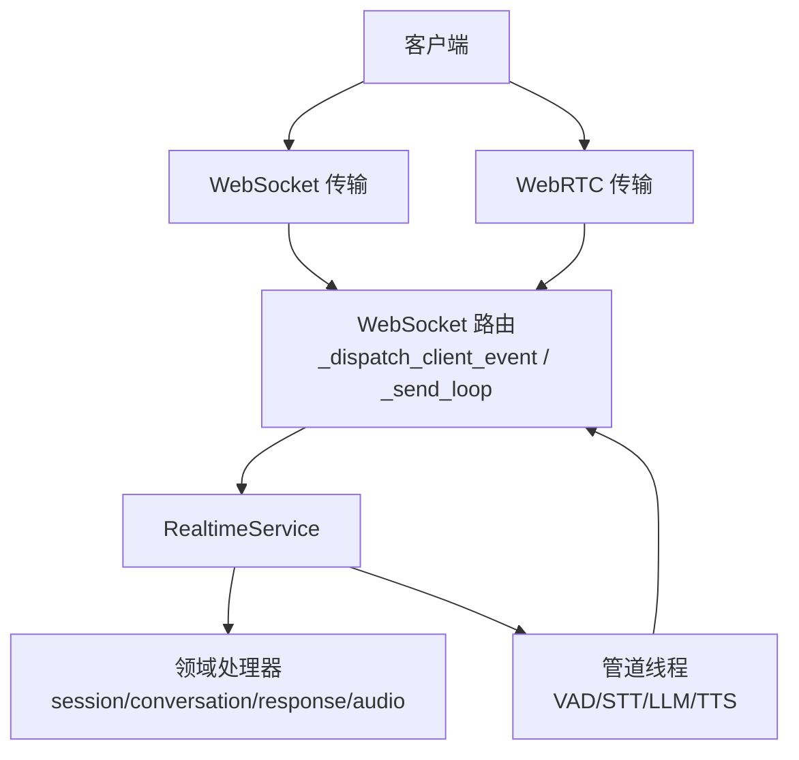
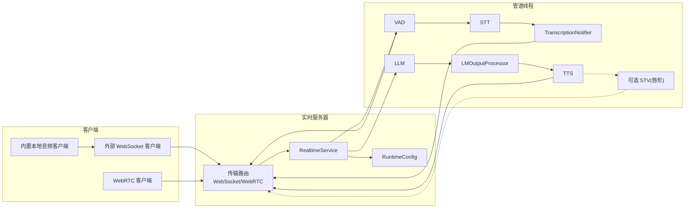
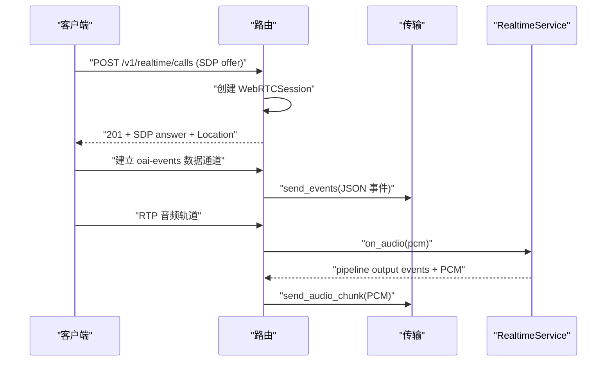
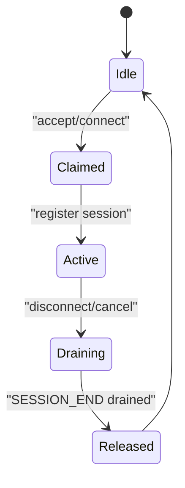
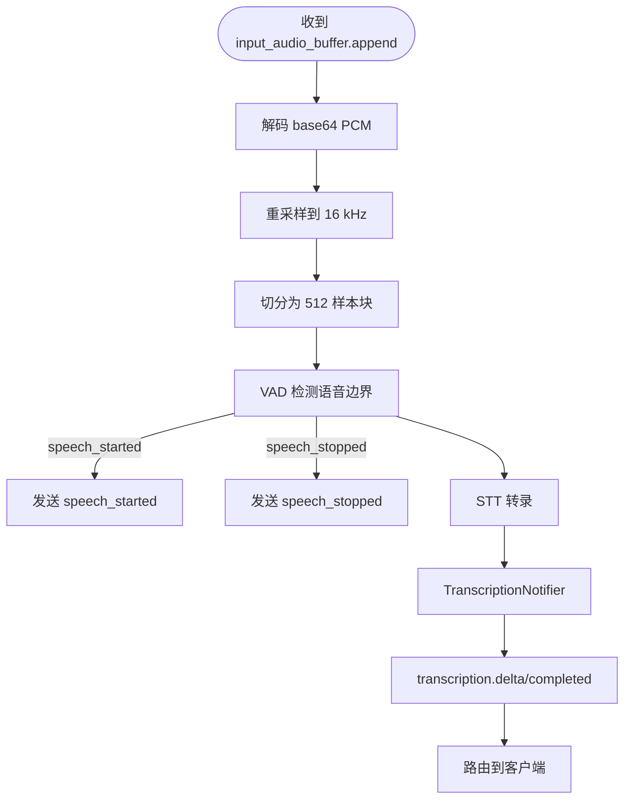
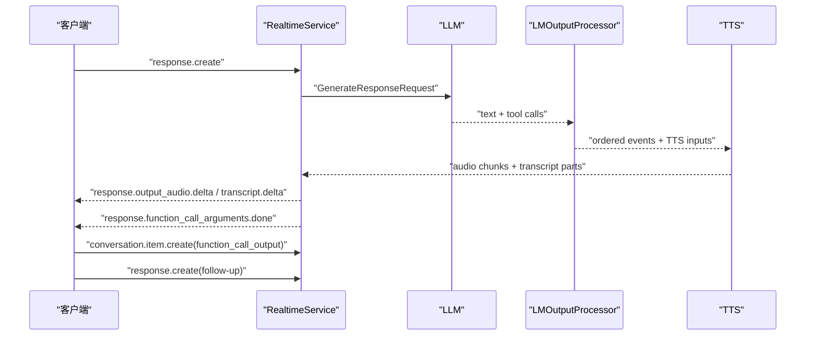
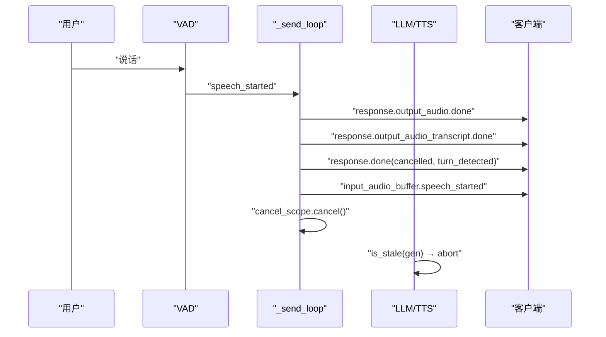
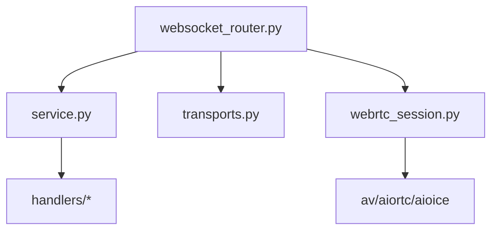

# OpenAI Realtime API

<cite>
**本文引用的文件**   
- [server.py](file://src/speech_to_speech/api/openai_realtime/server.py)
- [websocket_router.py](file://src/speech_to_speech/api/openai_realtime/websocket_router.py)
- [transports.py](file://src/speech_to_speech/api/openai_realtime/transports.py)
- [webrtc_session.py](file://src/speech_to_speech/api/openai_realtime/webrtc_session.py)
- [service.py](file://src/speech_to_speech/api/openai_realtime/service.py)
- [handlers/base.py](file://src/speech_to_speech/api/openai_realtime/handlers/base.py)
- [handlers/conversation.py](file://src/speech_to_speech/api/openai_realtime/handlers/conversation.py)
- [handlers/response.py](file://src/speech_to_speech/api/openai_realtime/handlers/response.py)
- [README.md](file://src/speech_to_speech/api/openai_realtime/README.md)
</cite>

## 目录
1. [简介](#简介)
2. [项目结构](#项目结构)
3. [核心组件](#核心组件)
4. [架构总览](#架构总览)
5. [详细组件分析](#详细组件分析)
6. [依赖关系分析](#依赖关系分析)
7. [性能与生产部署建议](#性能与生产部署建议)
8. [故障排查指南](#故障排查指南)
9. [结论](#结论)
10. [附录：协议与端点参考](#附录协议与端点参考)

## 简介
本仓库实现了面向浏览器、机器人或任意实时客户端的 OpenAI Realtime 协议服务。默认模型在本地运行，协议仅作为客户端接口；服务端负责会话管理、音频流处理、语音识别、大语言模型生成、文本转语音以及工具调用编排，并通过 WebSocket 和 WebRTC 两种传输方式对外暴露统一的事件协议。

该实现提供：
- 统一的 OpenAI Realtime 事件语义（会话、对话项、响应、转录、工具调用等）。
- 基于队列的管道线程模型，将 VAD、STT、LLM、LMOutputProcessor、TTS 等阶段解耦。
- 支持中断（barge-in）、取消、推测性轮次、工具调用自动跟进等高级特性。
- 可选唇形（viseme）输出扩展。
- 兼容官方 `@openai/agents` SDK 的 WebSocket 与 WebRTC 传输。

## 项目结构
OpenAI Realtime API 的核心位于 `src/speech_to_speech/api/openai_realtime`，关键目录与职责如下：
- `server.py`：FastAPI/uvicorn 进程封装，持有 PipelineUnit 池并启动服务。
- `websocket_router.py`：WebSocket/WebRTC 路由、会话生命周期、发送循环、客户端事件分发。
- `transports.py`：传输抽象层，定义 WebSocket 与 WebRTC 的统一发送接口。
- `webrtc_session.py`：WebRTC 媒体通道、RTP 帧调度、ICE/RTCP 适配。
- `service.py`：RealtimeService，协议与内部管道消息的转换器，维护 ConnState 与全局指标。
- `handlers/`：按领域拆分的处理器（会话、对话、响应、音频等），共享基础能力。
- `README.md`：协议事件、WebRTC、工具调用、中断处理、测试说明。

图表来源
- [websocket_router.py:531-634](file://src/speech_to_speech/api/openai_realtime/websocket_router.py#L531-L634)
- [transports.py:29-57](file://src/speech_to_speech/api/openai_realtime/transports.py#L29-L57)
- [webrtc_session.py:265-301](file://src/speech_to_speech/api/openai_realtime/webrtc_session.py#L265-L301)
- [service.py:355-391](file://src/speech_to_speech/api/openai_realtime/service.py#L355-L391)

章节来源
- [server.py:14-70](file://src/speech_to_speech/api/openai_realtime/server.py#L14-L70)
- [websocket_router.py:531-634](file://src/speech_to_speech/api/openai_realtime/websocket_router.py#L531-L634)
- [README.md:12-72](file://src/speech_to_speech/api/openai_realtime/README.md#L12-L72)

## 核心组件
- RealtimeServer：封装 uvicorn，维护 PipelineUnit 池，连接数受池大小限制。
- WebSocketRouter：创建 FastAPI 应用，注册 `/v1/realtime`、`/v1/realtime/calls` 等端点，维护每个 unit 的发送循环。
- SessionTransport：传输抽象，统一 `send_events`、`send_audio_chunk`、`discard_pending_audio`、`close`。
- WebSocketTransport：JSON over WebSocket，音频以 base64 delta 事件发送。
- WebRTCSession：SDP 握手、RTP 音频轨道、`oai-events` 数据通道承载 JSON 事件。
- RealtimeService：协议解析、ConnState 状态机、管道事件路由、使用量统计、延迟追踪。
- 领域处理器：
  - ConversationHandler：对话项注入、增量转录稳定化、最终转录完成。
  - ResponseHandler：响应生命周期、输出项顺序、工具调用事件、终端状态。
  - AudioHandler：输入音频缓冲、VAD 事件、输出音频编码。
  - BaseHandler：共享 conn_id 访问器、错误构造。

章节来源
- [server.py:14-70](file://src/speech_to_speech/api/openai_realtime/server.py#L14-L70)
- [websocket_router.py:531-634](file://src/speech_to_speech/api/openai_realtime/websocket_router.py#L531-L634)
- [transports.py:29-116](file://src/speech_to_speech/api/openai_realtime/transports.py#L29-L116)
- [webrtc_session.py:265-441](file://src/speech_to_speech/api/openai_realtime/webrtc_session.py#L265-L441)
- [service.py:355-391](file://src/speech_to_speech/api/openai_realtime/service.py#L355-L391)
- [handlers/base.py:18-59](file://src/speech_to_speech/api/openai_realtime/handlers/base.py#L18-L59)
- [handlers/conversation.py:80-152](file://src/speech_to_speech/api/openai_realtime/handlers/conversation.py#L80-L152)
- [handlers/response.py:75-183](file://src/speech_to_speech/api/openai_realtime/handlers/response.py#L75-L183)

## 架构总览
整体流程遵循“入站音频 → VAD → STT → LLM → LMOutputProcessor → TTS → 出站音频”的管道模型，同时通过 `RuntimeConfig` 共享会话配置（指令、工具、音色、VAD 阈值、音频格式等）。

图表来源
- [README.md:18-72](file://src/speech_to_speech/api/openai_realtime/README.md#L18-L72)

章节来源
- [README.md:18-72](file://src/speech_to_speech/api/openai_realtime/README.md#L18-L72)

## 详细组件分析

### 传输层：WebSocket 与 WebRTC
- WebSocket 传输：
  - 事件以 JSON 帧发送，音频以 `response.output_audio.delta` 的 base64 PCM 形式传输。
  - 不支持 `input_audio_buffer.append`（WebRTC 模式下会返回 `invalid_event_for_transport`）。
  - 客户端侧缓冲未播放音频，服务端不主动丢弃。
- WebRTC 传输：
  - SDP 握手通过 POST `/v1/realtime/calls`，返回 201 与 `Location` 头。
  - 音频走 RTP 媒体轨道（Opus 48 kHz），服务端在 16 kHz 管道速率与 48 kHz 之间进行有状态重采样。
  - JSON 事件通过 `oai-events` 数据通道传输，与 WebSocket 协议一致。
  - 支持 `output_audio_buffer.clear`，服务端可清空未播放缓冲区以实现打断静音。
  - ICE/TURN 可通过环境变量 `SPEECH_TO_SPEECH_ICE_SERVERS` 配置。

图表来源
- [websocket_router.py:794-800](file://src/speech_to_speech/api/openai_realtime/websocket_router.py#L794-L800)
- [webrtc_session.py:354-380](file://src/speech_to_speech/api/openai_realtime/webrtc_session.py#L354-L380)
- [transports.py:83-116](file://src/speech_to_speech/api/openai_realtime/transports.py#L83-L116)

章节来源
- [transports.py:29-116](file://src/speech_to_speech/api/openai_realtime/transports.py#L29-L116)
- [webrtc_session.py:59-77](file://src/speech_to_speech/api/openai_realtime/webrtc_session.py#L59-L77)
- [webrtc_session.py:265-441](file://src/speech_to_speech/api/openai_realtime/webrtc_session.py#L265-L441)
- [websocket_router.py:794-800](file://src/speech_to_speech/api/openai_realtime/websocket_router.py#L794-L800)

### 会话管理与连接建立
- 连接建立：
  - WebSocket：接受子协议 `realtime`，分配一个空闲 PipelineUnit，注册会话，发送 `session.created`。
  - WebRTC：SDP 握手成功后，数据通道打开时发送 `session.created`。
- 会话更新：
  - `session.update` 深合并到 `RuntimeConfig`，影响 VAD、LLM、TTS 运行时行为。
  - 服务端返回 `session.updated` 确认有效配置。
- 资源回收：
  - 断开连接后清理队列、重置 CancelScope、释放 Unit，等待 `SESSION_END` 传播完成，避免跨会话泄漏。

图表来源
- [websocket_router.py:574-634](file://src/speech_to_speech/api/openai_realtime/websocket_router.py#L574-L634)
- [websocket_router.py:294-339](file://src/speech_to_speech/api/openai_realtime/websocket_router.py#L294-L339)

章节来源
- [websocket_router.py:574-634](file://src/speech_to_speech/api/openai_realtime/websocket_router.py#L574-L634)
- [websocket_router.py:294-339](file://src/speech_to_speech/api/openai_realtime/websocket_router.py#L294-L339)

### 请求/响应与事件协议
- 客户端 → 服务端事件：
  - `input_audio_buffer.append`：流式 PCM，解码、重采样至 16 kHz、分块送入 VAD。
  - `input_audio_buffer.commit`：提交当前输入音频段。
  - `session.update`：深合并会话配置。
  - `conversation.item.create`：注入 `input_text` 或 `function_call_output`，不触发生成。
  - `conversation.item.delete`：删除对话项。
  - `conversation.item.truncate`：兼容性无操作（acknowledgement-free）。
  - `response.create`：触发 LLM 生成，支持 per-response `instructions`、`tool_choice`。
  - `response.cancel`：取消进行中或排队响应，恢复监听。
  - `output_audio_buffer.clear`：仅 WebRTC，清空服务端未播放音频缓冲。
- 服务端 → 客户端事件：
  - `session.created`、`session.updated`。
  - `error`：协议错误（如 `session_limit_reached`、`unknown_or_invalid_event`、`invalid_session_type`、`conversation_already_has_active_response` 等）。
  - `input_audio_buffer.speech_started`、`input_audio_buffer.speech_stopped`。
  - `conversation.item.created`、`conversation.item.deleted`。
  - `conversation.item.input_audio_transcription.delta`、`.completed`、`.failed`。
  - `speech_to_speech.input_audio_transcription.snapshot`（可选扩展）。
  - `response.created`、`response.done`（`completed`、`cancelled`、`incomplete`、`failed`）。
  - `response.output_audio.delta`、`response.output_audio.done`。
  - `response.output_audio_transcript.delta`、`response.output_audio_transcript.done`。
  - `response.function_call_arguments.done`。

章节来源
- [README.md:75-131](file://src/speech_to_speech/api/openai_realtime/README.md#L75-L131)
- [service.py:118-169](file://src/speech_to_speech/api/openai_realtime/service.py#L118-L169)

### 实时音频流处理
- 输入路径：
  - 接收 base64 PCM，解码为字节流，重采样到 16 kHz，切分为 512 样本块，放入 `recv_audio_chunks_queue`。
  - VAD 检测语音边界，发出 `speech_started`/`speech_stopped`，完整片段进入 STT。
- 输出路径：
  - TTS 输出有序事件与 PCM 音频块，经 `_send_loop` 编码为 `response.output_audio.delta`。
  - WebRTC 模式以 20 ms RTP 帧 pacing 输出，空闲时发送静音。
- 可选唇形（viseme）：
  - 启用 `--enable_visemes` 后，从 TTS 音频提取唇形，通过现有连接发送 `speech_to_speech.output_audio.visemes`。
  - WebSocket 保持顺序；WebRTC 不保证 viseme 先于对应音频到达。

图表来源
- [README.md:64-72](file://src/speech_to_speech/api/openai_realtime/README.md#L64-L72)
- [service.py:110-114](file://src/speech_to_speech/api/openai_realtime/service.py#L110-L114)

章节来源
- [README.md:64-72](file://src/speech_to_speech/api/openai_realtime/README.md#L64-L72)
- [service.py:110-114](file://src/speech_to_speech/api/openai_realtime/service.py#L110-L114)

### 文本流传输与转录稳定性
- 增量转录：
  - 内部部分转录是累积假设。在发送 `conversation.item.input_audio_transcription.delta` 前，比较前后假设在规范化词边界上的差异，保留已确认前缀，抑制不稳定尾部。
  - 若后续假设修订了已发出的词，则暂时抑制该部分，因为协议没有撤回事件；后续假设扩展已提交前缀后可继续流式输出。
- 权威完成：
  - `conversation.item.input_audio_transcription.completed` 是权威最终转录，客户端应替换同 `item_id` 的部分渲染。
- 可选快照扩展：
  - 客户端在 `session.update.extensions` 中声明 `speech_to_speech.input_audio_transcription.snapshot`。
  - 服务端每轮推送最新累积假设快照，用于显示；标准 delta 保持稳定提交文本。

章节来源
- [README.md:167-198](file://src/speech_to_speech/api/openai_realtime/README.md#L167-L198)
- [handlers/conversation.py:49-78](file://src/speech_to_speech/api/openai_realtime/handlers/conversation.py#L49-L78)
- [handlers/conversation.py:321-389](file://src/speech_to_speech/api/openai_realtime/handlers/conversation.py#L321-L389)

### 工具调用事件与自动跟进
- 两条路径：
  - 本地 LLM：工具签名转为 Python `inspect.Signature`，系统提示注入 `<code>` 包裹的工具调用，正则解析并校验。
  - OpenAI API：原生 `tools=` 参数，结构化 `function_call` 直接返回。
- 共同输出：
  - `LMOutputProcessor` 将文本与工具调用事件放置到同一队列，路由器翻译为：
    - `response.output_audio_transcript.delta`（文本块）+ 终端 `done`。
    - `response.function_call_arguments.done`（工具调用）。
- 工具结果流：
  - 客户端执行工具后发送 `conversation.item.create` 带 `function_call_output`。
  - 如需对结果说话，再发送 `response.create` 触发后续生成。
  - 对于“fire-and-forget”机器人动作，可在 `conversation.item.created` 后停止。
- 自动跟进优化：
  - 服务端在工具完成后发起推测性 follow-up 预取，减少用户显式 `response.create` 的延迟。
  - 客户端与服务端通过元数据标记自动 create，避免重复回复。

图表来源
- [README.md:230-264](file://src/speech_to_speech/api/openai_realtime/README.md#L230-L264)
- [handlers/response.py:351-406](file://src/speech_to_speech/api/openai_realtime/handlers/response.py#L351-L406)

章节来源
- [README.md:230-350](file://src/speech_to_speech/api/openai_realtime/README.md#L230-L350)
- [handlers/response.py:351-406](file://src/speech_to_speech/api/openai_realtime/handlers/response.py#L351-L406)

### 中断处理与取消机制
- 打断（barge-in）：
  - VAD 检测到用户说话，发送 `speech_started`。
  - `_send_loop` 优先处理文本事件，终止当前响应（`response.output_audio.done`、`response.output_audio_transcript.done`、`response.done(status=cancelled, reason=turn_detected)`），然后发送 `input_audio_buffer.speech_started`。
  - 使用 `CancelScope` 管理生成计数与丢弃窗口，确保旧生成被丢弃，新生成接管。
- 客户端取消：
  - `response.cancel` 清除队列、丢弃待处理音频、恢复监听。
- 中断门控：
  - 可由会话配置关闭（`turn_detection.interrupt_response=false`），此时用户说话仍会被转录但不打断响应。

图表来源
- [README.md:353-402](file://src/speech_to_speech/api/openai_realtime/README.md#L353-L402)

章节来源
- [README.md:353-402](file://src/speech_to_speech/api/openai_realtime/README.md#L353-L402)

## 依赖关系分析
- 模块耦合：
  - `websocket_router.py` 依赖 `service.py`、`transports.py`、`webrtc_session.py`、`handlers/*`。
  - `service.py` 聚合各处理器（session/conversation/response/audio/history）。
  - `webrtc_session.py` 依赖 aiortc、aioice、av，实现 WebRTC 媒体与信令。
- 外部依赖：
  - OpenAI Realtime 类型定义（`openai.types.realtime`）。
  - aiortc（可选 extra `webrtc`）。
  - av（音频重采样与编码）。
- 潜在循环依赖：
  - 通过抽象 `SessionTransport` 解耦传输实现，避免 router 与具体传输强耦合。
  - 处理器通过 `RealtimeBaseHandler` 共享基础能力，降低重复代码。

图表来源
- [websocket_router.py:1-59](file://src/speech_to_speech/api/openai_realtime/websocket_router.py#L1-L59)
- [service.py:54-91](file://src/speech_to_speech/api/openai_realtime/service.py#L54-L91)
- [webrtc_session.py:26-37](file://src/speech_to_speech/api/openai_realtime/webrtc_session.py#L26-L37)

章节来源
- [websocket_router.py:1-59](file://src/speech_to_speech/api/openai_realtime/websocket_router.py#L1-L59)
- [service.py:54-91](file://src/speech_to_speech/api/openai_realtime/service.py#L54-L91)
- [webrtc_session.py:26-37](file://src/speech_to_speech/api/openai_realtime/webrtc_session.py#L26-L37)

## 性能与生产部署建议
- 性能优化：
  - 使用 PipelineUnit 池限制并发会话，避免过载。
  - 音频分块 512 样本、16 kHz 管道速率，平衡延迟与 CPU 开销。
  - WebRTC 20 ms RTP 帧 pacing，减少抖动与拥塞。
  - 推测性轮次与工具调用预取减少端到端延迟。
- 负载均衡：
  - 多实例部署时，结合上游负载均衡器（如 Nginx/HAProxy）与 WebSocket 粘性会话。
  - WebRTC 需开放 UDP 端口或使用 TURN 中继。
- 安全考虑：
  - 管理员接口 `/admin/sessions/update` 需要 `S2S_ADMIN_TOKEN` Bearer 认证。
  - 限制连接池大小，防止资源耗尽。
  - 审计日志与错误分类（`errors_by_type`）便于监控异常。
- 监控与度量：
  - `/v1/usage` 聚合连接数、错误类型、token 用量、音频时长。
  - `/v1/pool` 查看单元状态（idle/active/draining/stuck）。

章节来源
- [websocket_router.py:636-695](file://src/speech_to_speech/api/openai_realtime/websocket_router.py#L636-L695)
- [websocket_router.py:717-792](file://src/speech_to_speech/api/openai_realtime/websocket_router.py#L717-L792)
- [README.md:405-436](file://src/speech_to_speech/api/openai_realtime/README.md#L405-L436)

## 故障排查指南
- 常见问题：
  - 连接被拒绝：所有会话槽位占用，返回 `session_limit_reached`。
  - 无效事件：未知或非法事件类型，返回 `unknown_or_invalid_event`。
  - WebRTC 模式误用 `input_audio_buffer.append`：返回 `invalid_event_for_transport`。
  - 转录失败：返回 `conversation.item.input_audio_transcription.failed`。
  - 响应失败：`response.done(status=failed)`，附带 `error` 事件。
- 调试建议：
  - 检查 `/v1/pool` 是否有 stuck 单元，可能因处理器线程卡死。
  - 查看 `/v1/usage` 的错误类型分布。
  - 启用详细日志，关注 `Skipped event: ws disconnected mid-send` 等异步关闭警告。

章节来源
- [websocket_router.py:583-594](file://src/speech_to_speech/api/openai_realtime/websocket_router.py#L583-L594)
- [websocket_router.py:425-435](file://src/speech_to_speech/api/openai_realtime/websocket_router.py#L425-L435)
- [handlers/conversation.py:451-484](file://src/speech_to_speech/api/openai_realtime/handlers/conversation.py#L451-L484)

## 结论
本实现提供了完整的 OpenAI Realtime API 服务端，涵盖 WebSocket 与 WebRTC 双传输、会话管理、实时音频流、文本流、工具调用、中断处理与生产级监控。其模块化设计（router/service/handlers/transports）便于扩展与维护，同时兼容官方 SDK，适合构建低延迟、高可用的语音助手或机器人后端。

## 附录：协议与端点参考

### 端点列表
- WebSocket：`ws://host:port/v1/realtime`
- WebRTC SDP 握手：`POST /v1/realtime/calls`
- 使用量查询：`GET /v1/usage`
- 池状态查询：`GET /v1/pool`
- 管理员会话热更新：`POST /admin/sessions/update`

章节来源
- [websocket_router.py:574-634](file://src/speech_to_speech/api/openai_realtime/websocket_router.py#L574-L634)
- [websocket_router.py:794-800](file://src/speech_to_speech/api/openai_realtime/websocket_router.py#L794-L800)
- [websocket_router.py:636-695](file://src/speech_to_speech/api/openai_realtime/websocket_router.py#L636-L695)
- [websocket_router.py:717-792](file://src/speech_to_speech/api/openai_realtime/websocket_router.py#L717-L792)

### 错误码与状态码
- HTTP 状态码：
  - 201：WebRTC SDP 握手成功。
  - 400/401/503：管理员接口错误（无效请求、未授权、禁用）。
- 协议错误类型：
  - `session_limit_reached`：会话槽位已满。
  - `unknown_or_invalid_event`：未知或非法事件。
  - `invalid_session_type`：无效会话类型。
  - `conversation_already_has_active_response`：已有活动响应。
  - `invalid_event_for_transport`：传输不支持的事件。
  - `tool_choice_not_supported`：不支持的工具选择类型。
  - `conversation_item_not_found`：对话项不存在。
  - `transcription_failed`：转录失败。
  - `tool_followup_already_answered`：工具结果已被使用。

章节来源
- [websocket_router.py:583-594](file://src/speech_to_speech/api/openai_realtime/websocket_router.py#L583-L594)
- [websocket_router.py:425-435](file://src/speech_to_speech/api/openai_realtime/websocket_router.py#L425-L435)
- [handlers/response.py:781-793](file://src/speech_to_speech/api/openai_realtime/handlers/response.py#L781-L793)
- [handlers/conversation.py:161-201](file://src/speech_to_speech/api/openai_realtime/handlers/conversation.py#L161-L201)