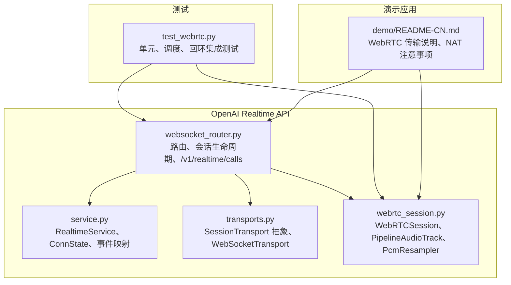
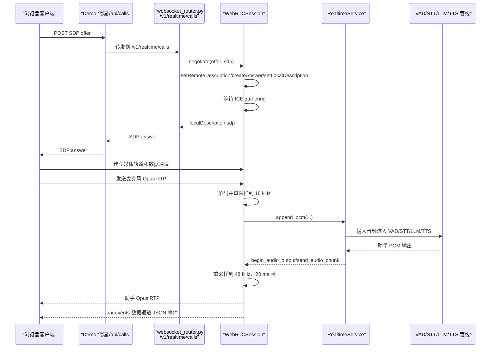
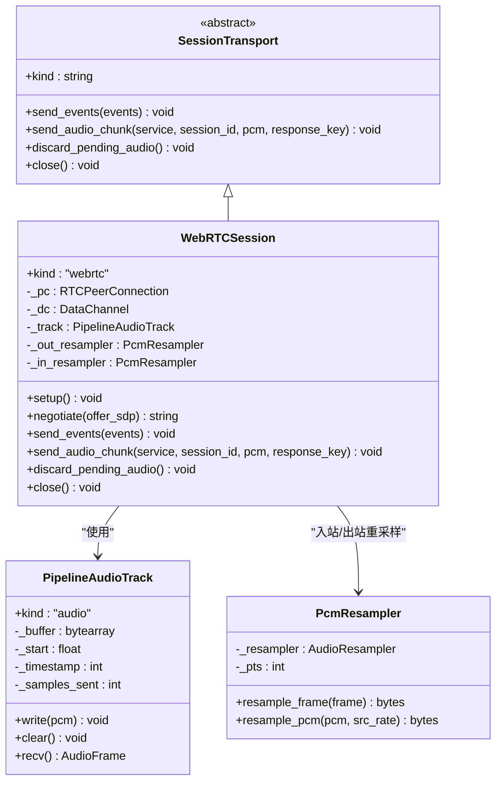
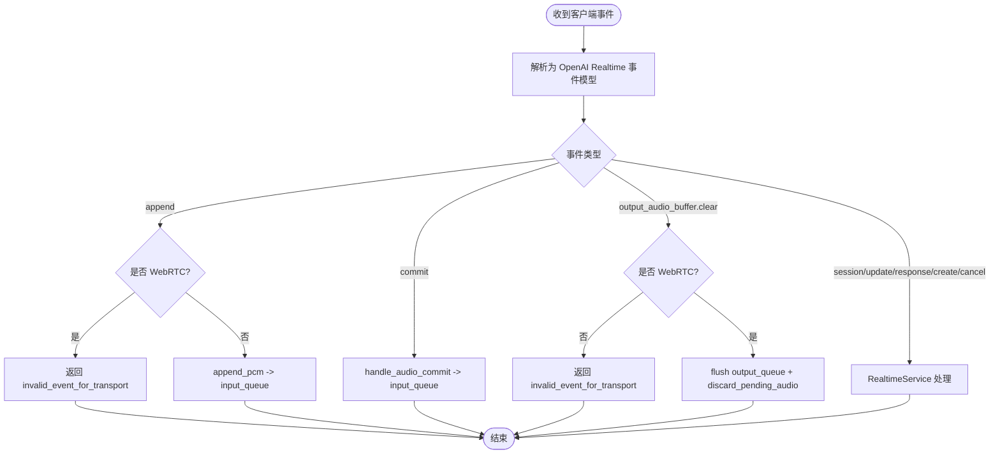
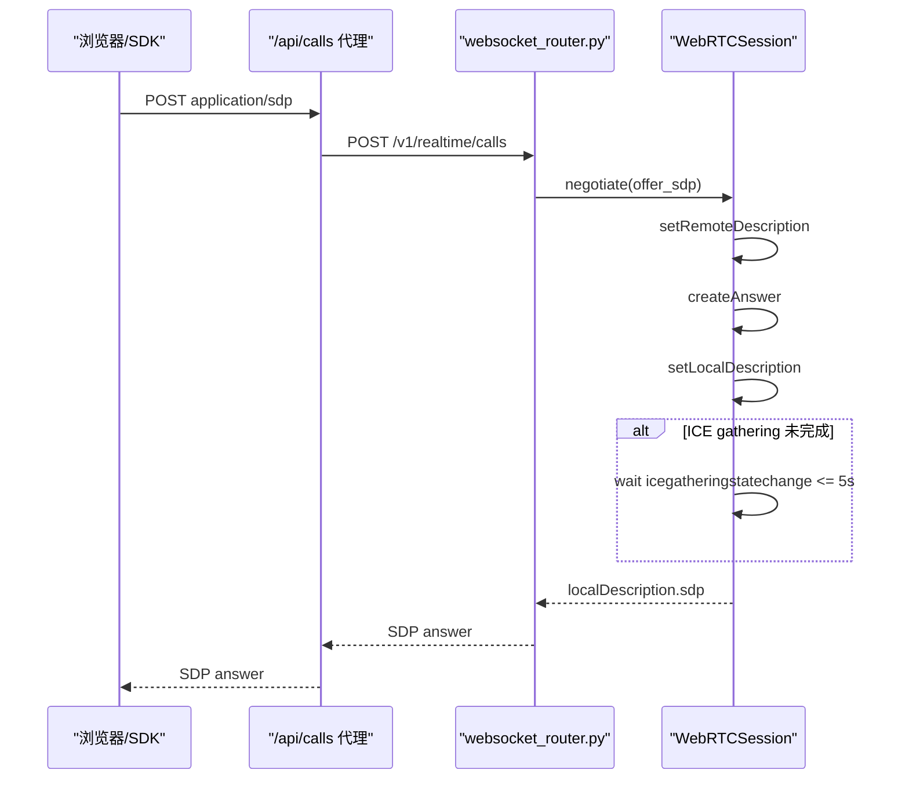
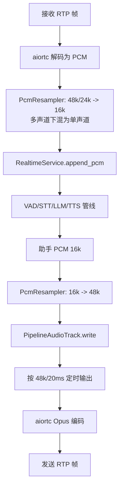
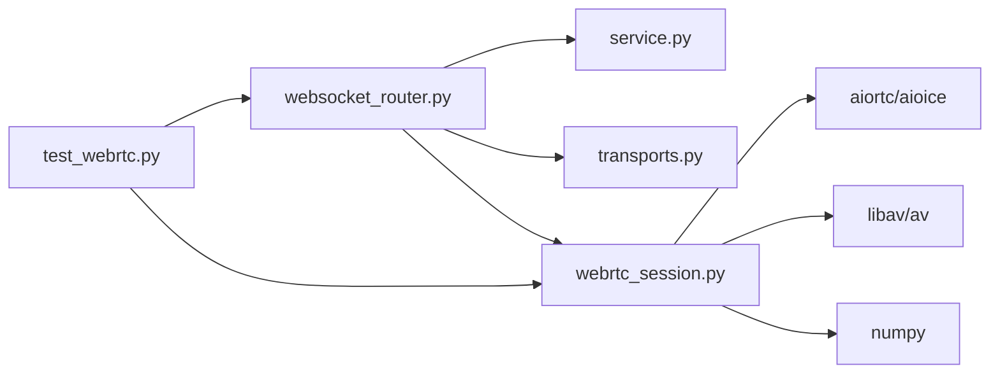
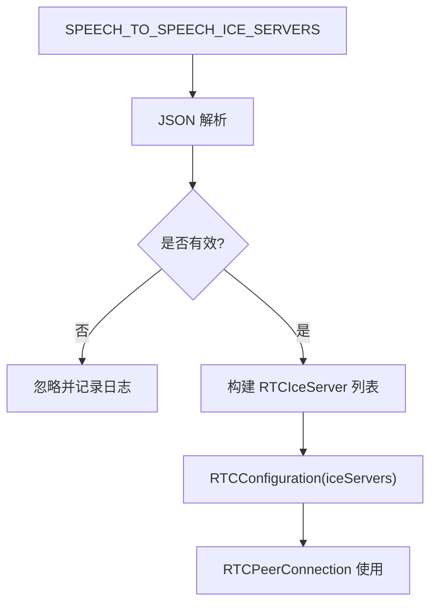

# WebRTC 支持

<cite>
**本文引用的文件**   
- [webrtc_session.py](file://src/speech_to_speech/api/openai_realtime/webrtc_session.py)
- [transports.py](file://src/speech_to_speech/api/openai_realtime/transports.py)
- [websocket_router.py](file://src/speech_to_speech/api/openai_realtime/websocket_router.py)
- [service.py](file://src/speech_to_speech/api/openai_realtime/service.py)
- [test_webrtc.py](file://tests/openai_realtime/test_webrtc.py)
- [demo README-CN.md](file://demo/README-CN.md)
</cite>

## 目录
1. [简介](#简介)
2. [项目结构](#项目结构)
3. [核心组件](#核心组件)
4. [架构总览](#架构总览)
5. [详细组件分析](#详细组件分析)
6. [依赖关系分析](#依赖关系分析)
7. [性能与延迟优化](#性能与延迟优化)
8. [STUN/TURN、NAT 穿透与防火墙兼容](#stunturnnat-穿透与防火墙兼容)
9. [浏览器端集成示例](#浏览器端集成示例)
10. [移动端适配指南](#移动端适配指南)
11. [故障排查](#故障排查)
12. [生产部署要点](#生产部署要点)
13. [结论](#结论)

## 简介
本仓库实现了基于 OpenAI Realtime GA 事件集的语音智能体服务，同时提供 WebSocket 和 WebRTC 两种传输。WebRTC 路径用于低延迟双向音频：麦克风音频通过 RTP 媒体轨道到达服务端，助手语音通过媒体轨道返回；所有会话控制、转写、工具调用等 JSON 信令统一走名为 `oai-events` 的数据通道。

WebRTC 实现的关键点包括：
- 使用 aiortc 建立 `RTCPeerConnection`，完成 SDP 协商与 ICE 候选收集。
- 将管道输出的 PCM 重采样到 48 kHz，按 20 ms 帧定时发送，保证播放节奏。
- 数据通道承载与 WebSocket 相同的 Realtime 协议事件，但音频不走 `input_audio_buffer.append`。
- 通过环境变量配置 STUN/TURN 服务器，支持跨网络 NAT 穿透。
- 提供连接超时、ICE 清理、中断刷新、RTP/RTCP 时间戳对齐等生产级健壮性机制。

## 项目结构
WebRTC 相关代码集中在 OpenAI Realtime API 层：

**图表来源**  
- [websocket_router.py:531-800](file://src/speech_to_speech/api/openai_realtime/websocket_router.py#L531-L800)
- [service.py:355-540](file://src/speech_to_speech/api/openai_realtime/service.py#L355-L540)
- [transports.py:1-116](file://src/speech_to_speech/api/openai_realtime/transports.py#L1-L116)
- [webrtc_session.py:1-541](file://src/speech_to_speech/api/openai_realtime/webrtc_session.py#L1-L541)
- [test_webrtc.py:1-80](file://tests/openai_realtime/test_webrtc.py#L1-L80)
- [demo README-CN.md:87-103](file://demo/README-CN.md#L87-L103)

**章节来源**  
- [websocket_router.py:531-800](file://src/speech_to_speech/api/openai_realtime/websocket_router.py#L531-L800)
- [transports.py:1-116](file://src/speech_to_speech/api/openai_realtime/transports.py#L1-L116)
- [webrtc_session.py:1-541](file://src/speech_to_speech/api/openai_realtime/webrtc_session.py#L1-L541)
- [demo README-CN.md:87-103](file://demo/README-CN.md#L87-L103)

## 核心组件
- **WebRTC 会话**：`WebRTCSession` 封装一个 `RTCPeerConnection`，负责 SDP 应答、数据通道收发、入站音频消费、出站音频轨道定时发送。
- **音频轨道**：`PipelineAudioTrack` 维护 PCM 缓冲，按 48 kHz、20 ms 帧向 aiortc 输出，并在空闲时推进 RTP 时间戳。
- **PCM 重采样器**：`PcmResampler` 使用 libswresample 做状态化重采样和多声道下混，避免分块边界伪影。
- **传输抽象**：`SessionTransport` 定义事件发送、音频发送、丢弃待播音频、关闭等接口；WebSocket 和 WebRTC 分别实现。
- **路由与服务**：`websocket_router.py` 暴露 `/v1/realtime` 和 `/v1/realtime/calls`；`service.py` 管理会话状态、事件解析、管线事件分发。

**章节来源**  
- [webrtc_session.py:79-106](file://src/speech_to_speech/api/openai_realtime/webrtc_session.py#L79-L106)
- [webrtc_session.py:108-204](file://src/speech_to_speech/api/openai_realtime/webrtc_session.py#L108-L204)
- [transports.py:29-57](file://src/speech_to_speech/api/openai_realtime/transports.py#L29-L57)
- [service.py:355-540](file://src/speech_to_speech/api/openai_realtime/service.py#L355-L540)

## 架构总览
WebRTC 在整体系统中的角色是“实时音频传输 + 同协议信令”的替代通道。WebSocket 路径用 JSON 帧携带音频增量；WebRTC 路径用 RTP 轨道传音频，用数据通道传 JSON 事件。

**图表来源**  
- [websocket_router.py:794-800](file://src/speech_to_speech/api/openai_realtime/websocket_router.py#L794-L800)
- [webrtc_session.py:354-380](file://src/speech_to_speech/api/openai_realtime/webrtc_session.py#L354-L380)
- [webrtc_session.py:400-418](file://src/speech_to_speech/api/openai_realtime/webrtc_session.py#L400-L418)
- [service.py:518-540](file://src/speech_to_speech/api/openai_realtime/service.py#L518-L540)

## 详细组件分析

### WebRTC 会话与媒体流
`WebRTCSession` 继承自 `SessionTransport`，对外暴露：
- `setup()`：添加音频轨道、注册 datachannel、track、connectionstatechange 回调。
- `negotiate(offer_sdp)`：设置远端描述、创建答案、等待 ICE gathering，返回本地 SDP。
- `send_events()`：通过 `oai-events` 数据通道发送 JSON 事件。
- `send_audio_chunk()`：调用 `begin_audio_output` 生成协议事件，并将 PCM 写入 `PipelineAudioTrack`。
- `discard_pending_audio()`：清空轨道缓冲并重置编码器状态，确保打断可立即生效。

**图表来源**  
- [transports.py:29-57](file://src/speech_to_speech/api/openai_realtime/transports.py#L29-L57)
- [webrtc_session.py:79-106](file://src/speech_to_speech/api/openai_realtime/webrtc_session.py#L79-L106)
- [webrtc_session.py:108-204](file://src/speech_to_speech/api/openai_realtime/webrtc_session.py#L108-L204)
- [webrtc_session.py:265-418](file://src/speech_to_speech/api/openai_realtime/webrtc_session.py#L265-L418)

**章节来源**  
- [webrtc_session.py:265-418](file://src/speech_to_speech/api/openai_realtime/webrtc_session.py#L265-L418)
- [webrtc_session.py:108-204](file://src/speech_to_speech/api/openai_realtime/webrtc_session.py#L108-L204)
- [webrtc_session.py:79-106](file://src/speech_to_speech/api/openai_realtime/webrtc_session.py#L79-L106)

### 信令交换与事件路由
WebSocket 和 WebRTC 共用 `_dispatch_client_event`，根据 `transport_kind` 限制某些事件：
- `input_audio_buffer.append`：仅 WebSocket 有效；WebRTC 模式下返回错误。
- `output_audio_buffer.clear`：仅 WebRTC 有效；用于清空服务端已缓冲但未播放的音频。
- `session.update`、`response.create`、`response.cancel` 等事件由 `RealtimeService` 处理。

**图表来源**  
- [websocket_router.py:392-512](file://src/speech_to_speech/api/openai_realtime/websocket_router.py#L392-L512)
- [service.py:477-540](file://src/speech_to_speech/api/openai_realtime/service.py#L477-L540)

**章节来源**  
- [websocket_router.py:392-512](file://src/speech_to_speech/api/openai_realtime/websocket_router.py#L392-L512)

### SDP 协商与 ICE 候选流程
WebRTC 握手通过 HTTP POST `/v1/realtime/calls` 完成：
1. 浏览器或 SDK 将 SDP offer 发送到 demo 的 `/api/calls` 代理。
2. 代理转发到后端 `/v1/realtime/calls`。
3. 服务端设置远端描述、创建答案、设置本地描述。
4. 如果 ICE gathering 未完成，等待最多 5 秒；超时也返回部分 SDP。
5. 启动连接看门狗：30 秒内未 connected 则释放会话。

**图表来源**  
- [websocket_router.py:794-800](file://src/speech_to_speech/api/openai_realtime/websocket_router.py#L794-L800)
- [webrtc_session.py:354-380](file://src/speech_to_speech/api/openai_realtime/webrtc_session.py#L354-L380)

**章节来源**  
- [webrtc_session.py:354-380](file://src/speech_to_speech/api/openai_realtime/webrtc_session.py#L354-L380)
- [websocket_router.py:794-800](file://src/speech_to_speech/api/openai_realtime/websocket_router.py#L794-L800)

### 音频编码、重采样与播放节奏
- 入站：浏览器发送 Opus RTP，aiortc 解码后由 `PcmResampler` 转为 16 kHz 单声道 PCM，再交给 `RealtimeService.append_pcm`。
- 出站：管道输出 16 kHz PCM，`PcmResampler` 重采样到 48 kHz，`PipelineAudioTrack` 按 20 ms 帧推送，并通过时间戳对齐 RTP 时钟。
- 中断：`discard_pending_audio` 清空缓冲并重置编码器 lookahead，防止被打断的语音继续出现。

**图表来源**  
- [webrtc_session.py:79-106](file://src/speech_to_speech/api/openai_realtime/webrtc_session.py#L79-L106)
- [webrtc_session.py:108-204](file://src/speech_to_speech/api/openai_realtime/webrtc_session.py#L108-L204)
- [webrtc_session.py:400-418](file://src/speech_to_speech/api/openai_realtime/webrtc_session.py#L400-L418)
- [service.py:512-540](file://src/speech_to_speech/api/openai_realtime/service.py#L512-L540)

**章节来源**  
- [webrtc_session.py:79-106](file://src/speech_to_speech/api/openai_realtime/webrtc_session.py#L79-L106)
- [webrtc_session.py:108-204](file://src/speech_to_speech/api/openai_realtime/webrtc_session.py#L108-L204)
- [webrtc_session.py:400-418](file://src/speech_to_speech/api/openai_realtime/webrtc_session.py#L400-L418)

## 依赖关系分析
- `websocket_router.py` 是 FastAPI 应用入口，负责 WebSocket 和 WebRTC 路由、会话池、发送循环。
- `service.py` 提供 `RealtimeService`，集中管理 ConnState、事件解析、管线事件分发、用量统计。
- `transports.py` 定义传输抽象，WebSocket 和 WebRTC 实现不同音频/事件投递方式。
- `webrtc_session.py` 依赖 aiortc、aioice、av、numpy，实现 WebRTC 专用逻辑。
- `test_webrtc.py` 覆盖重采样、轨道 pacing、RTP/RTCP 行为、事件分发、回环集成。

**图表来源**  
- [websocket_router.py:1-76](file://src/speech_to_speech/api/openai_realtime/websocket_router.py#L1-L76)
- [webrtc_session.py:16-37](file://src/speech_to_speech/api/openai_realtime/webrtc_session.py#L16-L37)
- [test_webrtc.py:30-54](file://tests/openai_realtime/test_webrtc.py#L30-L54)

**章节来源**  
- [websocket_router.py:1-76](file://src/speech_to_speech/api/openai_realtime/websocket_router.py#L1-L76)
- [webrtc_session.py:16-37](file://src/speech_to_speech/api/openai_realtime/webrtc_session.py#L16-L37)
- [test_webrtc.py:30-54](file://tests/openai_realtime/test_webrtc.py#L30-L54)

## 性能与延迟优化
- **20 ms 帧与 48 kHz 采样率**：平衡编码延迟与播放平滑度。
- **状态化重采样**：避免分块边界引入的伪影，降低音质损失。
- **RTP 时间戳对齐**：空闲时跳过整帧，保持时钟连续性，减少抖动。
- **RTCP SR/RR 切换**：无音频时发送 RR，有音频时发送 SR，报告 NTP/RTP 时间。
- **编码器 lookahead 清理**：打断时重置编码器状态，防止旧语音残留。
- **连接看门狗**：30 秒未 connected 释放会话，避免资源泄漏。
- **ICE 清理**：关闭时取消检查任务、关闭底层连接，避免僵尸任务。

**章节来源**  
- [webrtc_session.py:44-56](file://src/speech_to_speech/api/openai_realtime/webrtc_session.py#L44-L56)
- [webrtc_session.py:152-204](file://src/speech_to_speech/api/openai_realtime/webrtc_session.py#L152-L204)
- [webrtc_session.py:206-263](file://src/speech_to_speech/api/openai_realtime/webrtc_session.py#L206-L263)
- [webrtc_session.py:506-513](file://src/speech_to_speech/api/openai_realtime/webrtc_session.py#L506-L513)
- [webrtc_session.py:444-504](file://src/speech_to_speech/api/openai_realtime/webrtc_session.py#L444-L504)

## STUN/TURN、NAT 穿透与防火墙兼容
- **ICE 服务器配置**：通过环境变量 `SPEECH_TO_SPEECH_ICE_SERVERS` 传入 JSON 列表，每个条目是 `RTCIceServer` 参数，例如 stun 或 turn URL、用户名、凭据。
- **默认行为**：未配置时返回 None，使用 aiortc 默认值；demo 文档指出默认只提供 host 候选，适合本机或局域网。
- **跨互联网**：需要在前端设置 `RTC_ICE_SERVERS`，在后端设置 `SPEECH_TO_SPEECH_ICE_SERVERS`；没有 TURN 中继时对称 NAT 可能仍无法连接。
- **CORS 与代理**：demo 的 `/api/calls` 代理只转发 SDP offer，不转发任意 URL，避免开放代理风险。

**图表来源**  
- [webrtc_session.py:59-76](file://src/speech_to_speech/api/openai_realtime/webrtc_session.py#L59-L76)
- [demo README-CN.md:100-103](file://demo/README-CN.md#L100-L103)

**章节来源**  
- [webrtc_session.py:59-76](file://src/speech_to_speech/api/openai_realtime/webrtc_session.py#L59-L76)
- [demo README-CN.md:100-103](file://demo/README-CN.md#L100-L103)

## 浏览器端集成示例
仓库中的演示应用使用官方 `@openai/agents` SDK 的 `RealtimeSession`，并支持 WebSocket 或 WebRTC 传输。WebRTC 模式下：
- SDK 将麦克风轨道添加到 `RTCPeerConnection`。
- SDP offer 通过同源 `/api/calls` 代理转发到后端 `/v1/realtime/calls`。
- 数据通道使用相同 Realtime 协议，但音频走媒体轨道。
- 需要安装 `speech-to-speech[webrtc]`，否则 `/v1/realtime/calls` 返回 501。

参考路径：
- [demo README-CN.md:87-103](file://demo/README-CN.md#L87-L103)
- [demo README-CN.md:109-118](file://demo/README-CN.md#L109-L118)

**章节来源**  
- [demo README-CN.md:87-103](file://demo/README-CN.md#L87-L103)
- [demo README-CN.md:109-118](file://demo/README-CN.md#L109-L118)

## 移动端适配指南
- **HTTPS 或 localhost**：浏览器要求 HTTPS 或 `localhost` 才能访问麦克风/摄像头。
- **设备权限**：移动端需用户授权麦克风；部分浏览器对自动播放有限制。
- **NAT 与移动网络**：移动网络常处于对称 NAT，必须配置 TURN 服务器；仅 STUN 不够。
- **音频格式**：WebRTC 使用 Opus，移动端浏览器通常原生支持；注意采样率和声道数。
- **后台限制**：iOS/Android 可能对后台音频播放或麦克风采集有额外限制，需在 UI 中引导用户保持前台。

**章节来源**  
- [demo README-CN.md:67-68](file://demo/README-CN.md#L67-L68)
- [demo README-CN.md:100-103](file://demo/README-CN.md#L100-L103)

## 故障排查
常见问题与定位方法：
- **SDP 协商失败**：检查 `/v1/realtime/calls` 是否返回 501（缺少 webrtc 扩展），或 ICE gathering 超时。
- **无法连接**：确认 STUN/TURN 配置正确；对称 NAT 需要 TURN；检查 CORS 和代理是否只转发固定 URL。
- **音频无声**：检查数据通道是否打开、媒体轨道是否接收；查看 `send_audio_chunk` 是否被调用。
- **打断无效**：确认 `output_audio_buffer.clear` 仅在 WebRTC 模式有效；检查 `discard_pending_audio` 是否执行。
- **连接泄漏**：查看 30 秒连接看门狗是否触发；检查 ICE 清理逻辑。
- **事件乱序**：数据通道消息通过队列串行消费，避免 `session.update` 与 `response.create` 乱序。

**章节来源**  
- [webrtc_session.py:354-380](file://src/speech_to_speech/api/openai_realtime/webrtc_session.py#L354-L380)
- [webrtc_session.py:506-513](file://src/speech_to_speech/api/openai_realtime/webrtc_session.py#L506-L513)
- [webrtc_session.py:444-504](file://src/speech_to_speech/api/openai_realtime/webrtc_session.py#L444-L504)
- [websocket_router.py:425-461](file://src/speech_to_speech/api/openai_realtime/websocket_router.py#L425-L461)

## 生产部署要点
- **启用 webrtc 扩展**：`pip install "speech-to-speech[webrtc]"`，否则 WebRTC 端点不可用。
- **配置 ICE 服务器**：在生产环境设置 `SPEECH_TO_SPEECH_ICE_SERVERS`，包含 STUN/TURN。
- **监控会话池**：通过 `/v1/pool` 观察活跃、draining、stuck 状态，及时处理卡住的处理器。
- **用量统计**：`/v1/usage` 聚合每单元用量，包括 token、音频时长、错误类型。
- **安全**：demo 代理只转发固定 URL，避免开放代理；生产应限制 CORS 和认证。
- **负载均衡**：当前仅 WebSocket 支持负载均衡模式；WebRTC 直连后端。

**章节来源**  
- [demo README-CN.md:95](file://demo/README-CN.md#L95)
- [websocket_router.py:636-695](file://src/speech_to_speech/api/openai_realtime/websocket_router.py#L636-L695)
- [demo README-CN.md:113-118](file://demo/README-CN.md#L113-L118)

## 结论
该项目的 WebRTC 实现以 OpenAI Realtime GA 事件集为基础，将音频与信令分离：音频走 RTP 媒体轨道，信令走 `oai-events` 数据通道。它提供了完整的 SDP 协商、ICE 候选收集、PCM 重采样、播放节奏控制、RTCP 时间戳对齐、连接看门狗和 ICE 清理机制。配合 demo 应用的浏览器集成和测试用例，可作为生产级低延迟语音交互的基础设施。部署时需重点关注 STUN/TURN 配置、NAT 穿透、CORS 与安全策略，并通过监控端点观察会话状态与用量。