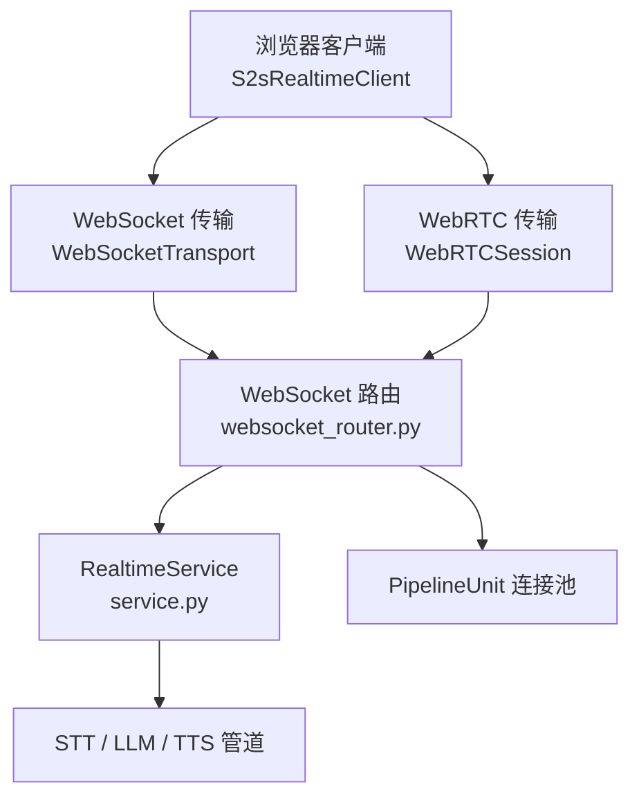
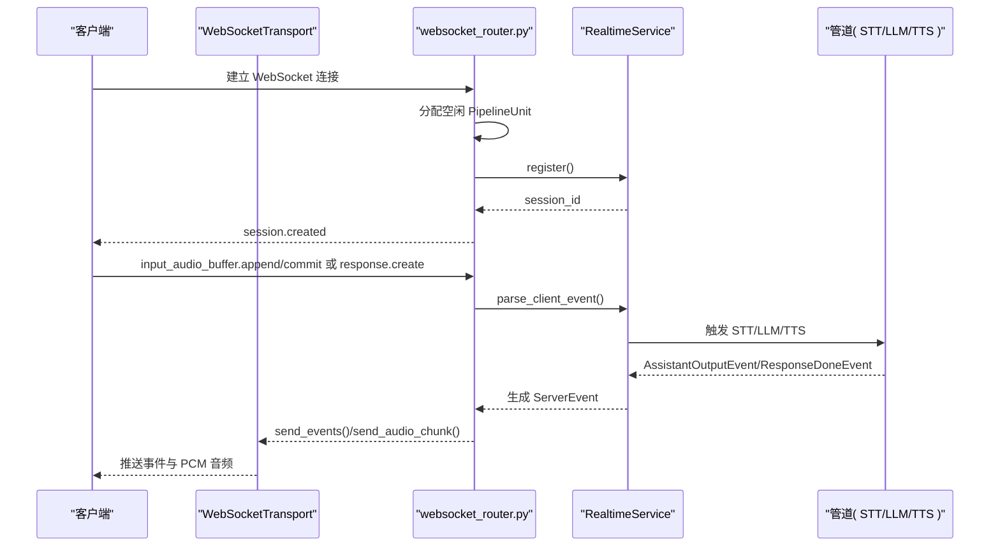
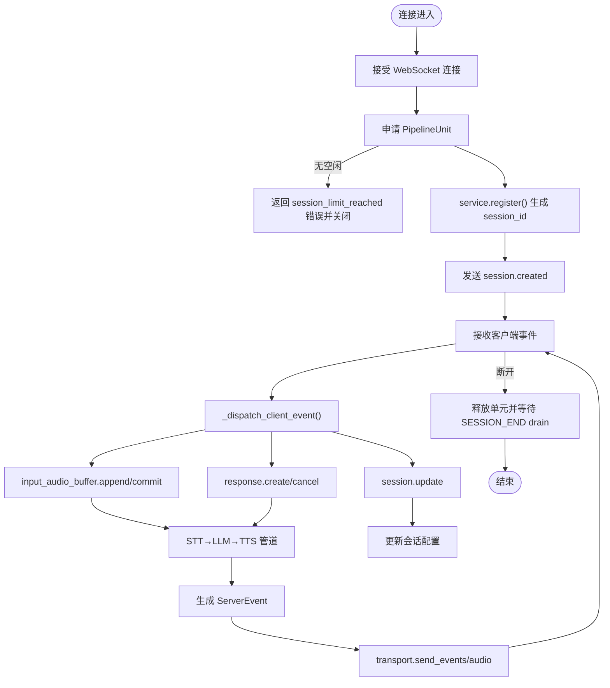
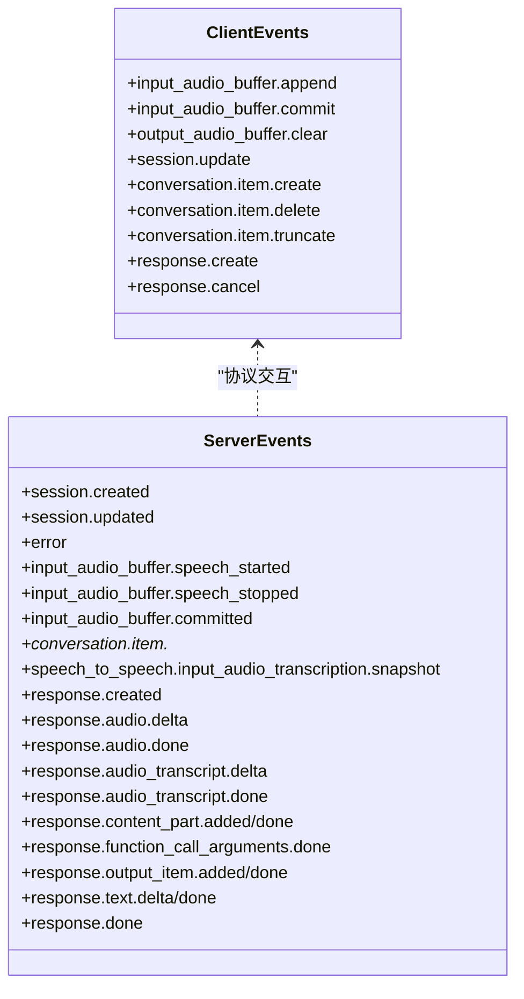
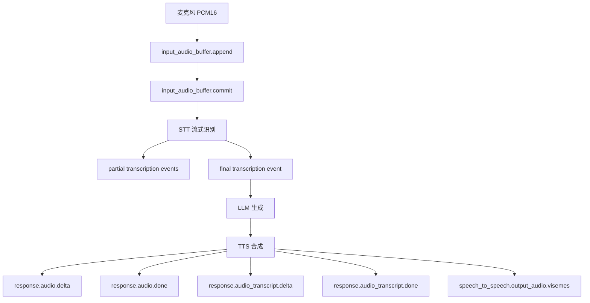
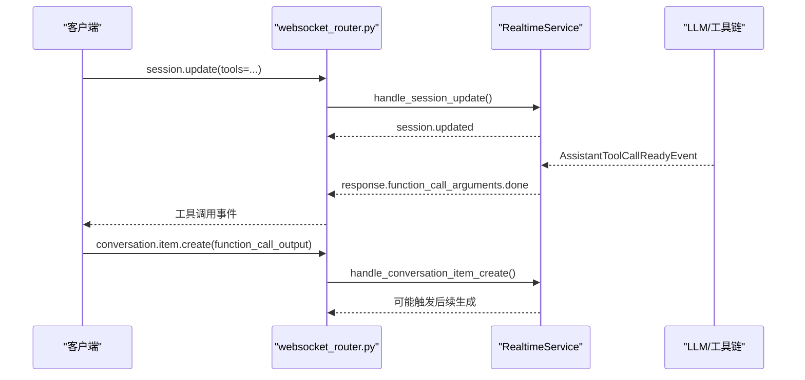
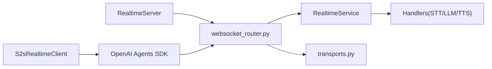
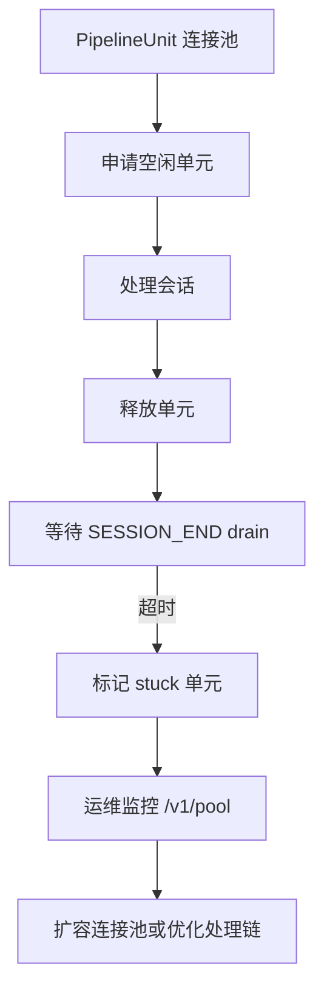

# WebSocket API

<cite>
**本文引用的文件**   
- [server.py](file://src/speech_to_speech/api/openai_realtime/server.py)
- [websocket_router.py](file://src/speech_to_speech/api/openai_realtime/websocket_router.py)
- [transports.py](file://src/speech_to_speech/api/openai_realtime/transports.py)
- [service.py](file://src/speech_to_speech/api/openai_realtime/service.py)
- [s2s-realtime-client.js](file://demo/s2s-realtime-client.js)
- [codec.js](file://demo/ws/codec.js)
- [user-audio-recorder.js](file://demo/ws/user-audio-recorder.js)
</cite>

## 目录
1. [简介](#简介)
2. [项目结构](#项目结构)
3. [核心组件](#核心组件)
4. [架构总览](#架构总览)
5. [详细组件分析](#详细组件分析)
6. [依赖关系分析](#依赖关系分析)
7. [性能与连接池优化](#性能与连接池优化)
8. [故障排查指南](#故障排查指南)
9. [结论](#结论)
10. [附录：协议与端点速查](#附录协议与端点速查)

## 简介
本文件面向使用 OpenAI Realtime 兼容接口的语音到语音（Speech-to-Speech）服务，系统性说明 WebSocket API 的连接建立、消息格式、事件类型、生命周期管理、音频流传输、文本流处理、工具调用实时通信模式，以及连接池、负载均衡和错误处理。服务端基于 FastAPI + uvicorn，提供两类传输通道：
- WebSocket 传输：事件与 PCM 音频以 JSON 帧传输。
- WebRTC 传输：事件通过 `oai-events` 数据通道传输，音频走 RTP 媒体轨道。

客户端示例位于 demo 目录，封装了 OpenAI Agents SDK 的 RealtimeSession，支持 WebSocket 与 WebRTC 两种模式，并实现麦克风采集、播放缓冲、VAD 打断、转写展示、工具调用等能力。

## 项目结构
OpenAI Realtime API 相关代码集中在 `src/speech_to_speech/api/openai_realtime` 下，关键文件职责如下：
- `server.py`：启动 uvicorn 服务器，持有 PipelineUnit 连接池，暴露 `/v1/realtime` WebSocket 入口。
- `websocket_router.py`：FastAPI 路由层，负责会话注册、事件分发、WebRTC SDP 握手、发送循环、连接释放与资源隔离。
- `transports.py`：抽象传输接口，提供 WebSocket 传输实现，定义事件与音频发送契约。
- `service.py`：RealtimeService，将 OpenAI Realtime 协议事件映射为内部管道消息，维护会话状态、响应生命周期、用量统计与延迟追踪。
- `demo/s2s-realtime-client.js`：浏览器端演示客户端，封装连接、音频采集播放、事件监听、工具调用。
- `demo/ws/codec.js`：纯函数工具，用于从 response.done 提取助手转录文本。
- `demo/ws/user-audio-recorder.js`：记录已发送给后端的 PCM16 片段，按 VAD 边界生成可回放 WAV。

**图表来源**
- [websocket_router.py:531-634](file://src/speech_to_speech/api/openai_realtime/websocket_router.py#L531-L634)
- [transports.py:29-116](file://src/speech_to_speech/api/openai_realtime/transports.py#L29-L116)
- [service.py:355-446](file://src/speech_to_speech/api/openai_realtime/service.py#L355-L446)

**章节来源**
- [server.py:14-70](file://src/speech_to_speech/api/openai_realtime/server.py#L14-L70)
- [websocket_router.py:531-634](file://src/speech_to_speech/api/openai_realtime/websocket_router.py#L531-L634)
- [transports.py:29-116](file://src/speech_to_speech/api/openai_realtime/transports.py#L29-L116)
- [service.py:355-446](file://src/speech_to_speech/api/openai_realtime/service.py#L355-L446)

## 核心组件
- RealtimeServer：封装 uvicorn 服务器与 PipelineUnit 连接池，提供 `/v1/realtime` WebSocket 入口。
- WebSocketRouter：FastAPI 应用构建器，包含 WebSocket 路由、WebRTC calls 端点、管理员端点、发送循环、连接释放逻辑。
- SessionTransport：传输抽象，统一 send_events、send_audio_chunk、discard_pending_audio、close。
- WebSocketTransport：JSON-over-WebSocket 实现，音频以 base64 delta 事件发送。
- RealtimeService：协议解析、会话状态、响应生命周期、音频编码、用量统计、延迟追踪、管道事件分发。
- S2sRealtimeClient：浏览器端演示客户端，封装 OpenAI Agents SDK，支持 WebSocket/WebRTC、音频采集播放、VAD 打断、工具调用、转录展示。

**章节来源**
- [server.py:14-70](file://src/speech_to_speech/api/openai_realtime/server.py#L14-L70)
- [websocket_router.py:531-634](file://src/speech_to_speech/api/openai_realtime/websocket_router.py#L531-L634)
- [transports.py:29-116](file://src/speech_to_speech/api/openai_realtime/transports.py#L29-L116)
- [service.py:355-446](file://src/speech_to_speech/api/openai_realtime/service.py#L355-L446)
- [s2s-realtime-client.js:89-250](file://demo/s2s-realtime-client.js#L89-L250)

## 架构总览
下图展示一次典型 WebSocket 连接的端到端流程：客户端发起连接，服务端分配 PipelineUnit，注册会话，发送 session.created；随后客户端发送输入音频或文本，服务端经 STT→LLM→TTS 管道处理后，通过 transport 推送音频与文本事件。

**图表来源**
- [websocket_router.py:574-634](file://src/speech_to_speech/api/openai_realtime/websocket_router.py#L574-L634)
- [websocket_router.py:937-1268](file://src/speech_to_speech/api/openai_realtime/websocket_router.py#L937-L1268)
- [transports.py:83-116](file://src/speech_to_speech/api/openai_realtime/transports.py#L83-L116)
- [service.py:477-560](file://src/speech_to_speech/api/openai_realtime/service.py#L477-L560)

## 详细组件分析

### WebSocket 连接建立与会话生命周期
- 连接建立：客户端连接 `/v1/realtime`，服务端接受子协议 `realtime`，创建 `WebSocketTransport`，从连接池申请一个空闲 `PipelineUnit`。
- 会话注册：调用 `unit.service.register()` 生成 `session_id`，发送 `session.created`。
- 事件循环：轮询接收 JSON 事件，分发给 `_dispatch_client_event`，根据事件类型调用 `RealtimeService` 对应处理器。
- 断开释放：捕获 `WebSocketDisconnect`，清理队列，入队 `SESSION_END`，异步等待 drain，最终释放 unit 供新连接复用。

**图表来源**
- [websocket_router.py:574-634](file://src/speech_to_speech/api/openai_realtime/websocket_router.py#L574-L634)
- [websocket_router.py:347-390](file://src/speech_to_speech/api/openai_realtime/websocket_router.py#L347-L390)
- [websocket_router.py:937-1268](file://src/speech_to_speech/api/openai_realtime/websocket_router.py#L937-L1268)

**章节来源**
- [websocket_router.py:574-634](file://src/speech_to_speech/api/openai_realtime/websocket_router.py#L574-L634)
- [websocket_router.py:347-390](file://src/speech_to_speech/api/openai_realtime/websocket_router.py#L347-L390)

### 消息协议与事件类型
服务端支持的客户端事件类型由 `_EVENT_TYPE_TO_MODEL` 映射表定义，包括：
- `input_audio_buffer.append`：追加音频缓冲区。
- `input_audio_buffer.commit`：提交音频缓冲区，触发 STT。
- `output_audio_buffer.clear`：清空未播放音频（仅 WebRTC）。
- `session.update`：更新会话配置（voice、instructions、tools 等）。
- `conversation.item.create/delete/truncate`：操作对话项。
- `response.create`：显式请求生成响应。
- `response.cancel`：取消当前响应。

服务端事件类型在 `ServerEvent` 联合类型中声明，涵盖会话、转写、响应生命周期、音频与文本增量、工具调用、错误等。

**图表来源**
- [service.py:118-169](file://src/speech_to_speech/api/openai_realtime/service.py#L118-L169)
- [websocket_router.py:408-511](file://src/speech_to_speech/api/openai_realtime/websocket_router.py#L408-L511)

**章节来源**
- [service.py:118-169](file://src/speech_to_speech/api/openai_realtime/service.py#L118-L169)
- [websocket_router.py:408-511](file://src/speech_to_speech/api/openai_realtime/websocket_router.py#L408-L511)

### 音频流传输与文本流处理
- 音频流：
  - WebSocket：PCM16 音频被编码为 `response.audio.delta` 事件，base64 传输；批量聚合以减少帧数。
  - WebRTC：音频走 RTP 媒体轨道，事件走 `oai-events` 数据通道。
- 文本流：
  - 用户侧转写：`conversation.item.input_audio_transcription.delta/completed/failed`。
  - 助手侧转录：`response.audio_transcript.delta/done`、`response.output_audio_transcript.delta/done`。
  - 快照扩展：`speech_to_speech.input_audio_transcription.snapshot`。
- 唇形同步：`speech_to_speech.output_audio.visemes` 携带 viseme 时间轴。

**图表来源**
- [websocket_router.py:937-1268](file://src/speech_to_speech/api/openai_realtime/websocket_router.py#L937-L1268)
- [service.py:798-961](file://src/speech_to_speech/api/openai_realtime/service.py#L798-L961)
- [transports.py:83-116](file://src/speech_to_speech/api/openai_realtime/transports.py#L83-L116)

**章节来源**
- [websocket_router.py:937-1268](file://src/speech_to_speech/api/openai_realtime/websocket_router.py#L937-L1268)
- [service.py:798-961](file://src/speech_to_speech/api/openai_realtime/service.py#L798-L961)
- [transports.py:83-116](file://src/speech_to_speech/api/openai_realtime/transports.py#L83-L116)

### 工具调用事件的实时通信模式
- 工具定义：客户端通过 `session.update` 或 SDK 工具定义注入工具。
- 工具调用：LLM 输出 `AssistantToolCallReadyEvent`，服务端生成 `response.function_call_arguments.done` 等事件。
- 工具执行：客户端收到工具调用事件后执行外部函数，并通过 `conversation.item.create` 添加工具输出。
- 后续生成：服务端可能自动预取后续响应，保持上下文一致性。

**图表来源**
- [websocket_router.py:463-511](file://src/speech_to_speech/api/openai_realtime/websocket_router.py#L463-L511)
- [service.py:595-608](file://src/speech_to_speech/api/openai_realtime/service.py#L595-L608)
- [service.py:610-680](file://src/speech_to_speech/api/openai_realtime/service.py#L610-L680)

**章节来源**
- [websocket_router.py:463-511](file://src/speech_to_speech/api/openai_realtime/websocket_router.py#L463-L511)
- [service.py:595-608](file://src/speech_to_speech/api/openai_realtime/service.py#L595-L608)
- [service.py:610-680](file://src/speech_to_speech/api/openai_realtime/service.py#L610-L680)

### 认证机制与安全
- WebSocket 连接：默认无需鉴权；可通过反向代理或网关层添加认证。
- WebRTC calls：SDP 握手通过 HTTP POST `/v1/realtime/calls`，需 Content-Type `application/sdp`。
- 管理员接口：`/admin/sessions/update` 要求 `Authorization: Bearer <token>`，token 来自环境变量 `S2S_ADMIN_TOKEN`，使用 HMAC 比较校验。

**章节来源**
- [websocket_router.py:717-792](file://src/speech_to_speech/api/openai_realtime/websocket_router.py#L717-L792)
- [websocket_router.py:794-915](file://src/speech_to_speech/api/openai_realtime/websocket_router.py#L794-L915)

### 错误处理
- 连接拒绝：当所有 PipelineUnit 被占用时，返回 `session_limit_reached` 错误。
- 事件无效：未知或非法事件类型返回 `unknown_or_invalid_event`。
- 传输不匹配：`input_audio_buffer.append` 在 WebRTC 模式下不支持，`output_audio_buffer.clear` 在 WebSocket 模式下不支持。
- 管道失败：`ResponseFailedEvent` 转换为 `error` 事件，保留响应生命周期。
- 用量统计：错误类型累计至全局指标，便于监控。

**章节来源**
- [websocket_router.py:583-594](file://src/speech_to_speech/api/openai_realtime/websocket_router.py#L583-L594)
- [websocket_router.py:418-460](file://src/speech_to_speech/api/openai_realtime/websocket_router.py#L418-L460)
- [service.py:1006-1057](file://src/speech_to_speech/api/openai_realtime/service.py#L1006-L1057)

## 依赖关系分析
- `RealtimeServer` 依赖 `create_app` 构建 FastAPI 应用，并启动 uvicorn。
- `websocket_router` 依赖 `RealtimeService` 进行协议解析与状态管理，依赖 `transports.SessionTransport` 抽象。
- `transports.WebSocketTransport` 依赖 FastAPI WebSocket 对象。
- `service.RealtimeService` 依赖内部管道事件模型与历史、音频、会话、响应处理器。
- 客户端 `S2sRealtimeClient` 依赖 OpenAI Agents SDK 的 `RealtimeSession`、`OpenAIRealtimeWebSocket`、`OpenAIRealtimeWebRTC`。

**图表来源**
- [server.py:14-70](file://src/speech_to_speech/api/openai_realtime/server.py#L14-L70)
- [websocket_router.py:531-634](file://src/speech_to_speech/api/openai_realtime/websocket_router.py#L531-L634)
- [transports.py:29-116](file://src/speech_to_speech/api/openai_realtime/transports.py#L29-L116)
- [service.py:355-446](file://src/speech_to_speech/api/openai_realtime/service.py#L355-L446)
- [s2s-realtime-client.js:89-250](file://demo/s2s-realtime-client.js#L89-L250)

**章节来源**
- [server.py:14-70](file://src/speech_to_speech/api/openai_realtime/server.py#L14-L70)
- [websocket_router.py:531-634](file://src/speech_to_speech/api/openai_realtime/websocket_router.py#L531-L634)
- [transports.py:29-116](file://src/speech_to_speech/api/openai_realtime/transports.py#L29-L116)
- [service.py:355-446](file://src/speech_to_speech/api/openai_realtime/service.py#L355-L446)
- [s2s-realtime-client.js:89-250](file://demo/s2s-realtime-client.js#L89-L250)

## 性能与连接池优化
- 连接池管理：
  - 每个 `PipelineUnit` 代表一个独立会话槽位，空闲时可被新连接抢占。
  - 连接池满时返回 `session_limit_reated` 错误，建议前端重试或提示用户。
  - 连接释放路径等待 `SESSION_END` 传播，超时后单元进入“stuck”状态，便于运维观察。
- 音频批处理：
  - 服务端将多个 PCM 片段合并为最大 6400 字节的批次，减少网络帧数。
  - WebSocket 模式下音频以 base64 传输，注意解码开销。
- 中断与丢弃：
  - 检测到用户说话时，若启用 `interrupt_response`，则取消当前响应并清空队列。
  - WebRTC 模式下通过 `discard_pending_audio` 清空轨道缓冲，确保打断生效。
- 用量与延迟：
  - `GlobalUsageMetrics` 累计 token、音频时长、错误数。
  - `TurnLatencyStore` 跟踪每响应的延迟锚点，支持智能等待与断言。

**图表来源**
- [websocket_router.py:561-572](file://src/speech_to_speech/api/openai_realtime/websocket_router.py#L561-L572)
- [websocket_router.py:294-340](file://src/speech_to_speech/api/openai_realtime/websocket_router.py#L294-L340)
- [websocket_router.py:660-695](file://src/speech_to_speech/api/openai_realtime/websocket_router.py#L660-L695)

**章节来源**
- [websocket_router.py:561-572](file://src/speech_to_speech/api/openai_realtime/websocket_router.py#L561-L572)
- [websocket_router.py:294-340](file://src/speech_to_speech/api/openai_realtime/websocket_router.py#L294-L340)
- [websocket_router.py:660-695](file://src/speech_to_speech/api/openai_realtime/websocket_router.py#L660-L695)
- [service.py:175-215](file://src/speech_to_speech/api/openai_realtime/service.py#L175-L215)

## 故障排查指南
- 连接被拒绝：检查连接池是否已满，查看 `/v1/pool` 状态，必要时扩容或优化处理链。
- 事件无效：确认客户端发送的事件类型与负载符合 OpenAI Realtime 规范。
- 传输不匹配：WebRTC 模式下不使用 `input_audio_buffer.append`，WebSocket 模式下不使用 `output_audio_buffer.clear`。
- 音频卡顿：检查 PCM 采样率、批量大小、播放缓冲策略；WebSocket 模式下注意 base64 解码开销。
- 工具调用异常：确认工具定义与执行逻辑正确，检查 `conversation.item.create` 的输出格式。
- 用量统计异常：查看 `get_usage()` 返回的全局指标，定位错误类型与 token 消耗。

**章节来源**
- [websocket_router.py:583-594](file://src/speech_to_speech/api/openai_realtime/websocket_router.py#L583-L594)
- [websocket_router.py:418-460](file://src/speech_to_speech/api/openai_realtime/websocket_router.py#L418-L460)
- [service.py:1046-1057](file://src/speech_to_speech/api/openai_realtime/service.py#L1046-L1057)

## 结论
本 WebSocket API 基于 OpenAI Realtime 协议，提供稳定的语音到语音实时通信能力。通过连接池、传输抽象与服务状态管理，系统实现了高并发、低延迟、可扩展的语音交互体验。客户端示例展示了完整的连接、音频采集播放、事件监听与工具调用流程。运维层面可通过 `/v1/pool` 与用量统计监控连接健康与资源使用，结合负载均衡与连接池扩容策略，保障服务稳定性与性能。

## 附录：协议与端点速查
- WebSocket 端点：`ws://host:port/v1/realtime`
- WebRTC 端点：`POST /v1/realtime/calls`（SDP offer），`DELETE /v1/realtime/calls/{call_id}`
- 管理员端点：`POST /admin/sessions/update`（Bearer Token）
- 用量查询：`GET /v1/usage`
- 连接池状态：`GET /v1/pool`

**章节来源**
- [websocket_router.py:574-634](file://src/speech_to_speech/api/openai_realtime/websocket_router.py#L574-L634)
- [websocket_router.py:794-935](file://src/speech_to_speech/api/openai_realtime/websocket_router.py#L794-L935)
- [websocket_router.py:636-695](file://src/speech_to_speech/api/openai_realtime/websocket_router.py#L636-L695)