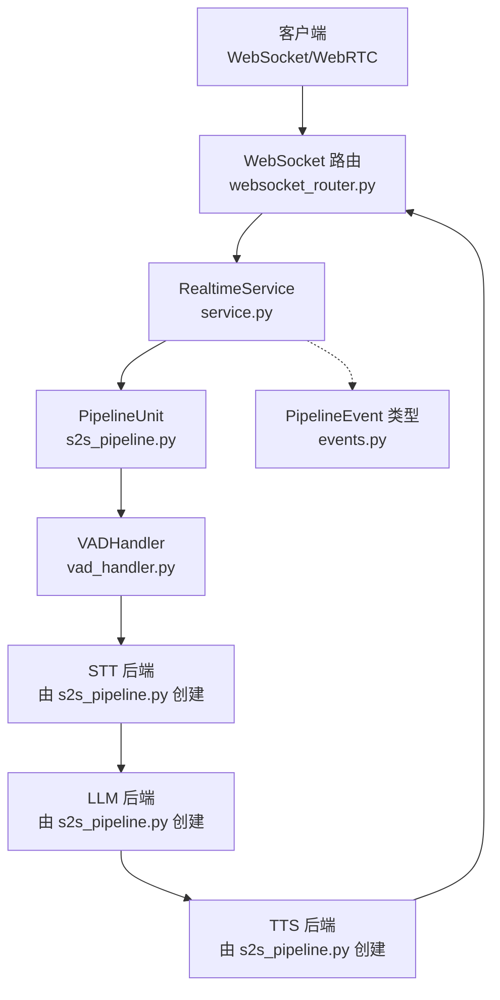
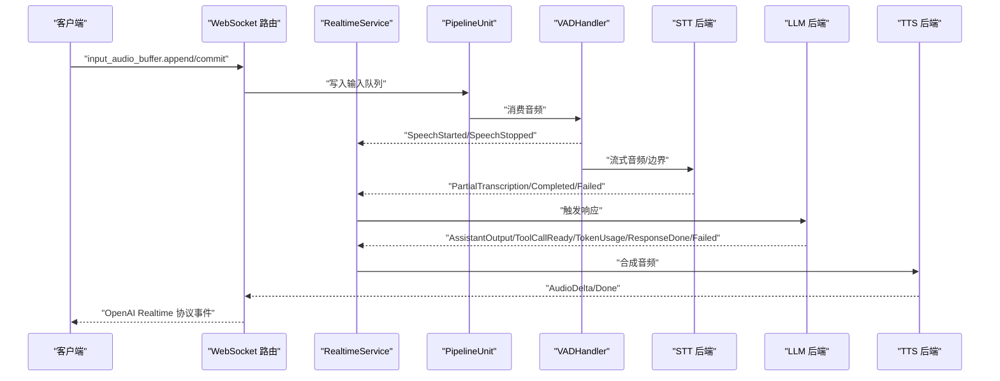
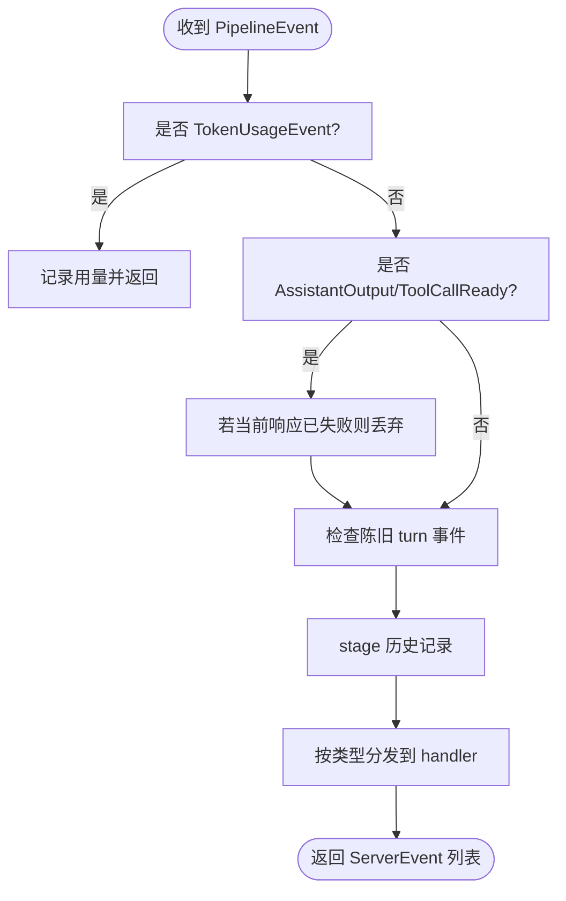
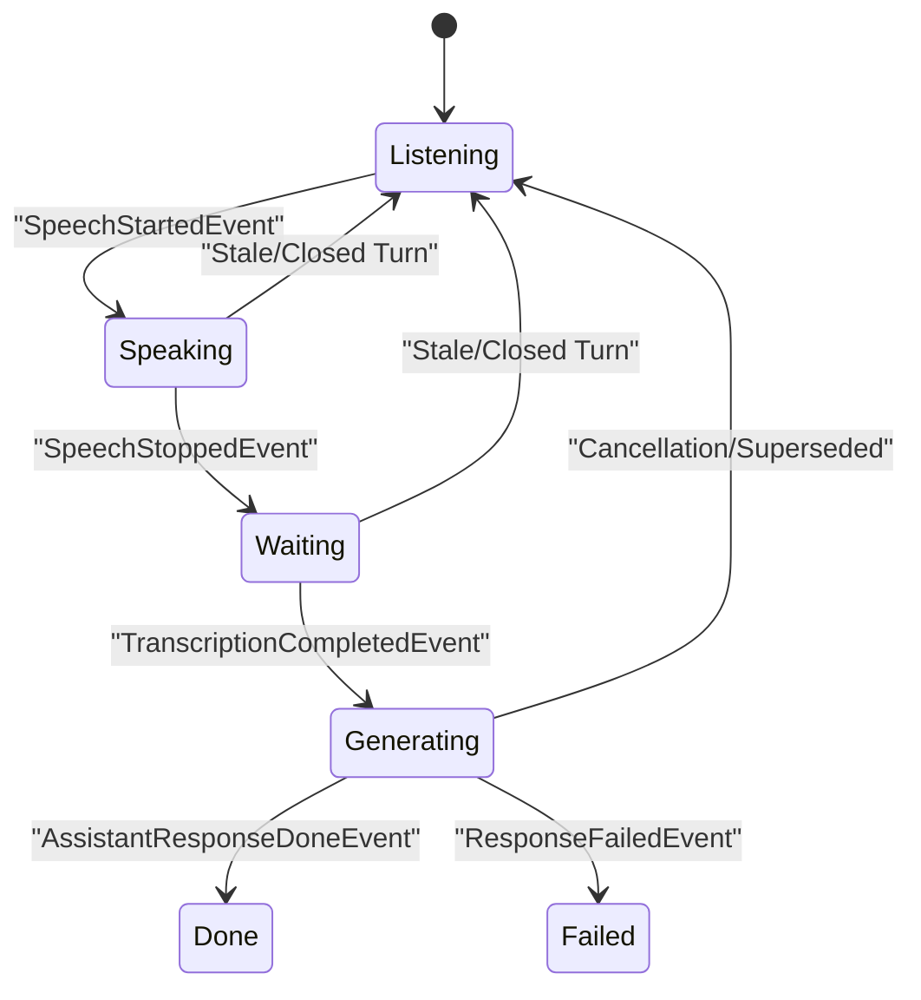
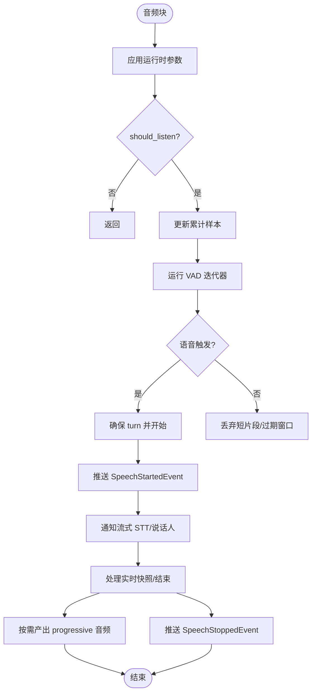
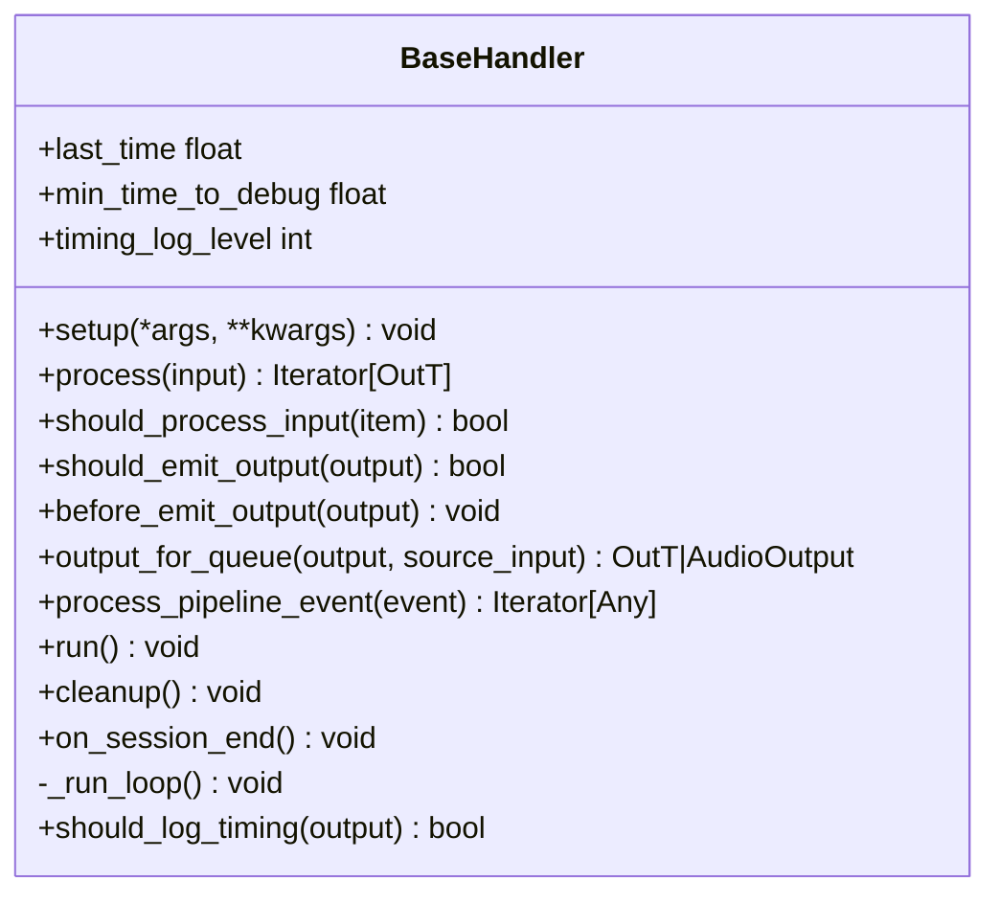
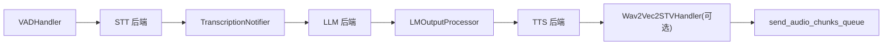

# 事件处理

<cite>
**本文引用的文件**   
- [s2s_pipeline.py](file://src/speech_to_speech/s2s_pipeline.py)
- [baseHandler.py](file://src/speech_to_speech/baseHandler.py)
- [events.py](file://src/speech_to_speech/pipeline/events.py)
- [service.py](file://src/speech_to_speech/api/openai_realtime/service.py)
- [websocket_router.py](file://src/speech_to_speech/api/openai_realtime/websocket_router.py)
- [vad_handler.py](file://src/speech_to_speech/VAD/vad_handler.py)
</cite>

## 目录
1. [引言](#引言)
2. [项目结构](#项目结构)
3. [核心组件](#核心组件)
4. [架构总览](#架构总览)
5. [详细组件分析](#详细组件分析)
6. [依赖关系分析](#依赖关系分析)
7. [性能与内存管理](#性能与内存管理)
8. [监控、日志与故障诊断](#监控日志与故障诊断)
9. [自定义事件处理器开发指南](#自定义事件处理器开发指南)
10. [结论](#结论)

## 引言
本文件面向“语音到语音”实时对话系统的事件处理机制，围绕事件驱动架构、异步消息传递、事件订阅与路由展开。系统以 VAD（语音活动检测）为输入入口，依次经过 STT（语音转文本）、LLM（大语言模型）、TTS（文本转语音），并通过 RealtimeService 将内部 PipelineEvent 转换为 OpenAI Realtime 协议事件，最终通过 WebSocket/WebRTC 通道返回客户端。文档重点说明：
- 事件类型与顺序
- 事件处理器注册与路由
- 错误恢复与背压控制
- 批处理、内存管理与性能优化
- 生产环境监控、日志与排障实践
- 如何扩展自定义事件处理器

## 项目结构
事件相关代码主要分布在以下模块：
- `pipeline/events.py`：定义所有内部 PipelineEvent 类型。
- `VAD/vad_handler.py`：实现 VAD 事件生产者。
- `baseHandler.py`：通用处理器基类，提供线程化 run loop、控制消息、会话结束等能力。
- `api/openai_realtime/service.py`：RealtimeService，负责事件分发、协议转换与会话状态。
- `api/openai_realtime/websocket_router.py`：WebSocket/WebRTC 路由、发送循环、队列清理与释放策略。
- `s2s_pipeline.py`：构建管道单元、连接各 Handler、创建服务与服务器。

**图表来源**
- [s2s_pipeline.py:382-574](file://src/speech_to_speech/s2s_pipeline.py#L382-L574)
- [service.py:355-403](file://src/speech_to_speech/api/openai_realtime/service.py#L355-L403)
- [websocket_router.py:531-634](file://src/speech_to_speech/api/openai_realtime/websocket_router.py#L531-L634)
- [vad_handler.py:58-209](file://src/speech_to_speech/VAD/vad_handler.py#L58-L209)
- [events.py:26-228](file://src/speech_to_speech/pipeline/events.py#L26-L228)

**章节来源**
- [s2s_pipeline.py:382-574](file://src/speech_to_speech/s2s_pipeline.py#L382-L574)
- [service.py:355-403](file://src/speech_to_speech/api/openai_realtime/service.py#L355-L403)
- [websocket_router.py:531-634](file://src/speech_to_speech/api/openai_realtime/websocket_router.py#L531-L634)
- [vad_handler.py:58-209](file://src/speech_to_speech/VAD/vad_handler.py#L58-L209)
- [events.py:26-228](file://src/speech_to_speech/pipeline/events.py#L26-L228)

## 核心组件
- PipelineEvent 体系：统一的事件基类与具体事件类型，包括 VAD、转录、LLM 输出、工具调用、响应完成/失败、Token 用量等。
- BaseHandler：通用处理器基类，封装线程生命周期、控制消息、会话结束、异常记录、计时统计。
- VADHandler：语音活动检测，产生 SpeechStarted/SpeechStopped 事件，并支持流式音频快照、说话人标注、智能回合检测。
- RealtimeService：事件分发中心，维护 ConnState，将 PipelineEvent 映射为 OpenAI Realtime 协议事件。
- WebSocketRouter：客户端事件解析、队列清理、发送循环、会话释放与隔离。
- s2s_pipeline：构建管道单元，串联 VAD → STT → LLM → TTS，注入上下文与共享状态。

**章节来源**
- [events.py:26-228](file://src/speech_to_speech/pipeline/events.py#L26-L228)
- [baseHandler.py:32-242](file://src/speech_to_speech/baseHandler.py#L32-L242)
- [vad_handler.py:58-209](file://src/speech_to_speech/VAD/vad_handler.py#L58-L209)
- [service.py:355-403](file://src/speech_to_speech/api/openai_realtime/service.py#L355-L403)
- [websocket_router.py:531-634](file://src/speech_to_speech/api/openai_realtime/websocket_router.py#L531-L634)
- [s2s_pipeline.py:382-574](file://src/speech_to_speech/s2s_pipeline.py#L382-L574)

## 架构总览
事件驱动架构的关键路径如下：
1. 客户端通过 WebSocket/WebRTC 发送音频或控制事件。
2. websocket_router 解析客户端事件，写入对应 PipelineUnit 的输入队列。
3. VADHandler 消费音频，产出 SpeechStarted/SpeechStopped 及可选的渐进式音频片段。
4. STT 将语音转为文本，TranscriptionNotifier 产出 PartialTranscription/TranscriptionCompleted/TranscriptionFailed。
5. LLM 生成助手输出，LMOutputProcessor 产出 AssistantOutputEvent、AssistantToolCallReadyEvent、TokenUsageEvent、AssistantResponseDoneEvent、ResponseGenerationDoneEvent、ResponseFailedEvent。
6. TTS 合成音频，必要时经 STV 生成视位信息。
7. RealtimeService 将内部事件转换为 OpenAI Realtime 协议事件，由 websocket_router 的发送循环写出。

**图表来源**
- [websocket_router.py:392-510](file://src/speech_to_speech/api/openai_realtime/websocket_router.py#L392-L510)
- [vad_handler.py:565-668](file://src/speech_to_speech/VAD/vad_handler.py#L565-L668)
- [service.py:610-669](file://src/speech_to_speech/api/openai_realtime/service.py#L610-L669)
- [s2s_pipeline.py:407-574](file://src/speech_to_speech/s2s_pipeline.py#L407-L574)

## 详细组件分析

### 事件类型与语义
- VAD 事件
  - SpeechStartedEvent：语音开始，携带 turn_id/turn_revision/reopened/audio_start_ms。
  - SpeechStoppedEvent：语音结束，携带 duration_s/audio_end_ms/turn_id/turn_revision。
- 转录事件
  - PartialTranscriptionEvent：最新累积假设 delta，带 turn_id/turn_revision。
  - TranscriptionCompletedEvent：完整转录，含 speaker_attribution/language_code。
  - TranscriptionFailedEvent：转录失败，message 描述原因。
- 直接音频事件
  - AudioInputCompletedEvent：VAD 最终音频等待响应记账，包含 audio/sample_rate/duration。
- LLM 输出事件
  - AssistantOutputEvent：有序助手输出，parts/text/tools/cancel_generation/response_key/output_sequence。
  - AssistantToolCallReadyEvent：工具调用可提前暴露，output_sequence 保证顺序。
  - TokenUsageEvent：Token 用量，cancel_generation/response_key。
  - AssistantResponseDoneEvent：响应完成，status/reason/response_key/input_tool_call_ids。
  - ResponseGenerationDoneEvent：内部信号，call_ids/succeeded。
  - ResponseFailedEvent：响应失败，message/cancel_generation/response_key。

这些事件在 RealtimeService 中通过 _pipeline_dispatch 表进行分发，部分事件走专用方法，部分走通用 stage + handler 流程。

**章节来源**
- [events.py:26-228](file://src/speech_to_speech/pipeline/events.py#L26-L228)
- [service.py:393-403](file://src/speech_to_speech/api/openai_realtime/service.py#L393-L403)
- [service.py:610-669](file://src/speech_to_speech/api/openai_realtime/service.py#L610-L669)

### 事件处理器注册与路由
- RealtimeService 初始化时建立 _pipeline_dispatch，将 PipelineEvent 子类映射到具体处理方法。
- dispatch_pipeline_event 先处理 TokenUsageEvent，再对 AssistantOutput/ToolCallReady 做失败响应过滤，随后检查陈旧 turn 事件，最后 stage 历史并调用对应 handler。
- 对于未识别事件类型，记录调试日志并返回空列表。

**图表来源**
- [service.py:610-669](file://src/speech_to_speech/api/openai_realtime/service.py#L610-L669)

**章节来源**
- [service.py:393-403](file://src/speech_to_speech/api/openai_realtime/service.py#L393-L403)
- [service.py:610-669](file://src/speech_to_speech/api/openai_realtime/service.py#L610-L669)

### 事件顺序与依赖关系
- 输入侧事件（_TURN_INPUT_EVENTS）：PartialTranscriptionEvent、TranscriptionCompletedEvent、TranscriptionFailedEvent、AudioInputCompletedEvent。
- 输出侧事件（_TURN_OUTPUT_EVENTS）：AssistantOutputEvent、AssistantResponseDoneEvent、AssistantToolCallReadyEvent、ResponseGenerationDoneEvent、ResponseFailedEvent。
- 服务层使用 SpeculativeTurnTracker 判断事件是否属于最新 turn；非最新事件被忽略或持有，避免旧响应覆盖新响应。
- AssistantToolCallReadyEvent 可通过 side channel 提前暴露，但实际文本/工具输出的顺序仍受 ordered TTS 队列约束。

**图表来源**
- [service.py:94-108](file://src/speech_to_speech/api/openai_realtime/service.py#L94-L108)
- [service.py:671-688](file://src/speech_to_speech/api/openai_realtime/service.py#L671-L688)

**章节来源**
- [service.py:94-108](file://src/speech_to_speech/api/openai_realtime/service.py#L94-L108)
- [service.py:671-688](file://src/speech_to_speech/api/openai_realtime/service.py#L671-L688)

### VAD 事件生产与流式处理
VADHandler 继承 BaseHandler，负责：
- 接收音频块，更新累计样本数，计算起止时间。
- 根据阈值与静音时长判定语音开始/结束。
- 支持渐进式音频快照（enable_realtime_transcription/window_check）。
- 与 SpeculativeTurnTracker 协作，标记 turn_id/turn_revision，支持 reopen 与智能回合检测。
- 向 text_output_queue 推送 SpeechStartedEvent/SpeechStoppedEvent。
- 可选地对接 DiarizationWorker 与 Streaming STT sink。

**图表来源**
- [vad_handler.py:565-668](file://src/speech_to_speech/VAD/vad_handler.py#L565-L668)
- [vad_handler.py:670-800](file://src/speech_to_speech/VAD/vad_handler.py#L670-L800)

**章节来源**
- [vad_handler.py:58-209](file://src/speech_to_speech/VAD/vad_handler.py#L58-L209)
- [vad_handler.py:565-668](file://src/speech_to_speech/VAD/vad_handler.py#L565-L668)
- [vad_handler.py:670-800](file://src/speech_to_speech/VAD/vad_handler.py#L670-L800)

### BaseHandler 通用处理逻辑
BaseHandler 提供：
- setup/run/cleanup 生命周期。
- process 抽象方法，子类实现数据转换。
- should_process_input/should_emit_output 过滤逻辑，支持 prefetch_transaction 与 cancel_scope.is_stale。
- process_pipeline_event 转发有序事件，允许下游阶段先 flush 音频。
- run loop 读取 queue_in，处理 SESSION_END、PIPELINE_END、GenerateResponseRequest 等控制消息。
- 异常记录 log_exception，计时统计 last_time/timing_log_level。

**图表来源**
- [baseHandler.py:32-242](file://src/speech_to_speech/baseHandler.py#L32-L242)

**章节来源**
- [baseHandler.py:32-242](file://src/speech_to_speech/baseHandler.py#L32-L242)

### 管道构建与处理器链
s2s_pipeline._build_handlers 构建处理器链：
- VADHandler：从 recv_audio_chunks_queue 读入，输出 spoken_prompt_queue。
- 可选 DiarizationWorker：与 VAD 同步采样率，warmup 后加入 side_handlers。
- STT 后端：根据 capabilities 决定是否绕过 TranscriptionNotifier。
- TranscriptionNotifier：将 STTOutItem 转为 TextPromptItem，同时向 text_output_queue 推送转录事件。
- LLM 后端：从 text_prompt_queue 读入，输出 lm_response_queue。
- LMOutputProcessor：将 LLM 输出转为 TTSInItem，并向 text_output_queue 推送 assistant/tool/token/response 事件。
- TTS 后端：从 lm_processed_queue 读入，输出 tts_output_queue。
- 可选 STV（Wav2Vec2STVHandler）：将 TTS 输出转为 send_audio_chunks_queue。

**图表来源**
- [s2s_pipeline.py:407-574](file://src/speech_to_speech/s2s_pipeline.py#L407-L574)

**章节来源**
- [s2s_pipeline.py:407-574](file://src/speech_to_speech/s2s_pipeline.py#L407-L574)

## 依赖关系分析
- s2s_pipeline.py 依赖：
  - pipeline.queue_types：定义各阶段数据类型。
  - pipeline.speculative_turns：SpeculativeTurnTracker。
  - pipeline.transcript_logging：日志开关与异常记录。
  - pipeline.turn_latency：TurnLatencyStore。
  - STT.transcription_notifier：TranscriptionNotifier。
  - utils.thread_manager：ThreadManager。
  - utils.utils：resolve_device。
  - VAD.vad_handler：VADHandler。
- service.py 依赖：
  - openai.types.realtime：协议事件模型。
  - api.openai_realtime.handlers：Audio/Conversation/History/Response/Session 处理器。
  - api.openai_realtime.input_state：会话输入状态。
  - api.openai_realtime.visemes：视位事件。
  - LLM.chat：Chat、用户消息构造。
  - pipeline.events：PipelineEvent 类型。
  - pipeline.messages：GenerateResponseRequest 等。
  - pipeline.speculative_turns：SpeculativeTurnTracker。
  - pipeline.transcript_logging：log_exception/transcript_for_log。
  - pipeline.turn_latency：SpeechLatencyAnchor/TurnLatencyStore。
  - utils.utils：_generate_id/audio_to_wav_base64。
- websocket_router.py 依赖：
  - asyncio/fastapi：异步 Web 框架。
  - speech_to_speech.api.openai_realtime.pipeline_unit：PipelineUnit/SessionState。
  - speech_to_speech.api.openai_realtime.service：RealtimeService/常量。
  - speech_to_speech.api.openai_realtime.transports：SessionTransport/WebSocketTransport/send_ws_event。
  - speech_to_speech.api.openai_realtime.visemes：SpeechToSpeechVisemesEvent。
  - speech_to_speech.pipeline.control：SESSION_END/PipelineControlMessage。
  - speech_to_speech.pipeline.events：PipelineEvent 类型。
  - speech_to_speech.pipeline.messages：AUDIO_RESPONSE_DONE/PIPELINE_END/AudioOutput。
  - speech_to_speech.pipeline.speculative_turns：TurnOutputHeld。
  - speech_to_speech.pipeline.transcript_logging：log_exception。

**图表来源**
- [s2s_pipeline.py:21-59](file://src/speech_to_speech/s2s_pipeline.py#L21-L59)
- [service.py:7-90](file://src/speech_to_speech/api/openai_realtime/service.py#L7-L90)
- [websocket_router.py:1-58](file://src/speech_to_speech/api/openai_realtime/websocket_router.py#L1-L58)

**章节来源**
- [s2s_pipeline.py:21-59](file://src/speech_to_speech/s2s_pipeline.py#L21-L59)
- [service.py:7-90](file://src/speech_to_speech/api/openai_realtime/service.py#L7-L90)
- [websocket_router.py:1-58](file://src/speech_to_speech/api/openai_realtime/websocket_router.py#L1-L58)

## 性能与内存管理
- 背压控制
  - 使用 Python Queue 作为处理器间缓冲，BaseHandler.run loop 使用 timeout=0.1 轮询 stop_event，避免忙等。
  - websocket_router 提供 _flush_queue，支持保留关键项（如 TokenUsageEvent、SESSION_END、AUDIO_RESPONSE_DONE）并重新插入队首，防止丢失控制消息。
  - _clean_unit 在会话释放前清空四个队列（input_queue/text_prompt_queue/output_queue/text_output_queue），避免跨会话泄漏。
- 批处理
  - VADHandler 支持渐进式音频快照（window_samples/realtime_processing_pause），减少频繁事件开销。
  - websocket_router 设置 MAX_AUDIO_BATCH_BYTES，批量发送音频以减少网络帧数量。
- 内存管理
  - VADHandler 维护 _total_samples、speech_buffer、active_speech_samples 等，及时丢弃过期短片段与 speculative prefix。
  - ConnState 限制 closed_response_keys 长度，避免无限增长。
  - speech_latency_anchors 限制最大条目数，防止内存泄漏。
- 性能优化
  - apply_torch_num_threads 显式设置 PyTorch 线程数，避免 Silero 加载后全局线程数变化影响推理。
  - TORCHINDUCTOR_CACHE_DIR 缓存编译产物，降低首次编译耗时。
  - 设备选择 resolve_device 与 DIAARIZATION_DEVICES 提示 CUDA/MPS 更优。

**章节来源**
- [baseHandler.py:126-242](file://src/speech_to_speech/baseHandler.py#L126-L242)
- [websocket_router.py:77-92](file://src/speech_to_speech/api/openai_realtime/websocket_router.py#L77-L92)
- [websocket_router.py:193-243](file://src/speech_to_speech/api/openai_realtime/websocket_router.py#L193-L243)
- [vad_handler.py:184-209](file://src/speech_to_speech/VAD/vad_handler.py#L184-L209)
- [vad_handler.py:467-507](file://src/speech_to_speech/VAD/vad_handler.py#L467-L507)
- [service.py:228-327](file://src/speech_to_speech/api/openai_realtime/service.py#L228-L327)
- [s2s_pipeline.py:78-81](file://src/speech_to_speech/s2s_pipeline.py#L78-L81)
- [s2s_pipeline.py:341-344](file://src/speech_to_speech/s2s_pipeline.py#L341-L344)
- [s2s_pipeline.py:434-467](file://src/speech_to_speech/s2s_pipeline.py#L434-L467)

## 监控、日志与故障诊断
- 日志记录
  - setup_logger 配置 PipelineLogFilter，统一添加 pipeline_prefix。
  - transcript_logging.log_exception 统一记录异常，避免中断处理流程。
  - VADHandler 每秒汇总日志，记录 chunks/s、state、starts/ends/progressive yields。
- 监控指标
  - UsageMetrics/GlobalUsageMetrics 聚合 token、audio_duration、responses、errors_by_type、connections。
  - /v1/usage 聚合 pool 中所有 unit 的使用量，并附加 llm_proxy 用量。
  - /v1/pool 暴露单位状态 idle/active/draining/stuck，便于运维观察。
- 故障诊断
  - SESSION_END_DRAIN_TIMEOUT_S 与 SESSION_END_QUARANTINE_TIMEOUT_S 控制释放与隔离超时。
  - _release_unit_after_drain 在超时后将 unit quarantined，防止旧会话输出污染新会话。
  - websocket_router 在 release 前 close_pending_responses，清理 pending output item 与 held items。
  - service.dispatch_pipeline_event 对 HistoryCommitError 捕获并转为 response_failed，避免状态不一致。

**章节来源**
- [s2s_pipeline.py:300-319](file://src/speech_to_speech/s2s_pipeline.py#L300-L319)
- [vad_handler.py:653-665](file://src/speech_to_speech/VAD/vad_handler.py#L653-L665)
- [service.py:175-214](file://src/speech_to_speech/api/openai_realtime/service.py#L175-L214)
- [websocket_router.py:77-92](file://src/speech_to_speech/api/openai_realtime/websocket_router.py#L77-L92)
- [websocket_router.py:294-339](file://src/speech_to_speech/api/openai_realtime/websocket_router.py#L294-L339)
- [websocket_router.py:636-695](file://src/speech_to_speech/api/openai_realtime/websocket_router.py#L636-L695)
- [service.py:659-669](file://src/speech_to_speech/api/openai_realtime/service.py#L659-L669)

## 自定义事件处理器开发指南
- 继承 BaseHandler，实现 process 方法，返回 Iterator[OutT]。
- 在 setup 中初始化资源，并在 cleanup 中释放。
- 如需处理 PipelineEvent，重写 process_pipeline_event，注意下游可能需先 flush 音频。
- 使用 should_process_input 过滤无效或陈旧输入，结合 cancel_scope.is_stale 与 prefetch_transaction.claimed。
- 使用 should_emit_output/before_emit_output/output_for_queue 控制输出包装与过滤。
- 在 s2s_pipeline._build_handlers 中注册新处理器，并将其接入相应队列。
- 如需对外暴露事件，定义新的 PipelineEvent 子类，并在 RealtimeService._pipeline_dispatch 中注册分发方法。

示例步骤：
1. 定义事件类型：在 events.py 新增 PipelineEvent 子类。
2. 实现处理器：继承 BaseHandler，实现 process/process_pipeline_event。
3. 注册分发：在 service.py 的 _pipeline_dispatch 中添加映射。
4. 接入管道：在 s2s_pipeline._build_handlers 中创建实例并连接队列。
5. 测试验证：使用 pytest 模拟队列与 stop_event，断言事件顺序与输出。

**章节来源**
- [baseHandler.py:32-242](file://src/speech_to_speech/baseHandler.py#L32-L242)
- [events.py:26-228](file://src/speech_to_speech/pipeline/events.py#L26-L228)
- [service.py:393-403](file://src/speech_to_speech/api/openai_realtime/service.py#L393-L403)
- [s2s_pipeline.py:407-574](file://src/speech_to_speech/s2s_pipeline.py#L407-L574)

## 结论
该事件处理系统以 VAD 为入口，通过 BaseHandler 提供的通用线程化与生命周期管理能力，将音频流逐步转化为文本、LLM 输出与语音，并由 RealtimeService 统一转换为 OpenAI Realtime 协议事件。系统通过 SpeculativeTurnTracker 管理 turn 生命周期，确保新旧响应不冲突；通过 Queue 与 _flush_queue/_clean_unit 实现背压与内存安全；通过 UsageMetrics 与 /v1/usage、/v1/pool 提供生产监控能力。扩展自定义事件处理器只需遵循 BaseHandler 契约并在 service 与 pipeline 中注册即可。