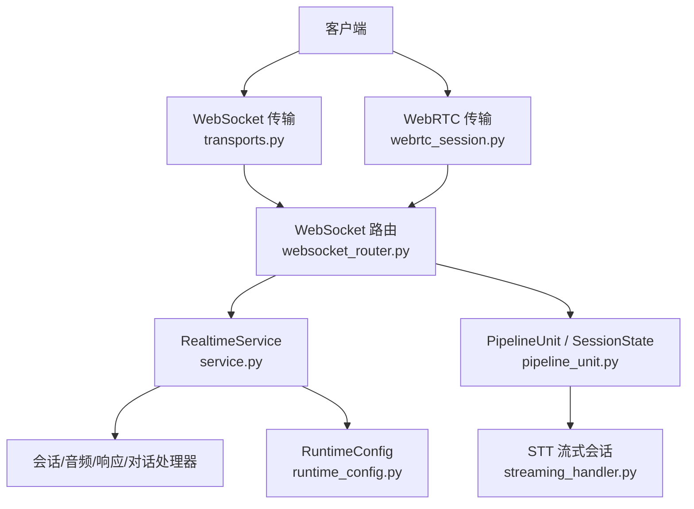
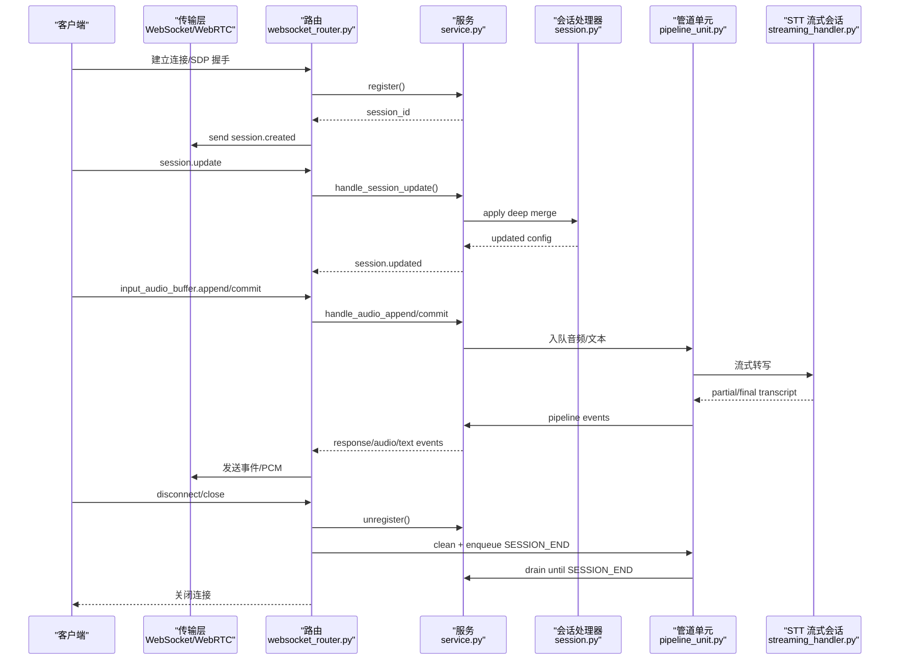
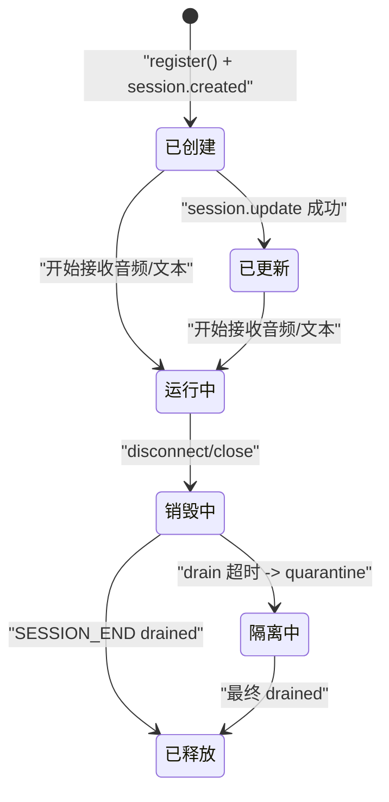
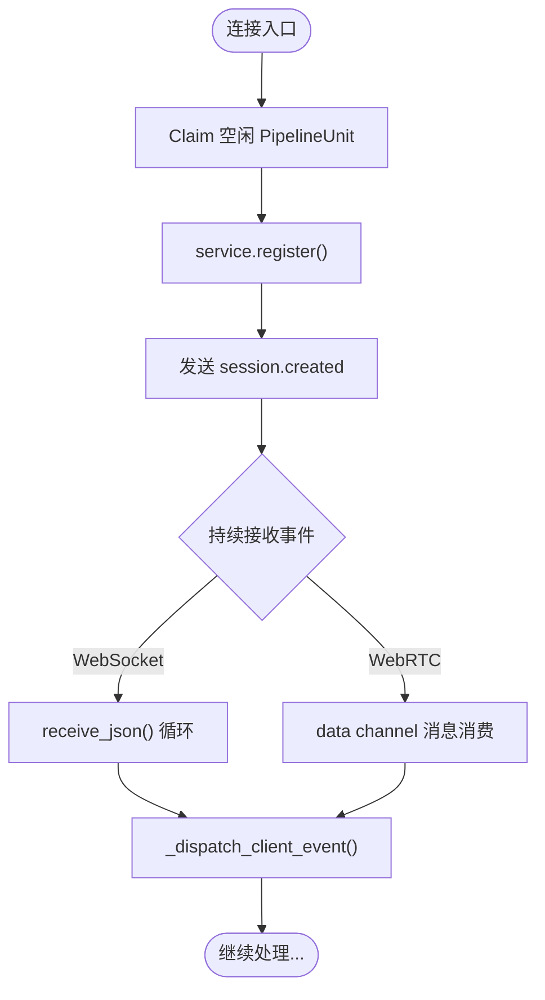
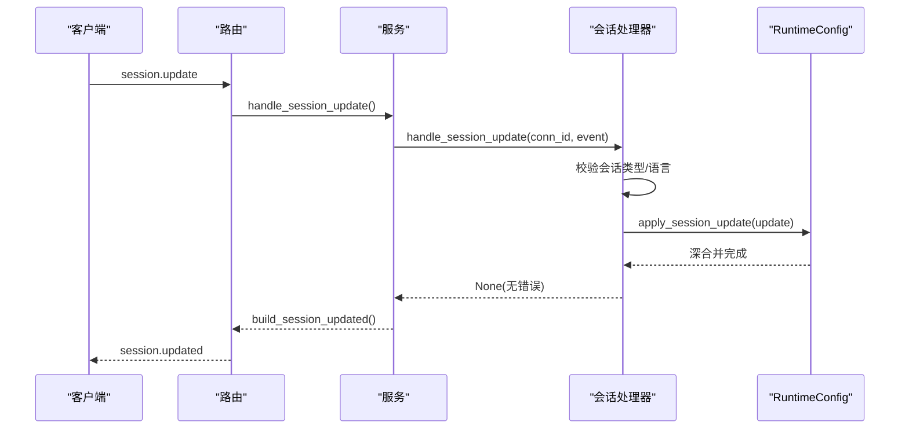
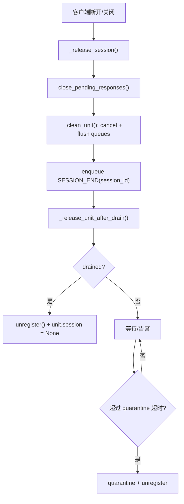
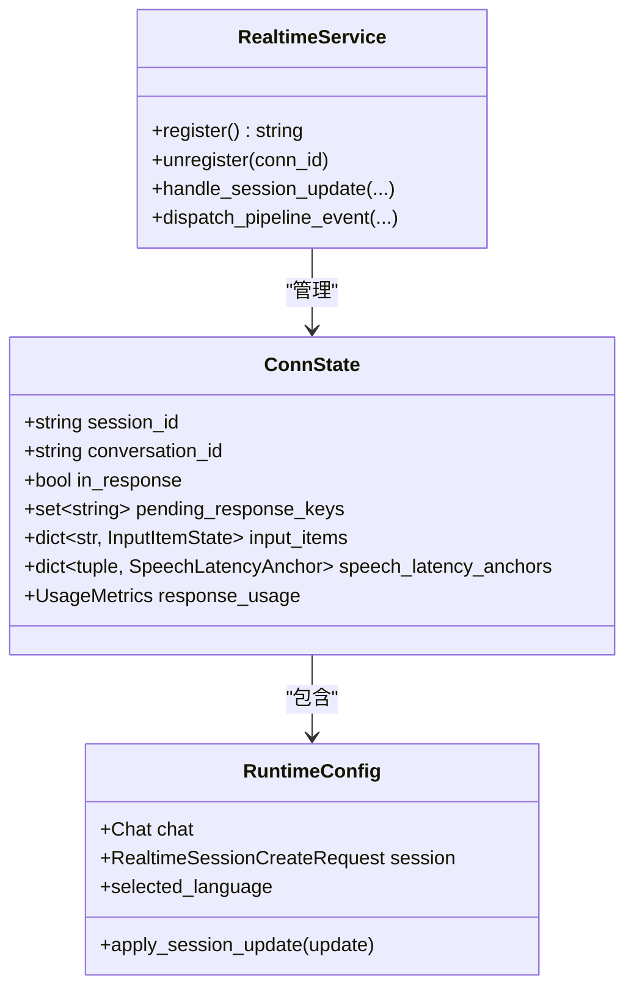
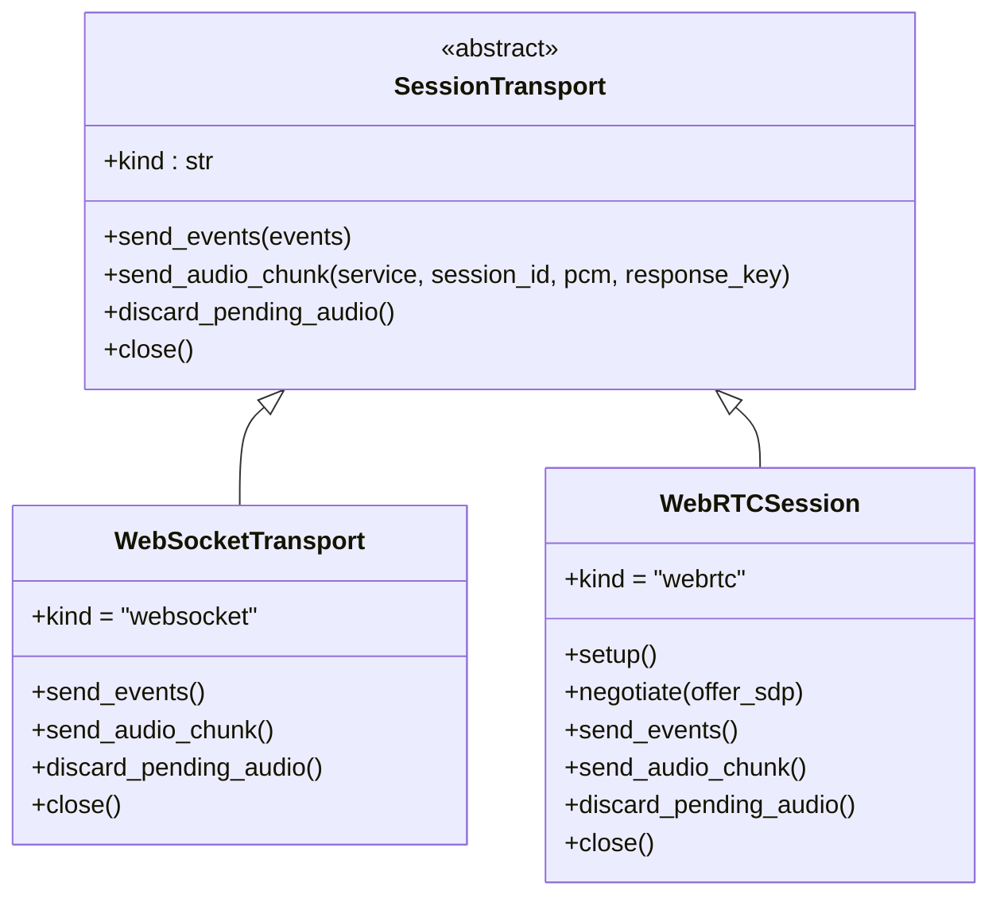
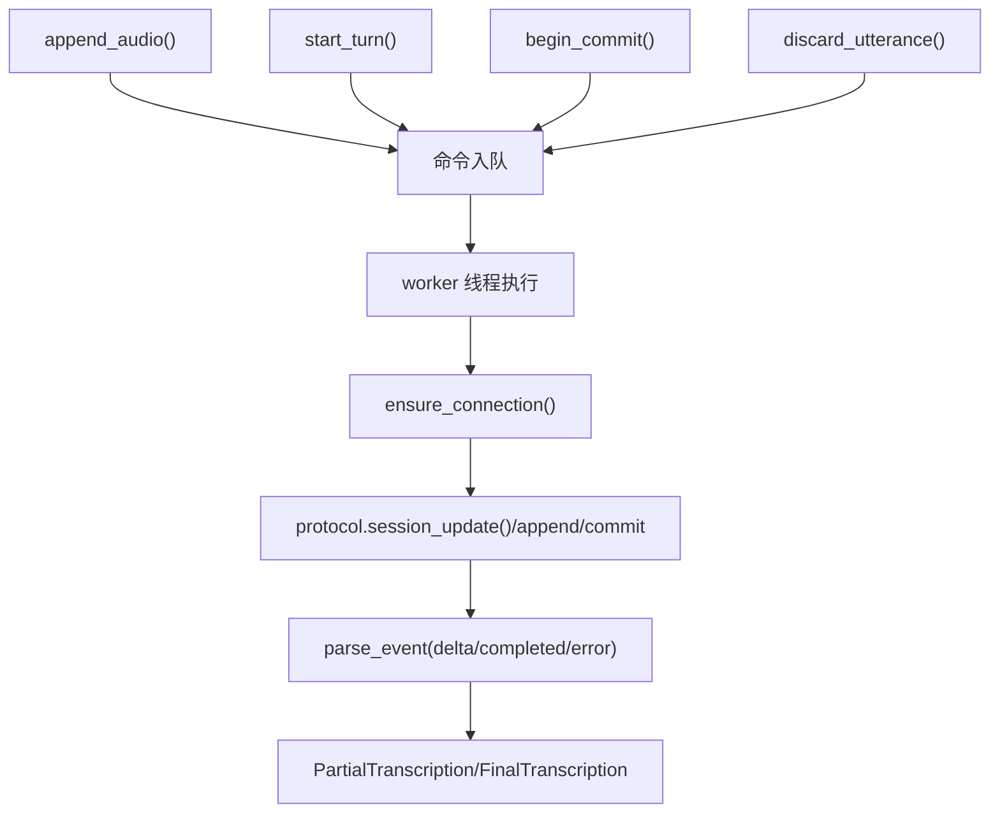
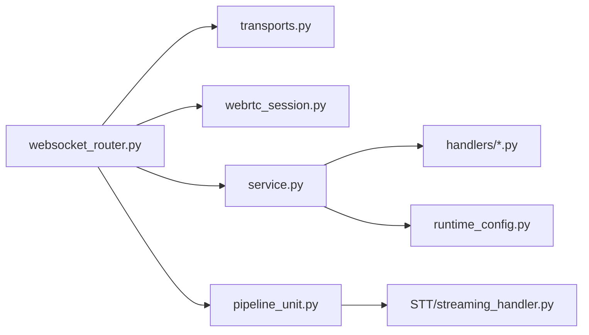

# 会话管理

<cite>
**本文引用的文件**   
- [session.py](file://src/speech_to_speech/api/openai_realtime/handlers/session.py)
- [pipeline_unit.py](file://src/speech_to_speech/api/openai_realtime/pipeline_unit.py)
- [transports.py](file://src/speech_to_speech/api/openai_realtime/transports.py)
- [webrtc_session.py](file://src/speech_to_speech/api/openai_realtime/webrtc_session.py)
- [runtime_config.py](file://src/speech_to_speech/api/openai_realtime/runtime_config.py)
- [service.py](file://src/speech_to_speech/api/openai_realtime/service.py)
- [websocket_router.py](file://src/speech_to_speech/api/openai_realtime/websocket_router.py)
- [streaming_handler.py](file://src/speech_to_speech/STT/streaming_handler.py)
</cite>

## 目录
1. [简介](#简介)
2. [项目结构](#项目结构)
3. [核心组件](#核心组件)
4. [架构总览](#架构总览)
5. [详细组件分析](#详细组件分析)
6. [依赖关系分析](#依赖关系分析)
7. [性能与并发控制](#性能与并发控制)
8. [故障排查指南](#故障排查指南)
9. [结论](#结论)
10. [附录：配置与最佳实践](#附录配置与最佳实践)

## 简介
本文件面向“语音到语音”实时服务中的会话管理，覆盖以下目标：
- 会话生命周期、状态转换与资源清理策略
- 会话创建、更新、销毁的完整流程
- 会话上下文、用户状态与对话历史的持久化机制
- 会话配置选项、超时设置与并发控制
- 多用户隔离、会话共享与状态同步
- 监控、调试工具与性能优化建议

该系统的会话以“连接级”为边界，通过 WebSocket 或 WebRTC 接入；每个 PipelineUnit 代表一个隔离的实时处理单元，承载 VAD、STT、LLM、TTS 等阶段。会话状态由 ConnState/RuntimeConfig 维护，传输层由 SessionTransport 抽象，WebSocket 与 WebRTC 分别实现事件与音频通道。

## 项目结构
与“会话管理”直接相关的代码集中在 OpenAI Realtime API 适配层与 STT 流式模块中：
- 会话处理器与协议事件：handlers/session.py
- 每连接状态与会话状态模型：service.py、pipeline_unit.py、runtime_config.py
- 传输层抽象与具体实现：transports.py、webrtc_session.py
- 路由、队列调度与释放逻辑：websocket_router.py
- STT 流式会话与重连、命令序列化：STT/streaming_handler.py

**图表来源**
- [transports.py:29-57](file://src/speech_to_speech/api/openai_realtime/transports.py#L29-L57)
- [webrtc_session.py:265-302](file://src/speech_to_speech/api/openai_realtime/webrtc_session.py#L265-L302)
- [websocket_router.py:531-634](file://src/speech_to_speech/api/openai_realtime/websocket_router.py#L531-L634)
- [service.py:355-446](file://src/speech_to_speech/api/openai_realtime/service.py#L355-L446)
- [pipeline_unit.py:13-76](file://src/speech_to_speech/api/openai_realtime/pipeline_unit.py#L13-L76)
- [streaming_handler.py:349-475](file://src/speech_to_speech/STT/streaming_handler.py#L349-L475)

**章节来源**
- [transports.py:29-116](file://src/speech_to_speech/api/openai_realtime/transports.py#L29-L116)
- [webrtc_session.py:265-541](file://src/speech_to_speech/api/openai_realtime/webrtc_session.py#L265-L541)
- [websocket_router.py:531-800](file://src/speech_to_speech/api/openai_realtime/websocket_router.py#L531-L800)
- [service.py:355-446](file://src/speech_to_speech/api/openai_realtime/service.py#L355-L446)
- [pipeline_unit.py:13-76](file://src/speech_to_speech/api/openai_realtime/pipeline_unit.py#L13-L76)
- [streaming_handler.py:349-475](file://src/speech_to_speech/STT/streaming_handler.py#L349-L475)

## 核心组件
- SessionHandler：负责会话配置更新与 session.created/updated 事件构建。
- RealtimeService：连接注册/注销、协议事件分发、会话状态与指标聚合。
- RuntimeConfig：会话运行时配置（含 Chat、audio.input/output、turn_detection 等），支持增量深合并。
- PipelineUnit/SessionState：每连接的生命周期对象，持有传输、队列、服务实例与发送循环状态。
- SessionTransport/WebSocketTransport/WebRTCSession：传输抽象与两种实现，统一事件与 PCM 输出。
- _StreamingSession（STT）：外部 STT 后端的重连、命令序列化、utterance 生命周期与超时控制。

**章节来源**
- [session.py:21-105](file://src/speech_to_speech/api/openai_realtime/handlers/session.py#L21-L105)
- [service.py:355-446](file://src/speech_to_speech/api/openai_realtime/service.py#L355-L446)
- [runtime_config.py:27-116](file://src/speech_to_speech/api/openai_realtime/runtime_config.py#L27-L116)
- [pipeline_unit.py:13-76](file://src/speech_to_speech/api/openai_realtime/pipeline_unit.py#L13-L76)
- [transports.py:29-116](file://src/speech_to_speech/api/openai_realtime/transports.py#L29-L116)
- [webrtc_session.py:265-541](file://src/speech_to_speech/api/openai_realtime/webrtc_session.py#L265-L541)
- [streaming_handler.py:349-475](file://src/speech_to_speech/STT/streaming_handler.py#L349-L475)

## 架构总览
下图展示一次典型会话从建立到销毁的关键路径，以及各组件的职责边界。

**图表来源**
- [websocket_router.py:574-634](file://src/speech_to_speech/api/openai_realtime/websocket_router.py#L574-L634)
- [service.py:407-446](file://src/speech_to_speech/api/openai_realtime/service.py#L407-L446)
- [session.py:24-105](file://src/speech_to_speech/api/openai_realtime/handlers/session.py#L24-L105)
- [pipeline_unit.py:13-76](file://src/speech_to_speech/api/openai_realtime/pipeline_unit.py#L13-L76)
- [streaming_handler.py:349-475](file://src/speech_to_speech/STT/streaming_handler.py#L349-L475)

## 详细组件分析

### 会话生命周期与状态转换
- 创建：路由接受连接后调用 service.register() 生成 ConnState，并返回 session_id；随后发送 session.created。
- 更新：客户端发送 session.update，经 Service 委派给 SessionHandler，对 RuntimeConfig.session 进行深合并；成功后返回 session.updated。
- 运行：音频输入经 Service.audio 入队，STT 流式会话产出 partial/final transcript，Service 将内部 PipelineEvent 分发给对应处理器，最终通过传输层回送事件与 PCM。
- 销毁：客户端断开或 WebRTC 关闭时，路由触发 _release_session()，清理队列、注入 SESSION_END，等待其传播完成后再释放 PipelineUnit；若长时间未 drained，进入 quarantined 状态并 unregister，防止跨会话泄漏。

**图表来源**
- [websocket_router.py:294-339](file://src/speech_to_speech/api/openai_realtime/websocket_router.py#L294-L339)
- [service.py:407-446](file://src/speech_to_speech/api/openai_realtime/service.py#L407-L446)
- [pipeline_unit.py:13-50](file://src/speech_to_speech/api/openai_realtime/pipeline_unit.py#L13-L50)

**章节来源**
- [websocket_router.py:574-634](file://src/speech_to_speech/api/openai_realtime/websocket_router.py#L574-L634)
- [websocket_router.py:294-339](file://src/speech_to_speech/api/openai_realtime/websocket_router.py#L294-L339)
- [service.py:407-446](file://src/speech_to_speech/api/openai_realtime/service.py#L407-L446)
- [pipeline_unit.py:13-50](file://src/speech_to_speech/api/openai_realtime/pipeline_unit.py#L13-L50)

### 会话创建流程
- WebSocket：accept 子协议后 claim 空闲 PipelineUnit，调用 service.register()，发送 session.created，然后进入事件循环。
- WebRTC：POST SDP offer，构造 WebRTCSession，协商 ICE/SDP，打开 oai-events 数据通道后视为连接就绪。

**图表来源**
- [websocket_router.py:574-634](file://src/speech_to_speech/api/openai_realtime/websocket_router.py#L574-L634)
- [webrtc_session.py:354-380](file://src/speech_to_speech/api/openai_realtime/webrtc_session.py#L354-L380)

**章节来源**
- [websocket_router.py:574-634](file://src/speech_to_speech/api/openai_realtime/websocket_router.py#L574-L634)
- [webrtc_session.py:354-380](file://src/speech_to_speech/api/openai_realtime/webrtc_session.py#L354-L380)

### 会话更新流程
- SessionHandler.handle_session_update() 仅接受 realtime 类型会话，拒绝 transcription 类型。
- 语言校验：若为 auto，需后端支持自动重置；否则检查是否在 STT/TTS 支持语言集合内。
- RuntimeConfig.apply_session_update() 使用深合并，只覆盖显式设置的字段，保留其他值。

**图表来源**
- [session.py:24-77](file://src/speech_to_speech/api/openai_realtime/handlers/session.py#L24-L77)
- [runtime_config.py:10-25](file://src/speech_to_speech/api/openai_realtime/runtime_config.py#L10-L25)
- [runtime_config.py:102-105](file://src/speech_to_speech/api/openai_realtime/runtime_config.py#L102-L105)

**章节来源**
- [session.py:24-77](file://src/speech_to_speech/api/openai_realtime/handlers/session.py#L24-L77)
- [runtime_config.py:10-25](file://src/speech_to_speech/api/openai_realtime/runtime_config.py#L10-L25)
- [runtime_config.py:102-116](file://src/speech_to_speech/api/openai_realtime/runtime_config.py#L102-L116)

### 会话销毁与资源清理
- 路由在 finally 块中调用 _release_session()，标记 released_at，清理 pending responses，flush 所有队列，注入 SESSION_END，并启动异步释放任务。
- _release_unit_after_drain() 等待 session.drained；超过 drain 超时记录警告，超过 quarantine 超时将 unit 置为 stuck 并 unregister，但仍保持 unclaimable 直到真正 drained。
- Service.unregister() 关闭 Chat、汇总 token 用量、清理延迟统计。

**图表来源**
- [websocket_router.py:347-389](file://src/speech_to_speech/api/openai_realtime/websocket_router.py#L347-L389)
- [websocket_router.py:294-339](file://src/speech_to_speech/api/openai_realtime/websocket_router.py#L294-L339)
- [service.py:424-446](file://src/speech_to_speech/api/openai_realtime/service.py#L424-L446)

**章节来源**
- [websocket_router.py:347-389](file://src/speech_to_speech/api/openai_realtime/websocket_router.py#L347-L389)
- [websocket_router.py:294-339](file://src/speech_to_speech/api/openai_realtime/websocket_router.py#L294-L339)
- [service.py:424-446](file://src/speech_to_speech/api/openai_realtime/service.py#L424-L446)

### 会话上下文与持久化
- 会话上下文：ConnState 保存 session_id、conversation_id、response 状态、input item 映射、音频缓冲、输出索引、工具调用跟踪、延迟锚点等。
- 运行时配置：RuntimeConfig.session 作为 Canonical State，Chat 提供对话历史缓冲区；apply_session_update() 保证部分更新不覆盖未设置字段。
- 历史持久化：HistoryHandler 在 Service 中挂载，用于 stage/close/history 操作；具体存储实现不在本节展开，但可见 close_session/close 等方法被调用。

**图表来源**
- [service.py:228-327](file://src/speech_to_speech/api/openai_realtime/service.py#L228-L327)
- [runtime_config.py:27-116](file://src/speech_to_speech/api/openai_realtime/runtime_config.py#L27-L116)
- [service.py:355-446](file://src/speech_to_speech/api/openai_realtime/service.py#L355-L446)

**章节来源**
- [service.py:228-327](file://src/speech_to_speech/api/openai_realtime/service.py#L228-L327)
- [runtime_config.py:27-116](file://src/speech_to_speech/api/openai_realtime/runtime_config.py#L27-L116)
- [service.py:355-446](file://src/speech_to_speech/api/openai_realtime/service.py#L355-L446)

### 传输层与会话共享
- SessionTransport 抽象了 send_events、send_audio_chunk、discard_pending_audio、close。
- WebSocketTransport：事件与 base64 PCM 通过 JSON 帧发送；丢弃待播放音频为空操作（客户端负责截断）。
- WebRTCSession：事件走 oai-events 数据通道，音频走 RTP 媒体轨道；支持 clear() 清空播放器缓冲以实现打断；ICE 连接超时保护。

**图表来源**
- [transports.py:29-116](file://src/speech_to_speech/api/openai_realtime/transports.py#L29-L116)
- [webrtc_session.py:265-441](file://src/speech_to_speech/api/openai_realtime/webrtc_session.py#L265-L441)

**章节来源**
- [transports.py:29-116](file://src/speech_to_speech/api/openai_realtime/transports.py#L29-L116)
- [webrtc_session.py:265-441](file://src/speech_to_speech/api/openai_realtime/webrtc_session.py#L265-L441)

### STT 流式会话与会话隔离
- _StreamingSession 封装外部 STT 后端连接，串行化 append/start_turn/discard/begin_commit/commit/cancel/close 等命令。
- 通过 generation 与 turn_id/revision 追踪命令归属，避免乱序与越界。
- 支持 connect_timeout、final_timeout 控制连接建立与 utterance 完成时限；失败时 poison_turn 并关闭连接。

**图表来源**
- [streaming_handler.py:349-475](file://src/speech_to_speech/STT/streaming_handler.py#L349-L475)
- [streaming_handler.py:476-800](file://src/speech_to_speech/STT/streaming_handler.py#L476-L800)

**章节来源**
- [streaming_handler.py:349-475](file://src/speech_to_speech/STT/streaming_handler.py#L349-L475)
- [streaming_handler.py:476-800](file://src/speech_to_speech/STT/streaming_handler.py#L476-L800)

## 依赖关系分析
- websocket_router.py 依赖 transports.py 与 webrtc_session.py 提供的传输接口，并通过 service.py 协调协议与状态。
- service.py 组合 SessionHandler、AudioHandler、ResponseHandler、ConversationHandler，并维护 ConnState/RuntimeConfig。
- runtime_config.py 提供会话配置的深合并与属性访问。
- pipeline_unit.py 定义 SessionState/PipelineUnit，作为路由与服务之间的桥梁。
- streaming_handler.py 作为 STT 子系统，受上层队列与取消作用域驱动。

**图表来源**
- [websocket_router.py:28-58](file://src/speech_to_speech/api/openai_realtime/websocket_router.py#L28-L58)
- [service.py:54-90](file://src/speech_to_speech/api/openai_realtime/service.py#L54-L90)
- [pipeline_unit.py:1-10](file://src/speech_to_speech/api/openai_realtime/pipeline_unit.py#L1-L10)
- [streaming_handler.py:1-25](file://src/speech_to_speech/STT/streaming_handler.py#L1-L25)

**章节来源**
- [websocket_router.py:28-58](file://src/speech_to_speech/api/openai_realtime/websocket_router.py#L28-L58)
- [service.py:54-90](file://src/speech_to_speech/api/openai_realtime/service.py#L54-L90)
- [pipeline_unit.py:1-10](file://src/speech_to_speech/api/openai_realtime/pipeline_unit.py#L1-L10)
- [streaming_handler.py:1-25](file://src/speech_to_speech/STT/streaming_handler.py#L1-L25)

## 性能与并发控制
- 并发模型：每个 PipelineUnit 拥有独立 send loop 与队列；WebSocket/WebRTC 传输层对事件发送加锁或顺序消费，避免乱序。
- 中断与丢弃：WebRTC 支持 discard_pending_audio() 清空编码器与轨道缓冲，确保 barge-in 可立即生效；WebSocket 侧由客户端负责截断。
- 超时与隔离：
  - WebRTC ICE gathering 超时与 CONNECT_TIMEOUT_S 保护未连接会话占用单元。
  - STT 流式会话支持 connect_timeout 与 final_timeout，避免阻塞。
  - 路由层 SESSION_END_DRAIN_TIMEOUT_S 与 SESSION_END_QUARANTINE_TIMEOUT_S 保障单元不会永久泄漏。
- 资源清理：_clean_unit() 取消 cancel_scope、flush 全部队列、重置 should_listen/response_playing，确保新会话不被旧状态污染。
- 指标与监控：GlobalUsageMetrics 聚合 token、音频时长、错误计数；/v1/usage 与 /v1/pool 暴露全局指标与单元状态（idle/active/draining/stuck）。

**章节来源**
- [webrtc_session.py:45-56](file://src/speech_to_speech/api/openai_realtime/webrtc_session.py#L45-L56)
- [webrtc_session.py:417-423](file://src/speech_to_speech/api/openai_realtime/webrtc_session.py#L417-L423)
- [streaming_handler.py:352-375](file://src/speech_to_speech/STT/streaming_handler.py#L352-L375)
- [websocket_router.py:77-92](file://src/speech_to_speech/api/openai_realtime/websocket_router.py#L77-L92)
- [websocket_router.py:222-244](file://src/speech_to_speech/api/openai_realtime/websocket_router.py#L222-L244)
- [service.py:175-214](file://src/speech_to_speech/api/openai_realtime/service.py#L175-L214)
- [websocket_router.py:636-695](file://src/speech_to_speech/api/openai_realtime/websocket_router.py#L636-L695)

## 故障排查指南
- 连接拒绝：当所有 PipelineUnit 被占用时，路由返回 session_limit_reached 错误并关闭连接。
- 无效事件：未知或非法 client event 会返回 unknown_or_invalid_event；WebRTC 模式下不支持 input_audio_buffer.append，WebSocket 模式不支持 output_audio_buffer.clear。
- 会话类型错误：仅支持 realtime 类型会话，transcription 类型会被拒绝。
- 语言不支持：若 STT/TTS 后端声明支持语言集合，传入不在集合内的语言将被拒绝。
- 会话卡住：/v1/pool 显示 stuck 表示 SESSION_END 长时间未 drained，可能因 handler 线程死锁或异常退出；此时单元不可被复用，需人工干预。
- 指标异常：/v1/usage 聚合 token、音频时长与错误类型；结合日志定位具体会话与单元。

**章节来源**
- [websocket_router.py:581-594](file://src/speech_to_speech/api/openai_realtime/websocket_router.py#L581-L594)
- [websocket_router.py:425-460](file://src/speech_to_speech/api/openai_realtime/websocket_router.py#L425-L460)
- [session.py:36-64](file://src/speech_to_speech/api/openai_realtime/handlers/session.py#L36-L64)
- [websocket_router.py:660-695](file://src/speech_to_speech/api/openai_realtime/websocket_router.py#L660-L695)

## 结论
该会话管理系统以 PipelineUnit 为隔离单位，通过 Service 协调协议事件与内部管线，借助 SessionTransport 抽象同时支持 WebSocket 与 WebRTC。会话生命周期清晰：创建→更新→运行→销毁，配合严格的队列清理、超时保护与隔离策略，有效避免跨会话状态泄漏。RuntimeConfig 提供灵活的会话配置与深合并能力，便于在线热更新。监控与诊断端点（/v1/usage、/v1/pool）帮助运维快速定位问题。

## 附录：配置与最佳实践
- 会话配置选项
  - audio.input.turn_detection：支持 create_response、interrupt_response 等开关，影响自动响应与打断行为。
  - audio.input.transcription.language：支持 auto 或指定语言；auto 需要后端支持自动重置。
  - audio.output.voice：TTS 音色选择。
  - tools/tool_choice：函数调用相关配置。
- 超时设置
  - WebRTC：ICE gathering 超时与 CONNECT_TIMEOUT_S 保护未连接会话。
  - STT：connect_timeout 与 final_timeout 控制连接与 utterance 完成时限。
  - 路由层：SESSION_END_DRAIN_TIMEOUT_S 与 SESSION_END_QUARANTINE_TIMEOUT_S 控制释放与隔离。
- 并发控制
  - 每个 PipelineUnit 独立 send loop 与队列，避免跨会话干扰。
  - WebRTC 使用有序 data channel 消费者保证事件顺序。
  - 使用 discard_pending_audio() 与 clear() 确保打断即时生效。
- 多用户隔离与会话共享
  - 每个连接拥有独立 ConnState/RuntimeConfig，互不干扰。
  - PipelineUnit 池化复用，但同一时刻仅一个会话 claim 该单元。
- 状态同步
  - session.update 深合并，局部更新不影响其他字段。
  - admin hot update 可对在线会话批量推送配置变更，并广播 session.updated。

**章节来源**
- [runtime_config.py:59-116](file://src/speech_to_speech/api/openai_realtime/runtime_config.py#L59-L116)
- [webrtc_session.py:45-56](file://src/speech_to_speech/api/openai_realtime/webrtc_session.py#L45-L56)
- [streaming_handler.py:352-375](file://src/speech_to_speech/STT/streaming_handler.py#L352-L375)
- [websocket_router.py:77-92](file://src/speech_to_speech/api/openai_realtime/websocket_router.py#L77-L92)
- [websocket_router.py:717-792](file://src/speech_to_speech/api/openai_realtime/websocket_router.py#L717-L792)