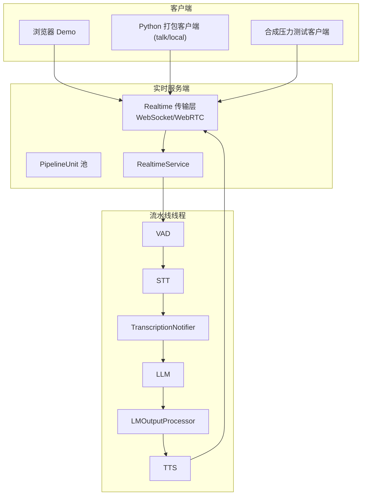
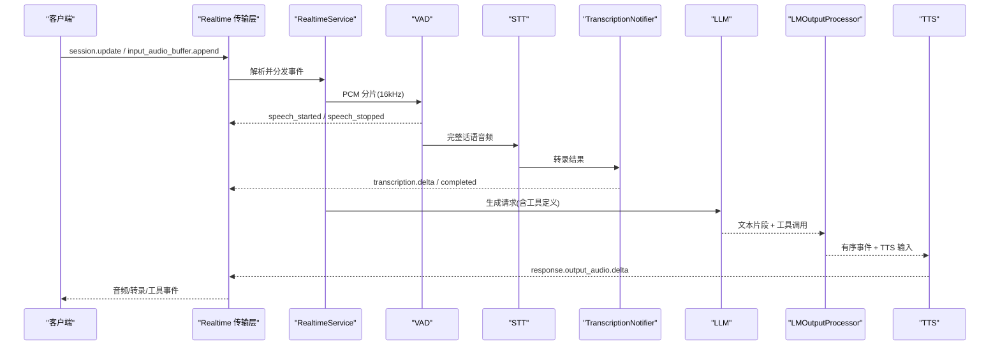
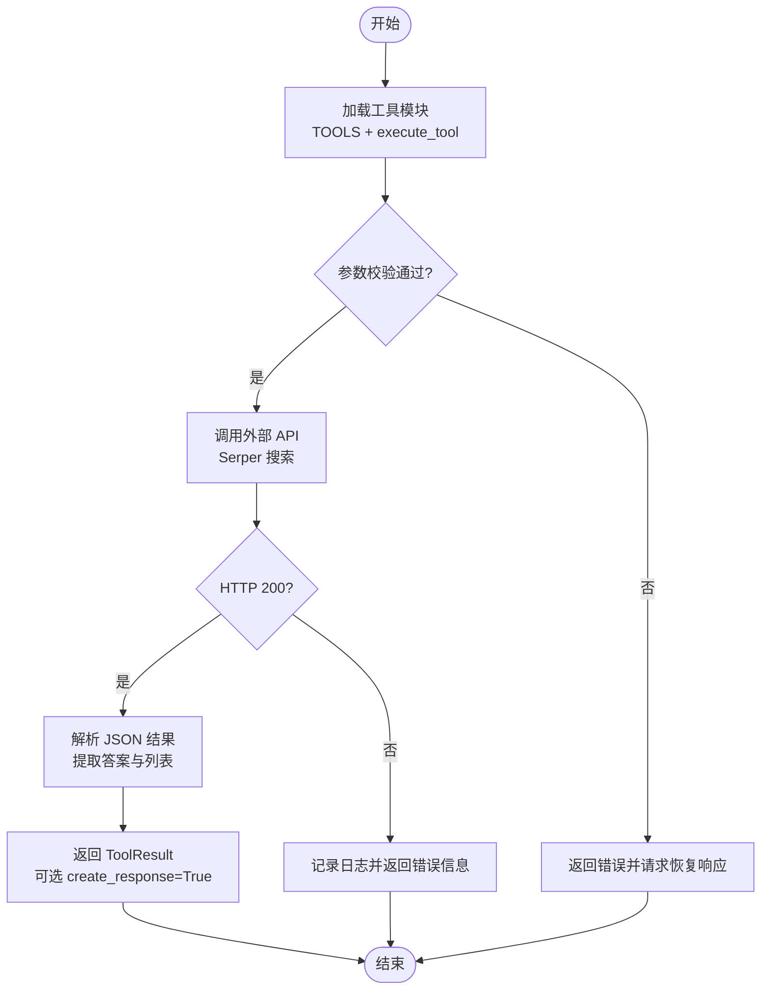
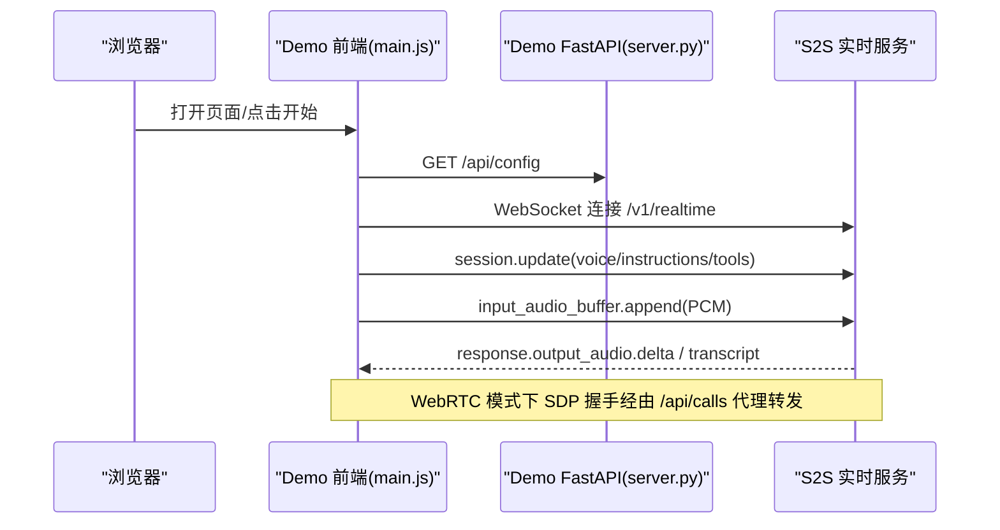
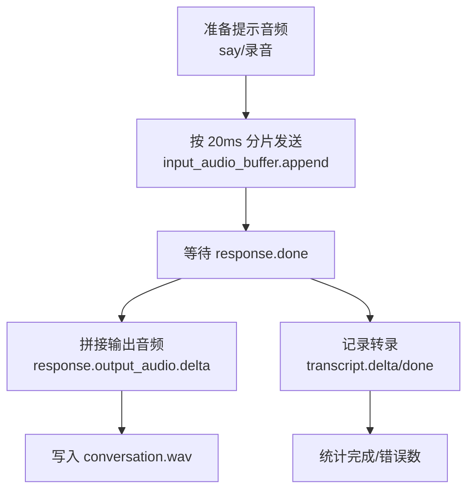
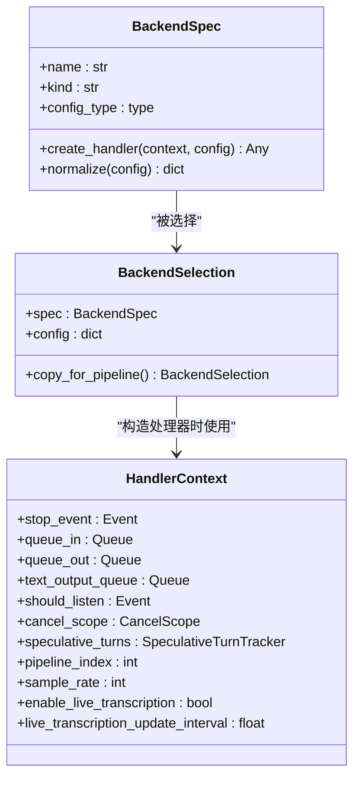

# 使用示例

<cite>
**本文引用的文件**
- [README.md](file://README.md)
- [demo/README.md](file://demo/README.md)
- [examples/gemma4-12b-macos/README.md](file://examples/gemma4-12b-macos/README.md)
- [src/speech_to_speech/cli.py](file://src/speech_to_speech/cli.py)
- [src/speech_to_speech/s2s_pipeline.py](file://src/speech_to_speech/s2s_pipeline.py)
- [src/speech_to_speech/backend_registry.py](file://src/speech_to_speech/backend_registry.py)
- [src/speech_to_speech/api/openai_realtime/README.md](file://src/speech_to_speech/api/openai_realtime/README.md)
- [src/speech_to_speech/api/openai_realtime/audio_client.py](file://src/speech_to_speech/api/openai_realtime/audio_client.py)
- [examples/realtime_web_search_tool.py](file://examples/realtime_web_search_tool.py)
- [scripts/synthetic_conversation_realtime_client.py](file://scripts/synthetic_conversation_realtime_client.py)
- [demo/main.js](file://demo/main.js)
- [demo/server.py](file://demo/server.py)
</cite>

## 目录
1. [简介](#简介)
2. [项目结构](#项目结构)
3. [核心组件](#核心组件)
4. [架构总览](#架构总览)
5. [详细组件与示例](#详细组件与示例)
6. [依赖关系分析](#依赖关系分析)
7. [性能优化建议](#性能优化建议)
8. [故障排查指南](#故障排查指南)
9. [结论](#结论)
10. [附录：端到端示例清单](#附录：端到端示例清单)

## 简介
本“使用示例”文档面向希望快速上手并深入集成语音到语音（Speech-to-Speech, S2S）系统的开发者。内容覆盖基本对话、工具调用、多语言支持、高级配置、第三方服务集成、浏览器与移动端/嵌入式部署、性能优化、错误处理与调试技巧，以及从数据采集到语音输出的完整端到端流程。所有示例均基于仓库内可运行的脚本与演示应用，并提供明确的源码路径以便查阅实现细节。

## 项目结构
本项目提供一条低延迟、全模块化的语音代理流水线：VAD → STT → LLM → TTS，并通过 OpenAI Realtime GA 事件集暴露 WebSocket 与 WebRTC 接口。每个阶段均可替换后端，LLM 槽位兼容 OpenAI 协议，既可指向托管提供商，也可指向本地 vLLM/llama.cpp 服务器。

图示来源
- [src/speech_to_speech/api/openai_realtime/README.md:9-59](file://src/speech_to_speech/api/openai_realtime/README.md#L9-L59)
- [src/speech_to_speech/s2s_pipeline.py:461-587](file://src/speech_to_speech/s2s_pipeline.py#L461-L587)

章节来源
- [README.md:87-96](file://README.md#L87-L96)
- [src/speech_to_speech/api/openai_realtime/README.md:9-59](file://src/speech_to_speech/api/openai_realtime/README.md#L9-L59)

## 核心组件
- VAD（语音活动检测）：Silero VAD v5，负责话轮边界与打断。
- STT（语音转文本）：Parakeet TDT（默认）、Whisper/Faster Whisper、Paraformer、OpenAI 兼容转录等。
- LLM（语言模型）：本地 transformers/mlx-lm，或远程 responses-api/chat-completions。
- TTS（文本转语音）：Qwen3-TTS（默认）、Kokoro、Pocket TTS、ChatTTS、OmniVoice、MMS、OpenAI 兼容语音等。
- 实时传输：WebSocket 与 WebRTC，遵循 OpenAI Realtime GA 事件集。
- 工具调用：两种路径（本地 LLM 通过函数签名提示；OpenAI API 原生 function_call），统一输出到协议层。

章节来源
- [README.md:166-188](file://README.md#L166-L188)
- [src/speech_to_speech/backend_registry.py:309-543](file://src/speech_to_speech/backend_registry.py#L309-L543)
- [src/speech_to_speech/api/openai_realtime/README.md:164-197](file://src/speech_to_speech/api/openai_realtime/README.md#L164-L197)

## 架构总览
下图展示了从客户端到服务端再到各流水线阶段的完整数据流，包括会话配置、音频流、转录与工具调用事件。

图示来源
- [src/speech_to_speech/api/openai_realtime/README.md:52-59](file://src/speech_to_speech/api/openai_realtime/README.md#L52-L59)
- [src/speech_to_speech/s2s_pipeline.py:354-458](file://src/speech_to_speech/s2s_pipeline.py#L354-L458)

## 详细组件与示例

### 基本对话：快速启动与本地通话
- 启动服务：安装后设置 OPENAI_API_KEY，运行 serve 命令即可在 ws://localhost:8765/v1/realtime 提供服务。
- 本地通话：使用 talk 命令连接已启动的实时服务进行语音对话。
- 一键本地模式：local 命令在同一进程内同时启动服务与内置麦克风/扬声器客户端。

参考命令与说明
- 启动服务与本地通话命令见 README 中的 Quickstart 与 Commands 表格。
- local 模式的播放缓冲策略与参数说明见 README 中关于 playback-buffer-ms 的描述。

章节来源
- [README.md:31-68](file://README.md#L31-L68)
- [README.md:198-216](file://README.md#L198-L216)
- [src/speech_to_speech/cli.py:18-35](file://src/speech_to_speech/cli.py#L18-L35)
- [src/speech_to_speech/cli.py:98-186](file://src/speech_to_speech/cli.py#L98-L186)

### 工具调用：Web 搜索示例
- 工具声明与执行：通过 Python 工具模块暴露 TOOLS 与 execute_tool，客户端加载后在服务端触发时执行。
- 示例工具：examples/realtime_web_search_tool.py 提供基于 Serper 的网络搜索工具，包含错误处理与结果格式化。
- 启用方式：通过 --tool-module 传入模块名，或在 demo UI 中开启工具开关。

图示来源
- [examples/realtime_web_search_tool.py:44-117](file://examples/realtime_web_search_tool.py#L44-L117)
- [src/speech_to_speech/api/openai_realtime/README.md:199-265](file://src/speech_to_speech/api/openai_realtime/README.md#L199-L265)

章节来源
- [examples/realtime_web_search_tool.py:1-118](file://examples/realtime_web_search_tool.py#L1-L118)
- [src/speech_to_speech/api/openai_realtime/README.md:199-265](file://src/speech_to_speech/api/openai_realtime/README.md#L199-L265)

### 多语言支持：自动语言检测与单语言固定
- 自动语言：设置 --language auto，STT 检测每段语音的语言并传递给 LLM；可选附加语言提示指令。
- 单语言：设置 --language 为目标语言代码（如 zh）。
- 组合建议：确保所选 STT、LLM、TTS 均覆盖目标语言。

章节来源
- [README.md:536-577](file://README.md#L536-L577)

### 高级配置：LLM 代理与离线运行
- LLM 代理：启用 --enable_llm_proxy 可将配置的远程 LLM 以 OpenAI 兼容端点暴露，供侧任务并发使用。
- 离线运行：首次在线缓存所需资源后，设置 HF_HUB_OFFLINE=1 完全离线运行；Smart Turn 可指定本地 ONNX 路径或禁用。

章节来源
- [README.md:334-353](file://README.md#L334-L353)
- [README.md:511-535](file://README.md#L511-L535)

### 第三方服务集成：OpenAI 兼容 STT/TTS 与本地推理
- 使用 OpenAI 兼容 /v1/audio/transcriptions 与 /v1/audio/speech 端点对接任意兼容服务。
- 本地推理：transformers 或 mlx-lm 直接本地运行；或通过 responses-api/chat-completions 指向本地 vLLM/llama.cpp。

章节来源
- [README.md:166-196](file://README.md#L166-L196)
- [README.md:355-510](file://README.md#L355-L510)

### 浏览器端集成：Demo 与 WebRTC
- 快速启动：先启动后端服务，再安装 demo 依赖并以环境变量 SPEECH_TO_SPEECH_URL 指向后端。
- 传输选择：默认 WebSocket；可在 Settings 中选择 WebRTC（需安装 webrtc extra）。
- 关键行为：会话更新、PCM 音频流、回放、打断、工具面板（网络搜索、摄像头快照）。

图示来源
- [demo/README.md:98-133](file://demo/README.md#L98-L133)
- [demo/server.py:188-331](file://demo/server.py#L188-L331)
- [demo/main.js:297-355](file://demo/main.js#L297-L355)

章节来源
- [demo/README.md:29-87](file://demo/README.md#L29-L87)
- [demo/README.md:98-156](file://demo/README.md#L98-L156)
- [demo/server.py:188-331](file://demo/server.py#L188-L331)
- [demo/main.js:297-355](file://demo/main.js#L297-L355)

### 移动端与嵌入式部署：容器化与最小化依赖
- Docker 部署：使用 docker compose 启动 llama.cpp 与实时服务，暴露端口供设备访问。
- 最小化依赖：按需安装 extras（如 pocket、kokoro、webrtc），仅保留必要组件以降低镜像体积。
- 设备适配：根据平台选择合适后端（如 Apple Silicon 用 MLX/Qwen3-TTS；Linux 用 GGML/CUDA）。

章节来源
- [README.md:286-295](file://README.md#L286-L295)
- [README.md:137-152](file://README.md#L137-L152)

### 端到端示例：从数据采集到语音输出
- 合成对话压测：scripts/synthetic_conversation_realtime_client.py 模拟多客户端并发对话，发送 PCM 音频并收集转录与音频输出，适合容量与稳定性测试。
- 本地 Mac 原生音频示例：examples/gemma4-12b-macos/README.md 展示在 Apple Silicon 上通过 llama.cpp 直接接收音频输入并输出语音的全链路。

图示来源
- [scripts/synthetic_conversation_realtime_client.py:188-244](file://scripts/synthetic_conversation_realtime_client.py#L188-L244)
- [scripts/synthetic_conversation_realtime_client.py:283-437](file://scripts/synthetic_conversation_realtime_client.py#L283-L437)

章节来源
- [scripts/synthetic_conversation_realtime_client.py:1-570](file://scripts/synthetic_conversation_realtime_client.py#L1-L570)
- [examples/gemma4-12b-macos/README.md:1-157](file://examples/gemma4-12b-macos/README.md#L1-L157)

### 管道构建与线程管理：serve 与 local
- parse_arguments：解析 CLI/JSON 配置，选择 STT/LLM/TTS 后端，应用 macOS 预设与兼容性选项。
- build_pipeline/build_local_pipeline：创建 PipelineUnit 池与 ThreadManager，组装 VAD→STT→LLM→TTS 处理器链。
- 信号处理：优雅关闭，停止所有线程与服务。

章节来源
- [src/speech_to_speech/s2s_pipeline.py:175-285](file://src/speech_to_speech/s2s_pipeline.py#L175-L285)
- [src/speech_to_speech/s2s_pipeline.py:354-587](file://src/speech_to_speech/s2s_pipeline.py#L354-L587)
- [src/speech_to_speech/s2s_pipeline.py:628-682](file://src/speech_to_speech/s2s_pipeline.py#L628-L682)

### 工具链与生态系统：包管理器与依赖
- 可选依赖：通过 pip extras 安装特定后端（如 faster-whisper、pocket、omnivoice、webrtc）。
- 平台标记：pyproject.toml 中针对不同平台的依赖自动解析。
- 开发工作流：uv sync + pytest + ruff check。

章节来源
- [README.md:137-152](file://README.md#L137-L152)
- [README.md:682-693](file://README.md#L682-L693)

## 依赖关系分析
后端注册表集中管理 STT/LLM/TTS 的实现与能力声明，便于动态选择与构造。

图示来源
- [src/speech_to_speech/backend_registry.py:48-122](file://src/speech_to_speech/backend_registry.py#L48-L122)
- [src/speech_to_speech/backend_registry.py:186-235](file://src/speech_to_speech/backend_registry.py#L186-L235)

章节来源
- [src/speech_to_speech/backend_registry.py:1-544](file://src/speech_to_speech/backend_registry.py#L1-L544)

## 性能优化建议
- 播放缓冲：针对 OpenAI 兼容 TTS 后端，默认缓冲 196ms 以吸收 HTTP 推理抖动；可通过 --playback-buffer-ms 调整。
- 多路并发：通过 --num_pipelines 增加并发会话；注意 Apple Silicon 下 MLX 全局锁对实时转录的影响。
- 量化与后端选择：Qwen3-TTS 在 macOS 上使用 MLX 量化（如 6bit）；Linux 可使用 GGML/CUDA 提升吞吐。
- 工具调用开销：本地 LLM 路径中，工具签名提示会增加 token 使用量，可按模型能力决定是否包含参数描述。

章节来源
- [README.md:208-216](file://README.md#L208-L216)
- [src/speech_to_speech/s2s_pipeline.py:643-654](file://src/speech_to_speech/s2s_pipeline.py#L643-L654)
- [src/speech_to_speech/LLM/tool_call/function_tool.py:8-35](file://src/speech_to_speech/LLM/tool_call/function_tool.py#L8-L35)

## 故障排查指南
- 连接失败：检查 URL 格式与权限（浏览器需 HTTPS 或 localhost 才能使用 getUserMedia）。
- WebRTC 501：未安装 webrtc extra；或服务端未启用相关路由。
- 工具不可用：确认 SERPER_API_KEY 已设置；或在 Tools 面板粘贴用户密钥。
- 转录与音频不同步：关注 live transcription update interval 与 VAD 阈值；必要时调整 min_silence_ms。
- 内存压力：降低模型量化级别或减少并发；避免同时运行多个大模型。

章节来源
- [demo/README.md:87-90](file://demo/README.md#L87-L90)
- [demo/README.md:135-156](file://demo/README.md#L135-L156)
- [demo/server.py:236-291](file://demo/server.py#L236-L291)
- [README.md:639-663](file://README.md#L639-L663)

## 结论
本示例文档提供了从基础对话到高级配置、从浏览器到移动端的完整实践路径，并结合仓库内可运行脚本与演示应用，帮助开发者快速搭建、扩展与优化语音到语音系统。通过模块化后端与标准实时协议，系统具备良好的可扩展性与生态兼容性。

## 附录：端到端示例清单
- 快速启动与本地通话：README 中的 Quickstart 与 Commands。
- 工具调用：examples/realtime_web_search_tool.py 与 demo 工具面板。
- 多语言：README 中的 Multi-Language Support。
- 浏览器集成：demo/README.md 与 demo/server.py、main.js。
- 移动端/嵌入式：README 中的 Docker 与可选依赖。
- 端到端压测：scripts/synthetic_conversation_realtime_client.py。
- 本地 Mac 原生音频：examples/gemma4-12b-macos/README.md。

章节来源
- [README.md:31-68](file://README.md#L31-L68)
- [examples/realtime_web_search_tool.py:1-118](file://examples/realtime_web_search_tool.py#L1-L118)
- [demo/README.md:29-87](file://demo/README.md#L29-L87)
- [scripts/synthetic_conversation_realtime_client.py:1-570](file://scripts/synthetic_conversation_realtime_client.py#L1-L570)
- [examples/gemma4-12b-macos/README.md:1-157](file://examples/gemma4-12b-macos/README.md#L1-L157)