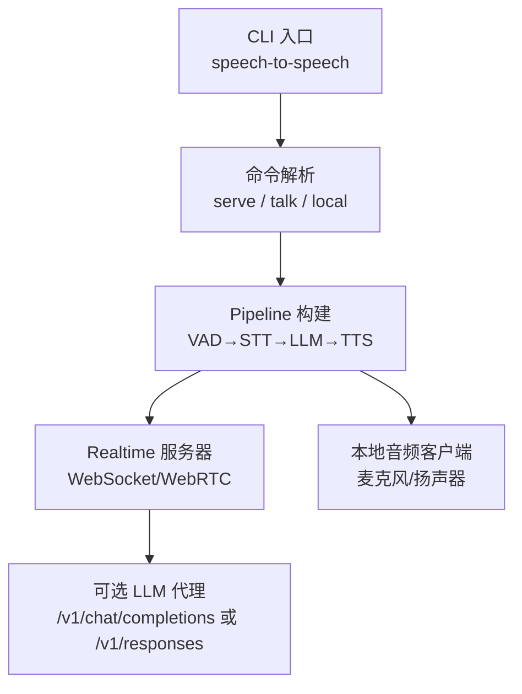
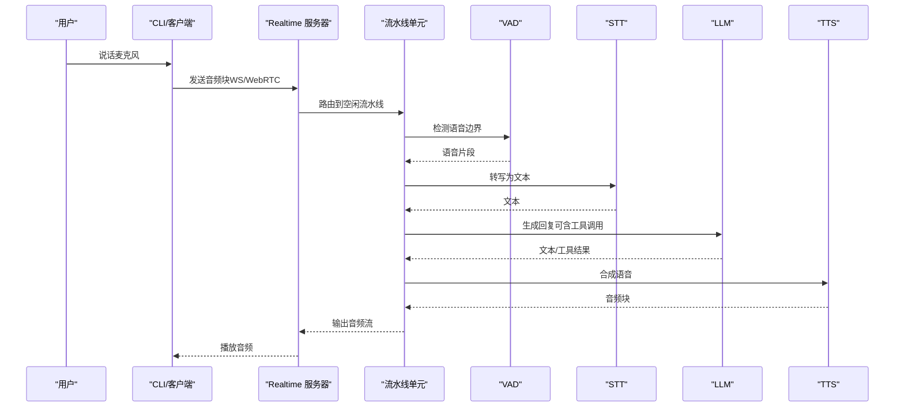

# 基本使用示例

<cite>
**本文引用的文件**
- [README-CN.md](file://README-CN.md)
- [cli.py](file://src/speech_to_speech/cli.py)
- [s2s_pipeline.py](file://src/speech_to_speech/s2s_pipeline.py)
- [module_arguments.py](file://src/speech_to_speech/arguments_classes/module_arguments.py)
- [vad_arguments.py](file://src/speech_to_speech/arguments_classes/vad_arguments.py)
- [local_audio_arguments.py](file://src/speech_to_speech/arguments_classes/local_audio_arguments.py)
- [pyproject.toml](file://pyproject.toml)
- [docker-compose.yml](file://docker-compose.yml)
- [Dockerfile](file://Dockerfile)
- [gemma4-12b-macos/README-CN.md](file://examples/gemma4-12b-macos/README-CN.md)
- [demo/README-CN.md](file://demo/README-CN.md)
- [realtime_web_search_tool.py](file://examples/realtime_web_search_tool.py)
</cite>

## 目录
1. [简介](#简介)
2. [项目结构](#项目结构)
3. [核心组件](#核心组件)
4. [架构总览](#架构总览)
5. [详细组件分析](#详细组件分析)
6. [依赖与安装](#依赖与安装)
7. [快速上手（从零开始）](#快速上手从零开始)
8. [命令行用法](#命令行用法)
9. [配置选项与调优建议](#配置选项与调优建议)
10. [性能与稳定性](#性能与稳定性)
11. [故障排查](#故障排查)
12. [结论](#结论)

## 简介
本指南面向初学者，提供从零开始的完整设置说明，帮助你在 macOS、Linux、Windows 上快速启动并运行语音到语音对话系统。你将学会：
- 准备环境与安装依赖
- 选择并配置 STT（语音转文本）、LLM（语言模型）、TTS（文本转语音）后端
- 使用 serve、talk、local 三种模式进行本地或远程实时对话
- 调整关键参数以获得更低的延迟和更好的体验
- 通过浏览器 Demo 或打包客户端进行交互

## 项目结构
仓库采用模块化设计，核心流水线由 VAD → STT → LLM → TTS 组成，并通过队列在各线程中协作。CLI 入口暴露三个命令：serve（启动服务）、talk（连接已有服务）、local（同时启动服务与本地麦克风/扬声器客户端）。

图表来源
- [cli.py:26-35](file://src/speech_to_speech/cli.py#L26-L35)
- [s2s_pipeline.py:550-587](file://src/speech_to_speech/s2s_pipeline.py#L550-L587)

章节来源
- [README-CN.md:87-96](file://README-CN.md#L87-L96)
- [README-CN.md:195-207](file://README-CN.md#L195-L207)
- [cli.py:26-35](file://src/speech_to_speech/cli.py#L26-L35)
- [s2s_pipeline.py:550-587](file://src/speech_to_speech/s2s_pipeline.py#L550-L587)

## 核心组件
- VAD（语音活动检测）：检测说话起止与轮次切换，支持 Smart Turn 优化响应时机
- STT（语音转文本）：将音频片段转为文本，支持多种后端（Parakeet TDT、Whisper、Paraformer 等）
- LLM（语言模型）：生成回复与工具调用，支持 OpenAI 兼容 API、本地 Transformers/MLX-LM
- TTS（文本转语音）：将文本合成语音流式返回，支持 Qwen3-TTS、Kokoro、Pocket TTS、OmniVoice 等

章节来源
- [README-CN.md:87-96](file://README-CN.md#L87-L96)
- [README-CN.md:166-193](file://README-CN.md#L166-L193)

## 架构总览
下图展示了从用户语音输入到助手语音输出的端到端流程，以及不同后端的选择点。

图表来源
- [s2s_pipeline.py:354-458](file://src/speech_to_speech/s2s_pipeline.py#L354-L458)
- [s2s_pipeline.py:550-587](file://src/speech_to_speech/s2s_pipeline.py#L550-L587)

## 详细组件分析

### 命令与入口
- serve：启动 Realtime 服务器，监听 WebSocket/WebRTC 端口
- talk：以打包的麦克风/扬声器客户端连接指定 URL
- local：在同一进程内组合 serve 与 talk，默认绑定回环地址

章节来源
- [cli.py:26-35](file://src/speech_to_speech/cli.py#L26-L35)
- [cli.py:98-186](file://src/speech_to_speech/cli.py#L98-L186)
- [README-CN.md:195-207](file://README-CN.md#L195-L207)

### 流水线构建与线程管理
- 每个流水线单元包含独立的 VAD/STT/LLM/TTS 处理器与队列
- 通过 ThreadManager 统一管理生命周期与停止信号
- 支持多流水线池并发处理多个会话

章节来源
- [s2s_pipeline.py:354-458](file://src/speech_to_speech/s2s_pipeline.py#L354-L458)
- [s2s_pipeline.py:550-587](file://src/speech_to_speech/s2s_pipeline.py#L550-L587)

### 模块级参数与后端选择
- stt：选择 STT 后端，支持 none（直接音频输入给 LLM）
- llm_backend：选择 LLM 后端（responses-api、chat-completions、transformers、mlx-lm）
- tts：选择 TTS 后端（qwen3、kokoro、pocket、omnivoice 等）
- device：全局设备覆盖（如 mps、cuda、cpu）
- num_pipelines：并发流水线数量

章节来源
- [module_arguments.py:12-105](file://src/speech_to_speech/arguments_classes/module_arguments.py#L12-L105)
- [README-CN.md:581-640](file://README-CN.md#L581-L640)

### VAD 参数与 Smart Turn
- thresh：VAD 阈值
- min_speech_ms/min_silence_ms：控制轮次切分
- speculative_reopen_ms/unanswered_reopen_ms：推测式轮次重开窗口
- smart_turn_*：Smart Turn v3.2 相关参数，用于优化响应时机

章节来源
- [vad_arguments.py:5-116](file://src/speech_to_speech/arguments_classes/vad_arguments.py#L5-L116)
- [README-CN.md:597-623](file://README-CN.md#L597-L623)

### 本地音频客户端参数
- playback_buffer_ms：播放前缓冲时长，平衡卡顿与延迟
- block_mic_during_playback：播放时暂停麦克风捕获
- input_device/output_device：指定声卡设备索引
- tool_module：加载本地 Python 工具模块（如网络搜索）

章节来源
- [local_audio_arguments.py:6-46](file://src/speech_to_speech/arguments_classes/local_audio_arguments.py#L6-L46)
- [README-CN.md:205-207](file://README-CN.md#L205-L207)

## 依赖与安装
- 基础要求：Python 3.10+
- 推荐方式：pip 安装或 uv 同步源码
- 可选扩展：根据需求安装 extras（如 faster-whisper、pocket、omnivoice 等）
- Docker：提供 GPU 镜像与 docker-compose 一键部署

章节来源
- [README-CN.md:98-164](file://README-CN.md#L98-L164)
- [pyproject.toml:5-66](file://pyproject.toml#L5-L66)
- [pyproject.toml:68-101](file://pyproject.toml#L68-L101)
- [docker-compose.yml:1-70](file://docker-compose.yml#L1-L70)
- [Dockerfile:1-28](file://Dockerfile#L1-L28)

## 快速上手（从零开始）

### 环境准备
- 确保已安装 Python 3.10+
- 准备麦克风与扬声器（或使用虚拟设备）
- 如需离线运行，提前在线启动一次以缓存模型资源

章节来源
- [README-CN.md:98-113](file://README-CN.md#L98-L113)
- [README-CN.md:489-504](file://README-CN.md#L489-L504)

### 安装依赖
- 基础安装：pip install speech-to-speech
- 可选扩展：按需安装 extras（如 pip install "speech-to-speech[webrtc]"）
- 源码安装：git clone + uv sync

章节来源
- [README-CN.md:102-164](file://README-CN.md#L102-L164)
- [pyproject.toml:68-101](file://pyproject.toml#L68-L101)

### 启动服务
- 最小化启动：speech-to-speech serve
- 指定 LLM 后端：--llm_backend responses-api 或 chat-completions
- 指定 STT/TTS：--stt parakeet-tdt --tts qwen3

章节来源
- [README-CN.md:31-68](file://README-CN.md#L31-L68)
- [README-CN.md:213-238](file://README-CN.md#L213-L238)

### 连接客户端
- 使用 talk：speech-to-speech talk --url ws://127.0.0.1:8765/v1/realtime
- 使用 local：speech-to-speech local（自动启动服务并连接）

章节来源
- [README-CN.md:41-51](file://README-CN.md#L41-L51)
- [cli.py:98-186](file://src/speech_to_speech/cli.py#L98-L186)

### 浏览器 Demo
- 启动后端后，安装 demo 依赖并运行 uvicorn
- 打开 http://localhost:7860，点击球体允许麦克风
- 支持 WebSocket 与 WebRTC 传输

章节来源
- [demo/README-CN.md:22-69](file://demo/README-CN.md#L22-L69)
- [demo/README-CN.md:87-103](file://demo/README-CN.md#L87-L103)

## 命令行用法

### serve 模式
- 用途：启动 Realtime 服务器，对外暴露 WebSocket/WebRTC 接口
- 常用参数：
  - --host/--port：绑定地址与端口
  - --llm_backend：选择 LLM 后端
  - --model_name：指定模型名称
  - --enable_live_transcription：启用实时转写显示
  - --num_pipelines：并发流水线数

章节来源
- [README-CN.md:213-238](file://README-CN.md#L213-L238)
- [module_arguments.py:96-105](file://src/speech_to_speech/arguments_classes/module_arguments.py#L96-L105)

### talk 模式
- 用途：以打包客户端连接已有 Realtime 服务器
- 常用参数：
  - --url：完整 WebSocket URL
  - --playback-buffer-ms：播放缓冲时长
  - --tool-module：加载本地工具模块
  - --voice：TTS 说话人名称

章节来源
- [cli.py:98-186](file://src/speech_to_speech/cli.py#L98-L186)
- [local_audio_arguments.py:26-45](file://src/speech_to_speech/arguments_classes/local_audio_arguments.py#L26-L45)

### local 模式
- 用途：在同一进程中启动服务与客户端，便于本地测试
- 特点：默认绑定 127.0.0.1，自动连接本地服务

章节来源
- [README-CN.md:195-207](file://README-CN.md#L195-L207)
- [s2s_pipeline.py:590-625](file://src/speech_to_speech/s2s_pipeline.py#L590-L625)

## 配置选项与调优建议

### STT 后端选择
- Parakeet TDT：默认，低延迟，支持多语言
- Whisper/Faster Whisper：多语言覆盖广
- Paraformer：偏向中文场景
- none：跳过 STT，直接将音频发送给支持音频输入的 LLM

章节来源
- [README-CN.md:166-193](file://README-CN.md#L166-L193)
- [README-CN.md:358-375](file://README-CN.md#L358-L375)

### LLM 后端选择
- responses-api：默认，指向 /v1/responses
- chat-completions：指向 /v1/chat/completions
- transformers/mlx-lm：本地推理
- 支持代理模式：将配置的 LLM 暴露为 HTTP 端点

章节来源
- [README-CN.md:345-467](file://README-CN.md#L345-L467)
- [module_arguments.py:35-48](file://src/speech_to_speech/arguments_classes/module_arguments.py#L35-L48)

### TTS 后端选择
- Qwen3-TTS：默认，支持 GGML/MLX 加速
- Kokoro/Pocket TTS/OmniVoice：可选扩展
- 支持 OpenAI 兼容 /v1/audio/speech

章节来源
- [README-CN.md:166-193](file://README-CN.md#L166-L193)

### VAD 与 Smart Turn 调优
- thresh：提高可减少误触发，降低可能漏检
- min_speech_ms/min_silence_ms：控制轮次切分灵敏度
- speculative_reopen_ms：延长软结束轮次的重开窗口
- smart_turn_threshold：提高可增加对模糊停顿的等待时间

章节来源
- [vad_arguments.py:5-116](file://src/speech_to_speech/arguments_classes/vad_arguments.py#L5-L116)
- [README-CN.md:597-623](file://README-CN.md#L597-L623)

### 本地播放缓冲
- playback_buffer-ms：增大可减少卡顿但增加首包延迟
- 默认值：OpenAI 兼容 TTS 为 196ms，其他为 0

章节来源
- [local_audio_arguments.py:26-35](file://src/speech_to_speech/arguments_classes/local_audio_arguments.py#L26-L35)
- [README-CN.md:205-207](file://README-CN.md#L205-L207)

## 性能与稳定性

### 并发与吞吐
- num_pipelines：控制并发流水线数，等于最大同时会话数
- 多流水线下 Apple Silicon 会禁用实时转写以避免 MLX 锁竞争

章节来源
- [module_arguments.py:96-105](file://src/speech_to_speech/arguments_classes/module_arguments.py#L96-L105)
- [s2s_pipeline.py:642-655](file://src/speech_to_speech/s2s_pipeline.py#L642-L655)

### 内存与设备
- macOS 推荐使用 mlx-lm 与 MPS 设备
- CUDA 环境下注意 Qwen3-TTS 的 wheel 版本匹配
- 大模型推理需充足显存/内存

章节来源
- [README-CN.md:242-274](file://README-CN.md#L242-L274)
- [README-CN.md:115-136](file://README-CN.md#L115-L136)

### 网络与延迟
- WebSocket/WebRTC 传输选择影响延迟与兼容性
- WebRTC 需要 webrtc 扩展，且 NAT 穿透需配置 ICE 服务器

章节来源
- [demo/README-CN.md:87-103](file://demo/README-CN.md#L87-L103)

## 故障排查

### 常见问题
- 无法连接服务器：检查端口与防火墙，确认服务已启动
- 无麦克风输入：浏览器需 HTTPS 或 localhost，允许麦克风权限
- WebRTC 返回 501：安装 webrtc 扩展或保持 WebSocket 传输
- 助手听到自己的声音：使用耳机，避免反馈

章节来源
- [demo/README-CN.md:67-69](file://demo/README-CN.md#L67-L69)
- [demo/README-CN.md:95-103](file://demo/README-CN.md#L95-L103)
- [gemma4-12b-macos/README-CN.md:110-119](file://examples/gemma4-12b-macos/README-CN.md#L110-L119)

### 调试技巧
- 启用 log-transcripts：记录完整对话内容（谨慎使用）
- 调整日志级别：--log_level debug 获取详细信息
- 使用 websocat 测试 WebSocket 连接

章节来源
- [cli.py:147-154](file://src/speech_to_speech/cli.py#L147-L154)
- [module_arguments.py:49-63](file://src/speech_to_speech/arguments_classes/module_arguments.py#L49-L63)
- [demo/README-CN.md:70-75](file://demo/README-CN.md#L70-L75)

## 结论
通过本指南，你已掌握语音到语音系统的安装、配置与使用方法。建议从 serve 与 talk 模式开始，逐步尝试 local 模式与浏览器 Demo。根据硬件与延迟需求调整 STT/LLM/TTS 后端与 VAD 参数，即可获得稳定低延迟的实时对话体验。