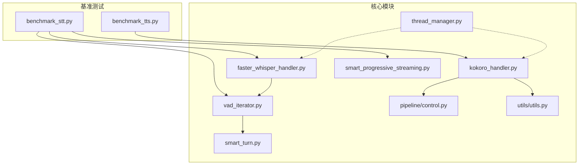
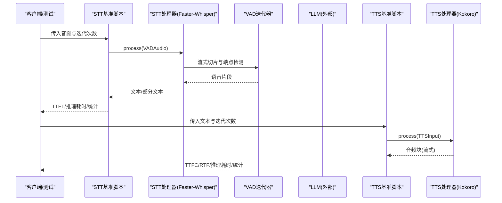
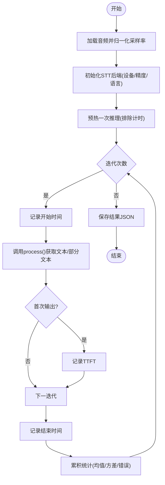
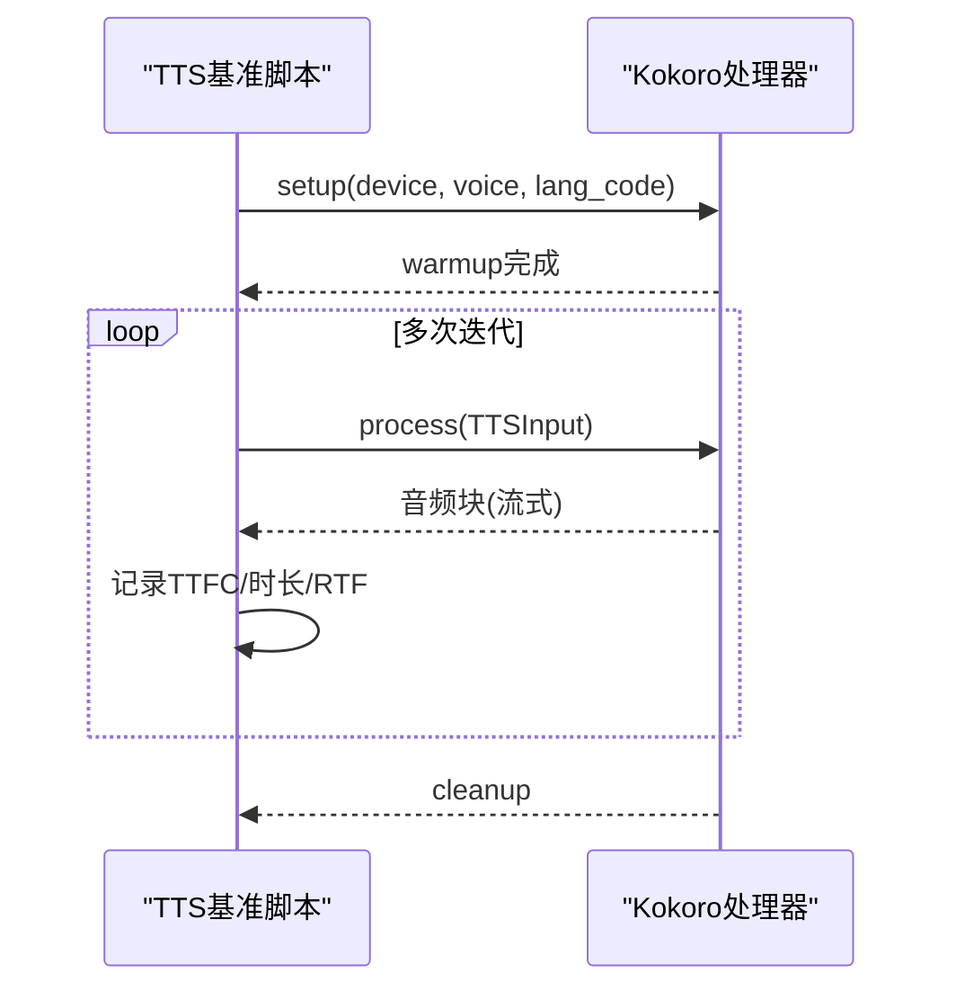
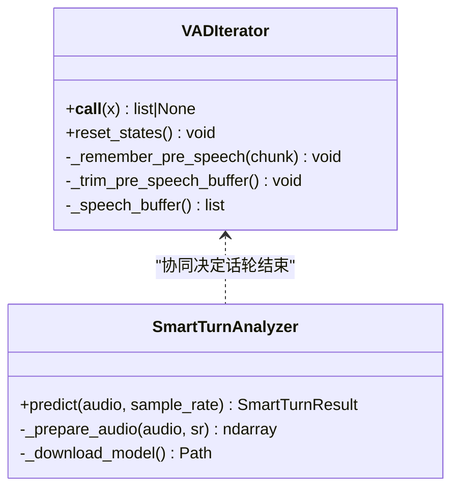
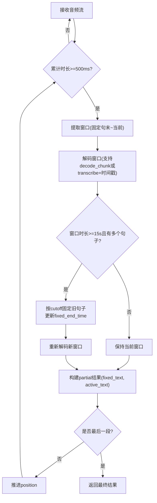
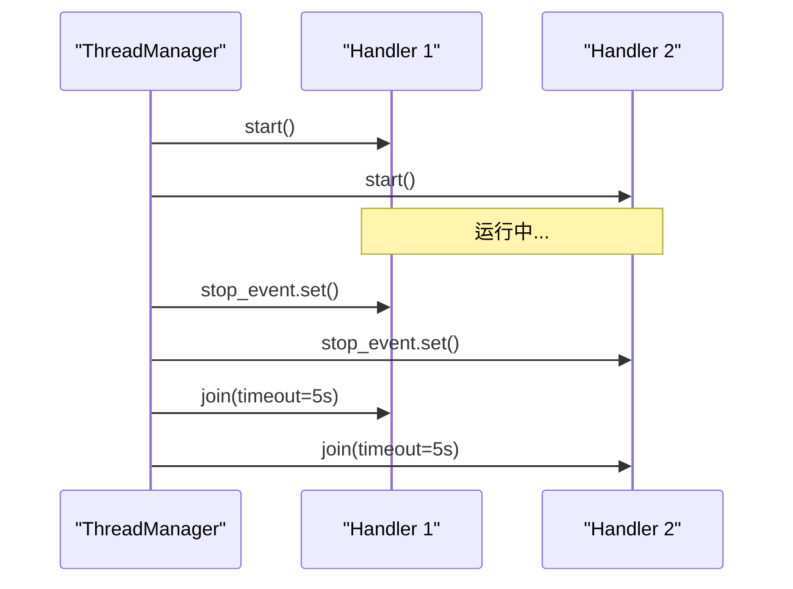
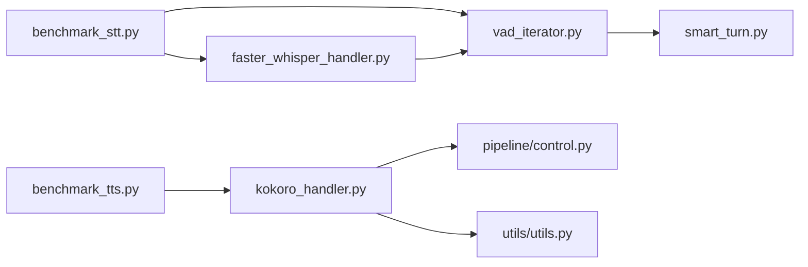

# 性能优化示例

<cite>
**本文引用的文件**
- [scripts/benchmark_stt.py](file://scripts/benchmark_stt.py)
- [scripts/benchmark_tts.py](file://scripts/benchmark_tts.py)
- [src/speech_to_speech/utils/thread_manager.py](file://src/speech_to_speech/utils/thread_manager.py)
- [src/speech_to_speech/VAD/vad_iterator.py](file://src/speech_to_speech/VAD/vad_iterator.py)
- [src/speech_to_speech/STT/smart_progressive_streaming.py](file://src/speech_to_speech/STT/smart_progressive_streaming.py)
- [src/speech_to_speech/STT/faster_whisper_handler.py](file://src/speech_to_speech/STT/faster_whisper_handler.py)
- [src/speech_to_speech/TTS/kokoro_handler.py](file://src/speech_to_speech/TTS/kokoro_handler.py)
- [src/speech_to_speech/pipeline/control.py](file://src/speech_to_speech/pipeline/control.py)
- [src/speech_to_speech/utils/utils.py](file://src/speech_to_speech/utils/utils.py)
- [src/speech_to_speech/VAD/smart_turn.py](file://src/speech_to_speech/VAD/smart_turn.py)
- [tests/test_smart_turn.py](file://tests/test_smart_turn.py)
- [tests/test_vad_iterator.py](file://tests/test_vad_iterator.py)
</cite>

## 目录
1. [简介](#简介)
2. [项目结构](#项目结构)
3. [核心组件](#核心组件)
4. [架构总览](#架构总览)
5. [详细组件分析](#详细组件分析)
6. [依赖关系分析](#依赖关系分析)
7. [性能考量与调优策略](#性能考量与调优策略)
8. [故障排查指南](#故障排查指南)
9. [结论](#结论)
10. [附录：基准测试使用与生产监控建议](#附录基准测试使用与生产监控建议)

## 简介
本文件面向语音到语音（Speech-to-Speech）系统的性能优化，提供系统级最佳实践与具体实现案例。重点覆盖：
- 如何使用基准测试工具评估 STT 和 TTS 模块的延迟、吞吐与资源利用率
- 多线程处理、内存管理、GPU/MPS 加速等优化技术
- 不同硬件配置下的性能对比与优化策略
- 延迟优化、吞吐量提升、资源利用率改进的实际案例
- 如何监控与分析瓶颈，识别优化机会
- 生产环境的性能调优指南与监控方案

## 项目结构
仓库围绕“可插拔的 STT/TTS 处理器 + VAD + 流式管线”组织，关键目录与职责如下：
- scripts：基准测试脚本，用于评测 STT/TTS 各后端
- src/speech_to_speech：核心实现，包含 STT、TTS、VAD、Pipeline、Utils 等
- tests：单元测试与集成测试，覆盖 VAD、Smart Turn、TTS/STT 行为
- demo/docs/examples：演示与文档

图表来源
- [scripts/benchmark_stt.py:1-386](file://scripts/benchmark_stt.py#L1-L386)
- [scripts/benchmark_tts.py:1-406](file://scripts/benchmark_tts.py#L1-L406)
- [src/speech_to_speech/STT/faster_whisper_handler.py:1-149](file://src/speech_to_speech/STT/faster_whisper_handler.py#L1-L149)
- [src/speech_to_speech/TTS/kokoro_handler.py:1-421](file://src/speech_to_speech/TTS/kokoro_handler.py#L1-L421)
- [src/speech_to_speech/VAD/vad_iterator.py:1-171](file://src/speech_to_speech/VAD/vad_iterator.py#L1-L171)
- [src/speech_to_speech/VAD/smart_turn.py:1-154](file://src/speech_to_speech/VAD/smart_turn.py#L1-L154)
- [src/speech_to_speech/STT/smart_progressive_streaming.py:1-344](file://src/speech_to_speech/STT/smart_progressive_streaming.py#L1-L344)
- [src/speech_to_speech/utils/thread_manager.py:1-40](file://src/speech_to_speech/utils/thread_manager.py#L1-L40)
- [src/speech_to_speech/pipeline/control.py:1-27](file://src/speech_to_speech/pipeline/control.py#L1-L27)
- [src/speech_to_speech/utils/utils.py:1-57](file://src/speech_to_speech/utils/utils.py#L1-L57)

章节来源
- [scripts/benchmark_stt.py:1-386](file://scripts/benchmark_stt.py#L1-L386)
- [scripts/benchmark_tts.py:1-406](file://scripts/benchmark_tts.py#L1-L406)

## 核心组件
- STT 基准与处理器
  - benchmark_stt.py：统一测量推理时间、首 token 延迟（TTFT）、错误率、样本转录质量；支持多种 STT 后端（Whisper、Faster-Whisper、MLX Whisper、Parakeet 等）。
  - faster_whisper_handler.py：基于 Faster-Whisper 的高效推理，支持设备自动选择、语言自适应、流式模式输出。
  - smart_progressive_streaming.py：智能渐进式流式转写，固定已确认句子，仅重算活跃窗口，降低长音频重复计算开销。
- TTS 基准与处理器
  - benchmark_tts.py：测量预热时间、推理时间、首块延迟（TTFC）、音频时长、实时因子（RTF），支持多后端（Kokoro、Qwen3-TTS、PocketTTS 等）。
  - kokoro_handler.py：跨平台后端（Apple Silicon MLX 与 CUDA/CPU 原生 Kokoro），预加载语音、分块流式输出、静音裁剪、采样率转换。
- VAD 与说话人端点检测
  - vad_iterator.py：流式 VAD，维护前缓冲、触发阈值、最小静音时长、语音片段拼接。
  - smart_turn.py：基于 ONNX 的 Smart Turn v3.2，判断用户话轮是否结束，CPU 执行并优化线程数。
- 并发与控制
  - thread_manager.py：统一管理多个 handler 线程的生命周期（启动、等待、停止）。
  - pipeline/control.py：管道控制消息（如会话结束）类型定义与判定。
- 工具函数
  - utils/utils.py：音频格式转换、响应模态判断、ID 生成等通用工具。

章节来源
- [scripts/benchmark_stt.py:1-386](file://scripts/benchmark_stt.py#L1-L386)
- [scripts/benchmark_tts.py:1-406](file://scripts/benchmark_tts.py#L1-L406)
- [src/speech_to_speech/STT/faster_whisper_handler.py:1-149](file://src/speech_to_speech/STT/faster_whisper_handler.py#L1-L149)
- [src/speech_to_speech/STT/smart_progressive_streaming.py:1-344](file://src/speech_to_speech/STT/smart_progressive_streaming.py#L1-L344)
- [src/speech_to_speech/TTS/kokoro_handler.py:1-421](file://src/speech_to_speech/TTS/kokoro_handler.py#L1-L421)
- [src/speech_to_speech/VAD/vad_iterator.py:1-171](file://src/speech_to_speech/VAD/vad_iterator.py#L1-L171)
- [src/speech_to_speech/VAD/smart_turn.py:1-154](file://src/speech_to_speech/VAD/smart_turn.py#L1-L154)
- [src/speech_to_speech/utils/thread_manager.py:1-40](file://src/speech_to_speech/utils/thread_manager.py#L1-L40)
- [src/speech_to_speech/pipeline/control.py:1-27](file://src/speech_to_speech/pipeline/control.py#L1-L27)
- [src/speech_to_speech/utils/utils.py:1-57](file://src/speech_to_speech/utils/utils.py#L1-L57)

## 架构总览
下图展示从输入音频到文本再到语音输出的端到端流程，以及基准测试如何介入测量关键指标。

图表来源
- [scripts/benchmark_stt.py:110-263](file://scripts/benchmark_stt.py#L110-L263)
- [scripts/benchmark_tts.py:91-219](file://scripts/benchmark_tts.py#L91-L219)
- [src/speech_to_speech/STT/faster_whisper_handler.py:107-149](file://src/speech_to_speech/STT/faster_whisper_handler.py#L107-L149)
- [src/speech_to_speech/VAD/vad_iterator.py:110-171](file://src/speech_to_speech/VAD/vad_iterator.py#L110-L171)
- [src/speech_to_speech/TTS/kokoro_handler.py:234-405](file://src/speech_to_speech/TTS/kokoro_handler.py#L234-L405)

## 详细组件分析

### STT 性能优化与基准
- 关键指标
  - 推理时间：单次音频处理的端到端耗时
  - 首 token 延迟（TTFT）：从开始到首个文本输出的时间
  - 错误率与样本转录质量：稳定性与准确性
- 优化要点
  - 设备与精度：CUDA + float16 或 MPS + BF16，减少显存占用并提升吞吐
  - 流式与渐进：结合 VAD 与渐进式窗口，避免整段重算
  - 模型选择：Faster-Whisper 在 CPU/GPU 上均有良好表现；MLX Whisper 在 Apple Silicon 上高效
- 基准脚本能力
  - 支持多后端一键对比，输出均值/方差/最快对比，便于回归测试与选型

图表来源
- [scripts/benchmark_stt.py:84-107](file://scripts/benchmark_stt.py#L84-L107)
- [scripts/benchmark_stt.py:110-263](file://scripts/benchmark_stt.py#L110-L263)
- [scripts/benchmark_stt.py:266-330](file://scripts/benchmark_stt.py#L266-L330)

章节来源
- [scripts/benchmark_stt.py:1-386](file://scripts/benchmark_stt.py#L1-L386)
- [src/speech_to_speech/STT/faster_whisper_handler.py:1-149](file://src/speech_to_speech/STT/faster_whisper_handler.py#L1-L149)
- [src/speech_to_speech/STT/smart_progressive_streaming.py:1-344](file://src/speech_to_speech/STT/smart_progressive_streaming.py#L1-L344)

### TTS 性能优化与基准
- 关键指标
  - 预热时间：模型/语音加载与缓存建立
  - 推理时间与首块延迟（TTFC）：影响交互感知延迟
  - RTF（Real-Time Factor）：音频时长/推理时长，越小越好
- 优化要点
  - 设备选择：Apple Silicon 走 MLX 路径，CUDA/CPU 走原生 Kokoro
  - 语音预加载：按语言预加载默认声音，避免运行时下载与重建
  - 流式分块：固定 blocksize 输出，便于下游网络传输与播放
  - 音频后处理：静音裁剪、采样率转换（24k→16k）、int16 量化
- 基准脚本能力
  - 支持多后端与量化参数（如 Qwen3-TTS MLX 量化），输出 TTFC/RTF/时长分布

图表来源
- [scripts/benchmark_tts.py:91-219](file://scripts/benchmark_tts.py#L91-L219)
- [src/speech_to_speech/TTS/kokoro_handler.py:87-153](file://src/speech_to_speech/TTS/kokoro_handler.py#L87-L153)
- [src/speech_to_speech/TTS/kokoro_handler.py:215-232](file://src/speech_to_speech/TTS/kokoro_handler.py#L215-L232)
- [src/speech_to_speech/TTS/kokoro_handler.py:282-405](file://src/speech_to_speech/TTS/kokoro_handler.py#L282-L405)

章节来源
- [scripts/benchmark_tts.py:1-406](file://scripts/benchmark_tts.py#L1-L406)
- [src/speech_to_speech/TTS/kokoro_handler.py:1-421](file://src/speech_to_speech/TTS/kokoro_handler.py#L1-L421)

### VAD 与 Smart Turn 优化
- VADIterator
  - 维护前缓冲（speech_pad_ms），确保触发前的上下文不丢失
  - 通过阈值与迟滞带（threshold±偏移）稳定切换“说话/静音”状态
  - 输出完整话轮片段，便于后续 STT 处理
- SmartTurnAnalyzer
  - 使用 ONNX Runtime CPU 执行，设置 inter/intra 线程数与图优化
  - 将音频标准化为固定长度特征，限制最大时长（8s），提高吞吐与一致性
  - 与 VAD 配合，仅在检测到静音边界时进行轻量推断，降低额外开销

图表来源
- [src/speech_to_speech/VAD/vad_iterator.py:6-171](file://src/speech_to_speech/VAD/vad_iterator.py#L6-L171)
- [src/speech_to_speech/VAD/smart_turn.py:36-154](file://src/speech_to_speech/VAD/smart_turn.py#L36-L154)

章节来源
- [src/speech_to_speech/VAD/vad_iterator.py:1-171](file://src/speech_to_speech/VAD/vad_iterator.py#L1-L171)
- [src/speech_to_speech/VAD/smart_turn.py:1-154](file://src/speech_to_speech/VAD/smart_turn.py#L1-L154)
- [tests/test_vad_iterator.py:1-199](file://tests/test_vad_iterator.py#L1-L199)
- [tests/test_smart_turn.py:1-236](file://tests/test_smart_turn.py#L1-L236)

### 渐进式流式转写（长音频优化）
- 目标：对长音频保持低延迟与高准确率
- 策略
  - 每 500ms 发射一次部分结果
  - 窗口增长至 15s 以提升上下文准确性
  - 超过 15s 时按句子边界滑动，固定已完成句子，仅重算活跃部分
- 收益：减少重复计算，维持最终一致性与低延迟

图表来源
- [src/speech_to_speech/STT/smart_progressive_streaming.py:69-238](file://src/speech_to_speech/STT/smart_progressive_streaming.py#L69-L238)

章节来源
- [src/speech_to_speech/STT/smart_progressive_streaming.py:1-344](file://src/speech_to_speech/STT/smart_progressive_streaming.py#L1-L344)

### 多线程与生命周期管理
- ThreadManager
  - 启动多个 handler 线程，守护标志设为非守护以确保优雅关闭
  - 停止时向所有 handler 发出 stop_event，并带超时 join，防止卡死
- Pipeline Control
  - 控制消息（如 SESSION_END）用于协调会话生命周期，避免资源泄漏

图表来源
- [src/speech_to_speech/utils/thread_manager.py:9-40](file://src/speech_to_speech/utils/thread_manager.py#L9-L40)
- [src/speech_to_speech/pipeline/control.py:7-27](file://src/speech_to_speech/pipeline/control.py#L7-L27)

章节来源
- [src/speech_to_speech/utils/thread_manager.py:1-40](file://src/speech_to_speech/utils/thread_manager.py#L1-L40)
- [src/speech_to_speech/pipeline/control.py:1-27](file://src/speech_to_speech/pipeline/control.py#L1-L27)

## 依赖关系分析
- STT 链路
  - benchmark_stt.py 依赖多种 STT 处理器（Whisper、Faster-Whisper、MLX Whisper、Parakeet）
  - Faster-Whisper 依赖设备与精度配置，输出 Transcription/PartialTranscription
  - VADIterator 与 SmartProgressiveStreaming 共同优化长音频处理
- TTS 链路
  - benchmark_tts.py 驱动多个 TTS 后端，测量 TTFC/RTF
  - Kokoro 根据平台选择 MLX 或原生库，预加载语音并流式输出
- 公共依赖
  - utils 提供音频格式转换与响应模态判断
  - control 提供控制消息类型，贯穿会话生命周期

图表来源
- [scripts/benchmark_stt.py:110-263](file://scripts/benchmark_stt.py#L110-L263)
- [scripts/benchmark_tts.py:91-219](file://scripts/benchmark_tts.py#L91-L219)
- [src/speech_to_speech/STT/faster_whisper_handler.py:107-149](file://src/speech_to_speech/STT/faster_whisper_handler.py#L107-L149)
- [src/speech_to_speech/VAD/vad_iterator.py:110-171](file://src/speech_to_speech/VAD/vad_iterator.py#L110-L171)
- [src/speech_to_speech/VAD/smart_turn.py:130-154](file://src/speech_to_speech/VAD/smart_turn.py#L130-L154)
- [src/speech_to_speech/TTS/kokoro_handler.py:234-405](file://src/speech_to_speech/TTS/kokoro_handler.py#L234-L405)
- [src/speech_to_speech/pipeline/control.py:7-27](file://src/speech_to_speech/pipeline/control.py#L7-L27)
- [src/speech_to_speech/utils/utils.py:12-57](file://src/speech_to_speech/utils/utils.py#L12-L57)

章节来源
- [scripts/benchmark_stt.py:1-386](file://scripts/benchmark_stt.py#L1-L386)
- [scripts/benchmark_tts.py:1-406](file://scripts/benchmark_tts.py#L1-L406)
- [src/speech_to_speech/STT/faster_whisper_handler.py:1-149](file://src/speech_to_speech/STT/faster_whisper_handler.py#L1-L149)
- [src/speech_to_speech/TTS/kokoro_handler.py:1-421](file://src/speech_to_speech/TTS/kokoro_handler.py#L1-L421)
- [src/speech_to_speech/VAD/vad_iterator.py:1-171](file://src/speech_to_speech/VAD/vad_iterator.py#L1-L171)
- [src/speech_to_speech/VAD/smart_turn.py:1-154](file://src/speech_to_speech/VAD/smart_turn.py#L1-L154)
- [src/speech_to_speech/pipeline/control.py:1-27](file://src/speech_to_speech/pipeline/control.py#L1-L27)
- [src/speech_to_speech/utils/utils.py:1-57](file://src/speech_to_speech/utils/utils.py#L1-L57)

## 性能考量与调优策略
- 延迟优化
  - 首 token/首块延迟：启用流式输出（STT PartialTranscription、TTS 分块），缩短 TTFT/TTFC
  - 渐进式窗口：长音频采用句子边界滑动，避免全量重算
  - 预热：模型与语音预加载，消除冷启动抖动
- 吞吐量提升
  - 设备与精度：CUDA float16、MPS BF16，减少显存带宽压力
  - 批量与并行：合理设置线程数（ONNX intra_op_num_threads），避免过度并行导致争用
  - 数据路径：音频格式快速转换（int16↔float32）、采样率转换使用高效算法（polyphase）
- 资源利用率改进
  - 内存管理：及时释放模型引用（cleanup），避免长期驻留
  - 流式消费：小分块传输，降低峰值内存
  - 控制信号：会话结束消息（SESSION_END）确保资源回收
- 不同硬件配置策略
  - Apple Silicon：优先 MLX 后端，预加载多语言语音，利用 MPS 加速
  - NVIDIA GPU：使用 CUDA + float16，开启 Faster-Whisper 的 compute_type 优化
  - CPU：限制线程数，使用 ONNX 图优化，必要时降级模型规模
- 监控与分析
  - 指标：TTFT、TTFC、RTF、推理时间均值/方差、错误率
  - 日志：关键节点打点（开始/结束/首次输出），便于定位瓶颈
  - 回归测试：基准脚本定期运行，比较不同版本/配置的差异

[本节为通用指导，无需特定文件来源]

## 故障排查指南
- 常见错误与定位
  - 依赖缺失：MLX/Kokoro 相关依赖未安装会导致导入失败，需按提示安装
  - 设备不可用：CUDA/MPS 不可用时回退 CPU，注意性能下降
  - 音频格式问题：确保单声道、正确采样率（16kHz），否则可能引发异常
- 调试手段
  - 增加日志级别，观察预处理、推理、后处理阶段耗时
  - 使用基准脚本在不同设备上运行，对比指标变化
  - 检查线程是否按时退出（ThreadManager 超时告警）

章节来源
- [src/speech_to_speech/TTS/kokoro_handler.py:154-196](file://src/speech_to_speech/TTS/kokoro_handler.py#L154-L196)
- [src/speech_to_speech/VAD/smart_turn.py:52-85](file://src/speech_to_speech/VAD/smart_turn.py#L52-L85)
- [src/speech_to_speech/utils/thread_manager.py:29-40](file://src/speech_to_speech/utils/thread_manager.py#L29-L40)

## 结论
本项目提供了完整的 STT/TTS 性能基准与优化实现，涵盖流式处理、设备加速、内存管理与线程生命周期控制。通过基准脚本与单元测试，可在不同硬件环境下快速评估与回归性能。生产环境建议结合监控指标与定期基准测试，持续优化延迟、吞吐与资源利用率。

[本节为总结性内容，无需特定文件来源]

## 附录：基准测试使用与生产监控建议
- 使用方式
  - STT 基准：指定音频文件与迭代次数，输出 JSON 结果与对比表
  - TTS 基准：指定文本与迭代次数，支持多后端与量化参数
- 生产监控建议
  - 采集 TTFT/TTFC/RTF 分布，设置阈值告警
  - 记录设备利用率（GPU/CPU 使用率、显存占用）
  - 定期回归基准，捕获性能退化
  - 结合会话控制消息，确保资源及时释放

[本节为通用指导，无需特定文件来源]