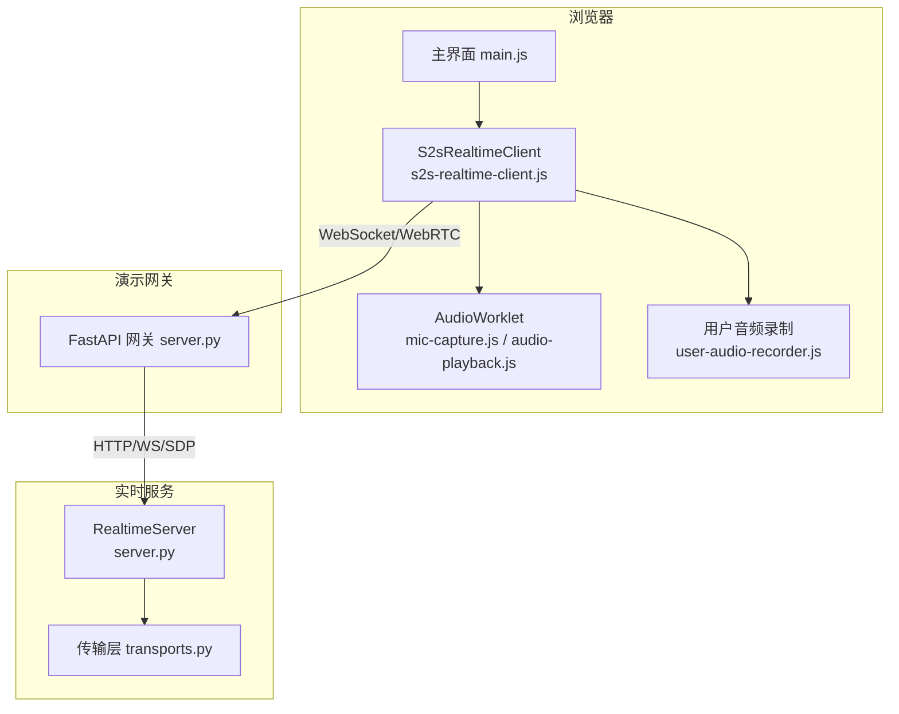
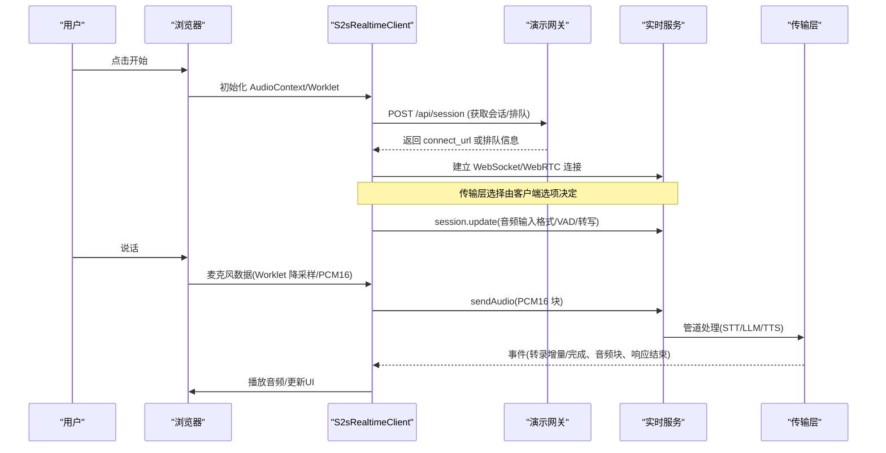
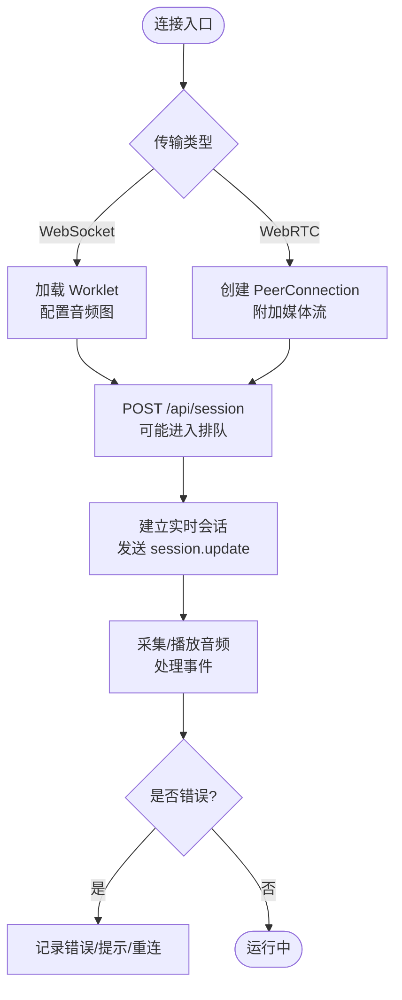
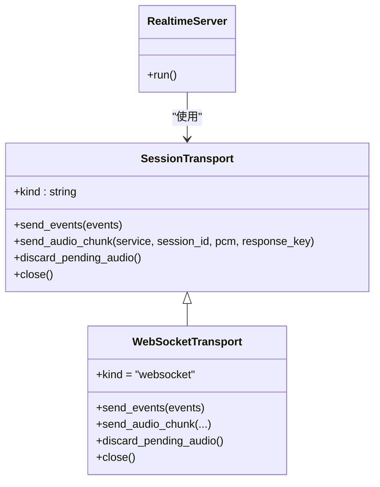
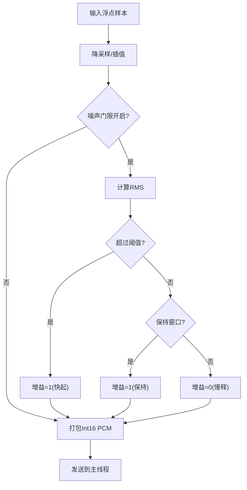
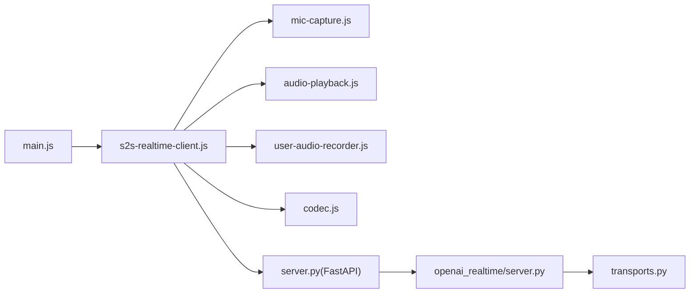

# 集成示例

<cite>
**本文引用的文件**
- [demo/s2s-realtime-client.js](file://demo/s2s-realtime-client.js)
- [demo/main.js](file://demo/main.js)
- [demo/server.py](file://demo/server.py)
- [src/speech_to_speech/api/openai_realtime/server.py](file://src/speech_to_speech/api/openai_realtime/server.py)
- [src/speech_to_speech/api/openai_realtime/transports.py](file://src/speech_to_speech/api/openai_realtime/transports.py)
- [demo/ws/codec.js](file://demo/ws/codec.js)
- [demo/ws/user-audio-recorder.js](file://demo/ws/user-audio-recorder.js)
- [demo/worklets/mic-capture.js](file://demo/worklets/mic-capture.js)
- [demo/worklets/audio-playback.js](file://demo/worklets/audio-playback.js)
- [README.md](file://README.md)
</cite>

## 目录
1. [简介](#简介)
2. [项目结构](#项目结构)
3. [核心组件](#核心组件)
4. [架构总览](#架构总览)
5. [详细组件分析](#详细组件分析)
6. [依赖关系分析](#依赖关系分析)
7. [性能与生产环境考虑](#性能与生产环境考虑)
8. [故障排查指南](#故障排查指南)
9. [结论](#结论)
10. [附录：各环境集成要点](#附录各环境集成要点)

## 简介
本集成示例文档面向将“语音到语音”系统接入不同应用环境的开发者，覆盖 Web 前端、移动应用、桌面应用与服务端集成。重点提供完整的 JavaScript 客户端集成说明（WebSocket/WebRTC 连接、音频流处理、实时通信协议事件），并详解浏览器端的麦克风捕获、音频编码、网络传输等技术细节；同时给出移动端最佳实践（权限管理、后台处理、电池优化）以及服务端架构设计与部署方案。文末包含错误处理、重连机制与性能监控等生产环境建议。

## 项目结构
该仓库提供一套可运行的演示与后端服务：
- 演示前端：基于 OpenAI Agents SDK 的 RealtimeSession，支持 WebSocket 与 WebRTC 两种传输方式，内置 AudioWorklet 实现低延迟采集与播放。
- 演示网关：FastAPI 服务，负责静态页面托管、会话代理、队列、WebRTC SDP 握手代理、搜索工具代理等。
- 实时服务端：OpenAI Realtime API 兼容的服务，使用 WebSocket/WebRTC 传输，内部以 PipelineUnit 池化并发处理。

图表来源
- [demo/main.js:1-120](file://demo/main.js#L1-L120)
- [demo/s2s-realtime-client.js:70-214](file://demo/s2s-realtime-client.js#L70-L214)
- [demo/server.py:188-208](file://demo/server.py#L188-L208)
- [src/speech_to_speech/api/openai_realtime/server.py:14-70](file://src/speech_to_speech/api/openai_realtime/server.py#L14-L70)
- [src/speech_to_speech/api/openai_realtime/transports.py:29-116](file://src/speech_to_speech/api/openai_realtime/transports.py#L29-L116)

章节来源
- [demo/main.js:1-120](file://demo/main.js#L1-L120)
- [demo/server.py:188-208](file://demo/server.py#L188-L208)
- [src/speech_to_speech/api/openai_realtime/server.py:14-70](file://src/speech_to_speech/api/openai_realtime/server.py#L14-L70)

## 核心组件
- S2sRealtimeClient：封装与 OpenAI Agents SDK 的交互，统一 WebSocket 与 WebRTC 传输，管理音频图、状态机、事件分发、工具调用、队列等待与会话配置。
- 演示网关（FastAPI）：提供 /api/config、/api/session、/api/calls、/api/search 等接口，屏蔽负载均衡器地址与密钥，提供排队与配额计量。
- 实时服务端：基于 PipelineUnit 池的 RealtimeServer，暴露 OpenAI Realtime 兼容事件集，通过 transports 抽象发送事件与音频。
- 音频工作单元：mic-capture 负责降采样、打包 PCM16、可选噪声门限；audio-playback 负责上采样与播放缓冲、欠载保护。
- 用户音频录制：SentAudioRecorder 记录已发送的 PCM 片段，按 VAD 边界拼接为 WAV 供回放或调试。

章节来源
- [demo/s2s-realtime-client.js:70-214](file://demo/s2s-realtime-client.js#L70-L214)
- [demo/server.py:188-208](file://demo/server.py#L188-L208)
- [src/speech_to_speech/api/openai_realtime/server.py:14-70](file://src/speech_to_speech/api/openai_realtime/server.py#L14-L70)
- [demo/worklets/mic-capture.js:1-158](file://demo/worklets/mic-capture.js#L1-L158)
- [demo/worklets/audio-playback.js:1-172](file://demo/worklets/audio-playback.js#L1-L172)
- [demo/ws/user-audio-recorder.js:1-199](file://demo/ws/user-audio-recorder.js#L1-L199)

## 架构总览
下图展示从浏览器采集到服务端处理的端到端流程，包括事件与音频流的走向。

图表来源
- [demo/s2s-realtime-client.js:134-214](file://demo/s2s-realtime-client.js#L134-L214)
- [demo/server.py:334-421](file://demo/server.py#L334-L421)
- [src/speech_to_speech/api/openai_realtime/transports.py:83-116](file://src/speech_to_speech/api/openai_realtime/transports.py#L83-L116)

## 详细组件分析

### 浏览器端集成（JavaScript 客户端）
- 连接与传输
  - 支持 WebSocket 与 WebRTC 两种传输。WebSocket 模式下通过 AudioWorklet 采集与播放；WebRTC 模式通过媒体流与数据通道传输。
  - 会话创建与排队：POST /api/session，若负载满则进入排队，轮询 /api/queue/{id} 直到获得 grant。
  - 会话配置：设置输出模态为音频、输入格式为 24kHz PCM16、开启服务器端 VAD 与中断响应、启用转写模型。
- 音频链路
  - 采集：AudioWorklet 将 48kHz 输入降采样至 24kHz，打包为 Int16 PCM，按固定时长分块发送（默认 40ms）。
  - 播放：接收到的 Float32 样本上采样至设备采样率，维护播放队列，处理欠载与淡入淡出。
  - 可视化：AnalyserNode 计算 RMS，驱动环形可视化与音量表。
- 事件与协议
  - 监听 input_audio_buffer.speech_started/stopped、response.created/done、conversation.item.input_audio_transcription.*、response.audio_transcript.* 等事件，驱动 UI 状态与字幕。
  - 工具调用：声明函数工具，执行后返回结果并可附带图片。
- 错误与重连
  - 连接断开、队列超时、登录失效、每日限额等错误均抛出带 code 的错误对象，便于上层重试或提示。
  - 关闭时清理定时器、节点、会话与上下文。

图表来源
- [demo/s2s-realtime-client.js:134-214](file://demo/s2s-realtime-client.js#L134-L214)
- [demo/s2s-realtime-client.js:262-310](file://demo/s2s-realtime-client.js#L262-L310)
- [demo/s2s-realtime-client.js:387-532](file://demo/s2s-realtime-client.js#L387-L532)
- [demo/server.py:334-421](file://demo/server.py#L334-L421)

章节来源
- [demo/s2s-realtime-client.js:70-214](file://demo/s2s-realtime-client.js#L70-L214)
- [demo/s2s-realtime-client.js:262-310](file://demo/s2s-realtime-client.js#L262-L310)
- [demo/s2s-realtime-client.js:387-532](file://demo/s2s-realtime-client.js#L387-L532)
- [demo/server.py:334-421](file://demo/server.py#L334-L421)

### 服务端集成（Python 实时服务）
- 服务启动：RealtimeServer 持有 PipelineUnit 池，启动 uvicorn 服务，监听 /v1/realtime。
- 传输抽象：transports.py 定义 SessionTransport 接口，WebSocketTransport 将事件与 base64 音频帧通过 JSON 发送；WebRTC 传输在独立模块中实现。
- 事件与音频：服务端按管线速率生成 PCM16 块并通过传输层下发；事件包含转录增量、音频块、工具调用、响应完成等。

图表来源
- [src/speech_to_speech/api/openai_realtime/transports.py:29-116](file://src/speech_to_speech/api/openai_realtime/transports.py#L29-L116)
- [src/speech_to_speech/api/openai_realtime/server.py:14-70](file://src/speech_to_speech/api/openai_realtime/server.py#L14-L70)

章节来源
- [src/speech_to_speech/api/openai_realtime/server.py:14-70](file://src/speech_to_speech/api/openai_realtime/server.py#L14-L70)
- [src/speech_to_speech/api/openai_realtime/transports.py:29-116](file://src/speech_to_speech/api/openai_realtime/transports.py#L29-L116)

### 音频工作单元（Worklet）
- 麦克风采集（mic-capture.js）
  - 将输入降采样至 24kHz，打包为 Int16 PCM，按 chunkMs 分块发送。
  - 可选噪声门限：根据每块 RMS 判断开/关，采用快起慢释包络避免削波与咔嗒声。
  - 上报 RMS 用于 UI 音量表。
- 音频播放（audio-playback.js）
  - 接收 Float32 样本，上采样至设备采样率，维护队列与读指针。
  - 欠载时输出静音并淡出，避免爆音；统计队列长度与播放计数。

图表来源
- [demo/worklets/mic-capture.js:32-158](file://demo/worklets/mic-capture.js#L32-L158)
- [demo/worklets/audio-playback.js:28-172](file://demo/worklets/audio-playback.js#L28-L172)

章节来源
- [demo/worklets/mic-capture.js:1-158](file://demo/worklets/mic-capture.js#L1-L158)
- [demo/worklets/audio-playback.js:1-172](file://demo/worklets/audio-playback.js#L1-L172)

### 用户音频录制与编解码
- SentAudioRecorder：记录已发送的 PCM 片段，按 VAD 边界拼接为 WAV Blob，支持预卷与最大缓冲控制，便于回放与调试。
- codec.js：提供 base64 编解码与从 response.done 中提取助手转录文本的工具函数。

章节来源
- [demo/ws/user-audio-recorder.js:1-199](file://demo/ws/user-audio-recorder.js#L1-L199)
- [demo/ws/codec.js:1-58](file://demo/ws/codec.js#L1-L58)

## 依赖关系分析
- 前端依赖
  - OpenAI Agents SDK：RealtimeSession、RealtimeAgent、WebSocket/WebRTC 传输。
  - Web Audio API：AudioContext、MediaStreamSource、AnalyserNode、AudioWorklet。
  - 演示网关：/api/config、/api/session、/api/calls、/api/search。
- 后端依赖
  - FastAPI/uvicorn：提供 HTTP/WS 服务。
  - PipelineUnit 池：隔离会话处理，提高并发能力。
  - transports：抽象传输层，解耦事件与音频发送逻辑。

图表来源
- [demo/main.js:1-120](file://demo/main.js#L1-L120)
- [demo/s2s-realtime-client.js:70-214](file://demo/s2s-realtime-client.js#L70-L214)
- [demo/server.py:188-208](file://demo/server.py#L188-L208)
- [src/speech_to_speech/api/openai_realtime/server.py:14-70](file://src/speech_to_speech/api/openai_realtime/server.py#L14-L70)
- [src/speech_to_speech/api/openai_realtime/transports.py:29-116](file://src/speech_to_speech/api/openai_realtime/transports.py#L29-L116)

章节来源
- [demo/main.js:1-120](file://demo/main.js#L1-L120)
- [demo/s2s-realtime-client.js:70-214](file://demo/s2s-realtime-client.js#L70-L214)
- [demo/server.py:188-208](file://demo/server.py#L188-L208)
- [src/speech_to_speech/api/openai_realtime/server.py:14-70](file://src/speech_to_speech/api/openai_realtime/server.py#L14-L70)
- [src/speech_to_speech/api/openai_realtime/transports.py:29-116](file://src/speech_to_speech/api/openai_realtime/transports.py#L29-L116)

## 性能与生产环境考虑
- 音频参数
  - 输入/输出均为 24kHz PCM16，确保与 OpenAI Realtime GA 协议一致。
  - 采集块大小 40ms 平衡延迟与带宽；可根据网络抖动调整。
- 噪声门限
  - 动态阈值（dBFS）减少背景噪音触发，避免无效请求与资源浪费。
- 播放缓冲
  - 播放侧维护队列与淡入淡出，欠载时输出静音，避免爆音。
- 传输选择
  - WebRTC 适合低延迟与跨 NAT 场景；WebSocket 更简单且稳定。
- 队列与配额
  - 演示网关支持排队与每日配额计量，避免过载与滥用。
- 监控指标
  - 输入/输出 RMS、队列长度、播放统计、事件耗时可用于性能分析与告警。

[本节为通用指导，不直接分析具体文件]

## 故障排查指南
- 常见问题
  - 无麦克风轨道：检查权限与 MediaStream 是否正确创建。
  - 连接失败：检查 /api/config 返回的 rtc 与 iceServers，确认 CORS 与证书。
  - 排队已满：等待或稍后重试；关注 /api/queue 状态。
  - 登录失效：根据 401 响应中的 loginUrl 重新登录。
  - 每日限额：402 响应提示限制，需升级或等待重置。
- 错误处理
  - 客户端抛出带 code 的错误对象（如 aborted、join-expired、limit、queue-full、login-required）。
  - 服务端日志记录不可达、认证拒绝、队列异常等信息。
- 重连策略
  - 检测到连接断开或错误后，销毁旧会话，重建 AudioContext，重新发起 /api/session。
  - 队列超时或令牌过期时，重新开始流程。

章节来源
- [demo/s2s-realtime-client.js:57-68](file://demo/s2s-realtime-client.js#L57-L68)
- [demo/s2s-realtime-client.js:610-733](file://demo/s2s-realtime-client.js#L610-L733)
- [demo/server.py:334-421](file://demo/server.py#L334-L421)
- [src/speech_to_speech/api/openai_realtime/transports.py:60-81](file://src/speech_to_speech/api/openai_realtime/transports.py#L60-L81)

## 结论
本集成示例提供了从浏览器到服务端的完整语音到语音链路，涵盖低延迟音频处理、实时事件协议、负载均衡与配额管理。通过模块化设计与标准化协议，开发者可在 Web、移动、桌面与服务端灵活集成，并根据场景选择合适传输与优化策略。

[本节为总结性内容，不直接分析具体文件]

## 附录：各环境集成要点

- Web 前端
  - 使用 OpenAI Agents SDK 的 RealtimeSession，选择 WebSocket 或 WebRTC。
  - 通过 AudioWorklet 实现 24kHz PCM16 采集与播放，配合 AnalyserNode 做可视化。
  - 处理 /api/config、/api/session、/api/calls 等接口，管理排队与配额。
  - 参考路径：[demo/s2s-realtime-client.js](file://demo/s2s-realtime-client.js)、[demo/main.js](file://demo/main.js)、[demo/server.py](file://demo/server.py)。

- 移动应用
  - 权限管理：在用户手势后请求麦克风/摄像头权限，处理拒绝与撤销。
  - 后台处理：使用前台服务或后台任务维持音频采集与网络传输，注意平台差异。
  - 电池优化：合理设置采集块大小与降噪门限，避免高频唤醒；必要时降低采样率或暂停非活跃会话。
  - 传输选择：优先 WebRTC 以降低延迟；在网络不稳定时回退 WebSocket。
  - 错误处理：捕获权限拒绝、网络异常、配额耗尽等，提供友好提示与重试。

- 桌面应用
  - 可使用 Electron/Tauri 等框架，复用 Web 前端代码，注意系统音频权限与设备枚举。
  - 利用系统级音频路由与多设备切换，提升用户体验。
  - 结合本地模型或远程服务，平衡延迟与资源占用。

- 服务端集成
  - 部署 RealtimeServer，配置 PipelineUnit 池大小与 LLM 后端。
  - 通过 transports 抽象扩展自定义传输（如 gRPC、MQTT）。
  - 接入负载均衡与配额计量，保障高可用与公平访问。
  - 参考路径：[src/speech_to_speech/api/openai_realtime/server.py](file://src/speech_to_speech/api/openai_realtime/server.py)、[src/speech_to_speech/api/openai_realtime/transports.py](file://src/speech_to_speech/api/openai_realtime/transports.py)。

章节来源
- [demo/s2s-realtime-client.js:70-214](file://demo/s2s-realtime-client.js#L70-L214)
- [demo/main.js:1-120](file://demo/main.js#L1-L120)
- [demo/server.py:188-208](file://demo/server.py#L188-L208)
- [src/speech_to_speech/api/openai_realtime/server.py:14-70](file://src/speech_to_speech/api/openai_realtime/server.py#L14-L70)
- [src/speech_to_speech/api/openai_realtime/transports.py:29-116](file://src/speech_to_speech/api/openai_realtime/transports.py#L29-L116)