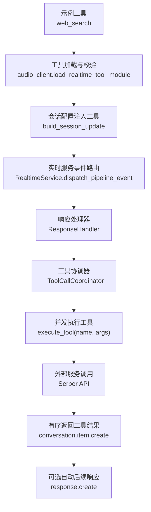
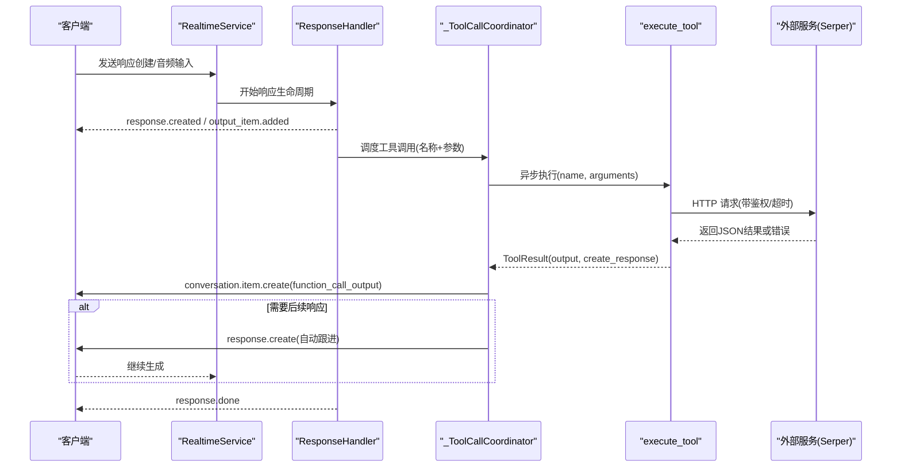
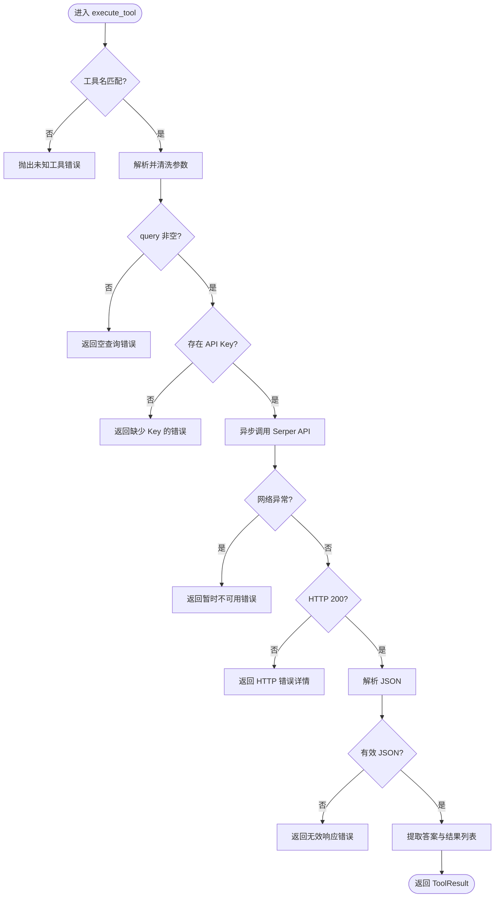
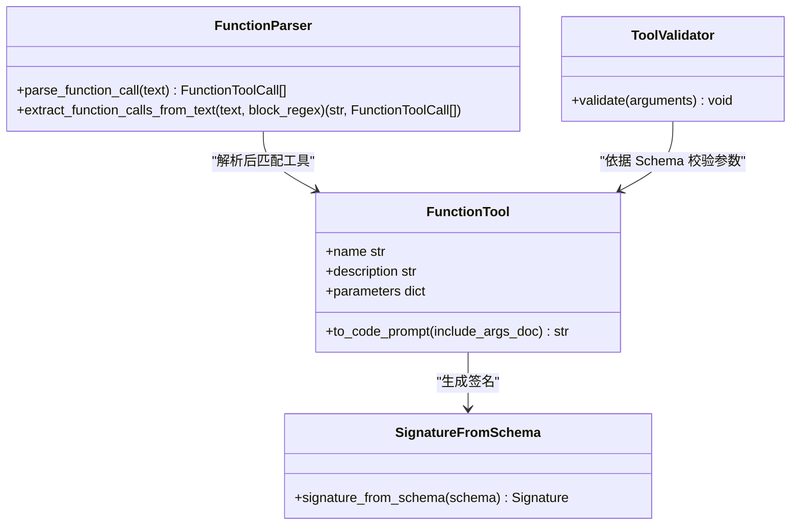
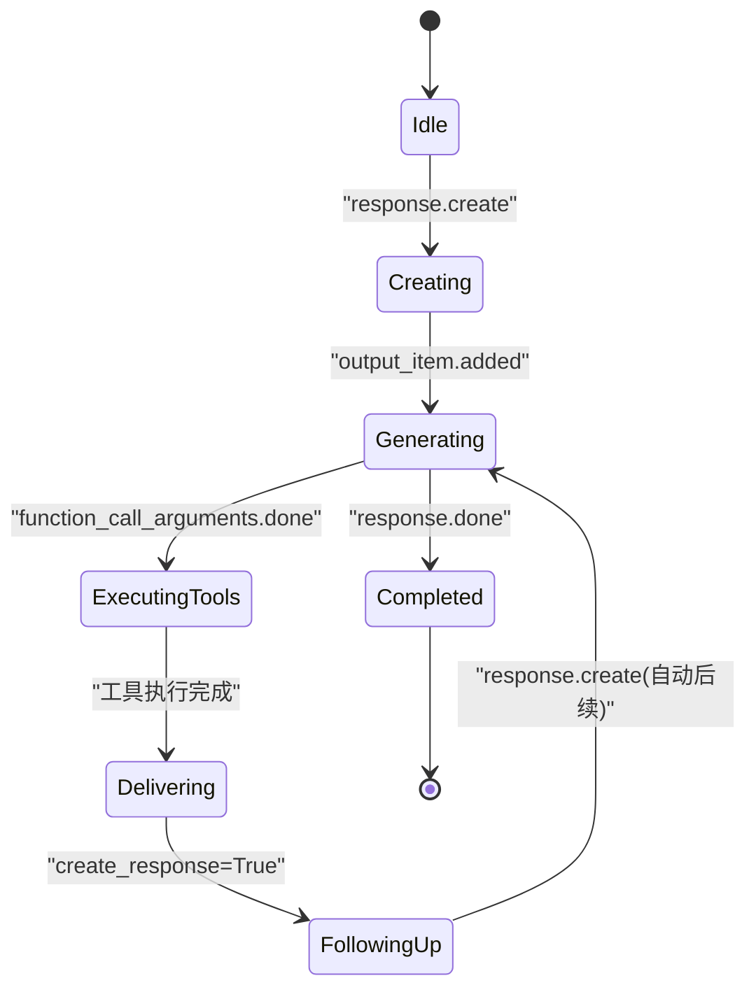
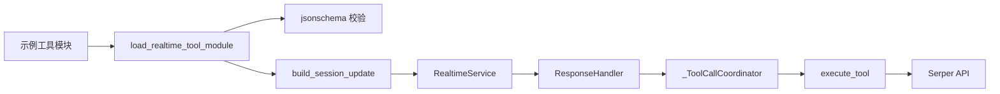

# 高级功能示例

<cite>
**本文引用的文件**
- [examples/realtime_web_search_tool.py](file://examples/realtime_web_search_tool.py)
- [src/speech_to_speech/api/openai_realtime/audio_client.py](file://src/speech_to_speech/api/openai_realtime/audio_client.py)
- [src/speech_to_speech/api/openai_realtime/service.py](file://src/speech_to_speech/api/openai_realtime/service.py)
- [src/speech_to_speech/api/openai_realtime/handlers/response.py](file://src/speech_to_speech/api/openai_realtime/handlers/response.py)
- [src/speech_to_speech/LLM/tool_call/function_tool.py](file://src/speech_to_speech/LLM/tool_call/function_tool.py)
- [src/speech_to_speech/LLM/tool_call/function_call.py](file://src/speech_to_speech/LLM/tool_call/function_call.py)
- [src/speech_to_speech/LLM/tool_call/signature_from_schema.py](file://src/speech_to_speech/LLM/tool_call/signature_from_schema.py)
- [src/speech_to_speech/LLM/tool_call/tool_prompt.py](file://src/speech_to_speech/LLM/tool_call/tool_prompt.py)
- [src/speech_to_speech/pipeline/events.py](file://src/speech_to_speech/pipeline/events.py)
- [tests/openai_realtime/test_web_search_tool_example.py](file://tests/openai_realtime/test_web_search_tool_example.py)
- [tests/tool_call/test_function_parser.py](file://tests/tool_call/test_function_parser.py)
</cite>

## 目录
1. [简介](#简介)
2. [项目结构](#项目结构)
3. [核心组件](#核心组件)
4. [架构总览](#架构总览)
5. [详细组件分析](#详细组件分析)
6. [依赖关系分析](#依赖关系分析)
7. [性能考虑](#性能考虑)
8. [故障排除指南](#故障排除指南)
9. [结论](#结论)
10. [附录](#附录)

## 简介
本示例文档聚焦于“工具调用、函数执行与外部服务集成”的高级能力，围绕以下目标展开：
- 如何定义并注册自定义工具函数（含参数校验、错误处理）
- 如何在实时语音对话中触发工具调用、并发执行工具、管理生命周期与资源清理
- 提供 Web 搜索、API 调用、数据库查询等实际场景的完整实现思路
- 给出性能优化技巧、调试方法与故障排除建议
- 说明如何扩展系统以支持新的工具类型与处理逻辑

## 项目结构
本项目在“实时语音对话”框架内实现了工具调用闭环：客户端声明工具、服务端解析 LLM 输出中的工具调用、异步执行工具、按序返回结果，并在必要时自动发起后续响应。关键路径涉及：
- 工具定义与执行入口（示例工具）
- 工具协议与解析（函数签名生成、调用解析）
- 实时服务编排（事件路由、响应生命周期、工具协调器）
- 管道事件模型（工具就绪、文本/音频输出、完成信号）

图表来源
- [examples/realtime_web_search_tool.py:20-41](file://examples/realtime_web_search_tool.py#L20-L41)
- [src/speech_to_speech/api/openai_realtime/audio_client.py:76-93](file://src/speech_to_speech/api/openai_realtime/audio_client.py#L76-L93)
- [src/speech_to_speech/api/openai_realtime/audio_client.py:164-207](file://src/speech_to_speech/api/openai_realtime/audio_client.py#L164-L207)
- [src/speech_to_speech/api/openai_realtime/service.py:500-579](file://src/speech_to_speech/api/openai_realtime/service.py#L500-L579)
- [src/speech_to_speech/api/openai_realtime/handlers/response.py:52-136](file://src/speech_to_speech/api/openai_realtime/handlers/response.py#L52-L136)
- [src/speech_to_speech/api/openai_realtime/audio_client.py:467-800](file://src/speech_to_speech/api/openai_realtime/audio_client.py#L467-L800)

章节来源
- [examples/realtime_web_search_tool.py:1-118](file://examples/realtime_web_search_tool.py#L1-L118)
- [src/speech_to_speech/api/openai_realtime/audio_client.py:76-207](file://src/speech_to_speech/api/openai_realtime/audio_client.py#L76-L207)
- [src/speech_to_speech/api/openai_realtime/service.py:500-579](file://src/speech_to_speech/api/openai_realtime/service.py#L500-L579)
- [src/speech_to_speech/api/openai_realtime/handlers/response.py:52-136](file://src/speech_to_speech/api/openai_realtime/handlers/response.py#L52-L136)

## 核心组件
- 工具定义与执行
  - 示例工具模块暴露 TOOLS 列表与 execute_tool 协程，负责参数校验、网络请求、错误处理与结果封装。
- 工具协议与解析
  - FunctionTool 将 JSON Schema 转为代码风格提示；signature_from_schema 从 Schema 生成 Python 签名；function_call 解析 LLM 输出的函数调用字符串为结构化对象。
- 实时服务与事件
  - RealtimeService 维护连接状态、事件分发、响应生命周期；ResponseHandler 管理 response 创建/取消/结束；PipelineEvent 统一描述工具就绪、文本/音频输出、完成信号。
- 工具协调器
  - _ToolCallCoordinator 负责工具调用的并发执行、顺序交付、失败重试与自动后续响应，保证不阻塞事件接收且避免竞态。

章节来源
- [examples/realtime_web_search_tool.py:20-118](file://examples/realtime_web_search_tool.py#L20-L118)
- [src/speech_to_speech/LLM/tool_call/function_tool.py:8-35](file://src/speech_to_speech/LLM/tool_call/function_tool.py#L8-L35)
- [src/speech_to_speech/LLM/tool_call/signature_from_schema.py:79-109](file://src/speech_to_speech/LLM/tool_call/signature_from_schema.py#L79-L109)
- [src/speech_to_speech/LLM/tool_call/function_call.py:183-237](file://src/speech_to_speech/LLM/tool_call/function_call.py#L183-L237)
- [src/speech_to_speech/pipeline/events.py:105-191](file://src/speech_to_speech/pipeline/events.py#L105-L191)
- [src/speech_to_speech/api/openai_realtime/audio_client.py:467-800](file://src/speech_to_speech/api/openai_realtime/audio_client.py#L467-L800)

## 架构总览
下图展示了从“LLM 输出工具调用”到“工具执行与结果回传”的端到端流程，包括并发执行、顺序交付与自动后续响应。

图表来源
- [src/speech_to_speech/api/openai_realtime/service.py:500-579](file://src/speech_to_speech/api/openai_realtime/service.py#L500-L579)
- [src/speech_to_speech/api/openai_realtime/handlers/response.py:52-136](file://src/speech_to_speech/api/openai_realtime/handlers/response.py#L52-L136)
- [src/speech_to_speech/api/openai_realtime/audio_client.py:467-800](file://src/speech_to_speech/api/openai_realtime/audio_client.py#L467-L800)
- [examples/realtime_web_search_tool.py:44-118](file://examples/realtime_web_search_tool.py#L44-L118)

## 详细组件分析

### 组件A：Web 搜索工具（外部服务集成）
- 工具定义
  - 通过 TOOLS 声明函数名、描述与 JSON Schema 参数，确保 LLM 可理解工具用途与必填字段。
- 执行逻辑
  - execute_tool 进行参数清洗与校验，检查 API Key，使用异步 HTTP 客户端调用 Serper，处理网络异常与 HTTP 错误码，解析 JSON 并提取答案与搜索结果。
- 错误处理
  - 对缺失 API Key、网络不可达、HTTP 非 200、无效 JSON 等情况返回结构化错误信息，便于上层展示与重试策略。
- 测试验证
  - 通过 Mock 响应与客户端，断言输出包含 answer 与 results，并验证请求头与参数。

图表来源
- [examples/realtime_web_search_tool.py:44-118](file://examples/realtime_web_search_tool.py#L44-L118)

章节来源
- [examples/realtime_web_search_tool.py:20-118](file://examples/realtime_web_search_tool.py#L20-L118)
- [tests/openai_realtime/test_web_search_tool_example.py:31-70](file://tests/openai_realtime/test_web_search_tool_example.py#L31-L70)

### 组件B：工具协议与解析（函数签名与调用解析）
- 函数签名生成
  - signature_from_schema 将 JSON Schema 的属性、required、default、枚举、anyOf/oneOf、数组 items 等映射为 Python 类型注解与默认值，供 to_code_prompt 生成代码风格提示。
- 工具提示构建
  - FunctionTool.to_code_prompt 基于 schema 生成函数签名与文档字符串，便于 LLM 理解工具接口。
- 调用解析
  - function_call.parse_function_call 使用 tokenize/ast 安全解析函数调用字符串，支持嵌套括号、字符串内含特殊字符、多行多调用；extract_function_calls_from_text 可从带标记的代码块中提取调用。
- 参数校验
  - 在服务端，工具协调器使用 jsonschema 校验传入参数是否符合工具声明的 Schema，不符合则拒绝并返回错误。

图表来源
- [src/speech_to_speech/LLM/tool_call/function_tool.py:8-35](file://src/speech_to_speech/LLM/tool_call/function_tool.py#L8-L35)
- [src/speech_to_speech/LLM/tool_call/signature_from_schema.py:79-109](file://src/speech_to_speech/LLM/tool_call/signature_from_schema.py#L79-L109)
- [src/speech_to_speech/LLM/tool_call/function_call.py:183-237](file://src/speech_to_speech/LLM/tool_call/function_call.py#L183-L237)
- [src/speech_to_speech/api/openai_realtime/audio_client.py:96-119](file://src/speech_to_speech/api/openai_realtime/audio_client.py#L96-L119)

章节来源
- [src/speech_to_speech/LLM/tool_call/function_tool.py:8-35](file://src/speech_to_speech/LLM/tool_call/function_tool.py#L8-L35)
- [src/speech_to_speech/LLM/tool_call/signature_from_schema.py:1-109](file://src/speech_to_speech/LLM/tool_call/signature_from_schema.py#L1-L109)
- [src/speech_to_speech/LLM/tool_call/function_call.py:36-322](file://src/speech_to_speech/LLM/tool_call/function_call.py#L36-L322)
- [tests/tool_call/test_function_parser.py:18-200](file://tests/tool_call/test_function_parser.py#L18-L200)

### 组件C：实时服务与响应生命周期（工具协调器）
- 事件路由
  - RealtimeService 根据 PipelineEvent 类型分派到对应处理器，如 AssistantOutputEvent、AssistantToolCallReadyEvent、ResponseGenerationDoneEvent。
- 响应生命周期
  - ResponseHandler 负责创建/取消/结束响应，维护输出项顺序、工具调用挂起状态、统计指标与清理。
- 工具协调器
  - _ToolCallCoordinator 监听 response.output_item.added 与 response.function_call_arguments.done，按 output_index 排序，并发执行工具，依次发送 conversation.item.create(function_call_output)，并在条件满足时自动发起 response.create 进行后续生成。
- 资源清理
  - 响应结束时清理 pending 状态、关闭任务、重置计数器，防止泄漏；连接注销时汇总用量并关闭聊天上下文。

图表来源
- [src/speech_to_speech/api/openai_realtime/service.py:500-579](file://src/speech_to_speech/api/openai_realtime/service.py#L500-L579)
- [src/speech_to_speech/api/openai_realtime/handlers/response.py:52-136](file://src/speech_to_speech/api/openai_realtime/handlers/response.py#L52-L136)
- [src/speech_to_speech/api/openai_realtime/audio_client.py:467-800](file://src/speech_to_speech/api/openai_realtime/audio_client.py#L467-L800)

章节来源
- [src/speech_to_speech/api/openai_realtime/service.py:287-800](file://src/speech_to_speech/api/openai_realtime/service.py#L287-L800)
- [src/speech_to_speech/api/openai_realtime/handlers/response.py:52-200](file://src/speech_to_speech/api/openai_realtime/handlers/response.py#L52-L200)
- [src/speech_to_speech/api/openai_realtime/audio_client.py:467-800](file://src/speech_to_speech/api/openai_realtime/audio_client.py#L467-L800)

### 组件D：管道事件模型（工具就绪与输出顺序）
- AssistantOutputEvent：携带文本与工具调用列表，用于 TTS 队列与顺序控制。
- AssistantToolCallReadyEvent：侧通道事件，允许提前暴露工具调用参数，以便客户端并行执行工具而不阻塞语音合成。
- ResponseGenerationDoneEvent：内部信号，标识生成结束及产生的工具调用 ID，便于预计算后续响应。
- TokenUsageEvent：累计 token 用量，支持按响应键聚合。

章节来源
- [src/speech_to_speech/pipeline/events.py:105-191](file://src/speech_to_speech/pipeline/events.py#L105-L191)

## 依赖关系分析
- 工具模块依赖
  - 示例工具依赖 httpx 进行异步 HTTP 请求，依赖环境变量配置 API Key。
- 工具加载与校验
  - audio_client.load_realtime_tool_module 动态导入工具模块，要求导出 TOOLS 与 execute_tool，并对每个工具的 JSON Schema 进行合法性校验。
- 实时服务依赖
  - service 依赖 handlers（Audio/Session/Response/Conversation）、pipeline events、runtime config 与 OpenAI 类型定义。
- 工具解析依赖
  - function_call 依赖 ast/tokenize/json/logging/pydantic；signature_from_schema 依赖 inspect；tool_prompt 依赖 jinja2。

图表来源
- [src/speech_to_speech/api/openai_realtime/audio_client.py:76-119](file://src/speech_to_speech/api/openai_realtime/audio_client.py#L76-L119)
- [src/speech_to_speech/api/openai_realtime/audio_client.py:164-207](file://src/speech_to_speech/api/openai_realtime/audio_client.py#L164-L207)
- [src/speech_to_speech/api/openai_realtime/service.py:287-327](file://src/speech_to_speech/api/openai_realtime/service.py#L287-L327)
- [src/speech_to_speech/api/openai_realtime/handlers/response.py:52-136](file://src/speech_to_speech/api/openai_realtime/handlers/response.py#L52-L136)
- [src/speech_to_speech/api/openai_realtime/audio_client.py:467-800](file://src/speech_to_speech/api/openai_realtime/audio_client.py#L467-L800)
- [examples/realtime_web_search_tool.py:1-118](file://examples/realtime_web_search_tool.py#L1-L118)

章节来源
- [src/speech_to_speech/api/openai_realtime/audio_client.py:76-207](file://src/speech_to_speech/api/openai_realtime/audio_client.py#L76-L207)
- [src/speech_to_speech/api/openai_realtime/service.py:287-327](file://src/speech_to_speech/api/openai_realtime/service.py#L287-L327)
- [src/speech_to_speech/api/openai_realtime/handlers/response.py:52-136](file://src/speech_to_speech/api/openai_realtime/handlers/response.py#L52-L136)
- [examples/realtime_web_search_tool.py:1-118](file://examples/realtime_web_search_tool.py#L1-L118)

## 性能考虑
- 并发执行与顺序交付
  - 工具协调器使用 asyncio.Task 并发执行多个工具，同时依据 output_index 维护交付顺序，避免乱序导致的前后依赖问题。
- 资源清理与防泄漏
  - 响应结束或取消时清理 pending 状态、关闭任务、重置计数器；连接注销时汇总用量并关闭聊天上下文，防止后台线程持有引用。
- 网络与超时
  - 外部服务调用设置合理超时与重试策略（示例中为单次请求），捕获网络异常并返回友好错误，避免长时间阻塞。
- 提示与令牌优化
  - FunctionTool.to_code_prompt 可选择是否包含参数描述，以减少不必要的 token 消耗；在本地 LLM 场景中按需启用。
- 流式与缓冲
  - 播放缓冲与启动缓冲降低首包延迟；TTS 队列与侧通道事件解耦文本与工具执行，提升整体吞吐。

[本节为通用性能指导，不直接分析具体文件]

## 故障排除指南
- 工具未找到或参数不合法
  - 现象：工具协调器抛出未知工具或参数校验失败。
  - 排查：确认工具已正确导出 TOOLS 与 execute_tool；检查 JSON Schema 是否有效；查看日志中的 ValidationError 消息。
- 外部服务不可达或返回错误
  - 现象：网络异常或 HTTP 非 200。
  - 排查：检查 API Key 与环境变量；确认网络连通性；查看返回的错误消息与状态码；必要时增加重试与退避。
- 工具结果无法序列化
  - 现象：工具返回对象无法被 json.dumps。
  - 排查：确保返回结果为基本类型或可序列化结构；必要时转换为字典或字符串。
- 响应冲突或重复创建
  - 现象：服务端返回 conversation_already_has_active_response。
  - 排查：协调器已处理碰撞与等待逻辑；检查客户端是否重复发送 response.create；关注 error 事件中的 type/code。
- 工具执行阻塞或超时
  - 现象：长时间无输出或客户端超时。
  - 排查：为外部服务调用设置超时；检查工具内部是否有阻塞操作；监控任务集合与 pending_deliveries。

章节来源
- [src/speech_to_speech/api/openai_realtime/audio_client.py:96-119](file://src/speech_to_speech/api/openai_realtime/audio_client.py#L96-L119)
- [src/speech_to_speech/api/openai_realtime/audio_client.py:533-577](file://src/speech_to_speech/api/openai_realtime/audio_client.py#L533-L577)
- [examples/realtime_web_search_tool.py:44-118](file://examples/realtime_web_search_tool.py#L44-L118)
- [src/speech_to_speech/api/openai_realtime/audio_client.py:736-772](file://src/speech_to_speech/api/openai_realtime/audio_client.py#L736-L772)

## 结论
本示例展示了在实时语音对话系统中实现工具调用的完整闭环：从工具定义、参数校验、外部服务集成，到并发执行、顺序交付、自动后续响应与资源清理。通过清晰的职责划分与事件驱动架构，系统具备良好的可扩展性与健壮性。开发者可基于此模式快速添加新的工具类型（如数据库查询、第三方 API 调用），并通过统一的协议与校验机制保障一致性。

[本节为总结性内容，不直接分析具体文件]

## 附录
- 扩展新工具类型
  - 在独立模块中定义 TOOLS 与 execute_tool 协程，遵循 JSON Schema 与错误返回约定。
  - 通过 load_realtime_tool_module 加载并注入会话配置。
- 调试方法
  - 启用 print_json 输出原始事件；记录工具执行日志；使用测试用例模拟外部服务响应。
- 最佳实践
  - 为外部调用设置超时与重试；严格参数校验；返回结构化错误；避免阻塞操作；合理使用并发与顺序控制。

[本节为补充说明，不直接分析具体文件]