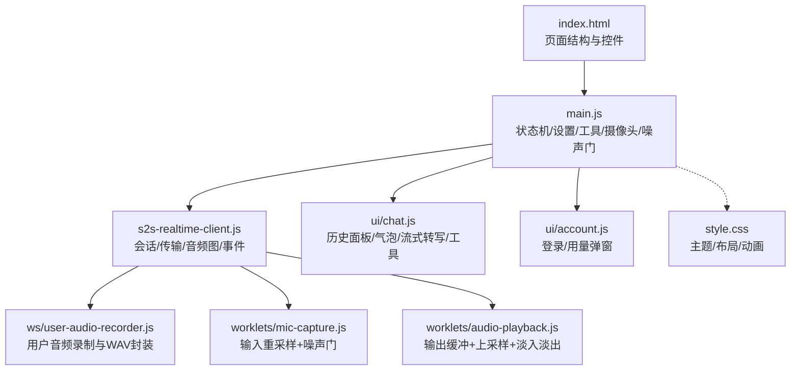
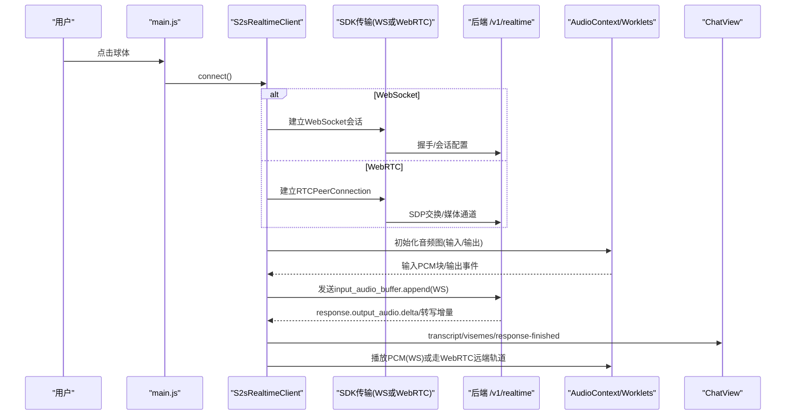
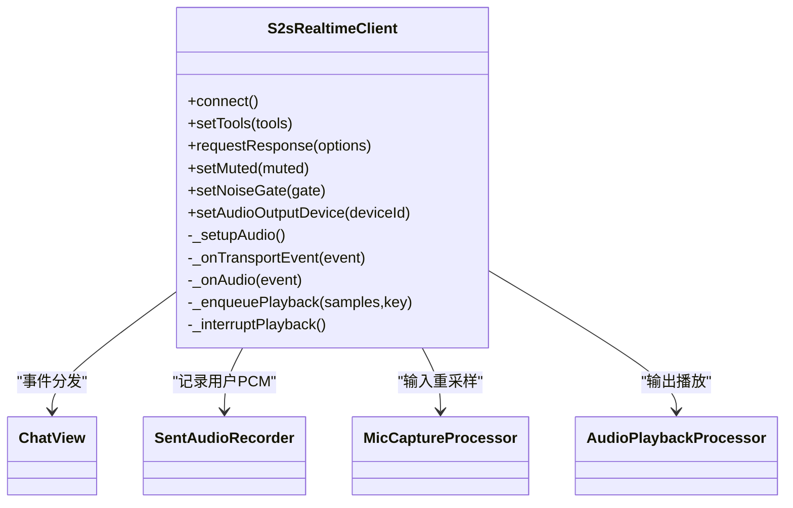
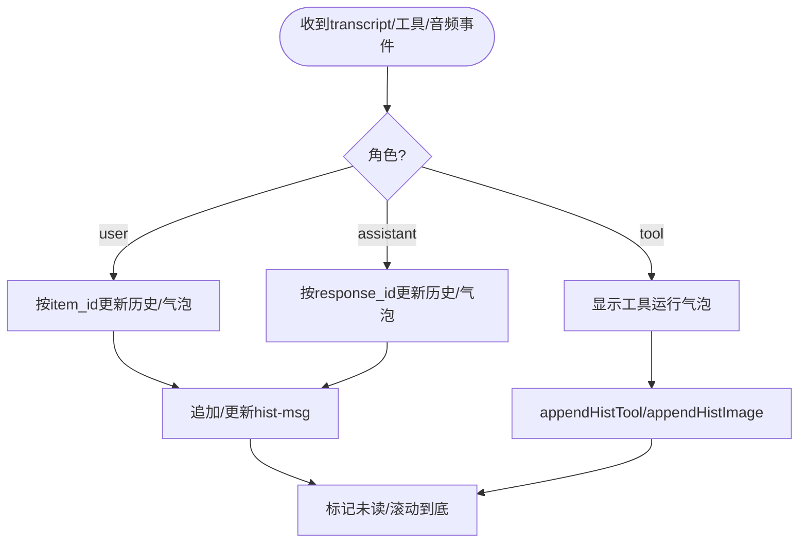
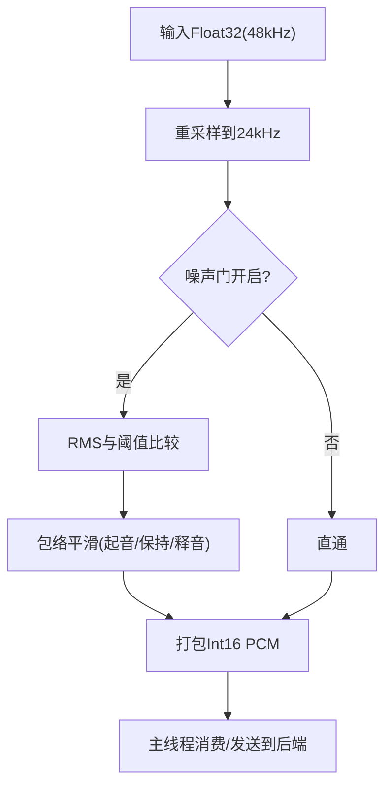
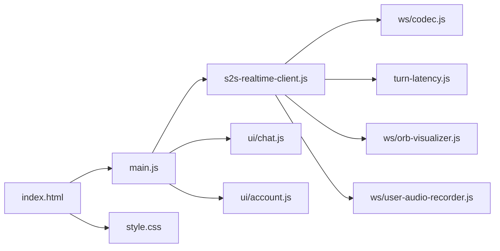

# 前端演示应用

<cite>
**本文引用的文件**   
- [demo/README.md](file://demo/README.md)
- [demo/README-CN.md](file://demo/README-CN.md)
- [demo/index.html](file://demo/index.html)
- [demo/main.js](file://demo/main.js)
- [demo/s2s-realtime-client.js](file://demo/s2s-realtime-client.js)
- [demo/style.css](file://demo/style.css)
- [demo/ui/chat.js](file://demo/ui/chat.js)
- [demo/ui/account.js](file://demo/ui/account.js)
- [demo/ws/user-audio-recorder.js](file://demo/ws/user-audio-recorder.js)
- [demo/worklets/mic-capture.js](file://demo/worklets/mic-capture.js)
- [demo/worklets/audio-playback.js](file://demo/worklets/audio-playback.js)
</cite>

## 目录
1. [简介](#简介)
2. [项目结构](#项目结构)
3. [核心组件](#核心组件)
4. [架构总览](#架构总览)
5. [详细组件分析](#详细组件分析)
6. [依赖关系分析](#依赖关系分析)
7. [性能与体验优化](#性能与体验优化)
8. [故障排查指南](#故障排查指南)
9. [二次开发与集成指南](#二次开发与集成指南)
10. [结论](#结论)

## 简介
本前端演示应用为 Hugging Face speech-to-speech 后端提供浏览器语音聊天界面，支持 OpenAI Realtime GA 协议。默认通过 WebSocket 连接，也可在环境变量固定的部署中使用 WebRTC 传输。应用包含：
- 中央球体交互、状态可视化（空闲、连接中、监听、用户说话、处理、助手说话、错误）
- 设置面板（服务器 URL、传输方式、麦克风/扬声器、音色、系统提示词、播放缓冲、噪声门）
- 工具面板（网络搜索、摄像头快照）
- 对话历史面板（流式转写、工具调用结果、用户录音回放）
- 用量计量与登录态（HF OAuth，仅在负载均衡模式启用）
- 移动端适配与深色主题

该文档聚焦浏览器端功能特性、用户交互流程、实时通信机制、JavaScript 客户端实现、WebSocket/WebRTC 连接管理、音频处理管线、样式与主题定制、二次开发扩展方法、移动端与跨浏览器兼容性、以及性能优化建议。

**章节来源**
- [demo/README.md:16-27](file://demo/README.md#L16-L27)
- [demo/README-CN.md:16-20](file://demo/README-CN.md#L16-L20)

## 项目结构
前端以单页应用为主，关键文件职责如下：
- index.html：页面骨架、顶部栏、中央球体、设置/工具/关于弹窗、对话历史面板、摄像头预览容器
- main.js：应用状态机、设置持久化、工具开关、摄像头控制、噪声门 UI、与 S2sRealtimeClient 的接线
- s2s-realtime-client.js：基于官方 Agents SDK 的窄封装，负责会话创建、传输选择、音频图构建、事件分发、打断与回放队列
- ui/chat.js：对话历史与气泡渲染、流式转写、工具调用展示、用户录音回放
- ui/account.js：HF 登录 Chip、用量上限弹窗、在线状态
- ws/user-audio-recorder.js：有界 PCM 缓冲区 + VAD 切片 + WAV 封装，用于回放“已发送”的用户音频
- worklets/mic-capture.js：AudioWorklet 输入重采样到 24 kHz PCM16，带可选噪声门
- worklets/audio-playback.js：AudioWorklet 输出环形缓冲、线性插值上采样、淡入淡出、断流保护
- style.css：深色主题、球体动画、布局、响应式规则

**图表来源**
- [demo/index.html:1-419](file://demo/index.html#L1-L419)
- [demo/main.js:1-120](file://demo/main.js#L1-L120)
- [demo/s2s-realtime-client.js:89-148](file://demo/s2s-realtime-client.js#L89-L148)
- [demo/ws/user-audio-recorder.js:58-77](file://demo/ws/user-audio-recorder.js#L58-L77)
- [demo/worklets/mic-capture.js:32-73](file://demo/worklets/mic-capture.js#L32-L73)
- [demo/worklets/audio-playback.js:29-78](file://demo/worklets/audio-playback.js#L29-L78)
- [demo/ui/chat.js:25-89](file://demo/ui/chat.js#L25-L89)
- [demo/ui/account.js:27-54](file://demo/ui/account.js#L27-L54)
- [demo/style.css:1-50](file://demo/style.css#L1-L50)

**章节来源**
- [demo/index.html:1-419](file://demo/index.html#L1-L419)
- [demo/main.js:1-120](file://demo/main.js#L1-L120)
- [demo/s2s-realtime-client.js:89-148](file://demo/s2s-realtime-client.js#L89-L148)
- [demo/ui/chat.js:25-89](file://demo/ui/chat.js#L25-L89)
- [demo/ui/account.js:27-54](file://demo/ui/account.js#L27-L54)
- [demo/style.css:1-50](file://demo/style.css#L1-L50)

## 核心组件
- S2sRealtimeClient：围绕官方 @openai/agents 的 RealtimeSession 与传输类（WebSocket/WebRTC），封装会话创建、音频图、事件分发、打断与回放队列、工具执行桥接。
- ChatView：负责对话历史面板、临时气泡、流式转写、工具调用行、用户录音回放。
- Account：HF 登录 Chip、用量限制弹窗、在线状态。
- 音频 Worklets：mic-capture 负责输入重采样与噪声门；audio-playback 负责输出缓冲、上采样与淡入淡出。
- 用户音频录制：SentAudioRecorder 维护有界 PCM 缓冲区，按 VAD 边界切段并封装为 WAV 供回放。

这些组件解耦了协议实现与 demo 专属行为（队列、音频、可视化、设备、摄像头、计量）。

**章节来源**
- [demo/s2s-realtime-client.js:1-46](file://demo/s2s-realtime-client.js#L1-L46)
- [demo/ui/chat.js:1-17](file://demo/ui/chat.js#L1-L17)
- [demo/ui/account.js:1-12](file://demo/ui/account.js#L1-L12)
- [demo/worklets/mic-capture.js:1-23](file://demo/worklets/mic-capture.js#L1-L23)
- [demo/worklets/audio-playback.js:1-24](file://demo/worklets/audio-playback.js#L1-L24)
- [demo/ws/user-audio-recorder.js:1-9](file://demo/ws/user-audio-recorder.js#L1-L9)

## 架构总览
下图展示了从用户点击球体到语音回放的端到端流程，包括两种传输路径（WebSocket 与 WebRTC）和音频工作线程。

**图表来源**
- [demo/main.js:159-250](file://demo/main.js#L159-L250)
- [demo/s2s-realtime-client.js:159-250](file://demo/s2s-realtime-client.js#L159-L250)
- [demo/s2s-realtime-client.js:301-381](file://demo/s2s-realtime-client.js#L301-L381)
- [demo/s2s-realtime-client.js:537-721](file://demo/s2s-realtime-client.js#L537-L721)

**章节来源**
- [demo/README.md:113-127](file://demo/README.md#L113-L127)
- [demo/README-CN.md:77-85](file://demo/README-CN.md#L77-L85)

## 详细组件分析

### 实时客户端 S2sRealtimeClient
职责：
- 根据 transport 选择 WebSocket 或 WebRTC 传输
- 创建 RealtimeSession，注入模型、配置、工具
- 构建 AudioContext 与 Worklets，处理输入/输出
- 分发服务端事件（转写、音频、VAD、工具调用、响应完成）
- 管理播放缓冲、打断、用户音频录制

关键点：
- 音频采样率 24 kHz，WS 模式下通过 AudioWorklet 收发 PCM16
- 播放缓冲策略：达到阈值后开始播放，完成后释放启动缓冲
- 打断：WS 下清空播放队列并发送 conversation.item.truncate；WebRTC 直接清理
- 工具：将 ToolDef 注册到 SDK Agent，executeTool 回调由 main.js 提供

**图表来源**
- [demo/s2s-realtime-client.js:89-148](file://demo/s2s-realtime-client.js#L89-L148)
- [demo/s2s-realtime-client.js:301-381](file://demo/s2s-realtime-client.js#L301-L381)
- [demo/s2s-realtime-client.js:431-528](file://demo/s2s-realtime-client.js#L431-L528)
- [demo/worklets/mic-capture.js:32-73](file://demo/worklets/mic-capture.js#L32-L73)
- [demo/worklets/audio-playback.js:29-78](file://demo/worklets/audio-playback.js#L29-L78)

**章节来源**
- [demo/s2s-realtime-client.js:89-148](file://demo/s2s-realtime-client.js#L89-L148)
- [demo/s2s-realtime-client.js:159-250](file://demo/s2s-realtime-client.js#L159-L250)
- [demo/s2s-realtime-client.js:301-381](file://demo/s2s-realtime-client.js#L301-L381)
- [demo/s2s-realtime-client.js:431-528](file://demo/s2s-realtime-client.js#L431-L528)
- [demo/s2s-realtime-client.js:537-721](file://demo/s2s-realtime-client.js#L537-L721)

### 对话视图 ChatView
职责：
- 管理对话历史面板与临时气泡
- 处理用户/助手转写增量，合并 item_id/response_id
- 工具调用行与图片快照展示
- 用户录音回放（WAV Blob），播放时静音麦克风防止反馈

要点：
- 用户转写按 item_id 分组，助手转写按 response_id 分组
- 气泡自动过期，按最旧优先顺序回收
- 工具调用结果可展开查看输入/输出，支持图片快照

**图表来源**
- [demo/ui/chat.js:431-529](file://demo/ui/chat.js#L431-L529)
- [demo/ui/chat.js:531-594](file://demo/ui/chat.js#L531-L594)
- [demo/ui/chat.js:680-693](file://demo/ui/chat.js#L680-L693)

**章节来源**
- [demo/ui/chat.js:25-89](file://demo/ui/chat.js#L25-L89)
- [demo/ui/chat.js:431-529](file://demo/ui/chat.js#L431-L529)
- [demo/ui/chat.js:531-594](file://demo/ui/chat.js#L531-L594)
- [demo/ui/chat.js:680-693](file://demo/ui/chat.js#L680-L693)

### 账户与用量 Account
职责：
- 读取 /api/me，渲染登录 Chip 或签名后的头像/昵称
- 显示剩余时长、升级链接、登出
- 用量耗尽或会话被中断时弹出限制弹窗

注意：
- 仅在负载均衡模式启用（/api/me.enabled）
- 区分匿名、免费、PRO、团队（org）等层级

**章节来源**
- [demo/ui/account.js:1-12](file://demo/ui/account.js#L1-L12)
- [demo/ui/account.js:27-54](file://demo/ui/account.js#L27-L54)
- [demo/ui/account.js:56-74](file://demo/ui/account.js#L56-L74)
- [demo/ui/account.js:153-182](file://demo/ui/account.js#L153-L182)

### 用户音频录制 SentAudioRecorder
职责：
- 维护有界的 PCM16 缓冲区，按 VAD 边界切段
- 将片段封装为 WAV Blob，供 ChatView 回放
- 支持截断提示（当请求的开始时间早于可用数据）

关键点：
- 预卷与最大缓冲毫秒数控制内存占用
- 同 item_id 的多次切片会拼接成一条完整录音

**章节来源**
- [demo/ws/user-audio-recorder.js:58-77](file://demo/ws/user-audio-recorder.js#L58-L77)
- [demo/ws/user-audio-recorder.js:79-90](file://demo/ws/user-audio-recorder.js#L79-L90)
- [demo/ws/user-audio-recorder.js:92-148](file://demo/ws/user-audio-recorder.js#L92-L148)
- [demo/ws/user-audio-recorder.js:188-197](file://demo/ws/user-audio-recorder.js#L188-L197)

### 音频工作线程
- mic-capture.js：将 AudioContext 采样率（通常 48 kHz）重采样到 24 kHz，打包为 Int16 LE PCM，定时发送块；内置噪声门（RMS 阈值、快速起音、保持、慢释）
- audio-playback.js：接收 Float32 样本，环形缓冲，线性插值上采样到 48 kHz，淡入淡出抑制咔哒声，统计队列长度与丢帧

**图表来源**
- [demo/worklets/mic-capture.js:32-73](file://demo/worklets/mic-capture.js#L32-L73)
- [demo/worklets/mic-capture.js:75-158](file://demo/worklets/mic-capture.js#L75-L158)

**章节来源**
- [demo/worklets/mic-capture.js:1-23](file://demo/worklets/mic-capture.js#L1-L23)
- [demo/worklets/mic-capture.js:32-73](file://demo/worklets/mic-capture.js#L32-L73)
- [demo/worklets/mic-capture.js:75-158](file://demo/worklets/mic-capture.js#L75-L158)
- [demo/worklets/audio-playback.js:29-78](file://demo/worklets/audio-playback.js#L29-L78)
- [demo/worklets/audio-playback.js:125-181](file://demo/worklets/audio-playback.js#L125-L181)

## 依赖关系分析
- main.js 导入 S2sRealtimeClient、ChatView、Account 与 DOM 工具
- S2sRealtimeClient 使用 ws/codec、turn-latency、orb-visualizer、user-audio-recorder
- 页面通过 vendor/openai-realtime-agents.umd.js 加载官方 SDK
- 样式由 style.css 统一控制，含深色主题与动画

**图表来源**
- [demo/index.html:415-417](file://demo/index.html#L415-L417)
- [demo/main.js:20-23](file://demo/main.js#L20-L23)
- [demo/s2s-realtime-client.js:48-51](file://demo/s2s-realtime-client.js#L48-L51)

**章节来源**
- [demo/index.html:415-417](file://demo/index.html#L415-L417)
- [demo/main.js:20-23](file://demo/main.js#L20-L23)
- [demo/s2s-realtime-client.js:48-51](file://demo/s2s-realtime-client.js#L48-L51)

## 性能与体验优化
- 输入路径
  - 48→24 kHz 快速路径采用盒式低通+抽取，奇数采样率回退线性插值
  - 噪声门避免环境底噪进入后端，RMS 阈值可调
- 输出路径
  - 播放缓冲阈值控制首包延迟与抗抖动；完成后释放启动缓冲
  - 线性插值上采样到 48 kHz，进出淡入淡出抑制咔哒声
- 打断与队列
  - WS 模式下，服务端 VAD 或显式中断会清空播放队列，并向服务器发送 truncate 事件
  - WebRTC 模式下，直接清理播放队列
- 缓存与版本
  - 入口模块、实时客户端、两个 AudioWorklet URL 共享版本号参数，确保浏览器音频契约一致
- 用户体验
  - 气泡自动回收、历史面板滚动节流、未读角标
  - 摄像头预览与权限监听，失败时优雅降级

**章节来源**
- [demo/README.md:345-392](file://demo/README.md#L345-L392)
- [demo/README-CN.md:235-240](file://demo/README-CN.md#L235-L240)
- [demo/s2s-realtime-client.js:301-381](file://demo/s2s-realtime-client.js#L301-L381)
- [demo/s2s-realtime-client.js:431-528](file://demo/s2s-realtime-client.js#L431-L528)
- [demo/worklets/mic-capture.js:75-158](file://demo/worklets/mic-capture.js#L75-L158)
- [demo/worklets/audio-playback.js:125-181](file://demo/worklets/audio-playback.js#L125-L181)

## 故障排查指南
常见问题与定位：
- 无法获取麦克风/摄像头
  - 需要 HTTPS 或 localhost；检查浏览器地址栏权限图标
  - 摄像头权限拒绝时，工具面板会提示并在关闭预览
- WebSocket 连接失败
  - 确认 SPEECH_TO_SPEECH_URL 指向正确的 /v1/realtime
  - Docker 环境下 WS 与 WebRTC 主机名不同（见 README）
- WebRTC 握手失败
  - 后端需安装 webrtc 扩展；否则返回 501
  - NAT 场景需配置 RTC_ICE_SERVERS（STUN/TURN）
- 播放卡顿或无声
  - 调整“播放启动缓冲（ms）”，WS 模式有效
  - 检查工作线程是否报告采样率不匹配或版本不一致
- 用户录音回放不可用
  - 仅 WS 模式可用；WebRTC 走媒体轨道，无 input_audio_buffer.append 回放
- 用量受限
  - 在 LB 模式下，/api/me 返回剩余秒数；耗尽时弹出限制弹窗

**章节来源**
- [demo/README.md:84-92](file://demo/README.md#L84-L92)
- [demo/README.md:129-170](file://demo/README.md#L129-L170)
- [demo/README.md:345-392](file://demo/README.md#L345-L392)
- [demo/ui/account.js:153-182](file://demo/ui/account.js#L153-L182)

## 二次开发与集成指南
- 接入现有应用
  - 引入 vendor/openai-realtime-agents.umd.js 与 main.js、style.css
  - 通过 S2sRealtimeClient 构造选项传入 micStream、audioContext、tools、executeTool 等
  - 将 ChatView 挂载到现有 DOM 容器中
- 扩展工具
  - 在 TOOL_DEFS 中添加新函数定义，并在 executeTool 中实现逻辑
  - 可通过 setTools 动态切换工具集
- 自定义主题
  - 修改 style.css 中的 CSS 变量（颜色、字体、圆角、阴影）
  - 球体状态与频谱条通过 CSS 变量驱动（--bar0..--bar4、--glow）
- 移动端适配
  - 已在小屏隐藏品牌文案、移动信息按钮、紧凑图标尺寸
  - 摄像头预览在底部左侧，footer 自适应
- 跨浏览器兼容
  - Chrome/Edge 支持 AudioContext.setSinkId 切换输出设备
  - 其他浏览器保持系统默认输出
- 集成示例
  - 本地启动后端与 demo 服务，设置 SPEECH_TO_SPEECH_URL 后访问 http://localhost:7860/
  - 在 LB 模式下，通过 /api/session 代理分配计算节点，浏览器直连 per-session URL

**章节来源**
- [demo/main.js:62-108](file://demo/main.js#L62-L108)
- [demo/main.js:350-362](file://demo/main.js#L350-L362)
- [demo/style.css:1-50](file://demo/style.css#L1-L50)
- [demo/style.css:147-189](file://demo/style.css#L147-L189)
- [demo/README.md:172-200](file://demo/README.md#L172-L200)

## 结论
本前端演示应用以简洁的球体交互为核心，结合 WebSocket/WebRTC 双传输、完善的音频工作线程与对话历史面板，提供了开箱即用的语音对话体验。其模块化设计便于二次开发与集成，同时兼顾移动端适配与跨浏览器兼容性。通过合理的播放缓冲、噪声门、打断与回放策略，可在真实环境中获得稳定且低延迟的语音交互体验。