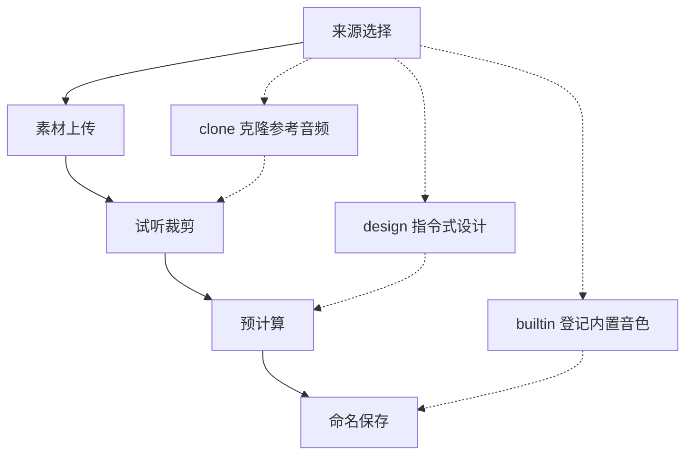

# 前端演示应用

<cite>
**本文引用的文件**   
- [console/design/console-refactor-demo.html](file://console/design/console-refactor-demo.html)
- [console/README.md](file://console/README.md)
- [docs/releases/v2.0.0.md](file://docs/releases/v2.0.0.md)
</cite>

## 更新摘要
**变更内容**   
- **新增音色制作向导**：在 console-refactor-demo.html 中实现了完整的 5 步音色制作流程（来源 → 素材 → 试听裁剪 → 预计算 → 命名保存）
- **部署参数下拉衔接**：qwen3_tts_speaker / ref_spk / ref_rvq / instruct 四个参数的「实际值」从文本输入改为音色派生下拉
- **音色库管理增强**：支持 builtin、clone、design 三种音色来源类型，包含完整的预计算流程和失败处理
- **静态原型实现**：纯前端 Mock 实现，无后端依赖，所有写操作仅 toast + 内存数据更新

## 目录
1. [简介](#简介)
2. [音色制作向导系统](#音色制作向导系统)
3. [部署参数配置](#部署参数配置)
4. [音色库数据结构](#音色库数据结构)
5. [界面组件说明](#界面组件说明)
6. [交互流程详解](#交互流程详解)
7. [技术实现细节](#技术实现细节)
8. [扩展开发指南](#扩展开发指南)

## 简介
speech-to-speech 项目的前端演示应用经过重大升级，新增了完整的音色制作向导系统和部署参数配置功能。新的 `console-refactor-demo.html` 文件（3,651 行）提供了生产级的控制台界面，包含负载均衡监控、机器管理、音色库管理、发布管理等完整功能模块。

**章节来源**
- [console/design/console-refactor-demo.html:1-50](file://console/design/console-refactor-demo.html#L1-L50)
- [console/README.md:1-17](file://console/README.md#L1-L17)

## 音色制作向导系统

### 五步制作流程
音色制作向导采用模态框形式，通过分步点亮范式引导用户完成音色创建：



**图表来源**
- [console/design/console-refactor-demo.html:3242-3284](file://console/design/console-refactor-demo.html#L3242-L3284)

### 三种音色来源类型

#### 1. Builtin（内置音色）
- **用途**：登记后端已支持的内置音色
- **流程**：跳过素材上传、试听裁剪和预计算步骤
- **输出**：仅写入 `qwen3_tts_speaker` 参数

#### 2. Clone（克隆音色）
- **用途**：基于参考音频克隆说话人音色
- **要求**：PCM16 · 16 kHz · 单声道 · ≤ 10 MiB 的参考音频
- **流程**：素材上传 → 试听裁剪 → 预计算 → 命名保存
- **产物**：`.spk.npy`、`.rvq.npy`、`ref.wav` 文件

#### 3. Design（设计音色）
- **用途**：通过自然语言描述创建 VoiceDesign 音色
- **要求**：至少 8 个字符的 VoiceDesign 指令
- **流程**：跳过素材上传和试听裁剪，直接预计算
- **输出**：写入 `qwen3_tts_instruct` 参数

**章节来源**
- [console/design/console-refactor-demo.html:1023-1026](file://console/design/console-refactor-demo.html#L1023-L1026)
- [console/design/console-refactor-demo.html:3273-3304](file://console/design/console-refactor-demo.html#L3273-L3304)

## 部署参数配置

### qwen3 TTS 参数下拉
部署页面的四个 qwen3 TTS 相关参数从文本输入改为音色派生下拉选择：

| 参数名 | 对应字段 | 说明 |
|--------|----------|------|
| `qwen3_tts_speaker` | `speaker` | 主音色选择器 |
| `qwen3_tts_ref_spk` | `spk` | 说话人向量路径 |
| `qwen3_tts_ref_rvq` | `rvq` | 声学码路径 |
| `qwen3_tts_instruct` | `instruct` | VoiceDesign 指令 |

### 动态选项生成
下拉选项由 VOICES 数组动态派生，过滤条件为：
- `backend === 'qwen3-tts'`
- `status === 'ready'`

新建音色完成后立即在下拉选项中可见，形成「制作完成即可被 qwen3 推理链路选用」的闭环。

**章节来源**
- [console/design/console-refactor-demo.html:1140-1142](file://console/design/console-refactor-demo.html#L1140-L1142)
- [console/design/console-refactor-demo.html:2365](file://console/design/console-refactor-demo.html#L2365)

## 音色库数据结构

### VOICES 数组扩展
每个音色条目新增以下字段：

```javascript
{
  id: 'jiajia',                    // 音色唯一标识
  backend: 'qwen3-tts',           // 后端类型
  model: 'qwen3-tts-1.7b',        // 模型版本
  lang: { en: 'Chinese', zh: '中文' }, // 多语言支持
  status: 'ready',                // 状态：ready/training/partial
  usage: 57,                      // 使用次数
  src: 'clone',                   // 来源：builtin/clone/design
  dur: 12.4,                      // 音频时长（秒）
  art: {                          // 艺术资源
    ulid: '01J9XQ8F3TGVW',       // ULID 标识符
    spk: '/app/data/voices/.../spk.npy', // 说话人向量
    rvq: '/app/data/voices/.../rvq.npy', // 声学码
    refText: { en: '...', zh: '...' }   // 参考文本
  }
}
```

### 种子数据
系统预置了 8 个种子音色，覆盖三种来源类型：
- **builtin**: sara, leo, echo, mint
- **clone**: jiajia（嘉嘉）
- **design**: aria, momo

**章节来源**
- [console/design/console-refactor-demo.html:1779-1791](file://console/design/console-refactor-demo.html#L1779-L1791)

## 界面组件说明

### 音色制作向导组件

#### 来源选择面板
- 三个可点击的来源类型卡片
- 选中状态高亮显示
- 每种来源附带详细说明

#### 音频波形可视化
- 48 条确定性波形柱状图
- 裁剪区域虚线框标注
- 实时显示保留时长统计

#### 预计算进度面板
- 复用发布流水线组件样式
- 分步骤状态指示器
- 模拟成功/失败分支
- 重试机制支持

#### 命名保存表单
- 音色名称验证（大小写不敏感唯一）
- 保存内容预览
- 参数映射关系展示

**章节来源**
- [console/design/console-refactor-demo.html:226-240](file://console/design/console-refactor-demo.html#L226-L240)
- [console/design/console-refactor-demo.html:3306-3387](file://console/design/console-refactor-demo.html#L3306-L3387)

## 交互流程详解

### 音色制作完整流程

#### 1. 来源选择阶段
```javascript
// 根据来源类型决定后续步骤
const vcSkip = (v, i) => (v.src === 'builtin' ? i >= 1 && i <= 3 : v.src === 'design' && i === 2);
```

#### 2. 素材处理阶段
- **Clone 模式**：文件上传 + 逐字转写 + x-vector 选项
- **Design 模式**：VoiceDesign 指令输入
- **Builtin 模式**：跳过此阶段

#### 3. 试听裁剪阶段
- 波形可视化显示
- 快速裁剪预设（整段/去头尾）
- 精确时间控制（ms 级）
- 最小保留时长验证（≥ 1.0s）

#### 4. 预计算阶段
- 模拟后端并发限制（VC_PRECONC = 1）
- 超时控制（VC_TIMEOUT = 300s）
- 失败分支处理（静音占比过高）
- 产物路径生成（ULID 哈希）

#### 5. 命名保存阶段
- 名称格式验证
- 重复名称检查
- 参数映射确认
- 内存数据更新

**章节来源**
- [console/design/console-refactor-demo.html:3254-3258](file://console/design/console-refactor-demo.html#L3254-L3258)
- [console/design/console-refactor-demo.html:3455-3503](file://console/design/console-refactor-demo.html#L3455-L3503)

## 技术实现细节

### 确定性算法
所有数值计算避免使用 `Math.random()`，确保重渲染结果一致：

```javascript
// ULID 生成
const vcUlid = (seed) => '01J9XQ' + vcHash(seed).toString(36).toUpperCase().padStart(7, '0').slice(-7);

// 音频时长推导
const vcDuration = (seed) => Math.round((6 + (vcHash(seed) % 61) / 10) * 10) / 10;

// 任务 ID 生成
const vcJob = (seed) => 'job-' + vcHash('job:' + seed).toString(36);
```

### 状态管理机制
- 全局状态对象 `state.voice` 管理向导状态
- 分步验证逻辑 `vcValidate(v)`
- 步骤导航函数 `vcForward` / `vcPrevStep`
- 模态框生命周期管理

### 国际化支持
所有界面文案采用双语键值对：
```javascript
Object.assign(I18N.en, {
  'voice.wizard.title': 'Voice creation',
  'voice.wizard.step.source': 'Source',
  // ...
});
Object.assign(I18N.zh, {
  'voice.wizard.title': '音色制作',
  'voice.wizard.step.source': '来源',
  // ...
});
```

**章节来源**
- [console/design/console-refactor-demo.html:1134-1138](file://console/design/console-refactor-demo.html#L1134-L1138)
- [console/design/console-refactor-demo.html:1016-1106](file://console/design/console-refactor-demo.html#L1016-L1106)

## 扩展开发指南

### 添加新的音色来源类型
1. 在 `VC_STEPS` 常量中添加新步骤定义
2. 扩展 `vcSkip` 逻辑以支持新来源
3. 添加对应的 UI 组件和验证逻辑
4. 更新 I18N 翻译键值

### 集成真实后端 API
当前实现为纯前端 Mock，集成真实后端需要：

1. **替换预计算逻辑**：
```javascript
// 当前 Mock 实现
function vcRunPre() {
  // 模拟异步处理
  mTimer(() => {
    if (v.sim === 'fail') {
      v.pre = 'failed';
      // ...
    } else {
      vcFinishPre();
    }
  }, 900);
}

// 真实 API 调用示例
async function vcRunPre() {
  try {
    const response = await fetch('/api/voice/precompute', {
      method: 'POST',
      body: JSON.stringify({ audio: v.file, transcript: v.transcript })
    });
    const result = await response.json();
    if (result.success) {
      vcFinishPre();
    } else {
      v.pre = 'failed';
      v.err = result.error;
    }
  } catch (error) {
    v.pre = 'failed';
    v.err = error.message;
  }
}
```

2. **更新数据持久化**：
```javascript
// 当前内存存储
VOICES.push(entry);

// 真实 API 调用
async function saveVoiceEntry(entry) {
  const response = await fetch('/api/voices', {
    method: 'POST',
    headers: { 'Content-Type': 'application/json' },
    body: JSON.stringify(entry)
  });
  return response.json();
}
```

### 性能优化建议
1. **虚拟滚动**：音色库超过 100 项时考虑虚拟滚动
2. **懒加载**：音色详情和音频文件按需加载
3. **缓存策略**：本地缓存音色元数据和波形数据
4. **Web Worker**：音频处理和波形计算移至后台线程

**章节来源**
- [console/design/console-refactor-demo.html:3455-3503](file://console/design/console-refactor-demo.html#L3455-L3503)