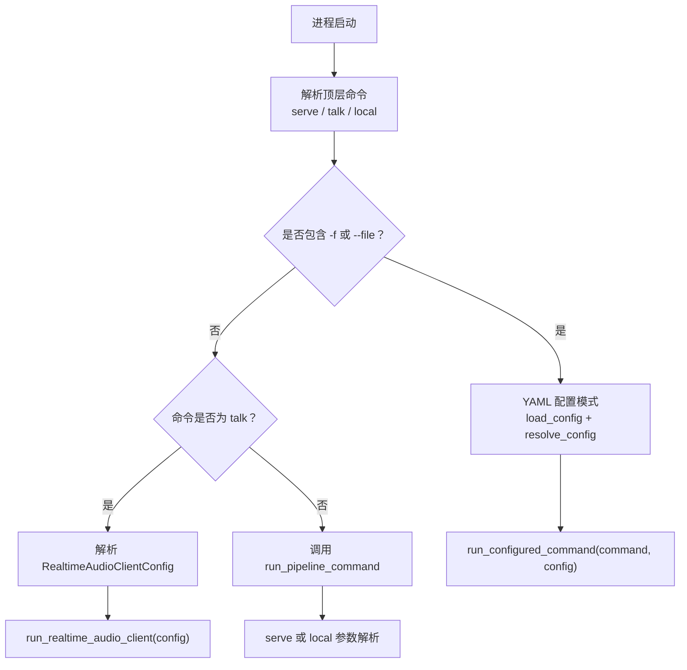

# 命令行接口参考

<cite>
**本文引用的文件**   
- [cli.py](file://src/speech_to_speech/cli.py)
- [s2s_pipeline.py](file://src/speech_to_speech/s2s_pipeline.py)
- [config.py](file://src/speech_to_speech/config.py)
- [_config_yaml.py](file://src/speech_to_speech/_config_yaml.py)
- [configured_runtime.py](file://src/speech_to_speech/configured_runtime.py)
- [module_arguments.py](file://src/speech_to_speech/arguments_classes/module_arguments.py)
- [vad_arguments.py](file://src/speech_to_speech/arguments_classes/vad_arguments.py)
- [realtime_server_arguments.py](file://src/speech_to_speech/arguments_classes/realtime_server_arguments.py)
- [local_audio_arguments.py](file://src/speech_to_speech/arguments_classes/local_audio_arguments.py)
- [parameter-catalog.yaml](file://docs/parameter-catalog.yaml)
</cite>

## 目录
1. [简介](#简介)
2. [命令总览与入口流程](#命令总览与入口流程)
3. [通用参数与配置加载方式](#通用参数与配置加载方式)
4. [命令：serve](#命令serve)
5. [命令：talk](#命令talk)
6. [命令：local](#命令local)
7. [模块级参数（ModuleArguments）](#模块级参数modulearguments)
8. [VAD 参数](#vad-参数)
9. [STT、LLM、TTS 后端参数选择规则](#sttllmtts-后端参数选择规则)
10. [Realtime 服务器参数](#realtime-服务器参数)
11. [本地音频客户端参数](#本地音频客户端参数)
12. [YAML 配置结构与作用域](#yaml-配置结构与作用域)
13. [常用命令组合示例](#常用命令组合示例)
14. [脚本化与自动化部署模式](#脚本化与自动化部署模式)
15. [参数验证错误说明](#参数验证错误说明)
16. [调试输出解读](#调试输出解读)
17. [性能调优建议](#性能调优建议)
18. [结论](#结论)

## 简介
本参考文档面向通过命令行运行或连接语音到语音实时管道的用户，覆盖以下目标：
- 完整记录 `serve`、`talk`、`local` 三个命令的功能、参数、默认值、作用域和依赖关系。
- 说明模块级参数、VAD 参数、STT/LLM/TTS 后端选择规则、Realtime 服务器参数和本地音频客户端参数。
- 解释 YAML 配置文件的顶层键、块定义、管道定义、环境变量引用和路径解析行为。
- 提供常用命令组合、脚本化使用模式和自动化部署注意事项。
- 汇总参数校验失败原因、日志与调试输出含义，以及端到端延迟、吞吐量和资源占用的调优建议。

该 CLI 支持两种主要用法：
- 直接传入命令行参数，由 `parse_arguments` 解析 STT、LLM、TTS 后端并构建运行时。
- 通过 `-f/--file` 指定 YAML 配置文件，由 `load_config` 和 `resolve_config` 校验并解析为可运行的配置对象。

## 命令总览与入口流程
CLI 顶层命令只有三个：`serve`、`talk`、`local`。入口逻辑位于 `cli.py`：
- 如果未传命令，会报错要求提供 `serve`、`talk` 或 `local`。
- 如果包含 `-f` 或 `--file`，则进入 YAML 配置模式。
- 如果命令是 `talk`，则走轻量音频客户端解析。
- 否则进入 `s2s_pipeline.run_pipeline_command`，由 `parse_arguments` 解析服务或本地模式参数。



**图表来源**
- [cli.py:26-95](file://src/speech_to_speech/cli.py#L26-L95)
- [cli.py:98-187](file://src/speech_to_speech/cli.py#L98-L187)
- [cli.py:190-249](file://src/speech_to_speech/cli.py#L190-L249)

**章节来源**
- [cli.py:18-95](file://src/speech_to_speech/cli.py#L18-L95)
- [cli.py:190-249](file://src/speech_to_speech/cli.py#L190-L249)

## 通用参数与配置加载方式
### 顶层通用选项
| 参数 | 适用命令 | 类型 | 默认值 | 作用 |
|---|---|---|---|---|
| `-f`、`--file` | serve、talk、local | YAML 路径 | 无 | 读取一个 YAML 配置文件；必须恰好提供一个文件。 |
| `--name` | serve、local | 字符串列表 | 无 | 从 YAML 的 `pipelines` 中选择一个或多个定义；serve/local 模式下最终只允许选中一个定义。 |

注意：
- `talk` 不接受 `--name`。
- 如果使用了 `--name` 但没有 `-f`，CLI 会报错提示需要配置文件。
- YAML 模式接受 `-h/--help`，但其他未知参数会被拒绝，因为 YAML 模式把业务参数放在文件中。

### YAML 配置约束
YAML 配置由 `_config_yaml.py` 安全加载，并由 `config.py` 校验：
- 最大文件大小：1 MiB。
- 最大嵌套深度：32 层。
- 不支持锚点、别名、显式标签、合并键。
- 映射键必须是字符串，不允许重复键。
- 数值必须有限，不允许非有限浮点数。
- 顶层键固定为 `schema_version`、`runtime`、`blocks`、`pipelines`。
- `schema_version` 必须为整数 `1`。
- `blocks` 和 `pipelines` 都必须是非空映射。
- 路径字段在解析时会先展开 `~`，相对路径按 YAML 文件所在目录解析。

**章节来源**
- [cli.py:190-228](file://src/speech_to_speech/cli.py#L190-L228)
- [_config_yaml.py:17-112](file://src/speech_to_speech/_config_yaml.py#L17-L112)
- [config.py:106-125](file://src/speech_to_speech/config.py#L106-L125)
- [config.py:371-438](file://src/speech_to_speech/config.py#L371-L438)

## 命令：serve
`serve` 用于启动 Realtime 语音到语音服务。它不直接绑定麦克风或扬声器，而是暴露 HTTP/WebSocket 接口，供外部客户端连接。

### 关键行为
- 解析 STT、LLM、TTS 后端。
- 根据 `num_pipelines` 创建多个隔离的 pipeline 实例。
- 启动 RealtimeServer，监听 `host` 和 `port`。
- 可选启用 LLM 代理，将受支持的 LLM 后端以 OpenAI 兼容接口暴露。
- 可通过 `log_level`、`log_transcripts`、`torch_num_threads` 控制日志和线程。

### 重要参数来源
`serve` 的参数主要来自两类：
1. 命令行参数，由 `s2s_pipeline.parse_arguments` 解析。
2. YAML 配置中的 `runtime.server`、`runtime.client`、`blocks`、`pipelines`。

### 典型用途
- 在服务器上启动语音对话服务。
- 配合反向代理或网关对外暴露 `/v1/realtime`。
- 通过 `enable_llm_proxy` 暴露上游 LLM 能力（需后端支持）。

**章节来源**
- [cli.py:247-249](file://src/speech_to_speech/cli.py#L247-L249)
- [s2s_pipeline.py:185-297](file://src/speech_to_speech/s2s_pipeline.py#L185-L297)
- [s2s_pipeline.py:710-747](file://src/speech_to_speech/s2s_pipeline.py#L710-L747)
- [configured_runtime.py:314-348](file://src/speech_to_speech/configured_runtime.py#L314-L348)

## 命令：talk
`talk` 是一个轻量音频客户端命令，用于连接任意 OpenAI 兼容 Realtime 服务端，并通过本机麦克风和扬声器进行语音交互。

### 核心参数
| 参数 | 类型 | 默认值 | 说明 |
|---|---|---|---|
| `--url` | 字符串 | `ws://127.0.0.1:8765/v1/realtime` | Realtime WebSocket 地址，必须包含 `/realtime`。 |
| `--model` | 字符串 | `local` | 会话模型名；部分本地后端可能忽略该值。 |
| `--api-key` | 字符串 | 空或占位符 | Realtime API Key；若为空且为本地回环地址，会使用无害占位符。 |
| `--send-rate` | 整数 | 16000 | 麦克风采样率。 |
| `--recv-rate` | 整数 | 16000 | 扬声器采样率。 |
| `--playback-buffer-ms` | 浮点数 | 0.0 | 播放前缓冲毫秒数，必须为非负有限数。 |
| `--chunk-size` | 整数 | 1024 | 音频回调块大小。 |
| `--input-device` | 整数 | 空 | 输入设备索引。 |
| `--output-device` | 整数 | 空 | 输出设备索引。 |
| `--instructions` | 字符串 | 空 | 会话指令，可覆盖服务端初始 prompt。 |
| `--tool-module` | 字符串 | 空 | 工具模块路径，需导出 `TOOLS` 和异步 `execute_tool(name, arguments)`。 |
| `--voice` | 字符串 | 空 | 音色名，例如 `bm_fable`、`marin`、`alloy`。 |
| `--print-json` | 布尔 | False | 打印原始 Realtime JSON 事件。 |
| `--block-mic-during-playback` | 布尔 | False | 播放时阻塞麦克风；关闭后支持打断。 |
| `--log-transcripts` | 布尔 | False | 记录完整转录和工具错误详情。 |
| `--connection-retry-timeout` | 浮点数 | 30.0 | 等待 Realtime 端可用的重试超时秒数。 |

### 行为说明
- `talk` 不会启动服务，只负责采集音频、发送请求、播放响应。
- 如果设置了 `--tool-module`，会通过 `load_realtime_tool_module` 加载工具描述和执行器。
- `log_transcripts` 会影响全局转录日志开关，并在启动前发出隐私警告。

**章节来源**
- [cli.py:98-187](file://src/speech_to_speech/cli.py#L98-L187)
- [parameter-catalog.yaml:23-291](file://docs/parameter-catalog.yaml#L23-L291)

## 命令：local
`local` 在同一进程中同时启动 Realtime 服务和本地音频客户端，默认通过回环地址通信。适合本地开发、调试和快速体验。

### 关键行为
- 强制使用 `127.0.0.1` 作为服务 host。
- 自动构造指向本地端口的 Realtime URL。
- 如果未显式设置 `playback_buffer_ms`，会根据 TTS 后端决定默认值：OpenAI 兼容 TTS 使用 196 ms，其他后端使用 0 ms。
- 如果显式设置了 `server.host` 且不是回环地址，会报错。
- 如果显式设置了 `client.url`，其端口必须匹配服务端端口。

### 本地音频参数
`local` 额外使用 `LocalAudioArguments`：
| 参数 | 类型 | 默认值 | 说明 |
|---|---|---|---|
| `--tool-module` | 字符串 | 空 | 本地模式工具模块。 |
| `--local-audio-input-device` | 整数 | 空 | 本地模式输入设备。 |
| `--local-audio-output-device` | 整数 | 空 | 本地模式输出设备。 |
| `--local-audio-chunk-size` | 整数 | 1024 | 本地音频回调块大小。 |
| `--local-audio-playback-buffer-ms` | 浮点数 | 空 | 本地播放缓冲；空时按 TTS 后端推断。 |
| `--local-audio-block-mic-during-playback` | 布尔 | False | 播放时暂停麦克风采集。 |
| `--local-audio-print-json` | 布尔 | False | 打印本地客户端收到的原始事件。 |

**章节来源**
- [s2s_pipeline.py:750-785](file://src/speech_to_speech/s2s_pipeline.py#L750-L785)
- [configured_runtime.py:112-159](file://src/speech_to_speech/configured_runtime.py#L112-L159)
- [local_audio_arguments.py:5-46](file://src/speech_to_speech/arguments_classes/local_audio_arguments.py#L5-L46)

## 模块级参数（ModuleArguments）
模块级参数控制整个语音到语音管道，包括 STT、LLM、TTS 后端选择、设备、并发、日志、转写、说话人分离、LLM 代理等。

### 核心参数表
| 参数 | 类型 | 默认值 | 作用域 | 说明 |
|---|---|---|---|---|
| `--stt` | 字符串 | `parakeet-tdt` | 模块级 | STT 后端；可选 `none` 表示跳过 STT，直接把 VAD 音频传给支持音频输入的 LLM。 |
| `--llm_backend`、`--llm-backend` | 字符串 | macOS 上为 `mlx-lm`，其他平台为 `transformers` | 模块级 | LLM 后端；API 后端必须显式选择。 |
| `--tts` | 字符串 | `qwen3` | 模块级 | TTS 后端。 |
| `--device` | 字符串 | 空 | 模块级 | 统一覆盖所有 handler 的设备；若组件未声明 `device` 字段则不生效。 |
| `--mac_optimal_settings` | 布尔 | False | 模块级 | 启用 macOS 预设：STT 用 Parakeet TDT，LLM 用 MLX LM，TTS 用 Qwen3，相关设备用 MPS。 |
| `--log_level` | 字符串 | `info` | 模块级 | 日志级别。 |
| `--log_transcripts` | 布尔 | False | 模块级 | 记录完整用户和助手文本；生产环境默认关闭以避免隐私泄露。 |
| `--torch_num_threads` | 正整数或空 | 空 | 模块级 | 设置 PyTorch CPU 线程数；必须为正整数，影响 Silero VAD 和其他 CPU 推理。 |
| `--enable_live_transcription` | 布尔 | True | 模块级 | 说话时显示实时转写，通常与 parakeet-tdt 配合。 |
| `--live_transcription_update_interval` | 浮点数 | 0.5 | 模块级 | 实时转写更新间隔秒数。 |
| `--enable_llm_proxy` | 布尔 | False | 模块级 | 暴露支持代理的 LLM 后端为 OpenAI 兼容 HTTP 接口。 |
| `--llm_proxy_connect_timeout_s` | 浮点数 | 10.0 | 模块级 | LLM 代理上游连接超时秒数。 |
| `--num_pipelines` | 整数 | 1 | 模块级 | 并行 pipeline 数量；等于最大并发 WebSocket 会话数。 |
| `--diarization` | 布尔 | False | 模块级 | 启用 Nemotron 3 Diarization 说话人感知对话。 |
| `--diarization_model_name` | 字符串或空 | 空 | 模块级 | 说话人分离模型名称；未设置但启用 diarization 时会自动填充默认值。 |
| `--diarization_revision` | 字符串或空 | 空 | 模块级 | 说话人分离模型版本。 |
| `--diarization_device` | 字符串 | `auto` | 模块级 | 说话人分离设备：auto、cuda、mps、cpu。 |
| `--diarization_dtype` | 枚举 | `float32` | 模块级 | 说话人分离精度：float32、float16、bfloat16。 |
| `--diarization_streaming_mode` | 枚举 | `low_latency` | 模块级 | 流式说话人分离模式。 |
| `--diarization_threshold` | 浮点数 | 0.5 | 模块级 | 说话人活动概率阈值，必须在 0 到 1 之间。 |
| `--detect_llm_output_language` | 布尔 | False | 模块级 | 检测助手文本语言并传给 TTS。 |

### 重要依赖关系
- `--stt none` 要求 LLM 后端支持音频输入。
- `--enable_llm_proxy` 要求 LLM 后端支持 LLM 代理。
- `--diarization_model_name` 存在时必须启用 STT。
- `--diarization_threshold` 必须在 `(0, 1)`。
- macOS 上禁止使用 CUDA；推荐 `mlx-lm` 和 `qwen3`。
- `--torch_num_threads` 必须为正整数。

**章节来源**
- [module_arguments.py:14-147](file://src/speech_to_speech/arguments_classes/module_arguments.py#L14-L147)
- [s2s_pipeline.py:347-366](file://src/speech_to_speech/s2s_pipeline.py#L347-L366)
- [s2s_pipeline.py:368-379](file://src/speech_to_speech/s2s_pipeline.py#L368-L379)

## VAD 参数
VAD 参数控制语音活动检测、分段策略、Smart Turn 行为和实时转写辅助行为。

### 核心参数表
| 参数 | 类型 | 默认值 | 说明 |
|---|---|---|---|
| `--vad` | 枚举 | `silero` | VAD 后端：`silero` 或 `firered`。 |
| `--vad-firered-model-dir` | 字符串或空 | 空 | FireRed Stream-VAD 权重目录；使用 `firered` 时需要。 |
| `--vad-firered-use-gpu` | 布尔 | False | FireRed VAD 是否使用 GPU。 |
| `--thresh` | 浮点数 | 0.6 | VAD 阈值，越高越保守。 |
| `--sample_rate` | 整数 | 16000 | VAD 音频采样率。 |
| `--min-silence-ms` | 整数 | 64 | 最小静音段长度。 |
| `--min-speech-ms` | 整数 | 384 | 最小有效语音段长度。 |
| `--min-speech-continuation-ms` | 整数 | 192 | 软结束续话段的滞后阈值，范围被限制在 `[100, min_speech_ms]`。 |
| `--max-speech-ms` | 浮点数 | 无穷大 | 强制切分连续语音的最大长度。 |
| `--speech-pad-ms` | 整数 | 500 | VAD 触发前保留的音频长度。 |
| `--audio-enhancement` | 布尔 | False | 开启降噪和均衡等音质增强。 |
| `--enable-realtime-transcription` | 布尔 | False | 说话期间释放渐进音频给实时转写。 |
| `--realtime-processing-pause` | 浮点数 | 0.5 | 渐进音频释放间隔秒数。 |
| `--speculative-reopen-ms` | 整数 | 800 | 软结束回复保持可重开的毫秒数。 |
| `--unanswered-reopen-ms` | 整数 | 7000 | 未回答软结束回复的重开上限。 |
| `--short-segment-merge-ms` | 整数 | 0 | 短片段合并窗口。 |
| `--smart-turn` | 布尔 | True | 启用 Smart Turn v3.2。 |
| `--smart-turn-model-path` | 字符串或空 | 空 | Smart Turn ONNX 模型路径。 |
| `--smart-turn-threshold` | 浮点数 | 0.5 | Smart Turn 完成概率阈值。 |
| `--smart-turn-max-wait-ms` | 整数 | 2000 | 推测性重开宽限时间。 |
| `--smart-turn-incomplete-delay-ms` | 整数 | 600 | Smart Turn 报告未完成后的延迟。 |
| `--smart-turn-cpu-count` | 整数 | 1 | Smart Turn ONNX Runtime CPU 线程数。 |

### 关键依赖
- `--vad firered` 需要可选依赖和权重目录。
- `--enable-live-transcription` 与 VAD 的 `enable_realtime_transcription` 联动，当 STT 不支持流式音频块时，pipeline 会启用 VAD 侧的渐进释放。
- Smart Turn 参数共同决定“说完没”的判断、重开窗口和延迟保护。

**章节来源**
- [vad_arguments.py:4-132](file://src/speech_to_speech/arguments_classes/vad_arguments.py#L4-L132)
- [s2s_pipeline.py:646-649](file://src/speech_to_speech/s2s_pipeline.py#L646-L649)

## STT、LLM、TTS 后端参数选择规则
### 后端选择流程
1. 首先解析 `--stt`、`--llm_backend`、`--tts`。
2. 如果传入 JSON 文件或启用 `--mac_optimal_settings`，会应用 macOS 预设。
3. 从注册表中查找对应后端；不存在时报错。
4. 使用 HuggingFace `HfArgumentParser` 解析所选后端的具体参数。
5. 对未选中的后端参数做兼容性处理：如果某个参数属于未激活后端，会忽略并记录警告。
6. 将选择的后端封装为 `BackendSelection`，并执行 `normalize` 生成标准化配置。

### 常见后端类别
- STT：例如 `parakeet-tdt`、`faster-whisper`、`whisper`、`openai`、`qwen3-asr`、`paraformer`、`parakeet-unified`、`nemotron-streaming`、`vllm-realtime` 等。
- LLM：例如 `mlx-lm`、`transformers`、`chat-completions`、`responses-api` 等。
- TTS：例如 `qwen3`、`pocket`、`kokoro`、`omnivoice`、`facebookMMS`、`supertonic`、`chatTTS`、`openai` 等。

### 兼容性规则
- 如果选择了 `--stt none`，LLM 必须支持音频输入。
- 如果启用 `--enable_llm_proxy`，LLM 必须支持 LLM 代理。
- 如果启用说话人分离，必须存在 STT。
- macOS 上不能直接使用 CUDA；推荐 MLX LLM 和 Qwen3 TTS。

**章节来源**
- [s2s_pipeline.py:145-182](file://src/speech_to_speech/s2s_pipeline.py#L145-L182)
- [s2s_pipeline.py:185-297](file://src/speech_to_speech/s2s_pipeline.py#L185-L297)
- [s2s_pipeline.py:347-366](file://src/speech_to_speech/s2s_pipeline.py#L347-L366)

## Realtime 服务器参数
Realtime 服务器参数控制服务监听地址和端口。

| 参数 | 类型 | 默认值 | 说明 |
|---|---|---|---|
| `--host` | 字符串 | `127.0.0.1` | Realtime 服务监听地址；默认仅本地可达。 |
| `--port` | 整数 | 8765 | Realtime HTTP/WebSocket 端口。 |

注意：
- `serve` 使用 `RealtimeServerArguments`。
- `local` 使用 `LocalRealtimeServerArguments`，只暴露端口，host 会被强制为回环地址。
- 生产环境如需外网访问，应通过反向代理或网关管理认证和 TLS，不要直接暴露 `0.0.0.0`。

**章节来源**
- [realtime_server_arguments.py:4-24](file://src/speech_to_speech/arguments_classes/realtime_server_arguments.py#L4-L24)
- [s2s_pipeline.py:240-274](file://src/speech_to_speech/s2s_pipeline.py#L240-L274)

## 本地音频客户端参数
本地音频客户端参数仅在 `local` 命令下生效，用于控制本机麦克风和扬声器行为。

| 参数 | 类型 | 默认值 | 说明 |
|---|---|---|---|
| `--local-audio-tool-module` | 字符串或空 | 空 | 本地模式工具模块。 |
| `--local-audio-input-device` | 整数或空 | 空 | 本地模式输入设备索引。 |
| `--local-audio-output-device` | 整数或空 | 空 | 本地模式输出设备索引。 |
| `--local-audio-chunk-size` | 整数 | 1024 | 本地音频回调块大小。 |
| `--local-audio-playback-buffer-ms` | 浮点数或空 | 空 | 本地播放缓冲；空时按 TTS 后端推断。 |
| `--local-audio-block-mic-during-playback` | 布尔 | False | 播放时暂停麦克风采集。 |
| `--local-audio-print-json` | 布尔 | False | 打印本地客户端原始事件。 |

**章节来源**
- [local_audio_arguments.py:5-46](file://src/speech_to_speech/arguments_classes/local_audio_arguments.py#L5-L46)
- [s2s_pipeline.py:750-785](file://src/speech_to_speech/s2s_pipeline.py#L750-L785)

## YAML 配置结构与作用域
YAML 配置分为四个顶层区域：
- `schema_version`：固定为 `1`。
- `runtime`：进程级运行时配置，包含 `server`、`client` 和模块级进程参数。
- `blocks`：可复用模块定义，每个 block 有 `kind`、`backend`、`settings`。
- `pipelines`：命名管道定义，引用 blocks 并设置实例数和选项。

### 作用域分类
| 作用域 | 说明 |
|---|---|
| 模块进程级 | `log_level`、`log_transcripts`、`torch_num_threads`。 |
| 服务器级 | `runtime.server`。 |
| 客户端级 | `runtime.client`。 |
| 管道选项级 | `pipelines.<name>.options`，如 `device`、`num_pipelines`、`diarization_*`、`enable_llm_proxy` 等。 |
| 模块后端级 | `blocks.<id>.settings`，对应具体后端参数类。 |

### 环境变量引用
YAML 支持 `{env: NAME}` 引用环境变量：
- 仅标量字段支持 env 引用。
- 如果环境变量缺失，会报错。
- 字符串、布尔、整数、浮点数会从环境变量文本转换。
- 路径字段会先展开 `~`，再按 YAML 文件目录解析相对路径。

### 配置校验关键点
- 必须定义非空的 `blocks` 和 `pipelines`。
- block ID 必须是合法标识符。
- pipeline 必须引用 vad、stt、llm、tts 四个 stage。
- `num_pipelines` 必须为正整数。
- 某些组合会被拒绝，例如 STT bypass 但 LLM 不支持音频输入。

**章节来源**
- [config.py:148-313](file://src/speech_to_speech/config.py#L148-L313)
- [config.py:371-438](file://src/speech_to_speech/config.py#L371-L438)
- [config.py:441-538](file://src/speech_to_speech/config.py#L441-L538)

## 常用命令组合示例
以下示例展示典型用法，不包含具体代码内容，仅给出命令语义。

### 启动默认服务
```text
speech-to-speech serve
```
- 使用默认 STT、LLM、TTS 后端。
- 监听 `127.0.0.1:8765`。
- 创建一个 pipeline 实例。

### 指定后端并开启调试日志
```text
speech-to-speech serve --stt faster-whisper --llm_backend transformers --tts qwen3 --log_level debug
```

### 使用 YAML 配置启动服务
```text
speech-to-speech serve -f config/prod.yaml
```

### 从 YAML 中选择命名管道
```text
speech-to-speech serve -f config/prod.yaml --name production-v1
```

### 本地模式快速调试
```text
speech-to-speech local
```

### 本地模式指定端口和工具模块
```text
speech-to-speech local --port 8766 --tool-module examples.realtime_web_search_tool
```

### 连接远程 Realtime 服务
```text
speech-to-speech talk --url wss://example.com/v1/realtime --api-key "$OPENAI_API_KEY"
```

### 本地模式连接自定义 URL
```text
speech-to-speech talk --url ws://127.0.0.1:8765/v1/realtime
```

**章节来源**
- [cli.py:98-187](file://src/speech_to_speech/cli.py#L98-L187)
- [cli.py:190-249](file://src/speech_to_speech/cli.py#L190-L249)
- [s2s_pipeline.py:185-297](file://src/speech_to_speech/s2s_pipeline.py#L185-L297)

## 脚本化与自动化部署模式
### 脚本化建议
- 优先使用 YAML 配置文件管理后端、凭据和设备路径。
- 使用环境变量注入密钥，避免硬编码。
- 使用 `--name` 区分测试、预发、生产配置。
- 使用 `--log_level` 控制日志详细程度，生产环境建议 `info` 或更高。
- 使用 `--torch_num_threads` 控制 CPU 线程数，避免与容器 CPU 配额冲突。

### 自动化部署注意事项
- YAML 最大 1 MiB，嵌套不超过 32 层。
- 路径字段在容器内建议使用绝对路径。
- 如果平台模板生成 YAML，应避免生成深层嵌套和多余键。
- 如果使用 `HF_HUB_OFFLINE` 或 `TRANSFORMERS_OFFLINE`，必须提前缓存模型权重。
- 如果使用 `enable_llm_proxy`，应在可信网络或网关后暴露。
- 如果使用 `host=0.0.0.0`，必须由网关承担认证、TLS 和限流。

**章节来源**
- [_config_yaml.py:17-112](file://src/speech_to_speech/_config_yaml.py#L17-L112)
- [config.py:303-312](file://src/speech_to_speech/config.py#L303-L312)
- [config.py:371-438](file://src/speech_to_speech/config.py#L371-L438)

## 参数验证错误说明
### CLI 层错误
- 未提供命令：必须选择 `serve`、`talk` 或 `local`。
- 未知命令：当前只支持这三个命令。
- `talk` 使用 `--name`：不被接受。
- YAML 模式缺少 `-f`：必须指定一个配置文件。
- YAML 模式有多个文件：只允许一个。
- YAML 模式出现未知参数：业务参数应放入 YAML。

### YAML 解析错误
- 文件超过 1 MiB。
- 嵌套超过 32 层。
- 使用锚点、别名、显式标签、合并键。
- 映射键不是字符串或重复。
- 数值非有限。
- 顶层不是映射文档。

### 配置校验错误
- `schema_version` 不是 `1`。
- 缺少 `blocks` 或 `pipelines`。
- block ID 不合法。
- backend 不在注册表中。
- VAD backend 不受支持。
- pipeline 缺少某个 stage 引用。
- `num_pipelines` 小于 1。
- STT bypass 但 LLM 不支持音频输入。
- 说话人分离启用但 STT 为 none。
- 说话人分离阈值不在 0 到 1 之间。
- LLM proxy 启用但后端不支持。
- 客户端与服务端 transcript 设置冲突。
- local 模式 host 不是回环地址。
- local 模式 client URL 端口与服务端不一致。

**章节来源**
- [cli.py:67-95](file://src/speech_to_speech/cli.py#L67-L95)
- [cli.py:190-228](file://src/speech_to_speech/cli.py#L190-L228)
- [_config_yaml.py:17-112](file://src/speech_to_speech/_config_yaml.py#L17-L112)
- [config.py:96-103](file://src/speech_to_speech/config.py#L96-L103)
- [config.py:345-438](file://src/speech_to_speech/config.py#L345-L438)
- [configured_runtime.py:112-159](file://src/speech_to_speech/configured_runtime.py#L112-L159)

## 调试输出解读
### 日志级别
- `debug`：打开 torch compile 图 break、recompile、cudagraphs 等底层调试信息。
- `info`：默认生产日志级别。
- 更高级别会减少输出，适合高吞吐场景。

### 转录日志
- `log_transcripts` 打开后会记录完整用户和助手文本。
- 启动前会发出隐私警告。
- 客户端和服务端都可以通过各自配置控制转录日志。

### 常见调试线索
- “Ignoring options for inactive backends”：说明某些参数属于未选中的后端，会被忽略。
- “Unsupported backend”：后端名称不在注册表中。
- “Cannot use CUDA on macOS”：macOS 上不应使用 CUDA。
- “Diarization is using CPU”：说话人分离在 CPU 上可能跟不上实时语音。
- “A configured worker, listener, or client failed”：配置的某个子任务崩溃。
- “Configured shutdown has threads still running”：进程退出时仍有线程未清理。

**章节来源**
- [s2s_pipeline.py:300-319](file://src/speech_to_speech/s2s_pipeline.py#L300-L319)
- [s2s_pipeline.py:174-182](file://src/speech_to_speech/s2s_pipeline.py#L174-L182)
- [s2s_pipeline.py:439-443](file://src/speech_to_speech/s2s_pipeline.py#L439-L443)
- [configured_runtime.py:184-274](file://src/speech_to_speech/configured_runtime.py#L184-L274)

## 性能调优建议
### 延迟优化
- 降低 `--playback-buffer-ms` 可减少首音延迟，但过小可能导致爆音。
- 合理设置 `--min-speech-ms`、`--min-silence-ms`、`--speech-pad-ms` 平衡断句和首字延迟。
- 使用支持流式音频块的 STT 后端可降低端到端延迟。
- 使用 `--enable_live_transcription` 提升交互感，但会增加 STT 负载。

### 吞吐量优化
- 增加 `--num_pipelines` 提高并发会话数，但会线性增加模型内存占用。
- 使用 GPU 或 MPS 加速 STT、LLM、TTS。
- 合理设置 `--torch_num_threads`，避免 CPU 过载或线程竞争。
- 避免在生产环境开启 `--log_transcripts`，减少 I/O 压力。

### 稳定性优化
- 使用 `--connection-retry-timeout` 适配弱网环境。
- 使用 `--block-mic-during-playback` 防止回声，但会牺牲 barge-in。
- 使用 `--smart-turn` 和 Smart Turn 参数减少误切分和过早提交。
- 使用 `--detect_llm_output_language` 提升多语言 TTS 准确率，但增加语言检测开销。

**章节来源**
- [module_arguments.py:101-146](file://src/speech_to_speech/arguments_classes/module_arguments.py#L101-L146)
- [vad_arguments.py:22-131](file://src/speech_to_speech/arguments_classes/vad_arguments.py#L22-L131)
- [parameter-catalog.yaml:23-291](file://docs/parameter-catalog.yaml#L23-L291)

## 结论
本 CLI 围绕 `serve`、`talk`、`local` 三个命令组织：
- `serve` 面向服务部署。
- `talk` 面向远程客户端连接。
- `local` 面向本地一体化调试。

参数体系分为：
- 顶层命令参数。
- 模块级参数。
- VAD 参数。
- STT、LLM、TTS 后端参数。
- Realtime 服务器参数。
- 本地音频客户端参数。
- YAML 配置中的 runtime、blocks、pipelines。

使用时建议：
- 先用 `local` 验证本地链路。
- 再用 `serve` 启动服务。
- 用 `talk` 连接真实或模拟远端。
- 将稳定配置写入 YAML，并通过环境变量注入密钥。
- 根据硬件和网络情况调整 VAD、TTS 缓冲、pipeline 数量和线程数。