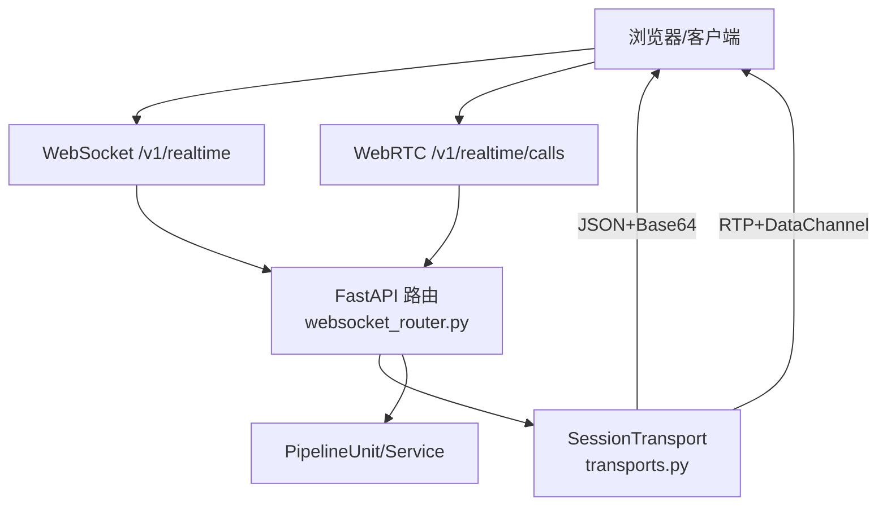
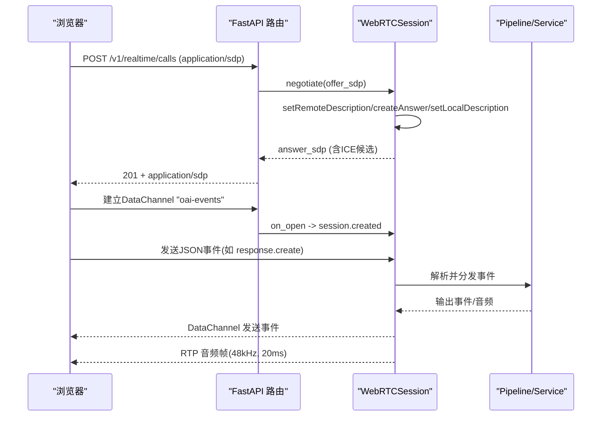
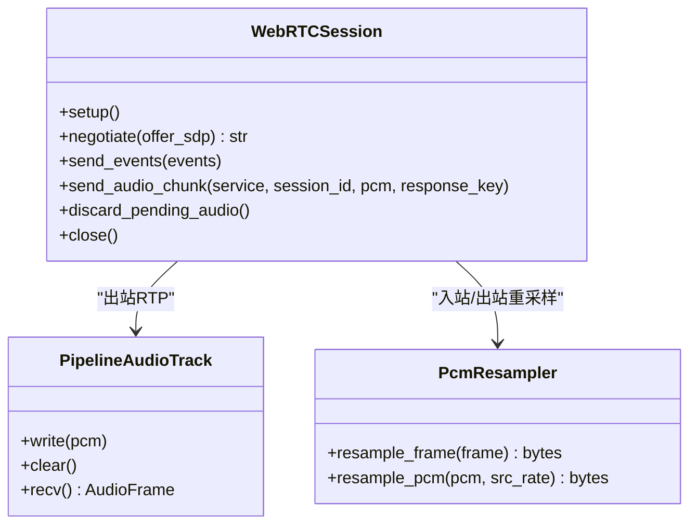
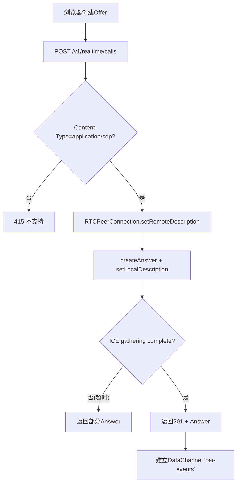
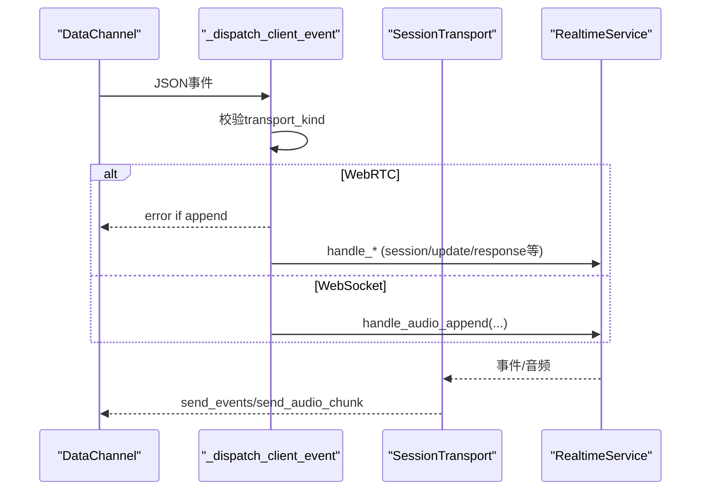
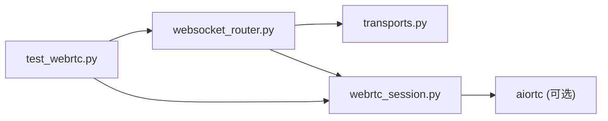

# WebRTC API

<cite>
**本文引用的文件**
- [webrtc_session.py](file://src/speech_to_speech/api/openai_realtime/webrtc_session.py)
- [transports.py](file://src/speech_to_speech/api/openai_realtime/transports.py)
- [websocket_router.py](file://src/speech_to_speech/api/openai_realtime/websocket_router.py)
- [server.py](file://src/speech_to_speech/api/openai_realtime/server.py)
- [audio_client.py](file://src/speech_to_speech/api/openai_realtime/audio_client.py)
- [s2s-realtime-client.js](file://demo/s2s-realtime-client.js)
- [index.html](file://demo/index.html)
- [test_webrtc.py](file://tests/openai_realtime/test_webrtc.py)
</cite>

## 目录
1. [简介](#简介)
2. [项目结构](#项目结构)
3. [核心组件](#核心组件)
4. [架构总览](#架构总览)
5. [详细组件分析](#详细组件分析)
6. [依赖关系分析](#依赖关系分析)
7. [性能与网络优化](#性能与网络优化)
8. [故障排查指南](#故障排查指南)
9. [结论](#结论)
10. [附录：客户端集成示例](#附录客户端集成示例)

## 简介
本仓库实现了基于 OpenAI Realtime 协议的实时语音对话后端，同时支持 WebSocket 与 WebRTC 两种传输。WebRTC 路径通过 aiortc 建立 P2P 媒体通道，音频走 RTP 媒体轨道（服务器端以 48 kHz s16 单声道、20 ms 帧 pacing），控制事件走名为 “oai-events” 的 DataChannel；WebSocket 路径则通过 JSON 帧传输事件与 base64 编码的 PCM 增量。本文聚焦 WebRTC 的连接建立流程、SDP/ICE 协商、媒体流传输与会话管理，并给出浏览器与 Python 客户端的集成要点、STUN/TURN 配置与常见问题排查。

## 项目结构
- 服务端核心位于 src/speech_to_speech/api/openai_realtime：
  - websocket_router.py：FastAPI 路由、会话池、发送循环、WebRTC SDP 握手入口
  - webrtc_session.py：WebRTC 会话封装、DataChannel 消息处理、RTP 输出轨道、PCM 重采样
  - transports.py：传输抽象 SessionTransport 及 WebSocket 实现
  - server.py：服务启动器（uvicorn）
  - audio_client.py：Python 本地客户端（面向 WebSocket，但协议一致）
- 演示前端位于 demo：
  - s2s-realtime-client.js：浏览器端 S2S 客户端（支持 WebSocket/WebRTC）
  - index.html：UI 入口
- 测试位于 tests/openai_realtime/test_webrtc.py：覆盖 WebRTC 握手、数据通道、音频收发等

图表来源
- [websocket_router.py:541-785](file://src/speech_to_speech/api/openai_realtime/websocket_router.py#L541-L785)
- [transports.py:29-116](file://src/speech_to_speech/api/openai_realtime/transports.py#L29-L116)

章节来源
- [websocket_router.py:498-785](file://src/speech_to_speech/api/openai_realtime/websocket_router.py#L498-L785)
- [server.py:14-70](file://src/speech_to_speech/api/openai_realtime/server.py#L14-L70)

## 核心组件
- WebRTC 会话封装 WebRTCSession：负责 RTCPeerConnection 生命周期、DataChannel 事件、入站音频接收、出站音频 pacing 与重采样。
- 传输抽象 SessionTransport：统一 send_events/send_audio_chunk/discard_pending_audio/close 接口，WebSocketTransport 与 WebRTCSession 均实现该接口。
- 路由与发送循环：websocket_router 维护每个 PipelineUnit 的发送循环，将管道输出转发给当前 transport。
- 浏览器客户端：s2s-realtime-client.js 提供 OpenAI Agents SDK 包装，支持选择 WebSocket 或 WebRTC 传输，并处理音频采集/播放与可视化。

章节来源
- [webrtc_session.py:157-327](file://src/speech_to_speech/api/openai_realtime/webrtc_session.py#L157-L327)
- [transports.py:29-116](file://src/speech_to_speech/api/openai_realtime/transports.py#L29-L116)
- [websocket_router.py:541-785](file://src/speech_to_speech/api/openai_realtime/websocket_router.py#L541-L785)
- [s2s-realtime-client.js:70-214](file://demo/s2s-realtime-client.js#L70-L214)

## 架构总览
WebRTC 模式下的端到端流程如下：
- 浏览器创建 RTCPeerConnection，生成 SDP Offer，POST 到 /v1/realtime/calls
- 服务端解析 Offer，创建 RTCPeerConnection，设置远端描述，生成 Answer，等待 ICE gathering 完成后返回 Answer（application/sdp）
- 连接建立后，DataChannel “oai-events” 用于交换 JSON 事件（session.created、response.*、input_audio_buffer.* 等）
- 音频双向传输：上行通过 MediaStreamTrack（浏览器麦克风），下行通过自定义 AudioTrack（服务器侧 pacing 20ms 帧）

图表来源
- [websocket_router.py:664-785](file://src/speech_to_speech/api/openai_realtime/websocket_router.py#L664-L785)
- [webrtc_session.py:244-270](file://src/speech_to_speech/api/openai_realtime/webrtc_session.py#L244-L270)
- [webrtc_session.py:196-236](file://src/speech_to_speech/api/openai_realtime/webrtc_session.py#L196-L236)

## 详细组件分析

### WebRTC 会话与媒体流
- 出站音频轨道 PipelineAudioTrack：按墙钟 pacing 输出 20 ms 帧（48 kHz s16 mono），缓冲为空时填充静音，支持 clear() 丢弃未播放音频以实现“打断”。
- 入站音频处理：收到浏览器音频轨道后，使用 PcmResampler 将 48 kHz 立体声下混为 16 kHz 单声道，送入管道输入队列。
- DataChannel 消息：仅接受字符串 JSON，顺序消费，错误日志记录。

图表来源
- [webrtc_session.py:72-155](file://src/speech_to_speech/api/openai_realtime/webrtc_session.py#L72-L155)
- [webrtc_session.py:157-327](file://src/speech_to_speech/api/openai_realtime/webrtc_session.py#L157-L327)

章节来源
- [webrtc_session.py:72-155](file://src/speech_to_speech/api/openai_realtime/webrtc_session.py#L72-L155)
- [webrtc_session.py:157-327](file://src/speech_to_speech/api/openai_realtime/webrtc_session.py#L157-L327)

### 信令与 SDP/ICE 协商
- 客户端 POST SDP Offer 到 /v1/realtime/calls，服务端调用 setRemoteDescription/createAnswer/setLocalDescription，并等待 ICE gathering 完成（超时保护）。
- 返回 201 + application/sdp，Location 头指向 /v1/realtime/calls/{call_id}，可用于后续挂断。
- DataChannel 标签固定为 “oai-events”，事件采用与 WebSocket 相同的 JSON 协议。

图表来源
- [websocket_router.py:664-785](file://src/speech_to_speech/api/openai_realtime/websocket_router.py#L664-L785)
- [webrtc_session.py:244-270](file://src/speech_to_speech/api/openai_realtime/webrtc_session.py#L244-L270)

章节来源
- [websocket_router.py:664-785](file://src/speech_to_speech/api/openai_realtime/websocket_router.py#L664-L785)
- [webrtc_session.py:244-270](file://src/speech_to_speech/api/openai_realtime/webrtc_session.py#L244-L270)

### 会话管理与事件分发
- 每个 PipelineUnit 绑定一个 SessionState，包含当前 transport。
- 发送循环从 output_queue 读取事件/音频，调用 transport.send_events/send_audio_chunk。
- 客户端事件通过 _dispatch_client_event 分发，区分传输类型：
  - WebRTC 模式下拒绝 input_audio_buffer.append（音频走媒体轨道）
  - WebRTC 模式下支持 output_audio_buffer.clear（清理服务器侧缓冲）

图表来源
- [websocket_router.py:384-495](file://src/speech_to_speech/api/openai_realtime/websocket_router.py#L384-L495)
- [transports.py:29-116](file://src/speech_to_speech/api/openai_realtime/transports.py#L29-L116)

章节来源
- [websocket_router.py:384-495](file://src/speech_to_speech/api/openai_realtime/websocket_router.py#L384-L495)
- [transports.py:29-116](file://src/speech_to_speech/api/openai_realtime/transports.py#L29-L116)

### 实时音视频数据传输机制
- 上行：浏览器麦克风 MediaStreamTrack → WebRTC 媒体轨道 → 服务器接收 → PcmResampler(48k→16k, 立体声→单声道) → 管道输入队列
- 下行：管道输出 PCM(16k) → PcmResampler(16k→48k) → PipelineAudioTrack(20ms pacing) → RTP 媒体轨道 → 浏览器播放
- 事件：DataChannel “oai-events” 传输 JSON 事件（与 WebSocket 协议一致）

章节来源
- [webrtc_session.py:72-155](file://src/speech_to_speech/api/openai_realtime/webrtc_session.py#L72-L155)
- [webrtc_session.py:417-427](file://src/speech_to_speech/api/openai_realtime/webrtc_session.py#L417-L427)

### STUN/TURN 与防火墙穿透
- 环境变量 SPEECH_TO_SPEECH_ICE_SERVERS：JSON 列表，每项为 RTCIceServer 参数（urls、username、credential 等）
- 若未配置或无效，回退到默认（host 候选），适用于同机/局域网场景
- 跨互联网需配置 STUN/TURN，推荐至少一个 TURN 中继以应对对称 NAT

章节来源
- [webrtc_session.py:52-69](file://src/speech_to_speech/api/openai_realtime/webrtc_session.py#L52-L69)

## 依赖关系分析
- websocket_router 依赖 transports.SessionTransport 抽象，解耦 WebSocket 与 WebRTC 实现
- webrtc_session 依赖 aiortc（可选 extra），在模块加载时尝试导入以避免冷启动阻塞共享事件循环
- 测试覆盖：单元测试验证重采样、pacing、事件分发；集成测试用真实 aiortc 对 FastAPI 应用进行端到端往返

图表来源
- [websocket_router.py:53-67](file://src/speech_to_speech/api/openai_realtime/websocket_router.py#L53-L67)
- [test_webrtc.py:1-16](file://tests/openai_realtime/test_webrtc.py#L1-L16)

章节来源
- [websocket_router.py:53-67](file://src/speech_to_speech/api/openai_realtime/websocket_router.py#L53-L67)
- [test_webrtc.py:1-16](file://tests/openai_realtime/test_webrtc.py#L1-L16)

## 性能与网络优化
- 音频帧大小与延迟：20 ms 帧（48 kHz s16 mono），兼顾低延迟与稳定性
- 重采样策略：状态式重采样避免边界伪影，支持多声道下混至单声道
- 播放 pacing：服务器侧按墙钟 pacing，确保稳定播放；支持 clear() 快速打断
- ICE 收集超时：防止长时间等待导致资源占用
- 连接看门狗：协商后 30 秒未 connected 则释放单元，避免僵尸会话

章节来源
- [webrtc_session.py:40-49](file://src/speech_to_speech/api/openai_realtime/webrtc_session.py#L40-L49)
- [webrtc_session.py:101-155](file://src/speech_to_speech/api/openai_realtime/webrtc_session.py#L101-L155)
- [webrtc_session.py:392-400](file://src/speech_to_speech/api/openai_realtime/webrtc_session.py#L392-L400)

## 故障排查指南
- 无法建立连接
  - 检查 Content-Type 是否为 application/sdp
  - 确认已正确配置 STUN/TURN（跨网段必须）
  - 查看浏览器控制台与服务器日志中的 ICE 相关警告
- 无声音或卡顿
  - 确认浏览器麦克风权限与设备可用
  - 检查 DataChannel 是否打开（“oai-events”）
  - 观察服务器侧是否持续收到上行音频帧
- 无法打断
  - 确认客户端发送了 output_audio_buffer.clear（仅 WebRTC 支持）
  - 检查服务端是否正确调用 discard_pending_audio()
- 资源泄漏
  - 关注连接看门狗与 ICE 清理逻辑，确保 close() 能释放所有任务与连接

章节来源
- [websocket_router.py:664-785](file://src/speech_to_speech/api/openai_realtime/websocket_router.py#L664-L785)
- [webrtc_session.py:316-390](file://src/speech_to_speech/api/openai_realtime/webrtc_session.py#L316-L390)
- [test_webrtc.py:710-800](file://tests/openai_realtime/test_webrtc.py#L710-L800)

## 结论
本项目提供了生产可用的 WebRTC 实时语音通道，遵循 OpenAI Realtime 协议，具备稳定的音频 pacing、可靠的 ICE 协商与会话管理。通过统一的 SessionTransport 抽象，WebSocket 与 WebRTC 可无缝切换。建议在生产环境配置 STUN/TURN，并结合监控与日志完善运维能力。

## 附录：客户端集成示例

### 浏览器 JavaScript 集成（WebRTC）
- 使用 OpenAI Agents SDK 的 RealtimeSession，选择 WebRTC 传输
- 通过 createOffer 并 POST 到 /v1/realtime/calls 完成 SDP 握手
- 监听 DataChannel 事件与媒体轨道，处理音频采集与播放
- 可通过 options.iceServers 注入 STUN/TURN 服务器

章节来源
- [s2s-realtime-client.js:134-214](file://demo/s2s-realtime-client.js#L134-L214)
- [s2s-realtime-client.js:216-232](file://demo/s2s-realtime-client.js#L216-L232)
- [index.html:244-257](file://demo/index.html#L244-L257)

### Python 客户端（WebSocket，协议一致）
- 使用 RealtimeAudioClientConfig 配置 URL、采样率、工具等
- 通过 AsyncOpenAI 连接 /v1/realtime，发送 session.update 配置音频格式
- 适合命令行或脚本化交互，便于调试与自动化

章节来源
- [audio_client.py:49-70](file://src/speech_to_speech/api/openai_realtime/audio_client.py#L49-L70)
- [audio_client.py:164-207](file://src/speech_to_speech/api/openai_realtime/audio_client.py#L164-L207)

### WebRTC 与 WebSocket 的区别与适用场景
- WebRTC
  - 优势：原生 RTP 媒体传输，更低延迟，更好的中断体验（服务器侧 pacing + clear）
  - 适用：需要极低延迟的实时语音对话、复杂网络环境下需 TURN 中继
- WebSocket
  - 优势：部署简单，兼容性好，易于代理与负载均衡
  - 适用：对延迟要求不高、希望简化基础设施的场景

[本节为概念性说明，不直接分析具体文件]