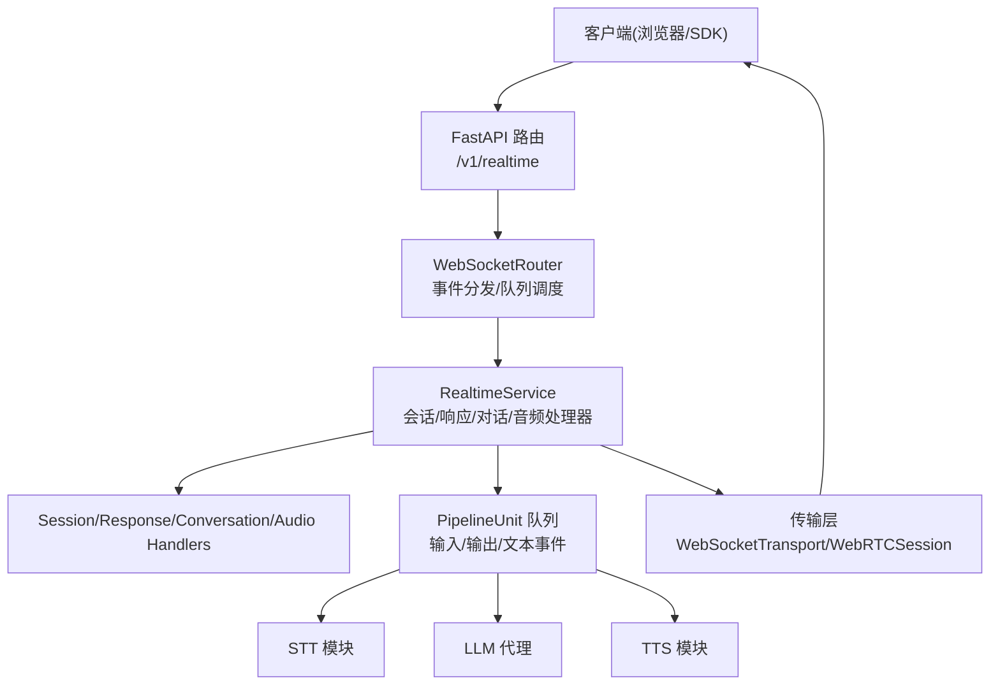
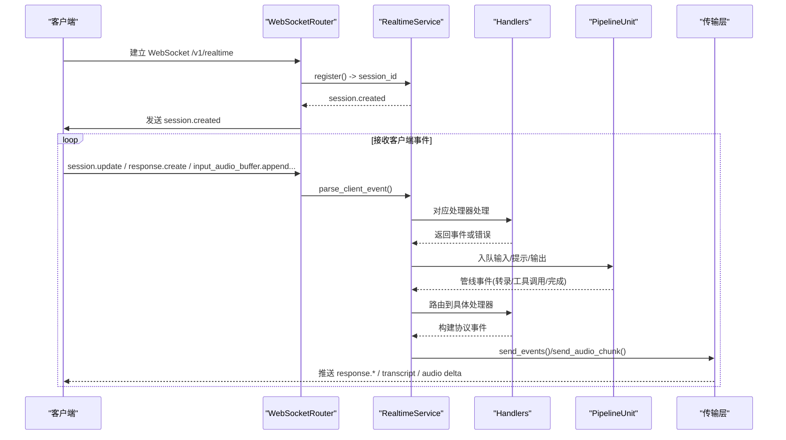
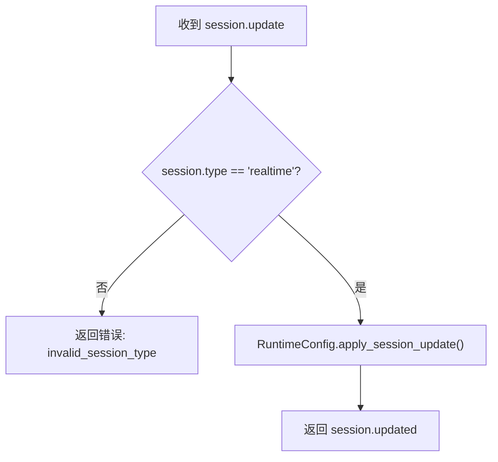
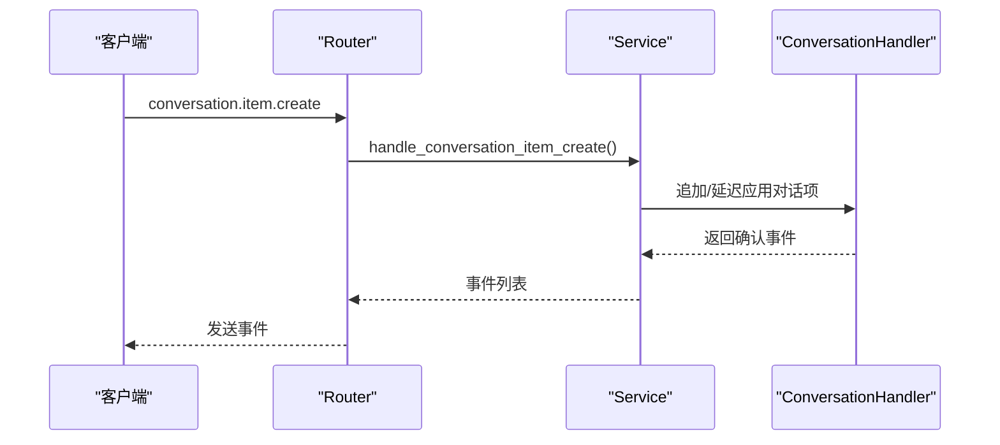
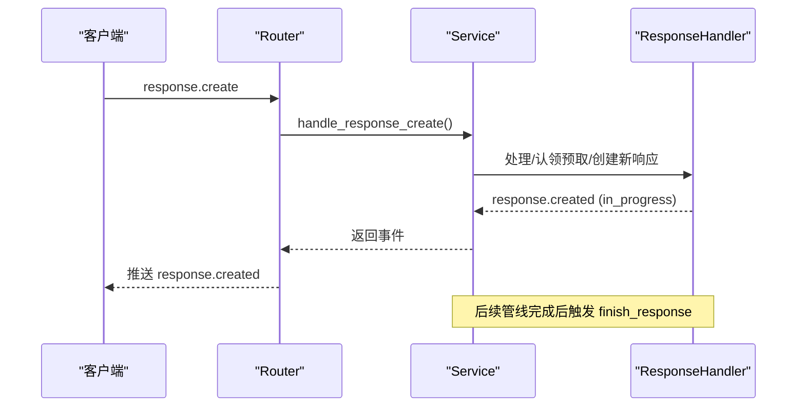
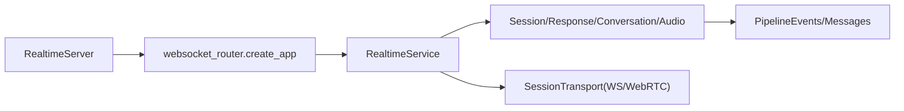

# WebSocket API

<cite>
**本文引用的文件**
- [server.py](file://src/speech_to_speech/api/openai_realtime/server.py)
- [websocket_router.py](file://src/speech_to_speech/api/openai_realtime/websocket_router.py)
- [service.py](file://src/speech_to_speech/api/openai_realtime/service.py)
- [transports.py](file://src/speech_to_speech/api/openai_realtime/transports.py)
- [session.py](file://src/speech_to_speech/api/openai_realtime/handlers/session.py)
- [response.py](file://src/speech_to_speech/api/openai_realtime/handlers/response.py)
- [runtime_config.py](file://src/speech_to_speech/api/openai_realtime/runtime_config.py)
- [s2s-realtime-client.js](file://demo/s2s-realtime-client.js)
- [main.js](file://demo/main.js)
- [README.md](file://demo/README.md)
- [openai-compatible-stt.md](file://docs/openai-compatible-stt.md)
</cite>

## 目录
1. [简介](#简介)
2. [项目结构](#项目结构)
3. [核心组件](#核心组件)
4. [架构总览](#架构总览)
5. [详细组件分析](#详细组件分析)
6. [依赖关系分析](#依赖关系分析)
7. [性能考虑](#性能考虑)
8. [故障排查指南](#故障排查指南)
9. [结论](#结论)
10. [附录](#附录)

## 简介
本文件面向使用 OpenAI Realtime GA 协议的语音到语音（Speech-to-Speech）实时对话系统，提供 WebSocket API 的完整说明。内容涵盖：
- 连接建立过程与端点：/v1/realtime（WebSocket）、/v1/realtime/calls（WebRTC SDP 握手）
- 会话管理、音频流传输、消息协议规范
- 事件类型与请求/响应格式：session.update、conversation.item.create、response.create 等
- 客户端连接示例与处理流程（浏览器端基于官方 Agents SDK 的适配）
- 错误处理策略、连接重试机制与性能优化建议
- 认证方式、速率限制与安全注意事项

## 项目结构
后端以 FastAPI + uvicorn 启动，暴露 /v1/realtime WebSocket 路由；通过 PipelineUnit 池隔离并发会话；服务层将 OpenAI Realtime 协议事件映射到内部管线事件；传输层抽象了 WebSocket 与 WebRTC 两种通道。

**图表来源**
- [websocket_router.py:541-601](file://src/speech_to_speech/api/openai_realtime/websocket_router.py#L541-L601)
- [service.py:287-327](file://src/speech_to_speech/api/openai_realtime/service.py#L287-L327)
- [transports.py:29-116](file://src/speech_to_speech/api/openai_realtime/transports.py#L29-L116)

**章节来源**
- [server.py:14-70](file://src/speech_to_speech/api/openai_realtime/server.py#L14-L70)
- [websocket_router.py:498-601](file://src/speech_to_speech/api/openai_realtime/websocket_router.py#L498-L601)

## 核心组件
- RealtimeServer：启动 uvicorn 并维护 PipelineUnit 池，监听 /v1/realtime
- WebSocketRouter：注册 /v1/realtime 与 /v1/realtime/calls，负责会话生命周期、事件分发、队列清理与释放
- RealtimeService：协议解析、会话状态 ConnState、事件路由、指标统计
- Handlers：SessionHandler（会话配置）、ResponseHandler（响应生命周期）、ConversationHandler（对话项）、AudioHandler（音频缓冲与编码）
- Transports：WebSocketTransport（JSON+base64 PCM）、WebRTCSession（媒体轨道+数据通道）

**章节来源**
- [service.py:287-327](file://src/speech_to_speech/api/openai_realtime/service.py#L287-L327)
- [session.py:21-81](file://src/speech_to_speech/api/openai_realtime/handlers/session.py#L21-L81)
- [response.py:52-136](file://src/speech_to_speech/api/openai_realtime/handlers/response.py#L52-L136)
- [transports.py:29-116](file://src/speech_to_speech/api/openai_realtime/transports.py#L29-L116)

## 架构总览
下图展示从客户端连接到服务端处理的端到端流程，包括会话创建、音频输入、转录、LLM 生成、TTS 输出与事件回推。

**图表来源**
- [websocket_router.py:541-601](file://src/speech_to_speech/api/openai_realtime/websocket_router.py#L541-L601)
- [service.py:379-418](file://src/speech_to_speech/api/openai_realtime/service.py#L379-L418)
- [transports.py:83-116](file://src/speech_to_speech/api/openai_realtime/transports.py#L83-L116)

## 详细组件分析

### WebSocket 连接与端点
- /v1/realtime：WebSocket 端点，支持子协议 realtime；连接后立刻返回 session.created；后续通过 JSON 帧收发事件
- /v1/realtime/calls：WebRTC SDP 握手端点；成功后返回 SDP answer，并在 Location 中附带 call_id；音频走媒体轨道，事件走数据通道
- /v1/pool：查看 PipelineUnit 池状态（空闲/活跃/ draining/stuck）
- /v1/usage：聚合各单元的使用量与错误计数

连接建立要点：
- 接受子协议 realtime（若客户端声明）
- 分配一个空闲 PipelineUnit，注册会话，清理残留状态，发送 session.created
- 进入事件循环，读取 JSON 事件并分发

**章节来源**
- [websocket_router.py:541-601](file://src/speech_to_speech/api/openai_realtime/websocket_router.py#L541-L601)
- [websocket_router.py:664-785](file://src/speech_to_speech/api/openai_realtime/websocket_router.py#L664-L785)
- [websocket_router.py:603-662](file://src/speech_to_speech/api/openai_realtime/websocket_router.py#L603-L662)

### 会话管理与配置
- session.update：深合并更新会话配置（仅支持 type="realtime"），可设置模型、指令、音频输入输出参数等
- session.created / session.updated：携带当前会话配置（含 id）

运行时配置：
- RuntimeConfig 维护 Chat 实例与 RealtimeSessionCreateRequest
- apply_session_update 对嵌套字段进行增量更新
- interrupt_response_enabled 控制打断行为（默认开启）

**章节来源**
- [session.py:24-81](file://src/speech_to_speech/api/openai_realtime/handlers/session.py#L24-L81)
- [runtime_config.py:27-82](file://src/speech_to_speech/api/openai_realtime/runtime_config.py#L27-L82)

### 音频流传输
- 输入：
  - WebSocket：input_audio_buffer.append（PCM16 base64 分片），随后 input_audio_buffer.commit 触发 VAD 与转录
  - WebRTC：音频直接走媒体轨道，不支持 input_audio_buffer.append
- 输出：
  - WebSocket：response.output_audio.delta（PCM16 base64），最终 response.output_audio.done
  - WebRTC：音频走远端媒体轨道，无需 delta 事件

传输层职责：
- WebSocketTransport：事件与音频 chunk 通过 JSON 帧发送
- WebRTCSession：事件通过数据通道，音频通过 RTP 轨道；支持丢弃待播放音频以实现即时打断

**章节来源**
- [websocket_router.py:417-450](file://src/speech_to_speech/api/openai_realtime/websocket_router.py#L417-L450)
- [transports.py:83-116](file://src/speech_to_speech/api/openai_realtime/transports.py#L83-L116)

### 消息协议规范与事件类型
支持的客户端事件：
- input_audio_buffer.append / commit
- output_audio_buffer.clear（仅 WebRTC）
- session.update
- conversation.item.create / truncate
- response.create / cancel

服务器事件（部分）：
- session.created / updated
- input_audio_buffer.speech_started / speech_stopped
- conversation.item.input_audio_transcription.{delta, completed, failed}
- response.created / done
- response.output_audio.{delta, done}
- response.output_text.{delta, done}
- response.output_item.done
- error

事件路由与转换：
- parse_client_event 校验并转换为 Pydantic 模型
- _dispatch_client_event 根据事件类型调用相应处理器
- 管线事件（转录、工具调用、完成）经 service._dispatch_pipeline_event 路由到 handlers

**章节来源**
- [service.py:87-132](file://src/speech_to_speech/api/openai_realtime/service.py#L87-L132)
- [websocket_router.py:384-495](file://src/speech_to_speech/api/openai_realtime/websocket_router.py#L384-L495)
- [service.py:500-579](file://src/speech_to_speech/api/openai_realtime/service.py#L500-L579)

### 关键事件处理流程

#### session.update
- 仅接受 type="realtime" 的会话
- 深合并更新 RuntimeConfig.session
- 成功时返回 session.updated

**图表来源**
- [session.py:24-53](file://src/speech_to_speech/api/openai_realtime/handlers/session.py#L24-L53)

**章节来源**
- [session.py:24-81](file://src/speech_to_speech/api/openai_realtime/handlers/session.py#L24-L81)

#### conversation.item.create
- 在 response 生成期间到达的 item 会被延迟应用，确保顺序一致性
- 可能触发工具调用的后续预取（tool follow-up prefetch）

**图表来源**
- [service.py:490-498](file://src/speech_to_speech/api/openai_realtime/service.py#L490-L498)

**章节来源**
- [service.py:490-498](file://src/speech_to_speech/api/openai_realtime/service.py#L490-L498)

#### response.create
- 校验 tool_choice 等参数
- 若存在内部预取且匹配，则“认领”该预取结果作为本次响应
- 否则创建新响应，标记 in_response，入队生成请求
- 返回 response.created（in_progress），并最终由 finish_response 输出 terminal 事件

**图表来源**
- [response.py:520-621](file://src/speech_to_speech/api/openai_realtime/handlers/response.py#L520-L621)
- [websocket_router.py:472-482](file://src/speech_to_speech/api/openai_realtime/websocket_router.py#L472-L482)

**章节来源**
- [response.py:520-621](file://src/speech_to_speech/api/openai_realtime/handlers/response.py#L520-L621)
- [websocket_router.py:472-482](file://src/speech_to_speech/api/openai_realtime/websocket_router.py#L472-L482)

### 客户端连接示例（浏览器）
- 使用官方 @openai/agents 的 RealtimeSession，选择 WebSocket 或 WebRTC 传输
- WebSocket 模式：
  - 构造 OpenAIRealtimeWebSocket，传入 useInsecureApiKey: true（演示环境）
  - 配置音频输入输出格式（PCM16，采样率 24kHz）
  - 连接后发送 session.update（voice/instructions/tools）
  - 通过 sendAudio 持续发送麦克风采集的 PCM 分片
  - 处理 response.audio_transcript.delta/done 与 response.output_audio.delta/done
- WebRTC 模式：
  - 通过 /api/calls 代理发起 SDP 握手，获取 answer
  - 音频走媒体轨道，事件走数据通道
  - 支持 ICE 服务器配置（RTC_ICE_SERVERS）

参考实现路径：
- 客户端初始化与连接：[s2s-realtime-client.js:134-214](file://demo/s2s-realtime-client.js#L134-L214)
- 音频工作节点与回放：[s2s-realtime-client.js:262-331](file://demo/s2s-realtime-client.js#L262-L331)
- 事件处理与转录拼接：[s2s-realtime-client.js:387-532](file://demo/s2s-realtime-client.js#L387-L532)

**章节来源**
- [s2s-realtime-client.js:134-214](file://demo/s2s-realtime-client.js#L134-L214)
- [s2s-realtime-client.js:262-331](file://demo/s2s-realtime-client.js#L262-L331)
- [s2s-realtime-client.js:387-532](file://demo/s2s-realtime-client.js#L387-L532)
- [README.md:29-112](file://demo/README.md#L29-L112)

## 依赖关系分析
- RealtimeServer 依赖 websocket_router.create_app 构建 FastAPI 应用
- websocket_router 依赖 service.RealtimeService 与 transports.SessionTransport
- service 依赖 handlers（Session/Response/Conversation/Audio）与 pipeline events/messages
- transports 抽象 WebSocketTransport 与 WebRTCSession，屏蔽底层差异

**图表来源**
- [server.py:14-70](file://src/speech_to_speech/api/openai_realtime/server.py#L14-L70)
- [websocket_router.py:498-501](file://src/speech_to_speech/api/openai_realtime/websocket_router.py#L498-L501)
- [service.py:287-327](file://src/speech_to_speech/api/openai_realtime/service.py#L287-L327)

**章节来源**
- [server.py:14-70](file://src/speech_to_speech/api/openai_realtime/server.py#L14-L70)
- [websocket_router.py:498-501](file://src/speech_to_speech/api/openai_realtime/websocket_router.py#L498-L501)
- [service.py:287-327](file://src/speech_to_speech/api/openai_realtime/service.py#L287-L327)

## 性能考虑
- 管道单元池：每个 PipelineUnit 独立运行，避免跨会话状态泄漏；满负载时拒绝新连接并返回错误事件
- 队列清理与释放：断开连接后等待 SESSION_END 传播，超时则隔离单元，防止旧会话输出污染新会话
- 音频批处理：MAX_AUDIO_BATCH_BYTES 控制批量大小，平衡延迟与吞吐
- 预取与去重：工具调用后的后续生成预取，减少响应延迟；过时响应键丢弃避免乱序
- 传输层优化：WebRTC 模式下丢弃待播放音频以实现即时打断；WebSocket 模式下客户端负责缓冲清理

**章节来源**
- [websocket_router.py:70-85](file://src/speech_to_speech/api/openai_realtime/websocket_router.py#L70-L85)
- [websocket_router.py:286-331](file://src/speech_to_speech/api/openai_realtime/websocket_router.py#L286-L331)
- [transports.py:47-54](file://src/speech_to_speech/api/openai_realtime/transports.py#L47-L54)

## 故障排查指南
常见错误与处理：
- 未知或无效事件：parse_client_event 失败时返回 unknown_or_invalid_event
- 传输不兼容：WebRTC 下禁止 input_audio_buffer.append；WebSocket 下不支持 output_audio_buffer.clear
- 会话限制：所有 PipelineUnit 被占用时返回 session_limit_reached
- 转录失败：TranscriptionFailedEvent 触发用户侧错误事件，恢复监听
- 响应失败：ResponseFailedEvent 表面化错误信息，音频终端事件关闭响应

调试建议：
- 使用 /v1/pool 检查单元状态（idle/active/draining/stuck）
- 使用 /v1/usage 聚合使用量与错误计数
- 启用日志观察会话生命周期与队列清理过程

**章节来源**
- [websocket_router.py:410-450](file://src/speech_to_speech/api/openai_realtime/websocket_router.py#L410-L450)
- [websocket_router.py:548-561](file://src/speech_to_speech/api/openai_realtime/websocket_router.py#L548-L561)
- [service.py:684-692](file://src/speech_to_speech/api/openai_realtime/service.py#L684-L692)
- [service.py:772-800](file://src/speech_to_speech/api/openai_realtime/service.py#L772-L800)

## 结论
本 WebSocket API 严格遵循 OpenAI Realtime GA 协议，提供稳定的会话管理、音频流传输与实时转录/合成能力。通过 PipelineUnit 池与传输层抽象，系统在并发、可靠性与性能方面具备良好表现。结合客户端示例与故障排查指南，开发者可快速集成并构建高质量的语音对话应用。

## 附录

### 认证与速率限制
- 本地开发：演示客户端使用 useInsecureApiKey: true，无需鉴权
- 部署模式：
  - 负载均衡器模式：/api/session 代理会话握手，按天计量对话时长；未登录或额度耗尽返回 402/401
  - 直连模式：SPEECH_TO_SPEECH_URL 设置后禁用 LB 逻辑，无计量与鉴权
- WebRTC 额外功能需安装 webrtc 扩展，否则 /v1/realtime/calls 返回 501

**章节来源**
- [s2s-realtime-client.js:164-184](file://demo/s2s-realtime-client.js#L164-L184)
- [server.py:294-331](file://demo/server.py#L294-L331)
- [server.py:334-422](file://demo/server.py#L334-L422)
- [README.md:114-155](file://demo/README.md#L114-L155)

### 安全考虑
- CORS：后端无 CORS 中间件，WebRTC 信令通过同域代理转发，避免跨域问题
- 密钥保护：搜索工具密钥保存在服务端，不暴露给浏览器
- 资源访问：/v1/pool 与 /v1/usage 为运维接口，生产环境应限制访问

**章节来源**
- [README.md:119-127](file://demo/README.md#L119-L127)
- [server.py:236-291](file://demo/server.py#L236-L291)