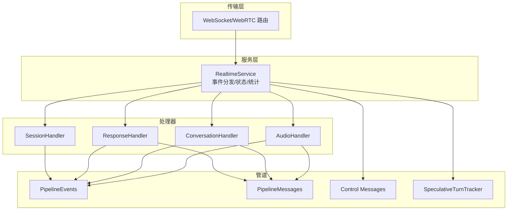
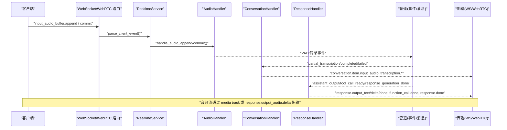
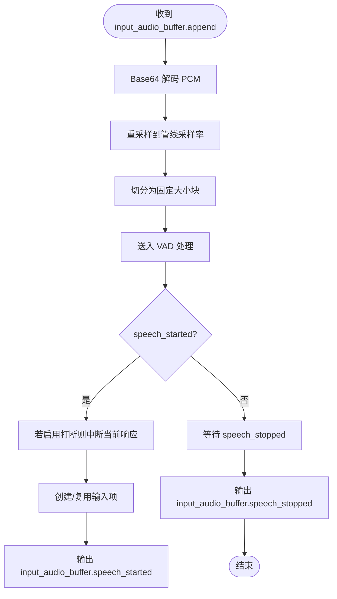
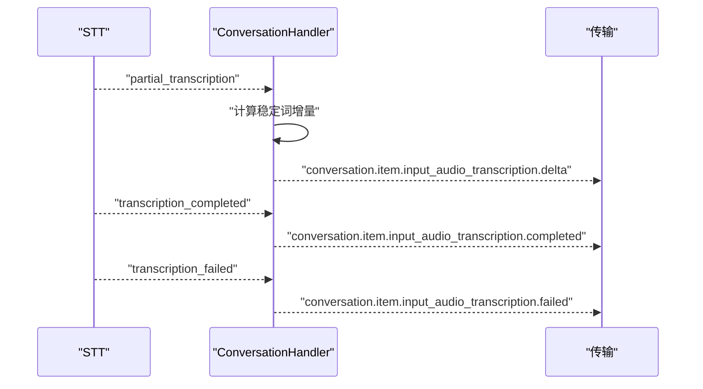
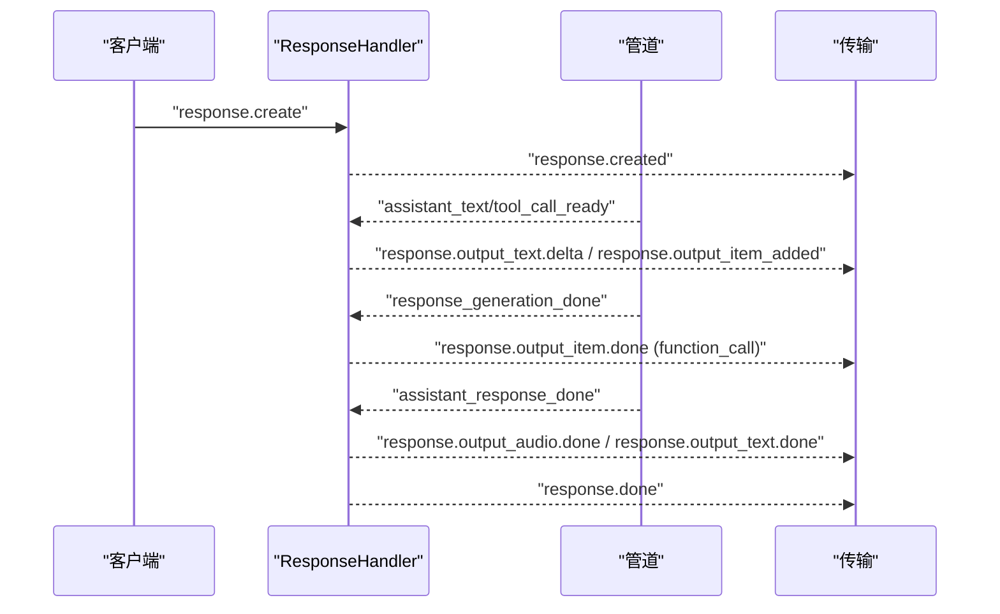
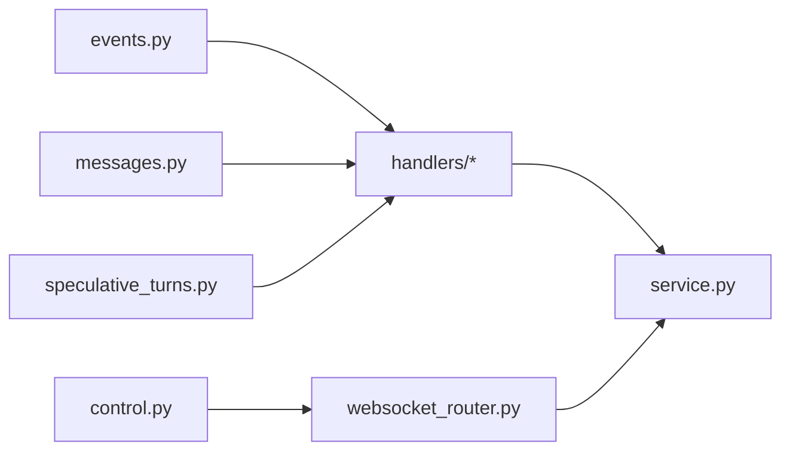

# 事件系统

<cite>
**本文引用的文件**
- [events.py](file://src/speech_to_speech/pipeline/events.py)
- [messages.py](file://src/speech_to_speech/pipeline/messages.py)
- [control.py](file://src/speech_to_speech/pipeline/control.py)
- [speculative_turns.py](file://src/speech_to_speech/pipeline/speculative_turns.py)
- [base.py](file://src/speech_to_speech/api/openai_realtime/handlers/base.py)
- [audio.py](file://src/speech_to_speech/api/openai_realtime/handlers/audio.py)
- [conversation.py](file://src/speech_to_speech/api/openai_realtime/handlers/conversation.py)
- [response.py](file://src/speech_to_speech/api/openai_realtime/handlers/response.py)
- [session.py](file://src/speech_to_speech/api/openai_realtime/handlers/session.py)
- [service.py](file://src/speech_to_speech/api/openai_realtime/service.py)
- [websocket_router.py](file://src/speech_to_speech/api/openai_realtime/websocket_router.py)
</cite>

## 目录
1. [简介](#简介)
2. [项目结构](#项目结构)
3. [核心组件](#核心组件)
4. [架构总览](#架构总览)
5. [详细组件分析](#详细组件分析)
6. [依赖关系分析](#依赖关系分析)
7. [性能与并发](#性能与并发)
8. [故障排查指南](#故障排查指南)
9. [结论](#结论)
10. [附录：事件类型与序列化](#附录事件类型与序列化)

## 简介
本文件系统化梳理 OpenAI Realtime API 兼容的事件模型，覆盖事件类型、生命周期、状态管理、处理器职责、路由机制、订阅模式、异步处理、序列化格式、错误传播、调试工具、优先级与并发控制及性能优化策略。该事件系统贯穿“音频输入 → VAD/STT → LLM → TTS → 协议输出”的完整链路，并通过服务层将内部管道事件映射为 OpenAI Realtime 协议事件，确保客户端可观测性与一致性。

## 项目结构
- 管道事件定义位于 pipeline/events.py，统一描述来自 STT/VAD/LLM/TTS 等阶段的 typed events。
- 管道消息定义位于 pipeline/messages.py，承载跨阶段数据（如转写、文本、工具调用、音频片段）。
- 控制消息位于 pipeline/control.py，用于会话释放、队列清理等强一致信号。
- 推测性轮次跟踪位于 pipeline/speculative_turns.py，保障多轮语音重叠时的顺序与正确提交。
- 领域处理器位于 api/openai_realtime/handlers/{audio, conversation, response, session}.py，分别负责音频、对话项、响应生命周期与会话配置。
- 服务编排位于 api/openai_realtime/service.py，维护连接状态、事件分发表、统计指标与协议转换。
- 传输与路由位于 api/openai_realtime/websocket_router.py，负责客户端事件解析、入队、发送循环与 WebRTC 集成。

图表来源
- [websocket_router.py:384-495](file://src/speech_to_speech/api/openai_realtime/websocket_router.py#L384-L495)
- [service.py:287-326](file://src/speech_to_speech/api/openai_realtime/service.py#L287-L326)
- [audio.py:32-331](file://src/speech_to_speech/api/openai_realtime/handlers/audio.py#L32-L331)
- [conversation.py:74-405](file://src/speech_to_speech/api/openai_realtime/handlers/conversation.py#L74-L405)
- [response.py:52-800](file://src/speech_to_speech/api/openai_realtime/handlers/response.py#L52-L800)
- [session.py:21-81](file://src/speech_to_speech/api/openai_realtime/handlers/session.py#L21-L81)
- [events.py:23-206](file://src/speech_to_speech/pipeline/events.py#L23-L206)
- [messages.py:31-367](file://src/speech_to_speech/pipeline/messages.py#L31-L367)
- [control.py:7-27](file://src/speech_to_speech/pipeline/control.py#L7-L27)
- [speculative_turns.py:24-417](file://src/speech_to_speech/pipeline/speculative_turns.py#L24-L417)

章节来源
- [websocket_router.py:384-495](file://src/speech_to_speech/api/openai_realtime/websocket_router.py#L384-L495)
- [service.py:287-326](file://src/speech_to_speech/api/openai_realtime/service.py#L287-L326)

## 核心组件
- 管道事件（PipelineEvent）：VAD/转录/助手输出/工具调用/响应完成/失败等事件的统一基类与派生类型，作为协议无关的内部事件载体。
- 管道消息（PipelineMessage）：跨阶段的数据载体，包括 VAD 音频、部分/最终转写、LLM 响应块、TTS 输入、音频输出、结束哨兵等。
- 控制消息（PipelineControlMessage）：会话结束等强控制信号，用于安全释放资源与队列清理。
- 推测性轮次跟踪（SpeculativeTurnTracker）：线程安全的 turn_id/revision 追踪，支持等待重开窗口、提交判定、优雅过期。
- 领域处理器：
  - AudioHandler：入站音频解码分片、VAD 事件到协议事件映射、出站音频编码与响应创建。
  - ConversationHandler：对话项注入、转写增量/完成/失败事件到协议事件映射、延迟应用与排序保证。
  - ResponseHandler：响应生命周期（创建、取消、完成）、输出项构建、工具调用与文本输出的有序化。
  - SessionHandler：会话配置更新与 session.created/updated 事件生成。
- 服务层（RealtimeService）：连接注册/注销、客户端事件解析、管道事件分发表、全局/逐响应使用量统计。
- 路由层（websocket_router）：客户端事件分发、入队、发送循环、WebRTC 集成、队列清理与释放流程。

章节来源
- [events.py:23-206](file://src/speech_to_speech/pipeline/events.py#L23-L206)
- [messages.py:31-367](file://src/speech_to_speech/pipeline/messages.py#L31-L367)
- [control.py:7-27](file://src/speech_to_speech/pipeline/control.py#L7-L27)
- [speculative_turns.py:24-417](file://src/speech_to_speech/pipeline/speculative_turns.py#L24-L417)
- [audio.py:32-331](file://src/speech_to_speech/api/openai_realtime/handlers/audio.py#L32-L331)
- [conversation.py:74-405](file://src/speech_to_speech/api/openai_realtime/handlers/conversation.py#L74-L405)
- [response.py:52-800](file://src/speech_to_speech/api/openai_realtime/handlers/response.py#L52-L800)
- [session.py:21-81](file://src/speech_to_speech/api/openai_realtime/handlers/session.py#L21-L81)
- [service.py:287-326](file://src/speech_to_speech/api/openai_realtime/service.py#L287-L326)
- [websocket_router.py:384-495](file://src/speech_to_speech/api/openai_realtime/websocket_router.py#L384-L495)

## 架构总览
下图展示从客户端事件到协议输出的端到端流程，以及内部管道事件在处理器间的流转。

图表来源
- [websocket_router.py:384-495](file://src/speech_to_speech/api/openai_realtime/websocket_router.py#L384-L495)
- [audio.py:105-331](file://src/speech_to_speech/api/openai_realtime/handlers/audio.py#L105-L331)
- [conversation.py:246-405](file://src/speech_to_speech/api/openai_realtime/handlers/conversation.py#L246-L405)
- [response.py:520-800](file://src/speech_to_speech/api/openai_realtime/handlers/response.py#L520-L800)
- [service.py:287-326](file://src/speech_to_speech/api/openai_realtime/service.py#L287-L326)

## 详细组件分析

### 事件模型与生命周期
- 事件基类 PipelineEvent 以 type 字段作为判别器，所有事件均携带 turn_id/turn_revision 以关联用户轮次与版本。
- VAD 事件：
  - speech_started：开始新输入项，可能中断当前响应（若启用打断），并记录推测轮次。
  - speech_stopped：记录时长并输出停止事件。
- 转录事件：
  - partial_transcription：稳定词增量，避免回退已发送词。
  - transcription_completed：终稿，附带时长统计。
  - transcription_failed：失败事件，包含错误信息。
- 助手输出事件：
  - assistant_text：有序文本/工具调用片段，带 output_sequence 保证顺序。
  - assistant_tool_call_ready：侧通道提前暴露工具调用参数，允许并行执行。
  - assistant_response_done：标记一个响应的有序输出结束。
  - token_usage：令牌用量上报。
  - response_generation_done：逻辑生成结束，驱动后续工具跟进预取。
  - response_failed：生成失败，关闭响应为 failed。

章节来源
- [events.py:23-206](file://src/speech_to_speech/pipeline/events.py#L23-L206)

### 音频事件处理器（AudioHandler）
- 职责：
  - 接收 input_audio_buffer.append，解码 base64 PCM，重采样至管线速率，按固定大小切分送入 VAD。
  - 处理 input_audio_buffer.commit，校验缓冲是否为空。
  - 将 VAD 的 speech_started/stopped 转换为协议事件，必要时中断当前响应。
  - 为出站音频建立 response 与 assistant 输出项，编码 PCM 为 base64 delta 事件。
- 关键流程：
  - append_pcm：重采样与分片，保留余量。
  - on_speech_started：根据配置决定是否中断响应，创建/复用输入项，记录推测轮次。
  - begin_audio_response/begin_audio_output：确保 response 存在并预留 assistant 输出项。
  - encode_audio_chunk：重采样到客户端期望采样率，生成 response.output_audio.delta。

图表来源
- [audio.py:105-331](file://src/speech_to_speech/api/openai_realtime/handlers/audio.py#L105-L331)

章节来源
- [audio.py:105-331](file://src/speech_to_speech/api/openai_realtime/handlers/audio.py#L105-L331)

### 对话事件处理器（ConversationHandler）
- 职责：
  - 注入 conversation.item.create（文本或函数输出）到聊天上下文，不立即触发响应。
  - 将 partial_transcription 转换为稳定的增量事件，避免回退已发送词。
  - 将 transcription_completed/failed 转为终端事件，并清理输入项状态。
  - 在响应进行中延迟应用客户端对话项，保证顺序与一致性。
- 关键流程：
  - handle_conversation_item_create：若处于响应中则延迟；满足条件时批量刷新。
  - on_partial_transcription：计算稳定词差，输出增量事件。
  - on_transcription_completed：终稿事件，累计时长。
  - on_transcription_failed：失败事件，清理输入项。

图表来源
- [conversation.py:246-405](file://src/speech_to_speech/api/openai_realtime/handlers/conversation.py#L246-L405)

章节来源
- [conversation.py:246-405](file://src/speech_to_speech/api/openai_realtime/handlers/conversation.py#L246-L405)

### 响应事件处理器（ResponseHandler）
- 职责：
  - 管理响应生命周期：创建、取消、完成、失败；维护 response_id/item_id/content_index。
  - 将助手输出（文本/工具调用）序列化为协议事件，保证顺序与完整性。
  - 处理 response_generation_done，驱动工具输出预取与延迟应用。
  - 构建 response.output 列表，并在 response.done 中输出最终状态与统计。
- 关键流程：
  - handle_response_create：校验输入，启动生成，返回 response.created。
  - finish_response：输出 audio/text done、output_item.done、response.done。
  - on_assistant_output：按 output_sequence 与 speculative turns 提交，生成文本/工具调用事件。
  - on_response_generation_done：记录工具调用集合，尝试启动工具跟进预取。

图表来源
- [response.py:520-800](file://src/speech_to_speech/api/openai_realtime/handlers/response.py#L520-L800)

章节来源
- [response.py:520-800](file://src/speech_to_speech/api/openai_realtime/handlers/response.py#L520-L800)

### 会话事件处理器（SessionHandler）
- 职责：
  - 应用 session.update 配置变更，仅支持 realtime 类型。
  - 生成 session.created/updated 事件，携带当前会话配置。

章节来源
- [session.py:21-81](file://src/speech_to_speech/api/openai_realtime/handlers/session.py#L21-L81)

### 事件路由与订阅
- 路由机制：
  - websocket_router._dispatch_client_event 解析客户端事件并调用 RealtimeService 对应方法。
  - RealtimeService 维护 _pipeline_dispatch 表，将管道事件类型映射到处理器方法。
- 订阅模式：
  - 各处理器通过 service 访问 ConnState、RuntimeConfig、队列与统计。
  - 发送循环（_send_loop_for）从输出队列读取事件并发送到当前连接的传输。
- 异步处理：
  - 路由层使用 asyncio 处理 WebSocket/WebRTC 事件。
  - 管道层使用 Queue + 线程事件（should_listen）协调阻塞/唤醒。

章节来源
- [websocket_router.py:384-495](file://src/speech_to_speech/api/openai_realtime/websocket_router.py#L384-L495)
- [service.py:287-326](file://src/speech_to_speech/api/openai_realtime/service.py#L287-L326)

### 错误传播与调试
- 错误事件：
  - 处理器通过 make_error 生成 RealtimeErrorEvent，包含错误类型与消息。
  - 路由层将错误事件与原始 client event_id 关联，便于客户端定位。
- 调试工具：
  - /v1/usage：聚合全局与单元使用量（tokens、音频时长、错误计数）。
  - /v1/pool：查看管线单元状态（空闲/活跃/释放中/卡住）。
  - 日志：处理器与服务层记录关键路径与异常。

章节来源
- [websocket_router.py:603-662](file://src/speech_to_speech/api/openai_realtime/websocket_router.py#L603-L662)
- [base.py:53-59](file://src/speech_to_speech/api/openai_realtime/handlers/base.py#L53-L59)

## 依赖关系分析
- 低耦合高内聚：
  - 事件与消息解耦协议实现，处理器专注领域逻辑。
  - 服务层集中管理状态与分发，降低处理器间直接依赖。
- 外部依赖：
  - OpenAI Realtime SDK 类型用于协议事件建模。
  - NumPy 用于音频数组操作。
  - FastAPI/asyncio 用于 Web 服务与异步 I/O。
- 潜在循环依赖：
  - 通过模块级 TYPE_CHECKING 与接口抽象避免运行时循环导入。

图表来源
- [events.py:23-206](file://src/speech_to_speech/pipeline/events.py#L23-L206)
- [messages.py:31-367](file://src/speech_to_speech/pipeline/messages.py#L31-L367)
- [control.py:7-27](file://src/speech_to_speech/pipeline/control.py#L7-L27)
- [speculative_turns.py:24-417](file://src/speech_to_speech/pipeline/speculative_turns.py#L24-L417)
- [service.py:287-326](file://src/speech_to_speech/api/openai_realtime/service.py#L287-L326)
- [websocket_router.py:384-495](file://src/speech_to_speech/api/openai_realtime/websocket_router.py#L384-L495)

章节来源
- [service.py:287-326](file://src/speech_to_speech/api/openai_realtime/service.py#L287-L326)
- [websocket_router.py:384-495](file://src/speech_to_speech/api/openai_realtime/websocket_router.py#L384-L495)

## 性能与并发
- 事件优先级：
  - 控制消息（SESSION_END）与使用量事件在释放路径中优先保留，防止资源泄漏。
  - 响应相关事件（assistant_output/response_done/response_failed）在 WebRTC 清空音频时仍被保留。
- 并发控制：
  - 推测性轮次跟踪（SpeculativeTurnTracker）保证多轮语音重叠时的顺序提交与撤销。
  - 队列清理（_flush_queue）在取消/释放时保留关键事件，避免丢失统计与终止信号。
- 性能优化：
  - 音频分片固定大小（512 样本）减少内存抖动与网络包碎片。
  - 重采样仅在必要路径执行，缓存剩余字节避免重复处理。
  - 工具调用预取与延迟应用提升吞吐，同时保持协议顺序。
  - 使用 output_sequence 与 ordered TTS 队列保证文本与音频的一致性。

章节来源
- [websocket_router.py:89-138](file://src/speech_to_speech/api/openai_realtime/websocket_router.py#L89-L138)
- [websocket_router.py:185-236](file://src/speech_to_speech/api/openai_realtime/websocket_router.py#L185-L236)
- [speculative_turns.py:24-417](file://src/speech_to_speech/pipeline/speculative_turns.py#L24-L417)
- [audio.py:26-30](file://src/speech_to_speech/api/openai_realtime/handlers/audio.py#L26-L30)

## 故障排查指南
- 常见问题：
  - 输入音频缓冲为空：handle_audio_commit 返回错误，检查客户端是否正确 append 后 commit。
  - 未知或无效事件：parse_client_event 返回 None，检查事件类型与字段。
  - 会话槽位用尽：/v1/realtime 拒绝连接，需断开现有会话。
  - 会话释放卡住：/v1/pool 显示 stuck，检查处理器是否异常退出或未清理队列。
- 调试步骤：
  - 查看 /v1/usage 统计，定位错误类型与高频问题。
  - 查看 /v1/pool 单元状态，识别卡住的会话。
  - 检查日志中的错误堆栈与关键路径（如 Base64 解码、重采样、队列清理）。
  - 使用 speculative turns 日志确认轮次提交与撤销。

章节来源
- [websocket_router.py:417-495](file://src/speech_to_speech/api/openai_realtime/websocket_router.py#L417-L495)
- [websocket_router.py:603-662](file://src/speech_to_speech/api/openai_realtime/websocket_router.py#L603-L662)
- [audio.py:151-161](file://src/speech_to_speech/api/openai_realtime/handlers/audio.py#L151-L161)

## 结论
该事件系统通过类型化的管道事件与消息、清晰的处理器职责划分、健壮的路由与状态管理，实现了 OpenAI Realtime API 兼容的高性能实时语音交互。其设计兼顾了顺序一致性、并发安全与可扩展性，提供了完善的错误传播与调试工具，适合生产环境部署与持续优化。

## 附录：事件类型与序列化
- 管道事件（events.py）：
  - speech_started/speech_stopped：VAD 生命周期。
  - partial_transcription/transcription_completed/transcription_failed：转录过程。
  - assistant_text/assistant_tool_call_ready/assistant_response_done/token_usage/response_generation_done/response_failed：助手输出与响应状态。
- 管道消息（messages.py）：
  - vad_audio/partial_transcription/transcription/transcription_failure：STT 阶段。
  - llm_response_chunk/token_usage/end_of_response：LLM 阶段。
  - tts_input/audio_output：TTS 阶段。
  - 二进制哨兵：AUDIO_RESPONSE_DONE、PIPELINE_END。
- 控制消息（control.py）：
  - SESSION_END：会话结束信号。
- 协议事件（OpenAI Realtime SDK 类型）：
  - 会话：session.created/updated。
  - 音频：input_audio_buffer.speech_started/stopped、response.output_audio.delta/done。
  - 对话：conversation.item.created、input_audio_transcription.*。
  - 响应：response.created/done、output_text/delta/done、function_call.*、output_item.*。

章节来源
- [events.py:23-206](file://src/speech_to_speech/pipeline/events.py#L23-L206)
- [messages.py:31-367](file://src/speech_to_speech/pipeline/messages.py#L31-L367)
- [control.py:7-27](file://src/speech_to_speech/pipeline/control.py#L7-L27)