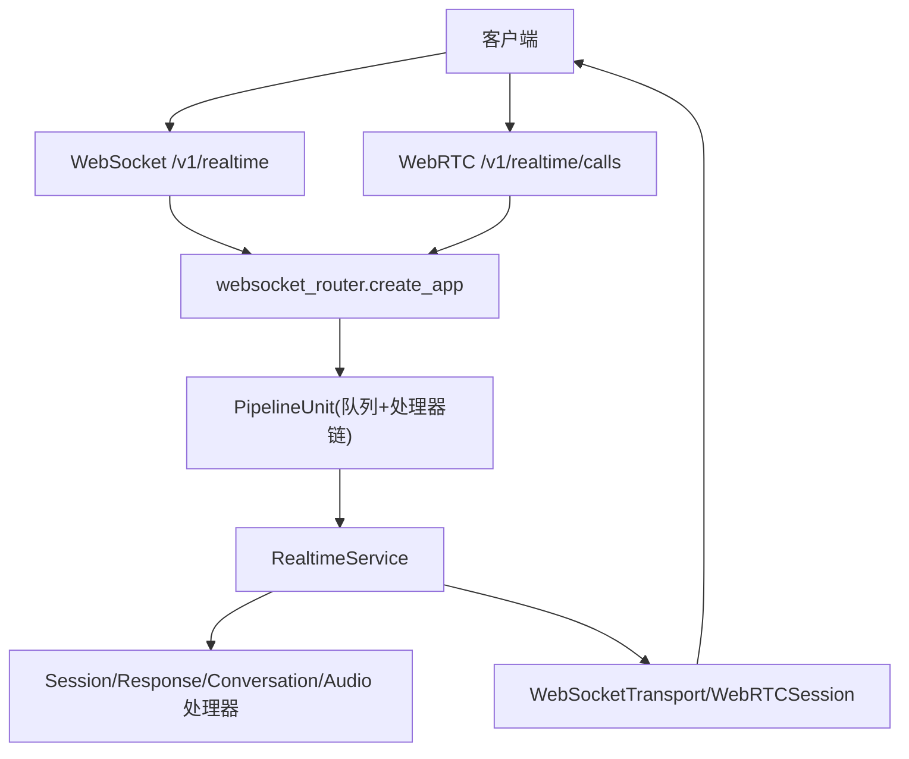
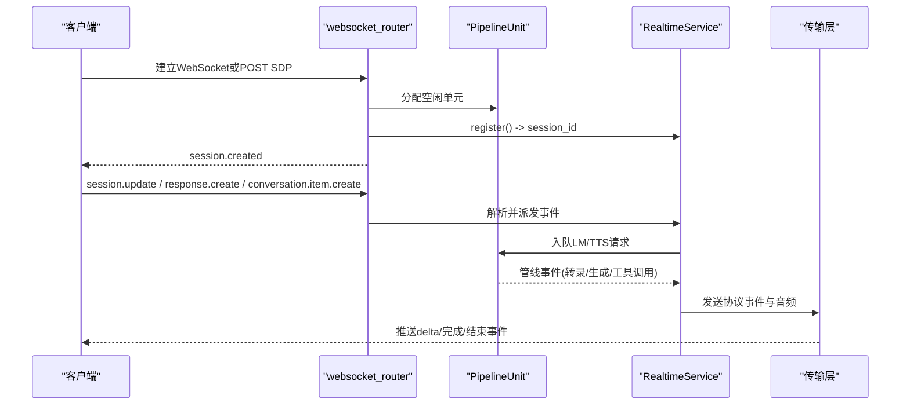
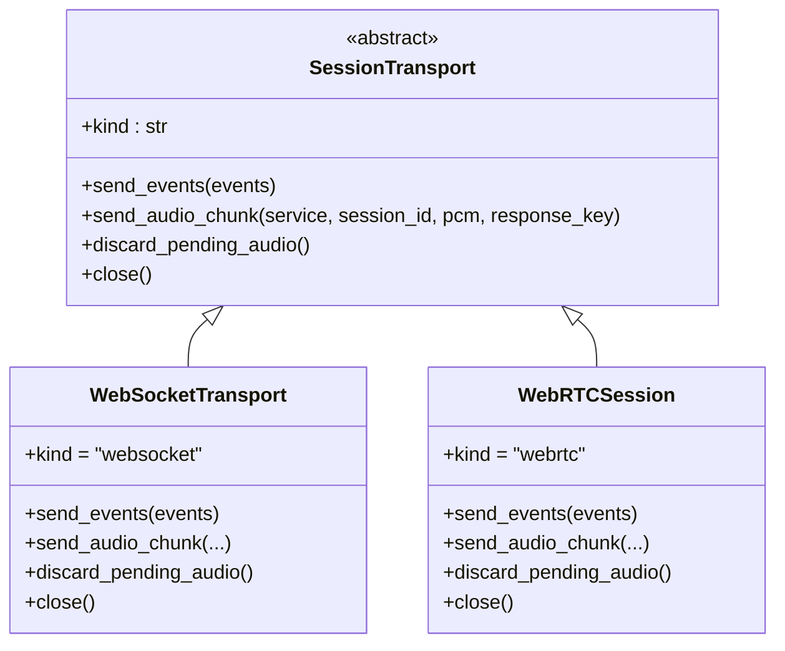
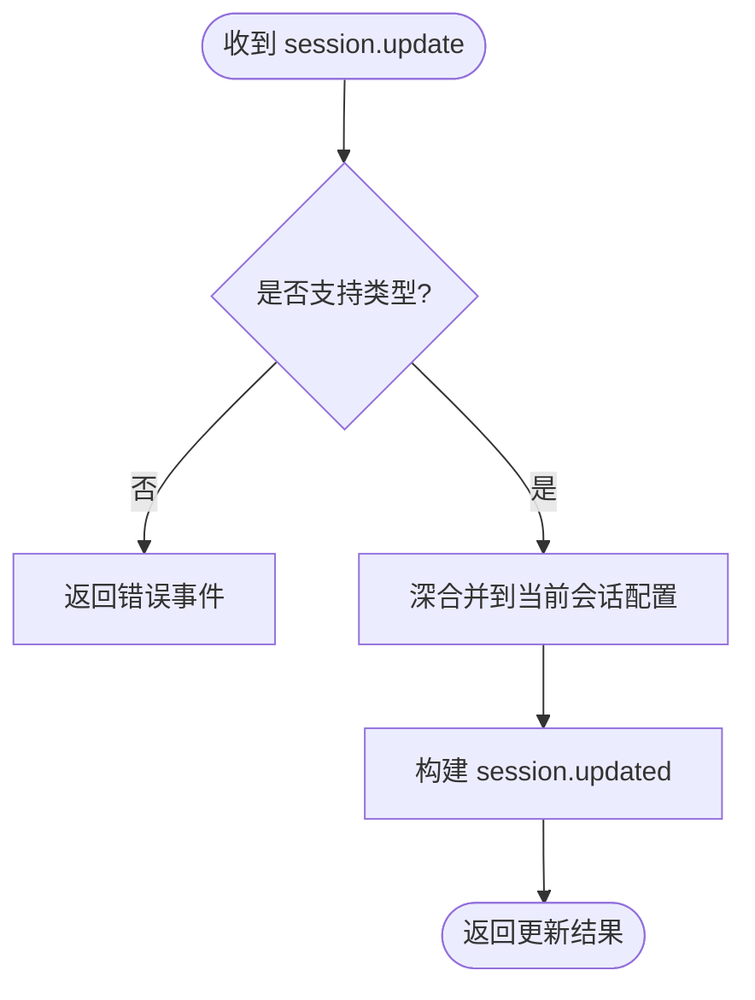
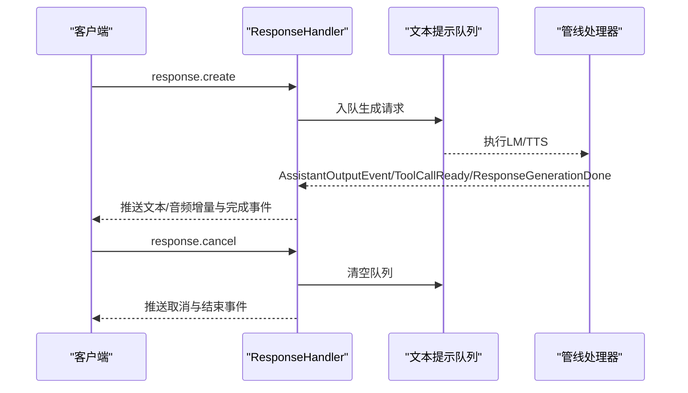
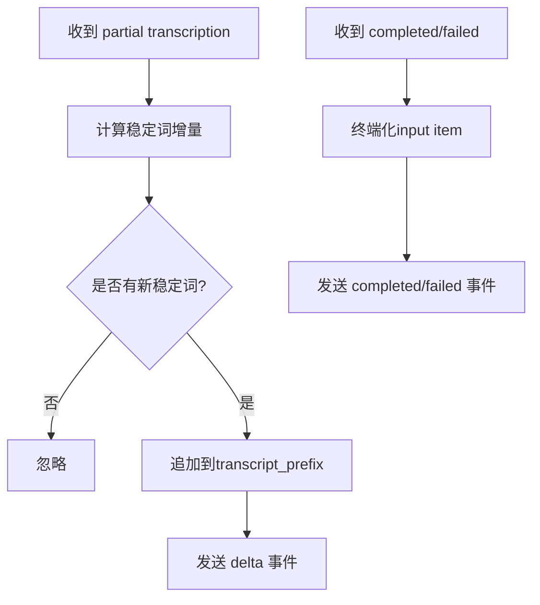
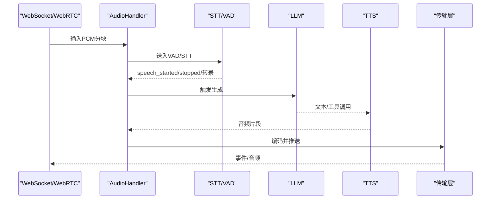
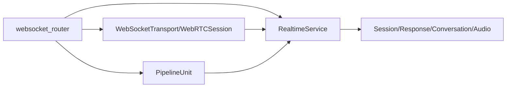

# 实时API接口

<cite>
**本文引用的文件**
- [server.py](file://src/speech_to_speech/api/openai_realtime/server.py)
- [websocket_router.py](file://src/speech_to_speech/api/openai_realtime/websocket_router.py)
- [transports.py](file://src/speech_to_speech/api/openai_realtime/transports.py)
- [webrtc_session.py](file://src/speech_to_speech/api/openai_realtime/webrtc_session.py)
- [service.py](file://src/speech_to_speech/api/openai_realtime/service.py)
- [handlers/session.py](file://src/speech_to_speech/api/openai_realtime/handlers/session.py)
- [handlers/response.py](file://src/speech_to_speech/api/openai_realtime/handlers/response.py)
- [handlers/conversation.py](file://src/speech_to_speech/api/openai_realtime/handlers/conversation.py)
- [handlers/audio.py](file://src/speech_to_speech/api/openai_realtime/handlers/audio.py)
- [runtime_config.py](file://src/speech_to_speech/api/openai_realtime/runtime_config.py)
- [pipeline_unit.py](file://src/speech_to_speech/api/openai_realtime/pipeline_unit.py)
- [demo/server.py](file://demo/server.py)
- [demo/README.md](file://demo/README.md)
</cite>

## 目录
1. [简介](#简介)
2. [项目结构](#项目结构)
3. [核心组件](#核心组件)
4. [架构总览](#架构总览)
5. [详细组件分析](#详细组件分析)
6. [依赖关系分析](#依赖关系分析)
7. [性能与并发](#性能与并发)
8. [故障排查指南](#故障排查指南)
9. [结论](#结论)
10. [附录：客户端连接与事件处理示例](#附录客户端连接与事件处理示例)

## 简介
本文件面向需要基于 OpenAI Realtime GA 协议构建语音到语音（Speech-to-Speech）应用的开发者，系统性说明本仓库提供的实时 API 兼容性、传输协议（WebSocket 与 WebRTC）、端点与事件模型、实时音频流处理、会话管理与并发控制机制，以及认证、限流与安全注意事项。文档同时提供调试工具、监控指标和性能优化建议，并给出如何基于该 API 构建应用程序的实践指引。

## 项目结构
本项目在 src/speech_to_speech/api/openai_realtime 下实现了完整的 OpenAI Realtime 兼容层，包含路由、传输、服务编排与处理器；demo 子目录提供浏览器演示与代理服务器。关键目录与职责如下：
- websocket_router.py：FastAPI 应用、WebSocket/WebRTC 路由、发送循环与会话释放流程
- transports.py：传输抽象与 WebSocket 实现
- webrtc_session.py：WebRTC 传输实现（媒体轨道与数据通道）
- service.py：OpenAI 事件与内部管线事件的转换、会话状态、指标统计
- handlers/*：会话、响应、对话项、音频等处理器
- runtime_config.py：运行时配置合并与中断策略
- pipeline_unit.py：隔离的管线单元与会话状态
- server.py：RealtimeServer 启动 uvicorn 服务
- demo/server.py：演示用 FastAPI 服务（代理 WebRTC SDP、负载均衡与配额）

**图示来源**
- [websocket_router.py:498-785](file://src/speech_to_speech/api/openai_realtime/websocket_router.py#L498-L785)
- [transports.py:29-116](file://src/speech_to_speech/api/openai_realtime/transports.py#L29-L116)
- [webrtc_session.py:157-309](file://src/speech_to_speech/api/openai_realtime/webrtc_session.py#L157-L309)
- [service.py:287-327](file://src/speech_to_speech/api/openai_realtime/service.py#L287-L327)

**章节来源**
- [websocket_router.py:498-785](file://src/speech_to_speech/api/openai_realtime/websocket_router.py#L498-L785)
- [server.py:14-70](file://src/speech_to_speech/api/openai_realtime/server.py#L14-L70)

## 核心组件
- RealtimeServer：封装 uvicorn 服务，持有 PipelineUnit 池，按连接数限制并发
- PipelineUnit：每个单元维护独立队列与处理器链，承载一个会话的生命周期
- SessionState：每客户端临时状态（transport、session_id、drained 等）
- RealtimeService：事件解析与派发、会话状态管理、指标聚合
- 传输层：
  - WebSocketTransport：JSON 帧 + base64 音频增量
  - WebRTCSession：媒体轨道传输 PCM，数据通道传输 JSON 事件
- 处理器：
  - SessionHandler：session.update、session.created/updated
  - ResponseHandler：response.create/cancel/done、输出项组装
  - ConversationHandler：conversation.item.create/truncate、转写增量/完成/失败
  - AudioHandler：输入音频分块、VAD 事件、输出音频编码

**章节来源**
- [pipeline_unit.py:13-77](file://src/speech_to_speech/api/openai_realtime/pipeline_unit.py#L13-L77)
- [service.py:287-327](file://src/speech_to_speech/api/openai_realtime/service.py#L287-L327)
- [transports.py:29-116](file://src/speech_to_speech/api/openai_realtime/transports.py#L29-L116)
- [webrtc_session.py:157-309](file://src/speech_to_speech/api/openai_realtime/webrtc_session.py#L157-L309)
- [handlers/session.py:21-81](file://src/speech_to_speech/api/openai_realtime/handlers/session.py#L21-L81)
- [handlers/response.py:52-136](file://src/speech_to_speech/api/openai_realtime/handlers/response.py#L52-L136)
- [handlers/conversation.py:74-218](file://src/speech_to_speech/api/openai_realtime/handlers/conversation.py#L74-L218)
- [handlers/audio.py:32-161](file://src/speech_to_speech/api/openai_realtime/handlers/audio.py#L32-L161)

## 架构总览
系统采用“路由-单元-服务-处理器-传输”的分层架构：
- 路由层负责接入（WebSocket/WebRTC），分配 PipelineUnit，维护发送循环
- 单元层隔离会话，持有队列与处理器链，保证资源不泄漏
- 服务层统一事件模型，将 OpenAI 协议事件映射为内部管线事件
- 处理器层专注业务逻辑（会话、响应、对话、音频）
- 传输层屏蔽底层差异，向客户端发送事件与音频

**图示来源**
- [websocket_router.py:541-601](file://src/speech_to_speech/api/openai_realtime/websocket_router.py#L541-L601)
- [websocket_router.py:664-785](file://src/speech_to_speech/api/openai_realtime/websocket_router.py#L664-L785)
- [service.py:379-499](file://src/speech_to_speech/api/openai_realtime/service.py#L379-L499)

## 详细组件分析

### 传输层：WebSocket 与 WebRTC
- WebSocketTransport：以 JSON 帧发送事件，音频以 base64 增量事件传输
- WebRTCSession：通过媒体轨道传输 PCM（48 kHz），数据通道传输相同 JSON 事件；支持服务端播放缓冲清理以实现打断
- 两者均实现统一的 SessionTransport 接口，便于发送循环复用

**图示来源**
- [transports.py:29-116](file://src/speech_to_speech/api/openai_realtime/transports.py#L29-L116)
- [webrtc_session.py:157-309](file://src/speech_to_speech/api/openai_realtime/webrtc_session.py#L157-L309)

**章节来源**
- [transports.py:29-116](file://src/speech_to_speech/api/openai_realtime/transports.py#L29-L116)
- [webrtc_session.py:157-309](file://src/speech_to_speech/api/openai_realtime/webrtc_session.py#L157-L309)

### 会话与配置管理
- RuntimeConfig：维护 Chat 与 RealtimeSessionCreateRequest，支持 session.update 的深合并
- interrupt_response_enabled：根据 turn_detection.interrupt_response 决定是否允许打断
- SessionHandler：处理 session.update，返回 session.updated；构建 session.created/updated

**图示来源**
- [runtime_config.py:27-82](file://src/speech_to_speech/api/openai_realtime/runtime_config.py#L27-L82)
- [handlers/session.py:21-81](file://src/speech_to_speech/api/openai_realtime/handlers/session.py#L21-L81)

**章节来源**
- [runtime_config.py:27-82](file://src/speech_to_speech/api/openai_realtime/runtime_config.py#L27-L82)
- [handlers/session.py:21-81](file://src/speech_to_speech/api/openai_realtime/handlers/session.py#L21-L81)

### 响应生命周期与并发控制
- ResponseHandler：管理 response.create/cancel/done，维护输出项顺序与函数调用完成状态
- 预取与抢占：支持工具调用后的预取生成，避免阻塞主响应；可被后续 response.create 替换
- 取消与丢弃：响应取消时清空相关队列与传输缓冲，确保打断生效

**图示来源**
- [handlers/response.py:520-621](file://src/speech_to_speech/api/openai_realtime/handlers/response.py#L520-L621)
- [handlers/response.py:623-769](file://src/speech_to_speech/api/openai_realtime/handlers/response.py#L623-L769)
- [websocket_router.py:472-495](file://src/speech_to_speech/api/openai_realtime/websocket_router.py#L472-L495)

**章节来源**
- [handlers/response.py:520-769](file://src/speech_to_speech/api/openai_realtime/handlers/response.py#L520-L769)
- [websocket_router.py:472-495](file://src/speech_to_speech/api/openai_realtime/websocket_router.py#L472-L495)

### 对话项与转写事件
- ConversationHandler：注入 conversation.item.create，延迟到响应完成后提交，保持顺序
- 转写增量：稳定词级增量，避免回退重发；最终完成事件携带时长与使用信息
- 失败处理：item 级别失败事件，不影响其他 item

**图示来源**
- [handlers/conversation.py:246-300](file://src/speech_to_speech/api/openai_realtime/handlers/conversation.py#L246-L300)
- [handlers/conversation.py:337-405](file://src/speech_to_speech/api/openai_realtime/handlers/conversation.py#L337-L405)

**章节来源**
- [handlers/conversation.py:246-405](file://src/speech_to_speech/api/openai_realtime/handlers/conversation.py#L246-L405)

### 实时音频流处理
- 输入路径：
  - WebSocket：base64 PCM 分块，重采样至 16 kHz，切分为 512 样本块送入 VAD
  - WebRTC：媒体轨道接收 Opus，解码后重采样至 16 kHz 送入 VAD
- 输出路径：
  - WebSocket：PCM 增量以 base64 事件推送
  - WebRTC：PCM 写入媒体轨道，按 20 ms 定时播放，支持清理缓冲实现打断
- AudioHandler：维护输入项状态、VAD 事件、输出音频编码

**图示来源**
- [handlers/audio.py:105-161](file://src/speech_to_speech/api/openai_realtime/handlers/audio.py#L105-L161)
- [handlers/audio.py:243-331](file://src/speech_to_speech/api/openai_realtime/handlers/audio.py#L243-L331)
- [webrtc_session.py:290-309](file://src/speech_to_speech/api/openai_realtime/webrtc_session.py#L290-L309)

**章节来源**
- [handlers/audio.py:105-331](file://src/speech_to_speech/api/openai_realtime/handlers/audio.py#L105-L331)
- [webrtc_session.py:290-309](file://src/speech_to_speech/api/openai_realtime/webrtc_session.py#L290-L309)

### 路由与端点
- WebSocket 端点：/v1/realtime
  - 接受子协议 realtime
  - 分配 PipelineUnit，注册会话，发送 session.created
  - 处理 client 事件（session.update、conversation.item.create、response.create/cancel）
- WebRTC 端点：/v1/realtime/calls
  - POST SDP offer，返回 answer，设置 Location
  - 数据通道标签 oai-events，媒体轨道传输音频
- 监控端点：
  - GET /v1/usage：聚合各单元的使用指标
  - GET /v1/pool：查看单元占用、释放、卡住状态

**章节来源**
- [websocket_router.py:541-601](file://src/speech_to_speech/api/openai_realtime/websocket_router.py#L541-L601)
- [websocket_router.py:664-785](file://src/speech_to_speech/api/openai_realtime/websocket_router.py#L664-L785)
- [websocket_router.py:603-662](file://src/speech_to_speech/api/openai_realtime/websocket_router.py#L603-L662)

## 依赖关系分析
- 路由依赖服务与传输：websocket_router 创建 app，挂载 LLM 代理，定义路由，调度发送循环
- 服务依赖处理器：RealtimeService 组合 Audio/Session/Response/Conversation 处理器
- 传输依赖服务：发送音频前需 begin_audio_output 获取上下文与事件
- 单元依赖服务与队列：PipelineUnit 持有服务实例与四路队列，驱动处理器链

**图示来源**
- [websocket_router.py:498-527](file://src/speech_to_speech/api/openai_realtime/websocket_router.py#L498-L527)
- [service.py:287-327](file://src/speech_to_speech/api/openai_realtime/service.py#L287-L327)
- [transports.py:29-116](file://src/speech_to_speech/api/openai_realtime/transports.py#L29-L116)

**章节来源**
- [websocket_router.py:498-527](file://src/speech_to_speech/api/openai_realtime/websocket_router.py#L498-L527)
- [service.py:287-327](file://src/speech_to_speech/api/openai_realtime/service.py#L287-L327)

## 性能与并发
- 并发模型：每个 PipelineUnit 对应一个会话，池大小决定最大并发；超过池容量拒绝新连接
- 队列与丢弃：取消时保留必要控制消息，丢弃过时音频与文本输出，防止跨会话泄漏
- 发送循环：每单元独立任务轮询输出队列，按传输能力推送，WebRTC 侧进行播放速率控制
- 指标与监控：
  - /v1/usage：汇总 token 使用、音频时长、错误计数
  - /v1/pool：单元状态（idle/active/draining/stuck），帮助定位卡住的处理器链

优化建议：
- 合理设置 --num_pipelines 以匹配硬件资源
- 调整 CHUNK_SIZE_BYTES 与 WebRTC AUDIO_PTIME 平衡延迟与稳定性
- 启用 WebRTC 的 discard_pending_audio 以提升打断响应速度
- 监控 /v1/pool 的 stuck 单元，及时重启或扩容

**章节来源**
- [websocket_router.py:214-332](file://src/speech_to_speech/api/openai_realtime/websocket_router.py#L214-L332)
- [websocket_router.py:603-662](file://src/speech_to_speech/api/openai_realtime/websocket_router.py#L603-L662)
- [webrtc_session.py:101-155](file://src/speech_to_speech/api/openai_realtime/webrtc_session.py#L101-L155)

## 故障排查指南
常见问题与定位方法：
- 连接被拒：检查 /v1/pool 是否全部 active；确认池大小与负载
- WebRTC 握手失败：确认 webrtc extra 已安装；检查 ICE 服务器配置；关注 negotiate 超时
- 音频无声：检查传输类型（WebSocket 使用 base64 增量，WebRTC 使用媒体轨道）；确认重采样与播放速率
- 响应未结束：查看 /v1/usage 中 responses_completed/cancelled；检查 response.done 是否发出
- 会话泄漏：观察 /v1/pool 的 draining/stuck 状态；确认 SESSION_END 是否传播完毕

错误处理策略：
- 传输层捕获 WebSocketDisconnect 与 RuntimeError，跳过关闭中的发送
- WebRTC 数据通道消息解析失败记录日志并继续
- 路由层对无效事件返回 error 事件，标注 event_id 以便客户端关联

**章节来源**
- [transports.py:60-81](file://src/speech_to_speech/api/openai_realtime/transports.py#L60-L81)
- [webrtc_session.py:401-416](file://src/speech_to_speech/api/openai_realtime/webrtc_session.py#L401-L416)
- [websocket_router.py:384-495](file://src/speech_to_speech/api/openai_realtime/websocket_router.py#L384-L495)

## 结论
本实现提供了与 OpenAI Realtime GA 协议高度兼容的实时 API，支持 WebSocket 与 WebRTC 两种传输方式，具备完善的会话管理、响应生命周期控制、实时音频流处理与并发隔离机制。通过 /v1/usage 与 /v1/pool 等监控端点，结合合理的池大小与参数调优，可构建低延迟、高可用的语音到语音应用。

## 附录：客户端连接与事件处理示例
- 连接方式：
  - WebSocket：ws://host:port/v1/realtime，子协议 realtime
  - WebRTC：POST SDP offer 到 http(s)://host:port/v1/realtime/calls，接收 answer 并建立媒体连接
- 事件类型：
  - 客户端事件：session.update、conversation.item.create、response.create、response.cancel、input_audio_buffer.append/commit、output_audio_buffer.clear（WebRTC）
  - 服务端事件：session.created/updated、conversation.item.created、response.created/done、response.output_audio.delta、input_audio_buffer.speech_started/stopped、error
- 错误处理：
  - 未知或无效事件返回 error 事件，携带 event_id 与错误类型
  - 传输关闭时跳过发送，避免异常堆栈
- 调试工具：
  - websocat 测试 WebSocket 连通性
  - 浏览器开发者工具查看 WebRTC 媒体与数据通道
  - 访问 /v1/usage 与 /v1/pool 查看指标与单元状态

参考文档与示例：
- demo/README.md 提供快速开始、传输选择与注意事项
- demo/server.py 提供代理与配额功能，便于演示部署

**章节来源**
- [demo/README.md:29-156](file://demo/README.md#L29-L156)
- [demo/server.py:188-208](file://demo/server.py#L188-L208)
- [demo/server.py:294-331](file://demo/server.py#L294-L331)