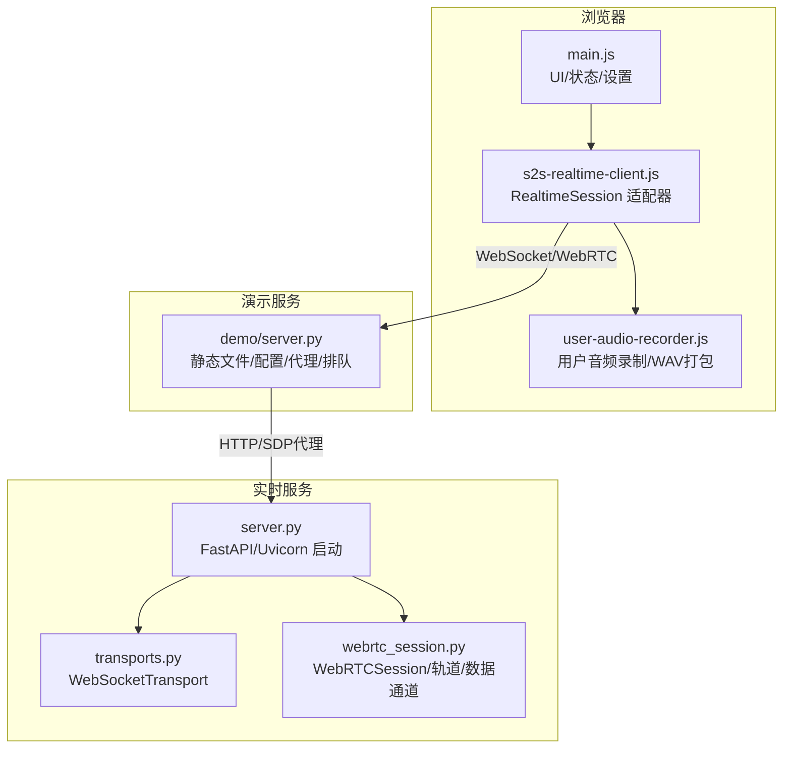
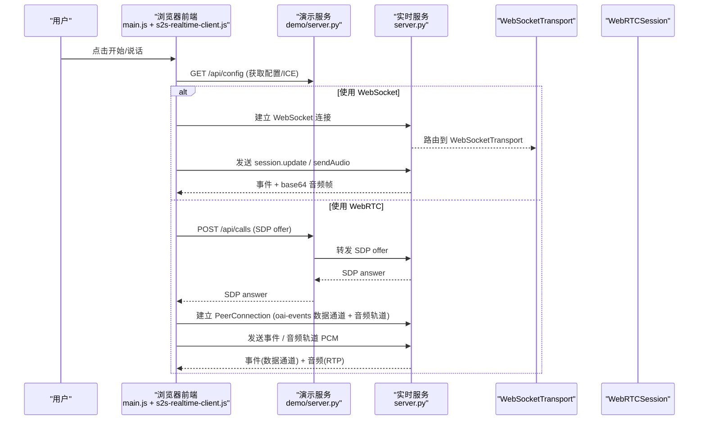
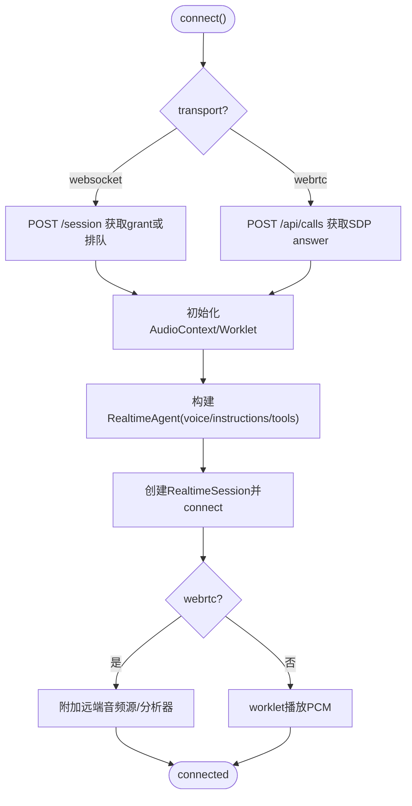
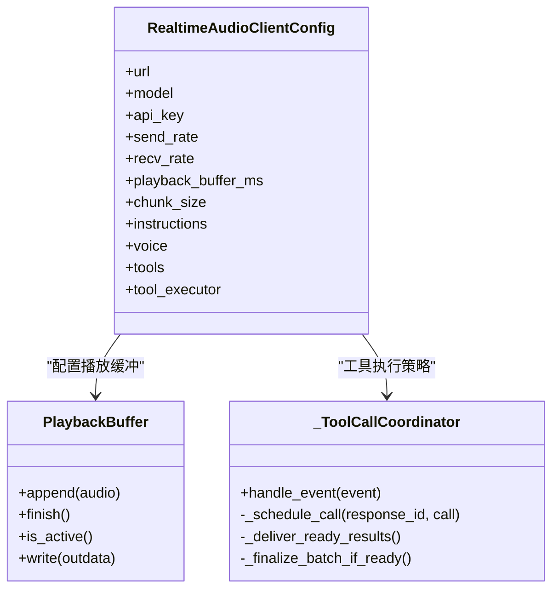
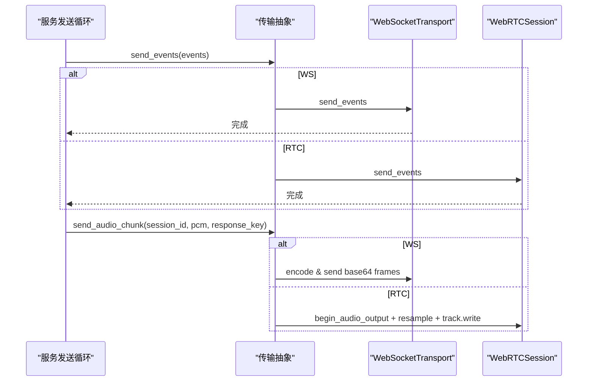
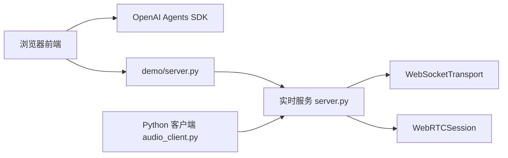
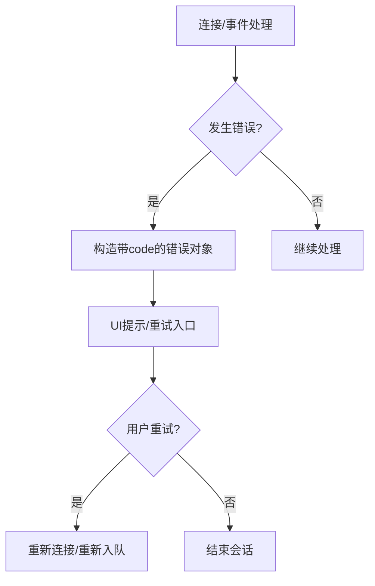

# 客户端集成

<cite>
**本文引用的文件**
- [demo/s2s-realtime-client.js](file://demo/s2s-realtime-client.js)
- [demo/main.js](file://demo/main.js)
- [demo/ws/user-audio-recorder.js](file://demo/ws/user-audio-recorder.js)
- [src/speech_to_speech/api/openai_realtime/audio_client.py](file://src/speech_to_speech/api/openai_realtime/audio_client.py)
- [src/speech_to_speech/api/openai_realtime/transports.py](file://src/speech_to_speech/api/openai_realtime/transports.py)
- [src/speech_to_speech/api/openai_realtime/webrtc_session.py](file://src/speech_to_speech/api/openai_realtime/webrtc_session.py)
- [src/speech_to_speech/api/openai_realtime/server.py](file://src/speech_to_speech/api/openai_realtime/server.py)
- [demo/server.py](file://demo/server.py)
- [README.md](file://README.md)
</cite>

## 目录
1. [简介](#简介)
2. [项目结构](#项目结构)
3. [核心组件](#核心组件)
4. [架构总览](#架构总览)
5. [详细组件分析](#详细组件分析)
6. [依赖关系分析](#依赖关系分析)
7. [性能与网络优化](#性能与网络优化)
8. [错误处理与重连机制](#错误处理与重连机制)
9. [端到端示例：从界面到后端](#端到端示例从界面到后端)
10. [结论](#结论)

## 简介
本指南面向希望基于 OpenAI Realtime API 构建语音对话客户端的开发者，覆盖 WebSocket 与 WebRTC 两种连接方式，提供 JavaScript 前端、Python 后端的完整集成说明，并给出音频数据处理、网络优化、用户体验设计、错误处理与资源管理的最佳实践。文档以仓库中的 demo 和 openai_realtime 模块为依据，帮助读者快速搭建端到端的语音对话应用。

## 项目结构
该仓库包含：
- 浏览器端 demo：提供基于 OpenAI Agents SDK 的实时会话封装、音频录制/播放、可视化与 UI 状态管理。
- Python 服务端：实现 OpenAI Realtime 兼容协议，支持 WebSocket 与 WebRTC 传输，内置工具调用协调、事件分发与音频流式输出。
- 配套演示服务器：提供静态页面、配置下发、WebRTC SDP 代理、负载均衡会话排队等能力。

图表来源
- [demo/main.js:1-120](file://demo/main.js#L1-L120)
- [demo/s2s-realtime-client.js:70-214](file://demo/s2s-realtime-client.js#L70-L214)
- [demo/ws/user-audio-recorder.js:58-148](file://demo/ws/user-audio-recorder.js#L58-L148)
- [demo/server.py:137-200](file://demo/server.py#L137-L200)
- [src/speech_to_speech/api/openai_realtime/server.py:14-70](file://src/speech_to_speech/api/openai_realtime/server.py#L14-L70)
- [src/speech_to_speech/api/openai_realtime/transports.py:29-116](file://src/speech_to_speech/api/openai_realtime/transports.py#L29-L116)
- [src/speech_to_speech/api/openai_realtime/webrtc_session.py:157-309](file://src/speech_to_speech/api/openai_realtime/webrtc_session.py#L157-L309)

章节来源
- [README.md:19-68](file://README.md#L19-L68)
- [demo/server.py:1-42](file://demo/server.py#L1-L42)

## 核心组件
- 浏览器端实时客户端（JavaScript）
  - 封装 OpenAI Agents SDK 的 RealtimeSession，统一 WebSocket 与 WebRTC 两种传输。
  - 负责麦克风采集、噪声门限、音频回放、输入/输出电平检测、转录文本拼接、响应生命周期事件处理。
- Python 本地音频客户端（CLI）
  - 通过 AsyncOpenAI 连接 Realtime 服务，管理录音/播放缓冲、工具调用执行与结果投递、控制台渲染。
- 传输层（服务端）
  - WebSocketTransport：将事件与 base64 音频帧以 JSON 帧发送。
  - WebRTCSession：通过数据通道发送事件，通过 RTP 媒体轨道发送音频，维护连接与 ICE 协商。
- 演示服务器
  - 提供 /api/config、/api/calls、/api/session、队列管理等能力，屏蔽负载均衡器地址与密钥。

章节来源
- [demo/s2s-realtime-client.js:70-214](file://demo/s2s-realtime-client.js#L70-L214)
- [src/speech_to_speech/api/openai_realtime/audio_client.py:48-208](file://src/speech_to_speech/api/openai_realtime/audio_client.py#L48-L208)
- [src/speech_to_speech/api/openai_realtime/transports.py:29-116](file://src/speech_to_speech/api/openai_realtime/transports.py#L29-L116)
- [src/speech_to_speech/api/openai_realtime/webrtc_session.py:157-309](file://src/speech_to_speech/api/openai_realtime/webrtc_session.py#L157-L309)
- [demo/server.py:137-200](file://demo/server.py#L137-L200)

## 架构总览
下图展示从浏览器到后端的端到端数据流，包括事件与音频在两种传输下的路径。

图表来源
- [demo/s2s-realtime-client.js:134-214](file://demo/s2s-realtime-client.js#L134-L214)
- [demo/server.py:116-129](file://demo/server.py#L116-L129)
- [src/speech_to_speech/api/openai_realtime/transports.py:83-116](file://src/speech_to_speech/api/openai_realtime/transports.py#L83-L116)
- [src/speech_to_speech/api/openai_realtime/webrtc_session.py:244-309](file://src/speech_to_speech/api/openai_realtime/webrtc_session.py#L244-L309)

## 详细组件分析

### 浏览器端实时客户端（JavaScript）
- 连接建立
  - 根据 transport 选择 WebSocket 或 WebRTC；若为 WebSocket 且未直连，则通过 /session 获取 grant 或进入队列等待。
  - 初始化 AudioContext、Worklet 节点（mic-capture、audio-playback），配置采样率与 VAD 参数。
  - 创建 RealtimeSession，绑定事件回调，发送初始消息（可选问候语）。
- 音频录制与发送
  - 通过 Worklet 捕获麦克风 PCM 片段，按 VAD 边界记录用户音频，必要时生成 WAV Blob 供回放。
  - 将 PCM 片段通过 sendAudio 发送到服务端。
- 文本输入与语音输出
  - 监听转录增量与完成事件，合并为用户/助手转录，发布 transcript 事件。
  - 接收音频事件，转换为 Float32 样本并通过 playback Worklet 播放；检测音量阈值判断 AI 是否正在说话。
- 工具调用
  - 声明工具定义，当模型触发函数调用时，调用 executeTool 返回结果，并可附加图片。
- 状态与事件
  - 维护连接状态机（idle/connecting/queued/your-turn/listening/user-speaking/processing/ai-speaking/error），通过 CustomEvent 通知 UI。

图表来源
- [demo/s2s-realtime-client.js:134-214](file://demo/s2s-realtime-client.js#L134-L214)
- [demo/s2s-realtime-client.js:262-310](file://demo/s2s-realtime-client.js#L262-L310)
- [demo/s2s-realtime-client.js:312-346](file://demo/s2s-realtime-client.js#L312-L346)
- [demo/server.py:116-129](file://demo/server.py#L116-L129)

章节来源
- [demo/s2s-realtime-client.js:70-214](file://demo/s2s-realtime-client.js#L70-L214)
- [demo/s2s-realtime-client.js:234-260](file://demo/s2s-realtime-client.js#L234-L260)
- [demo/s2s-realtime-client.js:360-532](file://demo/s2s-realtime-client.js#L360-L532)
- [demo/ws/user-audio-recorder.js:58-148](file://demo/ws/user-audio-recorder.js#L58-L148)

### Python 本地音频客户端（CLI）
- 配置与连接
  - 通过 normalize_realtime_url 解析 URL，构造 AsyncOpenAI 客户端；自动识别本地回环地址并使用本地 key。
  - 构建 session.update 配置，指定 VAD、音频格式、指令与工具。
- 音频缓冲与播放
  - PlaybackBuffer 线程安全地累积 PCM，控制启动缓冲与播放状态，避免卡顿与过早静音。
- 工具调用协调
  - _ToolCallCoordinator 按 response 批次调度工具执行，保证顺序与幂等，处理冲突与取消，并在完成后按需发起 follow-up response.create。
- 事件渲染
  - 控制台友好渲染用户与助手的转录流，处理中断与完成事件。

图表来源
- [src/speech_to_speech/api/openai_realtime/audio_client.py:48-208](file://src/speech_to_speech/api/openai_realtime/audio_client.py#L48-L208)
- [src/speech_to_speech/api/openai_realtime/audio_client.py:210-277](file://src/speech_to_speech/api/openai_realtime/audio_client.py#L210-L277)
- [src/speech_to_speech/api/openai_realtime/audio_client.py:467-773](file://src/speech_to_speech/api/openai_realtime/audio_client.py#L467-L773)

章节来源
- [src/speech_to_speech/api/openai_realtime/audio_client.py:122-208](file://src/speech_to_speech/api/openai_realtime/audio_client.py#L122-L208)
- [src/speech_to_speech/api/openai_realtime/audio_client.py:210-277](file://src/speech_to_speech/api/openai_realtime/audio_client.py#L210-L277)
- [src/speech_to_speech/api/openai_realtime/audio_client.py:467-773](file://src/speech_to_speech/api/openai_realtime/audio_client.py#L467-L773)

### 传输层（服务端）
- WebSocketTransport
  - 将事件与音频帧编码为 JSON 帧发送；丢弃未播放音频由客户端负责。
- WebRTCSession
  - 通过 oai-events 数据通道发送事件，通过 RTP 媒体轨道发送 48kHz PCM；维护连接超时、ICE 收集、关闭流程。
  - PipelineAudioTrack 按 20ms 帧 pacing 输出，支持清空缓冲以实现打断。

图表来源
- [src/speech_to_speech/api/openai_realtime/transports.py:29-116](file://src/speech_to_speech/api/openai_realtime/transports.py#L29-L116)
- [src/speech_to_speech/api/openai_realtime/webrtc_session.py:280-309](file://src/speech_to_speech/api/openai_realtime/webrtc_session.py#L280-L309)

章节来源
- [src/speech_to_speech/api/openai_realtime/transports.py:29-116](file://src/speech_to_speech/api/openai_realtime/transports.py#L29-L116)
- [src/speech_to_speech/api/openai_realtime/webrtc_session.py:157-309](file://src/speech_to_speech/api/openai_realtime/webrtc_session.py#L157-L309)

### 演示服务器（负载均衡/代理/配额）
- 提供 /api/config 告知前端是否走 LB、是否允许直连、ICE 服务器列表、是否支持 WebRTC。
- /api/calls 代理 WebRTC SDP offer/answer，仅暴露计算节点的 connect URL。
- /api/session 与 /api/queue 实现排队与抢占，保护每日预算与登录分级。

章节来源
- [demo/server.py:1-42](file://demo/server.py#L1-L42)
- [demo/server.py:137-200](file://demo/server.py#L137-L200)

## 依赖关系分析
- 浏览器端依赖 OpenAI Agents SDK 提供的 RealtimeSession、WebSocket/WebRTC 传输；通过 demo/server.py 提供的静态资源加载。
- Python 客户端依赖 AsyncOpenAI 与 sounddevice（本地命令），以及 aiortc（WebRTC 额外依赖）。
- 服务端依赖 FastAPI/Uvicorn、aiortc、av 进行音频重采样与帧处理。

图表来源
- [demo/server.py:137-200](file://demo/server.py#L137-L200)
- [src/speech_to_speech/api/openai_realtime/server.py:14-70](file://src/speech_to_speech/api/openai_realtime/server.py#L14-L70)
- [src/speech_to_speech/api/openai_realtime/transports.py:29-116](file://src/speech_to_speech/api/openai_realtime/transports.py#L29-L116)
- [src/speech_to_speech/api/openai_realtime/webrtc_session.py:157-309](file://src/speech_to_speech/api/openai_realtime/webrtc_session.py#L157-L309)
- [src/speech_to_speech/api/openai_realtime/audio_client.py:143-161](file://src/speech_to_speech/api/openai_realtime/audio_client.py#L143-L161)

章节来源
- [README.md:19-68](file://README.md#L19-L68)

## 性能与网络优化
- 音频采样与缓冲
  - 浏览器侧使用 24kHz PCM，Worklet 低延迟处理；Python 侧默认 16kHz 管道速率，支持 24kHz PCM 格式映射。
  - PlaybackBuffer 启动缓冲策略减少首包延迟，同时避免过长缓冲导致交互迟滞。
- WebRTC 帧 pacing
  - 服务端按 20ms 帧输出 48kHz PCM，确保稳定 RTP 流；支持清空缓冲实现即时打断。
- 网络与 ICE
  - 通过 /api/config 下发 STUN/TURN 服务器，提升跨 NAT 连通性；WebRTC 连接超时保护释放资源。
- 队列与配额
  - 在负载高时进入队列等待，避免拥塞；按登录等级限制对话时长，保障公平性。

章节来源
- [demo/s2s-realtime-client.js:216-232](file://demo/s2s-realtime-client.js#L216-L232)
- [src/speech_to_speech/api/openai_realtime/audio_client.py:164-208](file://src/speech_to_speech/api/openai_realtime/audio_client.py#L164-L208)
- [src/speech_to_speech/api/openai_realtime/webrtc_session.py:40-49](file://src/speech_to_speech/api/openai_realtime/webrtc_session.py#L40-L49)
- [demo/server.py:188-200](file://demo/server.py#L188-L200)

## 错误处理与重连机制
- 浏览器端
  - 连接断开、队列满、限额、登录过期等错误通过 codedError 携带 code 与 extra 信息，便于 UI 提示与重试。
  - 队列等待支持轮询与主动离开；加入窗口过期会拒绝并重试。
- Python 客户端
  - 工具执行异常被捕获并记录，返回结构化错误；连接重试超时可配置。
- 服务端
  - WebSocket 发送失败忽略已关闭连接；WebRTC 数据通道发送异常记录日志；连接超时释放单元。

图表来源
- [demo/s2s-realtime-client.js:57-62](file://demo/s2s-realtime-client.js#L57-L62)
- [demo/s2s-realtime-client.js:645-702](file://demo/s2s-realtime-client.js#L645-L702)
- [src/speech_to_speech/api/openai_realtime/transports.py:60-81](file://src/speech_to_speech/api/openai_realtime/transports.py#L60-L81)
- [src/speech_to_speech/api/openai_realtime/webrtc_session.py:392-400](file://src/speech_to_speech/api/openai_realtime/webrtc_session.py#L392-L400)

章节来源
- [demo/s2s-realtime-client.js:57-62](file://demo/s2s-realtime-client.js#L57-L62)
- [demo/s2s-realtime-client.js:645-702](file://demo/s2s-realtime-client.js#L645-L702)
- [src/speech_to_speech/api/openai_realtime/transports.py:60-81](file://src/speech_to_speech/api/openai_realtime/transports.py#L60-L81)
- [src/speech_to_speech/api/openai_realtime/webrtc_session.py:392-400](file://src/speech_to_speech/api/openai_realtime/webrtc_session.py#L392-L400)

## 端到端示例：从界面到后端
- 启动服务
  - 运行实时服务（FastAPI/Uvicorn），暴露 ws://host:port/v1/realtime。
  - 启动演示服务，提供静态页面与 /api/config、/api/calls、/api/session 等接口。
- 浏览器接入
  - 打开 index.html，点击开始，请求 /api/config 获取配置与 ICE 服务器。
  - 选择传输方式：
    - WebSocket：直接连接实时服务，发送 session.update 与音频。
    - WebRTC：POST /api/calls 获取 SDP answer，建立 PeerConnection，通过数据通道与媒体轨道通信。
- 音频与文本
  - 麦克风采集 PCM，经 VAD 边界录制，发送服务端；服务端返回转录与合成音频。
  - 前端合并增量转录，更新聊天视图；播放合成音频并可视化。
- 工具调用
  - 前端声明工具（如 web_search、camera_snapshot），服务端触发函数调用，前端执行并返回结果。
- 资源管理
  - 会话结束时清理 AudioContext、Worklet、MediaStream、定时器与队列任务，防止内存泄漏。

章节来源
- [demo/server.py:137-200](file://demo/server.py#L137-L200)
- [demo/s2s-realtime-client.js:134-214](file://demo/s2s-realtime-client.js#L134-L214)
- [demo/s2s-realtime-client.js:735-764](file://demo/s2s-realtime-client.js#L735-L764)
- [src/speech_to_speech/api/openai_realtime/server.py:14-70](file://src/speech_to_speech/api/openai_realtime/server.py#L14-L70)

## 结论
本仓库提供了完整的 OpenAI Realtime 兼容客户端与服务端实现，支持 WebSocket 与 WebRTC 两种传输，具备完善的音频处理、事件编排、工具调用与资源管理能力。通过 demo 与 openai_realtime 模块，开发者可以快速搭建语音对话应用，并根据场景选择合适的传输与优化策略。建议在生产环境中结合负载均衡、配额管理与 ICE 服务器配置，以获得稳定低延迟的用户体验。