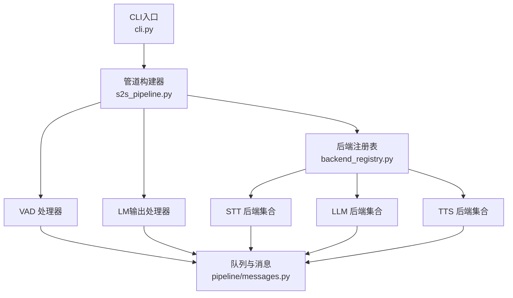
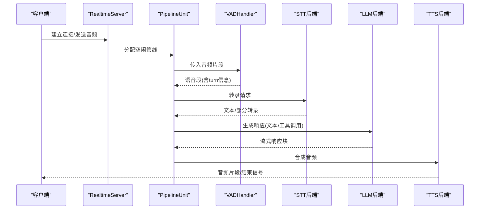
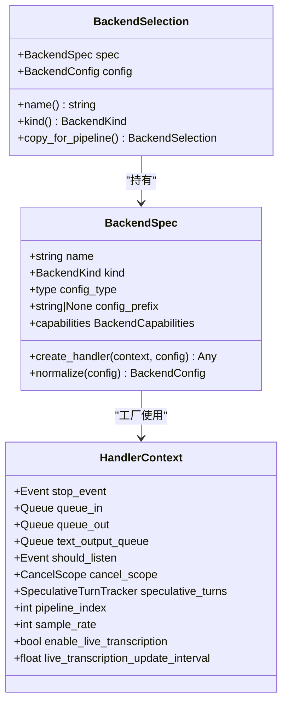
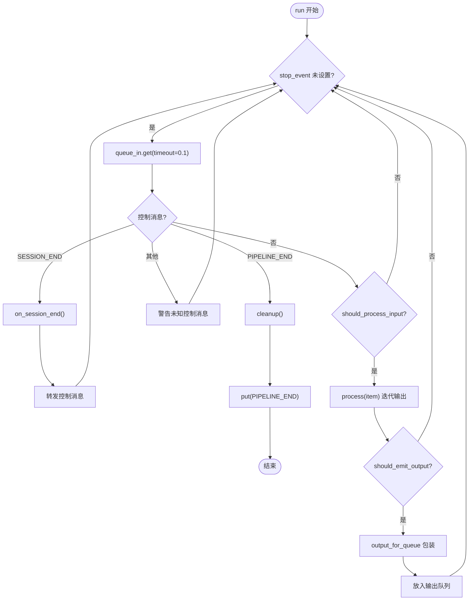
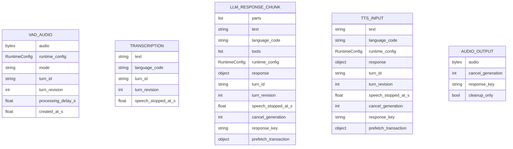
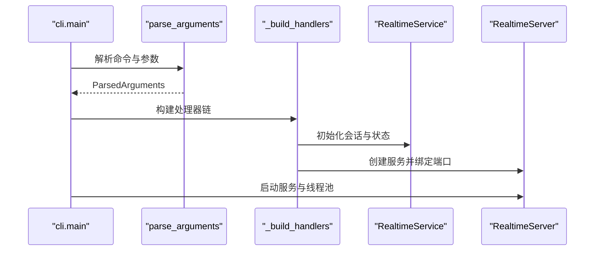
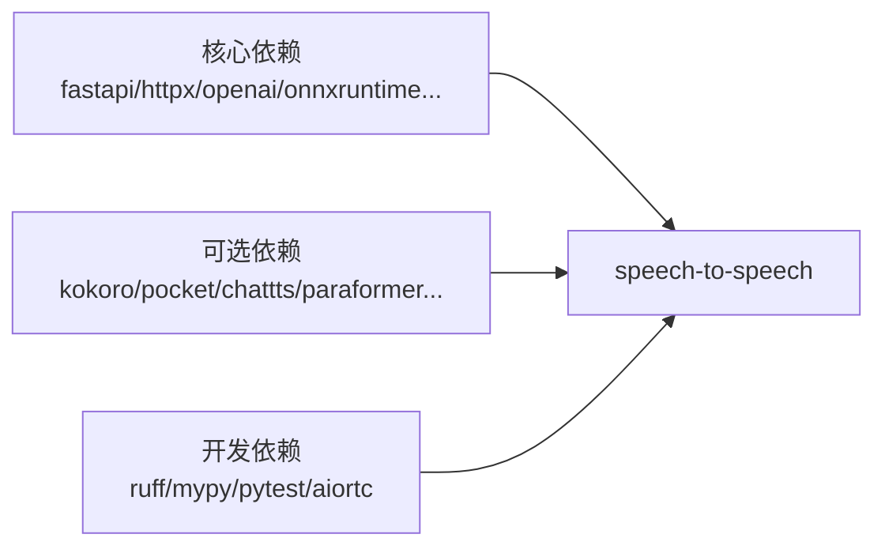

# 开发者指南

<cite>
**本文引用的文件**
- [README.md](file://README.md)
- [pyproject.toml](file://pyproject.toml)
- [AGENTS.md](file://AGENTS.md)
- [src/speech_to_speech/__init__.py](file://src/speech_to_speech/__init__.py)
- [src/speech_to_speech/cli.py](file://src/speech_to_speech/cli.py)
- [src/speech_to_speech/s2s_pipeline.py](file://src/speech_to_speech/s2s_pipeline.py)
- [src/speech_to_speech/baseHandler.py](file://src/speech_to_speech/baseHandler.py)
- [src/speech_to_speech/backend_registry.py](file://src/speech_to_speech/backend_registry.py)
- [src/speech_to_speech/arguments_classes/module_arguments.py](file://src/speech_to_speech/arguments_classes/module_arguments.py)
- [src/speech_to_speech/pipeline/messages.py](file://src/speech_to_speech/pipeline/messages.py)
- [scripts/benchmark_stt.py](file://scripts/benchmark_stt.py)
- [scripts/benchmark_tts.py](file://scripts/benchmark_tts.py)
</cite>

## 目录
1. [简介](#简介)
2. [项目结构](#项目结构)
3. [核心组件](#核心组件)
4. [架构总览](#架构总览)
5. [详细组件分析](#详细组件分析)
6. [依赖关系分析](#依赖关系分析)
7. [性能考量](#性能考量)
8. [故障排查指南](#故障排查指南)
9. [结论](#结论)
10. [附录](#附录)

## 简介
本指南面向希望扩展语音到语音（Speech-to-Speech）管道的开发者，涵盖如何添加新的后端处理器、自定义组件与扩展功能；解释代码结构与设计模式；提供测试策略、单元测试与集成测试方法；说明代码规范、静态检查与质量保证流程；包含贡献指南、Pull Request流程与社区参与方式；并展示如何调试问题、分析性能瓶颈与优化代码；最后给出开发环境搭建、依赖管理与版本控制指南。

## 项目结构
仓库采用模块化分层组织：
- src/speech_to_speech：核心库，包含管道编排、处理器基类、后端注册表、参数定义、消息类型等
- scripts：基准测试脚本（STT/TTS）
- tests：单元测试与集成测试
- demo：前端演示与服务端示例
- docs：文档与API参考
- archive：已弃用的实现归档

图表来源
- [src/speech_to_speech/cli.py:26-95](file://src/speech_to_speech/cli.py#L26-L95)
- [src/speech_to_speech/s2s_pipeline.py:175-285](file://src/speech_to_speech/s2s_pipeline.py#L175-L285)
- [src/speech_to_speech/backend_registry.py:309-543](file://src/speech_to_speech/backend_registry.py#L309-L543)
- [src/speech_to_speech/pipeline/messages.py:31-367](file://src/speech_to_speech/pipeline/messages.py#L31-L367)

章节来源
- [README.md:87-96](file://README.md#L87-L96)
- [pyproject.toml:108-118](file://pyproject.toml#L108-L118)

## 核心组件
- 处理器基类 BaseHandler：统一线程生命周期、输入输出队列、会话结束处理、计时与日志、丢弃陈旧输入等
- 后端注册表 backend_registry：集中管理 STT/LLM/TTS 后端选择、配置归一化、工厂创建、可选依赖提示
- 参数模块 arguments_classes.module_arguments：全局模块级参数（设备、默认后端、日志级别、并发管线数等）
- 消息模型 pipeline.messages：跨组件的强类型消息（VAD音频、转录、LLM响应块、TTS输入、音频输出、结束哨兵等）
- 管道构建 s2s_pipeline：解析参数、组装 VAD→STT→LLM→TTS 流水线、创建服务与线程池、启动/优雅关闭

章节来源
- [src/speech_to_speech/baseHandler.py:25-186](file://src/speech_to_speech/baseHandler.py#L25-L186)
- [src/speech_to_speech/backend_registry.py:48-196](file://src/speech_to_speech/backend_registry.py#L48-L196)
- [src/speech_to_speech/arguments_classes/module_arguments.py:12-105](file://src/speech_to_speech/arguments_classes/module_arguments.py#L12-L105)
- [src/speech_to_speech/pipeline/messages.py:31-367](file://src/speech_to_speech/pipeline/messages.py#L31-L367)
- [src/speech_to_speech/s2s_pipeline.py:354-587](file://src/speech_to_speech/s2s_pipeline.py#L354-L587)

## 架构总览
系统以“VAD → STT → LLM → TTS”四阶段串联，每阶段运行在独立线程并通过队列通信。通过后端注册表可插拔替换各阶段实现。实时服务暴露 OpenAI Realtime 兼容事件集，支持 WebSocket/WebRTC。

图表来源
- [src/speech_to_speech/s2s_pipeline.py:461-547](file://src/speech_to_speech/s2s_pipeline.py#L461-L547)
- [src/speech_to_speech/backend_registry.py:309-543](file://src/speech_to_speech/backend_registry.py#L309-L543)
- [src/speech_to_speech/pipeline/messages.py:46-225](file://src/speech_to_speech/pipeline/messages.py#L46-L225)

## 详细组件分析

### 后端注册表与工厂
- 使用 BackendSpec 描述每个后端的名称、类型、配置类、工厂函数、可选依赖、能力标记
- 通过 build_backend_registry 构建命名空间并去重校验
- 通过 create_backend_handler 动态加载模块并实例化处理器，捕获可选依赖缺失并给出安装提示
- 为不同后端提供专用工厂（如 Parakeet、OpenAI TTS、本地LLM等），注入上下文（取消作用域、推测性轮次跟踪、采样率、是否启用实时转录等）

图表来源
- [src/speech_to_speech/backend_registry.py:48-122](file://src/speech_to_speech/backend_registry.py#L48-L122)
- [src/speech_to_speech/backend_registry.py:186-235](file://src/speech_to_speech/backend_registry.py#L186-L235)

章节来源
- [src/speech_to_speech/backend_registry.py:153-196](file://src/speech_to_speech/backend_registry.py#L153-L196)
- [src/speech_to_speech/backend_registry.py:309-543](file://src/speech_to_speech/backend_registry.py#L309-L543)

### 处理器基类与生命周期
- BaseHandler 提供统一的 run 循环：从输入队列取项，处理控制消息与会话结束，过滤陈旧或无需处理的输入，执行 process 迭代输出，记录耗时，包装 AudioOutput，最终清理并发送 PIPELINE_END
- 支持 should_process_input/should_emit_output/before_emit_output/output_for_queue 钩子，便于子类定制行为
- 对 PrefetchTransaction 和 CancelScope 的支持确保推测性任务与取消语义正确

图表来源
- [src/speech_to_speech/baseHandler.py:105-164](file://src/speech_to_speech/baseHandler.py#L105-L164)

章节来源
- [src/speech_to_speech/baseHandler.py:25-186](file://src/speech_to_speech/baseHandler.py#L25-L186)

### 消息系统与数据流
- 使用 Pydantic 模型定义跨组件消息，保证类型安全与向后兼容
- 关键消息包括 VADAudio、PartialTranscription、Transcription、LLMResponseChunk、TTSInput、AudioOutput、EndOfResponse、GenerateResponseRequest 等
- 二进制哨兵用于队列终止与响应完成通知

图表来源
- [src/speech_to_speech/pipeline/messages.py:46-225](file://src/speech_to_speech/pipeline/messages.py#L46-L225)

章节来源
- [src/speech_to_speech/pipeline/messages.py:31-367](file://src/speech_to_speech/pipeline/messages.py#L31-L367)

### 管道构建与服务装配
- parse_arguments 解析命令行/JSON，应用 macOS 预设，选择 STT/LLM/TTS 后端并归一化配置
- _build_handlers 按顺序组装 VAD、STT（可选 TranscriptionNotifier）、LLM、LMOutputProcessor、TTS，并注入上下文
- build_pipeline/build_local_pipeline 创建多个 PipelineUnit 池，封装 RealtimeServer，统一管理线程与停止信号
- 支持 LLM 代理（将配置的远程 LLM 暴露为 OpenAI 兼容 HTTP 端点）

图表来源
- [src/speech_to_speech/cli.py:189-200](file://src/speech_to_speech/cli.py#L189-L200)
- [src/speech_to_speech/s2s_pipeline.py:175-285](file://src/speech_to_speech/s2s_pipeline.py#L175-L285)
- [src/speech_to_speech/s2s_pipeline.py:354-587](file://src/speech_to_speech/s2s_pipeline.py#L354-L587)

章节来源
- [src/speech_to_speech/s2s_pipeline.py:175-285](file://src/speech_to_speech/s2s_pipeline.py#L175-L285)
- [src/speech_to_speech/s2s_pipeline.py:354-587](file://src/speech_to_speech/s2s_pipeline.py#L354-L587)

## 依赖关系分析
- 运行时依赖由 pyproject.toml 声明，区分平台与可选特性（extras）
- 可选后端通过 required_extra 字段在导入失败时给出明确安装指引
- 开发依赖（ruff、mypy、pytest、aiortc）在 dependency-groups.dev 中定义

图表来源
- [pyproject.toml:27-66](file://pyproject.toml#L27-L66)
- [pyproject.toml:68-101](file://pyproject.toml#L68-L101)
- [pyproject.toml:111-118](file://pyproject.toml#L111-L118)

章节来源
- [pyproject.toml:27-118](file://pyproject.toml#L27-L118)

## 性能考量
- 多阶段并行：VAD/STT/LLM/TTS 各自线程，通过队列解耦，降低端到端延迟
- 推测性轮次与取消作用域：减少无效工作，提升交互响应性
- 实时转录：Parakeet TDT 支持渐进式转录，可通过 live_transcription_update_interval 调节刷新频率
- 量化与设备选择：macOS 推荐 MLX 路径；Linux 可使用 GGML/CUDA；Qwen3-TTS 支持多种量化
- 基准脚本：scripts/benchmark_stt.py 与 scripts/benchmark_tts.py 提供统一评测框架，测量 TTFT/TTFC、RTF、误差等指标

章节来源
- [README.md:87-96](file://README.md#L87-L96)
- [scripts/benchmark_stt.py:110-263](file://scripts/benchmark_stt.py#L110-L263)
- [scripts/benchmark_tts.py:91-219](file://scripts/benchmark_tts.py#L91-L219)

## 故障排查指南
- 可选依赖缺失：后端工厂会捕获 ImportError 并提示安装 extras（例如 pip install "speech-to-speech[kokoro]"）
- 设备不兼容：macOS 禁止 CUDA；若使用 --stt none，需选择支持音频输入的 LLM 后端
- 日志与转录：可通过 --log-transcripts 开启完整转录日志（注意生产环境隐私）
- 实时转录竞争：Apple Silicon 多管线下可能禁用实时转录以避免 MLX 锁争用
- 优雅关闭：注册 SIGINT/SIGTERM 信号处理器，停止线程管理器并等待退出

章节来源
- [src/speech_to_speech/backend_registry.py:175-196](file://src/speech_to_speech/backend_registry.py#L175-L196)
- [src/speech_to_speech/s2s_pipeline.py:324-352](file://src/speech_to_speech/s2s_pipeline.py#L324-L352)
- [src/speech_to_speech/s2s_pipeline.py:628-682](file://src/speech_to_speech/s2s_pipeline.py#L628-L682)

## 结论
本项目提供了高度模块化、可插拔的低延迟语音到语音管道。通过后端注册表与统一处理器基类，开发者可以便捷地添加新后端与扩展功能；借助类型化消息与清晰的线程模型，易于调试与优化。配合基准脚本与完善的测试生态，可实现持续的质量保障与性能调优。

## 附录

### 如何添加新的后端处理器
步骤概览：
1. 在对应目录（STT/LLM/TTS）实现处理器类，继承 BaseHandler，实现 setup/process/cleanup 等方法
2. 在 backend_registry 中注册 BackendSpec，指定名称、配置类、工厂函数、可选依赖与能力标记
3. 如需特殊上下文注入（如 cancel_scope、speculative_turns），在工厂中显式传递
4. 在 arguments_classes 中添加对应的参数类，并在 s2s_pipeline 的参数解析中纳入
5. 编写单元测试验证处理逻辑与消息流转

章节来源
- [src/speech_to_speech/baseHandler.py:25-186](file://src/speech_to_speech/baseHandler.py#L25-L186)
- [src/speech_to_speech/backend_registry.py:48-196](file://src/speech_to_speech/backend_registry.py#L48-L196)
- [src/speech_to_speech/s2s_pipeline.py:175-285](file://src/speech_to_speech/s2s_pipeline.py#L175-L285)

### 自定义组件与扩展功能
- 通过 TranscriptionNotifier 等中间件扩展转录输出
- 使用 LMOutputProcessor 对 LLM 输出进行重组与标准化
- 利用 ResponsePrefetchTransaction 管理推测性请求的生命周期
- 通过 ModuleArguments 暴露全局开关（如 num_pipelines、enable_llm_proxy）

章节来源
- [src/speech_to_speech/s2s_pipeline.py:393-458](file://src/speech_to_speech/s2s_pipeline.py#L393-L458)
- [src/speech_to_speech/pipeline/messages.py:230-333](file://src/speech_to_speech/pipeline/messages.py#L230-L333)
- [src/speech_to_speech/arguments_classes/module_arguments.py:12-105](file://src/speech_to_speech/arguments_classes/module_arguments.py#L12-L105)

### 测试策略与编写指南
- 单元测试：针对处理器逻辑、消息序列化/反序列化、参数解析进行断言
- 集成测试：模拟真实会话流程，验证端到端事件序列与音频流
- 基准测试：使用 scripts/benchmark_stt.py 与 scripts/benchmark_tts.py 对比不同后端性能
- 建议覆盖：错误路径（超时、网络异常、设备不可用）、边界条件（空输入、超长文本）、并发场景（多管线）

章节来源
- [scripts/benchmark_stt.py:333-381](file://scripts/benchmark_stt.py#L333-L381)
- [scripts/benchmark_tts.py:332-401](file://scripts/benchmark_tts.py#L332-L401)

### 代码规范、静态检查与质量保证
- 代码风格：使用 ruff 进行 linting，配置见 pyproject.toml
- 类型检查：使用 mypy 进行静态类型检查
- 测试框架：pytest，异步模式自动启用
- 发布流程：遵循 AGENTS.md 的版本与发布规范

章节来源
- [pyproject.toml:135-148](file://pyproject.toml#L135-L148)
- [AGENTS.md:11-31](file://AGENTS.md#L11-L31)

### 贡献指南、Pull Request 流程与社区参与
- 分支命名避免特定前缀；PR 标题保持清晰
- 合并前需确认用户明确要求；不得随意重写历史
- 发布 PR 仅包含版本元数据与文档更新
- 通过 GitHub Actions 自动化发布到 PyPI

章节来源
- [AGENTS.md:3-10](file://AGENTS.md#L3-L10)
- [AGENTS.md:11-31](file://AGENTS.md#L11-L31)

### 调试与性能优化
- 启用调试日志：设置 log_level=debug，查看 torch compile 细节
- 监控耗时：BaseHandler.last_time 与 timing_log_level 可定位慢点
- 调整实时转录：live_transcription_update_interval 与 min_silence_ms
- 设备与量化：根据平台选择最优后端与量化策略（如 Qwen3-TTS 的 MLX 量化）

章节来源
- [src/speech_to_speech/s2s_pipeline.py:288-307](file://src/speech_to_speech/s2s_pipeline.py#L288-L307)
- [src/speech_to_speech/baseHandler.py:166-180](file://src/speech_to_speech/baseHandler.py#L166-L180)
- [README.md:511-535](file://README.md#L511-L535)

### 开发环境搭建、依赖管理与版本控制
- 安装：pip install speech-to-speech 或使用 uv sync 从源码安装
- 可选组件：通过 extras 安装（如 kokoro、pocket、paraformer）
- 版本管理：pyproject.toml 与 __init__.py 中的版本号同步更新
- 发布：遵循 AGENTS.md 的步骤打标签并触发 CI

章节来源
- [README.md:98-164](file://README.md#L98-L164)
- [pyproject.toml:5-10](file://pyproject.toml#L5-L10)
- [src/speech_to_speech/__init__.py:1-4](file://src/speech_to_speech/__init__.py#L1-L4)
- [AGENTS.md:11-31](file://AGENTS.md#L11-L31)