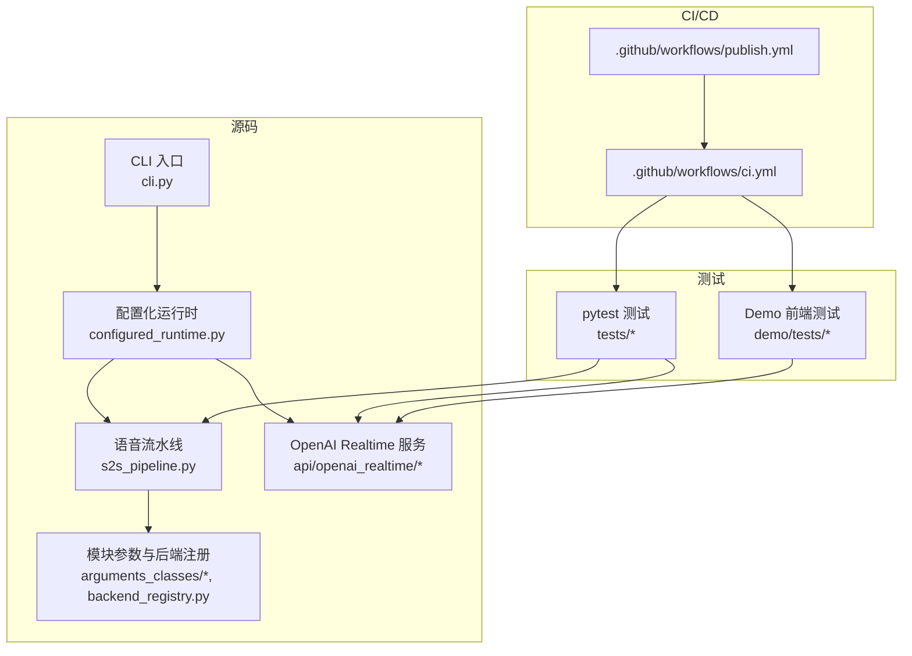
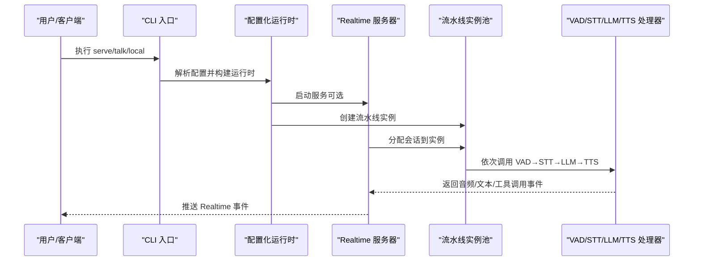
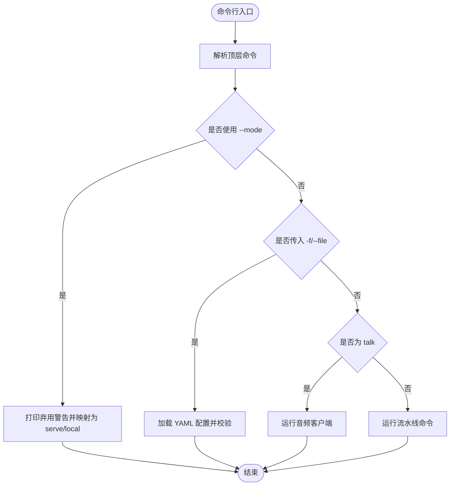
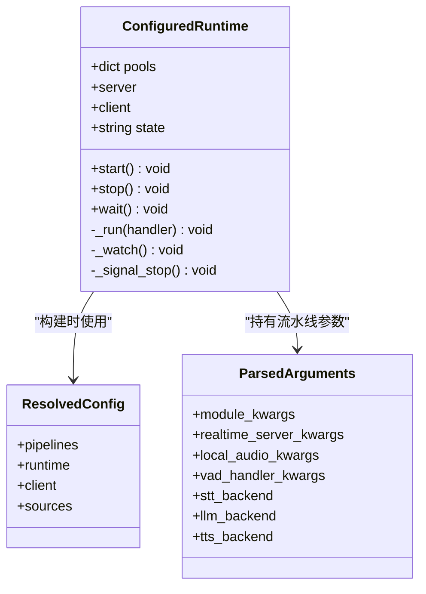
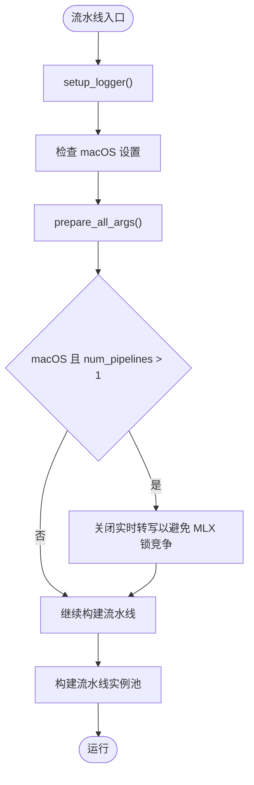
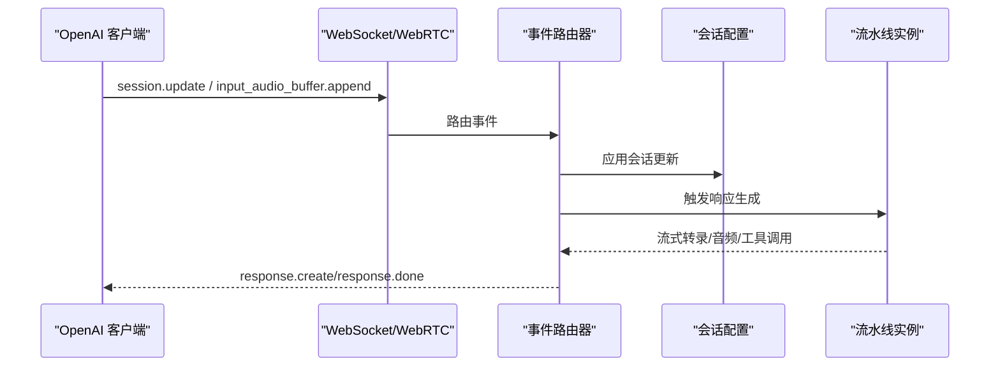
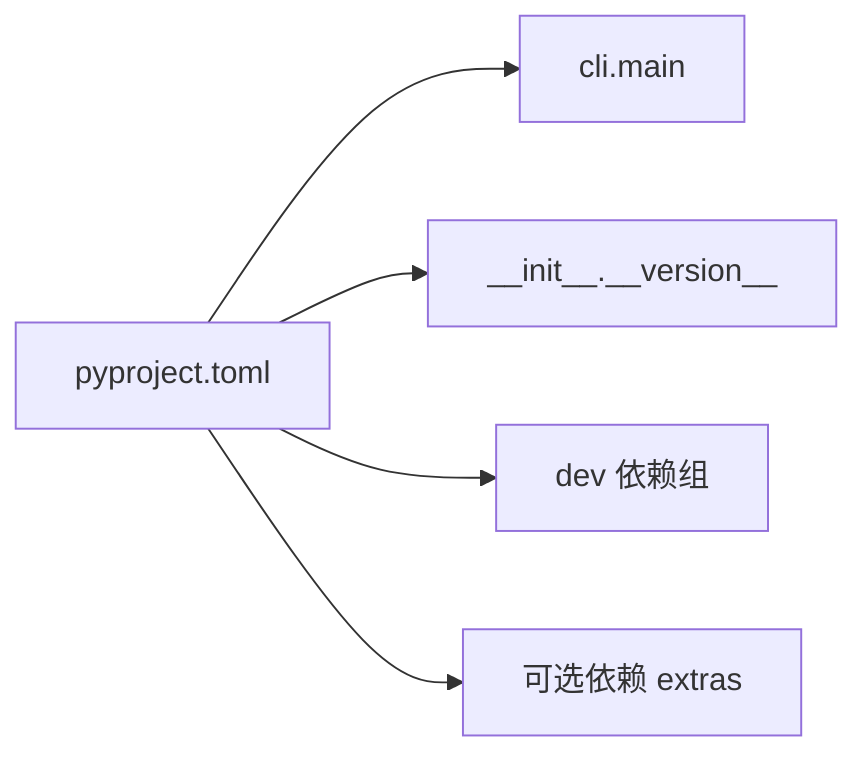
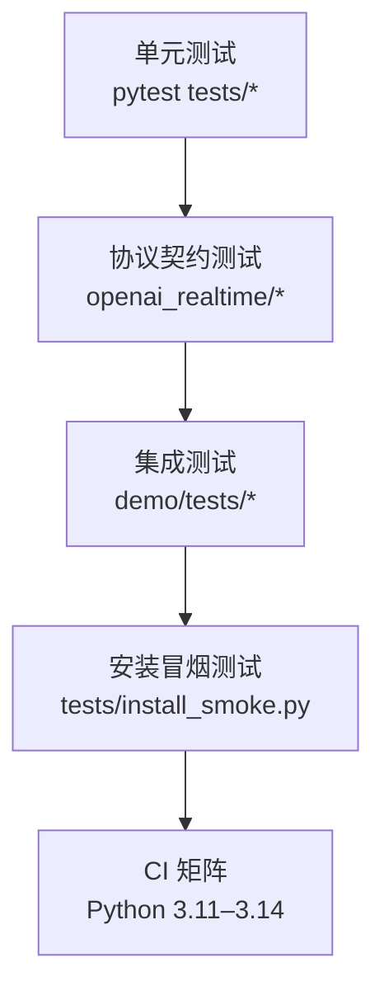
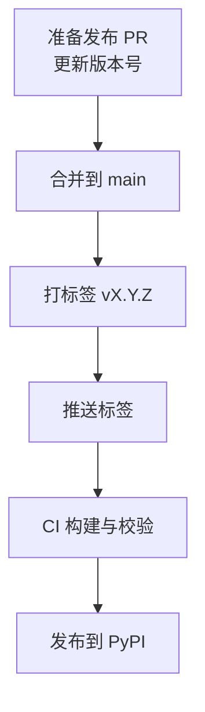

# 开发者指南

<cite>
**本文引用的文件**   
- [README.md](file://README.md)
- [README-CN.md](file://README-CN.md)
- [pyproject.toml](file://pyproject.toml)
- [AGENTS.md](file://AGENTS.md)
- [.github/workflows/ci.yml](file://.github/workflows/ci.yml)
- [.github/workflows/publish.yml](file://.github/workflows/publish.yml)
- [src/speech_to_speech/__init__.py](file://src/speech_to_speech/__init__.py)
- [src/speech_to_speech/cli.py](file://src/speech_to_speech/cli.py)
- [src/speech_to_speech/configured_runtime.py](file://src/speech_to_speech/configured_runtime.py)
- [src/speech_to_speech/s2s_pipeline.py](file://src/speech_to_speech/s2s_pipeline.py)
- [tests/install_smoke.py](file://tests/install_smoke.py)
- [tests/openai_realtime/test_runtime_config.py](file://tests/openai_realtime/test_runtime_config.py)
</cite>

## 目录
1. [引言](#引言)
2. [项目结构](#项目结构)
3. [核心组件](#核心组件)
4. [架构总览](#架构总览)
5. [详细组件分析](#详细组件分析)
6. [依赖与耦合分析](#依赖与耦合分析)
7. [性能与延迟特性](#性能与延迟特性)
8. [测试策略](#测试策略)
9. [调试、日志与排障](#调试日志与排障)
10. [代码贡献流程](#代码贡献流程)
11. [编码规范与审查标准](#编码规范与审查标准)
12. [新功能开发流程](#新功能开发流程)
13. [向后兼容性与版本发布](#向后兼容性与版本发布)
14. [常见问题解答](#常见问题解答)
15. [社区贡献指南](#社区贡献指南)
16. [结论](#结论)

## 引言
本开发者指南面向希望参与 Speech-to-Speech 语音智能体项目的工程师，目标是帮助你快速完成环境搭建、理解系统架构、遵循开发与测试规范、掌握调试与性能分析方法，并安全地进行功能扩展和版本发布。该项目是一个低延迟的“VAD → STT → LLM → TTS”语音到语音流水线，通过 OpenAI Realtime 协议暴露 WebSocket/WebRTC 接口，支持本地模型与远程提供方灵活组合。

## 项目结构
仓库采用 Python 包 + CLI + 文档 + 测试 + CI/CD 的典型组织方式：
- `src/speech_to_speech`：核心包，包含实时服务、流水线、STT/LLM/TTS/VAD 后端、参数定义、配置解析等。
- `demo`：浏览器端演示、LiveKit 集成示例、前端测试。
- `tests`：Python 单元测试、集成测试、Realtime 协议契约测试。
- `scripts`：基准脚本、评估工具、合成对话客户端。
- `.github/workflows`：CI、打包发布工作流。
- `docs`：配置、延迟、硬件方案、OpenAI 兼容说明等文档。
- `config`、`example_configs`：生产与环境配置样例。

**图表来源**
- [src/speech_to_speech/cli.py:26-35](file://src/speech_to_speech/cli.py#L26-L35)
- [src/speech_to_speech/configured_runtime.py:162-233](file://src/speech_to_speech/configured_runtime.py#L162-L233)
- [src/speech_to_speech/s2s_pipeline.py:300-319](file://src/speech_to_speech/s2s_pipeline.py#L300-L319)
- [.github/workflows/ci.yml:14-63](file://.github/workflows/ci.yml#L14-L63)
- [.github/workflows/publish.yml:12-49](file://.github/workflows/publish.yml#L12-L49)

**章节来源**
- [README.md:111-124](file://README.md#L111-L124)
- [README-CN.md:87-96](file://README-CN.md#L87-L96)
- [pyproject.toml:123-149](file://pyproject.toml#L123-L149)

## 核心组件
- CLI 入口：提供 `serve`、`talk`、`local` 三个命令，负责参数解析、YAML 配置加载、日志开关与运行调度。
- 配置化运行时：将 YAML 配置转换为可运行的流水线实例池，管理线程、资源清理、信号处理与生命周期。
- 语音流水线：串联 VAD、STT、LLM、TTS，支持多后端选择、设备与生成参数、日志上下文、MLX 锁与并发控制。
- OpenAI Realtime 服务：实现核心事件集，提供 WebSocket/WebRTC 接入，可选 LLM 代理。
- 参数体系：每个后端都有独立的参数类，统一由 `ModuleArguments` 与后端注册表装配。

**章节来源**
- [src/speech_to_speech/cli.py:18-35](file://src/speech_to_speech/cli.py#L18-L35)
- [src/speech_to_speech/configured_runtime.py:162-233](file://src/speech_to_speech/configured_runtime.py#L162-L233)
- [src/speech_to_speech/s2s_pipeline.py:300-319](file://src/speech_to_speech/s2s_pipeline.py#L300-L319)
- [README.md:314-355](file://README.md#L314-L355)

## 架构总览
系统以“命令 → 配置 → 运行时 → 流水线单元 → 后端处理器”为主线，同时通过 OpenAI Realtime 协议对外暴露能力。

**图表来源**
- [src/speech_to_speech/cli.py:231-249](file://src/speech_to_speech/cli.py#L231-L249)
- [src/speech_to_speech/configured_runtime.py:314-348](file://src/speech_to_speech/configured_runtime.py#L314-L348)
- [src/speech_to_speech/configured_runtime.py:277-311](file://src/speech_to_speech/configured_runtime.py#L277-L311)
- [README.md:314-355](file://README.md#L314-L355)

## 详细组件分析

### CLI 与命令路由
CLI 负责：
- 顶层命令解析：`serve`、`talk`、`local`。
- 兼容旧版 `--mode` 迁移提示。
- YAML 文件模式：`-f/--file` 与 `--name` 选择命名流水线。
- 日志开关：`--log-transcripts` 控制是否记录完整转写内容。
- 分发到 `run_pipeline_command` 或 `listen_and_play_realtime`。

**图表来源**
- [src/speech_to_speech/cli.py:38-95](file://src/speech_to_speech/cli.py#L38-L95)
- [src/speech_to_speech/cli.py:190-229](file://src/speech_to_speech/cli.py#L190-L229)
- [src/speech_to_speech/cli.py:231-249](file://src/speech_to_speech/cli.py#L231-L249)

**章节来源**
- [src/speech_to_speech/cli.py:26-35](file://src/speech_to_speech/cli.py#L26-L35)
- [src/speech_to_speech/cli.py:190-229](file://src/speech_to_speech/cli.py#L190-L229)

### 配置化运行时与生命周期
`ConfiguredRuntime` 管理：
- 命名流水线实例池。
- 服务端点与可选本地客户端。
- 线程启动、监控、停止与资源清理。
- 信号处理与优雅退出。

关键行为：
- `start()` 启动所有 handler 线程并进入运行态。
- `stop()` 等待线程退出，清理资源，失败时标记状态。
- `wait()` 阻塞直到所有线程退出，再触发 stop。
- `build_configured_server()` 组装 Realtime 服务器与可选客户端。
- `run_configured_command()` 绑定信号、初始化日志、启动服务或客户端。

**图表来源**
- [src/speech_to_speech/configured_runtime.py:162-233](file://src/speech_to_speech/configured_runtime.py#L162-L233)
- [src/speech_to_speech/configured_runtime.py:277-311](file://src/speech_to_speech/configured_runtime.py#L277-L311)
- [src/speech_to_speech/configured_runtime.py:314-348](file://src/speech_to_speech/configured_runtime.py#L314-L348)
- [src/speech_to_speech/configured_runtime.py:351-390](file://src/speech_to_speech/configured_runtime.py#L351-L390)

**章节来源**
- [src/speech_to_speech/configured_runtime.py:162-233](file://src/speech_to_speech/configured_runtime.py#L162-L233)
- [src/speech_to_speech/configured_runtime.py:277-311](file://src/speech_to_speech/configured_runtime.py#L277-L311)
- [src/speech_to_speech/configured_runtime.py:314-348](file://src/speech_to_speech/configured_runtime.py#L314-L348)
- [src/speech_to_speech/configured_runtime.py:351-390](file://src/speech_to_speech/configured_runtime.py#L351-L390)

### 语音流水线与日志
`s2s_pipeline.py` 负责：
- 设置全局日志格式与过滤上下文。
- 在 macOS 上对 MLX 并发进行保护与日志优化。
- 根据参数准备各后端，校验兼容性。
- 控制 `num_pipelines`、实时转写开关、设备限制。

**图表来源**
- [src/speech_to_speech/s2s_pipeline.py:300-319](file://src/speech_to_speech/s2s_pipeline.py#L300-L319)
- [src/speech_to_speech/s2s_pipeline.py:792-816](file://src/speech_to_speech/s2s_pipeline.py#L792-L816)

**章节来源**
- [src/speech_to_speech/s2s_pipeline.py:300-319](file://src/speech_to_speech/s2s_pipeline.py#L300-L319)
- [src/speech_to_speech/s2s_pipeline.py:792-816](file://src/speech_to_speech/s2s_pipeline.py#L792-L816)

### OpenAI Realtime 协议与服务
服务器实现核心 Realtime 事件集，包括入站 `input_audio_buffer.append`、`session.update`、`conversation.item.create/truncate`、`response.create/cancel`，以及出站语音开始/停止、流式转写、音频增量、工具调用与 `response.done`。可通过 `--enable_llm_proxy` 暴露上游 LLM 的 `/v1/chat/completions` 或 `/v1/responses`。

**图表来源**
- [README.md:314-355](file://README.md#L314-L355)
- [src/speech_to_speech/configured_runtime.py:314-348](file://src/speech_to_speech/configured_runtime.py#L314-L348)

**章节来源**
- [README.md:314-355](file://README.md#L314-L355)

## 依赖与耦合分析
- 包元数据与依赖：`pyproject.toml` 声明 Python 版本、核心依赖、可选 extras、开发依赖、Ruff/Mypy 配置、包发现规则。
- CLI 入口：`speech-to-speech = "speech_to_speech.cli:main"`。
- 版本信息：`__version__ = "1.0.0"`。
- 开发依赖：ruff、mypy、pytest、pytest-asyncio、aiortc。

**图表来源**
- [pyproject.toml:5-66](file://pyproject.toml#L5-L66)
- [pyproject.toml:68-116](file://pyproject.toml#L68-L116)
- [pyproject.toml:123-164](file://pyproject.toml#L123-L164)
- [src/speech_to_speech/__init__.py:1-4](file://src/speech_to_speech/__init__.py#L1-L4)

**章节来源**
- [pyproject.toml:5-66](file://pyproject.toml#L5-L66)
- [pyproject.toml:68-116](file://pyproject.toml#L68-L116)
- [pyproject.toml:123-164](file://pyproject.toml#L123-L164)
- [src/speech_to_speech/__init__.py:1-4](file://src/speech_to_speech/__init__.py#L1-L4)

## 性能与延迟特性
- 端到端延迟受 STT、LLM、TTS 影响最大；默认流水线在本地设备上运行以降低网络延迟。
- macOS 上 MLX 推理存在全局锁，多流水线并发时会禁用实时转写以避免日志风暴。
- Qwen3-TTS GGML 后端在 Linux 上默认针对 CUDA 12.8 与特定 glibc；不匹配时需安装对应 wheel。
- 播放缓冲：`local` 客户端在使用 OpenAI 兼容 TTS 后端时缓冲 196 ms 以吸收 HTTP 抖动；可通过 `--playback-buffer-ms` 调整。
- 语言检测与 TTS 语言选择：支持自动检测助手输出语言，短文本或歧义时使用会话语言或后端默认行为。

**章节来源**
- [README.md:154-174](file://README.md#L154-L174)
- [README.md:274-281](file://README.md#L274-L281)
- [README.md:581-602](file://README.md#L581-L602)
- [src/speech_to_speech/s2s_pipeline.py:792-816](file://src/speech_to_speech/s2s_pipeline.py#L792-L816)

## 测试策略
测试分为三层：
- 单元测试：覆盖配置、后端适配、协议契约、工具调用、VAD/STT/LLM/TTS 行为。
- 集成测试：通过 OpenAI Agents SDK 的 WebSocket/WebRTC 传输验证核心 Realtime 流程。
- 安装冒烟测试：在独立虚拟环境中安装 wheel，验证 CLI 入口与可选依赖安装。

**图表来源**
- [.github/workflows/ci.yml:43-63](file://.github/workflows/ci.yml#L43-L63)
- [.github/workflows/ci.yml:65-104](file://.github/workflows/ci.yml#L65-L104)
- [.github/workflows/ci.yml:126-176](file://.github/workflows/ci.yml#L126-L176)
- [tests/openai_realtime/test_runtime_config.py:124-179](file://tests/openai_realtime/test_runtime_config.py#L124-L179)

**章节来源**
- [.github/workflows/ci.yml:43-63](file://.github/workflows/ci.yml#L43-L63)
- [.github/workflows/ci.yml:65-104](file://.github/workflows/ci.yml#L65-L104)
- [.github/workflows/ci.yml:126-176](file://.github/workflows/ci.yml#L126-L176)
- [tests/openai_realtime/test_runtime_config.py:124-179](file://tests/openai_realtime/test_runtime_config.py#L124-L179)

## 调试、日志与排障
- 日志级别：通过 `--log_level` 或 YAML `runtime.log_level` 设置；默认 info。
- 转写日志：`--log_transcripts` 会记录完整用户与助手转写，启动时会发出隐私警告。
- 日志上下文：`setup_logger()` 注入 `pipeline_prefix`，便于区分不同流水线实例。
- 调试 MLX：debug 级别启用 torch compile 日志（图断裂、重编译、CUDA Graphs）。
- 常见错误：
  - 配置错误：YAML 字段缺失、命名流水线选择不当、进程与客户端日志设置不一致。
  - 运行时错误：线程未正常退出、资源清理失败、服务构造失败。
  - 平台问题：macOS 上使用 CUDA、MLX 锁竞争导致实时转写被禁用。

**章节来源**
- [src/speech_to_speech/s2s_pipeline.py:300-319](file://src/speech_to_speech/s2s_pipeline.py#L300-L319)
- [src/speech_to_speech/cli.py:147-154](file://src/speech_to_speech/cli.py#L147-L154)
- [src/speech_to_speech/configured_runtime.py:235-264](file://src/speech_to_speech/configured_runtime.py#L235-L264)
- [src/speech_to_speech/configured_runtime.py:351-390](file://src/speech_to_speech/configured_runtime.py#L351-L390)

## 代码贡献流程
推荐流程：
1. 克隆仓库并使用 uv 同步依赖。
2. 创建功能分支，避免在分支名或 PR 标题中使用 `codex`。
3. 编写单元测试与集成测试，确保覆盖新增逻辑。
4. 运行 ruff 检查与格式化、mypy 类型检查、pytest 测试。
5. 提交变更，保持 PR 聚焦；不要重写历史除非明确要求。
6. 维护者确认后合并；发布流程由 GitHub Actions 自动化。

**章节来源**
- [AGENTS.md:1-10](file://AGENTS.md#L1-L10)
- [README-CN.md:642-653](file://README-CN.md#L642-L653)

## 编码规范与审查标准
- 代码风格：使用 Ruff 进行 lint 与格式化，行宽 120，忽略 E501。
- 类型检查：Mypy 配置开启严格警告，忽略缺失导入，允许未标注定义。
- 测试要求：新增功能需配套 pytest 用例；Realtime 相关变更需通过 WebSocket/WebRTC 集成测试。
- 审查关注点：
  - 配置安全性：避免泄露凭据与敏感信息。
  - 日志卫生：默认不记录内容，仅在调试时启用。
  - 平台兼容：macOS 与 Linux 差异、MLX/CUDA/GGML 依赖。
  - 向后兼容：保留旧参数迁移提示，避免破坏现有 CLI/YAML。

**章节来源**
- [pyproject.toml:151-164](file://pyproject.toml#L151-L164)
- [src/speech_to_speech/cli.py:38-95](file://src/speech_to_speech/cli.py#L38-L95)
- [src/speech_to_speech/s2s_pipeline.py:300-319](file://src/speech_to_speech/s2s_pipeline.py#L300-L319)

## 新功能开发流程
建议步骤：
1. 明确需求：确定新增的是 STT/LLM/TTS/VAD 后端，还是 Realtime 协议扩展。
2. 添加参数类：在 `arguments_classes` 中定义新后端的配置参数。
3. 注册后端：在 `backend_registry` 中注册新后端及其配置类型。
4. 实现处理器：在对应 `STT`/`LLM`/`TTS`/`VAD` 目录下实现处理器。
5. 适配流水线：确保 `ParsedArguments` 与 `_adapt()` 能正确装配新后端。
6. 编写测试：单元测试覆盖参数校验与基本行为；集成测试覆盖 Realtime 事件。
7. 文档更新：在组件 README 与 CLI 帮助中补充说明。
8. 运行 CI：确保 ruff/mypy/pytest 全部通过。

**章节来源**
- [src/speech_to_speech/configured_runtime.py:53-109](file://src/speech_to_speech/configured_runtime.py#L53-L109)
- [src/speech_to_speech/cli.py:190-229](file://src/speech_to_speech/cli.py#L190-L229)
- [README.md:211-258](file://README.md#L211-L258)

## 向后兼容性与版本发布
- 向后兼容：
  - 旧版 `--mode` 仍支持但会打印弃用警告，并映射到 `serve`/`local`。
  - JSON 配置可包含未激活后端键，会被忽略并带警告。
  - 参数类保持向前兼容，未知字段不会导致崩溃。
- 版本发布：
  - 修改 `pyproject.toml` 中的 `version` 与 `src/speech_to_speech/__init__.py` 中的 `__version__`。
  - 合并发布 PR 后打标签 `vX.Y.Z` 并推送。
  - GitHub Actions 自动构建、校验并发布到 PyPI。

**图表来源**
- [AGENTS.md:11-30](file://AGENTS.md#L11-L30)
- [src/speech_to_speech/__init__.py:1-4](file://src/speech_to_speech/__init__.py#L1-L4)
- [.github/workflows/publish.yml:12-49](file://.github/workflows/publish.yml#L12-L49)

**章节来源**
- [src/speech_to_speech/cli.py:38-95](file://src/speech_to_speech/cli.py#L38-L95)
- [AGENTS.md:11-30](file://AGENTS.md#L11-L30)
- [src/speech_to_speech/__init__.py:1-4](file://src/speech_to_speech/__init__.py#L1-L4)
- [.github/workflows/publish.yml:12-49](file://.github/workflows/publish.yml#L12-L49)

## 常见问题解答
- 如何只启动服务器？  
  使用 `speech-to-speech serve`，默认监听 `ws://127.0.0.1:8765/v1/realtime`。
- 如何在本地同时运行服务器与客户端？  
  使用 `speech-to-speech local`，它会在回环地址上启动服务并连接内置客户端。
- 如何连接到已有 Realtime 服务器？  
  使用 `speech-to-speech talk --url <full-realtime-url>`。
- 如何离线运行？  
  首次在线启动缓存依赖与模型，然后设置 `HF_HUB_OFFLINE=1`。
- 如何启用完整转写日志？  
  使用 `--log-transcripts`，注意这会记录对话内容并触发隐私警告。
- 如何解决 macOS 上实时转写日志过多？  
  多流水线并发时会自动禁用实时转写；也可手动减少 `num_pipelines` 或关闭实时转写。

**章节来源**
- [README.md:77-90](file://README.md#L77-L90)
- [README.md:551-577](file://README.md#L551-L577)
- [src/speech_to_speech/cli.py:147-154](file://src/speech_to_speech/cli.py#L147-L154)
- [src/speech_to_speech/s2s_pipeline.py:792-816](file://src/speech_to_speech/s2s_pipeline.py#L792-L816)

## 社区贡献指南
- 欢迎提交 Issue 与 Pull Request。
- 大型改动先开 Issue 讨论方案。
- 本地开发命令：`uv sync`、`pytest`、`ruff check`。
- 遵守仓库指令：不随意重写历史、不提交构建产物、PR 标题不含 `codex`。
- 发布流程由 CI 自动化，维护者确认后才合并。

**章节来源**
- [README-CN.md:642-653](file://README-CN.md#L642-L653)
- [AGENTS.md:1-10](file://AGENTS.md#L1-L10)

## 结论
Speech-to-Speech 项目以模块化、可替换的后端设计与 OpenAI Realtime 协议为核心，提供了从本地到云端的灵活语音智能体解决方案。开发者应遵循清晰的配置与生命周期管理、严格的测试与质量门禁、安全的日志与隐私实践，并在扩展功能时保持向后兼容与版本可控。通过本指南，你可以快速上手开发、定位问题、优化性能，并安全地参与社区贡献与发布流程。