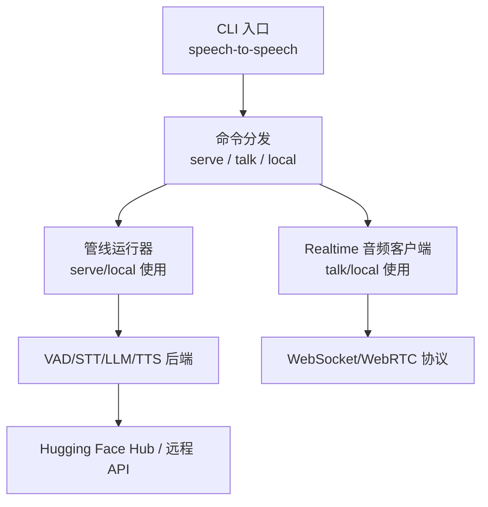
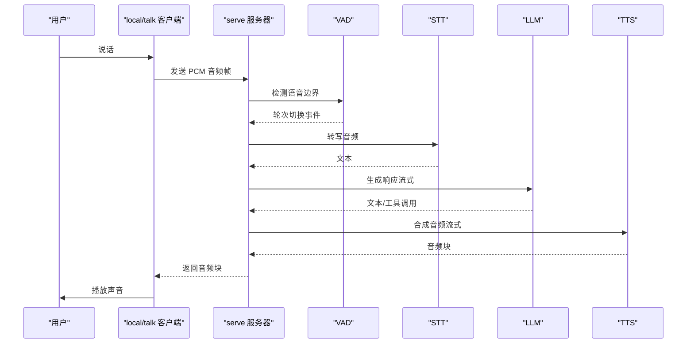
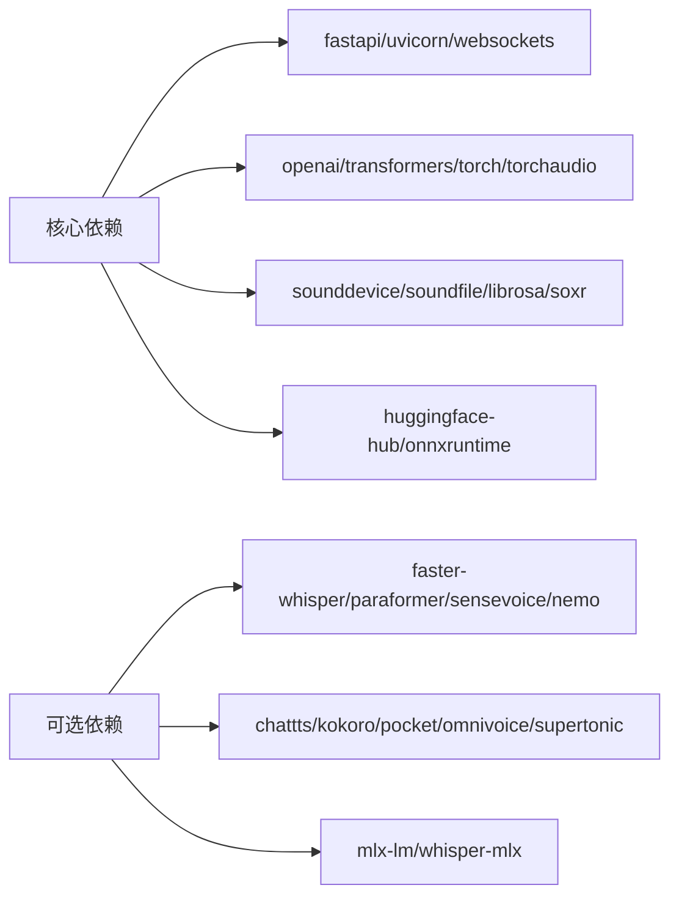

# 快速开始

<cite>
**本文引用的文件**   
- [README-CN.md](file://README-CN.md)
- [pyproject.toml](file://pyproject.toml)
- [cli.py](file://src/speech_to_speech/cli.py)
- [audio_client.py](file://src/speech_to_speech/api/openai_realtime/audio_client.py)
- [local_audio_arguments.py](file://src/speech_to_speech/arguments_classes/local_audio_arguments.py)
- [prod.yaml](file://config/prod.yaml)
- [mac.yaml](file://example_configs/mac.yaml)
</cite>

## 目录
1. [简介](#简介)
2. [项目结构](#项目结构)
3. [核心组件](#核心组件)
4. [架构总览](#架构总览)
5. [详细组件分析](#详细组件分析)
6. [依赖分析](#依赖分析)
7. [性能考虑](#性能考虑)
8. [故障排除指南](#故障排除指南)
9. [结论](#结论)
10. [附录](#附录)

## 简介
本指南面向首次接触 speech-to-speech 项目的用户，目标是在几分钟内完成环境准备、依赖安装与模型下载，并跑通三种主要使用模式：
- local：本地体验（同时启动服务器和打包的麦克风/扬声器客户端）
- serve：服务部署（对外提供 OpenAI Realtime 兼容的 WebSocket/WebRTC 接口）
- talk：客户端连接（连接已有 Realtime 服务器进行语音对话）

本项目是一个低延迟、完全模块化的语音智能体流水线：VAD → STT → LLM → TTS。默认路径包含 Parakeet TDT 做本地 STT、OpenAI 兼容 LLM、Qwen3-TTS 做本地语音输出；在 macOS 上会使用 mlx-audio 后端。

## 项目结构
仓库采用“功能域 + 可替换后端”的组织方式：
- src/speech_to_speech：核心代码，包含 CLI、配置解析、Realtime API、STT/TTS/LLM/VAD 各后端实现、参数类、运行时管线等
- config/example_configs：YAML 配置示例，用于以声明式方式组合 VAD/STT/LLM/TTS 管道
- demo：浏览器端演示与测试
- docs：文档与参数目录
- pyproject.toml：包元数据、依赖、可选依赖与入口脚本

图表来源
- [cli.py:26-35](file://src/speech_to_speech/cli.py#L26-L35)
- [audio_client.py:55-77](file://src/speech_to_speech/api/openai_realtime/audio_client.py#L55-L77)

章节来源
- [README-CN.md:31-68](file://README-CN.md#L31-L68)
- [pyproject.toml:123-124](file://pyproject.toml#L123-L124)

## 核心组件
- CLI 命令
  - serve：启动 Realtime 服务器，暴露 ws://localhost:8765/v1/realtime
  - talk：连接指定 URL 的 Realtime 服务器，使用本机麦克风和扬声器
  - local：在同一进程中启动 serve 并与本地 talk 客户端通信
- 音频客户端
  - 负责采集麦克风、发送 PCM 到服务器、接收合成音频并播放
  - 支持输入/输出设备选择、回放缓冲、工具模块扩展
- 配置系统
  - 支持 YAML 声明式配置，组合 VAD/STT/LLM/TTS 管道
  - 提供 macOS 优化预设与生产示例

章节来源
- [README-CN.md:195-207](file://README-CN.md#L195-L207)
- [cli.py:18-35](file://src/speech_to_speech/cli.py#L18-L35)
- [audio_client.py:55-77](file://src/speech_to_speech/api/openai_realtime/audio_client.py#L55-L77)
- [local_audio_arguments.py:5-46](file://src/speech_to_speech/arguments_classes/local_audio_arguments.py#L5-L46)

## 架构总览
下图展示从用户说话到听到回复的端到端流程，以及三种命令如何参与该流程。

图表来源
- [README-CN.md:87-96](file://README-CN.md#L87-L96)
- [README-CN.md:286-322](file://README-CN.md#L286-L322)

## 详细组件分析

### 安装与环境准备
- Python 版本要求
  - 包定义要求 Python >= 3.11
- 推荐安装方式
  - 通过 pip 安装：pip install speech-to-speech
  - 从源码安装：git clone 后 uv sync
- 默认依赖覆盖
  - STT：Parakeet TDT
  - LLM：OpenAI 兼容 API
  - TTS：Qwen3-TTS（非 macOS 默认 GGML，Apple Silicon 使用 mlx-audio）
  - 本地音频与实时服务器模式
- 可选组件
  - 通过 extras 安装，例如 kokoro、pocket、chattts、omnivoice、faster-whisper、whisper-mlx、paraformer、mlx-lm 等
- CUDA 说明（Linux）
  - Qwen3-TTS 的 GGML 后端来自 faster-qwen3-tts[ggml]
  - 若 CUDA/glibc 不匹配，可从 Hugging Face wheelhouse 安装匹配的 wheel，再安装 speech-to-speech
  - 也可使用 torch 后端替代 GGML

章节来源
- [pyproject.toml:5-11](file://pyproject.toml#L5-L11)
- [pyproject.toml:28-66](file://pyproject.toml#L28-L66)
- [pyproject.toml:68-116](file://pyproject.toml#L68-L116)
- [README-CN.md:98-154](file://README-CN.md#L98-L154)
- [README-CN.md:156-164](file://README-CN.md#L156-L164)

### 模型下载与离线运行
- 首次在线启动会缓存所需资源（STT、LLM、TTS、Silero VAD、NLTK、Smart Turn 等）
- 离线运行
  - 设置 HF_HUB_OFFLINE=1 防止 Hub 请求
  - Smart Turn 可使用本地 ONNX checkpoint，或禁用 Smart Turn
- 本地 LLM
  - 可在独立 llama.cpp 进程运行，并通过 responses-api/chat-completions 指向本地地址

章节来源
- [README-CN.md:489-504](file://README-CN.md#L489-L504)
- [README-CN.md:463-487](file://README-CN.md#L463-L487)

### 三种主要使用模式

#### local（本地体验）
- 行为
  - 在一个命令中同时启动服务器与打包的麦克风/扬声器客户端
  - 默认绑定回环地址，并在 ws://127.0.0.1:<port>/v1/realtime 连接本地客户端
- 典型命令
  - speech-to-speech local
- 适用场景
  - 快速验证完整链路，无需额外终端
- 关键参数
  - --playback-buffer-ms：控制本地播放前的缓冲毫秒数
  - --tool-module：启用本地 Python 工具
  - --local_audio_input_device / --local_audio_output_device：指定声卡设备索引
  - --block-mic-during-playback：播放时是否阻塞麦克风采集

章节来源
- [README-CN.md:47-51](file://README-CN.md#L47-L51)
- [README-CN.md:203-207](file://README-CN.md#L203-L207)
- [local_audio_arguments.py:14-45](file://src/speech_to_speech/arguments_classes/local_audio_arguments.py#L14-L45)

#### serve（服务部署）
- 行为
  - 启动 Realtime 服务器，暴露 ws://localhost:8765/v1/realtime
  - 默认绑定 127.0.0.1；要暴露到网络需显式传入 --host 0.0.0.0
- 典型命令
  - export OPENAI_API_KEY=...
  - speech-to-speech serve
- 适用场景
  - 基于 OpenAI Realtime 协议构建应用或设备
- 关键参数
  - --stt：选择 STT 后端（如 parakeet-tdt、whisper-mlx、paraformer 等）
  - --llm_backend：选择 LLM 后端（responses-api 或 chat-completions）
  - --model_name：模型名称或本地路径
  - --responses_api_base_url / --responses_api_api_key：远程 LLM 提供方或自托管服务器
  - --qwen3_tts_*：Qwen3-TTS 相关参数（模型、设备、量化、后端等）
  - --enable_live_transcription：开启实时转写
  - --num_pipelines：流水线池大小

章节来源
- [README-CN.md:31-45](file://README-CN.md#L31-L45)
- [README-CN.md:213-240](file://README-CN.md#L213-L240)
- [README-CN.md:345-487](file://README-CN.md#L345-L487)

#### talk（客户端连接）
- 行为
  - 连接已有 Realtime 服务器的麦克风/扬声器客户端
- 典型命令
  - speech-to-speech talk --url ws://127.0.0.1:8765/v1/realtime
- 适用场景
  - 与已部署的 Realtime 服务器对话
- 关键参数
  - --url：完整的 Realtime WebSocket 端点
  - --api-key：Realtime API Key（本地回环可省略）
  - --send-rate / --recv-rate：采样率（默认 16000）
  - --input-device / --output-device：输入/输出设备索引
  - --playback-buffer-ms：回放缓冲毫秒数
  - --voice：session.audio.output.voice
  - --tool-module：加载本地工具模块
  - --connection-retry-timeout_s：等待服务端可用的超时秒数

章节来源
- [README-CN.md:41-45](file://README-CN.md#L41-L45)
- [cli.py:98-187](file://src/speech_to_speech/cli.py#L98-L187)
- [audio_client.py:55-77](file://src/speech_to_speech/api/openai_realtime/audio_client.py#L55-L77)

### 平台特殊配置

#### macOS
- 推荐使用 macOS 优化预设
  - speech-to-speech local --mac-optimal-settings
- 特点
  - 对受支持的组件使用 MPS 默认
  - STT：Parakeet TDT
  - LLM：mlx-lm
  - TTS：Qwen3-TTS（mlx-audio，默认 6bit 量化）
- 其他 TTS 后端
  - --tts pocket、--tts kokoro、--tts omnivoice 在 macOS 上也有效

章节来源
- [README-CN.md:242-265](file://README-CN.md#L242-L265)
- [mac.yaml:1-18](file://example_configs/mac.yaml#L1-L18)

#### Linux
- CUDA 与 Qwen3-TTS
  - 若 CUDA/glibc 不匹配，先安装匹配的 qwentts-cpp-python wheel，再安装 speech-to-speech
  - 或使用 --qwen3_tts_backend torch 切换为 torch 后端
- 生产配置示例
  - 使用 prod.yaml 组合 VAD/STT/LLM/TTS，并通过 docker-compose 启动

章节来源
- [README-CN.md:115-136](file://README-CN.md#L115-L136)
- [prod.yaml:1-75](file://config/prod.yaml#L1-L75)

#### Windows
- Qwen3-TTS
  - Windows 上使用 faster-qwen3-tts（不带 ggml 标记）
- 其他可选后端
  - 根据需求安装 extras（如 kokoro、pocket、omnivoice 等）

章节来源
- [pyproject.toml:57-58](file://pyproject.toml#L57-L58)
- [pyproject.toml:68-116](file://pyproject.toml#L68-L116)

### 音频设备配置
- 客户端设备选择
  - talk：--input-device / --output-device
  - local：--local_audio_input_device / --local_audio_output_device
- 播放缓冲
  - local：默认对 OpenAI 兼容 TTS 使用 196 ms 缓冲；其他后端立即播放
  - talk：默认立即播放
  - 可通过 --playback-buffer-ms 调整
- 麦克风与扬声器
  - 确保系统允许应用访问麦克风/扬声器
  - 在 Windows 上检查隐私设置；在 macOS 上检查“麦克风”权限；在 Linux 上检查 PulseAudio/PipeWire 配置

章节来源
- [audio_client.py:55-77](file://src/speech_to_speech/api/openai_realtime/audio_client.py#L55-L77)
- [local_audio_arguments.py:14-45](file://src/speech_to_speech/arguments_classes/local_audio_arguments.py#L14-L45)
- [README-CN.md:203-207](file://README-CN.md#L203-L207)

### 网络设置
- 服务器绑定
  - serve 默认绑定 127.0.0.1；如需外网访问，传入 --host 0.0.0.0
- 防火墙与端口
  - 默认端口 8765；确保入站规则放行
- 代理与反向代理
  - 可将 Realtime 服务置于 Nginx/Caddy 之后，注意 WebSocket 升级头
- LLM 后端
  - 通过 --responses_api_base_url 指向远程或本地 LLM 服务
  - 需要正确的 API Key 或空字符串（如 llama.cpp）

章节来源
- [README-CN.md:203-207](file://README-CN.md#L203-L207)
- [README-CN.md:377-487](file://README-CN.md#L377-L487)

## 依赖分析
- 核心依赖
  - fastapi、uvicorn、websockets、openai、transformers、torch、torchaudio、numpy、sounddevice、soundfile、soxr、huggingface-hub、onnxruntime、librosa、lingua-language-detector 等
- 平台差异
  - macOS：固定 torch/torchaudio/transformers 版本，引入 mlx、mlx-audio、mlx-lm、mlx-metal
  - 非 macOS：引入 nano-parakeet、faster-qwen3-tts（Windows 不带 ggml）
- 可选依赖
  - chattts、faster-whisper、fireredvad、kokoro、kitten、mlx-lm、nemo、omnivoice、paraformer、sensevoice、pocket、supertonic、webrtc、whisper-mlx

图表来源
- [pyproject.toml:28-66](file://pyproject.toml#L28-L66)
- [pyproject.toml:68-116](file://pyproject.toml#L68-L116)

章节来源
- [pyproject.toml:28-116](file://pyproject.toml#L28-L116)

## 性能考虑
- 推理强度与延迟
  - 通过 --responses_api_reasoning_effort none 抑制推理以提升语音延迟
- 流水线并发
  - 通过 --num_pipelines 调整并行度
- 设备选择
  - 合理选择 device（cuda/mps/cpu），避免 CPU 瓶颈
- 模型量化
  - macOS 上可使用 MLX 量化变体（如 6bit）平衡质量与速度
- 回放缓冲
  - 适当增大 --playback-buffer-ms 可减少卡顿，但会增加首包延迟

章节来源
- [README-CN.md:430-461](file://README-CN.md#L430-L461)
- [README-CN.md:267-274](file://README-CN.md#L267-L274)
- [README-CN.md:203-207](file://README-CN.md#L203-L207)

## 故障排除指南
- 无法安装或依赖冲突
  - 确认 Python 版本满足要求（>= 3.11）
  - Linux 上 CUDA/glibc 不匹配时，先安装匹配的 qwentts-cpp-python wheel
  - DeepFilterNet 与 Pocket TTS 的 numpy 版本冲突：未使用 Pocket TTS 时再手动安装 DeepFilterNet
- 模型下载失败或离线运行
  - 首次在线启动缓存资源后再离线运行
  - 设置 HF_HUB_OFFLINE=1，或提供本地模型路径
- 音频设备问题
  - 检查系统权限与默认设备
  - 使用 --input-device / --output-device 或 --local_audio_input_device / --local_audio_output_device 指定设备
  - 调整 --playback-buffer-ms 缓解卡顿
- 网络连接问题
  - 确认端口 8765 开放且未被占用
  - 如需外网访问，使用 --host 0.0.0.0 并配置防火墙/反向代理
  - 检查 LLM 后端 base_url 与 api_key 是否正确
- 服务器启动失败
  - 检查 YAML 配置与 --name 选择
  - 查看日志中的后端与运行时资源错误提示

章节来源
- [README-CN.md:115-154](file://README-CN.md#L115-L154)
- [README-CN.md:489-504](file://README-CN.md#L489-L504)
- [cli.py:190-228](file://src/speech_to_speech/cli.py#L190-L228)

## 结论
通过本指南，你可以在几分钟内完成 speech-to-speech 的安装与首次体验。根据你的需求选择 local、serve 或 talk 模式，并根据平台特性调整设备与网络配置。遇到常见问题时，参考故障排除部分定位并解决。

## 附录

### 常用命令速查
- 安装
  - pip install speech-to-speech
- 本地体验
  - speech-to-speech local
- 服务部署
  - export OPENAI_API_KEY=...
  - speech-to-speech serve
- 客户端连接
  - speech-to-speech talk --url ws://127.0.0.1:8765/v1/realtime

章节来源
- [README-CN.md:31-51](file://README-CN.md#L31-L51)