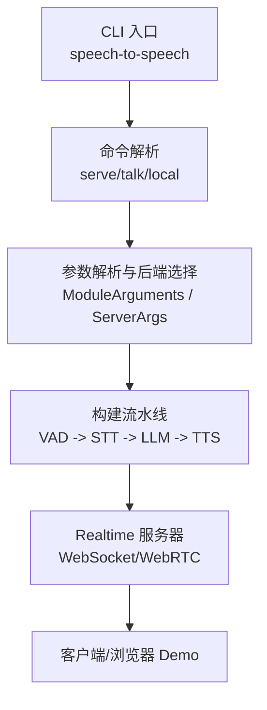
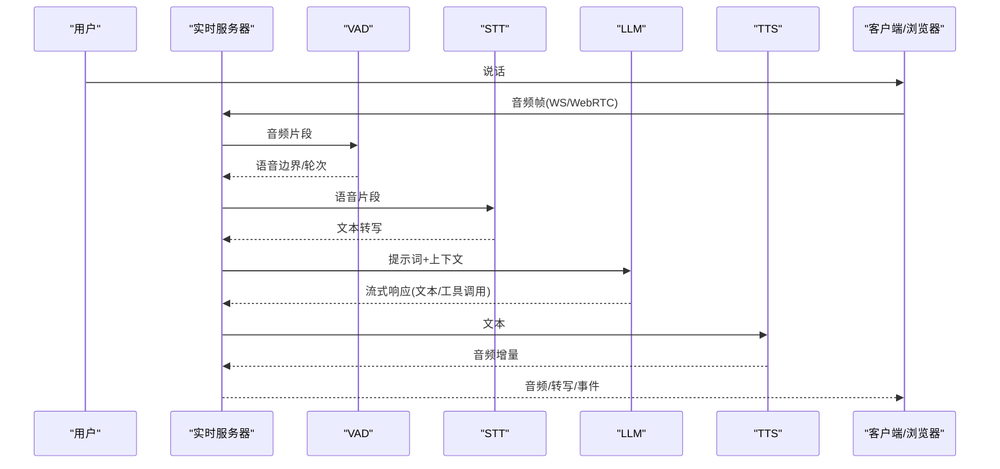
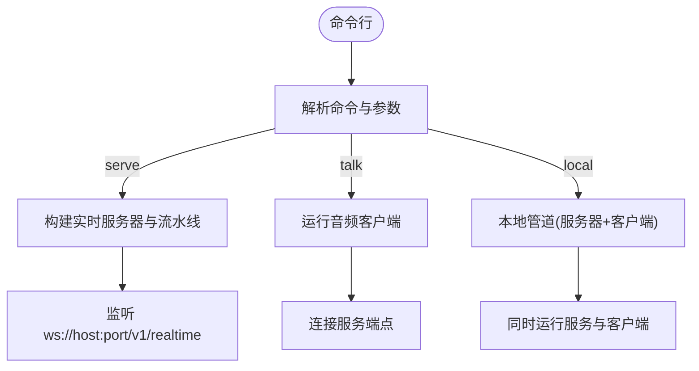
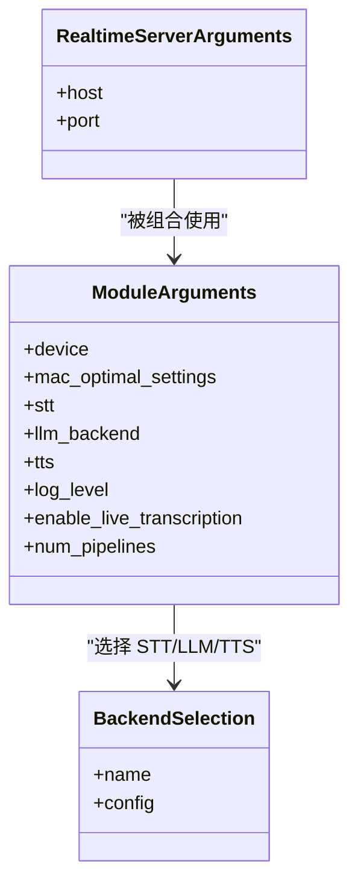
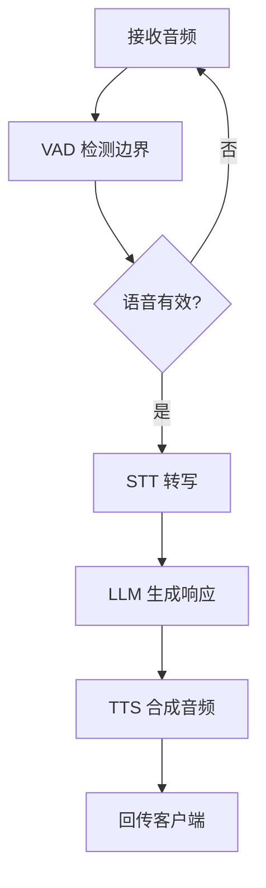

# 快速开始

<cite>
**本文引用的文件**
- [README-CN.md](file://README-CN.md)
- [pyproject.toml](file://pyproject.toml)
- [cli.py](file://src/speech_to_speech/cli.py)
- [s2s_pipeline.py](file://src/speech_to_speech/s2s_pipeline.py)
- [module_arguments.py](file://src/speech_to_speech/arguments_classes/module_arguments.py)
- [realtime_server_arguments.py](file://src/speech_to_speech/arguments_classes/realtime_server_arguments.py)
- [Dockerfile](file://Dockerfile)
- [docker-compose.yml](file://docker-compose.yml)
- [demo/README-CN.md](file://demo/README-CN.md)
- [examples/gemma4-12b-macos/README-CN.md](file://examples/gemma4-12b-macos/README-CN.md)
</cite>

## 目录
1. [简介](#简介)
2. [项目结构](#项目结构)
3. [核心组件](#核心组件)
4. [架构总览](#架构总览)
5. [详细组件分析](#详细组件分析)
6. [依赖与安装](#依赖与安装)
7. [服务器启动与本地对话](#服务器启动与本地对话)
8. [常见使用场景示例](#常见使用场景示例)
9. [故障排除指南](#故障排除指南)
10. [性能与优化建议](#性能与优化建议)
11. [结论](#结论)

## 简介
本指南面向新用户，帮助你在 5 分钟内完成环境准备、安装、基本配置，并成功运行第一个语音对话示例。你将学会：
- 安装基础包与可选组件（含 CUDA 支持）
- 启动 OpenAI Realtime 兼容的实时服务器
- 使用命令行工具进行本地对话
- 连接 OpenAI 兼容 API 或自托管 LLM 后端
- 解决常见的安装与配置问题

## 项目结构
仓库采用模块化设计，核心入口为 CLI，运行时通过流水线将 VAD、STT、LLM、TTS 串联起来，并通过 OpenAI Realtime 协议对外暴露 WebSocket/WebRTC 接口。关键路径包括：
- CLI 入口与命令分发
- 参数解析与后端选择
- 实时服务与管道构建
- 演示应用与 Docker 编排

**图表来源**
- [cli.py:26-35](file://src/speech_to_speech/cli.py#L26-L35)
- [s2s_pipeline.py:175-285](file://src/speech_to_speech/s2s_pipeline.py#L175-L285)
- [module_arguments.py:12-105](file://src/speech_to_speech/arguments_classes/module_arguments.py#L12-L105)
- [realtime_server_arguments.py:4-25](file://src/speech_to_speech/arguments_classes/realtime_server_arguments.py#L4-L25)

**章节来源**
- [cli.py:26-35](file://src/speech_to_speech/cli.py#L26-L35)
- [s2s_pipeline.py:175-285](file://src/speech_to_speech/s2s_pipeline.py#L175-L285)
- [module_arguments.py:12-105](file://src/speech_to_speech/arguments_classes/module_arguments.py#L12-L105)
- [realtime_server_arguments.py:4-25](file://src/speech_to_speech/arguments_classes/realtime_server_arguments.py#L4-L25)

## 核心组件
- VAD（语音活动检测）：Silero VAD v5，用于轮次边界检测与打断
- STT（语音转文本）：默认 Parakeet TDT，也支持 Whisper/Faster Whisper/Paraformer 等
- LLM（语言模型）：OpenAI 兼容 API（responses-api/chat-completions），可指向托管或自托管服务
- TTS（文本转语音）：默认 Qwen3-TTS，也支持 Kokoro/Pocket TTS/ChatTTS/OmniVoice/MMS 等

每个阶段运行在独立线程中，通过队列传递数据，保证低延迟与高并发。

**章节来源**
- [README-CN.md:87-96](file://README-CN.md#L87-L96)

## 架构总览
下图展示了从输入到输出的完整数据流，以及各组件之间的交互关系。

**图表来源**
- [s2s_pipeline.py:354-458](file://src/speech_to_speech/s2s_pipeline.py#L354-L458)
- [README-CN.md:87-96](file://README-CN.md#L87-L96)

## 详细组件分析

### CLI 与命令
- 命令：serve（启动服务器）、talk（连接已有服务器）、local（本地同时启动服务器与客户端）
- talk 子命令支持麦克风/扬声器、播放缓冲、工具模块、设备选择等
- serve/local 通过 s2s_pipeline 构建流水线与实时服务

**图表来源**
- [cli.py:26-35](file://src/speech_to_speech/cli.py#L26-L35)
- [cli.py:98-186](file://src/speech_to_speech/cli.py#L98-L186)
- [s2s_pipeline.py:628-689](file://src/speech_to_speech/s2s_pipeline.py#L628-L689)

**章节来源**
- [cli.py:26-35](file://src/speech_to_speech/cli.py#L26-L35)
- [cli.py:98-186](file://src/speech_to_speech/cli.py#L98-L186)
- [s2s_pipeline.py:628-689](file://src/speech_to_speech/s2s_pipeline.py#L628-L689)

### 参数与后端选择
- ModuleArguments 定义全局设备、日志级别、是否启用实时转写、LLM 代理、并发管线数等
- RealtimeServerArguments 定义主机与端口
- 通过后端注册表选择 STT/LLM/TTS 实现，未激活后端的选项会被忽略并警告

**图表来源**
- [module_arguments.py:12-105](file://src/speech_to_speech/arguments_classes/module_arguments.py#L12-L105)
- [realtime_server_arguments.py:4-25](file://src/speech_to_speech/arguments_classes/realtime_server_arguments.py#L4-L25)
- [s2s_pipeline.py:175-285](file://src/speech_to_speech/s2s_pipeline.py#L175-L285)

**章节来源**
- [module_arguments.py:12-105](file://src/speech_to_speech/arguments_classes/module_arguments.py#L12-L105)
- [realtime_server_arguments.py:4-25](file://src/speech_to_speech/arguments_classes/realtime_server_arguments.py#L4-L25)
- [s2s_pipeline.py:175-285](file://src/speech_to_speech/s2s_pipeline.py#L175-L285)

### 流水线构建与执行
- 构建顺序：VAD → STT/AudioInput → LLM → TTS
- 每个单元拥有独立状态与队列，通过 ThreadManager 管理生命周期
- 支持推测式轮次修订、取消与打断

**图表来源**
- [s2s_pipeline.py:354-458](file://src/speech_to_speech/s2s_pipeline.py#L354-L458)

**章节来源**
- [s2s_pipeline.py:354-458](file://src/speech_to_speech/s2s_pipeline.py#L354-L458)

## 依赖与安装

### 环境要求
- Python 3.10+
- 推荐系统：Linux/macOS/Windows；Apple Silicon 可使用 MLX 优化
- 若需 GPU 加速，请确保已安装对应驱动与 CUDA 运行时（见下文 CUDA 说明）

**章节来源**
- [README-CN.md:98-113](file://README-CN.md#L98-L113)
- [pyproject.toml:5-10](file://pyproject.toml#L5-L10)

### 基础安装
- 一键安装：pip install speech-to-speech
- 默认包含：Parakeet TDT（STT）、OpenAI 兼容 LLM、Qwen3-TTS（TTS）、本地音频与实时服务器模式

**章节来源**
- [README-CN.md:98-113](file://README-CN.md#L98-L113)

### CUDA 支持与 Qwen3-TTS 注意事项
- Linux 上 Qwen3-TTS 的 GGML 后端来自 faster-qwen3-tts[ggml]，默认 wheel 针对特定 CUDA/glibc
- 如你的 CUDA 运行时或 glibc 较旧，请先从 Hugging Face wheelhouse 安装匹配的 wheel，再安装 speech-to-speech
- 如需使用之前的 CUDA-graphs 实现而非 GGML，传入 --qwen3_tts_backend torch

**章节来源**
- [README-CN.md:115-136](file://README-CN.md#L115-L136)

### 可选组件（extras）
- 通过 pip extras 安装可选后端，例如：
  - kokoro、pocket、chattts、omnivoice、faster-whisper、whisper-mlx、paraformer、mlx-lm、webrtc
- macOS 与非 macOS 的依赖通过 pyproject.toml 中的平台标记自动解析

**章节来源**
- [README-CN.md:137-152](file://README-CN.md#L137-L152)
- [pyproject.toml:68-101](file://pyproject.toml#L68-L101)

### 从源码安装
- git clone 仓库后，使用 uv sync 以可编辑模式安装，使 CLI 可用

**章节来源**
- [README-CN.md:156-164](file://README-CN.md#L156-L164)

### Docker 与 Compose
- 提供基于 nvidia/cuda 的镜像与 docker-compose 编排，包含 llama.cpp 服务与实时服务器
- 需要 NVIDIA Container Toolkit

**章节来源**
- [README-CN.md:276-284](file://README-CN.md#L276-L284)
- [Dockerfile:1-28](file://Dockerfile#L1-L28)
- [docker-compose.yml:1-70](file://docker-compose.yml#L1-L70)

## 服务器启动与本地对话

### 最小化快速开始（5 分钟）
- 设置环境变量 OPENAI_API_KEY
- 启动实时服务器：speech-to-speech serve
- 新终端连接对话：speech-to-speech talk --url ws://127.0.0.1:8765/v1/realtime
- 或在一条命令中同时启动服务器与客户端：speech-to-speech local

默认监听地址：ws://localhost:8765/v1/realtime

**章节来源**
- [README-CN.md:31-51](file://README-CN.md#L31-L51)
- [realtime_server_arguments.py:4-25](file://src/speech_to_speech/arguments_classes/realtime_server_arguments.py#L4-L25)

### 本地 Mac 最佳设置
- 使用 --mac-optimal-settings 自动选择 MPS 设备与合适的后端
- 可配合指定 LLM 模型名称

**章节来源**
- [README-CN.md:242-265](file://README-CN.md#L242-L265)

### 浏览器 Demo（可选）
- 安装前端依赖并启动 demo，设置 SPEECH_TO_SPEECH_URL 指向后端
- 打开 http://localhost:7860，点击球体允许麦克风即可对话

**章节来源**
- [demo/README-CN.md:22-69](file://demo/README-CN.md#L22-L69)

## 常见使用场景示例

### 连接 OpenAI 兼容 API（Responses API）
- 设置 responses_api_base_url 与 model_name
- 开启流式输出与实时转写

示例要点：
- 使用 responses-api 后端
- 设置 base_url、api_key、model_name
- 开启 --responses_api_stream 与 --enable_live_transcription

**章节来源**
- [README-CN.md:377-414](file://README-CN.md#L377-L414)

### 连接 Chat Completions 后端
- 适用于某些提供方在 Responses 路径行为不一致时
- 同样复用 --responses_api_* 连接标志，但对话的是 /v1/chat/completions

示例要点：
- 使用 chat-completions 后端
- 设置 base_url、model_name
- 必要时关闭推理强度以获得更低延迟

**章节来源**
- [README-CN.md:430-461](file://README-CN.md#L430-L461)

### 完全本地（自托管 LLM）
- 在独立进程中运行 llama.cpp 提供 Gemma 4
- 将 speech-to-speech 的 responses-api 后端指向本地服务

示例要点：
- 启动 llama-server 提供 /v1 端点
- 设置 responses_api_base_url 指向本地地址
- 开启流式与实时转写

**章节来源**
- [README-CN.md:463-487](file://README-CN.md#L463-L487)
- [examples/gemma4-12b-macos/README-CN.md:39-87](file://examples/gemma4-12b-macos/README-CN.md#L39-L87)

### 直接音频输入（无 STT）
- 使用 --stt none 并将音频片段直接发送给支持音频输入的 LLM
- 必须显式设置 --model_name 为接受音频的模型

**章节来源**
- [README-CN.md:358-374](file://README-CN.md#L358-L374)

### 多语言与自动语言切换
- 设置 --language auto 让 STT 检测每句语言并转发给 LLM
- 可选择附加语言指令以提升小模型表现

**章节来源**
- [README-CN.md:506-546](file://README-CN.md#L506-L546)

## 故障排除指南

### 安装与依赖
- 若遇到 numpy 冲突（DeepFilterNet vs Pocket TTS），仅在未使用 Pocket TTS 的环境中手动安装 DeepFilterNet
- macOS 上不支持 CUDA，请使用 cpu 或 mps；建议使用 mlx-lm 作为 LLM 后端

**章节来源**
- [README-CN.md:152-155](file://README-CN.md#L152-L155)
- [s2s_pipeline.py:309-322](file://src/speech_to_speech/s2s_pipeline.py#L309-L322)

### CUDA 与 Qwen3-TTS
- 如 CUDA/glibc 不匹配，先安装匹配的 qwentts-cpp-python wheel，再安装 speech-to-speech
- 也可切换到 torch 后端或使用 CPU 回退

**章节来源**
- [README-CN.md:115-136](file://README-CN.md#L115-L136)

### 连接与网络
- 默认绑定 127.0.0.1；要暴露到网络需显式传入 --host 0.0.0.0
- 浏览器 Demo 需在 HTTPS 或 localhost 下访问麦克风权限
- WebRTC 传输需要 webrtc 扩展，否则返回 501

**章节来源**
- [README-CN.md:203-207](file://README-CN.md#L203-L207)
- [demo/README-CN.md:60-69](file://demo/README-CN.md#L60-L69)
- [demo/README-CN.md:87-103](file://demo/README-CN.md#L87-L103)

### 模型与资源
- 离线运行前需在线启动一次以缓存所需资源（STT/LLM/TTS/Silero/NLTK/Smart Turn）
- Smart Turn 首次使用时会下载 ONNX checkpoint；可通过 --smart_turn_model_path 指定本地路径或禁用

**章节来源**
- [README-CN.md:489-504](file://README-CN.md#L489-L504)

### 性能与延迟
- 合理设置 min_silence_ms 与 speculative_reopen_ms，避免过早结束轮次
- 在 Apple Silicon 上多管线并发时，可能自动禁用实时转写以避免 MLX 锁争用

**章节来源**
- [README-CN.md:609-623](file://README-CN.md#L609-L623)
- [s2s_pipeline.py:643-655](file://src/speech_to_speech/s2s_pipeline.py#L643-L655)

## 性能与优化建议
- 选择合适的 LLM 后端：本地 transformers/mlx-lm 或自托管 vLLM/llama.cpp 服务
- 使用流式输出降低首包延迟
- 调整 VAD 阈值与静音时长，平衡响应性与误判
- 在 macOS 上使用 --mac-optimal-settings 获得更优默认配置
- 对 TTS 选择合适的量化与设备，减少内存占用与提升速度

**章节来源**
- [README-CN.md:345-357](file://README-CN.md#L345-L357)
- [README-CN.md:242-265](file://README-CN.md#L242-L265)

## 结论
通过本指南，你应能在 5 分钟内完成安装并运行第一个语音对话示例。后续可根据需求选择不同 STT/LLM/TTS 后端，接入 OpenAI 兼容 API 或自托管服务，并利用浏览器 Demo 或命令行工具进行交互。遇到问题时，请参考故障排除部分逐步定位与解决。