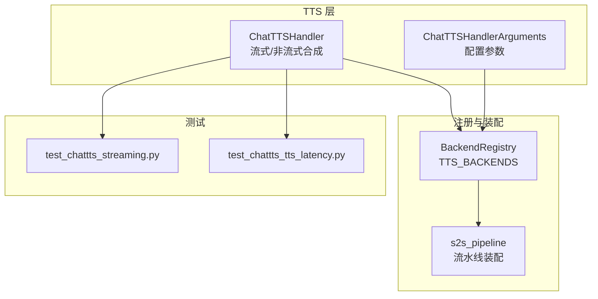
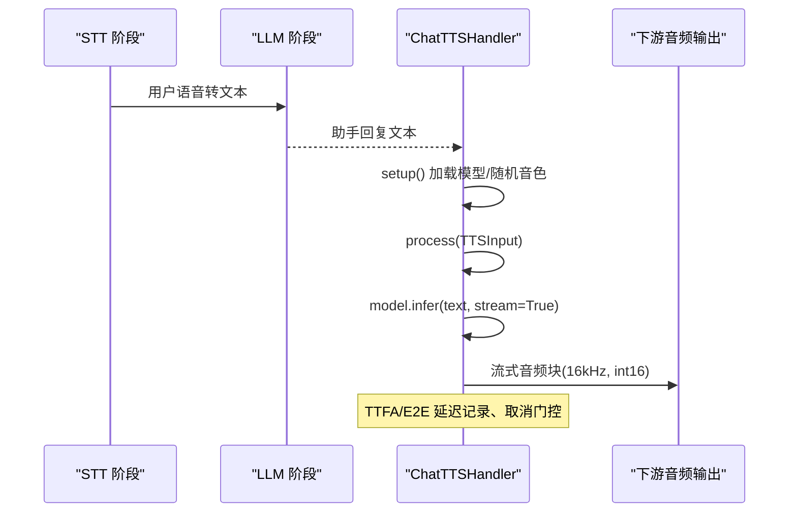
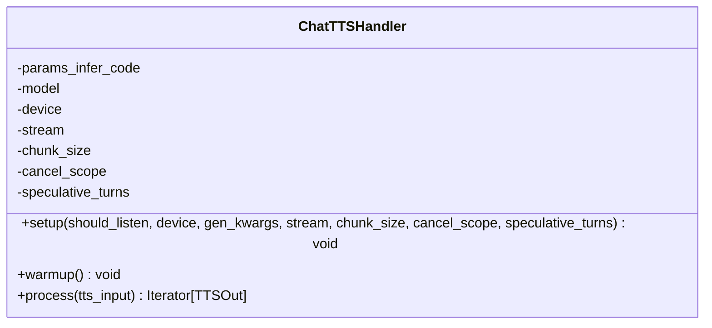
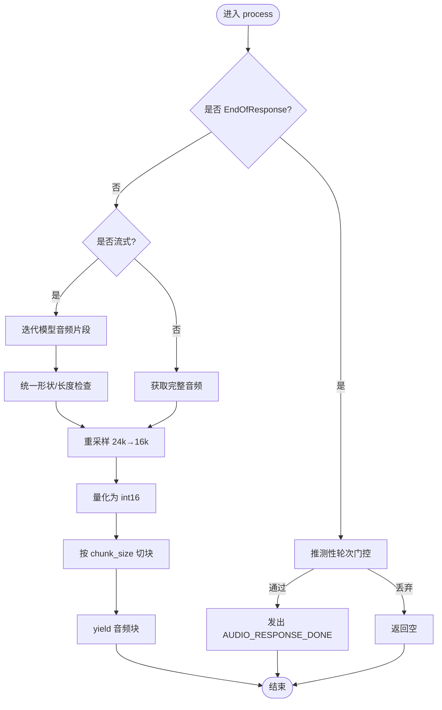
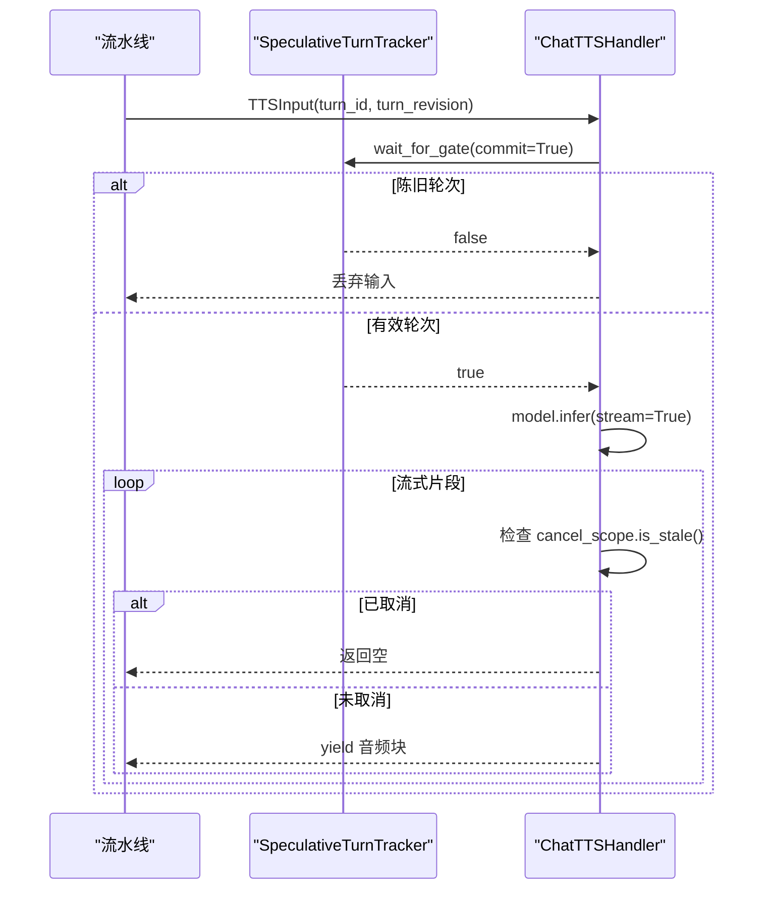
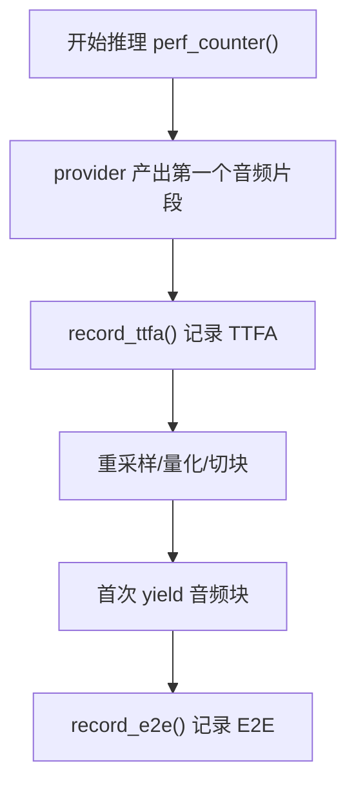
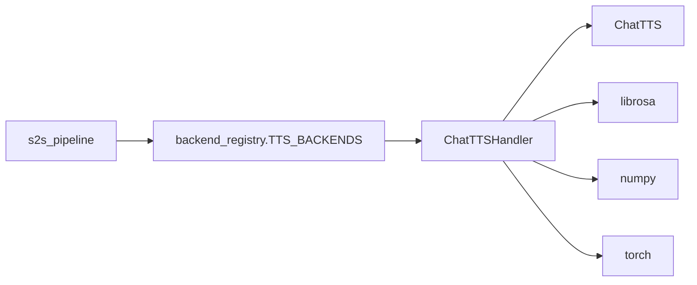
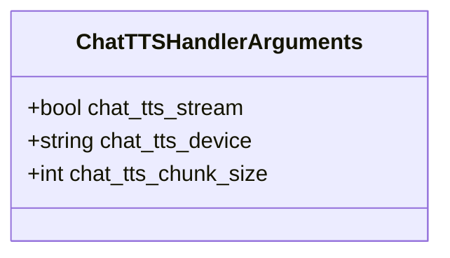
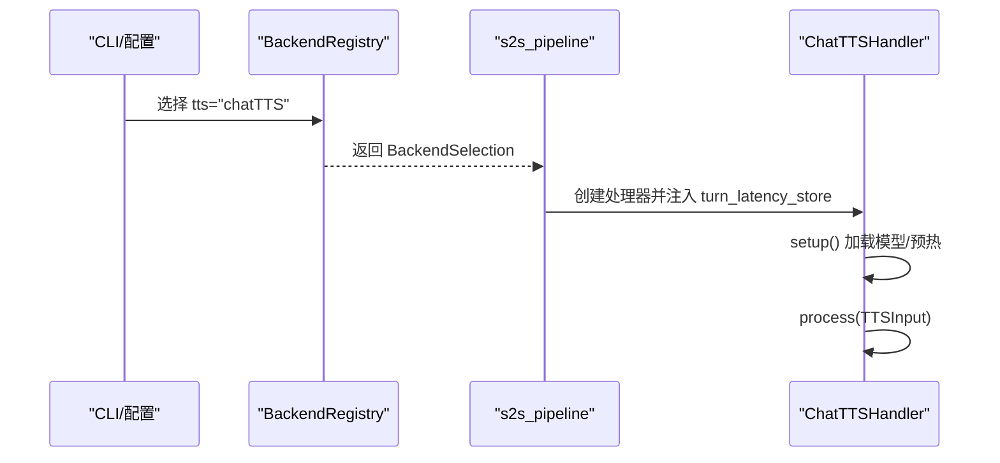

# ChatTTS 引擎

<cite>
**本文引用的文件**   
- [chatTTS_handler.py](file://src/speech_to_speech/TTS/chatTTS_handler.py)
- [chat_tts_arguments.py](file://src/speech_to_speech/arguments_classes/chat_tts_arguments.py)
- [backend_registry.py](file://src/speech_to_speech/backend_registry.py)
- [s2s_pipeline.py](file://src/speech_to_speech/s2s_pipeline.py)
- [test_chattts_streaming.py](file://tests/test_chattts_streaming.py)
- [test_chattts_tts_latency.py](file://tests/test_chattts_tts_latency.py)
</cite>

## 目录
1. [简介](#简介)
2. [项目结构](#项目结构)
3. [核心组件](#核心组件)
4. [架构总览](#架构总览)
5. [详细组件分析](#详细组件分析)
6. [依赖关系分析](#依赖关系分析)
7. [性能与延迟特性](#性能与延迟特性)
8. [配置参数与声音定制](#配置参数与声音定制)
9. [部署与集成示例](#部署与集成示例)
10. [故障排查](#故障排查)
11. [结论](#结论)

## 简介
本技术文档聚焦于仓库中的 ChatTTS 语音合成引擎，围绕其对话式语音合成能力、流式合成机制、延迟优化策略、音质保证、配置参数、声音定制以及集成方式展开。ChatTTS 在本项目中以 TTS 后端的形式接入端到端“语音到语音”流水线，支持流式音频块输出、设备自适应加载、MPS 内存清理、可取消生成、推测性轮次门控等工程化能力，并通过测试用例对 TTFA（文本到首音频）和 E2E（端到端）延迟进行验证。

## 项目结构
ChatTTS 相关代码主要分布在以下位置：
- TTS 实现：`src/speech_to_speech/TTS/chatTTS_handler.py`
- 参数定义：`src/speech_to_speech/arguments_classes/chat_tts_arguments.py`
- 后端注册与创建：`src/speech_to_speech/backend_registry.py`
- 流水线装配与语言能力声明：`src/speech_to_speech/s2s_pipeline.py`
- 流式行为与延迟测试：`tests/test_chattts_streaming.py`、`tests/test_chattts_tts_latency.py`

**图表来源**
- [chatTTS_handler.py:27-54](file://src/speech_to_speech/TTS/chatTTS_handler.py#L27-L54)
- [chat_tts_arguments.py:4-22](file://src/speech_to_speech/arguments_classes/chat_tts_arguments.py#L4-L22)
- [backend_registry.py:555-570](file://src/speech_to_speech/backend_registry.py#L555-L570)
- [s2s_pipeline.py:683-693](file://src/speech_to_speech/s2s_pipeline.py#L683-L693)

**章节来源**
- [chatTTS_handler.py:27-54](file://src/speech_to_speech/TTS/chatTTS_handler.py#L27-L54)
- [chat_tts_arguments.py:4-22](file://src/speech_to_speech/arguments_classes/chat_tts_arguments.py#L4-L22)
- [backend_registry.py:555-570](file://src/speech_to_speech/backend_registry.py#L555-L570)
- [s2s_pipeline.py:683-693](file://src/speech_to_speech/s2s_pipeline.py#L683-L693)

## 核心组件
- ChatTTSHandler：封装 ChatTTS 模型加载、推理、流式分块、采样率转换、量化为 int16、TTFA/E2E 延迟记录、取消生成、推测性轮次门控。
- ChatTTSHandlerArguments：暴露 stream、device、chunk_size 三个关键配置项。
- BackendRegistry：将 ChatTTS 作为 tts 后端注册，并注入上下文（如 cancel_scope、speculative_turns）。
- s2s_pipeline：在构建流水线时挂载 TTS 处理器，并将 turn_latency_store 注入各处理器用于延迟统计；同时声明 chatTTS 的语言能力集合。

**章节来源**
- [chatTTS_handler.py:27-163](file://src/speech_to_speech/TTS/chatTTS_handler.py#L27-L163)
- [chat_tts_arguments.py:4-22](file://src/speech_to_speech/arguments_classes/chat_tts_arguments.py#L4-L22)
- [backend_registry.py:555-570](file://src/speech_to_speech/backend_registry.py#L555-L570)
- [s2s_pipeline.py:671-693](file://src/speech_to_speech/s2s_pipeline.py#L671-L693)

## 架构总览
ChatTTS 在整体“语音到语音”流水线中处于 LLM 输出之后、音频输出之前。它接收文本输入，调用 ChatTTS 模型进行合成，并以固定大小的音频块向下游发送。

**图表来源**
- [chatTTS_handler.py:27-163](file://src/speech_to_speech/TTS/chatTTS_handler.py#L27-L163)
- [backend_registry.py:555-570](file://src/speech_to_speech/backend_registry.py#L555-L570)
- [s2s_pipeline.py:671-693](file://src/speech_to_speech/s2s_pipeline.py#L671-L693)

## 详细组件分析

### ChatTTSHandler 类
职责概览：
- 初始化：校验设备、加载 ChatTTS 模型、设置 InferCodeParams（包含随机说话人嵌入）、预热一次推理。
- 处理流程：
  - 若收到 EndOfResponse，结合推测性轮次门控决定是否丢弃或仅清理。
  - 若当前轮次被判定为陈旧，则丢弃该 TTS 输入。
  - 根据 stream 模式分别走流式或非流式分支。
  - MPS 设备特殊处理：同步并清空缓存，避免不稳定问题。
  - 记录 TTFA（首次音频时间）和 E2E（从上次语音停止到首个音频块产出）延迟。
  - 将 24kHz 音频重采样至 16kHz，转换为 int16，并按 chunk_size 切块输出。
  - 支持取消生成（cancel_scope），遇到中断立即返回。

**图表来源**
- [chatTTS_handler.py:27-54](file://src/speech_to_speech/TTS/chatTTS_handler.py#L27-L54)
- [chatTTS_handler.py:56-163](file://src/speech_to_speech/TTS/chatTTS_handler.py#L56-L163)

**章节来源**
- [chatTTS_handler.py:27-163](file://src/speech_to_speech/TTS/chatTTS_handler.py#L27-L163)

### 流式与非流式合成路径
- 流式模式：
  - 迭代模型返回的音频片段，兼容 (samples,) 与 (1, samples) 两种形状。
  - 对每个片段执行重采样、量化、按 chunk_size 切块输出。
  - 首次产出前记录 TTFA，首次 yield 后记录 E2E。
- 非流式模式：
  - 一次性获取完整音频，再执行重采样、量化、分块输出。
  - 同样记录 TTFA 与 E2E。

**图表来源**
- [chatTTS_handler.py:60-163](file://src/speech_to_speech/TTS/chatTTS_handler.py#L60-L163)

**章节来源**
- [chatTTS_handler.py:60-163](file://src/speech_to_speech/TTS/chatTTS_handler.py#L60-L163)

### 推测性轮次与取消生成
- 推测性轮次门控：
  - 当收到 EndOfResponse 或普通 TTSInput 时，使用 SpeculativeTurnTracker 判断是否为陈旧轮次。
  - 若是陈旧轮次，可选择丢弃或仅做清理。
- 取消生成：
  - 通过 cancel_scope.generation 与 is_stale 检测，一旦检测到取消，立即终止流式生成。

**图表来源**
- [chatTTS_handler.py:60-103](file://src/speech_to_speech/TTS/chatTTS_handler.py#L60-L103)
- [backend_registry.py:218-248](file://src/speech_to_speech/backend_registry.py#L218-L248)

**章节来源**
- [chatTTS_handler.py:60-103](file://src/speech_to_speech/TTS/chatTTS_handler.py#L60-L103)
- [backend_registry.py:218-248](file://src/speech_to_speech/backend_registry.py#L218-L248)

### 延迟测量与指标
- TTFA（Text-to-First-Audio）：从开始推理到首次 provider 产出的时间，在首次 provider 数据到达时记录。
- E2E（End-to-End）：从上次语音停止到首个音频块产出，仅在首次 yield 时记录。
- 测试覆盖：
  - 流式模式下 TTFA 在重采样前记录，E2E 在首次 yield 后记录。
  - 非流式模式下 TTFA 在重采样前记录，E2E 基于时间推进计算。
  - 空 provider 片段不会设置延迟指标。

**图表来源**
- [chatTTS_handler.py:94-122](file://src/speech_to_speech/TTS/chatTTS_handler.py#L94-L122)
- [test_chattts_tts_latency.py:49-86](file://tests/test_chattts_tts_latency.py#L49-L86)
- [test_chattts_tts_latency.py:152-186](file://tests/test_chattts_tts_latency.py#L152-L186)

**章节来源**
- [chatTTS_handler.py:94-122](file://src/speech_to_speech/TTS/chatTTS_handler.py#L94-L122)
- [test_chattts_tts_latency.py:49-86](file://tests/test_chattts_tts_latency.py#L49-L86)
- [test_chattts_tts_latency.py:152-186](file://tests/test_chattts_tts_latency.py#L152-L186)

## 依赖关系分析
- ChatTTSHandler 依赖外部库：
  - ChatTTS：模型加载与 infer 接口。
  - librosa：音频重采样。
  - numpy：数组操作与类型转换。
  - torch：设备管理与 MPS 同步/缓存清理。
- 后端注册：
  - backend_registry 将 ChatTTS 注册为 tts 后端，指定 config_prefix="chat_tts"，并标记可选依赖 "chattts"。
- 流水线装配：
  - s2s_pipeline 在构建 handlers 时将 turn_latency_store 注入所有处理器，并在 tts_selection.name == "chatTTS" 时声明语言能力集合为空集。

**图表来源**
- [chatTTS_handler.py:8-20](file://src/speech_to_speech/TTS/chatTTS_handler.py#L8-L20)
- [backend_registry.py:555-570](file://src/speech_to_speech/backend_registry.py#L555-L570)
- [s2s_pipeline.py:683-693](file://src/speech_to_speech/s2s_pipeline.py#L683-L693)

**章节来源**
- [chatTTS_handler.py:8-20](file://src/speech_to_speech/TTS/chatTTS_handler.py#L8-L20)
- [backend_registry.py:555-570](file://src/speech_to_speech/backend_registry.py#L555-L570)
- [s2s_pipeline.py:683-693](file://src/speech_to_speech/s2s_pipeline.py#L683-L693)

## 性能与延迟特性
- 流式优先：默认启用流式合成，降低首包延迟，提升交互自然度。
- TTFA 与 E2E：
  - TTFA 在 provider 首次产出时记录，不受本地重采样影响。
  - E2E 在首次 yield 时记录，反映端到端感知延迟。
- 设备优化：
  - MPS 设备在推理前同步并清空缓存，减少不稳定导致的失败。
- 取消与门控：
  - 支持取消生成，避免无效计算。
  - 推测性轮次门控丢弃陈旧轮次，提高吞吐与一致性。
- 音频质量：
  - 统一重采样至 16kHz，量化为 int16，确保下游播放一致性与低 CPU 开销。
- 测试验证：
  - 流式与列向量输入兼容性测试。
  - TTFA/E2E 时序断言。
  - 空 provider 片段不设置延迟指标。

**章节来源**
- [chatTTS_handler.py:85-91](file://src/speech_to_speech/TTS/chatTTS_handler.py#L85-L91)
- [chatTTS_handler.py:94-122](file://src/speech_to_speech/TTS/chatTTS_handler.py#L94-L122)
- [test_chattts_streaming.py:46-70](file://tests/test_chattts_streaming.py#L46-L70)
- [test_chattts_tts_latency.py:49-86](file://tests/test_chattts_tts_latency.py#L49-L86)
- [test_chattts_tts_latency.py:152-186](file://tests/test_chattts_tts_latency.py#L152-L186)
- [test_chattts_tts_latency.py:189-201](file://tests/test_chattts_tts_latency.py#L189-L201)

## 配置参数与声音定制
- 配置参数（ChatTTSHandlerArguments）：
  - chat_tts_stream：是否启用流式合成，默认 True。
  - chat_tts_device：设备选择，支持 auto/cuda/npu/mps/cpu，默认 auto。
  - chat_tts_chunk_size：每轮处理的音频块大小（样本数），默认 512，平衡播放延迟与 CPU 负载。
- 声音定制：
  - 当前实现使用随机说话人嵌入（sample_random_speaker）构造 InferCodeParams，未暴露显式 spk_emb 配置字段。
  - 如需固定音色，可在上层扩展参数类并传入自定义 spk_emb。
- 后端注册：
  - config_prefix="chat_tts"，表示配置键以 chat_tts_ 前缀命名。
  - required_extra="chattts"，提示需要安装可选依赖。

**图表来源**
- [chat_tts_arguments.py:4-22](file://src/speech_to_speech/arguments_classes/chat_tts_arguments.py#L4-L22)
- [backend_registry.py:555-570](file://src/speech_to_speech/backend_registry.py#L555-L570)

**章节来源**
- [chat_tts_arguments.py:4-22](file://src/speech_to_speech/arguments_classes/chat_tts_arguments.py#L4-L22)
- [backend_registry.py:555-570](file://src/speech_to_speech/backend_registry.py#L555-L570)
- [chatTTS_handler.py:50-53](file://src/speech_to_speech/TTS/chatTTS_handler.py#L50-L53)

## 部署与集成示例
- 后端选择：
  - 在命令行或配置中选择 tts="chatTTS"。
  - 通过 --tts 参数或配置文件指定后端名称。
- 配置注入：
  - 使用 chat_tts_stream、chat_tts_device、chat_tts_chunk_size 控制行为。
- 流水线装配：
  - s2s_pipeline 在构建 handlers 时将 turn_latency_store 注入处理器，便于延迟统计。
  - 对于 chatTTS，服务侧声明 tts_supported_languages 为空集。

**图表来源**
- [s2s_pipeline.py:208-239](file://src/speech_to_speech/s2s_pipeline.py#L208-L239)
- [s2s_pipeline.py:671-693](file://src/speech_to_speech/s2s_pipeline.py#L671-L693)
- [backend_registry.py:555-570](file://src/speech_to_speech/backend_registry.py#L555-L570)

**章节来源**
- [s2s_pipeline.py:208-239](file://src/speech_to_speech/s2s_pipeline.py#L208-L239)
- [s2s_pipeline.py:671-693](file://src/speech_to_speech/s2s_pipeline.py#L671-L693)
- [backend_registry.py:555-570](file://src/speech_to_speech/backend_registry.py#L555-L570)

## 故障排查
- 模型加载失败：
  - 现象：抛出“ChatTTS failed to load its models.”
  - 原因：ChatTTS.load 返回 False。
  - 处理：检查设备与依赖安装，确认 ChatTTS 可用。
- MPS 不稳定：
  - 现象：MPS 设备上推理失败或不稳定。
  - 处理：已在推理前执行 torch.mps.synchronize() 与 torch.mps.empty_cache()。
- 空 provider 片段：
  - 现象：provider 返回空数组或 None。
  - 处理：handler 会直接返回，不设置延迟指标。
- 设备不支持：
  - 现象：传入非法设备字符串。
  - 处理：validate_device 会拒绝非法值。

**章节来源**
- [chatTTS_handler.py:45-46](file://src/speech_to_speech/TTS/chatTTS_handler.py#L45-L46)
- [chatTTS_handler.py:85-91](file://src/speech_to_speech/TTS/chatTTS_handler.py#L85-L91)
- [chatTTS_handler.py:129-147](file://src/speech_to_speech/TTS/chatTTS_handler.py#L129-L147)
- [chatTTS_handler.py:41-41](file://src/speech_to_speech/TTS/chatTTS_handler.py#L41-L41)

## 结论
ChatTTS 在本项目中实现了高内聚、低耦合的 TTS 后端，具备流式合成、设备自适应、MPS 稳定性增强、推测性轮次门控与取消生成等工程化能力。通过 TTFA/E2E 延迟测量与多场景测试，保证了交互自然度与系统稳定性。配置参数简洁明确，便于在不同部署环境中调优。未来可扩展声音定制能力（如固定 spk_emb）以满足更精细的声音风格需求。