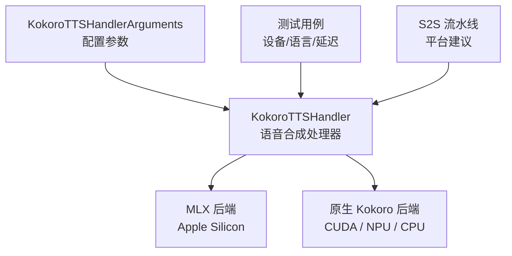
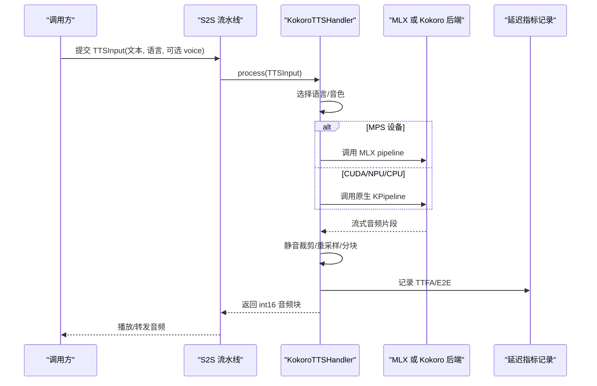
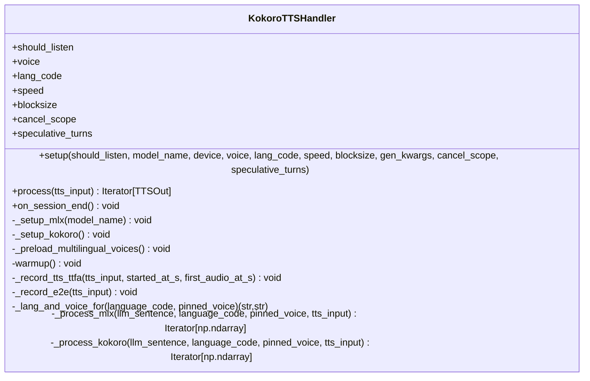
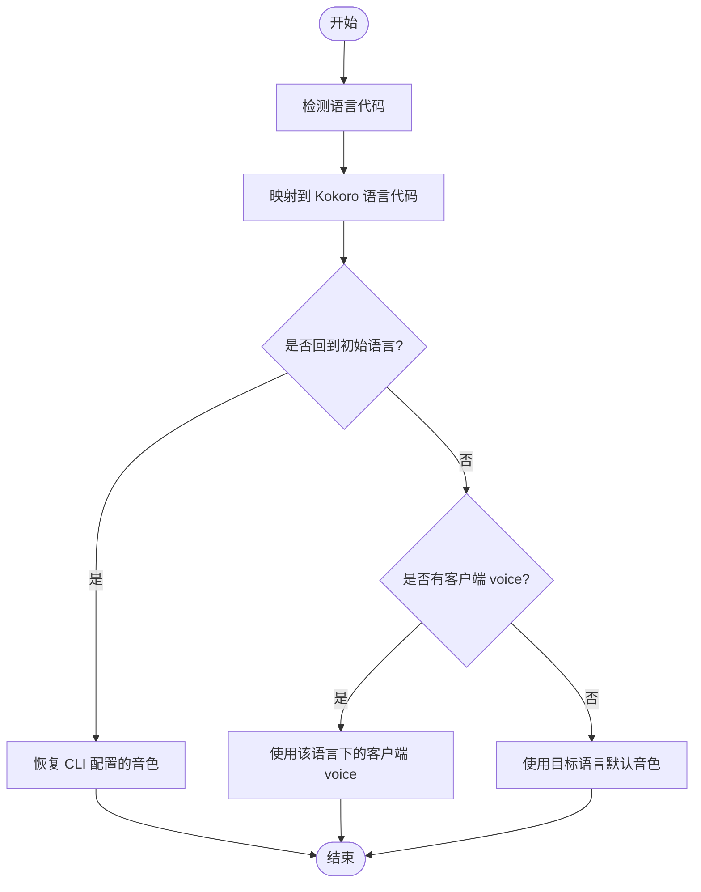
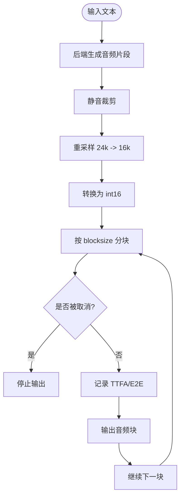
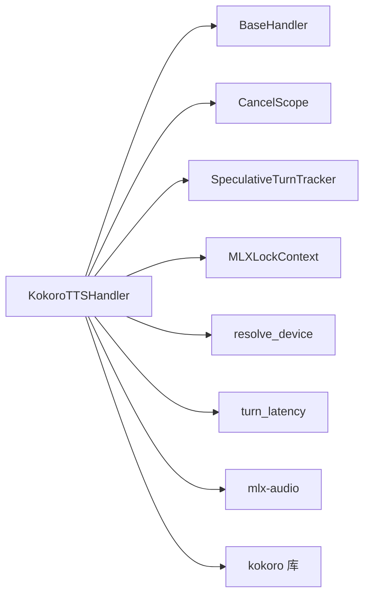

# Kokoro 引擎

<cite>
**本文引用的文件**   
- [kokoro_handler.py](file://src/speech_to_speech/TTS/kokoro_handler.py)
- [kokoro_tts_arguments.py](file://src/speech_to_speech/arguments_classes/kokoro_tts_arguments.py)
- [test_kokoro_device.py](file://tests/test_kokoro_device.py)
- [test_kokoro_language_voice.py](file://tests/test_kokoro_language_voice.py)
- [test_kokoro_tts_latency.py](file://tests/test_kokoro_tts_latency.py)
- [s2s_pipeline.py](file://src/speech_to_speech/s2s_pipeline.py)
- [openai-compatible-tts.md](file://docs/openai-compatible-tts.md)
- [openai-compatible-tts-CN.md](file://docs/openai-compatible-tts-CN.md)
</cite>

## 目录
1. [简介](#简介)
2. [项目结构中的 Kokoro 位置](#项目结构中的-kokoro-位置)
3. [核心组件与职责](#核心组件与职责)
4. [架构总览](#架构总览)
5. [详细组件分析](#详细组件分析)
6. [依赖关系分析](#依赖关系分析)
7. [性能与内存优化](#性能与内存优化)
8. [与其他 TTS 引擎的对比与使用场景](#与其他-tts-引擎的对比与使用场景)
9. [安装与配置](#安装与配置)
10. [API 调用示例](#api-调用示例)
11. [故障排除指南](#故障排除指南)
12. [结论](#结论)

## 简介
Kokoro 引擎在本项目中以 `KokoroTTSHandler` 的形式实现，提供基于 Kokoro 模型的语音合成能力。该处理器支持多语言、多音色、语速调节，并在 Apple Silicon 上通过 MLX 后端运行，在 CUDA/NPU/CPU 上通过原生 kokoro 库运行。它输出流式音频块，适配实时对话流水线，并内置首包时间、端到端延迟等指标记录能力。

## 项目结构中的 Kokoro 位置
- 核心实现：`src/speech_to_speech/TTS/kokoro_handler.py`
- 参数定义：`src/speech_to_speech/arguments_classes/kokoro_tts_arguments.py`
- 行为测试：`tests/test_kokoro_device.py`、`tests/test_kokoro_language_voice.py`、`tests/test_kokoro_tts_latency.py`
- 运行时建议与平台提示：`src/speech_to_speech/s2s_pipeline.py`
- 其他 TTS 文档（OpenAI 兼容）：`docs/openai-compatible-tts.md`、`docs/openai-compatible-tts-CN.md`



**图表来源**
- [kokoro_handler.py:82-151](file://src/speech_to_speech/TTS/kokoro_handler.py#L82-L151)
- [kokoro_tts_arguments.py:5-39](file://src/speech_to_speech/arguments_classes/kokoro_tts_arguments.py#L5-L39)
- [s2s_pipeline.py:327-333](file://src/speech_to_speech/s2s_pipeline.py#L327-L333)

**章节来源**
- [kokoro_handler.py:1-10](file://src/speech_to_speech/TTS/kokoro_handler.py#L1-L10)
- [kokoro_tts_arguments.py:1-39](file://src/speech_to_speech/arguments_classes/kokoro_tts_arguments.py#L1-L39)
- [s2s_pipeline.py:327-333](file://src/speech_to_speech/s2s_pipeline.py#L327-L333)

## 核心组件与职责
- `KokoroTTSHandler`：负责模型加载、设备选择、语言/音色切换、流式音频生成、会话状态恢复、延迟指标记录。
- `KokoroTTSHandlerArguments`：声明 CLI/配置层可用的 Kokoro 相关参数，包括模型名、设备、音色、语言代码、语速、分块大小。
- 测试模块：验证设备自动选择、语言/音色策略、TTFA/E2E 延迟记录等行为。

关键职责要点：
- 设备自动选择：macOS 默认 MPS，否则按 CUDA/NPU/CPU 顺序解析。
- 双后端：MPS 走 MLX；其他走原生 kokoro。
- 多语言映射：将 Whisper/langdetect 语言映射到 Kokoro 语言代码，并提供默认音色。
- 流式输出：按固定块大小输出 int16 音频，内部进行静音裁剪和重采样。
- 会话语义：支持响应级 voice 覆盖、会话级 voice 持久化、会话结束恢复初始音色。

**章节来源**
- [kokoro_handler.py:82-151](file://src/speech_to_speech/TTS/kokoro_handler.py#L82-L151)
- [kokoro_handler.py:153-195](file://src/speech_to_speech/TTS/kokoro_handler.py#L153-L195)
- [kokoro_handler.py:233-291](file://src/speech_to_speech/TTS/kokoro_handler.py#L233-L291)
- [kokoro_handler.py:311-327](file://src/speech_to_speech/TTS/kokoro_handler.py#L311-L327)
- [kokoro_handler.py:492-505](file://src/speech_to_speech/TTS/kokoro_handler.py#L492-L505)
- [kokoro_tts_arguments.py:5-39](file://src/speech_to_speech/arguments_classes/kokoro_tts_arguments.py#L5-L39)

## 架构总览
Kokoro 引擎作为 TTS 阶段接入 S2S 流水线，接收文本输入，输出流式音频块。其内部根据设备选择不同后端，并通过统一的 `process` 接口对外暴露。



**图表来源**
- [kokoro_handler.py:233-291](file://src/speech_to_speech/TTS/kokoro_handler.py#L233-L291)
- [kokoro_handler.py:328-419](file://src/speech_to_speech/TTS/kokoro_handler.py#L328-L419)
- [kokoro_handler.py:420-490](file://src/speech_to_speech/TTS/kokoro_handler.py#L420-L490)

## 详细组件分析

### KokoroTTSHandler 类
- 初始化与设备选择：根据 `device` 参数与平台决定 MPS 或原生 kokoro。
- 后端设置：
  - `_setup_mlx`：加载 MLX 模型，预取语言管道与音色，预加载常用语言音色以减少首次下载延迟。
  - `_setup_kokoro`：加载原生 kokoro 的 `KPipeline`。
- 预热：执行一次短推理以预热模型。
- 处理流程：
  - `process`：统一入口，处理 EndOfResponse、推测轮次门控、语言/音色选择、后端分发。
  - `_lang_and_voice_for`：根据传入语言与客户端 voice 选择最终语言代码与音色。
  - `_process_mlx`：MLX 路径，包含静音裁剪、重采样、分块、取消检测、延迟记录。
  - `_process_kokoro`：原生 kokoro 路径，包含重采样、分块、取消检测、延迟记录。
- 会话结束：恢复初始语言与音色，重建对应后端对象。



**图表来源**
- [kokoro_handler.py:82-151](file://src/speech_to_speech/TTS/kokoro_handler.py#L82-L151)
- [kokoro_handler.py:153-195](file://src/speech_to_speech/TTS/kokoro_handler.py#L153-L195)
- [kokoro_handler.py:214-231](file://src/speech_to_speech/TTS/kokoro_handler.py#L214-L231)
- [kokoro_handler.py:233-291](file://src/speech_to_speech/TTS/kokoro_handler.py#L233-L291)
- [kokoro_handler.py:293-327](file://src/speech_to_speech/TTS/kokoro_handler.py#L293-L327)
- [kokoro_handler.py:328-419](file://src/speech_to_speech/TTS/kokoro_handler.py#L328-L419)
- [kokoro_handler.py:420-490](file://src/speech_to_speech/TTS/kokoro_handler.py#L420-L490)
- [kokoro_handler.py:492-505](file://src/speech_to_speech/TTS/kokoro_handler.py#L492-L505)

**章节来源**
- [kokoro_handler.py:82-151](file://src/speech_to_speech/TTS/kokoro_handler.py#L82-L151)
- [kokoro_handler.py:153-195](file://src/speech_to_speech/TTS/kokoro_handler.py#L153-L195)
- [kokoro_handler.py:214-231](file://src/speech_to_speech/TTS/kokoro_handler.py#L214-L231)
- [kokoro_handler.py:233-291](file://src/speech_to_speech/TTS/kokoro_handler.py#L233-L291)
- [kokoro_handler.py:311-327](file://src/speech_to_speech/TTS/kokoro_handler.py#L311-L327)
- [kokoro_handler.py:328-419](file://src/speech_to_speech/TTS/kokoro_handler.py#L328-L419)
- [kokoro_handler.py:420-490](file://src/speech_to_speech/TTS/kokoro_handler.py#L420-L490)
- [kokoro_handler.py:492-505](file://src/speech_to_speech/TTS/kokoro_handler.py#L492-L505)

### 语言与音色选择逻辑
- 语言映射：将 Whisper/langdetect 的语言代码映射到 Kokoro 语言代码，未支持的欧洲语言回退到英语变体。
- 默认音色：每种语言有默认音色，便于快速启动。
- 客户端 voice 优先级：
  - 若响应中指定 voice，则仅对该响应生效。
  - 若会话中指定 voice，则在同语言下保持。
  - 回到初始语言时恢复 CLI 配置的 voice。
- 非本机语言且无客户端 voice：使用目标语言的默认音色。



**图表来源**
- [kokoro_handler.py:34-79](file://src/speech_to_speech/TTS/kokoro_handler.py#L34-L79)
- [kokoro_handler.py:311-327](file://src/speech_to_speech/TTS/kokoro_handler.py#L311-L327)
- [test_kokoro_language_voice.py:43-60](file://tests/test_kokoro_language_voice.py#L43-L60)
- [test_kokoro_language_voice.py:112-179](file://tests/test_kokoro_language_voice.py#L112-L179)

**章节来源**
- [kokoro_handler.py:34-79](file://src/speech_to_speech/TTS/kokoro_handler.py#L34-L79)
- [kokoro_handler.py:311-327](file://src/speech_to_speech/TTS/kokoro_handler.py#L311-L327)
- [test_kokoro_language_voice.py:43-60](file://tests/test_kokoro_language_voice.py#L43-L60)
- [test_kokoro_language_voice.py:112-179](file://tests/test_kokoro_language_voice.py#L112-L179)

### 流式音频处理与指标记录
- 静音裁剪：去除首尾静音，保留少量 padding 避免切掉语音。
- 重采样：从 24kHz 重采样到 16kHz，使用 polyphase 算法保证质量与速度。
- 分块输出：按 `blocksize` 输出 int16 音频块，不足补齐。
- 取消检测：在生成过程中检查 `cancel_scope`，支持打断。
- 指标记录：
  - TTFA：首个 provider 音频到达时间（重采样前）。
  - E2E：从上次语音停止到首个音频块输出的端到端时间。



**图表来源**
- [kokoro_handler.py:328-419](file://src/speech_to_speech/TTS/kokoro_handler.py#L328-L419)
- [kokoro_handler.py:420-490](file://src/speech_to_speech/TTS/kokoro_handler.py#L420-L490)
- [test_kokoro_tts_latency.py:34-85](file://tests/test_kokoro_tts_latency.py#L34-L85)
- [test_kokoro_tts_latency.py:88-137](file://tests/test_kokoro_tts_latency.py#L88-L137)

**章节来源**
- [kokoro_handler.py:328-419](file://src/speech_to_speech/TTS/kokoro_handler.py#L328-L419)
- [kokoro_handler.py:420-490](file://src/speech_to_speech/TTS/kokoro_handler.py#L420-L490)
- [test_kokoro_tts_latency.py:34-85](file://tests/test_kokoro_tts_latency.py#L34-L85)
- [test_kokoro_tts_latency.py:88-137](file://tests/test_kokoro_tts_latency.py#L88-L137)

## 依赖关系分析
- 外部依赖：
  - MLX 后端：`mlx-audio`，用于 Apple Silicon 上的 Kokoro 模型加载与推理。
  - 原生 kokoro：`kokoro>=0.9.2`，需要 `soundfile` 与系统工具 `espeak-ng`。
- 内部依赖：
  - `BaseHandler`：继承基础处理器接口。
  - `CancelScope`：支持生成任务取消。
  - `SpeculativeTurnTracker`：推测轮次门控。
  - `MLXLockContext`：MLX 线程锁上下文。
  - `utils.resolve_device`：设备解析。
  - `turn_latency`：延迟指标记录。



**图表来源**
- [kokoro_handler.py:19-31](file://src/speech_to_speech/TTS/kokoro_handler.py#L19-L31)
- [kokoro_handler.py:153-195](file://src/speech_to_speech/TTS/kokoro_handler.py#L153-L195)

**章节来源**
- [kokoro_handler.py:19-31](file://src/speech_to_speech/TTS/kokoro_handler.py#L19-L31)
- [kokoro_handler.py:153-195](file://src/speech_to_speech/TTS/kokoro_handler.py#L153-L195)

## 性能与内存优化
- 预加载音色：在 MLX 后端预加载常用语言音色，减少首次推理时的下载与加载延迟。
- 流式输出：按固定块大小输出，降低内存峰值，提升实时性。
- 重采样策略：使用 scipy 的 polyphase 重采样，兼顾速度与音质。
- 静音裁剪：去除首尾静音，减少无效数据量。
- 取消机制：支持打断，及时释放资源。
- 线程数控制：可通过 `torch_num_threads` 控制 PyTorch 线程数，避免过度并行导致争用。

建议：
- 在 macOS 上使用 MLX 后端以获得更好能效比。
- 合理设置 `blocksize`，平衡延迟与稳定性。
- 对长文本进行分段输入，避免单次生成过长。
- 使用预热减少冷启动延迟。

**章节来源**
- [kokoro_handler.py:197-213](file://src/speech_to_speech/TTS/kokoro_handler.py#L197-L213)
- [kokoro_handler.py:328-419](file://src/speech_to_speech/TTS/kokoro_handler.py#L328-L419)
- [kokoro_handler.py:420-490](file://src/speech_to_speech/TTS/kokoro_handler.py#L420-L490)
- [s2s_pipeline.py:336-344](file://src/speech_to_speech/s2s_pipeline.py#L336-L344)

## 与其他 TTS 引擎的对比与使用场景
- Kokoro：
  - 优势：多语言、多音色、轻量模型（82M）、流式输出、跨平台（MLX/native）。
  - 适用：实时对话、多语言交互、低延迟要求。
- Qwen3-TTS：
  - 优势：高质量中文、可定制音色、适合本地部署。
  - 适用：中文为主、高音质需求。
- Pocket TTS：
  - 优势：轻量、适合边缘设备。
  - 适用：移动端或资源受限环境。
- ChatTTS：
  - 优势：情感丰富、自然度高。
  - 适用：拟人化对话、娱乐场景。

平台建议：
- macOS 推荐 qwen3，但 kokoro、pocket、omnivoice 也有效。
- 服务器端建议使用 qwen3 或 openai 兼容后端以获得更高音质与稳定性。

**章节来源**
- [s2s_pipeline.py:327-333](file://src/speech_to_speech/s2s_pipeline.py#L327-L333)
- [openai-compatible-tts.md:1-144](file://docs/openai-compatible-tts.md#L1-L144)
- [openai-compatible-tts-CN.md:1-102](file://docs/openai-compatible-tts-CN.md#L1-L102)

## 安装与配置
- 依赖安装：
  - MLX 后端：`pip install mlx-audio`，Apple Silicon 需额外依赖 `misaki`、`spacy`、`phonemizer`、`espeakng_loader`、`num2words`。
  - 原生 kokoro：`pip install kokoro>=0.9.2 soundfile`，并安装系统工具 `espeak-ng`。
- 配置参数：
  - `kokoro_model_name`：模型标识，自动选择 MPS 或 CUDA/CPU 模型。
  - `kokoro_device`：设备选择，支持 `auto`、`cuda`、`npu`、`mps`、`cpu`。
  - `kokoro_voice`：音色标识，如 `bm_fable`。
  - `kokoro_lang_code`：语言代码，如 `b` 表示英式英语。
  - `kokoro_speed`：语速倍数，>1 加速，<1 减速。
  - `kokoro_blocksize`：音频分块大小，默认 512。

命令行示例：
```bash
speech-to-speech local \
  --tts kokoro \
  --kokoro_device auto \
  --kokoro_voice bm_fable \
  --kokoro_lang_code b \
  --kokoro_speed 1.0 \
  --kokoro_blocksize 512
```

**章节来源**
- [kokoro_handler.py:153-195](file://src/speech_to_speech/TTS/kokoro_handler.py#L153-L195)
- [kokoro_tts_arguments.py:5-39](file://src/speech_to_speech/arguments_classes/kokoro_tts_arguments.py#L5-L39)

## API 调用示例
- 基本调用：
  - 创建处理器实例，设置设备、音色、语言、语速。
  - 调用 `process` 获取流式音频块。
- 动态切换音色：
  - 通过响应或会话配置指定 voice，支持语言切换时保持或恢复音色。
- 取消生成：
  - 使用 `cancel_scope` 支持打断，及时停止输出。

参考测试用例：
- 设备自动选择与管道重建：`tests/test_kokoro_device.py`
- 语言/音色策略：`tests/test_kokoro_language_voice.py`
- 延迟指标记录：`tests/test_kokoro_tts_latency.py`

**章节来源**
- [test_kokoro_device.py:16-39](file://tests/test_kokoro_device.py#L16-L39)
- [test_kokoro_language_voice.py:43-60](file://tests/test_kokoro_language_voice.py#L43-L60)
- [test_kokoro_language_voice.py:112-179](file://tests/test_kokoro_language_voice.py#L112-L179)
- [test_kokoro_tts_latency.py:34-85](file://tests/test_kokoro_tts_latency.py#L34-L85)

## 故障排除指南
- 依赖缺失：
  - MLX 后端缺少 `misaki`、`spacy`、`phonemizer`、`espeakng_loader`、`num2words`：安装 `speech-to-speech[kokoro]`。
  - 原生 kokoro 缺少 `kokoro` 或 `soundfile`：安装对应包，并确保系统安装 `espeak-ng`。
- 设备问题：
  - CUDA/NPU 不可用：检查驱动与环境变量。
  - MPS 不可用：确认 macOS 版本与 PyTorch 支持。
- 音色/语言错误：
  - 检查语言代码与音色名称是否匹配。
  - 确认目标语言是否有可用音色。
- 延迟过高：
  - 调整 `blocksize`，减小分块大小以降低延迟。
  - 启用预热，减少冷启动延迟。
  - 检查系统资源占用，避免 CPU/GPU 过载。

**章节来源**
- [kokoro_handler.py:170-195](file://src/speech_to_speech/TTS/kokoro_handler.py#L170-L195)
- [kokoro_handler.py:214-231](file://src/speech_to_speech/TTS/kokoro_handler.py#L214-L231)

## 结论
Kokoro 引擎在本项目中提供了高效、灵活的多语言语音合成能力，支持流式输出、动态音色切换与延迟指标记录。通过 MLX 与原生 kokoro 双后端适配，可在不同平台上获得良好性能。结合合理的配置与优化策略，适用于实时对话、多语言交互等场景。