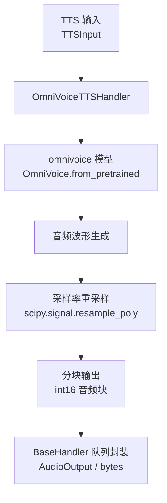
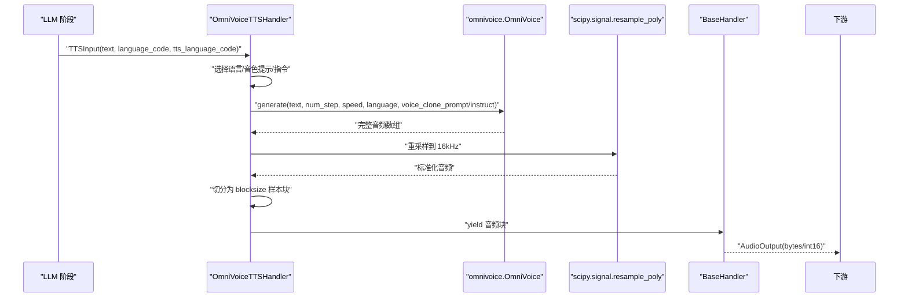
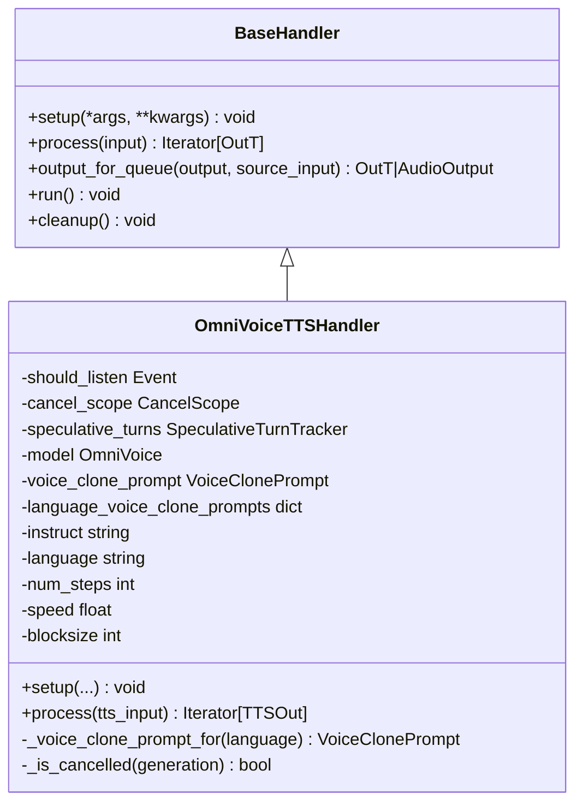
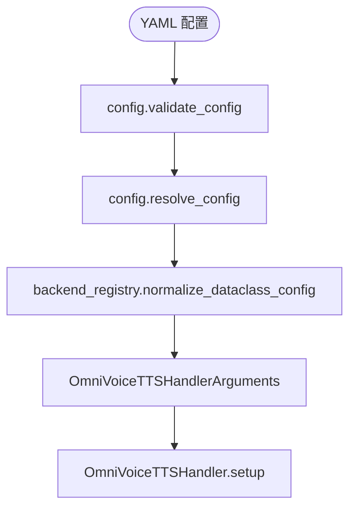
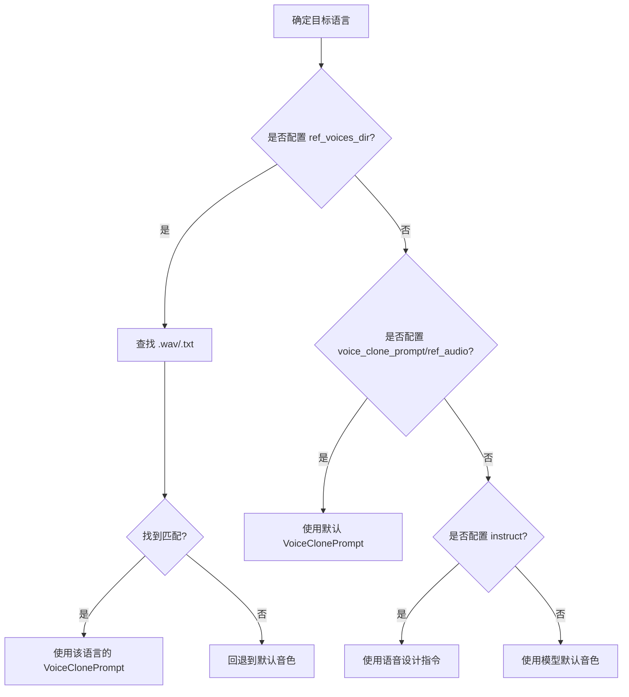
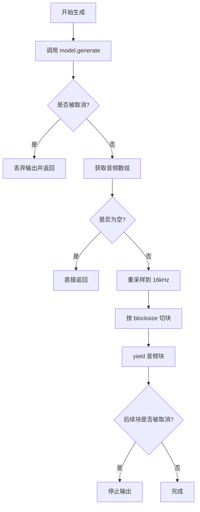
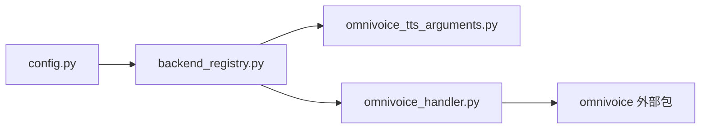

# OmniVoice 引擎

<cite>
**本文引用的文件**   
- [omnivoice_handler.py](file://src/speech_to_speech/TTS/omnivoice_handler.py)
- [omnivoice_tts_arguments.py](file://src/speech_to_speech/arguments_classes/omnivoice_tts_arguments.py)
- [backend_registry.py](file://src/speech_to_speech/backend_registry.py)
- [baseHandler.py](file://src/speech_to_speech/baseHandler.py)
- [handler_types.py](file://src/speech_to_speech/pipeline/handler_types.py)
- [config.py](file://src/speech_to_speech/config.py)
- [test_omnivoice_tts_latency.py](file://tests/test_omnivoice_tts_latency.py)
</cite>

## 目录
1. [简介](#简介)
2. [项目结构](#项目结构)
3. [核心组件](#核心组件)
4. [架构总览](#架构总览)
5. [详细组件分析](#详细组件分析)
6. [依赖关系分析](#依赖关系分析)
7. [性能与部署建议](#性能与部署建议)
8. [故障排查](#故障排查)
9. [结论](#结论)

## 简介
本技术文档聚焦于仓库中的 OmniVoice TTS 引擎实现，说明其作为本地语音合成后端在整体语音到语音流水线中的角色、配置方式、多语言与音色控制能力、流式输出机制、取消与推测执行集成，以及性能优化要点。需要特别说明的是：OmniVoice 在本仓库中是一个本地推理后端，通过外部 `omnivoice` Python 包加载模型；当前代码未暴露云端 API、认证或配额管理接口，因此“云端集成、API 密钥、配额限制”等能力不在本仓库实现范围内。

## 项目结构
OmniVoice TTS 相关代码主要分布在以下位置：
- TTS 处理器实现：`src/speech_to_speech/TTS/omnivoice_handler.py`
- 参数定义：`src/speech_to_speech/arguments_classes/omnivoice_tts_arguments.py`
- 后端注册表：`src/speech_to_speech/backend_registry.py`
- 通用处理器基类与流水线类型：`src/speech_to_speech/baseHandler.py`、`src/speech_to_speech/pipeline/handler_types.py`
- 配置解析与校验：`src/speech_to_speech/config.py`
- 延迟与行为测试：`tests/test_omnivoice_tts_latency.py`

**图表来源**
- [omnivoice_handler.py:28-230](file://src/speech_to_speech/TTS/omnivoice_handler.py#L28-L230)
- [baseHandler.py:106-120](file://src/speech_to_speech/baseHandler.py#L106-L120)
- [handler_types.py:43-45](file://src/speech_to_speech/pipeline/handler_types.py#L43-L45)

**章节来源**
- [omnivoice_handler.py:28-230](file://src/speech_to_speech/TTS/omnivoice_handler.py#L28-L230)
- [omnivoice_tts_arguments.py:5-67](file://src/speech_to_speech/arguments_classes/omnivoice_tts_arguments.py#L5-L67)
- [backend_registry.py:583-595](file://src/speech_to_speech/backend_registry.py#L583-L595)
- [baseHandler.py:32-120](file://src/speech_to_speech/baseHandler.py#L32-L120)
- [handler_types.py:43-45](file://src/speech_to_speech/pipeline/handler_types.py#L43-L45)
- [config.py:44-56](file://src/speech_to_speech/config.py#L44-L56)

## 核心组件
- OmniVoiceTTSHandler：继承自 BaseHandler，负责加载 OmniVoice 模型、选择音色提示、调用模型生成、重采样、分块输出，并处理中断与推测回合。
- OmniVoiceTTSHandlerArguments：声明所有 OmniVoice 后端可配置的参数，包括模型名称、设备、精度、参考音频、音色克隆提示、每语言参考音色目录、语音指令、目标语言、扩散步数、语速和输出块大小。
- backend_registry：将 `omnivoice` 注册为 TTS 后端，指定参数类、工厂函数、配置前缀和可选依赖。
- baseHandler：提供线程化运行循环、输入过滤、输出包装、会话结束处理和错误日志。
- handler_types：定义 TTSIn/TTSOut 的类型别名，明确 OmniVoice 的输入输出语义。
- config：对 YAML 配置进行强类型校验，并将路径字段（如 OmniVoice 参考音频）展开为绝对路径。

**章节来源**
- [omnivoice_handler.py:28-230](file://src/speech_to_speech/TTS/omnivoice_handler.py#L28-L230)
- [omnivoice_tts_arguments.py:5-67](file://src/speech_to_speech/arguments_classes/omnivoice_tts_arguments.py#L5-L67)
- [backend_registry.py:583-595](file://src/speech_to_speech/backend_registry.py#L583-L595)
- [baseHandler.py:32-120](file://src/speech_to_speech/baseHandler.py#L32-L120)
- [handler_types.py:43-45](file://src/speech_to_speech/pipeline/handler_types.py#L43-L45)
- [config.py:44-56](file://src/speech_to_speech/config.py#L44-L56)

## 架构总览
OmniVoice TTS 是语音到语音流水线中的 TTS 阶段。上游 STT/LLM 产出文本后，系统构造 TTSInput，交由 OmniVoiceTTSHandler 处理；处理器调用外部 `omnivoice` 模型生成完整波形，再按流水线标准采样率重采样并切分为固定大小的 int16 音频块，最终由 BaseHandler 包装成 AudioOutput 或原始字节进入下游播放或传输通道。

**图表来源**
- [omnivoice_handler.py:127-230](file://src/speech_to_speech/TTS/omnivoice_handler.py#L127-L230)
- [baseHandler.py:106-120](file://src/speech_to_speech/baseHandler.py#L106-L120)

## 详细组件分析

### OmniVoiceTTSHandler 类
OmniVoiceTTSHandler 实现了 TTS 阶段的完整生命周期：
- setup：校验参数、解析设备与 dtype、加载 OmniVoice 模型、准备音色克隆提示或语音设计指令、按语言加载参考音色。
- process：接收 TTSInput 或 EndOfResponse，跳过空文本，构建 generate 参数，调用模型生成，检查取消状态，重采样，分块输出，记录端到端与 TTFA 延迟。
- 语言与口音：支持通过 `language` 或 `tts_language_code` 指定目标语言；若配置了 `ref_voices_dir`，则根据语言名或基础语言码匹配对应 `.wav/.txt` 参考音色，否则回退到默认音色。
- 风格控制：支持 `instruct` 语音设计指令，或与音色克隆互斥；也可使用预保存的 `voice_clone_prompt`。
- 流式与中断：虽然模型生成是阻塞的，但处理器在生成前后及分块过程中检查 cancel_scope，避免把已生成的音频发送到已取消的响应。

**图表来源**
- [baseHandler.py:32-120](file://src/speech_to_speech/baseHandler.py#L32-L120)
- [omnivoice_handler.py:28-230](file://src/speech_to_speech/TTS/omnivoice_handler.py#L28-L230)

**章节来源**
- [omnivoice_handler.py:28-230](file://src/speech_to_speech/TTS/omnivoice_handler.py#L28-L230)

### 参数与配置
OmniVoiceTTSHandlerArguments 定义了所有 OmniVoice 后端参数：
- 模型与设备：`omnivoice_model_name`、`omnivoice_device`、`omnivoice_dtype`。
- 音色克隆：`omnivoice_ref_audio`、`omnivoice_ref_text`、`omnivoice_voice_clone_prompt`、`omnivoice_ref_voices_dir`。
- 语音设计与语言：`omnivoice_instruct`、`omnivoice_language`。
- 生成控制：`omnivoice_num_steps`、`omnivoice_speed`、`omnivoice_blocksize`。

这些参数会被 backend_registry 以 `omnivoice_` 前缀归一化为 handler kwargs，并在 YAML 配置中通过 blocks/tts 设置注入。

**图表来源**
- [config.py:371-438](file://src/speech_to_speech/config.py#L371-L438)
- [config.py:441-538](file://src/speech_to_speech/config.py#L441-L538)
- [backend_registry.py:143-163](file://src/speech_to_speech/backend_registry.py#L143-L163)
- [omnivoice_tts_arguments.py:5-67](file://src/speech_to_speech/arguments_classes/omnivoice_tts_arguments.py#L5-L67)

**章节来源**
- [omnivoice_tts_arguments.py:5-67](file://src/speech_to_speech/arguments_classes/omnivoice_tts_arguments.py#L5-L67)
- [backend_registry.py:143-163](file://src/speech_to_speech/backend_registry.py#L143-L163)
- [config.py:44-56](file://src/speech_to_speech/config.py#L44-L56)

### 多语言切换与口音模拟
- 多语言切换：处理器优先使用 `tts_language_code`，其次回退到 `language_code`，最后使用 setup 时配置的 `language`。若未设置，则使用模型默认语言。
- 口音与音色：如果配置了 `ref_voices_dir`，处理器会扫描该目录下 `<语言>.wav` 与 `<语言>.txt`，为每种语言创建独立的 VoiceClonePrompt；生成时先尝试精确语言码，再尝试基础语言码，找不到则回退到默认音色。
- 语音设计：如果设置了 `instruct`，则不启用音色克隆；`instruct` 与 `voice_clone_prompt`、`ref_audio`、`ref_voices_dir` 互斥。

**图表来源**
- [omnivoice_handler.py:98-122](file://src/speech_to_speech/TTS/omnivoice_handler.py#L98-L122)
- [omnivoice_handler.py:159-167](file://src/speech_to_speech/TTS/omnivoice_handler.py#L159-L167)

**章节来源**
- [omnivoice_handler.py:98-122](file://src/speech_to_speech/TTS/omnivoice_handler.py#L98-L122)
- [omnivoice_handler.py:159-167](file://src/speech_to_speech/TTS/omnivoice_handler.py#L159-L167)

### 流式输出与中断处理
- OmniVoice 的 `generate` 是阻塞调用，处理器在调用前后检查 cancel_scope，避免向已取消的响应发送音频。
- 输出被切分为 `blocksize` 个样本的块，每个块 yield 给 BaseHandler；BaseHandler 将其包装为 AudioOutput 或 bytes。
- 首次 yield 时记录端到端延迟，TTFA 延迟在模型返回后立即记录。

**图表来源**
- [omnivoice_handler.py:172-230](file://src/speech_to_speech/TTS/omnivoice_handler.py#L172-L230)
- [baseHandler.py:106-120](file://src/speech_to_speech/baseHandler.py#L106-L120)

**章节来源**
- [omnivoice_handler.py:172-230](file://src/speech_to_speech/TTS/omnivoice_handler.py#L172-L230)
- [baseHandler.py:106-120](file://src/speech_to_speech/baseHandler.py#L106-L120)

### 推测回合与会话清理
- 当存在 `speculative_turns` 时，处理器会在处理 TTSInput 前等待门控，丢弃旧版本 turn 的输入。
- 收到 EndOfResponse 时，若推测回合未通过门控，则仅做清理并返回 AUDIO_RESPONSE_DONE。

**章节来源**
- [omnivoice_handler.py:127-147](file://src/speech_to_speech/TTS/omnivoice_handler.py#L127-L147)

## 依赖关系分析
- OmniVoiceTTSHandler 依赖外部 `omnivoice` 包，在 setup 中动态导入 `OmniVoice` 与 `VoiceClonePrompt`。
- 后端注册表将 `omnivoice` 标记为可选依赖 `required_extra="omnivoice"`，未安装时会给出明确的安装提示。
- 配置层将 OmniVoice 相关路径字段加入 `_PATH_FIELDS`，确保 YAML 中的相对路径被展开为绝对路径。

**图表来源**
- [config.py:44-56](file://src/speech_to_speech/config.py#L44-L56)
- [backend_registry.py:583-595](file://src/speech_to_speech/backend_registry.py#L583-L595)
- [omnivoice_handler.py:65-88](file://src/speech_to_speech/TTS/omnivoice_handler.py#L65-L88)

**章节来源**
- [backend_registry.py:583-595](file://src/speech_to_speech/backend_registry.py#L583-L595)
- [config.py:44-56](file://src/speech_to_speech/config.py#L44-L56)
- [omnivoice_handler.py:65-88](file://src/speech_to_speech/TTS/omnivoice_handler.py#L65-L88)

## 性能与部署建议
- 设备与精度：可通过 `omnivoice_device` 与 `omnivoice_dtype` 选择 CUDA/NPU/XPU/MPS/CPU 与 float16/bfloat16/float32；默认使用 auto 设备与 float16。
- 扩散步数与语速：`omnivoice_num_steps` 控制扩散解码步数，影响质量与延迟；`omnivoice_speed` 控制语速，大于 1 更快，小于 1 更慢。
- 输出块大小：`omnivoice_blocksize` 决定每次 yield 的 16kHz 样本数，默认 512；较小块可降低首包延迟，较大块可减少调度开销。
- 采样率重采样：模型默认采样率可能为 24kHz，处理器会重采样到 16kHz 以适配流水线；重采样发生在 TTFA 之后、首次 yield 之前。
- 本地部署：OmniVoice 是本地推理后端，无需云端 API；需安装 `omnivoice` 可选依赖并通过 Hugging Face 模型 ID 或本地路径加载模型。
- 性能观测：测试用例验证 TTFA 与 e2e 延迟记录，建议在真实负载下结合 TurnLatencyStore 观察指标。

**章节来源**
- [omnivoice_tts_arguments.py:11-66](file://src/speech_to_speech/arguments_classes/omnivoice_tts_arguments.py#L11-L66)
- [omnivoice_handler.py:193-202](file://src/speech_to_speech/TTS/omnivoice_handler.py#L193-L202)
- [test_omnivoice_tts_latency.py:42-77](file://tests/test_omnivoice_tts_latency.py#L42-L77)

## 故障排查
- 参数冲突：
  - `ref_audio` 必须配合 `ref_text`。
  - `voice_clone_prompt` 与 `ref_audio` 互斥。
  - `instruct` 不能与任何音色克隆配置同时出现。
- 设备与精度：
  - `dtype` 必须是 float16、bfloat16 或 float32。
  - 设备字符串由 `resolve_device` 校验，不支持的设备会报错。
- 参考音色目录：
  - `ref_voices_dir` 中每个 `.wav` 必须有同名 `.txt` 转录。
  - 目录中至少包含一个 `<语言>.wav`，否则会报错。
- 空文本与空音频：
  - 空文本直接返回。
  - 模型返回空音频直接返回。
- 中断与推测回合：
  - 若 cancel_scope 判定为过期，处理器会丢弃输出并记录中断日志。
  - 推测回合未通过门控时，TTS 输入被丢弃，EndOfResponse 仅做清理。

**章节来源**
- [omnivoice_handler.py:48-63](file://src/speech_to_speech/TTS/omnivoice_handler.py#L48-L63)
- [omnivoice_handler.py:68-74](file://src/speech_to_speech/TTS/omnivoice_handler.py#L68-L74)
- [omnivoice_handler.py:98-108](file://src/speech_to_speech/TTS/omnivoice_handler.py#L98-L108)
- [omnivoice_handler.py:149-151](file://src/speech_to_speech/TTS/omnivoice_handler.py#L149-L151)
- [omnivoice_handler.py:172-184](file://src/speech_to_speech/TTS/omnivoice_handler.py#L172-L184)
- [omnivoice_handler.py:124-147](file://src/speech_to_speech/TTS/omnivoice_handler.py#L124-L147)

## 结论
OmniVoice TTS 在本仓库中是一个本地语音合成后端，具备多语言切换、参考音色克隆、语音设计指令、扩散步数与语速控制、流式分块输出、中断与推测回合兼容等能力。它通过 backend_registry 注册为 `omnivoice` TTS 后端，并由 config 层进行强类型校验与路径展开。由于实现完全基于本地模型推理，仓库未提供云端 API、认证机制或配额管理；如需云端集成，应通过其他 OpenAI 兼容 TTS 后端或自行扩展适配器。对于生产部署，建议合理配置设备与精度、调整扩散步数与语速、选择合适的 blocksize，并结合延迟测试与监控持续优化端到端体验。