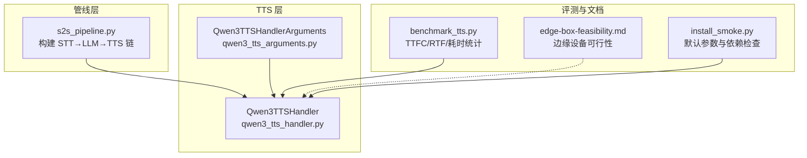
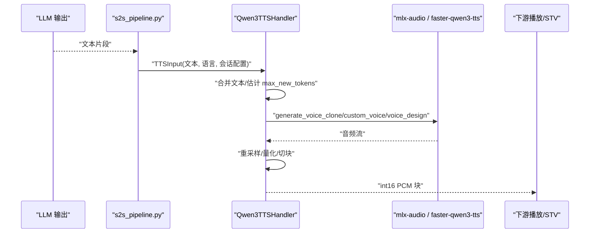
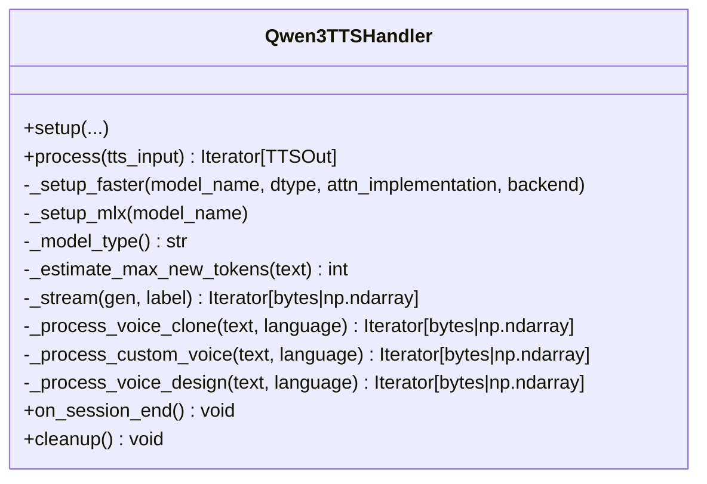
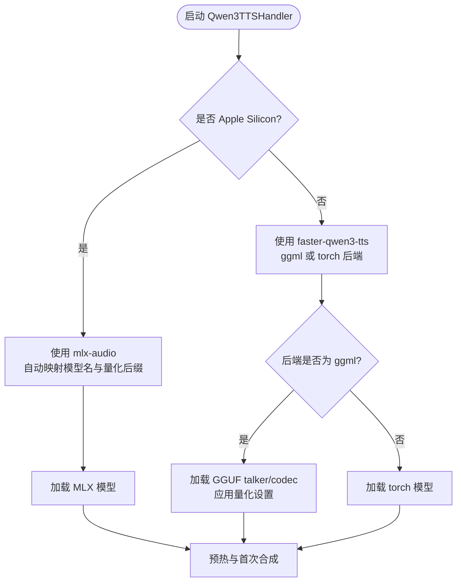
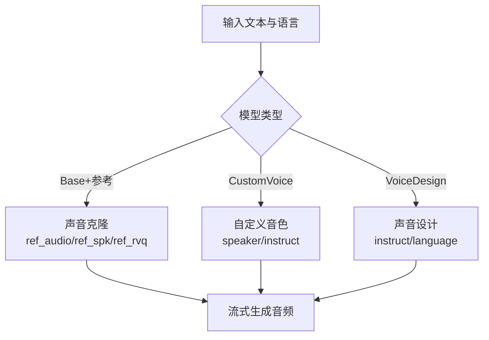
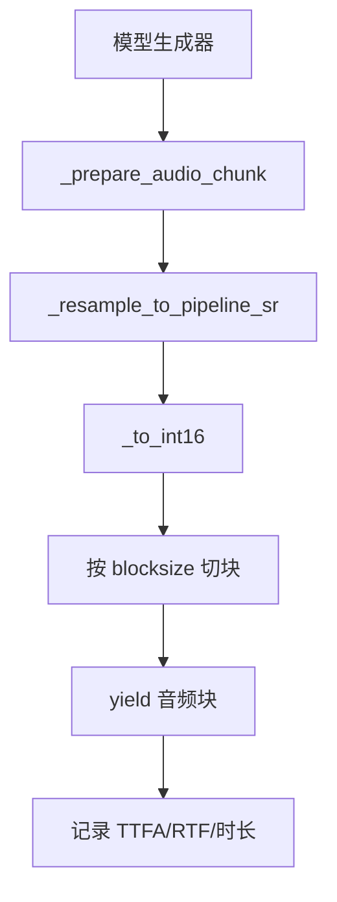
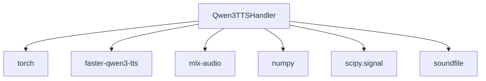
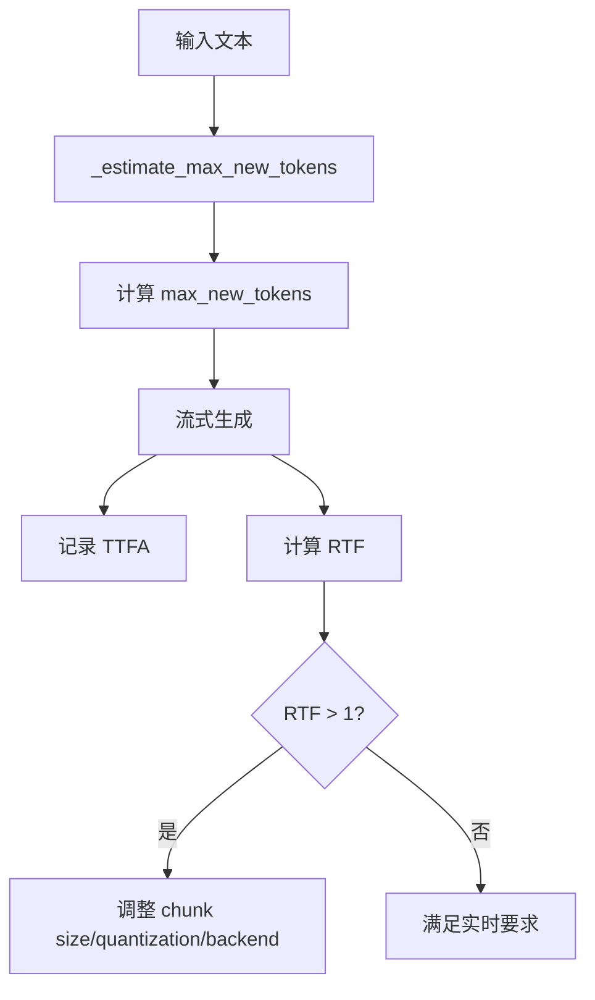
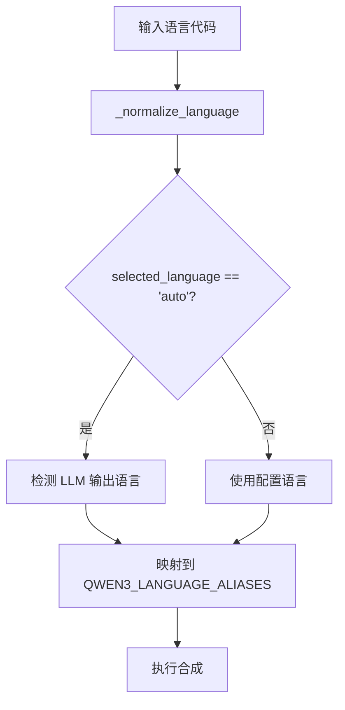
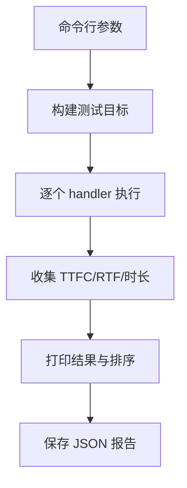

# Qwen3-TTS 引擎

<cite>
**本文引用的文件**   
- [qwen3_tts_handler.py](file://src/speech_to_speech/TTS/qwen3_tts_handler.py)
- [qwen3_tts_arguments.py](file://src/speech_to_speech/arguments_classes/qwen3_tts_arguments.py)
- [benchmark_tts.py](file://scripts/benchmark_tts.py)
- [s2s_pipeline.py](file://src/speech_to_speech/s2s_pipeline.py)
- [edge-box-feasibility.md](file://docs/hardware/edge-box-feasibility.md)
- [install_smoke.py](file://tests/install_smoke.py)
</cite>

## 目录
1. [简介](#简介)
2. [项目结构](#项目结构)
3. [核心组件](#核心组件)
4. [架构总览](#架构总览)
5. [详细组件分析](#详细组件分析)
6. [依赖关系分析](#依赖关系分析)
7. [性能与延迟优化](#性能与延迟优化)
8. [配置参数与声音选择](#配置参数与声音选择)
9. [多语言支持与音质调优](#多语言支持与音质调优)
10. [部署建议与资源使用](#部署建议与资源使用)
11. [基准测试方法](#基准测试方法)
12. [故障排查指南](#故障排查指南)
13. [结论](#结论)

## 简介
Qwen3-TTS 是 speech-to-speech 管线中的文本转语音后端，封装了 Qwen3-TTS 模型的推理流程。该实现根据运行平台自动选择后端：在 Apple Silicon 上使用 mlx-audio，在其他平台上使用 faster-qwen3-tts（支持 ggml 或 torch 后端）。它同时支持三种模型类型：声音克隆、自定义音色和声音设计，并提供流式音频输出、首帧延迟统计、实时因子评估、会话级声音覆盖、语言自动检测与对齐等能力。

## 项目结构
Qwen3-TTS 相关代码主要分布在以下位置：
- TTS 处理器实现：`src/speech_to_speech/TTS/qwen3_tts_handler.py`
- 处理器参数定义：`src/speech_to_speech/arguments_classes/qwen3_tts_arguments.py`
- TTS 基准脚本：`scripts/benchmark_tts.py`
- 运行时管线集成与语言集合注册：`src/speech_to_speech/s2s_pipeline.py`
- 边缘设备可行性与性能参考：`docs/hardware/edge-box-feasibility.md`
- 安装冒烟测试与默认值校验：`tests/install_smoke.py`

**图表来源**
- [qwen3_tts_handler.py:96-108](file://src/speech_to_speech/TTS/qwen3_tts_handler.py#L96-L108)
- [qwen3_tts_arguments.py:6-135](file://src/speech_to_speech/arguments_classes/qwen3_tts_arguments.py#L6-L135)
- [s2s_pipeline.py:548-574](file://src/speech_to_speech/s2s_pipeline.py#L548-L574)
- [benchmark_tts.py:142-156](file://scripts/benchmark_tts.py#L142-L156)
- [install_smoke.py:126-145](file://tests/install_smoke.py#L126-L145)

**章节来源**
- [qwen3_tts_handler.py:1-108](file://src/speech_to_speech/TTS/qwen3_tts_handler.py#L1-L108)
- [qwen3_tts_arguments.py:1-135](file://src/speech_to_speech/arguments_classes/qwen3_tts_arguments.py#L1-L135)
- [s2s_pipeline.py:548-574](file://src/speech_to_speech/s2s_pipeline.py#L548-L574)
- [benchmark_tts.py:1-416](file://scripts/benchmark_tts.py#L1-L416)
- [edge-box-feasibility.md:1-509](file://docs/hardware/edge-box-feasibility.md#L1-L509)
- [install_smoke.py:126-145](file://tests/install_smoke.py#L126-L145)

## 核心组件
Qwen3-TTS 的核心是一个处理器类，负责：
- 初始化并加载模型（mlx-audio 或 faster-qwen3-tts）
- 选择声音克隆、自定义音色或声音设计模式
- 合并待合成文本、估计最大 token 数
- 流式生成音频块、统一采样率、量化为 int16
- 记录 TTFA、RTF、音频时长等指标
- 处理会话结束状态重置与资源清理

该类继承自通用处理器基类，并通过 `process` 方法接入 pipeline 的输入输出队列。

**章节来源**
- [qwen3_tts_handler.py:96-108](file://src/speech_to_speech/TTS/qwen3_tts_handler.py#L96-L108)
- [qwen3_tts_handler.py:825-910](file://src/speech_to_speech/TTS/qwen3_tts_handler.py#L825-L910)

## 架构总览
Qwen3-TTS 在整体 speech-to-speech 管线中位于 LLM 之后，作为最终音频输出阶段。其关键交互如下：
- 上游 LLM 输出文本片段被聚合后送入 TTS
- TTS 根据模型类型决定调用声音克隆、自定义音色或声音设计接口
- 音频以固定 blocksize 分块输出到下游（可选唇形同步模块）
- 运行时可注入会话级声音覆盖，例如通过 OpenAI Realtime Response 的 voice 字段

**图表来源**
- [s2s_pipeline.py:548-574](file://src/speech_to_speech/s2s_pipeline.py#L548-L574)
- [qwen3_tts_handler.py:825-910](file://src/speech_to_speech/TTS/qwen3_tts_handler.py#L825-L910)
- [qwen3_tts_handler.py:957-1053](file://src/speech_to_speech/TTS/qwen3_tts_handler.py#L957-L1053)

## 详细组件分析

### Qwen3TTSHandler 类
该类实现了完整的 Qwen3-TTS 推理生命周期：
- `setup`：解析参数、选择后端、加载模型、预热
- `_setup_faster`：faster-qwen3-tts 后端初始化（ggml/torch）
- `_setup_mlx`：Apple Silicon MLX 后端初始化
- `_model_type`：推断模型类型（base/custom_voice/voice_design）
- `_estimate_max_new_tokens`：按词数、字符数、CJK 字符数和标点停顿估算音频长度，再映射为 codec token 上限
- `_stream`：公共流式循环，记录 TTFA、RTF，输出固定 blocksize 的 int16 音频
- `_process_voice_clone/_process_custom_voice/_process_voice_design`：三类生成路径
- `on_session_end/cleanup`：会话状态恢复与资源释放

**图表来源**
- [qwen3_tts_handler.py:96-108](file://src/speech_to_speech/TTS/qwen3_tts_handler.py#L96-L108)
- [qwen3_tts_handler.py:110-220](file://src/speech_to_speech/TTS/qwen3_tts_handler.py#L110-L220)
- [qwen3_tts_handler.py:222-270](file://src/speech_to_speech/TTS/qwen3_tts_handler.py#L222-L270)
- [qwen3_tts_handler.py:583-667](file://src/speech_to_speech/TTS/qwen3_tts_handler.py#L583-L667)
- [qwen3_tts_handler.py:704-762](file://src/speech_to_speech/TTS/qwen3_tts_handler.py#L704-L762)
- [qwen3_tts_handler.py:957-1053](file://src/speech_to_speech/TTS/qwen3_tts_handler.py#L957-L1053)
- [qwen3_tts_handler.py:1055-1085](file://src/speech_to_speech/TTS/qwen3_tts_handler.py#L1055-L1085)

**章节来源**
- [qwen3_tts_handler.py:96-1085](file://src/speech_to_speech/TTS/qwen3_tts_handler.py#L96-L1085)

### 后端选择与模型加载
- Apple Silicon：使用 mlx-audio，自动选择 MLX 模型名称，支持 bf16/4bit/6bit/8bit 量化后缀
- 非 Apple Silicon：使用 faster-qwen3-tts，支持 ggml 或 torch 后端；ggml 后端可指定 GGUF talker/codec 路径与量化格式

**图表来源**
- [qwen3_tts_handler.py:168-206](file://src/speech_to_speech/TTS/qwen3_tts_handler.py#L168-L206)
- [qwen3_tts_handler.py:222-270](file://src/speech_to_speech/TTS/qwen3_tts_handler.py#L222-L270)
- [qwen3_tts_handler.py:329-379](file://src/speech_to_speech/TTS/qwen3_tts_handler.py#L329-L379)

**章节来源**
- [qwen3_tts_handler.py:168-206](file://src/speech_to_speech/TTS/qwen3_tts_handler.py#L168-L206)
- [qwen3_tts_handler.py:222-270](file://src/speech_to_speech/TTS/qwen3_tts_handler.py#L222-L270)
- [qwen3_tts_handler.py:329-379](file://src/speech_to_speech/TTS/qwen3_tts_handler.py#L329-L379)

### 声音克隆、自定义音色与声音设计
- 声音克隆：需要参考音频或缓存的 speaker embedding/acoustic codes，支持 xvec_only 模式（非 MLX）
- 自定义音色：需要 speaker 名称，可从模型支持的说话人列表中选择第一个
- 声音设计：通过 instruct 文本描述声音风格

**图表来源**
- [qwen3_tts_handler.py:583-667](file://src/speech_to_speech/TTS/qwen3_tts_handler.py#L583-L667)
- [qwen3_tts_handler.py:957-1053](file://src/speech_to_speech/TTS/qwen3_tts_handler.py#L957-L1053)

**章节来源**
- [qwen3_tts_handler.py:583-667](file://src/speech_to_speech/TTS/qwen3_tts_handler.py#L583-L667)
- [qwen3_tts_handler.py:957-1053](file://src/speech_to_speech/TTS/qwen3_tts_handler.py#L957-L1053)

### 流式输出与延迟统计
- TTFA（Time To First Audio）：从开始合成到首个音频块的时间
- RTF（Real-Time Factor）：音频时长除以生成时间
- 音频块大小：blocksize 控制输出粒度，默认 512 样本
- 采样率归一化：统一到 PIPELINE_SR（16kHz），必要时进行 resample_poly 重采样

**图表来源**
- [qwen3_tts_handler.py:683-762](file://src/speech_to_speech/TTS/qwen3_tts_handler.py#L683-L762)

**章节来源**
- [qwen3_tts_handler.py:683-762](file://src/speech_to_speech/TTS/qwen3_tts_handler.py#L683-L762)

## 依赖关系分析
Qwen3-TTS 依赖的外部库与运行时环境：
- Apple Silicon：mlx-audio、mlx.core
- 非 Apple Silicon：torch、faster-qwen3-tts（可选 ggml 后端）
- 音频处理：numpy、scipy.signal.resample_poly、soundfile（用于参考音频预处理）
- 日志与监控：rich.console、pipeline.monitor.trace

**图表来源**
- [qwen3_tts_handler.py:222-270](file://src/speech_to_speech/TTS/qwen3_tts_handler.py#L222-L270)
- [qwen3_tts_handler.py:475-512](file://src/speech_to_speech/TTS/qwen3_tts_handler.py#L475-L512)

**章节来源**
- [qwen3_tts_handler.py:222-270](file://src/speech_to_speech/TTS/qwen3_tts_handler.py#L222-L270)
- [qwen3_tts_handler.py:475-512](file://src/speech_to_speech/TTS/qwen3_tts_handler.py#L475-L512)

## 性能与延迟优化
- 流式 chunk size：faster-qwen3-tts 默认 8，mlx-audio 默认 4；可通过 `streaming_chunk_size` 调整
- 预填充策略：`non_streaming_mode=True` 会在 faster-qwen3-tts 上预填完整文本，减少解码抖动
- CUDA Graph 稳定性：`parity_mode=True` 禁用 CUDA-graph 流式路径以提升稳定性
- Token 预算估算：基于词数、字符数、CJK 字符数和标点停顿估算音频时长，乘以安全系数得到 max_new_tokens
- 首帧延迟：TTFA 通过 perf_counter 记录，并在活跃 turn 延迟追踪器中上报
- 实时因子：RTF = 音频时长 / 生成时间，用于衡量是否达到实时

**图表来源**
- [qwen3_tts_handler.py:624-667](file://src/speech_to_speech/TTS/qwen3_tts_handler.py#L624-L667)
- [qwen3_tts_handler.py:704-762](file://src/speech_to_speech/TTS/qwen3_tts_handler.py#L704-L762)

**章节来源**
- [qwen3_tts_handler.py:624-667](file://src/speech_to_speech/TTS/qwen3_tts_handler.py#L624-L667)
- [qwen3_tts_handler.py:704-762](file://src/speech_to_speech/TTS/qwen3_tts_handler.py#L704-L762)

## 配置参数与声音选择
Qwen3-TTS 的配置参数集中在 `Qwen3TTSHandlerArguments` 数据类中，涵盖模型名称、设备、数据类型、注意力实现、后端选择、GGUF 量化、参考音频/嵌入、说话人、指令、xvec_only、parity_mode、non_streaming_mode、MLX 量化、语言、流式 chunk size、max_new_tokens、blocksize 等。

关键参数说明：
- `qwen3_tts_model_name`：HuggingFace Hub ID 或本地路径；Apple Silicon 下自动映射到 mlx-community
- `qwen3_tts_device`：torch 后端设备，默认 cuda
- `qwen3_tts_dtype`：auto/float16/bfloat16/float32
- `qwen3_tts_attn_implementation`：eager/flash_attention_2/sdpa
- `qwen3_tts_backend`：ggml/torch（非 macOS）
- `qwen3_tts_ggml_quantization`：BF16/Q8_0/Q4_K_M/F32
- `qwen3_tts_ref_audio/ref_spk/ref_rvq/ref_text`：声音克隆参考
- `qwen3_tts_speaker`：CustomVoice 说话人，默认 Aiden
- `qwen3_tts_instruct`：VoiceDesign 指令
- `qwen3_tts_xvec_only`：仅使用 x-vector 的声音克隆模式
- `qwen3_tts_parity_mode`：禁用 CUDA-graph 流式路径
- `qwen3_tts_non_streaming_mode`：预填完整文本
- `qwen3_tts_mlx_quantization`：bf16/4bit/6bit/8bit
- `qwen3_tts_language`：目标语言，默认 auto
- `qwen3_tts_streaming_chunk_size`：流式 chunk 大小
- `qwen3_tts_max_new_tokens`：最大 token 上限，默认 1536
- `qwen3_tts_blocksize`：音频块大小，默认 512

**章节来源**
- [qwen3_tts_arguments.py:6-135](file://src/speech_to_speech/arguments_classes/qwen3_tts_arguments.py#L6-L135)
- [qwen3_tts_handler.py:110-220](file://src/speech_to_speech/TTS/qwen3_tts_handler.py#L110-L220)

## 多语言支持与音质调优
- 语言别名映射：中文、英文、日文、韩文、德文、法文、俄文、葡萄牙文、西班牙文、意大利文等
- 自动语言检测：当 selected_language 为 auto 且 detect_llm_output_language 启用时，根据输入语言代码选择目标语言
- 会话级声音覆盖：通过 RuntimeConfig 或 RealtimeResponseCreateParams 的 voice 字段覆盖当前会话声音
- 音质调优：
  - 降低 streaming_chunk_size 可减少首帧延迟但可能增加调度开销
  - 使用更高分辨率的 GGUF 量化（如 BF16）提升音质但增加显存占用
  - 使用 xvec_only 模式改善起始静音和语言切换
  - 调整 non_streaming_mode 平衡预填延迟与解码抖动

**图表来源**
- [qwen3_tts_handler.py:388-408](file://src/speech_to_speech/TTS/qwen3_tts_handler.py#L388-L408)
- [s2s_pipeline.py:691-692](file://src/speech_to_speech/s2s_pipeline.py#L691-L692)

**章节来源**
- [qwen3_tts_handler.py:388-408](file://src/speech_to_speech/TTS/qwen3_tts_handler.py#L388-L408)
- [s2s_pipeline.py:691-692](file://src/speech_to_speech/s2s_pipeline.py#L691-L692)

## 部署建议与资源使用
- Apple Silicon：优先使用 mlx-audio，默认 6bit 量化可在内存与音质间取得平衡；如需更高音质可选择 bf16
- CUDA/GPU：推荐使用 faster-qwen3-tts 的 ggml 后端，配合 BF16 或 Q8_0 量化；若需兼容性可使用 torch 后端
- 边缘设备：参考 edge-box-feasibility.md 中对不同硬件的可行性评估，注意 RTF 与 TTFA 的实际表现
- 资源清理：on_session_end 恢复初始声音与参考音频，cleanup 释放模型与缓存

**章节来源**
- [qwen3_tts_handler.py:1055-1085](file://src/speech_to_speech/TTS/qwen3_tts_handler.py#L1055-L1085)
- [edge-box-feasibility.md:1-509](file://docs/hardware/edge-box-feasibility.md#L1-L509)

## 基准测试方法
benchmark_tts.py 提供了统一的 TTS 基准框架，支持 kokoro、qwen3、pocket_tts、kitten、chatTTS、facebookMMS、supertonic 等后端对比。对 qwen3 后端，默认使用 Base 模型与参考音频，并可传入 MLX 量化变体进行横向比较。

关键指标：
- warmup_time：初始化与预热时间
- inference_times：每次合成的耗时
- time_to_first_chunk：首块到达时间（TTFC）
- audio_durations：合成音频时长
- avg_rtf：平均实时因子

**图表来源**
- [benchmark_tts.py:91-229](file://scripts/benchmark_tts.py#L91-L229)
- [benchmark_tts.py:254-340](file://scripts/benchmark_tts.py#L254-L340)
- [benchmark_tts.py:342-416](file://scripts/benchmark_tts.py#L342-L416)

**章节来源**
- [benchmark_tts.py:1-416](file://scripts/benchmark_tts.py#L1-L416)

## 故障排查指南
常见问题与解决思路：
- GGUF 路径不匹配：确保 gguf_talker_path 与 gguf_codec_path 成对提供，且后端为 ggml
- 参考音频冲突：ref_audio 与 ref_spk/ref_rvq 互斥；ref_rvq 必须搭配 ref_spk 与 ref_text
- MLX 量化不支持：仅支持 bf16/4bit/6bit/8bit，其他值会抛出 ValueError
- 声音克隆失败：Base 模型需要提供参考音频或缓存引用；CustomVoice 需要 speaker；VoiceDesign 需要 instruct
- 首帧延迟过高：尝试减小 streaming_chunk_size、启用 non_streaming_mode、检查 GPU/CUDA 驱动与算子支持
- 实时因子大于 1：考虑降低量化精度、更换后端、或使用更小模型（如 0.6B）

**章节来源**
- [qwen3_tts_handler.py:294-328](file://src/speech_to_speech/TTS/qwen3_tts_handler.py#L294-L328)
- [qwen3_tts_handler.py:329-341](file://src/speech_to_speech/TTS/qwen3_tts_handler.py#L329-L341)
- [qwen3_tts_handler.py:678-681](file://src/speech_to_speech/TTS/qwen3_tts_handler.py#L678-L681)
- [qwen3_tts_handler.py:999-1002](file://src/speech_to_speech/TTS/qwen3_tts_handler.py#L999-L1002)

## 结论
Qwen3-TTS 在 speech-to-speech 管线中提供了灵活、可扩展的文本转语音能力。通过平台感知的后端选择、丰富的声音模式、精细的语言映射与流式优化，它能够在多种硬件环境下实现低延迟、高质量的语音合成。结合 benchmark_tts.py 与 edge-box-feasibility.md，用户可以系统性地评估性能、调优参数并制定部署策略。