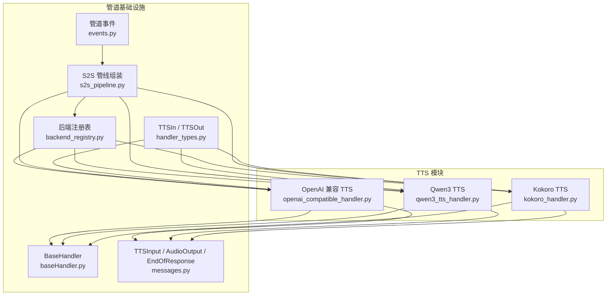
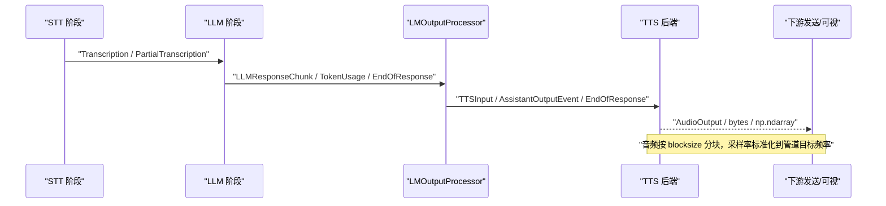
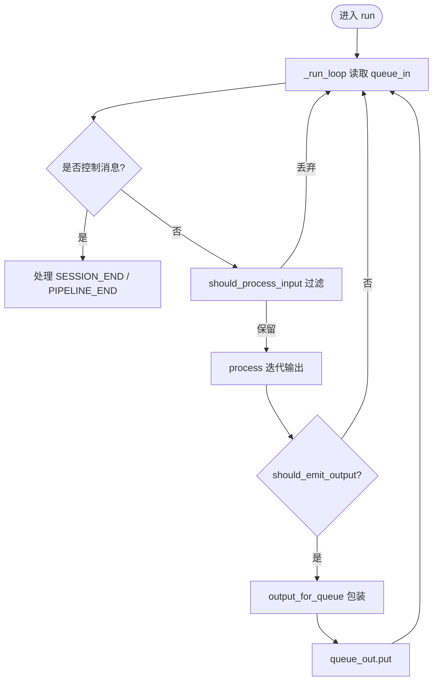
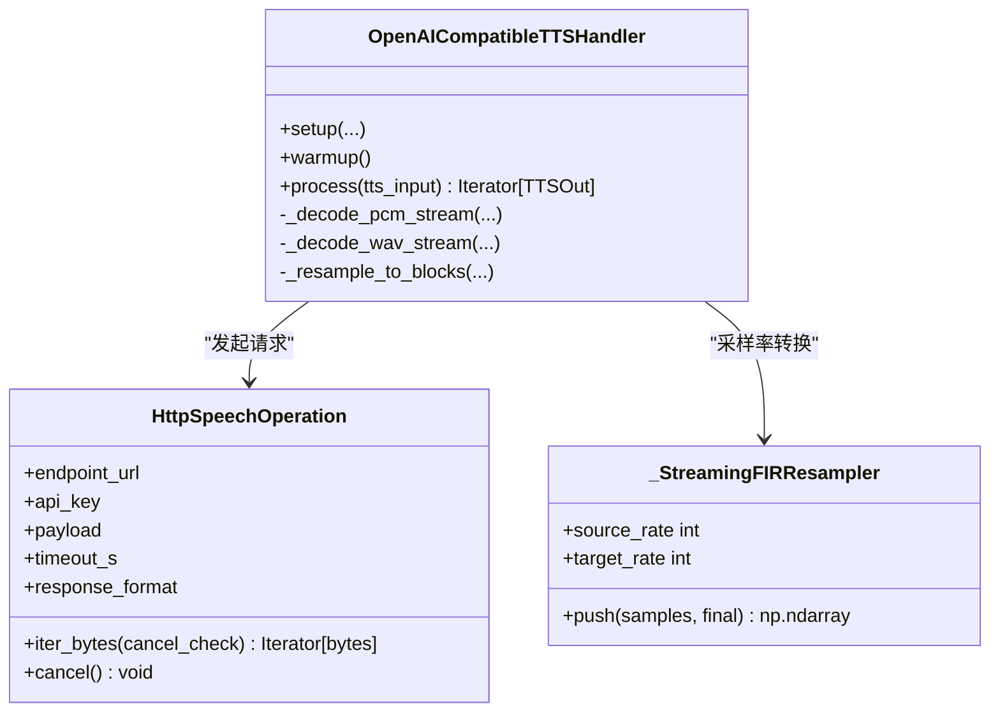
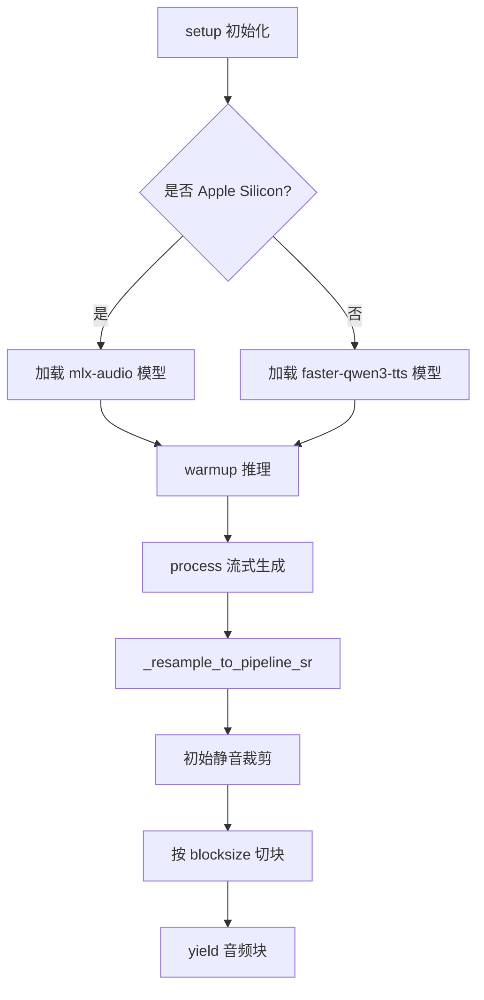
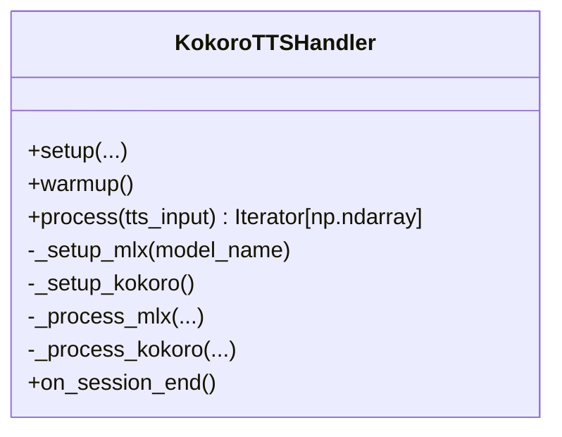
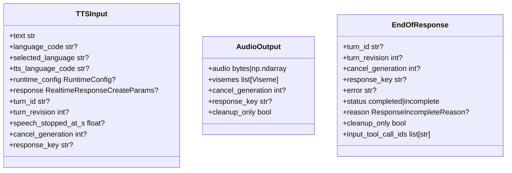
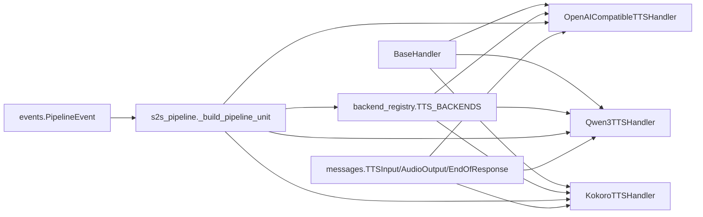

# TTS 架构设计

<cite>
**本文引用的文件**   
- [baseHandler.py](file://src/speech_to_speech/baseHandler.py)
- [backend_registry.py](file://src/speech_to_speech/backend_registry.py)
- [openai_compatible_handler.py](file://src/speech_to_speech/TTS/openai_compatible_handler.py)
- [qwen3_tts_handler.py](file://src/speech_to_speech/TTS/qwen3_tts_handler.py)
- [kokoro_handler.py](file://src/speech_to_speech/TTS/kokoro_handler.py)
- [handler_types.py](file://src/speech_to_speech/pipeline/handler_types.py)
- [messages.py](file://src/speech_to_speech/pipeline/messages.py)
- [events.py](file://src/speech_to_speech/pipeline/events.py)
- [s2s_pipeline.py](file://src/speech_to_speech/s2s_pipeline.py)
</cite>

## 目录
1. [引言](#引言)
2. [项目结构](#项目结构)
3. [核心组件](#核心组件)
4. [架构总览](#架构总览)
5. [详细组件分析](#详细组件分析)
6. [依赖关系分析](#依赖关系分析)
7. [性能与流式处理特性](#性能与流式处理特性)
8. [故障排查指南](#故障排查指南)
9. [扩展新 TTS 后端的开发指南](#扩展新-tts-后端的开发指南)
10. [结论](#结论)

## 引言
本文面向语音到语音系统的 TTS 子系统，系统化说明统一后端接口、处理器基类抽象、配置注册机制、音频流处理与采样率标准化、以及事件驱动的管道集成方式。文档同时给出扩展新 TTS 后端的实践建议，帮助开发者以最小成本接入新的语音合成模型或远程服务。

## 项目结构
TTS 子系统位于 `speech_to_speech/TTS` 目录下，包含多个具体后端实现；统一的运行时装配由 `backend_registry.py` 完成；所有处理器继承自 `BaseHandler`；管道消息类型定义在 `pipeline/messages.py` 和 `pipeline/handler_types.py`；端到端管线组装在 `s2s_pipeline.py`。

**图表来源**
- [openai_compatible_handler.py:364-800](file://src/speech_to_speech/TTS/openai_compatible_handler.py#L364-L800)
- [qwen3_tts_handler.py:96-800](file://src/speech_to_speech/TTS/qwen3_tts_handler.py#L96-L800)
- [kokoro_handler.py:82-506](file://src/speech_to_speech/TTS/kokoro_handler.py#L82-L506)
- [baseHandler.py:32-242](file://src/speech_to_speech/baseHandler.py#L32-L242)
- [backend_registry.py:555-693](file://src/speech_to_speech/backend_registry.py#L555-L693)
- [s2s_pipeline.py:516-574](file://src/speech_to_speech/s2s_pipeline.py#L516-L574)
- [handler_types.py:43-46](file://src/speech_to_speech/pipeline/handler_types.py#L43-L46)
- [messages.py:222-267](file://src/speech_to_speech/pipeline/messages.py#L222-L267)
- [events.py:26-194](file://src/speech_to_speech/pipeline/events.py#L26-L194)

**章节来源**
- [backend_registry.py:555-693](file://src/speech_to_speech/backend_registry.py#L555-L693)
- [s2s_pipeline.py:516-574](file://src/speech_to_speech/s2s_pipeline.py#L516-L574)

## 核心组件
- BaseHandler：所有管道阶段的通用基类，提供线程运行循环、输入过滤、输出包装、会话结束清理、控制消息转发等能力。
- TTSIn / TTSOut：TTS 阶段输入输出类型别名，明确 TTS 接收 `TTSInput` 或 `EndOfResponse`，输出二进制音频、NumPy 数组或带响应上下文的 `AudioOutput`。
- TTSInput / AudioOutput / EndOfResponse：管道消息，承载文本、语言信息、响应上下文、取消标记、可视化音素等。
- BackendRegistry：集中声明 TTS 后端名称、参数数据类、工厂函数、可选依赖、能力标志，并负责构造处理器实例。
- S2S Pipeline：将 VAD、STT、LLM、LMOutputProcessor、TTS 串联为可并行运行的 Handler 链，并通过队列传递消息。

**章节来源**
- [baseHandler.py:32-242](file://src/speech_to_speech/baseHandler.py#L32-L242)
- [handler_types.py:43-46](file://src/speech_to_speech/pipeline/handler_types.py#L43-L46)
- [messages.py:222-267](file://src/speech_to_speech/pipeline/messages.py#L222-L267)
- [backend_registry.py:102-163](file://src/speech_to_speech/backend_registry.py#L102-L163)
- [s2s_pipeline.py:516-574](file://src/speech_to_speech/s2s_pipeline.py#L516-L574)

## 架构总览
TTS 子系统采用“统一接口 + 多后端实现”的架构：
- 统一接口：所有 TTS 处理器继承 `BaseHandler[TTSIn, TTSOut]`，实现 `process` 方法，按输入消息生成音频块。
- 后端注册：通过 `TTS_BACKENDS` 注册表声明每个后端名称、参数类、创建工厂、可选依赖、配置前缀等。
- 管道集成：`s2s_pipeline.py` 根据配置选择 TTS 后端，注入 `cancel_scope`、`speculative_turns`、`detect_llm_output_language` 等上下文，并将 TTS 输出连接到发送队列或可选 STV（视素）处理阶段。
- 事件驱动：TTS 与 LLM 输出处理器共享有序消息流，工具调用就绪事件可提前暴露，而音频最终化顺序仍由 TTS 队列保证。

**图表来源**
- [s2s_pipeline.py:532-551](file://src/speech_to_speech/s2s_pipeline.py#L532-L551)
- [messages.py:146-217](file://src/speech_to_speech/pipeline/messages.py#L146-L217)
- [messages.py:222-267](file://src/speech_to_speech/pipeline/messages.py#L222-L267)
- [events.py:144-163](file://src/speech_to_speech/pipeline/events.py#L144-L163)

**章节来源**
- [s2s_pipeline.py:516-574](file://src/speech_to_speech/s2s_pipeline.py#L516-L574)
- [events.py:26-194](file://src/speech_to_speech/pipeline/events.py#L26-L194)

## 详细组件分析

### BaseHandler：处理器基类与生命周期
BaseHandler 定义了管道阶段的通用行为：
- 初始化时执行 `setup`，失败时确保 `cleanup` 被调用。
- 主循环 `_run_loop` 从输入队列读取消息，处理控制消息、会话结束、流水线结束哨兵。
- 对普通输入调用 `should_process_input` 进行预过滤，再调用 `process` 迭代输出。
- 输出经 `should_emit_output`、`before_emit_output`、`output_for_queue` 处理后入队。
- 支持 `PipelineEvent` 有序转发，保证下游先刷新音频再处理事件。
- 记录耗时、日志级别、最后处理时间等元信息。

**图表来源**
- [baseHandler.py:126-242](file://src/speech_to_speech/baseHandler.py#L126-L242)

**章节来源**
- [baseHandler.py:32-242](file://src/speech_to_speech/baseHandler.py#L32-L242)

### OpenAICompatibleTTSHandler：远程 HTTP 流式 TTS
该处理器对接 `/v1/audio/speech` 接口，支持 PCM/WAV 流式返回，内置：
- 可取消的 HTTP 请求操作对象，封装异步读取、超时、内容类型校验、错误归一化。
- 流式 PCM/WAV 解码器，逐块解析字节流，处理不完整帧与通道合并。
- FIR 抗混叠重采样器，将任意源采样率稳定转换为管道目标采样率。
- 首包 TTFA 计时、首次音频提交门控、失败响应去重、响应身份标识。
- 支持自动语言检测、Qwen3 语言代码映射、voice 动态覆盖。

**图表来源**
- [openai_compatible_handler.py:55-247](file://src/speech_to_speech/TTS/openai_compatible_handler.py#L55-L247)
- [openai_compatible_handler.py:249-333](file://src/speech_to_speech/TTS/openai_compatible_handler.py#L249-L333)
- [openai_compatible_handler.py:364-800](file://src/speech_to_speech/TTS/openai_compatible_handler.py#L364-L800)

**章节来源**
- [openai_compatible_handler.py:364-800](file://src/speech_to_speech/TTS/openai_compatible_handler.py#L364-L800)

### Qwen3TTSHandler：本地流式 TTS（Apple Silicon 与 faster-qwen3-tts）
该处理器根据平台选择 MLX 或 faster-qwen3-tts 后端，支持：
- 语音克隆、自定义音色、语音设计三种模型模式。
- GGML 量化、GGUF talker/codec、参考音频缓存、MLX 量化后缀。
- 流式 token 估算、最大 new tokens 对齐、CJK 字符统计。
- 音频片段静音裁剪、管道采样率转换、固定 blocksize 分块。
- 会话级 voice/language 状态恢复。

**图表来源**
- [qwen3_tts_handler.py:110-220](file://src/speech_to_speech/TTS/qwen3_tts_handler.py#L110-L220)
- [qwen3_tts_handler.py:683-762](file://src/speech_to_speech/TTS/qwen3_tts_handler.py#L683-L762)

**章节来源**
- [qwen3_tts_handler.py:96-800](file://src/speech_to_speech/TTS/qwen3_tts_handler.py#L96-L800)

### KokoroTTSHandler：多语言高质量 TTS
该处理器支持 Apple Silicon 的 MLX 路径与非 Apple 平台的原生 kokoro 库：
- 语言到 Kokoro lang_code 映射，默认音色选择。
- MLX 路径下预加载 pipeline 与多语言音色，避免每次推理下载。
- 非 MLX 路径下按需重建 pipeline 切换语言。
- 音频 24kHz → 16kHz 重采样，int16 转换，blocksize 分块。
- TTFA 与端到端延迟记录，会话结束时恢复初始 voice/lang。

**图表来源**
- [kokoro_handler.py:82-196](file://src/speech_to_speech/TTS/kokoro_handler.py#L82-L196)
- [kokoro_handler.py:328-490](file://src/speech_to_speech/TTS/kokoro_handler.py#L328-L490)
- [kokoro_handler.py:492-506](file://src/speech_to_speech/TTS/kokoro_handler.py#L492-L506)

**章节来源**
- [kokoro_handler.py:82-506](file://src/speech_to_speech/TTS/kokoro_handler.py#L82-L506)

### 管道消息与类型定义
- TTSIn / TTSOut：明确 TTS 阶段输入输出类型，便于泛型处理器声明。
- TTSInput：携带待合成文本、语言信息、运行时配置、响应上下文、转轮次与取消标记。
- AudioOutput：带响应上下文的音频队列项，支持 visemes 与 cleanup_only。
- EndOfResponse：响应结束哨兵，支持 error/status/reason/cleanup_only。

**图表来源**
- [messages.py:222-267](file://src/speech_to_speech/pipeline/messages.py#L222-L267)
- [messages.py:194-217](file://src/speech_to_speech/pipeline/messages.py#L194-L217)
- [handler_types.py:43-46](file://src/speech_to_speech/pipeline/handler_types.py#L43-L46)

**章节来源**
- [messages.py:222-267](file://src/speech_to_speech/pipeline/messages.py#L222-L267)
- [handler_types.py:43-46](file://src/speech_to_speech/pipeline/handler_types.py#L43-L46)

## 依赖关系分析
- BaseHandler 是所有 TTS 后端的共同基类，提供线程、队列、控制消息、事件转发、生命周期管理。
- TTS 后端通过 backend_registry.py 的 `TTS_BACKENDS` 注册，使用 `_simple_handler_factory` 或自定义工厂创建实例。
- s2s_pipeline.py 构建 HandlerContext，注入 cancel_scope、speculative_turns、sample_rate、detect_llm_output_language 等上下文。
- TTS 后端消费 messages.py 中的 TTSInput、EndOfResponse，产出 AudioOutput 或原始音频。
- events.py 定义管道事件，如 assistant_tool_call_ready，允许工具调用结果早于 TTS 音频暴露。

**图表来源**
- [backend_registry.py:555-693](file://src/speech_to_speech/backend_registry.py#L555-L693)
- [s2s_pipeline.py:516-574](file://src/speech_to_speech/s2s_pipeline.py#L516-L574)
- [messages.py:222-267](file://src/speech_to_speech/pipeline/messages.py#L222-L267)
- [events.py:144-163](file://src/speech_to_speech/pipeline/events.py#L144-L163)

**章节来源**
- [backend_registry.py:555-693](file://src/speech_to_speech/backend_registry.py#L555-L693)
- [s2s_pipeline.py:516-574](file://src/speech_to_speech/s2s_pipeline.py#L516-L574)

## 性能与流式处理特性
- 流式解码：OpenAICompatibleTTSHandler 支持 PCM/WAV 流式解码，避免等待完整响应。
- 抗混叠重采样：FIR 滤波器 + 上采样/下采样，保证跨 chunk 的稳定输出。
- 首包 TTFA：记录从请求开始到首个音频到达的时间，用于端到端延迟评估。
- 分块输出：所有 TTS 后端按 blocksize 输出固定长度音频块，便于下游播放与缓冲。
- 取消与门控：基于 cancel_scope 与 speculative_turns 的门控机制，丢弃陈旧或已撤销的请求。
- 语言与音色动态切换：Kokoro 与 Qwen3 支持运行时语言/音色切换，减少重复加载开销。

**章节来源**
- [openai_compatible_handler.py:249-333](file://src/speech_to_speech/TTS/openai_compatible_handler.py#L249-L333)
- [openai_compatible_handler.py:504-575](file://src/speech_to_speech/TTS/openai_compatible_handler.py#L504-L575)
- [qwen3_tts_handler.py:683-762](file://src/speech_to_speech/TTS/qwen3_tts_handler.py#L683-L762)
- [kokoro_handler.py:328-490](file://src/speech_to_speech/TTS/kokoro_handler.py#L328-L490)

## 故障排查指南
- 远程 TTS 无音频：OpenAICompatibleTTSHandler 在 warmup 与 process 中检查是否收到音频，若无则抛出异常。
- 内容类型不匹配：HTTP 响应若返回 text/json 或非预期媒体类型，会抛出 SpeechRequestError。
- WAV 格式不支持：WAV 头校验失败或声道/位深不支持时抛出异常。
- 请求超时：HttpSpeechOperation 在超时后设置 deadline_exceeded 并取消请求。
- 响应失败去重：通过 response_identity 记录失败响应，避免重复处理。
- 会话结束状态恢复：KokoroTTSHandler.on_session_end 恢复初始 voice/lang。

**章节来源**
- [openai_compatible_handler.py:423-449](file://src/speech_to_speech/TTS/openai_compatible_handler.py#L423-L449)
- [openai_compatible_handler.py:190-224](file://src/speech_to_speech/TTS/openai_compatible_handler.py#L190-L224)
- [openai_compatible_handler.py:716-758](file://src/speech_to_speech/TTS/openai_compatible_handler.py#L716-L758)
- [kokoro_handler.py:492-506](file://src/speech_to_speech/TTS/kokoro_handler.py#L492-L506)

## 扩展新 TTS 后端的开发指南
步骤与建议如下：

1. 新建处理器类
   - 继承 `BaseHandler[TTSIn, TTSOut]`。
   - 实现 `setup` 与 `process`，遵循 BaseHandler 的生命周期约定。
   - 在 `process` 中处理 `EndOfResponse`，必要时 yield `AUDIO_RESPONSE_DONE`。
   - 输出音频块为 `bytes` 或 `np.ndarray[int16]`，或包装为 `AudioOutput`。

2. 定义参数数据类
   - 在 `arguments_classes` 下新增 `xxx_tts_arguments.py`，使用 dataclass 描述后端特有参数。
   - 如需特殊配置前缀或 normalize 逻辑，可在 registry 中指定。

3. 注册后端
   - 在 `backend_registry.py` 的 `TTS_BACKENDS` 中添加 `BackendSpec`。
   - 使用 `_simple_handler_factory` 或自定义工厂创建处理器。
   - 设置 `config_prefix`、`required_extra`、`capabilities` 等元数据。

4. 音频流与采样率
   - 若后端输出非 16kHz，需自行重采样到管道目标采样率。
   - 若后端输出非 int16，需转换为 int16。
   - 按 blocksize 分块输出，避免过大缓冲。

5. 取消与会话管理
   - 使用 `cancel_scope` 与 `speculative_turns` 进行门控与去重。
   - 在 `on_session_end` 中恢复初始状态，如 voice/lang。

6. 测试与验证
   - 编写单元测试覆盖 warmup、process、错误路径、取消路径。
   - 验证 TTFA、RTF、端到端延迟指标。
   - 验证语言/音色切换与回退逻辑。

最佳实践：
- 保持处理器无副作用，仅依赖注入的上下文。
- 使用 logger 记录关键路径与异常，便于定位问题。
- 对远程服务增加超时、重试、降级策略。
- 对本地模型增加设备检测、量化选择、预热流程。
- 对音频格式进行严格校验，避免下游播放异常。

**章节来源**
- [baseHandler.py:32-242](file://src/speech_to_speech/baseHandler.py#L32-L242)
- [backend_registry.py:102-163](file://src/speech_to_speech/backend_registry.py#L102-L163)
- [backend_registry.py:555-693](file://src/speech_to_speech/backend_registry.py#L555-L693)
- [messages.py:222-267](file://src/speech_to_speech/pipeline/messages.py#L222-L267)

## 结论
TTS 子系统通过 BaseHandler 抽象、BackendRegistry 注册、Pipeline 消息与事件驱动，实现了统一、可扩展、高性能的语音合成框架。OpenAICompatibleTTSHandler、Qwen3TTSHandler、KokoroTTSHandler 分别覆盖了远程 HTTP 流式、本地高性能、多语言高质量三类典型场景。开发者可依据本文档快速扩展新后端，并确保与现有管道无缝集成。