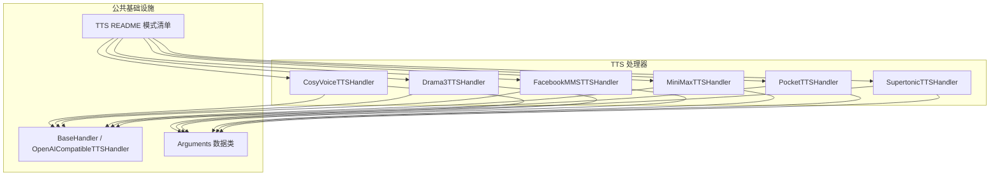
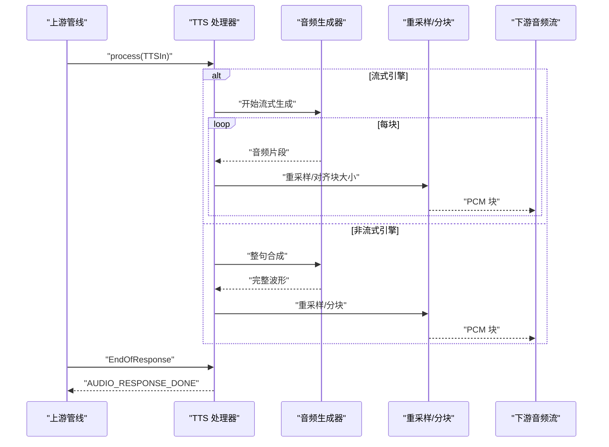
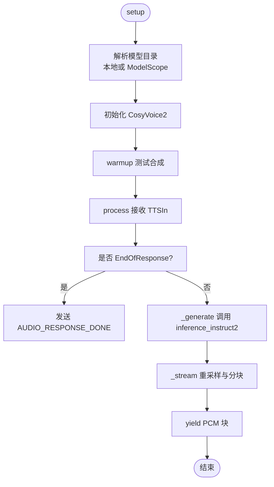
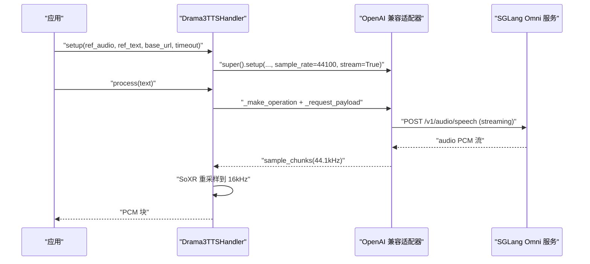
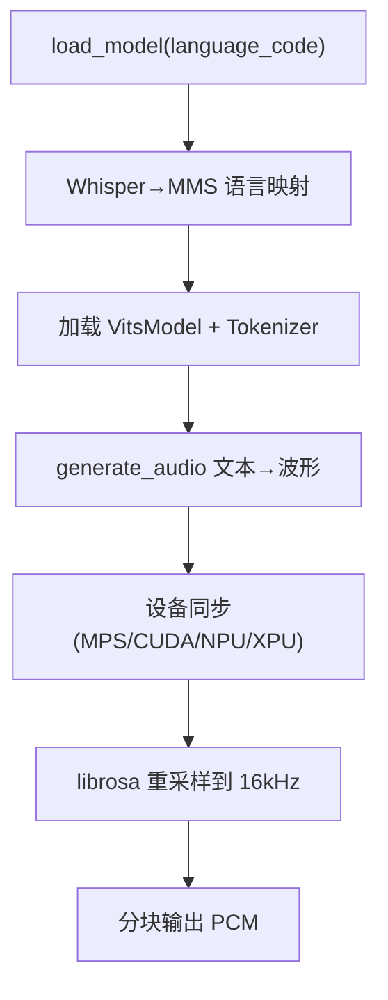
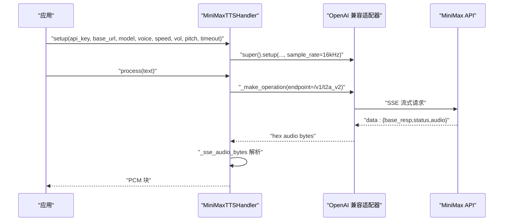
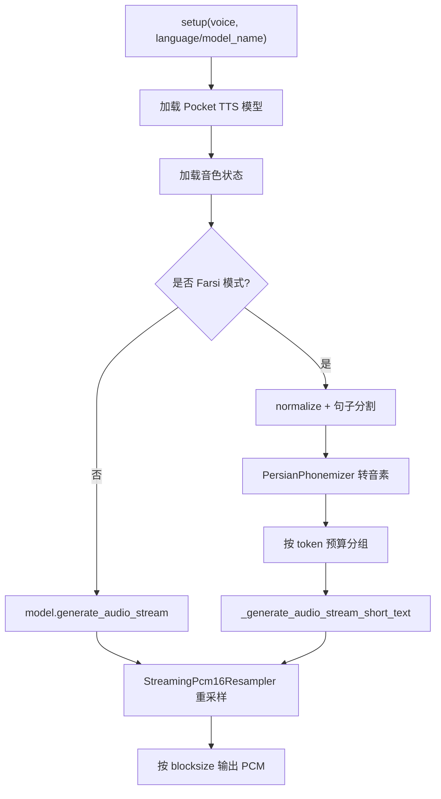
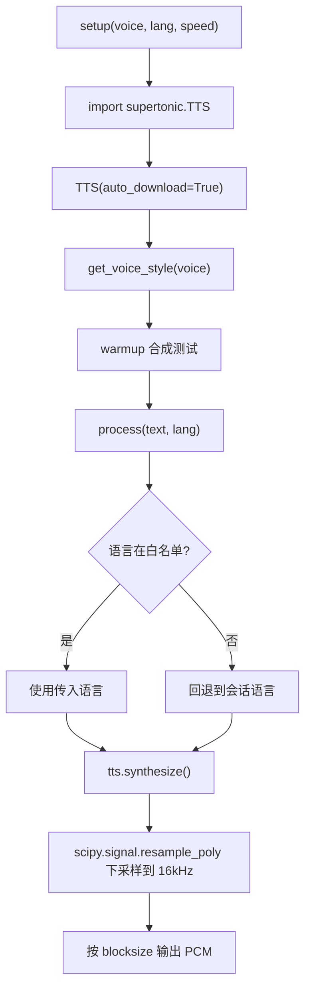
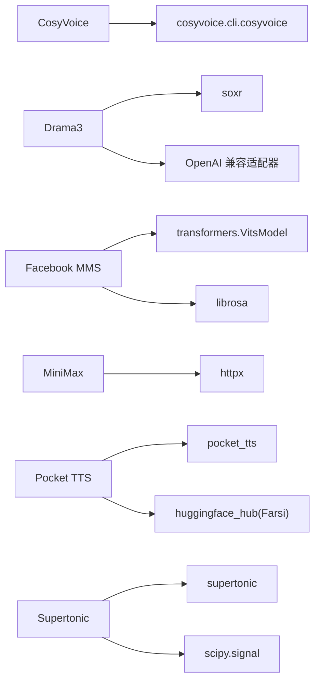

# 其他 TTS 引擎

<cite>
**本文引用的文件**   
- [cosyvoice_handler.py](file://src/speech_to_speech/TTS/cosyvoice_handler.py)
- [drama3_handler.py](file://src/speech_to_speech/TTS/drama3_handler.py)
- [facebookmms_handler.py](file://src/speech_to_speech/TTS/facebookmms_handler.py)
- [minimax_tts_handler.py](file://src/speech_to_speech/TTS/minimax_tts_handler.py)
- [pocket_tts_handler.py](file://src/speech_to_speech/TTS/pocket_tts_handler.py)
- [supertonic_tts_handler.py](file://src/speech_to_speech/TTS/supertonic_tts_handler.py)
- [cosyvoice_tts_arguments.py](file://src/speech_to_speech/arguments_classes/cosyvoice_tts_arguments.py)
- [drama3_tts_arguments.py](file://src/speech_to_speech/arguments_classes/drama3_tts_arguments.py)
- [facebookmms_tts_arguments.py](file://src/speech_to_speech/arguments_classes/facebookmms_tts_arguments.py)
- [minimax_tts_arguments.py](file://src/speech_to_speech/arguments_classes/minimax_tts_arguments.py)
- [pocket_tts_arguments.py](file://src/speech_to_speech/arguments_classes/pocket_tts_arguments.py)
- [supertonic_tts_arguments.py](file://src/speech_to_speech/arguments_classes/supertonic_tts_arguments.py)
- [TTS README.md](file://src/speech_to_speech/TTS/README.md)
- [TTS README-CN.md](file://src/speech_to_speech/TTS/README-CN.md)
</cite>

## 目录
1. [引言](#引言)
2. [项目结构](#项目结构)
3. [核心组件](#核心组件)
4. [架构总览](#架构总览)
5. [详细组件分析](#详细组件分析)
6. [依赖关系分析](#依赖关系分析)
7. [性能与延迟特性](#性能与延迟特性)
8. [配置与集成指南](#配置与集成指南)
9. [选择指南与迁移建议](#选择指南与迁移建议)
10. [故障排查](#故障排查)
11. [结论](#结论)

## 引言
本文件面向需要在语音到语音系统中接入“其他 TTS 引擎”的读者，聚焦以下六种实现：CosyVoice、Drama3、Facebook MMS、MiniMax、Pocket TTS、Supertonic。文档从系统架构、数据流、语言支持、音质表现、配置方法、集成步骤、特殊注意事项、性能特征和迁移建议等维度进行系统化说明，帮助你在不同部署环境（本地 GPU/CPU、Apple Silicon、云端 API）中做出合理选型并快速落地。

## 项目结构
这些 TTS 引擎以“处理器（Handler）”的形式统一接入流水线：
- 每个引擎对应一个处理器类，继承自基类或共享适配器。
- 参数通过独立的 Arguments 数据类暴露命令行与配置文件。
- 统一的 TTS 模式列表在 README 中维护，便于运行时选择。

**图示来源**
- [cosyvoice_handler.py:31-93](file://src/speech_to_speech/TTS/cosyvoice_handler.py#L31-L93)
- [drama3_handler.py:21-59](file://src/speech_to_speech/TTS/drama3_handler.py#L21-L59)
- [facebookmms_handler.py:69-95](file://src/speech_to_speech/TTS/facebookmms_handler.py#L69-L95)
- [minimax_tts_handler.py:37-90](file://src/speech_to_speech/TTS/minimax_tts_handler.py#L37-L90)
- [pocket_tts_handler.py:28-154](file://src/speech_to_speech/TTS/pocket_tts_handler.py#L28-L154)
- [supertonic_tts_handler.py:60-102](file://src/speech_to_speech/TTS/supertonic_tts_handler.py#L60-L102)
- [TTS README.md:13-28](file://src/speech_to_speech/TTS/README.md#L13-L28)

**章节来源**
- [TTS README.md:13-28](file://src/speech_to_speech/TTS/README.md#L13-L28)

## 核心组件
本节概述各引擎的职责边界、输入输出形态与关键行为。

- CosyVoice
  - 职责：基于 CosyVoice2 模型进行中文/英/日/韩合成，支持方言与情感指令，零样本音色克隆。
  - 输入：文本、可选 instruct 提示、参考音频路径。
  - 输出：16 kHz PCM int16 块；内部模型采样率 24 kHz，需重采样。
  - 关键点：需要官方 CosyVoice 源码在 PYTHONPATH；默认 prompt_wav 提供稳定中文音色；可启用 JIT/TRT/fp16。

- Drama3
  - 职责：通过 SGLang Omni 的 streaming speech 端点调用 Fish Audio Drama-3。
  - 输入：文本、可选参考音频+文本用于音色克隆。
  - 输出：44.1 kHz PCM，经 SoXR 低延迟重采样至 16 kHz。
  - 关键点：必须同时提供 ref_audio 与 ref_text；超时校验严格；使用 OpenAI 兼容适配器的流式传输能力。

- Facebook MMS
  - 职责：基于 Transformers VITS 加载 facebook/mms-tts-* 多语言模型，按语言切换模型。
  - 输入：文本、语言代码（自动映射 Whisper 到 MMS 语言码）。
  - 输出：16 kHz PCM int16 块；设备同步后记录端到端与 TTFA 指标。
  - 关键点：不支持的语言回退到会话初始语言；支持 MPS/CUDA/NPU/XPU 设备同步。

- MiniMax
  - 职责：对接 MiniMax t2a_v2 SSE 接口，返回流式 PCM。
  - 输入：文本、声音设置（语速/音量/音高）、模型与音色 ID。
  - 输出：16 kHz 单声道 PCM 流；SSE JSON 事件解码。
  - 关键点：要求 MINIMAX_API_KEY；超时与范围校验；不发起付费 warmup；复用通用 HTTP 取消与响应身份机制。

- Pocket TTS
  - 职责：Kyutai Labs Pocket TTS 流式合成，支持预设音色与参考音频克隆；Farsi v2 分支具备专用 G2P 与短文本流式 API。
  - 输入：文本、音色（预设名/本地音频/HF 路径）、语言或 Farsi 专用模型。
  - 输出：16 kHz PCM 块；内部 24 kHz 经 StreamingPcm16Resampler 重采样。
  - 关键点：Farsi 模式对包版本、配置标志、参考音频长度有强约束；失败响应去重与错误事件上报。

- Supertonic
  - 职责：基于 supertonic ONNX runtime 的多语言 TTS，内置 M1-M5/F1-F5 音色。
  - 输入：文本、语言代码（支持 auto 后缀）、语速。
  - 输出：44.1 kHz float32 数组，经 scipy.signal.resample_poly 下采样到 16 kHz。
  - 关键点：语言代码白名单校验；blocksize 必须为正；阻塞合成期间支持中断检测。

**章节来源**
- [cosyvoice_handler.py:21-93](file://src/speech_to_speech/TTS/cosyvoice_handler.py#L21-L93)
- [drama3_handler.py:21-59](file://src/speech_to_speech/TTS/drama3_handler.py#L21-L59)
- [facebookmms_handler.py:27-109](file://src/speech_to_speech/TTS/facebookmms_handler.py#L27-L109)
- [minimax_tts_handler.py:28-90](file://src/speech_to_speech/TTS/minimax_tts_handler.py#L28-L90)
- [pocket_tts_handler.py:28-154](file://src/speech_to_speech/TTS/pocket_tts_handler.py#L28-L154)
- [supertonic_tts_handler.py:22-102](file://src/speech_to_speech/TTS/supertonic_tts_handler.py#L22-L102)

## 架构总览
下图展示请求从上游进入 TTS 处理器，再到音频块输出的典型流程。不同引擎在“生成音频”阶段差异明显：有的直接流式产出，有的先整句合成再分块，有的走远程 SSE。

**图示来源**
- [cosyvoice_handler.py:119-192](file://src/speech_to_speech/TTS/cosyvoice_handler.py#L119-L192)
- [facebookmms_handler.py:145-247](file://src/speech_to_speech/TTS/facebookmms_handler.py#L145-L247)
- [pocket_tts_handler.py:298-430](file://src/speech_to_speech/TTS/pocket_tts_handler.py#L298-L430)
- [supertonic_tts_handler.py:138-218](file://src/speech_to_speech/TTS/supertonic_tts_handler.py#L138-L218)

## 详细组件分析

### CosyVoice 处理器
- 设计要点
  - 通过 CosyVoice2 推理接口进行文本合成，支持 instruct 控制方言/情感。
  - 默认使用 zero-shot 参考音频，避免 spk2info 依赖。
  - 将 24 kHz 输出重采样到 16 kHz，并按 chunk_size 切块。
- 关键流程
  - setup 时解析模型目录（本地或 ModelScope），初始化 CosyVoice2，执行一次 warmup。
  - process 处理 EndOfResponse 与推测轮次守卫，随后调用 _generate/_stream 输出音频块。
  - cleanup 释放模型与显存缓存。

**图示来源**
- [cosyvoice_handler.py:47-93](file://src/speech_to_speech/TTS/cosyvoice_handler.py#L47-L93)
- [cosyvoice_handler.py:119-192](file://src/speech_to_speech/TTS/cosyvoice_handler.py#L119-L192)

**章节来源**
- [cosyvoice_handler.py:21-93](file://src/speech_to_speech/TTS/cosyvoice_handler.py#L21-L93)
- [cosyvoice_handler.py:119-205](file://src/speech_to_speech/TTS/cosyvoice_handler.py#L119-L205)
- [cosyvoice_tts_arguments.py:1-49](file://src/speech_to_speech/arguments_classes/cosyvoice_tts_arguments.py#L1-L49)

### Drama3 处理器
- 设计要点
  - 继承 OpenAI 兼容适配器，向 SGLang Omni 的 streaming speech 端点发送请求。
  - 强制要求成对的 ref_audio 与 ref_text 用于音色克隆。
  - 使用 SoXR ResampleStream 将 44.1 kHz 音频低延迟重采样到 16 kHz。
- 关键流程
  - setup 校验参数并构建 references，调用父类 setup 指定 sample_rate=44100、stream=True。
  - _request_payload 构造 Drama-3 的请求体，包含 temperature/top_p/top_k 等采样参数。
  - _resample_to_blocks 使用 SoXR 流式转换，避免 FIR 放大带来的额外开销。

**图示来源**
- [drama3_handler.py:21-59](file://src/speech_to_speech/TTS/drama3_handler.py#L21-L59)
- [drama3_handler.py:61-104](file://src/speech_to_speech/TTS/drama3_handler.py#L61-L104)

**章节来源**
- [drama3_handler.py:21-104](file://src/speech_to_speech/TTS/drama3_handler.py#L21-L104)
- [drama3_tts_arguments.py:1-43](file://src/speech_to_speech/arguments_classes/drama3_tts_arguments.py#L1-L43)

### Facebook MMS 处理器
- 设计要点
  - 根据语言代码动态加载 facebook/mms-tts-* 模型，并在语言变化时重载。
  - 将 Whisper 语言码映射为 MMS 语言码，未支持语言回退到会话初始语言。
  - 在 MPS/CUDA/NPU/XPU 设备上同步后再记录 TTFA 与端到端指标。
- 关键流程
  - load_model 根据 language_code 选择模型名称，加载 VitsModel 与 Tokenizer。
  - generate_audio 编码文本、推理得到波形，并进行设备同步。
  - process 处理语言切换、生成音频、重采样到 16 kHz、分块输出。

**图示来源**
- [facebookmms_handler.py:97-143](file://src/speech_to_speech/TTS/facebookmms_handler.py#L97-L143)
- [facebookmms_handler.py:145-247](file://src/speech_to_speech/TTS/facebookmms_handler.py#L145-L247)

**章节来源**
- [facebookmms_handler.py:27-109](file://src/speech_to_speech/TTS/facebookmms_handler.py#L27-L109)
- [facebookmms_handler.py:145-254](file://src/speech_to_speech/TTS/facebookmms_handler.py#L145-L254)
- [facebookmms_tts_arguments.py:1-24](file://src/speech_to_speech/arguments_classes/facebookmms_tts_arguments.py#L1-L24)

### MiniMax 处理器
- 设计要点
  - 继承 OpenAI 兼容适配器，重写请求负载与 SSE 解码逻辑。
  - 校验 API Key、语速/音量/音高等参数范围，超时必须为正数。
  - 不发起付费 warmup，复用通用 HTTP 取消与响应身份机制。
- 关键流程
  - setup 校验参数并设置 endpoint_url=/v1/t2a_v2。
  - _request_payload 构造 model/text/stream/voice_setting/audio_setting/stream_options。
  - _sse_audio_bytes 解析 data: JSON 事件，提取 hex audio 字节流，遇到终止状态返回。

**图示来源**
- [minimax_tts_handler.py:45-90](file://src/speech_to_speech/TTS/minimax_tts_handler.py#L45-L90)
- [minimax_tts_handler.py:95-179](file://src/speech_to_speech/TTS/minimax_tts_handler.py#L95-L179)

**章节来源**
- [minimax_tts_handler.py:28-179](file://src/speech_to_speech/TTS/minimax_tts_handler.py#L28-L179)
- [minimax_tts_arguments.py:1-57](file://src/speech_to_speech/arguments_classes/minimax_tts_arguments.py#L1-L57)

### Pocket TTS 处理器
- 设计要点
  - 支持预设音色与参考音频克隆；Farsi v2 分支使用专用 G2P 与短文本流式 API。
  - 内部 24 kHz 输出经 StreamingPcm16Resampler 重采样到 16 kHz，按 blocksize 分块。
  - Farsi 模式对包版本、配置标志、参考音频长度、token 预算有严格限制。
- 关键流程
  - setup 加载模型与音色状态；Farsi 模式下载 model.yaml 并检查 Config 字段。
  - _generate_audio 区分普通流式与 Farsi 分支；Farsi 分支进行句子分割、G2P、分词组与长度校验。
  - _synthesize_farsi_chunk 调用私有短文本流式 API，多次重试与有效性校验。
  - process 捕获失败响应并发送 ResponseFailedEvent，避免重复失败。

**图示来源**
- [pocket_tts_handler.py:34-154](file://src/speech_to_speech/TTS/pocket_tts_handler.py#L34-L154)
- [pocket_tts_handler.py:156-287](file://src/speech_to_speech/TTS/pocket_tts_handler.py#L156-L287)
- [pocket_tts_handler.py:298-430](file://src/speech_to_speech/TTS/pocket_tts_handler.py#L298-L430)

**章节来源**
- [pocket_tts_handler.py:28-154](file://src/speech_to_speech/TTS/pocket_tts_handler.py#L28-L154)
- [pocket_tts_handler.py:156-430](file://src/speech_to_speech/TTS/pocket_tts_handler.py#L156-L430)
- [pocket_tts_arguments.py:1-52](file://src/speech_to_speech/arguments_classes/pocket_tts_arguments.py#L1-L52)

### Supertonic 处理器
- 设计要点
  - 基于 supertonic.TTS 的 ONNX runtime，自动下载模型到本地缓存。
  - 语言代码白名单校验，支持“-auto”后缀；不支持则回退到会话语言。
  - 合成返回 44.1 kHz float32，使用 scipy.signal.resample_poly 下采样到 16 kHz。
- 关键流程
  - setup 导入 supertonic，实例化 TTS，获取 voice_style，执行 warmup。
  - process 解析语言、调用 synthesize，检查中断，重采样并分块输出。

**图示来源**
- [supertonic_tts_handler.py:60-102](file://src/speech_to_speech/TTS/supertonic_tts_handler.py#L60-L102)
- [supertonic_tts_handler.py:120-218](file://src/speech_to_speech/TTS/supertonic_tts_handler.py#L120-L218)

**章节来源**
- [supertonic_tts_handler.py:22-102](file://src/speech_to_speech/TTS/supertonic_tts_handler.py#L22-L102)
- [supertonic_tts_handler.py:120-218](file://src/speech_to_speech/TTS/supertonic_tts_handler.py#L120-L218)
- [supertonic_tts_arguments.py:1-22](file://src/speech_to_speech/arguments_classes/supertonic_tts_arguments.py#L1-L22)

## 依赖关系分析
- 外部库
  - CosyVoice：需要官方 CosyVoice 源码在 PYTHONPATH；可选 ModelScope 下载模型。
  - Drama3：依赖 soxr 进行低延迟重采样；依赖 OpenAI 兼容适配器。
  - Facebook MMS：依赖 transformers(VitsModel)、librosa、torch。
  - MiniMax：依赖 httpx 与 SSE 解析逻辑；复用通用 HTTP 传输。
  - Pocket TTS：依赖 pocket_tts、huggingface_hub（Farsi 模式）、torch；Farsi 需要特定 fork。
  - Supertonic：依赖 supertonic、scipy.signal。
- 耦合与内聚
  - 所有处理器均遵循统一的 process/EndOfResponse/AUDIO_RESPONSE_DONE 协议，内聚于 TTS 流水线。
  - OpenAI 兼容适配器被 Drama3 与 MiniMax 复用，降低 HTTP 层重复实现。
  - 语言映射与设备选择在各处理器中独立实现，保持较高内聚性。

**图示来源**
- [cosyvoice_handler.py:83-93](file://src/speech_to_speech/TTS/cosyvoice_handler.py#L83-L93)
- [drama3_handler.py:13-18](file://src/speech_to_speech/TTS/drama3_handler.py#L13-L18)
- [facebookmms_handler.py:8-12](file://src/speech_to_speech/TTS/facebookmms_handler.py#L8-L12)
- [minimax_tts_handler.py:13-23](file://src/speech_to_speech/TTS/minimax_tts_handler.py#L13-L23)
- [pocket_tts_handler.py:95-120](file://src/speech_to_speech/TTS/pocket_tts_handler.py#L95-L120)
- [supertonic_tts_handler.py:90-101](file://src/speech_to_speech/TTS/supertonic_tts_handler.py#L90-L101)

**章节来源**
- [cosyvoice_handler.py:83-108](file://src/speech_to_speech/TTS/cosyvoice_handler.py#L83-L108)
- [drama3_handler.py:13-18](file://src/speech_to_speech/TTS/drama3_handler.py#L13-L18)
- [facebookmms_handler.py:8-12](file://src/speech_to_speech/TTS/facebookmms_handler.py#L8-L12)
- [minimax_tts_handler.py:13-23](file://src/speech_to_speech/TTS/minimax_tts_handler.py#L13-L23)
- [pocket_tts_handler.py:95-120](file://src/speech_to_speech/TTS/pocket_tts_handler.py#L95-L120)
- [supertonic_tts_handler.py:90-101](file://src/speech_to_speech/TTS/supertonic_tts_handler.py#L90-L101)

## 性能与延迟特性
- 首帧时间（TTFA）与端到端延迟
  - Facebook MMS：在设备同步后记录 TTFA 与端到端延迟，适合评估 GPU/MPS/NPU/XPU 上的真实延迟。
  - Pocket TTS：在首次收到 provider 音频时记录 TTFA，并在首个 PCM 块输出时记录端到端延迟。
  - Supertonic：阻塞合成，TTFA 包含整句合成时间；中断发生在阻塞返回后丢弃结果。
  - Drama3：SoXR 低延迟重采样减少滤波延迟，但整体 TTFA 受远端服务影响。
  - MiniMax：HTTP SSE 流式传输，TTFA 取决于网络与服务端处理。
  - CosyVoice：流式或非流式均可；chunk_size 影响首块到达时间。
- 实时因子与吞吐
  - 代码未提供跨引擎的统一基准值；实际 RTF 受设备、dtype、文本长度、网络与模型规模影响。
  - 建议在相同硬件与文本集上运行 benchmark_tts.py（仓库提供）进行横向对比。

[本节为通用性能讨论，不直接分析具体文件]

## 配置与集成指南
- 选择引擎
  - 通过 --tts 指定引擎：cosyvoice、drama3、facebookMMS、minimax、pocket、supertonic。
  - 各引擎的参数前缀见各自 Arguments 数据类。
- 常用参数
  - CosyVoice：模型名、设备、说话人、instruct、stream、JIT/TRT/fp16、chunk_size。
  - Drama3：base_url、api_key、model、ref_audio/ref_text、timeout、blocksize、采样温度/Top-p/Top-k。
  - Facebook MMS：model_name、device、torch_dtype、language。
  - MiniMax：api_key、base_url、model、voice、speed/vol/pitch、blocksize、timeout。
  - Pocket TTS：device、voice、sample_rate、blocksize、max_tokens、language、model_name(Farsi)、temperature/eos_threshold。
  - Supertonic：voice、lang、speed、blocksize。
- 安装与依赖
  - Supertonic：pip install "speech-to-speech[supertonic]"。
  - Pocket TTS Farsi：需要作者 fork 与特定短文本流式 API。
  - CosyVoice：需要官方源码在 PYTHONPATH，镜像已拷贝到 /opt/cosyvoice-src。
  - Drama3：需运行 SGLang Omni 服务并提供端点。
  - MiniMax：设置 MINIMAX_API_KEY。
- 集成步骤
  - 在 CLI 或配置文件中设置 --tts 与各引擎参数。
  - 启动服务后，验证 warmup 与首帧输出。
  - 对于远程 API（Drama3、MiniMax），确认网络连通性与鉴权。

**章节来源**
- [TTS README.md:13-28](file://src/speech_to_speech/TTS/README.md#L13-L28)
- [TTS README.md:309-331](file://src/speech_to_speech/TTS/README.md#L309-L331)
- [TTS README.md:353-367](file://src/speech_to_speech/TTS/README.md#L353-L367)
- [cosyvoice_tts_arguments.py:1-49](file://src/speech_to_speech/arguments_classes/cosyvoice_tts_arguments.py#L1-L49)
- [drama3_tts_arguments.py:1-43](file://src/speech_to_speech/arguments_classes/drama3_tts_arguments.py#L1-L43)
- [facebookmms_tts_arguments.py:1-24](file://src/speech_to_speech/arguments_classes/facebookmms_tts_arguments.py#L1-L24)
- [minimax_tts_arguments.py:1-57](file://src/speech_to_speech/arguments_classes/minimax_tts_arguments.py#L1-L57)
- [pocket_tts_arguments.py:1-52](file://src/speech_to_speech/arguments_classes/pocket_tts_arguments.py#L1-L52)
- [supertonic_tts_arguments.py:1-22](file://src/speech_to_speech/arguments_classes/supertonic_tts_arguments.py#L1-L22)

## 选择指南与迁移建议
- 选择指南
  - 中文/方言/情感控制优先：CosyVoice（instruct 提示 + zero-shot 音色克隆）。
  - 多语言本地合成且需语言切换：Facebook MMS（按语言加载模型，支持广泛语言码）。
  - 高质量远程合成与可控声音参数：MiniMax（语速/音量/音高可调，SSE 流式）。
  - 本地轻量与多音色：Pocket TTS（预设音色与参考音频克隆，Farsi 专用分支）。
  - 多语言 ONNX 实时合成：Supertonic（内置 M/F 系列音色，语言白名单）。
  - 戏剧化风格与参考音频克隆：Drama3（需 SGLang Omni 服务，SoXR 低延迟重采样）。
- 迁移建议
  - 从远程到本地：若 MiniMax/Drama3 受网络或成本限制，可迁移到 Pocket TTS 或 Supertonic；注意语言支持与音色一致性。
  - 从本地到远程：若本地资源不足，可迁移到 MiniMax/Drama3；确保鉴权与超时配置正确。
  - 语言切换频繁：Facebook MMS 更适合动态语言切换；Supertonic 仅支持白名单语言。
  - 音色克隆需求：CosyVoice 与 Pocket TTS 支持参考音频克隆；Drama3 要求成对音频+文本。

[本节为概念性指导，不直接分析具体文件]

## 故障排查
- CosyVoice
  - 报错缺少官方源码：需在 PYTHONPATH 引入官方 CosyVoice 源码或使用带 extra 的镜像。
  - ModelScope 下载失败：回退到本地模型目录。
- Drama3
  - 未同时提供 ref_audio 与 ref_text：抛出参数错误。
  - 超时非法：必须为有限正数。
- Facebook MMS
  - 语言不支持：回退到会话初始语言；日志记录警告。
  - 设备同步问题：确保 MPS/CUDA/NPU/XPU 同步逻辑生效。
- MiniMax
  - 未设置 API Key：抛出参数错误。
  - SSE 非期望内容类型或无效事件：抛出请求错误。
- Pocket TTS
  - Farsi 模式包不匹配或缺少短文本流式 API：抛出运行时错误。
  - 参考音频为空或长度超限：抛出参数错误。
  - 合成失败：发送 ResponseFailedEvent，避免重复失败。
- Supertonic
  - 语言代码不在白名单：回退到会话语言并记录警告。
  - blocksize 非正数：抛出参数错误。

**章节来源**
- [cosyvoice_handler.py:83-108](file://src/speech_to_speech/TTS/cosyvoice_handler.py#L83-L108)
- [drama3_handler.py:36-39](file://src/speech_to_speech/TTS/drama3_handler.py#L36-L39)
- [facebookmms_handler.py:107-109](file://src/speech_to_speech/TTS/facebookmms_handler.py#L107-L109)
- [facebookmms_handler.py:186-196](file://src/speech_to_speech/TTS/facebookmms_handler.py#L186-L196)
- [minimax_tts_handler.py:61-71](file://src/speech_to_speech/TTS/minimax_tts_handler.py#L61-L71)
- [minimax_tts_handler.py:142-174](file://src/speech_to_speech/TTS/minimax_tts_handler.py#L142-L174)
- [pocket_tts_handler.py:77-88](file://src/speech_to_speech/TTS/pocket_tts_handler.py#L77-L88)
- [pocket_tts_handler.py:104-130](file://src/speech_to_speech/TTS/pocket_tts_handler.py#L104-L130)
- [pocket_tts_handler.py:334-355](file://src/speech_to_speech/TTS/pocket_tts_handler.py#L334-L355)
- [supertonic_tts_handler.py:72-80](file://src/speech_to_speech/TTS/supertonic_tts_handler.py#L72-L80)
- [supertonic_tts_handler.py:120-133](file://src/speech_to_speech/TTS/supertonic_tts_handler.py#L120-L133)

## 结论
上述六种 TTS 引擎覆盖了本地与远程、流式与非流式、多语言与方言/情感控制等多种场景。选择时应综合考虑语言支持、音色克隆需求、部署环境与延迟目标。通过统一的 Handler 抽象与 Arguments 配置，系统提供了良好的可扩展性与可维护性。建议在真实业务数据与硬件环境下进行基准测试，结合本指南的配置与排错建议，完成平滑迁移与稳定上线。