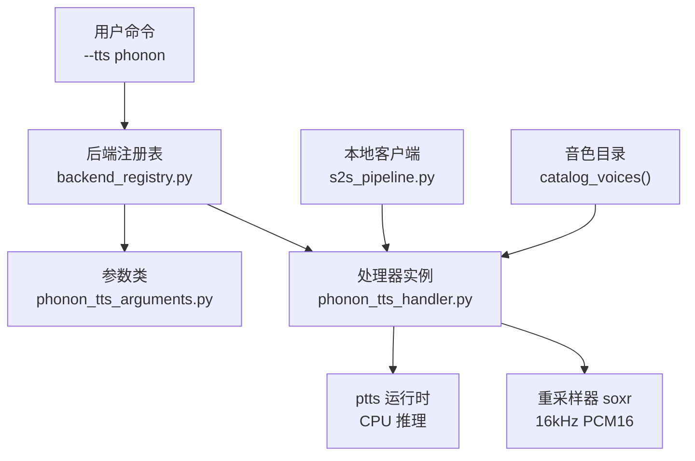
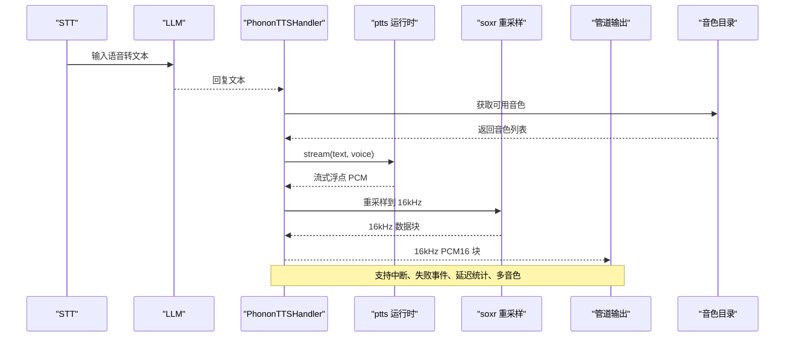
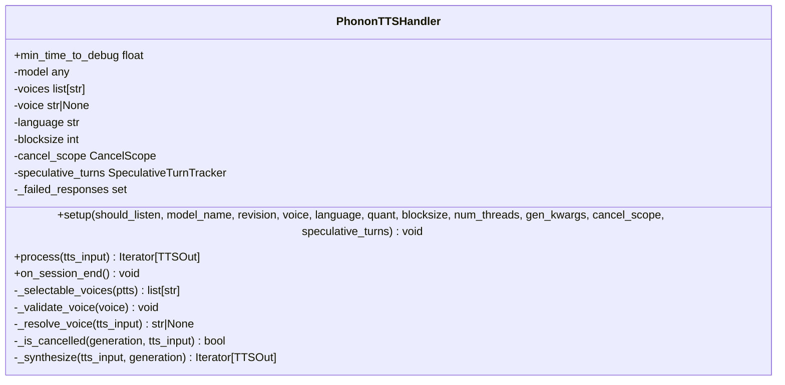
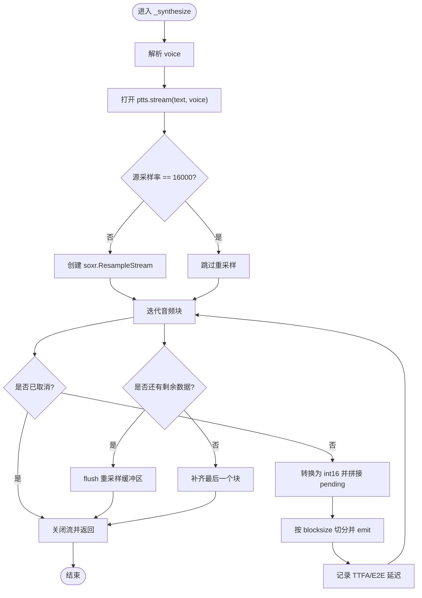
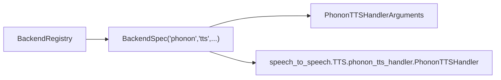
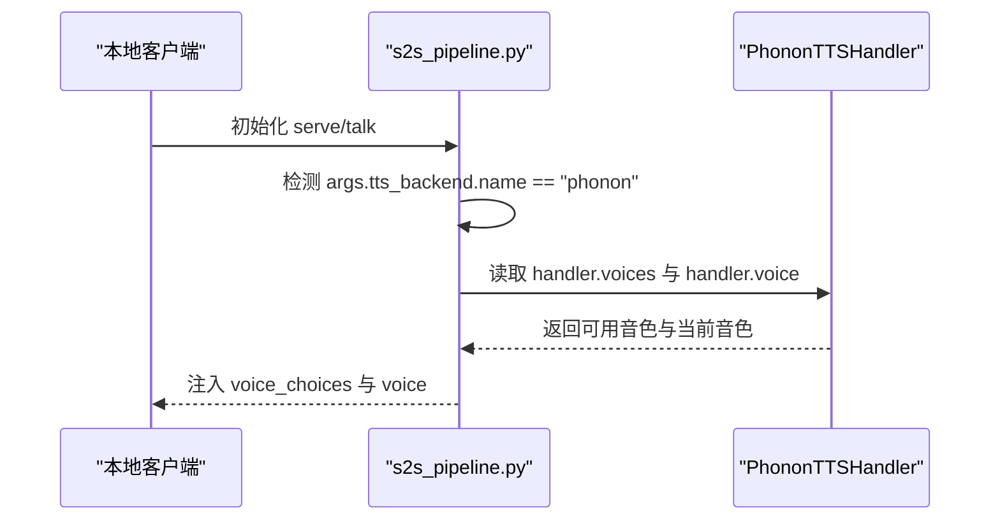
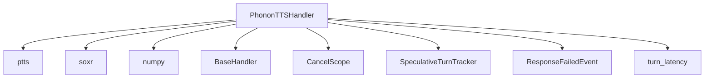

# Phonon TTS 引擎

<cite>
**本文引用的文件**   
- [phonon_tts_handler.py](file://src/speech_to_speech/TTS/phonon_tts_handler.py)
- [phonon_tts_arguments.py](file://src/speech_to_speech/arguments_classes/phonon_tts_arguments.py)
- [backend_registry.py](file://src/speech_to_speech/backend_registry.py)
- [s2s_pipeline.py](file://src/speech_to_speech/s2s_pipeline.py)
- [TTS README.md](file://src/speech_to_speech/TTS/README.md)
- [项目说明 README.md](file://README.md)
- [test_phonon_tts_handler.py](file://tests/test_phonon_tts_handler.py)
</cite>

## 更新摘要
**变更内容**   
- 更新了架构总览以反映完全集成的状态
- 增强了核心组件描述，突出流式合成和多音色支持
- 完善了详细组件分析，包含完整的生命周期管理
- 更新了依赖关系分析，强调 ptts 运行时和 soxr 重采样器
- 增强了性能与延迟特性说明
- 完善了故障排查指南，包含更多实际场景

## 目录
1. [简介](#简介)
2. [项目结构定位](#项目结构定位)
3. [核心组件](#核心组件)
4. [架构总览](#架构总览)
5. [详细组件分析](#详细组件分析)
6. [依赖关系分析](#依赖关系分析)
7. [性能与延迟特性](#性能与延迟特性)
8. [故障排查指南](#故障排查指南)
9. [结论](#结论)
10. [附录：参数与用法](#附录参数与用法)

## 简介
Phonon TTS 是 speech-to-speech 项目中一个完全实现的本地语音合成后端，通过 `ptts` 在 CPU 上提供高性能流式文本转语音服务。该引擎从文本生成浮点 PCM 音频流，自动重采样到管道标准的 16 kHz PCM16 格式，并以固定块大小输出。它支持：
- 使用 Hugging Face 仓库 ID、本地目录或配置文件路径加载 Phonon checkpoint；
- 选择权重格式（如 q8）、语言归一化、多音色支持；
- 在会话级和响应级动态覆盖音色；
- 完整的中断、取消、推测性轮次等管线语义；
- 端到端与首帧音频延迟指标记录；
- 与本地实时客户端的深度集成，支持交互式音色选择。

## 项目结构定位
Phonon TTS 相关代码主要分布在以下位置：
- TTS 处理器实现：`src/speech_to_speech/TTS/phonon_tts_handler.py`
- CLI/配置参数定义：`src/speech_to_speech/arguments_classes/phonon_tts_arguments.py`
- 后端注册与构建：`src/speech_to_speech/backend_registry.py`
- 本地实时客户端集成与音色列表注入：`src/speech_to_speech/s2s_pipeline.py`
- 组件文档与安装说明：`src/speech_to_speech/TTS/README.md`
- 顶层使用说明与约束：`README.md`
- 单元测试与行为验证：`tests/test_phonon_tts_handler.py`

**图表来源**
- [backend_registry.py:597-622](file://src/speech_to_speech/backend_registry.py#L597-L622)
- [phonon_tts_arguments.py:4-42](file://src/speech_to_speech/arguments_classes/phonon_tts_arguments.py#L4-L42)
- [phonon_tts_handler.py:26-75](file://src/speech_to_speech/TTS/phonon_tts_handler.py#L26-L75)
- [s2s_pipeline.py:795-830](file://src/speech_to_speech/s2s_pipeline.py#L795-L830)

**章节来源**
- [backend_registry.py:597-622](file://src/speech_to_speech/backend_registry.py#L597-L622)
- [phonon_tts_arguments.py:4-42](file://src/speech_to_speech/arguments_classes/phonon_tts_arguments.py#L4-L42)
- [phonon_tts_handler.py:26-75](file://src/speech_to_speech/TTS/phonon_tts_handler.py#L26-L75)
- [s2s_pipeline.py:795-830](file://src/speech_to_speech/s2s_pipeline.py#L795-L830)

## 核心组件
- **PhononTTSHandler**：继承自 BaseHandler，负责加载 Phonon 模型、解析音色、流式合成、重采样、中断处理与延迟统计。
- **PhononTTSHandlerArguments**：声明所有 `--phonon_tts_*` 参数的默认值与帮助信息。
- **后端注册**：将 `phonon` 作为 TTS 后端名注册到系统，绑定参数类与处理器模块。
- **本地客户端集成**：当 TTS 为 phonon 时，自动收集可用音色并注入到实时客户端，支持交互式音色选择。

**章节来源**
- [phonon_tts_handler.py:26-75](file://src/speech_to_speech/TTS/phonon_tts_handler.py#L26-L75)
- [phonon_tts_arguments.py:4-42](file://src/speech_to_speech/arguments_classes/phonon_tts_arguments.py#L4-L42)
- [backend_registry.py:610-622](file://src/speech_to_speech/backend_registry.py#L610-L622)
- [s2s_pipeline.py:795-830](file://src/speech_to_speech/s2s_pipeline.py#L795-L830)

## 架构总览
Phonon TTS 在整体 pipeline 中的角色如下：
- STT 将语音转为文本；
- LLM 生成回复文本；
- Phonon TTS 接收文本，调用 ptts 流式合成；
- 输出统一为 16 kHz PCM16 数据块；
- 上层可基于 response_key、turn_id、cancel_generation 进行中断与清理；
- 支持多音色选择和语言归一化。

**图表来源**
- [phonon_tts_handler.py:171-235](file://src/speech_to_speech/TTS/phonon_tts_handler.py#L171-L235)
- [phonon_tts_handler.py:81-94](file://src/speech_to_speech/TTS/phonon_tts_handler.py#L81-L94)

## 详细组件分析

### PhononTTSHandler 类
该类封装了 Phonon 的完整生命周期与流式合成逻辑，实现了从文本到音频的完整转换流程。

**图表来源**
- [phonon_tts_handler.py:26-235](file://src/speech_to_speech/TTS/phonon_tts_handler.py#L26-L235)

#### 关键方法职责
- **setup**：校验参数、设置线程数、加载 ptts.TTS、获取可用音色、校验 voice。
- **process**：处理 EndOfResponse、过滤空文本、判断是否被取消、调用 _synthesize、捕获异常并发送 ResponseFailedEvent。
- **_synthesize**：打开 ptts.stream、按块缓冲、重采样、记录 TTFA 与 E2E 延迟、处理结束与填充。
- **_resolve_voice**：优先级为"响应级 voice > 会话级 voice > 配置 voice"，并校验是否为已知音色。
- **_is_cancelled**：综合 stop_event、CancelScope 与 SpeculativeTurnTracker 判断是否应停止。
- **_selectable_voices**：从 checkpoint 和 catalog 中获取可用音色列表。

**章节来源**
- [phonon_tts_handler.py:29-75](file://src/speech_to_speech/TTS/phonon_tts_handler.py#L29-L75)
- [phonon_tts_handler.py:115-169](file://src/speech_to_speech/TTS/phonon_tts_handler.py#L115-L169)
- [phonon_tts_handler.py:171-235](file://src/speech_to_speech/TTS/phonon_tts_handler.py#L171-L235)
- [phonon_tts_handler.py:81-94](file://src/speech_to_speech/TTS/phonon_tts_handler.py#L81-L94)

#### 流式合成流程

**图表来源**
- [phonon_tts_handler.py:171-235](file://src/speech_to_speech/TTS/phonon_tts_handler.py#L171-L235)

**章节来源**
- [phonon_tts_handler.py:171-235](file://src/speech_to_speech/TTS/phonon_tts_handler.py#L171-L235)

### 参数定义 PhononTTSHandlerArguments
该 dataclass 定义了所有 `--phonon_tts_*` 参数：
- `phonon_tts_model_name`：checkpoint 目录、config.json 路径或 Hugging Face repo ID；
- `phonon_tts_revision`：HF 分支、标签或提交；
- `phonon_tts_voice`：checkpoint 内音色名；
- `phonon_tts_language`：文本归一化语言，限制为 en/fr/de/es/pt/none；
- `phonon_tts_quant`：权重格式，默认 q8；
- `phonon_tts_blocksize`：每块样本数，默认 512；
- `phonon_tts_num_threads`：进程级原生线程池大小，默认 4。

**章节来源**
- [phonon_tts_arguments.py:4-42](file://src/speech_to_speech/arguments_classes/phonon_tts_arguments.py#L4-L42)

### 后端注册与构建
后端注册表将 `phonon` 注册为 TTS 后端，绑定参数类与处理器模块，并指定配置前缀与可选依赖。

**图表来源**
- [backend_registry.py:610-622](file://src/speech_to_speech/backend_registry.py#L610-L622)

**章节来源**
- [backend_registry.py:610-622](file://src/speech_to_speech/backend_registry.py#L610-L622)

### 本地客户端与音色选择
当 TTS 后端为 phonon 时，本地客户端会扫描已构建的 handler，提取可用音色列表，并将默认音色置于首位，同时把当前 voice 注入到实时客户端。

**图表来源**
- [s2s_pipeline.py:795-830](file://src/speech_to_speech/s2s_pipeline.py#L795-L830)

**章节来源**
- [s2s_pipeline.py:795-830](file://src/speech_to_speech/s2s_pipeline.py#L795-L830)

## 依赖关系分析
- **外部依赖**：
  - `ptts`：Phonon 的原生 Python 绑定，提供 TTS 推理与流式接口；
  - `soxr`：高质量重采样库，用于将任意采样率统一到 16 kHz；
  - `numpy`：数组操作与类型转换。
- **内部依赖**：
  - `BaseHandler`：统一处理器基类；
  - `CancelScope`：生成级取消控制；
  - `SpeculativeTurnTracker`：推测性轮次最新性检查；
  - `console`：对话显示；
  - `ResponseFailedEvent`：失败事件；
  - `turn_latency`：TTFA 与 E2E 延迟记录。

**图表来源**
- [phonon_tts_handler.py:1-23](file://src/speech_to_speech/TTS/phonon_tts_handler.py#L1-L23)

**章节来源**
- [phonon_tts_handler.py:1-23](file://src/speech_to_speech/TTS/phonon_tts_handler.py#L1-L23)

## 性能与延迟特性
- **设备与线程**：Phonon 始终运行在 CPU；可通过 `--phonon_tts_num_threads` 设置进程级原生线程池大小，默认 4。
- **采样率与块大小**：输出统一为 16 kHz PCM16；`--phonon_tts_blocksize` 控制每块样本数，默认 512。
- **延迟指标**：
  - TTFA（TTS First Audio）：从开始合成到首个音频块的时间；
  - E2E（End-to-End）：从语音停止到首个音频块的时间。
- **中断与资源释放**：中断或生成器关闭会立即关闭 ptts.stream，释放原生工作线程；每次 utterance 的重采样状态独立。
- **内存效率**：模型在会话间保持加载状态，避免重复加载开销。

**章节来源**
- [phonon_tts_handler.py:171-235](file://src/speech_to_speech/TTS/phonon_tts_handler.py#L171-L235)
- [TTS README.md:334-351](file://src/speech_to_speech/TTS/README.md#L334-L351)
- [项目说明 README.md:763-765](file://README.md#L763-L765)

## 故障排查指南
常见问题与定位方式：
- **未提供 checkpoint**：setup 会抛出"需要 checkpoint"的错误；请设置 `--phonon_tts_model_name`。
- **无效 blocksize 或 num_threads**：必须为正整数。
- **不支持的语言**：仅允许 en/fr/de/es/pt/none。
- **未知音色**：若 voice 不在 checkpoint 或 catalog 中，会拒绝并提示可用音色。
- **无音频返回**：若 ptts.stream 返回空流，会抛出错误并发送 ResponseFailedEvent。
- **失败重试与清理**：同一 response_key 的失败会被缓存，直到收到 EndOfResponse 清理；会话结束时也会清空失败集合。
- **网络问题**：如果无法访问 voice catalog，将只使用 checkpoint 内置音色。

建议排查步骤：
1. 确认 `--phonon_tts_model_name` 指向有效 checkpoint 或 HF repo；
2. 确认 `--phonon_tts_quant` 与 checkpoint 提供的权重格式一致；
3. 确认 `--phonon_tts_language` 与期望的归一化语言一致；
4. 检查网络是否能访问 voice catalog（否则仅使用 checkpoint 内置音色）；
5. 观察日志中的 TTFA/E2E 与失败事件，定位阻塞点；
6. 对于多音色场景，确认音色名称是否在可用列表中。

**章节来源**
- [phonon_tts_handler.py:43-55](file://src/speech_to_speech/TTS/phonon_tts_handler.py#L43-L55)
- [phonon_tts_handler.py:96-113](file://src/speech_to_speech/TTS/phonon_tts_handler.py#L96-L113)
- [phonon_tts_handler.py:151-169](file://src/speech_to_speech/TTS/phonon_tts_handler.py#L151-L169)
- [test_phonon_tts_handler.py:63-79](file://tests/test_phonon_tts_handler.py#L63-L79)
- [test_phonon_tts_handler.py:235-250](file://tests/test_phonon_tts_handler.py#L235-L250)

## 结论
Phonon TTS 以轻量、低延迟的方式将文本流式合成为 16 kHz PCM16，适合与 GPU 加速的 STT/LLM 组合使用。其设计强调：
- 明确的参数边界与校验；
- 稳定的中断与资源释放；
- 统一的输出格式与延迟统计；
- 灵活的音色选择与会话/响应级覆盖；
- 与本地客户端的深度集成，支持交互式音色选择。

在生产环境中，建议根据硬件调整 `num_threads` 与 `blocksize`，并确保 checkpoint 与量化格式匹配；如需多语言，需固定 `language` 并在会话层保持一致。

## 附录：参数与用法
- 启用方式：`speech-to-speech serve --tts phonon`
- 安装要求：`pip install "speech-to-speech[phonon]"`
- 默认 checkpoint：`gradium/phonon-31m-en`（Apache-2.0，无需登录）
- 受限 checkpoint：如 `gradium/phonon-40m-en`（CC BY-NC 4.0，需接受条款并登录）
- 常用参数：
  - `--phonon_tts_model_name`
  - `--phonon_tts_revision`
  - `--phonon_tts_voice`
  - `--phonon_tts_language`
  - `--phonon_tts_quant`
  - `--phonon_tts_blocksize`
  - `--phonon_tts_num_threads`

**章节来源**
- [TTS README.md:334-355](file://src/speech_to_speech/TTS/README.md#L334-L355)
- [项目说明 README.md:763-765](file://README.md#L763-L765)
- [phonon_tts_arguments.py:4-42](file://src/speech_to_speech/arguments_classes/phonon_tts_arguments.py#L4-L42)