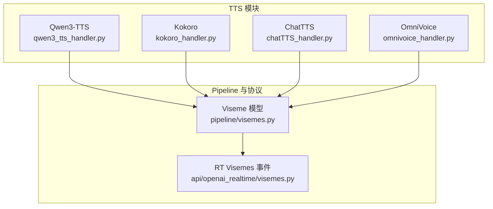
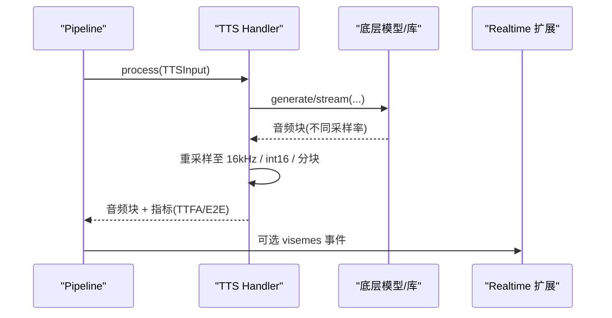
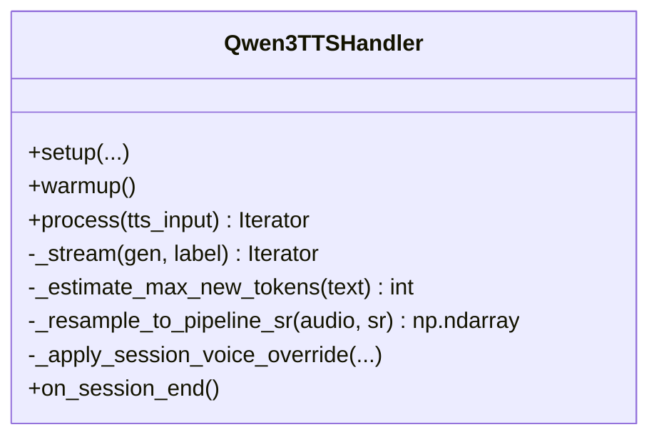
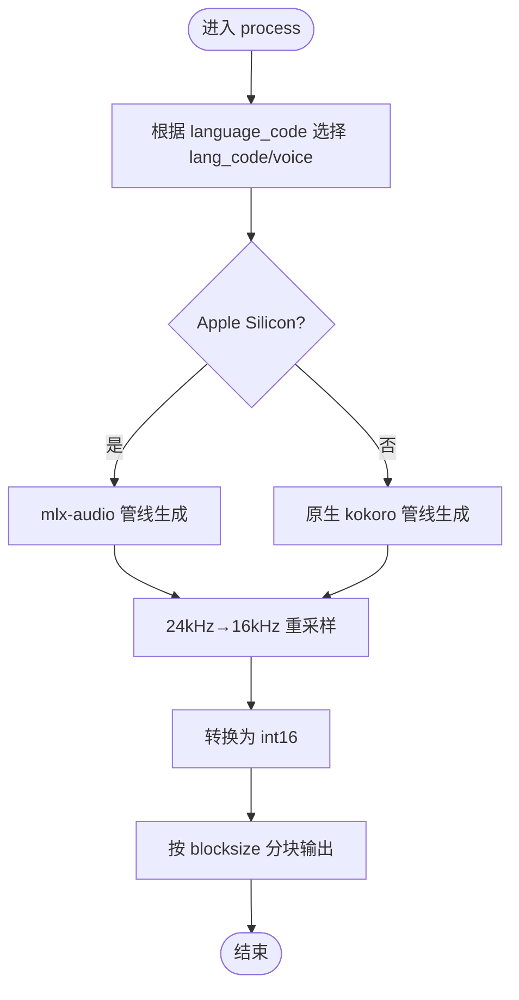
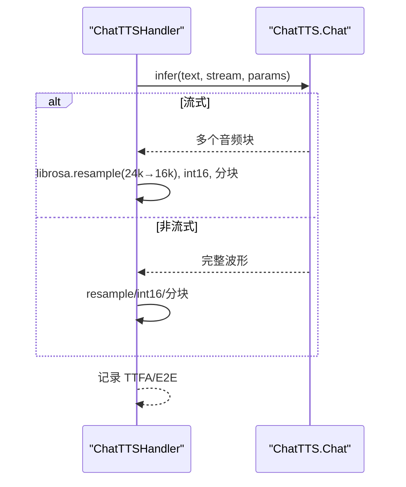
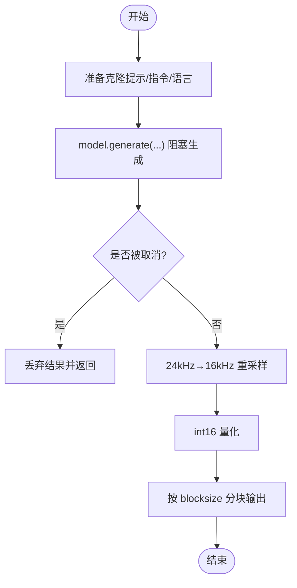
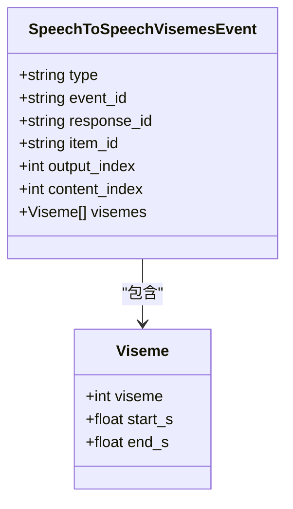
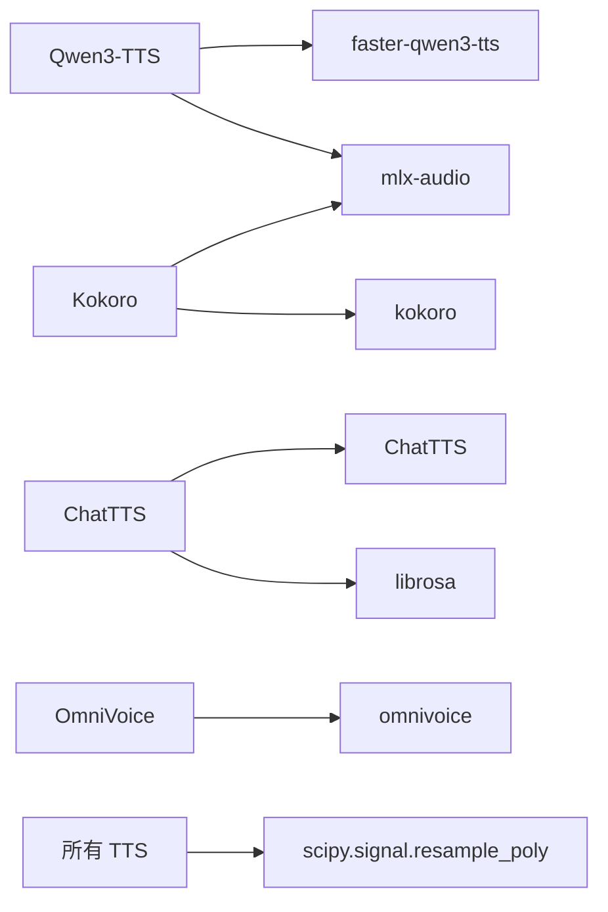

# 文字转语音 (TTS)

<cite>
**本文引用的文件**   
- [src/speech_to_speech/TTS/README.md](file://src/speech_to_speech/TTS/README.md)
- [src/speech_to_speech/TTS/qwen3_tts_handler.py](file://src/speech_to_speech/TTS/qwen3_tts_handler.py)
- [src/speech_to_speech/TTS/kokoro_handler.py](file://src/speech_to_speech/TTS/kokoro_handler.py)
- [src/speech_to_speech/TTS/chatTTS_handler.py](file://src/speech_to_speech/TTS/chatTTS_handler.py)
- [src/speech_to_speech/TTS/omnivoice_handler.py](file://src/speech_to_speech/TTS/omnivoice_handler.py)
- [src/speech_to_speech/pipeline/visemes.py](file://src/speech_to_speech/pipeline/visemes.py)
- [src/speech_to_speech/api/openai_realtime/visemes.py](file://src/speech_to_speech/api/openai_realtime/visemes.py)
</cite>

## 目录
1. [简介](#简介)
2. [项目结构](#项目结构)
3. [核心组件](#核心组件)
4. [架构总览](#架构总览)
5. [详细组件分析](#详细组件分析)
6. [依赖关系分析](#依赖关系分析)
7. [性能与延迟优化](#性能与延迟优化)
8. [故障排除指南](#故障排除指南)
9. [结论](#结论)
10. [附录：集成示例与参数速查](#附录：集成示例与参数速查)

## 简介
本技术文档面向 TTS（文字转语音）子系统，系统性梳理多种后端引擎的架构、实现要点与使用方式。重点覆盖 Qwen3-TTS、Kokoro、ChatTTS、OmniVoice 等引擎的技术优势；说明流式合成、多语言支持、声音克隆、口型同步（visemes）、音频格式与采样率处理；并给出性能基准建议、资源需求、平台兼容性、音质与延迟调优策略、实际集成示例与常见问题排查方法。

## 项目结构
TTS 子系统位于 `src/speech_to_speech/TTS`，每个引擎以独立 handler 模块提供统一接口；运行时通过统一的 pipeline 消息类型进行输入输出，并在 OpenAI Realtime 扩展中暴露 visemes 事件。

图表来源
- [src/speech_to_speech/TTS/qwen3_tts_handler.py:96-1085](file://src/speech_to_speech/TTS/qwen3_tts_handler.py#L96-L1085)
- [src/speech_to_speech/TTS/kokoro_handler.py:82-506](file://src/speech_to_speech/TTS/kokoro_handler.py#L82-L506)
- [src/speech_to_speech/TTS/chatTTS_handler.py:27-163](file://src/speech_to_speech/TTS/chatTTS_handler.py#L27-L163)
- [src/speech_to_speech/TTS/omnivoice_handler.py:28-230](file://src/speech_to_speech/TTS/omnivoice_handler.py#L28-L230)
- [src/speech_to_speech/pipeline/visemes.py:1-18](file://src/speech_to_speech/pipeline/visemes.py#L1-L18)
- [src/speech_to_speech/api/openai_realtime/visemes.py:1-18](file://src/speech_to_speech/api/openai_realtime/visemes.py#L1-L18)

章节来源
- [src/speech_to_speech/TTS/README.md:13-29](file://src/speech_to_speech/TTS/README.md#L13-L29)

## 核心组件
- Qwen3-TTS：跨平台高性能 TTS，Apple Silicon 走 MLX，其他平台走 faster-qwen3-tts；支持声音克隆、预设说话人、声音设计；自动语言映射与流式分块。
- Kokoro：多语言高质量 TTS，Apple Silicon 走 MLX，其他平台走原生 kokoro；按语言自动选择默认音色，支持速度控制。
- ChatTTS：基于 ChatTTS 库的流式/非流式合成，自动重采样到 16kHz，支持 MPS/CUDA/NPU/CPU。
- OmniVoice：扩散式语音合成，支持参考音频克隆、按语言预置克隆提示、指令式声音设计；阻塞生成后分块输出。

章节来源
- [src/speech_to_speech/TTS/qwen3_tts_handler.py:96-1085](file://src/speech_to_speech/TTS/qwen3_tts_handler.py#L96-L1085)
- [src/speech_to_speech/TTS/kokoro_handler.py:82-506](file://src/speech_to_speech/TTS/kokoro_handler.py#L82-L506)
- [src/speech_to_speech/TTS/chatTTS_handler.py:27-163](file://src/speech_to_speech/TTS/chatTTS_handler.py#L27-L163)
- [src/speech_to_speech/TTS/omnivoice_handler.py:28-230](file://src/speech_to_speech/TTS/omnivoice_handler.py#L28-L230)

## 架构总览
TTS 各 handler 遵循统一接口：setup 初始化模型与设备，process 接收文本输入并产出固定大小的 int16 PCM 音频块；同时记录 TTFA（首音频时间）和端到端延迟，支持取消与推测性回合。

图表来源
- [src/speech_to_speech/TTS/qwen3_tts_handler.py:704-762](file://src/speech_to_speech/TTS/qwen3_tts_handler.py#L704-L762)
- [src/speech_to_speech/TTS/kokoro_handler.py:328-418](file://src/speech_to_speech/TTS/kokoro_handler.py#L328-L418)
- [src/speech_to_speech/TTS/chatTTS_handler.py:94-163](file://src/speech_to_speech/TTS/chatTTS_handler.py#L94-L163)
- [src/speech_to_speech/TTS/omnivoice_handler.py:127-230](file://src/speech_to_speech/TTS/omnivoice_handler.py#L127-L230)
- [src/speech_to_speech/api/openai_realtime/visemes.py:10-18](file://src/speech_to_speech/api/openai_realtime/visemes.py#L10-L18)

## 详细组件分析

### Qwen3-TTS 组件
- 后端选择：Apple Silicon 使用 mlx-audio；其他平台使用 faster-qwen3-tts（ggml/torch）。
- 模式支持：声音克隆（原始参考或缓存 .spk/.rvq）、CustomVoice 预设说话人、VoiceDesign 指令。
- 语言处理：内置语言别名映射，支持 auto 检测与会话级覆盖。
- 流式与分块：统一 _stream 循环，TTFA 统计、RTF 日志、静音裁剪、blocksize 对齐。
- 采样率：统一到 PIPELINE_SR=16000，int16 输出。
- 会话状态：on_session_end 恢复初始 speaker/ref_audio/ref_spk/ref_rvq。

图表来源
- [src/speech_to_speech/TTS/qwen3_tts_handler.py:96-1085](file://src/speech_to_speech/TTS/qwen3_tts_handler.py#L96-L1085)

章节来源
- [src/speech_to_speech/TTS/qwen3_tts_handler.py:96-1085](file://src/speech_to_speech/TTS/qwen3_tts_handler.py#L96-L1085)

### Kokoro 组件
- 后端选择：Apple Silicon 使用 mlx-audio；其他平台使用原生 kokoro。
- 多语言：Whisper/langdetect 代码到 Kokoro lang_code 映射；为不支持的语言回退到英语变体。
- 音色管理：按语言默认音色，支持客户端 voice 覆盖；MLX 下预加载常用语言音色以降低首次延迟。
- 音频处理：24kHz→16kHz 重采样，int16，blocksize 分块；TTFA/E2E 指标记录。
- 会话重置：on_session_end 恢复初始 voice/lang_code。

图表来源
- [src/speech_to_speech/TTS/kokoro_handler.py:311-418](file://src/speech_to_speech/TTS/kokoro_handler.py#L311-L418)

章节来源
- [src/speech_to_speech/TTS/kokoro_handler.py:82-506](file://src/speech_to_speech/TTS/kokoro_handler.py#L82-L506)

### ChatTTS 组件
- 模型加载：ChatTTS.Chat，支持 CUDA/NPU/MPS/CPU；MPS 场景有额外同步与缓存清理逻辑。
- 流式/非流式：infer 返回流式生成器或完整波形；统一重采样到 16kHz，int16 分块。
- 指标：TTFA 在首个 provider 样本前记录；E2E 在首次 yield 时记录。

图表来源
- [src/speech_to_speech/TTS/chatTTS_handler.py:27-163](file://src/speech_to_speech/TTS/chatTTS_handler.py#L27-L163)

章节来源
- [src/speech_to_speech/TTS/chatTTS_handler.py:27-163](file://src/speech_to_speech/TTS/chatTTS_handler.py#L27-L163)

### OmniVoice 组件
- 克隆与指令：支持 ref_audio+ref_text 克隆、预存 voice_clone_prompt、按语言目录预置克隆提示；或 instruct 声音设计。
- 生成特性：generate 为阻塞调用，完成后按 blocksize 切块输出；支持 num_steps 与 speed 控制。
- 采样率：默认 24kHz，统一重采样到 16kHz，int16 输出。
- 取消：在阻塞生成后检查 cancel_scope，丢弃已完成的缓冲。

图表来源
- [src/speech_to_speech/TTS/omnivoice_handler.py:28-230](file://src/speech_to_speech/TTS/omnivoice_handler.py#L28-L230)

章节来源
- [src/speech_to_speech/TTS/omnivoice_handler.py:28-230](file://src/speech_to_speech/TTS/omnivoice_handler.py#L28-L230)

### 口型同步（visemes）机制
- 数据模型：Viseme 包含 viseme 编号与起止时间（秒），保证区间有序。
- 实时扩展：SpeechToSpeechVisemesEvent 将 visemes 列表作为附加事件发送到客户端，不改变标准音频事件。

图表来源
- [src/speech_to_speech/pipeline/visemes.py:1-18](file://src/speech_to_speech/pipeline/visemes.py#L1-L18)
- [src/speech_to_speech/api/openai_realtime/visemes.py:10-18](file://src/speech_to_speech/api/openai_realtime/visemes.py#L10-L18)

章节来源
- [src/speech_to_speech/pipeline/visemes.py:1-18](file://src/speech_to_speech/pipeline/visemes.py#L1-L18)
- [src/speech_to_speech/api/openai_realtime/visemes.py:1-18](file://src/speech_to_speech/api/openai_realtime/visemes.py#L1-L18)

## 依赖关系分析
- 平台相关依赖：
  - Apple Silicon：mlx-audio（Qwen3/Kokoro）。
  - 其他平台：faster-qwen3-tts（GGML/Torch）、kokoro、ChatTTS、omnivoice。
- 音频处理：scipy.signal.resample_poly、librosa（ChatTTS）。
- 设备选择：utils.resolve_device、torch 设备枚举。

图表来源
- [src/speech_to_speech/TTS/qwen3_tts_handler.py:222-268](file://src/speech_to_speech/TTS/qwen3_tts_handler.py#L222-L268)
- [src/speech_to_speech/TTS/kokoro_handler.py:153-195](file://src/speech_to_speech/TTS/kokoro_handler.py#L153-L195)
- [src/speech_to_speech/TTS/chatTTS_handler.py:8-12](file://src/speech_to_speech/TTS/chatTTS_handler.py#L8-L12)
- [src/speech_to_speech/TTS/omnivoice_handler.py:65-88](file://src/speech_to_speech/TTS/omnivoice_handler.py#L65-L88)

章节来源
- [src/speech_to_speech/TTS/qwen3_tts_handler.py:222-268](file://src/speech_to_speech/TTS/qwen3_tts_handler.py#L222-L268)
- [src/speech_to_speech/TTS/kokoro_handler.py:153-195](file://src/speech_to_speech/TTS/kokoro_handler.py#L153-L195)
- [src/speech_to_speech/TTS/chatTTS_handler.py:8-12](file://src/speech_to_speech/TTS/chatTTS_handler.py#L8-L12)
- [src/speech_to_speech/TTS/omnivoice_handler.py:65-88](file://src/speech_to_speech/TTS/omnivoice_handler.py#L65-L88)

## 性能与延迟优化
- 流式优先：
  - Qwen3-TTS：合理设置 streaming_chunk_size 与 max_new_tokens，减少 TTFA；启用 warmup。
  - ChatTTS：开启 stream=true，降低首包延迟。
  - Kokoro：预加载常用语言音色，避免首次下载开销。
- 采样率与分块：
  - 统一输出 16kHz int16，blocksize 建议 512；OmniVoice 需 24kHz→16kHz 重采样。
- 设备与精度：
  - Qwen3-TTS：CUDA 用 torch backend，macOS 用 MLX；按需选择 GGML 量化（BF16/Q8_0/Q4_K_M/F32）或 MLX 量化（bf16/4bit/6bit/8bit）。
  - Kokoro：Apple Silicon 用 MLX，其他平台用原生 kokoro。
  - OmniVoice：dtype=float16/bfloat16/float32，num_steps 控制质量与延迟权衡。
- 语言与音色：
  - Qwen3-TTS：auto 语言检测与会话覆盖；CustomVoice 指定说话人。
  - Kokoro：按语言自动选择默认音色，必要时显式 voice。
- 中断与取消：
  - 所有 handler 均支持 cancel_scope；OmniVoice 在阻塞生成后检查取消并丢弃结果。

章节来源
- [src/speech_to_speech/TTS/qwen3_tts_handler.py:563-582](file://src/speech_to_speech/TTS/qwen3_tts_handler.py#L563-L582)
- [src/speech_to_speech/TTS/qwen3_tts_handler.py:624-667](file://src/speech_to_speech/TTS/qwen3_tts_handler.py#L624-L667)
- [src/speech_to_speech/TTS/kokoro_handler.py:197-213](file://src/speech_to_speech/TTS/kokoro_handler.py#L197-L213)
- [src/speech_to_speech/TTS/omnivoice_handler.py:172-178](file://src/speech_to_speech/TTS/omnivoice_handler.py#L172-L178)

## 故障排除指南
- 依赖缺失：
  - Qwen3-TTS 非 macOS：安装 faster-qwen3-tts；macOS：安装 mlx-audio。
  - Kokoro：Apple Silicon 需要额外依赖（misaki/spacy/phonemizer/espeakng_loader/num2words）；其他平台需 kokoro>=0.9.2 与 soundfile，系统 espeak-ng。
  - ChatTTS：确保 torch 可用；MPS 场景注意同步与缓存清理。
  - OmniVoice：确保 omnivoice 与匹配 PyTorch 构建（CUDA/MPS/XPU）。
- 配置冲突：
  - Qwen3-TTS：ref_audio 与 ref_spk/ref_rvq 互斥；ref_rvq 需要 ref_spk 与 ref_text；gguf_talker_path 与 gguf_codec_path 必须成对。
  - OmniVoice：ref_audio 与 voice_clone_prompt 互斥；instruct 不能与克隆配置混用。
- 采样率与格式：
  - 所有 handler 最终输出 16kHz int16；若上游返回不同采样率，会进行重采样。
- 语言与音色：
  - Kokoro：不支持的语言回退到英语；会话结束时恢复初始 voice/lang_code。
  - Qwen3-TTS：Base 模型需要声音克隆参考；CustomVoice 需要 speaker。

章节来源
- [src/speech_to_speech/TTS/qwen3_tts_handler.py:294-328](file://src/speech_to_speech/TTS/qwen3_tts_handler.py#L294-L328)
- [src/speech_to_speech/TTS/kokoro_handler.py:170-195](file://src/speech_to_speech/TTS/kokoro_handler.py#L170-L195)
- [src/speech_to_speech/TTS/chatTTS_handler.py:41-54](file://src/speech_to_speech/TTS/chatTTS_handler.py#L41-L54)
- [src/speech_to_speech/TTS/omnivoice_handler.py:48-64](file://src/speech_to_speech/TTS/omnivoice_handler.py#L48-L64)

## 结论
该 TTS 子系统通过统一 handler 接口整合了多种高质量语音合成引擎，兼顾低延迟流式输出、多语言与声音克隆能力，并提供稳定的音频格式与采样率转换。针对不同平台与设备，提供了 MLX、GGML、原生库等多路径优化；配合 visemes 扩展，可进一步满足唇形同步需求。在生产环境中，建议依据设备与延迟目标选择合适的后端与量化/精度配置，并结合语言与音色策略以获得最佳体验。

## 附录：集成示例与参数速查
- 运行模式与后端选择：参见 README 中的 --tts 选项与各引擎主参数前缀。
- 典型命令：
  - ChatTTS：--tts chatTTS，--chat_tts_device cuda，--chat_tts_stream true，--chat_tts_chunk_size 512。
  - Kokoro：--tts kokoro，--kokoro_device auto，--kokoro_voice bm_fable，--kokoro_lang_code b。
  - Qwen3-TTS：--tts qwen3，--qwen3_tts_model_name ...，--qwen3_tts_backend ggml，--qwen3_tts_speaker Aiden，--qwen3_tts_language auto，--qwen3_tts_non_streaming_mode True。
  - OmniVoice：--tts omnivoice，--omnivoice_model_name k2-fsa/OmniVoice，--omnivoice_device cuda，--omnivoice_dtype float16，--omnivoice_ref_audio ...，--omnivoice_ref_text ...。

章节来源
- [src/speech_to_speech/TTS/README.md:31-331](file://src/speech_to_speech/TTS/README.md#L31-L331)