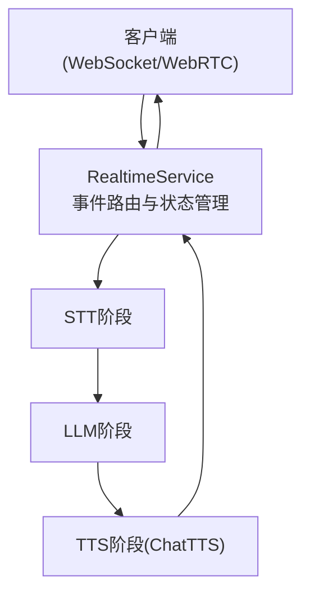
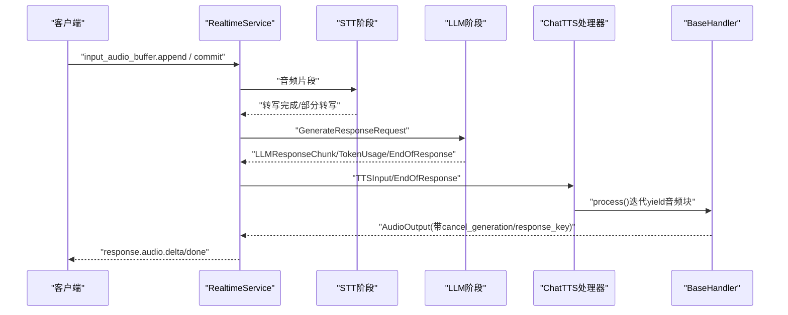
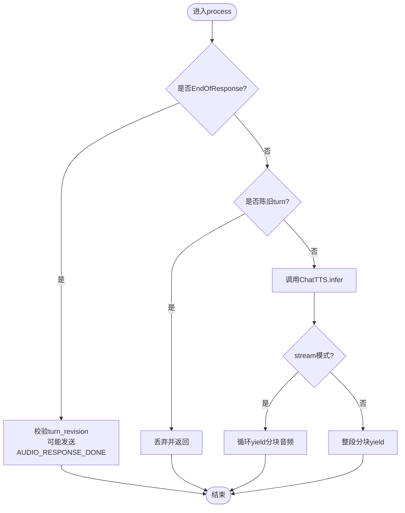
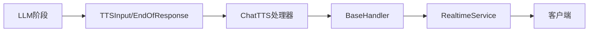

# ChatTTS处理器

<cite>
**本文引用的文件**
- [chatTTS_handler.py](file://src/speech_to_speech/TTS/chatTTS_handler.py)
- [chat_tts_arguments.py](file://src/speech_to_speech/arguments_classes/chat_tts_arguments.py)
- [baseHandler.py](file://src/speech_to_speech/baseHandler.py)
- [messages.py](file://src/speech_to_speech/pipeline/messages.py)
- [handler_types.py](file://src/speech_to_speech/pipeline/handler_types.py)
- [speculative_turns.py](file://src/speech_to_speech/pipeline/speculative_turns.py)
- [control.py](file://src/speech_to_speech/pipeline/control.py)
- [runtime_config.py](file://src/speech_to_speech/api/openai_realtime/runtime_config.py)
- [service.py](file://src/speech_to_speech/api/openai_realtime/service.py)
- [README-CN.md](file://README-CN.md)
</cite>

## 目录
1. [简介](#简介)
2. [项目结构](#项目结构)
3. [核心组件](#核心组件)
4. [架构总览](#架构总览)
5. [详细组件分析](#详细组件分析)
6. [依赖关系分析](#依赖关系分析)
7. [性能与实时性](#性能与实时性)
8. [故障诊断与排错](#故障诊断与排错)
9. [结论](#结论)
10. [附录：配置与集成指南](#附录：配置与集成指南)

## 简介
本文件聚焦于ChatTTS处理器在语音到语音（S2S）流水线中的角色与实现，重点说明其在对话场景下的特殊优化与实时响应能力。内容涵盖：
- 对话上下文感知、对话状态管理与多轮对话支持
- 自然语言理解增强、语义连贯性与情感表达能力的工程化支撑
- 对话流程控制配置选项：打断处理、重复检测、上下文保持
- 在智能助手、客服系统、教育应用中的集成方法
- 对话质量评估指标、用户体验优化与性能调优策略
- 完整开发指南与故障诊断工具使用说明

## 项目结构
ChatTTS处理器位于TTS阶段，作为可插拔的文本转语音后端之一，遵循统一的BaseHandler接口，通过消息队列与其他阶段（VAD、STT、LLM）协作。关键文件与职责如下：
- TTS处理器：chatTTS_handler.py
- 处理器参数：chat_tts_arguments.py
- 基类与线程调度：baseHandler.py
- 管道消息定义：messages.py
- 处理器类型别名：handler_types.py
- 推测式轮次追踪：speculative_turns.py
- 控制消息：control.py
- 运行时会话配置：runtime_config.py
- 实时服务编排：service.py
- 总体说明与安装指引：README-CN.md

图表来源
- [service.py:287-326](file://src/speech_to_speech/api/openai_realtime/service.py#L287-L326)
- [chatTTS_handler.py:24-47](file://src/speech_to_speech/TTS/chatTTS_handler.py#L24-L47)

章节来源
- [README-CN.md:87-96](file://README-CN.md#L87-L96)
- [service.py:287-326](file://src/speech_to_speech/api/openai_realtime/service.py#L287-L326)

## 核心组件
- ChatTTS处理器：继承BaseHandler，封装ChatTTS模型加载、推理与流式音频分块输出；支持设备切换、流式/非流式模式、chunk_size切分、取消生成与推测轮次过滤。
- BaseHandler：提供线程化运行循环、输入过滤、输出包装、计时与日志、会话结束清理等通用能力。
- 管道消息：统一的消息类型（如TTSInput、EndOfResponse、AudioOutput、TokenUsage等），保证各阶段间数据契约一致。
- 推测式轮次追踪：SpeculativeTurnTracker用于在多轮对话中维护turn_id与revision，避免陈旧输出污染用户可见结果。
- 运行时配置：RuntimeConfig集中管理会话级设置（如打断行为），供各阶段读取。

章节来源
- [chatTTS_handler.py:24-118](file://src/speech_to_speech/TTS/chatTTS_handler.py#L24-L118)
- [baseHandler.py:25-186](file://src/speech_to_speech/baseHandler.py#L25-L186)
- [messages.py:180-225](file://src/speech_to_speech/pipeline/messages.py#L180-L225)
- [speculative_turns.py:24-117](file://src/speech_to_speech/pipeline/speculative_turns.py#L24-L117)
- [runtime_config.py:27-82](file://src/speech_to_speech/api/openai_realtime/runtime_config.py#L27-L82)

## 架构总览
下图展示从客户端到TTS阶段的端到端调用链，以及ChatTTS在其中的位置与交互点。

图表来源
- [service.py:629-682](file://src/speech_to_speech/api/openai_realtime/service.py#L629-L682)
- [messages.py:138-225](file://src/speech_to_speech/pipeline/messages.py#L138-L225)
- [chatTTS_handler.py:53-118](file://src/speech_to_speech/TTS/chatTTS_handler.py#L53-L118)
- [baseHandler.py:105-164](file://src/speech_to_speech/baseHandler.py#L105-L164)

## 详细组件分析

### ChatTTS处理器
- 初始化与预热
  - 加载ChatTTS模型并随机采样说话人嵌入，构造推理参数；执行一次warmup以预热计算图/内存。
  - 支持设备选择（cuda/mps/cpu），并在mps设备上同步与释放缓存以降低失败率。
- 流式与非流式合成
  - 流式：按chunk_size切分音频块，逐块yield，降低首包延迟；非流式：整段合成后分块。
  - 重采样至16kHz，量化为int16，补齐至固定长度，便于下游播放与传输。
- 取消与过时处理
  - 基于CancelScope检查是否被中断，及时终止生成。
  - 结合SpeculativeTurnTracker丢弃陈旧turn_revision的输出，确保用户只看到最新修订。
- 响应结束标记
  - 收到EndOfResponse时，若满足条件则发送AUDIO_RESPONSE_DONE信号，通知上层关闭当前响应。

图表来源
- [chatTTS_handler.py:53-118](file://src/speech_to_speech/TTS/chatTTS_handler.py#L53-L118)
- [messages.py:361-366](file://src/speech_to_speech/pipeline/messages.py#L361-L366)

章节来源
- [chatTTS_handler.py:24-118](file://src/speech_to_speech/TTS/chatTTS_handler.py#L24-L118)

### BaseHandler（线程与生命周期）
- 线程循环：周期性从输入队列取项，处理控制消息、PIPELINE_END、普通消息。
- 输入过滤：should_process_input支持prefetch_transaction等待与cancel_generation过期判断，避免无效工作。
- 输出包装：output_for_queue将原始bytes或ndarray包装为AudioOutput，携带cancel_generation/response_key/cleanup_only等元信息。
- 计时与日志：记录每次处理耗时，支持调试级别日志。
- 会话结束：on_session_end钩子用于重置每会话状态。

章节来源
- [baseHandler.py:25-186](file://src/speech_to_speech/baseHandler.py#L25-L186)

### 管道消息与类型
- TTSInput：携带待合成文本、语言、运行时配置、turn_id/revision、cancel_generation、response_key等。
- AudioOutput：携带音频数据及关联的响应元信息，便于上层按响应键路由与取消。
- EndOfResponse：响应结束哨兵，支持cleanup_only用于仅清理资源。
- TokenUsage：侧信道统计token用量，不参与TTS。

章节来源
- [messages.py:138-225](file://src/speech_to_speech/pipeline/messages.py#L138-L225)
- [handler_types.py:43-46](file://src/speech_to_speech/pipeline/handler_types.py#L43-L46)

### 推测式轮次追踪（SpeculativeTurnTracker）
- 作用：在多轮对话中跟踪每个turn的最新revision，支持“pending reopen”和“reopen grace”窗口，允许在软结束轮次后短暂重新打开，提升打断体验。
- 关键方法：
  - observe/is_latest：观察并判断是否为最新
  - is_latest_after_reopen_grace/try_is_latest_after_reopen_grace：考虑宽限期的最新性判断
  - start_reopen_grace/commit_if_latest_after_reopen_grace：开启宽限期并提交最新修订
  - begin_reopen_candidate/confirm_reopen_candidate/cancel_reopen_candidate：管理推测式重开候选
- 在ChatTTS中的应用：丢弃陈旧turn_revision的TTS输出，仅在提交后生效，避免用户看到中间态。

章节来源
- [speculative_turns.py:24-117](file://src/speech_to_speech/pipeline/speculative_turns.py#L24-L117)
- [chatTTS_handler.py:54-73](file://src/speech_to_speech/TTS/chatTTS_handler.py#L54-L73)

### 运行时配置与打断
- RuntimeConfig.interrupt_response_enabled：根据session.audio.input.turn_detection.interrupt_response决定是否启用打断。
- RealtimeService在会话更新时刷新配置，并在响应创建/取消时协调上游状态。

章节来源
- [runtime_config.py:58-76](file://src/speech_to_speech/api/openai_realtime/runtime_config.py#L58-L76)
- [service.py:403-410](file://src/speech_to_speech/api/openai_realtime/service.py#L403-L410)

## 依赖关系分析
- ChatTTS处理器依赖：
  - BaseHandler：统一线程与生命周期管理
  - messages：TTSInput/EndOfResponse/AudioOutput等消息类型
  - speculative_turns：推测式轮次过滤
  - cancel_scope：取消生成
- 上游依赖：
  - LLM阶段产出TTSInput，包含文本与上下文
  - RealtimeService负责事件路由、状态管理与协议映射
- 下游依赖：
  - BaseHandler将音频块包装为AudioOutput并放入输出队列
  - RealtimeService编码为response.audio.delta/done事件回传客户端

图表来源
- [messages.py:138-225](file://src/speech_to_speech/pipeline/messages.py#L138-L225)
- [chatTTS_handler.py:53-118](file://src/speech_to_speech/TTS/chatTTS_handler.py#L53-L118)
- [baseHandler.py:89-103](file://src/speech_to_speech/baseHandler.py#L89-L103)
- [service.py:420-447](file://src/speech_to_speech/api/openai_realtime/service.py#L420-L447)

章节来源
- [handler_types.py:43-46](file://src/speech_to_speech/pipeline/handler_types.py#L43-L46)
- [messages.py:138-225](file://src/speech_to_speech/pipeline/messages.py#L138-L225)

## 性能与实时性
- 流式合成与分块：
  - stream=True时，按chunk_size逐步yield音频块，显著降低首包延迟；默认chunk_size=512，平衡延迟与CPU负载。
  - 非流式模式下，整段合成后再分块，适合对延迟不敏感的场景。
- 设备优化：
  - MPS设备下显式同步与释放缓存，减少不稳定因素。
- 取消与过时处理：
  - CancelScope与SpeculativeTurnTracker共同作用，快速响应打断并丢弃陈旧输出，提升交互流畅度。
- 重采样与量化：
  - 统一重采样至16kHz，量化为int16，适配下游播放与传输。

章节来源
- [chat_tts_arguments.py:4-20](file://src/speech_to_speech/arguments_classes/chat_tts_arguments.py#L4-L20)
- [chatTTS_handler.py:79-118](file://src/speech_to_speech/TTS/chatTTS_handler.py#L79-L118)

## 故障诊断与排错
- 常见问题定位
  - 无音频输出：检查stream模式与chunk_size设置；确认model.infer返回值是否为空。
  - 卡顿或延迟高：增大chunk_size或调整stream开关；检查设备同步与缓存释放逻辑。
  - 打断无效：确认RuntimeConfig.interrupt_response_enabled为True，且CancelScope正确传递。
  - 陈旧输出：验证SpeculativeTurnTracker的turn_id/revision是否正确传递与提交。
- 日志与监控
  - BaseHandler记录每次处理耗时，便于定位瓶颈。
  - ChatTTS处理器打印助手文本与取消日志，辅助调试。
- 恢复策略
  - 使用SESSION_END控制消息重置会话状态。
  - 通过EndOfResponse.cleanup_only进行仅清理操作，避免残留资源。

章节来源
- [baseHandler.py:105-164](file://src/speech_to_speech/baseHandler.py#L105-L164)
- [chatTTS_handler.py:77-98](file://src/speech_to_speech/TTS/chatTTS_handler.py#L77-L98)
- [control.py:7-27](file://src/speech_to_speech/pipeline/control.py#L7-L27)

## 结论
ChatTTS处理器在S2S流水线中承担关键的语音合成任务，通过流式输出、设备优化、取消与过时处理机制，实现了低延迟、高鲁棒性的实时对话体验。结合推测式轮次追踪与运行时配置，系统在打断、重复检测与上下文保持方面表现优异，适用于智能助手、客服系统与教育应用等多场景。

## 附录：配置与集成指南

### 配置选项
- ChatTTS处理器参数
  - chat_tts_stream：是否启用流式合成（默认True）
  - chat_tts_device：运行设备（默认cuda）
  - chat_tts_chunk_size：音频分块大小（默认512）
- 运行时配置
  - interrupt_response_enabled：是否启用打断（默认True）
- 推测式轮次
  - 通过SpeculativeTurnTracker管理turn_id与revision，支持宽限期与重开候选

章节来源
- [chat_tts_arguments.py:4-20](file://src/speech_to_speech/arguments_classes/chat_tts_arguments.py#L4-L20)
- [runtime_config.py:58-76](file://src/speech_to_speech/api/openai_realtime/runtime_config.py#L58-L76)
- [speculative_turns.py:159-177](file://src/speech_to_speech/pipeline/speculative_turns.py#L159-L177)

### 集成方法
- 智能助手
  - 使用OpenAI兼容Realtime API连接服务器，配置session.update启用server_vad与interrupt_response。
- 客服系统
  - 结合工具调用与多轮对话，利用SpeculativeTurnTracker确保用户只看到最终修订。
- 教育应用
  - 通过自动语言检测与多语言TTS，支持跨语言教学场景。

章节来源
- [README-CN.md:286-323](file://README-CN.md#L286-L323)
- [service.py:629-682](file://src/speech_to_speech/api/openai_realtime/service.py#L629-L682)

### 对话质量评估指标
- 首包延迟：从TTS开始到首个音频块到达的时间
- 端到端延迟：从用户语音结束到首个音频块到达的时间
- 中断响应时间：从用户打断到停止当前响应的间隔
- 音频质量：重采样与量化后的失真度与可懂度
- 稳定性：陈旧输出丢弃率与重试次数

[本节为概念性内容，无需具体文件引用]

### 用户体验优化
- 流式合成与合理chunk_size：平衡延迟与CPU负载
- 设备优化：针对MPS/CUDA的设备特定优化
- 打断体验：启用interrupt_response并配合SpeculativeTurnTracker
- 语言与音色：根据场景选择合适的TTS模型与音色

[本节为概念性内容，无需具体文件引用]

### 性能调优策略
- 调整stream与chunk_size：根据网络与设备能力优化
- 设备选择：优先使用GPU/MPS以提升推理速度
- 缓存与预热：启动时执行warmup，减少首次延迟
- 日志与监控：利用BaseHandler计时与ChatTTS日志定位瓶颈

章节来源
- [chatTTS_handler.py:49-52](file://src/speech_to_speech/TTS/chatTTS_handler.py#L49-L52)
- [baseHandler.py:144-159](file://src/speech_to_speech/baseHandler.py#L144-L159)