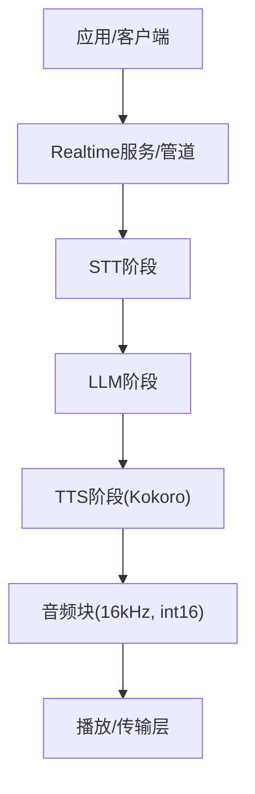
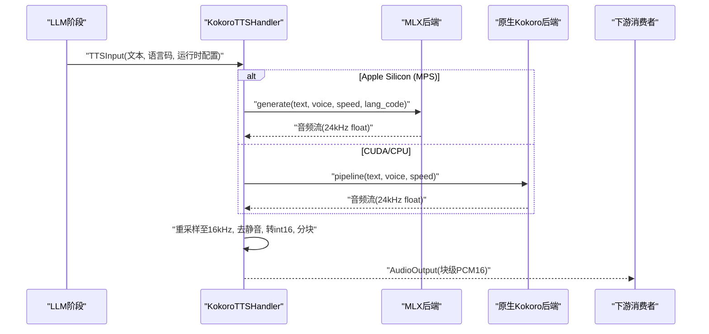
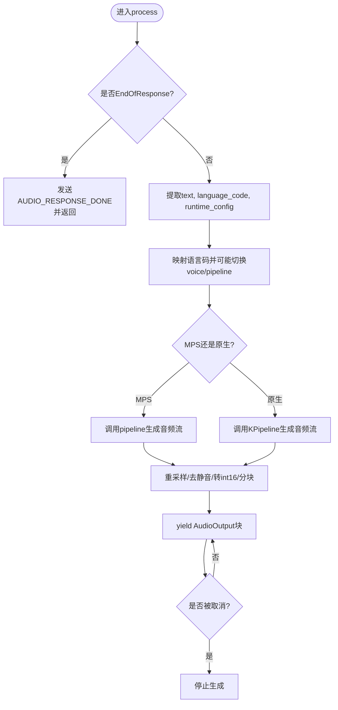
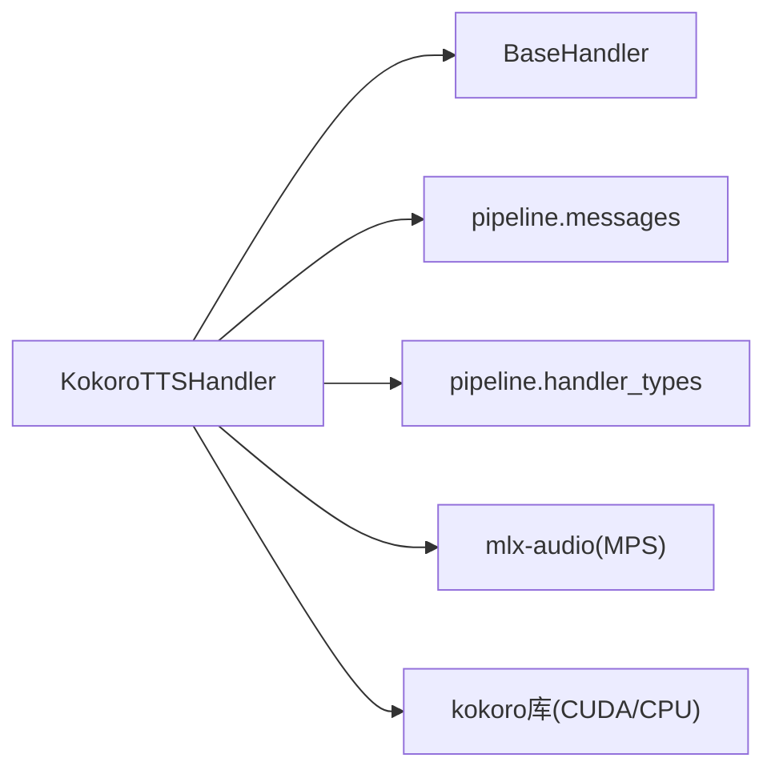

# Kokoro TTS后端

<cite>
**本文引用的文件**
- [kokoro_handler.py](file://src/speech_to_speech/TTS/kokoro_handler.py)
- [kokoro_tts_arguments.py](file://src/speech_to_speech/arguments_classes/kokoro_tts_arguments.py)
- [baseHandler.py](file://src/speech_to_speech/baseHandler.py)
- [handler_types.py](file://src/speech_to_speech/pipeline/handler_types.py)
- [messages.py](file://src/speech_to_speech/pipeline/messages.py)
- [TTS README.md](file://src/speech_to_speech/TTS/README.md)
- [项目总览 README.md](file://README.md)
- [OpenAI兼容TTS文档](file://docs/openai-compatible-tts.md)
</cite>

## 目录
1. [简介](#简介)
2. [项目结构](#项目结构)
3. [核心组件](#核心组件)
4. [架构总览](#架构总览)
5. [详细组件分析](#详细组件分析)
6. [依赖关系分析](#依赖关系分析)
7. [性能与内存优化](#性能与内存优化)
8. [故障排查指南](#故障排查指南)
9. [结论](#结论)
10. [附录：API与配置参考](#附录api与配置参考)

## 简介
本文件面向Kokoro TTS后端的集成与使用，覆盖其特点、模型加载与初始化、语音风格与语速控制、流式音频输出、与语音管道的集成方式、并发与取消策略、性能优化建议以及常见场景的最佳实践。Kokoro TTS在本项目中提供高质量的多语言语音合成能力，支持在Apple Silicon（MPS）通过mlx-audio运行，在CUDA/CPU上通过原生kokoro库运行，并具备自动设备选择、预加载多语言声音、运行时语言切换与低延迟流式输出等特性。

## 项目结构
围绕Kokoro TTS的关键代码位于以下位置：
- TTS处理器实现：src/speech_to_speech/TTS/kokoro_handler.py
- 参数定义：src/speech_to_speech/arguments_classes/kokoro_tts_arguments.py
- 管道基类与消息类型：src/speech_to_speech/baseHandler.py、src/speech_to_speech/pipeline/messages.py、src/speech_to_speech/pipeline/handler_types.py
- 使用说明与示例：src/speech_to_speech/TTS/README.md、README.md、docs/openai-compatible-tts.md

图表来源
- [kokoro_handler.py:76-152](file://src/speech_to_speech/TTS/kokoro_handler.py#L76-L152)
- [baseHandler.py:105-164](file://src/speech_to_speech/baseHandler.py#L105-L164)
- [messages.py:201-225](file://src/speech_to_speech/pipeline/messages.py#L201-L225)

章节来源
- [kokoro_handler.py:1-152](file://src/speech_to_speech/TTS/kokoro_handler.py#L1-L152)
- [baseHandler.py:1-186](file://src/speech_to_speech/baseHandler.py#L1-L186)
- [messages.py:1-225](file://src/speech_to_speech/pipeline/messages.py#L1-L225)
- [TTS README.md:62-78](file://src/speech_to_speech/TTS/README.md#L62-L78)
- [项目总览 README.md:166-192](file://README.md#L166-L192)

## 核心组件
- KokoroTTSHandler：基于BaseHandler实现的TTS处理器，负责模型加载、预热、文本到音频的流式生成、语言/声音切换、音频重采样与分块输出。
- 参数类KokoroTTSHandlerArguments：暴露CLI/配置项，如模型名、设备、声音、语言码、语速、块大小等。
- 管道消息与类型：TTSInput、AudioOutput、EndOfResponse等用于在VAD→STT→LLM→TTS流水线中传递数据与控制信号。
- 基类BaseHandler：统一处理输入队列消费、会话结束、异常日志、计时与输出封装。

章节来源
- [kokoro_handler.py:76-152](file://src/speech_to_speech/TTS/kokoro_handler.py#L76-L152)
- [kokoro_tts_arguments.py:1-39](file://src/speech_to_speech/arguments_classes/kokoro_tts_arguments.py#L1-L39)
- [handler_types.py:43-46](file://src/speech_to_speech/pipeline/handler_types.py#L43-L46)
- [messages.py:201-225](file://src/speech_to_speech/pipeline/messages.py#L201-L225)
- [baseHandler.py:25-186](file://src/speech_to_speech/baseHandler.py#L25-L186)

## 架构总览
Kokoro TTS作为TTS阶段接入整体语音管道，接收来自LLM阶段的文本片段，按流式方式输出固定大小的音频块。关键流程如下：
- 设备与模型选择：根据平台自动选择MLX或原生kokoro路径；可显式指定设备与模型名。
- 预热：启动时执行一次短推理以预热模型，降低首包延迟。
- 文本处理：从TTSInput提取文本、语言码、运行时配置与响应上下文；必要时根据语言码切换声音与管线。
- 音频生成与后处理：将24kHz浮点音频重采样至16kHz，裁剪静音，转换为int16并按块size分片输出。
- 取消与清理：支持中断当前生成；会话结束时恢复初始声音与语言状态。

图表来源
- [kokoro_handler.py:234-405](file://src/speech_to_speech/TTS/kokoro_handler.py#L234-L405)
- [messages.py:201-225](file://src/speech_to_speech/pipeline/messages.py#L201-L225)

章节来源
- [kokoro_handler.py:122-152](file://src/speech_to_speech/TTS/kokoro_handler.py#L122-L152)
- [kokoro_handler.py:215-232](file://src/speech_to_speech/TTS/kokoro_handler.py#L215-L232)
- [kokoro_handler.py:277-405](file://src/speech_to_speech/TTS/kokoro_handler.py#L277-L405)

## 详细组件分析

### 模型加载、初始化与配置
- 设备检测：当device为auto时，macOS走MPS，否则优先CUDA，回退CPU。
- 模型选择：MPS使用mlx-community/Kokoro-82M-bf16；其他平台使用hexgrad/Kokoro-82M。
- 后端初始化：
  - MPS：通过mlx_audio.tts.utils.load_model加载模型，获取对应语言的pipeline并预加载声音张量，同时预加载若干常用语言的声音以减少首次下载延迟。
  - 非MPS：通过kokoro.KPipeline(lang_code)初始化原生管线。
- 预热：调用一次短文本推理以预热模型，减少首包延迟。
- 会话结束：恢复初始voice与lang_code，重建或重置管线。

章节来源
- [kokoro_handler.py:87-152](file://src/speech_to_speech/TTS/kokoro_handler.py#L87-L152)
- [kokoro_handler.py:154-197](file://src/speech_to_speech/TTS/kokoro_handler.py#L154-L197)
- [kokoro_handler.py:198-232](file://src/speech_to_speech/TTS/kokoro_handler.py#L198-L232)
- [kokoro_handler.py:407-421](file://src/speech_to_speech/TTS/kokoro_handler.py#L407-L421)

### 支持的语音风格、语速与情感表达
- 语音风格：通过voice参数选择具体声音（例如bm_fable、af_heart等），不同语言有默认推荐声音。
- 语速控制：speed为倍率，>1加速，<1减速。
- 情感表达：当前实现未暴露独立的情感参数；可通过选择不同voice间接影响音色与风格。若需更细粒度控制，可在上层结合提示词或外部工具进行编排。

章节来源
- [kokoro_handler.py:31-73](file://src/speech_to_speech/TTS/kokoro_handler.py#L31-L73)
- [kokoro_handler.py:87-119](file://src/speech_to_speech/TTS/kokoro_handler.py#L87-L119)
- [kokoro_tts_arguments.py:19-34](file://src/speech_to_speech/arguments_classes/kokoro_tts_arguments.py#L19-L34)

### 文本输入处理与流式机制
- 输入：TTSInput包含text、language_code、runtime_config、response等上下文。
- 语言切换：根据传入的language_code映射到Kokoro语言码，必要时切换pipeline与voice。
- 流式输出：
  - MPS路径：直接调用已缓存的pipeline，避免每次重新加载voice。
  - 原生路径：迭代pipeline返回的(graphemes, phonemes, audio)。
- 音频后处理：
  - 重采样：24kHz→16kHz（scipy resample_poly up=2, down=3）。
  - 去静音：去除首尾约250ms静音，保留少量padding避免截断。
  - 格式转换：float32→int16，按blocksize切块，不足补齐。
- 取消与中断：通过CancelScope检查是否过时，及时终止生成。

图表来源
- [kokoro_handler.py:234-405](file://src/speech_to_speech/TTS/kokoro_handler.py#L234-L405)
- [messages.py:361-367](file://src/speech_to_speech/pipeline/messages.py#L361-L367)

章节来源
- [kokoro_handler.py:234-405](file://src/speech_to_speech/TTS/kokoro_handler.py#L234-L405)
- [messages.py:201-225](file://src/speech_to_speech/pipeline/messages.py#L201-L225)

### 与语音管道的集成
- 上游：LLM阶段产出TTSInput（含文本与语言信息）。
- 下游：TTS阶段输出AudioOutput（PCM16, 16kHz, 固定块大小），由播放/传输层消费。
- 控制：EndOfResponse用于标记响应结束；BaseHandler统一处理会话结束与清理。

章节来源
- [handler_types.py:43-46](file://src/speech_to_speech/pipeline/handler_types.py#L43-L46)
- [messages.py:180-225](file://src/speech_to_speech/pipeline/messages.py#L180-L225)
- [baseHandler.py:105-164](file://src/speech_to_speech/baseHandler.py#L105-L164)

## 依赖关系分析
- 运行时依赖：
  - MPS：mlx-audio及其TTS依赖（misaki、espeakng-loader）。
  - 非MPS：kokoro>=0.9.2、soundfile、系统级espeak-ng。
- 内部依赖：
  - BaseHandler：统一线程、队列、会话生命周期管理。
  - pipeline.messages：标准化消息类型与哨兵常量。
  - pipeline.handler_types：类型别名简化声明。
- 外部模型：
  - mlx-community/Kokoro-82M-bf16（MPS）
  - hexgrad/Kokoro-82M（CUDA/CPU）

图表来源
- [kokoro_handler.py:144-197](file://src/speech_to_speech/TTS/kokoro_handler.py#L144-L197)
- [baseHandler.py:25-186](file://src/speech_to_speech/baseHandler.py#L25-L186)
- [messages.py:1-225](file://src/speech_to_speech/pipeline/messages.py#L1-L225)
- [handler_types.py:43-46](file://src/speech_to_speech/pipeline/handler_types.py#L43-L46)

章节来源
- [kokoro_handler.py:144-197](file://src/speech_to_speech/TTS/kokoro_handler.py#L144-L197)
- [baseHandler.py:25-186](file://src/speech_to_speech/baseHandler.py#L25-L186)
- [messages.py:1-225](file://src/speech_to_speech/pipeline/messages.py#L1-L225)
- [handler_types.py:43-46](file://src/speech_to_speech/pipeline/handler_types.py#L43-L46)

## 性能与内存优化
- 设备选择：优先使用GPU（CUDA）以获得最佳吞吐；Apple Silicon使用MPS路径可获得良好性能。
- 预加载声音：对常用语言预加载声音张量，减少首次推理时的下载与加载开销。
- 流式分块：合理设置blocksize（默认512样本）平衡延迟与带宽；过大增加首包延迟，过小增加调度开销。
- 重采样质量：使用scipy polyphase重采样，兼顾速度与音质。
- 去静音：去除首尾静音减少无效数据传输，提升端到端感知延迟。
- 并发与取消：通过CancelScope及时中断过时生成，避免浪费计算资源。
- 内存管理：避免重复创建pipeline与voice张量；会话结束时恢复初始状态，防止状态泄漏。

[本节为通用指导，不直接分析具体文件]

## 故障排查指南
- 导入错误（MPS）：缺少mlx-audio或其TTS依赖（misaki、espeakng-loader）。安装相应依赖后可解决。
- 导入错误（CUDA/CPU）：缺少kokoro、soundfile或系统espeak-ng。按提示安装后重试。
- 语言切换失败：当检测到语言变化但切换失败时会记录警告并回退到当前语言；检查目标语言是否在支持范围内。
- 首包延迟高：确认已启用预热；检查网络与模型下载；适当增大playback buffer（针对外部TTS后端场景）。
- 音频卡顿：调整blocksize；确保下游播放器缓冲合理；检查重采样与分块逻辑是否正常。

章节来源
- [kokoro_handler.py:154-197](file://src/speech_to_speech/TTS/kokoro_handler.py#L154-L197)
- [kokoro_handler.py:288-305](file://src/speech_to_speech/TTS/kokoro_handler.py#L288-L305)
- [docs/openai-compatible-tts.md:76-115](file://docs/openai-compatible-tts.md#L76-L115)

## 结论
Kokoro TTS后端在本项目中提供了跨平台、高质量、低延迟的语音合成能力。通过自动设备选择、预加载声音、流式分块与取消机制，能够在多种硬件环境下稳定工作。结合管道消息与基类抽象，易于与其他组件集成，满足实时对话与语音代理的需求。

[本节为总结性内容，不直接分析具体文件]

## 附录：API与配置参考

### CLI与参数
- 启用Kokoro TTS：--tts kokoro
- 主要参数前缀：--kokoro_*
- 常用参数：
  - --kokoro_device：auto/cuda/mps/cpu
  - --kokoro_voice：声音标识（如bm_fable）
  - --kokoro_lang_code：语言码（a/b/e/f/h/i/j/p/z）
  - --kokoro_speed：语速倍率
  - --kokoro_blocksize：音频块大小（样本数）

章节来源
- [TTS README.md:62-78](file://src/speech_to_speech/TTS/README.md#L62-L78)
- [kokoro_tts_arguments.py:1-39](file://src/speech_to_speech/arguments_classes/kokoro_tts_arguments.py#L1-L39)

### 文本到音频接口（管道内）
- 输入：TTSInput（text, language_code, runtime_config, response等）
- 输出：AudioOutput（bytes或np.ndarray，PCM16, 16kHz, 固定块大小）
- 控制：EndOfResponse用于响应结束；AUDIO_RESPONSE_DONE为二进制哨兵

章节来源
- [messages.py:201-225](file://src/speech_to_speech/pipeline/messages.py#L201-L225)
- [messages.py:361-367](file://src/speech_to_speech/pipeline/messages.py#L361-L367)

### 典型使用场景与最佳实践
- 本地Mac快速体验：使用--mac-optimal-settings并结合--tts kokoro，自动选择MPS路径。
- 多语言对话：开启自动语言检测，让STT语言码驱动TTS语言与声音切换。
- 低延迟优化：启用预热、合理设置blocksize、使用GPU/MPS、避免不必要的模型重载。
- 外部TTS后端对比：如需HTTP流式TTS，可参考OpenAI兼容TTS文档中的播放缓冲与流式配置。

章节来源
- [项目总览 README.md:252-275](file://README.md#L252-L275)
- [docs/openai-compatible-tts.md:76-115](file://docs/openai-compatible-tts.md#L76-L115)