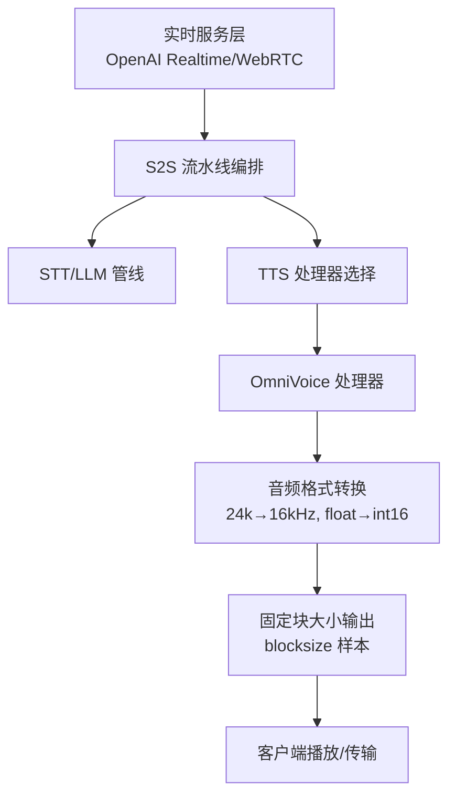
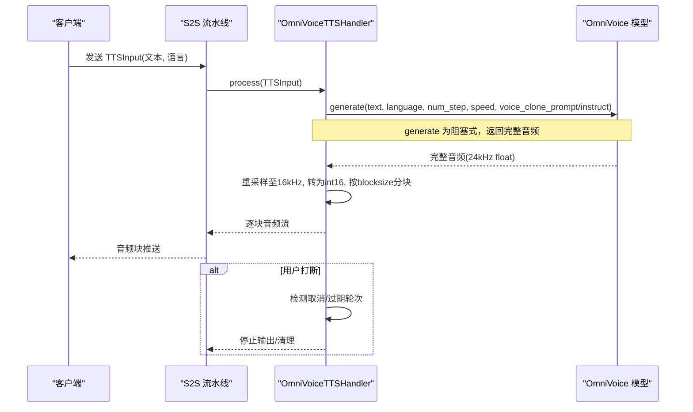
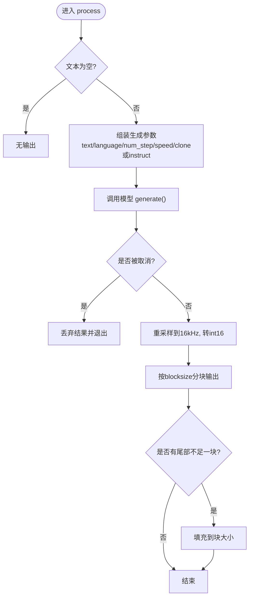
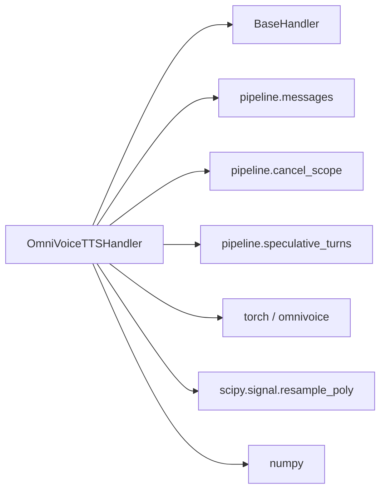

# OmniVoice TTS后端

<cite>
**本文引用的文件**
- [omnivoice_handler.py](file://src/speech_to_speech/TTS/omnivoice_handler.py)
- [omnivoice_tts_arguments.py](file://src/speech_to_speech/arguments_classes/omnivoice_tts_arguments.py)
- [test_omnivoice_tts_handler.py](file://tests/test_omnivoice_tts_handler.py)
- [README.md](file://README.md)
- [README-CN.md](file://README-CN.md)
- [TTS README（英文）](file://src/speech_to_speech/TTS/README.md)
- [TTS README（中文）](file://src/speech_to_speech/TTS/README-CN.md)
- [OpenAI 兼容 TTS 文档（英文）](file://docs/openai-compatible-tts.md)
- [OpenAI 兼容 TTS 文档（中文）](file://docs/openai-compatible-tts-CN.md)
</cite>

## 目录
1. [简介](#简介)
2. [项目结构](#项目结构)
3. [核心组件](#核心组件)
4. [架构总览](#架构总览)
5. [详细组件分析](#详细组件分析)
6. [依赖关系分析](#依赖关系分析)
7. [性能与延迟特性](#性能与延迟特性)
8. [生产部署最佳实践](#生产部署最佳实践)
9. [故障排查指南](#故障排查指南)
10. [API 参考与客户端示例](#api-参考与客户端示例)
11. [结论](#结论)

## 简介
本文件面向使用 OmniVoice 作为文本转语音后端的开发者，系统性说明其在 Speech-to-Speech 流水线中的角色、配置方式、运行时行为与生产部署要点。OmniVoice 提供跨语种语音合成能力，支持语音克隆、声音设计与自动选声，并在 CUDA、Intel XPU、Apple Silicon 等平台上运行。该实现将模型输出的 24 kHz 浮点音频统一重采样到流水线的 16 kHz int16 块，以适配下游播放与传输。

## 项目结构
- 处理器实现位于 TTS 模块：
  - 核心处理逻辑：[omnivoice_handler.py](file://src/speech_to_speech/TTS/omnivoice_handler.py)
  - 参数定义：[omnivoice_tts_arguments.py](file://src/speech_to_speech/arguments_classes/omnivoice_tts_arguments.py)
- 测试覆盖关键路径：
  - [test_omnivoice_tts_handler.py](file://tests/test_omnivoice_tts_handler.py)
- 顶层与组件级文档：
  - 项目总览与安装、命令、多语言支持等：[README.md](file://README.md)、[README-CN.md](file://README-CN.md)
  - TTS 组件总览与 OmniVoice 使用说明：[TTS README（英文）](file://src/speech_to_speech/TTS/README.md)、[TTS README（中文）](file://src/speech_to_speech/TTS/README-CN.md)
  - OpenAI 兼容 TTS 端点（用于对比与集成场景）：[OpenAI 兼容 TTS 文档（英文）](file://docs/openai-compatible-tts.md)、[OpenAI 兼容 TTS 文档（中文）](file://docs/openai-compatible-tts-CN.md)

图表来源
- [omnivoice_handler.py:24-179](file://src/speech_to_speech/TTS/omnivoice_handler.py#L24-L179)
- [TTS README（英文）:206-248](file://src/speech_to_speech/TTS/README.md#L206-L248)

章节来源
- [README.md:166-193](file://README.md#L166-L193)
- [TTS README（英文）:206-248](file://src/speech_to_speech/TTS/README.md#L206-L248)

## 核心组件
- OmniVoiceTTSHandler：封装模型加载、设备选择、语音克隆提示构建、生成调用、音频重采样与分块输出，并支持取消与推测轮次清理。
- 参数类 OmniVoiceTTSHandlerArguments：暴露 CLI/配置项，包括模型名、设备、精度、参考音频/文本、保存的克隆提示、指令、语言、扩散步数、语速、块大小等。

章节来源
- [omnivoice_handler.py:24-179](file://src/speech_to_speech/TTS/omnivoice_handler.py#L24-L179)
- [omnivoice_tts_arguments.py:5-59](file://src/speech_to_speech/arguments_classes/omnivoice_tts_arguments.py#L5-L59)

## 架构总览
OmniVoice 处理器在 S2S 流水线中承担“文本→音频”的转换职责。其输入为 TTSInput（含文本与可选语言），输出为按固定块大小切分的 int16 音频流。处理器内部：
- 启动时根据设备策略加载模型，并可预计算 VoiceClonePrompt（来自参考音频或已保存的提示）。
- 每次处理时组装生成参数（文本、语言、步数、语速、克隆提示或指令），调用模型的 generate()。
- 将模型返回的完整 24 kHz 浮点音频重采样至 16 kHz，裁剪为 int16，并按 blocksize 切片输出；若尾部不足一块则填充。
- 支持中断：在阻塞生成期间或分块输出期间检查取消状态，必要时丢弃结果并停止输出。
- 与推测轮次机制协作：对过期轮次的 EndOfResponse 进行清理标记，避免无效输出到达客户端。

图表来源
- [omnivoice_handler.py:99-179](file://src/speech_to_speech/TTS/omnivoice_handler.py#L99-L179)
- [test_omnivoice_tts_handler.py:180-227](file://tests/test_omnivoice_tts_handler.py#L180-L227)

## 详细组件分析

### OmniVoiceTTSHandler 类
- 初始化与校验
  - 校验 blocksize、num_steps、speed 为正数；ref_audio/ref_text 必须成对出现；voice_clone_prompt 与 ref_audio 互斥；instruct 不能与克隆配置同时设置。
  - 动态导入 omnivoice，解析 dtype 映射，自动选择设备（CUDA/XPU/MPS/CPU）。
  - 加载模型并准备 VoiceClonePrompt（从参考音频创建或加载已保存提示）。
- 处理流程
  - 过滤空文本；组装 generation_kwargs（text、language、num_step、speed、voice_clone_prompt 或 instruct）。
  - 调用 model.generate() 获取完整音频；若被取消则丢弃结果。
  - 将 24 kHz 浮点音频重采样到 16 kHz，转换为 int16，按 blocksize 分块输出；尾部不足一块时填充。
  - 支持 SpeculativeTurnTracker：对过期轮次的终端消息进行清理标记，确保仅最新有效输出到达客户端。
- 错误与边界
  - 参数非法抛出 ValueError。
  - 生成期间或输出期间检测到取消立即终止。
  - 对非最新轮次的输入直接丢弃，避免竞态导致的重复输出。

图表来源
- [omnivoice_handler.py:102-179](file://src/speech_to_speech/TTS/omnivoice_handler.py#L102-L179)

章节来源
- [omnivoice_handler.py:24-179](file://src/speech_to_speech/TTS/omnivoice_handler.py#L24-L179)
- [test_omnivoice_tts_handler.py:62-158](file://tests/test_omnivoice_tts_handler.py#L62-L158)
- [test_omnivoice_tts_handler.py:161-227](file://tests/test_omnivoice_tts_handler.py#L161-L227)

### 参数与配置
- 模型与设备
  - omnivoice_model_name：Hugging Face 模型 ID 或本地路径。
  - omnivoice_device：auto/cuda/cuda:0/mps/xpu/cpu。
  - omnivoice_dtype：float16/bfloat16,float32。
- 语音克隆与声音设计
  - omnivoice_ref_audio + omnivoice_ref_text：参考音频与对应转写，用于创建克隆提示。
  - omnivoice_voice_clone_prompt：已保存的 VoiceClonePrompt 路径，替代参考音频。
  - omnivoice_instruct：声音设计指令（如性别、音高、口音），与克隆配置互斥。
- 语言与生成控制
  - omnivoice_language：目标语言名称或代码；未设置时沿用每句传入的语言。
  - omnivoice_num_steps：扩散解码步数（默认 32）。
  - omnivoice_speed：语速因子（>1 更快，<1 更慢）。
  - omnivoice_blocksize：输出块大小（16 kHz 下的样本数，默认 512）。

章节来源
- [omnivoice_tts_arguments.py:5-59](file://src/speech_to_speech/arguments_classes/omnivoice_tts_arguments.py#L5-L59)
- [TTS README（英文）:206-248](file://src/speech_to_speech/TTS/README.md#L206-L248)
- [TTS README（中文）:205-247](file://src/speech_to_speech/TTS/README-CN.md#L205-L247)

### 多模态与跨平台兼容性
- 多模态能力
  - 支持语音克隆（参考音频+文本或已保存提示）、声音设计（自然语言指令）、自动选声（不设置克隆/指令时由模型决定）。
- 跨平台
  - 支持 CUDA、Intel XPU、Apple Silicon（MPS）、CPU；dtype 随设备能力选择。
  - 通过自动设备检测与参数化配置，便于在不同硬件上部署。

章节来源
- [README.md:166-193](file://README.md#L166-L193)
- [README-CN.md:166-193](file://README-CN.md#L166-L193)
- [omnivoice_handler.py:78-98](file://src/speech_to_speech/TTS/omnivoice_handler.py#L78-L98)

### 注意力机制与声码器集成
- 当前处理器不直接实现注意力或声码器细节，而是调用上游 OmniVoice 模型的 generate() 完成端到端合成。
- 处理器负责：
  - 将模型输出（24 kHz float）重采样到流水线标准（16 kHz int16）。
  - 按固定块大小输出，满足下游播放与传输需求。
- 如需深入注意力/声码器层面优化，需在上游模型或推理框架侧调整。

章节来源
- [omnivoice_handler.py:145-179](file://src/speech_to_speech/TTS/omnivoice_handler.py#L145-L179)
- [TTS README（英文）:206-248](file://src/speech_to_speech/TTS/README.md#L206-L248)

### 实时处理能力
- 生成阶段为阻塞式：首个音频块需等待整句合成完成后才可用。
- 输出阶段为分块流式：按 blocksize 逐步输出，支持中断与推测轮次清理。
- 可通过 num_steps、speed、device、dtype 调节首包延迟与吞吐。

章节来源
- [TTS README（英文）:206-248](file://src/speech_to_speech/TTS/README.md#L206-L248)
- [omnivoice_handler.py:145-179](file://src/speech_to_speech/TTS/omnivoice_handler.py#L145-L179)

## 依赖关系分析
- 外部依赖
  - torch：设备与 dtype 管理。
  - omnivoice：模型加载与生成接口。
  - scipy.signal：音频重采样。
  - numpy：数组操作与类型转换。
- 内部依赖
  - BaseHandler：统一处理器基类。
  - pipeline 消息与类型：TTSIn/TTSOut、EndOfResponse、AUDIO_RESPONSE_DONE。
  - cancel_scope/speculative_turns：中断与推测轮次清理。

图表来源
- [omnivoice_handler.py:1-22](file://src/speech_to_speech/TTS/omnivoice_handler.py#L1-L22)
- [omnivoice_handler.py:12-17](file://src/speech_to_speech/TTS/omnivoice_handler.py#L12-L17)

章节来源
- [omnivoice_handler.py:1-22](file://src/speech_to_speech/TTS/omnivoice_handler.py#L1-L22)

## 性能与延迟特性
- 首包延迟
  - 由于 generate() 阻塞且返回完整音频，首包延迟包含整句合成时间。
  - 可通过减少 num_steps、提高 speed、选择合适 device/dtype 降低延迟。
- 吞吐与并发
  - 每个请求独立调用模型生成；在高并发场景下建议结合负载均衡与实例扩容。
- 音频质量
  - 重采样到 16 kHz 以满足流水线一致性；如需更高保真可在上游模型或后续处理链调整。
- 中断与资源释放
  - 支持在生成与输出阶段检测取消，及时停止并释放资源，避免浪费。

章节来源
- [TTS README（英文）:206-248](file://src/speech_to_speech/TTS/README.md#L206-L248)
- [omnivoice_handler.py:145-179](file://src/speech_to_speech/TTS/omnivoice_handler.py#L145-L179)

## 生产部署最佳实践
- 负载均衡
  - 使用反向代理（如 Nginx/HAProxy）将请求分发到多个 S2S 实例；每个实例可绑定不同 GPU/XPU 设备。
- 故障恢复
  - 健康检查：启动时执行一次简短合成验证端点/模型可用性（参考 OpenAI 兼容 TTS 的启动探测思路）。
  - 优雅关闭：在会话断开或取消时关闭活动连接并清理缓存（如克隆提示）。
- 性能监控
  - 指标采集：首包延迟、端到端延迟、GPU/XPU 利用率、内存占用、错误率。
  - 日志规范：记录设备、dtype、num_steps、speed、语言、块大小等关键参数，便于定位问题。
- 安全与合规
  - 语音克隆需授权与同意；遵循上游模型许可与安全声明，禁止滥用。

章节来源
- [OpenAI 兼容 TTS 文档（英文）:117-144](file://docs/openai-compatible-tts.md#L117-L144)
- [OpenAI 兼容 TTS 文档（中文）:86-102](file://docs/openai-compatible-tts-CN.md#L86-L102)
- [TTS README（英文）:245-248](file://src/speech_to_speech/TTS/README.md#L245-L248)
- [TTS README（中文）:245-247](file://src/speech_to_speech/TTS/README-CN.md#L245-L247)

## 故障排查指南
- 常见错误
  - 参数非法：blocksize/num_steps/speed 必须为正；ref_audio/ref_text 必须成对；voice_clone_prompt 与 ref_audio 互斥；instruct 不可与克隆配置共存。
  - 设备不支持：dtype 与设备不匹配导致加载失败；确认设备可用性与驱动版本。
- 调试步骤
  - 检查设备选择与 dtype 映射是否正确。
  - 验证参考音频与转写是否一致，或已保存提示路径是否有效。
  - 观察生成期间是否触发取消；必要时调整 blocksize 与 num_steps。
- 测试用例参考
  - 克隆提示复用、语言传递、重采样与分块、取消与过期轮次清理等行为均有测试覆盖。

章节来源
- [omnivoice_handler.py:43-67](file://src/speech_to_speech/TTS/omnivoice_handler.py#L43-L67)
- [test_omnivoice_tts_handler.py:62-158](file://tests/test_omnivoice_tts_handler.py#L62-L158)
- [test_omnivoice_tts_handler.py:161-227](file://tests/test_omnivoice_tts_handler.py#L161-L227)

## API 参考与客户端示例
- 服务端启用 OmniVoice
  - 安装可选依赖并选择设备与克隆/设计模式。
  - 示例命令参见 TTS 组件文档与项目总览。
- 客户端接入
  - 通过 OpenAI Realtime 协议连接服务器，发送 session.update 与 input_audio_buffer.append，接收 speech start/stop、流式转写、音频增量与 response.done。
  - 对于仅客户端的 TTS 服务（如 vLLM-Omni），可使用 OpenAI 兼容端点，将 LLM 文本转发到 /v1/audio/speech，并处理 PCM16/WAV 响应。

章节来源
- [README.md:296-333](file://README.md#L296-L333)
- [README-CN.md:286-323](file://README-CN.md#L286-L323)
- [TTS README（英文）:206-248](file://src/speech_to_speech/TTS/README.md#L206-L248)
- [OpenAI 兼容 TTS 文档（英文）:1-144](file://docs/openai-compatible-tts.md#L1-L144)
- [OpenAI 兼容 TTS 文档（中文）:1-102](file://docs/openai-compatible-tts-CN.md#L1-L102)

## 结论
OmniVoice TTS 后端在 Speech-to-Speech 流水线中提供了强大的多语种语音合成能力，支持语音克隆、声音设计与自动选声，并在多种硬件平台上稳定运行。尽管生成阶段为阻塞式，但通过合理的参数调优与分块输出机制，可满足低延迟与高吞吐的生产需求。结合负载均衡、健康检查、监控与合规策略，可实现可靠、可扩展的语音服务部署。