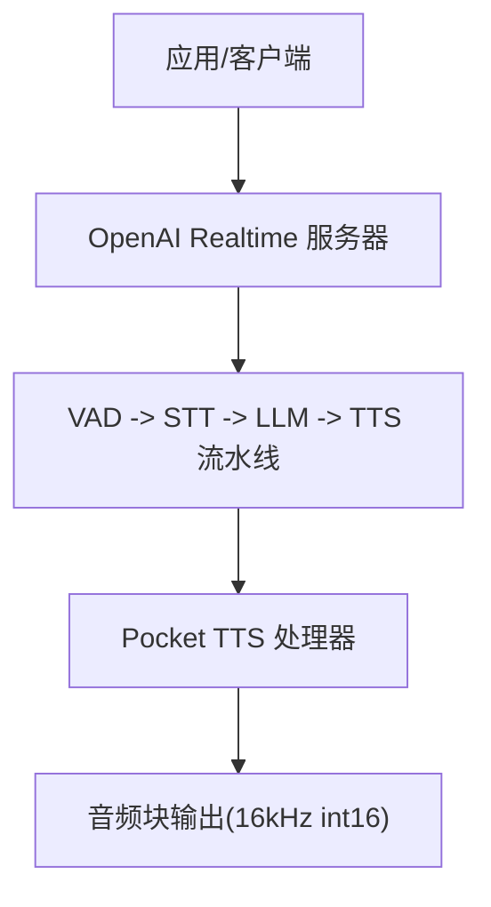
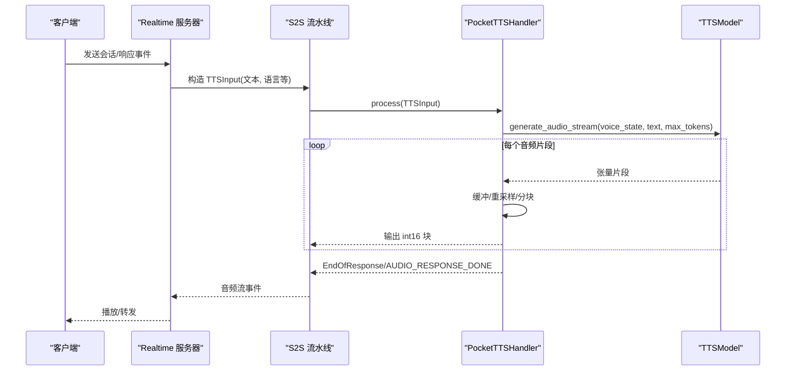
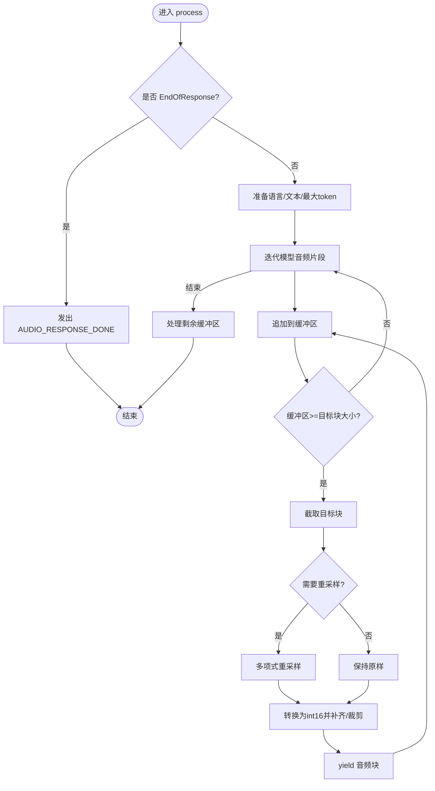
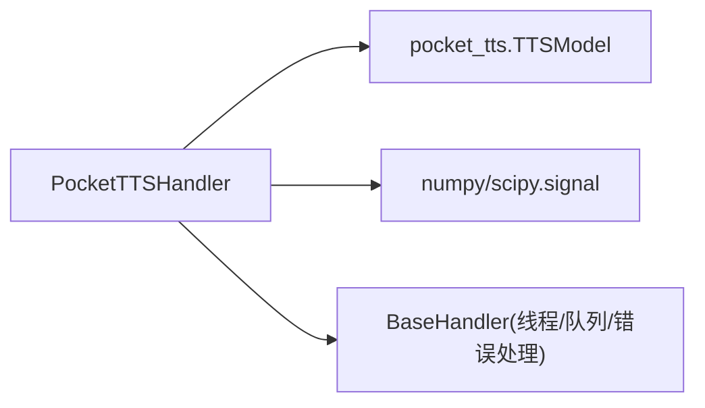
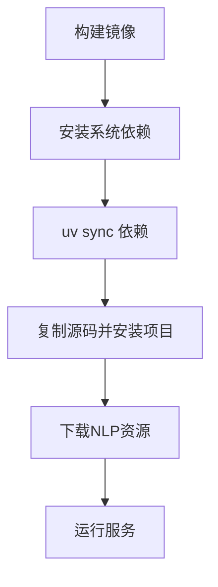
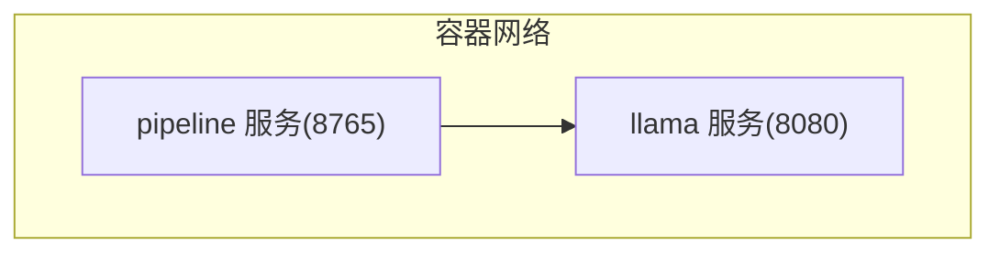

# Pocket TTS后端

<cite>
**本文引用的文件**
- [pocket_tts_handler.py](file://src/speech_to_speech/TTS/pocket_tts_handler.py)
- [pocket_tts_arguments.py](file://src/speech_to_speech/arguments_classes/pocket_tts_arguments.py)
- [test_pocket_tts_handler.py](file://tests/test_pocket_tts_handler.py)
- [README-CN.md](file://README-CN.md)
- [TTS README-CN.md](file://src/speech_to_speech/TTS/README-CN.md)
- [Dockerfile](file://Dockerfile)
- [docker-compose.yml](file://docker-compose.yml)
- [baseHandler.py](file://src/speech_to_speech/baseHandler.py)
</cite>

## 目录
1. [简介](#简介)
2. [项目结构](#项目结构)
3. [核心组件](#核心组件)
4. [架构总览](#架构总览)
5. [详细组件分析](#详细组件分析)
6. [依赖关系分析](#依赖关系分析)
7. [性能与资源优化](#性能与资源优化)
8. [部署指南](#部署指南)
9. [故障排查与调试](#故障排查与调试)
10. [结论](#结论)
11. [附录：参数与集成示例](#附录参数与集成示例)

## 简介
Pocket TTS 是 speech-to-speech 流水线中的文本转语音（TTS）后端之一，基于 Kyutai Labs 的 Pocket TTS 模型，支持流式音频生成与声音克隆。该实现以轻量、低延迟为目标，适配边缘设备与受限环境，提供 CPU/GPU/MPS 多设备运行能力，并在内部进行采样率转换与块化输出，便于下游播放与实时传输。

## 项目结构
- TTS 处理器位于 src/speech_to_speech/TTS/pocket_tts_handler.py，继承自通用基类 BaseHandler，遵循统一的输入/输出队列与生命周期管理。
- 配置参数通过 dataclass 暴露为 CLI 选项，前缀为 pocket_tts_*。
- 测试覆盖语言加载等关键路径，确保不同语言配置正确传入底层模型。
- 文档与使用入口在仓库根 README 与 TTS 模块 README 中。

图表来源
- [README-CN.md:18-22](file://README-CN.md#L18-L22)
- [TTS README-CN.md:47-61](file://src/speech_to_speech/TTS/README-CN.md#L47-L61)

章节来源
- [README-CN.md:18-22](file://README-CN.md#L18-L22)
- [TTS README-CN.md:47-61](file://src/speech_to_speech/TTS/README-CN.md#L47-L61)

## 核心组件
- PocketTTSHandler：封装 Pocket TTS 模型的加载、设备迁移、声音状态获取与流式音频生成；负责将模型输出的浮点音频重采样到目标采样率并分块为固定大小的 int16 数据块。
- PocketTTSHandlerArguments：定义 CLI 参数，包括设备、声音、采样率、块大小、最大 token 数、语言等。
- 基类 BaseHandler：提供线程化运行、错误处理、计时日志、取消与陈旧请求丢弃等通用能力。

章节来源
- [pocket_tts_handler.py:22-92](file://src/speech_to_speech/TTS/pocket_tts_handler.py#L22-L92)
- [pocket_tts_arguments.py:4-36](file://src/speech_to_speech/arguments_classes/pocket_tts_arguments.py#L4-L36)
- [baseHandler.py:25-186](file://src/speech_to_speech/baseHandler.py#L25-L186)

## 架构总览
Pocket TTS 处理器作为 TTS 阶段的一个可插拔后端，接收来自上游的文本与元信息，调用底层 TTSModel 的流式生成接口，按目标采样率和块大小产出音频块，并通过流水线队列回传。

图表来源
- [pocket_tts_handler.py:102-234](file://src/speech_to_speech/TTS/pocket_tts_handler.py#L102-L234)
- [baseHandler.py:105-164](file://src/speech_to_speech/baseHandler.py#L105-L164)

## 详细组件分析

### PocketTTSHandler 类
- 初始化与设备迁移：根据 device 参数将模型移动到 CPU/CUDA/MPS；加载指定语言的模型与声音状态。
- 流式生成与缓冲：从模型迭代获取音频片段，累积到缓冲区，达到目标块大小后输出；若模型采样率与目标不一致，则使用多项式重采样进行转换。
- 取消与陈旧请求：结合 CancelScope 与 SpeculativeTurnTracker 丢弃过时或已取消的请求，避免无效计算。
- 日志与性能：重写最小日志阈值以减少高频小块带来的日志噪音；记录首包时间用于端到端延迟评估。

图表来源
- [pocket_tts_handler.py:102-234](file://src/speech_to_speech/TTS/pocket_tts_handler.py#L102-L234)

章节来源
- [pocket_tts_handler.py:22-92](file://src/speech_to_speech/TTS/pocket_tts_handler.py#L22-L92)
- [pocket_tts_handler.py:102-234](file://src/speech_to_speech/TTS/pocket_tts_handler.py#L102-L234)

### 参数与配置
- 设备：cpu/cuda/mps，默认 cpu。
- 声音：预设名称或本地/HF 路径。
- 采样率：默认 16000 Hz，内部模型可能为 24000 Hz，自动重采样。
- 块大小：默认 512，控制每次 yield 的样本数。
- 最大 token：默认 50，限制单次生成的 token 数量。
- 语言：选择模型配置，如 english、french_24l 等。

章节来源
- [pocket_tts_arguments.py:4-36](file://src/speech_to_speech/arguments_classes/pocket_tts_arguments.py#L4-L36)
- [pocket_tts_handler.py:28-64](file://src/speech_to_speech/TTS/pocket_tts_handler.py#L28-L64)

### 测试要点
- 验证 setup 时能正确将 language 参数传递给底层 load_model。
- 通过 monkeypatch 注入 fake model，断言加载的语言列表。

章节来源
- [test_pocket_tts_handler.py:10-43](file://tests/test_pocket_tts_handler.py#L10-L43)

## 依赖关系分析
- 运行时依赖：numpy、scipy.signal.resample_poly、torch（由底层 pocket_tts 引入）、rich（控制台输出）。
- 外部库：pocket_tts.TTSModel，负责模型加载与流式生成。
- 流水线集成：BaseHandler 提供的线程、队列、错误处理与计时机制。

图表来源
- [pocket_tts_handler.py:71-92](file://src/speech_to_speech/TTS/pocket_tts_handler.py#L71-L92)
- [baseHandler.py:25-186](file://src/speech_to_speech/baseHandler.py#L25-L186)

章节来源
- [pocket_tts_handler.py:71-92](file://src/speech_to_speech/TTS/pocket_tts_handler.py#L71-L92)
- [baseHandler.py:25-186](file://src/speech_to_speech/baseHandler.py#L25-L186)

## 性能与资源优化
- 内存与缓冲策略：
  - 使用音频缓冲区累积模型片段，仅在达到目标块大小时输出，减少频繁 I/O 与拷贝开销。
  - 重采样采用多项式滤波器，避免多次重采样导致的精度损失。
  - 输出统一为 int16 并精确补齐/裁剪至 blocksize，便于下游播放器稳定消费。
- 采样率转换：
  - 当模型采样率与目标不一致时，计算 up/down 因子并使用 resample_poly 进行高效转换。
- 日志与监控：
  - 提高最小日志阈值，抑制高频小块产生的日志噪音。
  - 记录首包时间，便于端到端延迟评估。
- 取消与陈旧请求：
  - 结合 CancelScope 与 SpeculativeTurnTracker，及时中断或丢弃过时请求，节省算力。
- 设备选择：
  - 支持 CPU/CUDA/MPS，根据硬件条件选择最优设备以降低延迟与能耗。

章节来源
- [pocket_tts_handler.py:94-101](file://src/speech_to_speech/TTS/pocket_tts_handler.py#L94-L101)
- [pocket_tts_handler.py:137-206](file://src/speech_to_speech/TTS/pocket_tts_handler.py#L137-L206)
- [pocket_tts_handler.py:166-171](file://src/speech_to_speech/TTS/pocket_tts_handler.py#L166-L171)
- [baseHandler.py:144-164](file://src/speech_to_speech/baseHandler.py#L144-L164)

## 部署指南

### Docker 容器化
- 基础镜像：nvidia/cuda:12.8.1-cudnn-runtime-ubuntu24.04，预装 Python 环境与必要系统库。
- 安装流程：使用 uv 同步依赖，复制项目代码并执行二次同步以安装项目本身。
- 预下载 NLP 资源：启动时下载 punkt_tab 与 averaged_perceptron_tagger_eng，确保离线可用。

图表来源
- [Dockerfile:1-28](file://Dockerfile#L1-L28)

章节来源
- [Dockerfile:1-28](file://Dockerfile#L1-L28)

### docker-compose 编排
- 服务组成：llama.cpp 推理服务 + speech-to-speech 流水线服务。
- GPU 资源预留：通过 deploy.resources.reservations.devices 指定 NVIDIA GPU。
- 端口映射：8080（LLM）、8765（Realtime 服务）。

图表来源
- [docker-compose.yml:1-70](file://docker-compose.yml#L1-L70)

章节来源
- [docker-compose.yml:1-70](file://docker-compose.yml#L1-L70)

### 本地安装与配置
- 可选依赖：通过 extras 安装 pocket 扩展以启用 Pocket TTS。
- 命令示例：使用 --tts pocket 并设置 voice、device、sample_rate 等参数。
- 离线运行：提前在线启动一次以缓存模型与资源，随后设置 HF_HUB_OFFLINE=1 在无网环境下运行。

章节来源
- [README-CN.md:137-155](file://README-CN.md#L137-L155)
- [README-CN.md:489-505](file://README-CN.md#L489-L505)
- [TTS README-CN.md:47-61](file://src/speech_to_speech/TTS/README-CN.md#L47-L61)

## 故障排查与调试
- 常见问题定位：
  - 设备不匹配：确认 device 参数与实际硬件一致（cuda/mps/cpu）。
  - 采样率不一致：检查 sample_rate 与模型内部采样率差异，必要时调整 blocksize。
  - 声音加载失败：确认 voice 名称或路径有效，HF 路径需具备访问权限。
- 日志与调试：
  - 提高日志级别观察模型加载与设备迁移过程。
  - 关注首包时间与处理耗时，识别瓶颈环节。
- 错误处理：
  - 基类捕获 process 异常并记录，避免线程崩溃。
  - 对陈旧请求与取消信号进行处理，防止无效计算。

章节来源
- [baseHandler.py:144-164](file://src/speech_to_speech/baseHandler.py#L144-L164)
- [pocket_tts_handler.py:66-85](file://src/speech_to_speech/TTS/pocket_tts_handler.py#L66-L85)
- [pocket_tts_handler.py:166-171](file://src/speech_to_speech/TTS/pocket_tts_handler.py#L166-L171)

## 结论
Pocket TTS 后端在 speech-to-speech 流水线中提供了轻量、低延迟的文本转语音能力，支持流式生成、声音克隆与多设备运行。通过合理的缓冲与重采样策略、取消与陈旧请求处理、以及容器化部署方案，能够在资源受限环境中高效运行。结合 CLI 参数与测试用例，用户可快速配置与验证不同语言与声音效果。

## 附录：参数与集成示例

### 常用 CLI 参数
- --tts pocket：启用 Pocket TTS 后端。
- --pocket_tts_device：设备选择（cpu/cuda/mps）。
- --pocket_tts_voice：声音预设或路径。
- --pocket_tts_sample_rate：输出采样率（默认 16000）。
- --pocket_tts_blocksize：音频块大小（默认 512）。
- --pocket_tts_max_tokens：最大 token 数（默认 50）。
- --pocket_tts_language：模型语言配置（如 english、french_24l）。

章节来源
- [pocket_tts_arguments.py:4-36](file://src/speech_to_speech/arguments_classes/pocket_tts_arguments.py#L4-L36)
- [TTS README-CN.md:47-61](file://src/speech_to_speech/TTS/README-CN.md#L47-L61)

### 集成与迁移
- 与 OpenAI Realtime 集成：通过 WebSocket/WebRTC 事件集接入，TTS 输出以音频块形式返回。
- 迁移到其他 TTS 后端：替换 --tts 参数与对应的前缀参数即可切换后端，无需改动上层逻辑。
- 与 LLM 代理配合：可在同一服务中并行运行 LLM 代理任务，互不干扰。

章节来源
- [README-CN.md:286-343](file://README-CN.md#L286-L343)
- [README-CN.md:324-343](file://README-CN.md#L324-L343)