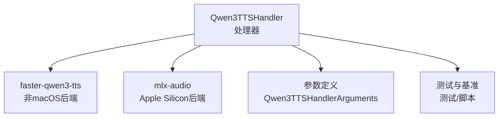
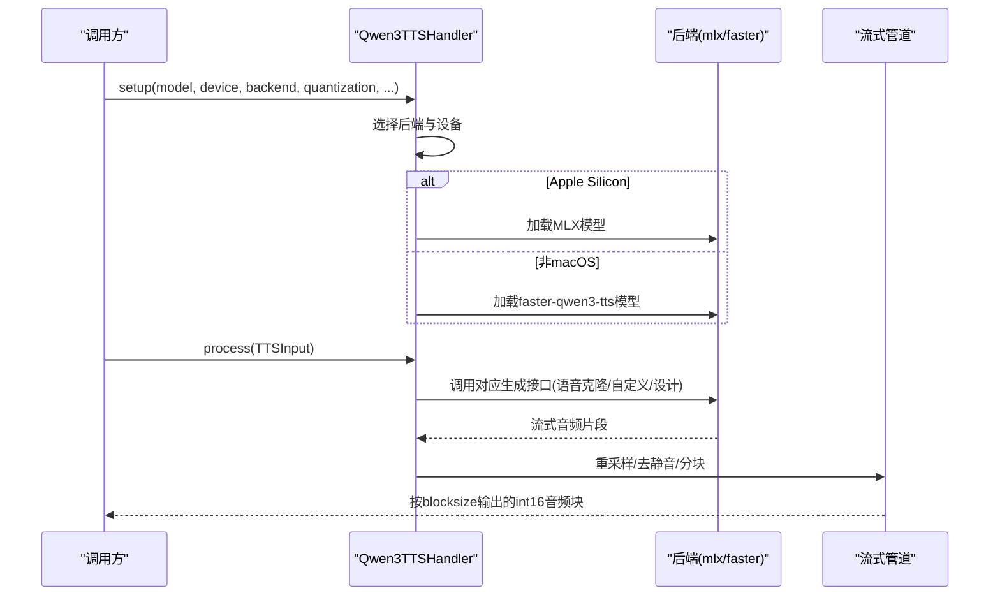
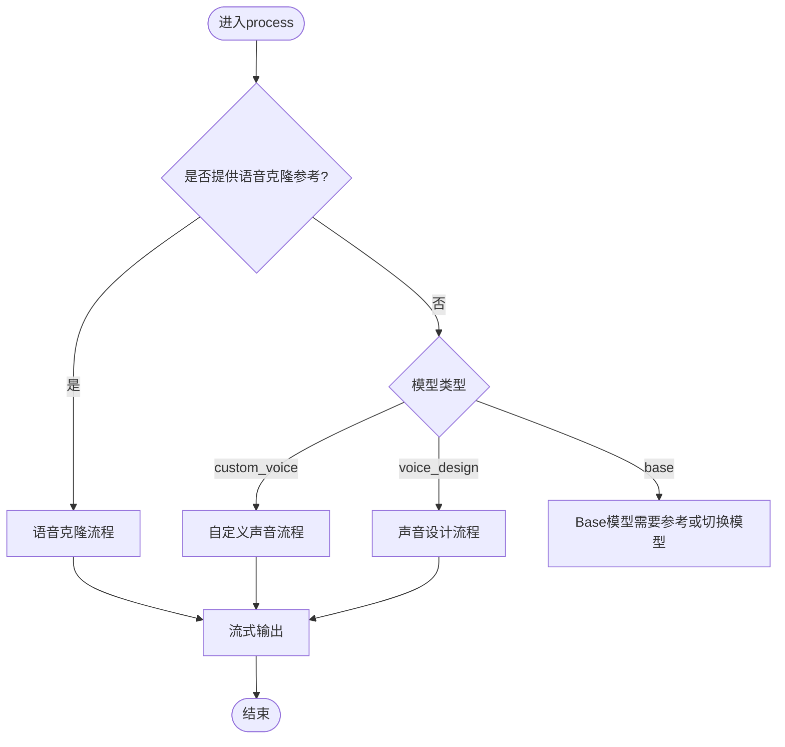
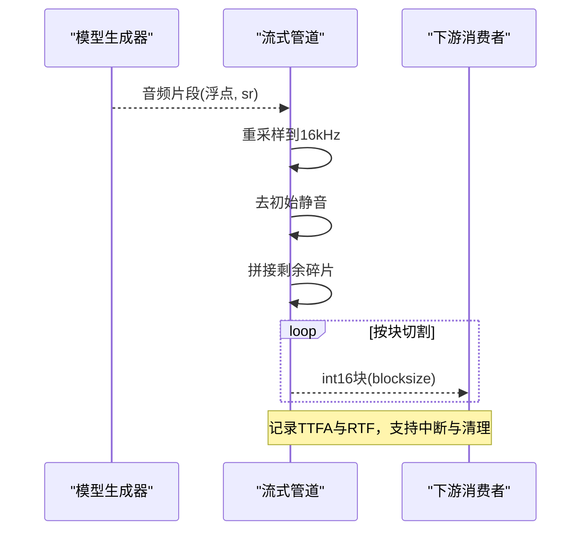
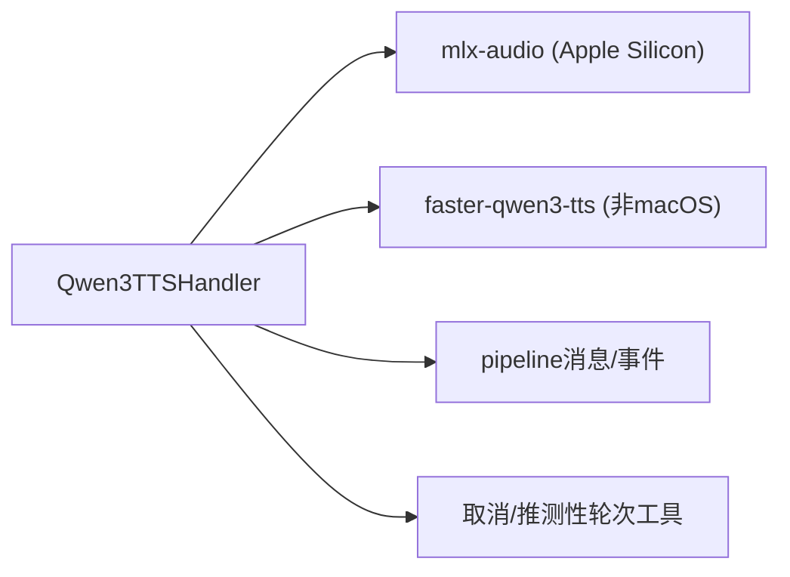

# Qwen3-TTS后端

<cite>
**本文引用的文件**
- [qwen3_tts_handler.py](file://src/speech_to_speech/TTS/qwen3_tts_handler.py)
- [qwen3_tts_arguments.py](file://src/speech_to_speech/arguments_classes/qwen3_tts_arguments.py)
- [test_qwen3_tts_handler_backend.py](file://tests/test_qwen3_tts_handler_backend.py)
- [benchmark_tts.py](file://scripts/benchmark_tts.py)
</cite>

## 目录
1. [简介](#简介)
2. [项目结构](#项目结构)
3. [核心组件](#核心组件)
4. [架构总览](#架构总览)
5. [详细组件分析](#详细组件分析)
6. [依赖关系分析](#依赖关系分析)
7. [性能考量](#性能考量)
8. [故障排除指南](#故障排除指南)
9. [结论](#结论)
10. [附录：配置与使用示例](#附录配置与使用示例)

## 简介
本文件为Qwen3-TTS后端的完整技术文档，聚焦其作为默认TTS后端的实现原理、三种生成模式（语音克隆、自定义声音、声音设计）、流式音频生成与实时播放机制、缓冲区管理、配置选项、硬件要求、性能基准方法与常见问题排查。该后端在Apple Silicon上通过MLX-Audio加载量化模型，在非macOS平台则通过faster-qwen3-tts提供低延迟流式推理。

## 项目结构
Qwen3-TTS后端位于TTS模块中，由处理器类、参数定义与测试/基准脚本组成：
- 处理器：负责设备选择、模型加载、流式生成、缓冲与输出
- 参数：集中声明所有可配置项及默认值
- 测试：覆盖平台分支、参数校验、流式行为与边界条件
- 基准：统一测量TTFA、RTF、首块时间等指标

图表来源
- [qwen3_tts_handler.py:93-199](file://src/speech_to_speech/TTS/qwen3_tts_handler.py#L93-L199)
- [qwen3_tts_arguments.py:5-135](file://src/speech_to_speech/arguments_classes/qwen3_tts_arguments.py#L5-L135)

章节来源
- [qwen3_tts_handler.py:93-199](file://src/speech_to_speech/TTS/qwen3_tts_handler.py#L93-L199)
- [qwen3_tts_arguments.py:5-135](file://src/speech_to_speech/arguments_classes/qwen3_tts_arguments.py#L5-L135)

## 核心组件
- Qwen3TTSHandler：统一封装两种后端，自动选择设备与模型，处理三种生成模式，提供流式输出与缓冲管理
- 参数集：集中管理模型名、量化、设备、语言、流式块大小、最大token数等
- 流式管道：将模型输出的音频片段重采样、截断静音、按固定块大小切分并输出
- 会话状态：支持会话级声音覆盖与结束重置

章节来源
- [qwen3_tts_handler.py:93-199](file://src/speech_to_speech/TTS/qwen3_tts_handler.py#L93-L199)
- [qwen3_tts_arguments.py:5-135](file://src/speech_to_speech/arguments_classes/qwen3_tts_arguments.py#L5-L135)

## 架构总览
Qwen3-TTS后端根据运行平台自动选择后端：
- Apple Silicon：使用mlx-audio加载MLX量化模型，设置mps设备，忽略non_streaming_mode
- 其他平台：使用faster-qwen3-tts，支持ggml或torch后端，并可配置量化与本地GGUF路径

图表来源
- [qwen3_tts_handler.py:164-199](file://src/speech_to_speech/TTS/qwen3_tts_handler.py#L164-L199)
- [qwen3_tts_handler.py:893-909](file://src/speech_to_speech/TTS/qwen3_tts_handler.py#L893-L909)
- [qwen3_tts_handler.py:696-750](file://src/speech_to_speech/TTS/qwen3_tts_handler.py#L696-L750)

## 详细组件分析

### 后端选择与模型加载
- 平台检测：darwin使用mlx；否则使用faster-qwen3-tts
- MLX模型名映射：Qwen/*自动映射到mlx-community/*，未指定量化时默认追加6bit后缀
- faster后端：支持ggml/torch，可传入量化、talker/codec GGUF路径、参考缓存目录
- 参数校验：确保gguf成对、ref_audio与缓存引用互斥、rvq需spk与ref_text等

章节来源
- [qwen3_tts_handler.py:164-199](file://src/speech_to_speech/TTS/qwen3_tts_handler.py#L164-L199)
- [qwen3_tts_handler.py:214-250](file://src/speech_to_speech/TTS/qwen3_tts_handler.py#L214-L250)
- [qwen3_tts_handler.py:252-277](file://src/speech_to_speech/TTS/qwen3_tts_handler.py#L252-L277)
- [qwen3_tts_handler.py:279-335](file://src/speech_to_speech/TTS/qwen3_tts_handler.py#L279-L335)
- [qwen3_tts_handler.py:336-386](file://src/speech_to_speech/TTS/qwen3_tts_handler.py#L336-L386)

### 三种生成模式
- 语音克隆：支持raw ref_audio或缓存的ref_spk/ref_rvq；MLX下会归一化参考音频至目标采样率并缓存临时文件
- 自定义声音：基于预设说话人名称；可从模型能力中获取可用说话人列表
- 声音设计：通过指令提示控制音色风格

图表来源
- [qwen3_tts_handler.py:813-867](file://src/speech_to_speech/TTS/qwen3_tts_handler.py#L813-L867)
- [qwen3_tts_handler.py:911-1004](file://src/speech_to_speech/TTS/qwen3_tts_handler.py#L911-L1004)

章节来源
- [qwen3_tts_handler.py:911-1004](file://src/speech_to_speech/TTS/qwen3_tts_handler.py#L911-L1004)

### 流式音频生成与实时播放
- 流式循环：从模型迭代器获取音频片段，记录首次音频到达时间（TTFA）
- 重采样：统一到流水线采样率（16kHz）
- 去静音：去除初始静音段，保留一定预卷避免切掉起始音素
- 分块：按blocksize切分为固定长度int16块，便于实时播放
- 取消与过期：支持取消范围与推测性轮次清理

图表来源
- [qwen3_tts_handler.py:696-750](file://src/speech_to_speech/TTS/qwen3_tts_handler.py#L696-L750)
- [qwen3_tts_handler.py:813-867](file://src/speech_to_speech/TTS/qwen3_tts_handler.py#L813-L867)

章节来源
- [qwen3_tts_handler.py:696-750](file://src/speech_to_speech/TTS/qwen3_tts_handler.py#L696-L750)
- [qwen3_tts_handler.py:813-867](file://src/speech_to_speech/TTS/qwen3_tts_handler.py#L813-L867)

### 缓冲区管理机制
- 剩余片段leftover：累积不足一个blocksize的音频，待下一批补齐
- 最终填充：结束时若仍有剩余，填充至blocksize再输出
- 会话重置：on_session_end恢复初始speaker与参考音频

章节来源
- [qwen3_tts_handler.py:696-750](file://src/speech_to_speech/TTS/qwen3_tts_handler.py#L696-L750)
- [qwen3_tts_handler.py:1006-1012](file://src/speech_to_speech/TTS/qwen3_tts_handler.py#L1006-L1012)

### 会话级声音覆盖
- 支持从运行时配置或响应中覆盖声音（文件或预设说话人）
- 对CustomVoice仅接受受支持的说话人名称
- Base模型仅接受音频文件路径

章节来源
- [qwen3_tts_handler.py:507-555](file://src/speech_to_speech/TTS/qwen3_tts_handler.py#L507-L555)

## 依赖关系分析
- 平台相关依赖：
  - Apple Silicon：mlx-audio及其TTS依赖（misaki、spacy、phonemizer-fork、espeakng-loader）
  - 非macOS：torch与faster-qwen3-tts（可选ggml或torch后端）
- 内部依赖：
  - 流水线消息与事件（TTSInput、EndOfResponse、AssistantOutputEvent）
  - 取消范围与推测性轮次跟踪
  - 日志与异常记录工具

图表来源
- [qwen3_tts_handler.py:214-277](file://src/speech_to_speech/TTS/qwen3_tts_handler.py#L214-L277)
- [qwen3_tts_handler.py:27-42](file://src/speech_to_speech/TTS/qwen3_tts_handler.py#L27-L42)

章节来源
- [qwen3_tts_handler.py:214-277](file://src/speech_to_speech/TTS/qwen3_tts_handler.py#L214-L277)

## 性能考量
- 流式块大小：blocksize影响实时性与内存占用；默认512样本
- 流式步长：streaming_chunk_size控制每次生成的编解码步数；MLX默认4，faster默认8
- 最大token预算：max_new_tokens限制单次合成上限；处理器会根据文本长度估算合理预算
- 量化策略：
  - MLX：bf16/4bit/6bit/8bit，默认6bit
  - GGML：BF16/Q8_0/Q4_K_M/F32
- 设备与注意力实现：device与attn_implementation可调；Jetson建议eager
- 基准方法：使用benchmark_tts.py测量TTFA、RTF、平均推理时间与音频时长

章节来源
- [qwen3_tts_handler.py:388-393](file://src/speech_to_speech/TTS/qwen3_tts_handler.py#L388-L393)
- [qwen3_tts_handler.py:616-659](file://src/speech_to_speech/TTS/qwen3_tts_handler.py#L616-L659)
- [benchmark_tts.py:34-88](file://scripts/benchmark_tts.py#L34-L88)
- [benchmark_tts.py:132-146](file://scripts/benchmark_tts.py#L132-L146)

## 故障排除指南
- 依赖缺失
  - 非macOS缺少torch或faster-qwen3-tts：安装相应包
  - Apple Silicon缺少mlx-audio或其TTS依赖：安装mlx-audio与相关依赖
- 参数冲突
  - gguf_talker_path与gguf_codec_path必须成对提供
  - ref_audio与缓存引用(ref_spk/ref_rvq)互斥
  - ref_rvq需同时提供ref_spk与ref_text，且xvec_only应为False
  - 使用GGML选项时必须backend=ggml
- 模型类型不匹配
  - Base模型需要提供语音克隆参考或切换到CustomVoice/VoiceDesign模型
- 会话覆盖无效
  - CustomVoice仅接受受支持的说话人名称
  - Base模型仅接受音频文件路径
- 清理问题
  - cleanup会删除临时参考音频并释放GPU/MLX缓存

章节来源
- [qwen3_tts_handler.py:214-277](file://src/speech_to_speech/TTS/qwen3_tts_handler.py#L214-L277)
- [qwen3_tts_handler.py:301-335](file://src/speech_to_speech/TTS/qwen3_tts_handler.py#L301-L335)
- [qwen3_tts_handler.py:1013-1036](file://src/speech_to_speech/TTS/qwen3_tts_handler.py#L1013-L1036)

## 结论
Qwen3-TTS后端通过平台自适应的后端选择与统一的流式处理管线，实现了低延迟、可扩展的文本转语音能力。其三种生成模式覆盖了语音克隆、预设声音与指令驱动的声音设计，配合灵活的量化与设备配置，可在不同硬件环境下取得良好性能。借助基准脚本与完善的测试覆盖，用户可快速评估与调优系统表现。

## 附录：配置与使用示例

### 配置选项说明
- 模型与后端
  - qwen3_tts_model_name：HuggingFace模型ID或本地路径；Apple Silicon下Qwen/*自动映射到mlx-community/*
  - qwen3_tts_device：首选设备（cuda/cpu/mps/auto）；Apple Silicon自动使用mps
  - qwen3_tts_dtype：数据类型（auto/float16/bfloat16/float32）
  - qwen3_tts_attn_implementation：注意力实现（eager/flash_attention_2/sdpa）
  - qwen3_tts_backend：非macOS后端（ggml/torch）
  - qwen3_tts_ggml_quantization：GGML量化（BF16/Q8_0/Q4_K_M/F32）
  - qwen3_tts_gguf_talker_path / qwen3_tts_gguf_codec_path：本地GGUF路径（需成对）
  - qwen3_tts_ref_cache_dir：缓存目录（用于.spk/.rvq）
- 声音与语言
  - qwen3_tts_ref_audio：参考音频路径（语音克隆）
  - qwen3_tts_ref_spk / qwen3_tts_ref_rvq：预计算说话人嵌入与声学码（需配套ref_text）
  - qwen3_tts_ref_text：参考音频转录文本
  - qwen3_tts_speaker：预设说话人名称（CustomVoice）
  - qwen3_tts_instruct：声音设计指令
  - qwen3_tts_language：目标语言（auto/具体语言）
- 流式与性能
  - qwen3_tts_streaming_chunk_size：每块编解码步数（默认后端特定）
  - qwen3_tts_max_new_tokens：最大token上限（默认1536，可按需提高）
  - qwen3_tts_blocksize：输出音频块大小（默认512）
  - qwen3_tts_non_streaming_mode：文本预填开关（Apple Silicon忽略）
  - qwen3_tts_xvec_only：仅x向量模式（推荐更干净开头与语言切换）
  - qwen3_tts_parity_mode：稳定性模式（禁用CUDA图流式路径）
  - qwen3_tts_mlx_quantization：MLX量化覆盖（bf16/4bit/6bit/8bit）

章节来源
- [qwen3_tts_arguments.py:5-135](file://src/speech_to_speech/arguments_classes/qwen3_tts_arguments.py#L5-L135)

### 使用示例
- 语音克隆
  - 提供ref_audio或缓存的ref_spk/ref_rvq与ref_text
  - 适用于Base模型或需要个性化声音的场景
- 自定义声音
  - 设置speaker为预设名称（如Aiden、Vivian等），或使用模型返回的支持列表
- 声音设计
  - 设置instruct描述期望音色风格（如“明亮电台声”）

章节来源
- [qwen3_tts_handler.py:911-1004](file://src/speech_to_speech/TTS/qwen3_tts_handler.py#L911-L1004)
- [qwen3_tts_handler.py:583-611](file://src/speech_to_speech/TTS/qwen3_tts_handler.py#L583-L611)

### 硬件要求与基准
- Apple Silicon：推荐MLX量化模型以获得最佳性能与内存占用
- 非macOS：建议使用CUDA GPU与ggml后端；也可尝试torch后端
- 基准脚本：使用benchmark_tts.py测量TTFA、RTF与推理时间，支持多后端对比

章节来源
- [benchmark_tts.py:132-146](file://scripts/benchmark_tts.py#L132-L146)
- [benchmark_tts.py:222-262](file://scripts/benchmark_tts.py#L222-L262)
- [benchmark_tts.py:332-406](file://scripts/benchmark_tts.py#L332-L406)