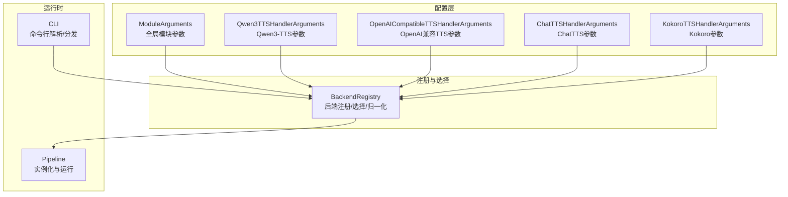
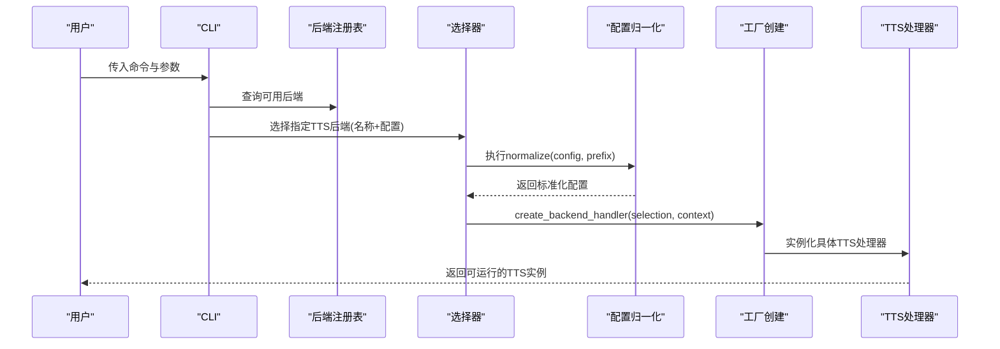
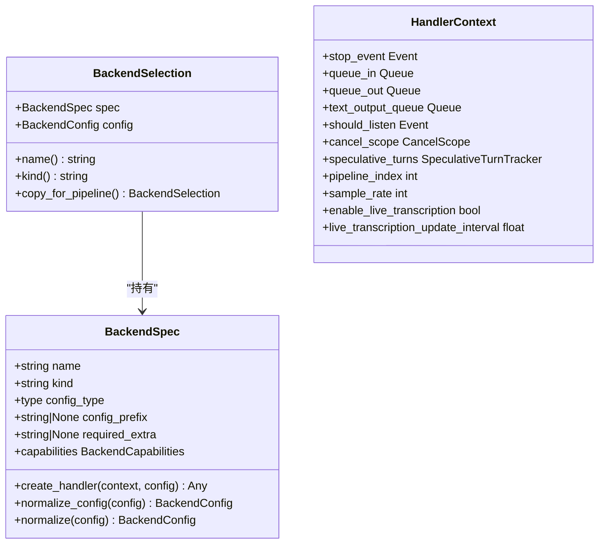
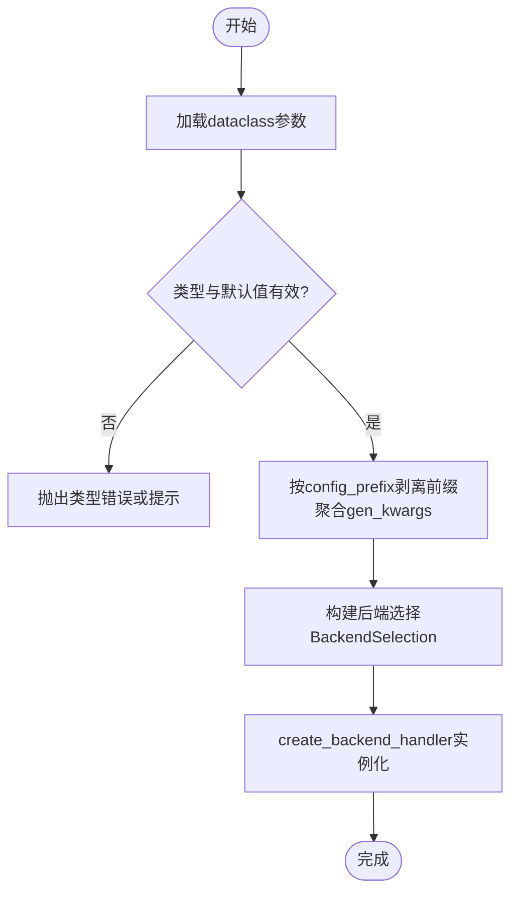
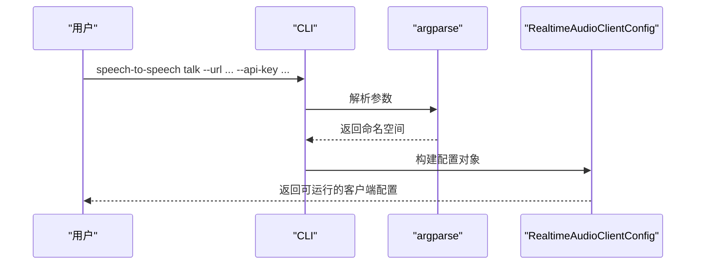
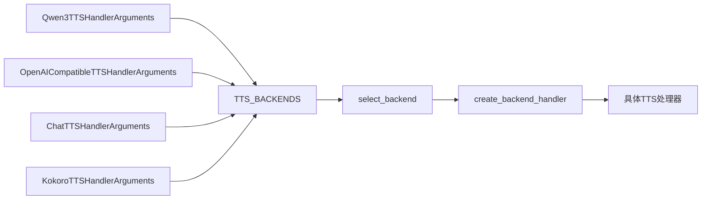

# TTS配置管理

<cite>
**本文引用的文件**
- [backend_registry.py](file://src/speech_to_speech/backend_registry.py)
- [module_arguments.py](file://src/speech_to_speech/arguments_classes/module_arguments.py)
- [qwen3_tts_arguments.py](file://src/speech_to_speech/arguments_classes/qwen3_tts_arguments.py)
- [openai_tts_arguments.py](file://src/speech_to_speech/arguments_classes/openai_tts_arguments.py)
- [chat_tts_arguments.py](file://src/speech_to_speech/arguments_classes/chat_tts_arguments.py)
- [kokoro_tts_arguments.py](file://src/speech_to_speech/arguments_classes/kokoro_tts_arguments.py)
- [cli.py](file://src/speech_to_speech/cli.py)
</cite>

## 目录
1. [简介](#简介)
2. [项目结构](#项目结构)
3. [核心组件](#核心组件)
4. [架构总览](#架构总览)
5. [详细组件分析](#详细组件分析)
6. [依赖关系分析](#依赖关系分析)
7. [性能考虑](#性能考虑)
8. [故障排查指南](#故障排查指南)
9. [结论](#结论)
10. [附录](#附录)

## 简介
本文件面向TTS（文本转语音）子系统的配置管理，系统化说明统一的配置系统架构：参数验证、默认值管理与类型检查；覆盖JSON/YAML与命令行参数的格式与语法；解释配置继承、环境变量覆盖与动态更新机制；提供开发/测试/生产环境的配置模板；展示配置热重载、配置校验与错误处理策略；并给出最佳实践、安全注意事项与性能优化建议。最后提供配置迁移工具与版本兼容性指南，帮助在不同部署环境中稳定演进配置。

## 项目结构
围绕TTS配置的核心代码集中在以下位置：
- 后端注册与选择：统一的后端注册表、配置归一化与工厂创建逻辑
- 模块级通用参数：设备、日志、流水线数量等全局开关
- TTS处理器参数：各TTS后端的dataclass参数定义（含默认值与帮助信息）
- CLI入口：命令行解析与命令分发

图表来源
- [backend_registry.py:83-172](file://src/speech_to_speech/backend_registry.py#L83-L172)
- [module_arguments.py:12-105](file://src/speech_to_speech/arguments_classes/module_arguments.py#L12-L105)
- [qwen3_tts_arguments.py:5-135](file://src/speech_to_speech/arguments_classes/qwen3_tts_arguments.py#L5-L135)
- [openai_tts_arguments.py:5-61](file://src/speech_to_speech/arguments_classes/openai_tts_arguments.py#L5-L61)
- [chat_tts_arguments.py:4-20](file://src/speech_to_speech/arguments_classes/chat_tts_arguments.py#L4-L20)
- [kokoro_tts_arguments.py:5-39](file://src/speech_to_speech/arguments_classes/kokoro_tts_arguments.py#L5-L39)
- [cli.py:26-95](file://src/speech_to_speech/cli.py#L26-L95)

章节来源
- [backend_registry.py:83-172](file://src/speech_to_speech/backend_registry.py#L83-L172)
- [module_arguments.py:12-105](file://src/speech_to_speech/arguments_classes/module_arguments.py#L12-L105)
- [cli.py:26-95](file://src/speech_to_speech/cli.py#L26-L95)

## 核心组件
- 后端注册表与选择器
  - 通过BackendSpec声明每个后端的能力、配置类型、创建工厂、配置前缀与可选依赖
  - select_backend根据名称查找并调用normalize进行配置归一化
  - create_backend_handler负责构造处理器，并将可选依赖缺失转换为明确提示
- 数据类参数与默认值
  - 每个TTS后端以dataclass定义参数，使用field的default与metadata描述默认值与帮助信息
  - 支持choices限制取值范围（在模块级参数中体现），以及类型注解实现静态类型检查
- 配置归一化
  - normalize_dataclass_config将dataclass字段转为字典，支持按config_prefix剥离前缀，并将gen_*字段聚合到gen_kwargs
  - 针对特定后端（如FacebookMMS）提供自定义归一化函数
- 模块级参数
  - ModuleArguments集中管理设备、日志级别、是否启用LLM代理、流水线数量等全局开关
- CLI与命令分发
  - cli.py提供serve/talk/local命令解析，talk子命令用于轻量音频客户端连接

章节来源
- [backend_registry.py:83-172](file://src/speech_to_speech/backend_registry.py#L83-L172)
- [backend_registry.py:124-150](file://src/speech_to_speech/backend_registry.py#L124-L150)
- [backend_registry.py:186-195](file://src/speech_to_speech/backend_registry.py#L186-L195)
- [module_arguments.py:12-105](file://src/speech_to_speech/arguments_classes/module_arguments.py#L12-L105)
- [cli.py:26-95](file://src/speech_to_speech/cli.py#L26-L95)

## 架构总览
下图展示了从命令行到TTS处理器实例化的完整流程，包括配置来源、选择、归一化与创建。

图表来源
- [cli.py:26-95](file://src/speech_to_speech/cli.py#L26-L95)
- [backend_registry.py:153-172](file://src/speech_to_speech/backend_registry.py#L153-L172)
- [backend_registry.py:186-195](file://src/speech_to_speech/backend_registry.py#L186-L195)

## 详细组件分析

### 统一后端注册与选择
- BackendSpec
  - name: 后端标识
  - kind: stt/llm/tts
  - config_type: dataclass类型，用于类型校验
  - create_handler: 工厂函数，接收上下文与配置并返回处理器
  - config_prefix: 配置前缀，用于剥离命名空间
  - normalize_config: 可选的自定义归一化函数
  - required_extra: 可选依赖名，缺失时给出安装提示
- 选择与归一化
  - select_backend(name, config)查找spec并调用spec.normalize(config)
  - normalize_dataclass_config将dataclass字段映射为字典，支持prefix剥离与gen_kwargs聚合
  - _optional_dependency_error将ImportError包装为带安装指引的错误
- 注册表构建
  - build_backend_registry(kind, specs)去重并校验kind一致性
  - TTS_BACKENDS集中声明所有TTS后端及其能力与依赖

图表来源
- [backend_registry.py:83-122](file://src/speech_to_speech/backend_registry.py#L83-L122)
- [backend_registry.py:62-79](file://src/speech_to_speech/backend_registry.py#L62-L79)

章节来源
- [backend_registry.py:83-172](file://src/speech_to_speech/backend_registry.py#L83-L172)
- [backend_registry.py:153-172](file://src/speech_to_speech/backend_registry.py#L153-L172)
- [backend_registry.py:175-195](file://src/speech_to_speech/backend_registry.py#L175-L195)

### TTS处理器参数与默认值
- Qwen3-TTS
  - 模型名称、设备、数据类型、注意力实现、后端(ggml/torch)、量化、本地GGUF路径、参考音频/说话人嵌入、指令、语言、流式块大小、最大token数等
  - 默认值与帮助信息通过dataclass field的default与metadata提供
- OpenAI兼容TTS
  - base_url、api_key、model、voice、language、task_type、instructions、response_format、sample_rate、speed、stream、timeout、blocksize
- ChatTTS
  - stream模式、device、chunk_size
- Kokoro
  - model_name、device、voice、lang_code、speed、blocksize

图表来源
- [qwen3_tts_arguments.py:5-135](file://src/speech_to_speech/arguments_classes/qwen3_tts_arguments.py#L5-L135)
- [openai_tts_arguments.py:5-61](file://src/speech_to_speech/arguments_classes/openai_tts_arguments.py#L5-L61)
- [chat_tts_arguments.py:4-20](file://src/speech_to_speech/arguments_classes/chat_tts_arguments.py#L4-L20)
- [kokoro_tts_arguments.py:5-39](file://src/speech_to_speech/arguments_classes/kokoro_tts_arguments.py#L5-L39)
- [backend_registry.py:124-150](file://src/speech_to_speech/backend_registry.py#L124-L150)

章节来源
- [qwen3_tts_arguments.py:5-135](file://src/speech_to_speech/arguments_classes/qwen3_tts_arguments.py#L5-L135)
- [openai_tts_arguments.py:5-61](file://src/speech_to_speech/arguments_classes/openai_tts_arguments.py#L5-L61)
- [chat_tts_arguments.py:4-20](file://src/speech_to_speech/arguments_classes/chat_tts_arguments.py#L4-L20)
- [kokoro_tts_arguments.py:5-39](file://src/speech_to_speech/arguments_classes/kokoro_tts_arguments.py#L5-L39)
- [backend_registry.py:124-150](file://src/speech_to_speech/backend_registry.py#L124-L150)

### 命令行参数与环境变量
- CLI命令
  - serve/talk/local三种命令，talk子命令用于连接实时音频客户端
  - talk子命令包含url、model、api_key、send/recv_rate、playback_buffer_ms、chunk_size、输入输出设备、指令、工具模块、voice、print_json、阻塞麦克风、日志转录、连接重试超时等参数
- 环境变量
  - api_key默认读取OPENAI_API_KEY（当未显式设置时）
- 全局模块参数
  - device、mac_optimal_settings、stt/llm/tts后端选择、log_level、log_transcripts、enable_live_transcription、num_pipelines等

图表来源
- [cli.py:98-186](file://src/speech_to_speech/cli.py#L98-L186)

章节来源
- [cli.py:26-95](file://src/speech_to_speech/cli.py#L26-L95)
- [cli.py:98-186](file://src/speech_to_speech/cli.py#L98-L186)
- [module_arguments.py:12-105](file://src/speech_to_speech/arguments_classes/module_arguments.py#L12-L105)

### 配置继承、环境变量覆盖与动态更新
- 配置继承
  - 通过config_prefix对dataclass字段进行命名空间剥离，实现“模块级前缀”的配置继承（例如qwen3_tts_前缀）
  - 归一化时将gen_*字段合并到gen_kwargs，便于下游生成阶段复用
- 环境变量覆盖
  - 部分参数支持从环境变量读取（如api_key默认读取OPENAI_API_KEY），可在启动脚本或容器环境中注入
- 动态更新
  - 当前代码未暴露直接的运行时配置热更新接口；可通过外部进程重启服务或使用支持热重载的服务器框架（如uvicorn的reload）实现配置热重载
  - 对于多流水线场景，可通过num_pipelines控制并发隔离，结合外部编排工具实现滚动更新

章节来源
- [backend_registry.py:124-150](file://src/speech_to_speech/backend_registry.py#L124-L150)
- [cli.py:98-186](file://src/speech_to_speech/cli.py#L98-L186)
- [module_arguments.py:96-105](file://src/speech_to_speech/arguments_classes/module_arguments.py#L96-L105)

### 不同部署环境的配置模板
以下为基于现有参数的环境模板要点（以键名与默认值为主，不包含代码片段）：
- 开发环境
  - 设备：优先使用cpu或mps以便快速迭代
  - 日志级别：debug
  - 启用日志转录：关闭（避免泄露对话内容）
  - 流水线数量：1
  - TTS后端：qwen3或kokoro（本地推理）
  - OpenAI兼容TTS：base_url指向本地服务，timeout适当降低
- 测试环境
  - 设备：cuda或auto
  - 日志级别：info
  - 启用日志转录：关闭
  - 流水线数量：根据并发需求设定
  - TTS后端：qwen3或openai（集成测试）
  - OpenAI兼容TTS：base_url指向测试服务，启用stream=false以简化断言
- 生产环境
  - 设备：cuda或mps（依据硬件）
  - 日志级别：info或warning
  - 启用日志转录：关闭
  - 流水线数量：根据峰值并发与资源设定
  - TTS后端：qwen3或openai（高可用）
  - OpenAI兼容TTS：base_url指向生产服务，timeout合理设置，启用速率限制与健康检查

[本节为概念性模板说明，不直接分析具体文件]

### 配置热重载、配置校验与错误处理
- 配置校验
  - dataclass类型注解与field默认值提供基础校验
  - 模块级参数使用choices限制后端选择
  - BackendSpec.config_type在normalize时进行类型检查，不匹配则抛出TypeError
- 错误处理
  - 可选依赖缺失时，create_backend_handler将ImportError包装为包含安装提示的错误
  - 不支持的后端名称会抛出ValueError并列出可选列表
- 热重载
  - 当前代码未内置运行时配置热更新；推荐通过外部进程重启或支持热重载的服务框架实现

章节来源
- [backend_registry.py:96-102](file://src/speech_to_speech/backend_registry.py#L96-L102)
- [backend_registry.py:166-172](file://src/speech_to_speech/backend_registry.py#L166-L172)
- [backend_registry.py:175-195](file://src/speech_to_speech/backend_registry.py#L175-L195)
- [module_arguments.py:26-48](file://src/speech_to_speech/arguments_classes/module_arguments.py#L26-L48)

## 依赖关系分析
TTS相关后端在注册表中集中声明，形成清晰的依赖边界与扩展点。新增TTS后端只需添加BackendSpec并实现对应的dataclass参数与工厂函数。

图表来源
- [backend_registry.py:443-543](file://src/speech_to_speech/backend_registry.py#L443-L543)
- [backend_registry.py:166-195](file://src/speech_to_speech/backend_registry.py#L166-L195)

章节来源
- [backend_registry.py:443-543](file://src/speech_to_speech/backend_registry.py#L443-L543)
- [backend_registry.py:166-195](file://src/speech_to_speech/backend_registry.py#L166-L195)

## 性能考虑
- 设备与量化
  - Qwen3-TTS支持多种设备与量化选项（如bf16/4bit/6bit/8bit），在Apple Silicon上自动选择mlx-audio并可使用量化以降低内存占用
  - 选择合适的attention实现（eager/flash_attention_2/sdpa）以平衡速度与稳定性
- 流式与块大小
  - 合理设置streaming_chunk_size与blocksize以平衡延迟与吞吐
  - OpenAI兼容TTS的sample_rate与response_format需与服务端一致
- 流水线与并发
  - num_pipelines控制隔离的流水线实例数量，影响最大并发会话数与资源占用
- 网络与超时
  - OpenAI兼容TTS的timeout应根据服务端响应时间合理设置，避免长时间阻塞

[本节提供一般性指导，不直接分析具体文件]

## 故障排查指南
- 导入失败或可选依赖缺失
  - 现象：启动时报ImportError
  - 处理：根据错误提示安装对应可选依赖（如pip install "speech-to-speech[extra]"）
- 不支持的后端名称
  - 现象：ValueError提示unsupported backend
  - 处理：检查后端名称是否在注册表中存在，或修正配置中的后端选择
- 类型不匹配
  - 现象：TypeError提示期望的数据类类型
  - 处理：核对dataclass字段类型与传入配置是否一致
- 环境变量未生效
  - 现象：api_key未正确读取
  - 处理：确认环境变量名与大小写是否正确，或在命令行显式传递

章节来源
- [backend_registry.py:175-195](file://src/speech_to_speech/backend_registry.py#L175-L195)
- [backend_registry.py:166-172](file://src/speech_to_speech/backend_registry.py#L166-L172)
- [backend_registry.py:96-102](file://src/speech_to_speech/backend_registry.py#L96-L102)
- [cli.py:98-186](file://src/speech_to_speech/cli.py#L98-L186)

## 结论
本项目的TTS配置管理采用统一的dataclass参数与后端注册表架构，实现了强类型的参数定义、默认值管理、配置归一化与安全的后端选择与实例化。通过config_prefix实现配置继承，结合环境变量与命令行参数完成灵活覆盖。尽管当前未内置运行时热更新，但可通过外部进程或服务框架实现。建议在开发与生产环境中遵循安全与性能最佳实践，合理使用设备、量化、流式与并发参数，确保稳定高效的TTS服务。

[本节为总结性内容，不直接分析具体文件]

## 附录

### JSON/YAML与命令行参数格式
- JSON/YAML
  - 可将dataclass字段映射为JSON/YAML键值对，注意config_prefix的使用（如qwen3_tts_前缀）
  - gen_*字段将被聚合到gen_kwargs，便于下游生成阶段使用
- 命令行参数
  - 使用--参数名=值的形式传递，talk子命令支持丰富的音频客户端参数
  - 环境变量如OPENAI_API_KEY可用于敏感信息注入

[本节为概念性说明，不直接分析具体文件]

### 配置迁移与版本兼容性
- 向后兼容
  - 新增dataclass字段时应提供默认值，避免破坏旧配置
  - 保留config_prefix以维持命名空间兼容
- 向前兼容
  - 废弃字段应逐步移除并在文档中标注
  - 变更后端名称或能力时需更新注册表与帮助信息
- 迁移工具
  - 可编写脚本将旧版JSON/YAML映射到新dataclass结构，并进行校验与转换

[本节为概念性说明，不直接分析具体文件]