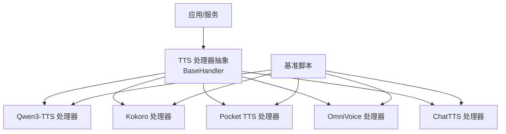
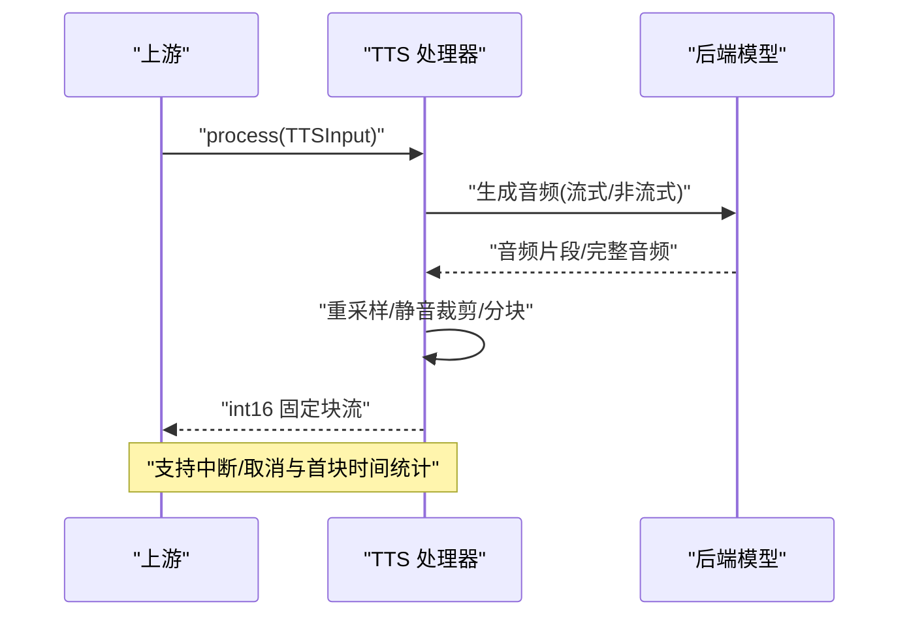
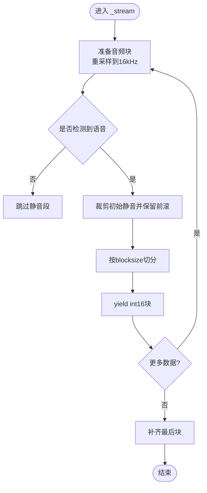
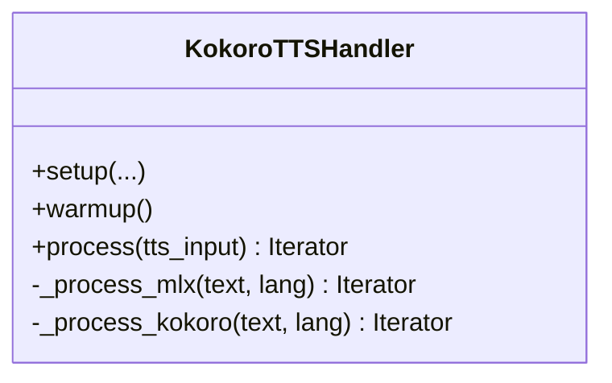
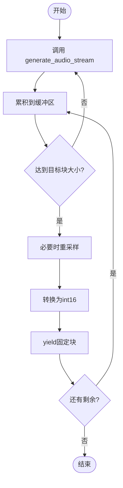
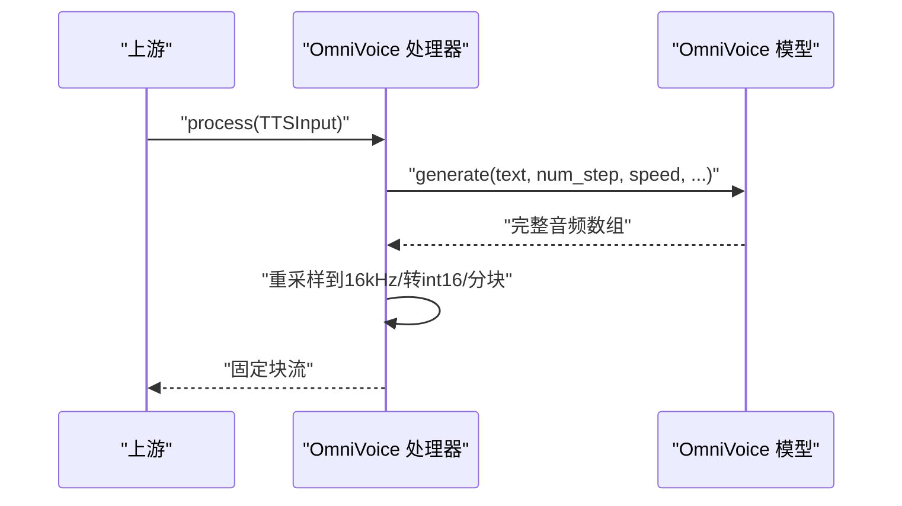
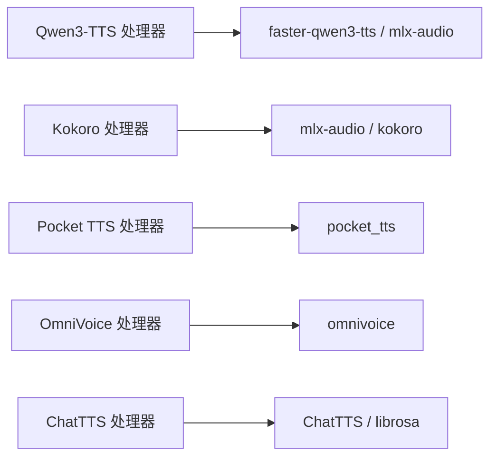

# 文本转语音模块

<cite>
**本文引用的文件**
- [README-CN.md](file://src/speech_to_speech/TTS/README-CN.md)
- [qwen3_tts_handler.py](file://src/speech_to_speech/TTS/qwen3_tts_handler.py)
- [kokoro_handler.py](file://src/speech_to_speech/TTS/kokoro_handler.py)
- [pocket_tts_handler.py](file://src/speech_to_speech/TTS/pocket_tts_handler.py)
- [omnivoice_handler.py](file://src/speech_to_speech/TTS/omnivoice_handler.py)
- [chatTTS_handler.py](file://src/speech_to_speech/TTS/chatTTS_handler.py)
- [benchmark_tts.py](file://scripts/benchmark_tts.py)
</cite>

## 目录
1. [简介](#简介)
2. [项目结构](#项目结构)
3. [核心组件](#核心组件)
4. [架构总览](#架构总览)
5. [详细组件分析](#详细组件分析)
6. [依赖关系分析](#依赖关系分析)
7. [性能与延迟优化](#性能与延迟优化)
8. [故障排查指南](#故障排查指南)
9. [结论](#结论)
10. [附录：配置与基准](#附录配置与基准)

## 简介
本模块提供统一的文本转语音（TTS）能力，支持多种后端：Qwen3-TTS（默认）、Kokoro、Pocket TTS、OmniVoice、ChatTTS。各后端均遵循相同的处理器接口，便于在流水线中无缝切换。模块支持语音克隆、声音定制（说话人/指令）、多语言合成；提供流式音频生成、实时播放友好的固定块大小输出以及缓冲区管理；并提供基准脚本用于对比不同后端的性能与延迟。

## 项目结构
- TTS 处理器位于 src/speech_to_speech/TTS 下，每个后端一个处理器类，统一实现 setup/process/warmup 等生命周期方法。
- 参数与运行模式说明见 TTS 中文文档。
- 基准脚本 scripts/benchmark_tts.py 提供跨后端的性能测量与对比。

图表来源
- [qwen3_tts_handler.py:93-136](file://src/speech_to_speech/TTS/qwen3_tts_handler.py#L93-L136)
- [kokoro_handler.py:76-152](file://src/speech_to_speech/TTS/kokoro_handler.py#L76-L152)
- [pocket_tts_handler.py:22-91](file://src/speech_to_speech/TTS/pocket_tts_handler.py#L22-L91)
- [omnivoice_handler.py:24-98](file://src/speech_to_speech/TTS/omnivoice_handler.py#L24-L98)
- [chatTTS_handler.py:24-47](file://src/speech_to_speech/TTS/chatTTS_handler.py#L24-L47)
- [benchmark_tts.py:91-219](file://scripts/benchmark_tts.py#L91-L219)

章节来源
- [README-CN.md:5-17](file://src/speech_to_speech/TTS/README-CN.md#L5-L17)

## 核心组件
- Qwen3-TTS 处理器：根据平台自动选择 MLX（Apple Silicon）或 faster-qwen3-tts（CUDA/CPU），支持语音克隆、自定义说话人、声音设计（指令），并内置流式分块与 TTFA/RTF 统计。
- Kokoro 处理器：Apple Silicon 使用 MLX 转换模型，其他平台使用原生 kokoro 库；支持多语言与多声线，自动映射 STT 语言代码到对应声线。
- Pocket TTS 处理器：Kyutai Labs 的流式 TTS，支持预设声线与本地/HF 参考音频，内部缓冲与重采样保证固定块输出。
- OmniVoice 处理器：基于扩散模型的语音克隆/声音设计，阻塞式生成后按固定块切分输出；支持预计算 voice clone prompt 复用。
- ChatTTS 处理器：支持流式与非流式两种模式，内部重采样至 16kHz 并按块输出。

章节来源
- [qwen3_tts_handler.py:93-136](file://src/speech_to_speech/TTS/qwen3_tts_handler.py#L93-L136)
- [kokoro_handler.py:76-152](file://src/speech_to_speech/TTS/kokoro_handler.py#L76-L152)
- [pocket_tts_handler.py:22-91](file://src/speech_to_speech/TTS/pocket_tts_handler.py#L22-L91)
- [omnivoice_handler.py:24-98](file://src/speech_to_speech/TTS/omnivoice_handler.py#L24-L98)
- [chatTTS_handler.py:24-47](file://src/speech_to_speech/TTS/chatTTS_handler.py#L24-L47)

## 架构总览
所有 TTS 处理器继承统一基类，暴露一致的 process() 迭代器接口，上游可消费固定大小的 int16 音频块进行实时播放。各后端在内部完成重采样、静音裁剪、取消检测与日志统计。

图表来源
- [qwen3_tts_handler.py:696-750](file://src/speech_to_speech/TTS/qwen3_tts_handler.py#L696-L750)
- [pocket_tts_handler.py:131-233](file://src/speech_to_speech/TTS/pocket_tts_handler.py#L131-L233)
- [omnivoice_handler.py:102-179](file://src/speech_to_speech/TTS/omnivoice_handler.py#L102-L179)
- [chatTTS_handler.py:53-118](file://src/speech_to_speech/TTS/chatTTS_handler.py#L53-L118)

## 详细组件分析

### Qwen3-TTS 处理器
- 平台选择：Apple Silicon 使用 mlx-audio，其他平台使用 faster-qwen3-tts。
- 生成模式：语音克隆（原始参考或缓存 .spk/.rvq）、自定义说话人、声音设计（instruct）。
- 流式与分块：默认流式分块大小由后端决定；内部将任意采样率重采样到 16kHz，按 blocksize 切分并填充最后一块。
- 语言与说话人：支持语言别名映射；会话级 voice 覆盖（CustomVoice 说话人或参考音频路径）。
- 量化与 GGUF：支持 GGML 量化与本地 GGUF talker/codec 加载；Apple Silicon 支持 MLX 量化后缀覆盖。
- 性能指标：记录 TTFA（首块时间）与 RTF（实时因子）。

图表来源
- [qwen3_tts_handler.py:696-750](file://src/speech_to_speech/TTS/qwen3_tts_handler.py#L696-L750)

章节来源
- [qwen3_tts_handler.py:93-136](file://src/speech_to_speech/TTS/qwen3_tts_handler.py#L93-L136)
- [qwen3_tts_handler.py:214-250](file://src/speech_to_speech/TTS/qwen3_tts_handler.py#L214-L250)
- [qwen3_tts_handler.py:252-277](file://src/speech_to_speech/TTS/qwen3_tts_handler.py#L252-L277)
- [qwen3_tts_handler.py:301-335](file://src/speech_to_speech/TTS/qwen3_tts_handler.py#L301-L335)
- [qwen3_tts_handler.py:507-555](file://src/speech_to_speech/TTS/qwen3_tts_handler.py#L507-L555)
- [qwen3_tts_handler.py:616-659](file://src/speech_to_speech/TTS/qwen3_tts_handler.py#L616-L659)
- [qwen3_tts_handler.py:696-750](file://src/speech_to_speech/TTS/qwen3_tts_handler.py#L696-L750)

### Kokoro 处理器
- 平台选择：Apple Silicon 使用 MLX 转换模型，其他平台使用原生 kokoro 库。
- 多语言与声线：内置语言代码到声线的映射，自动切换语言与默认声线；支持速度控制。
- 流式输出：对 MLX 与原生路径分别处理，统一重采样到 16kHz 并按块输出。
- 预热与预加载：启动时执行一次推理预热，并可预加载常用语言声线以减少首次延迟。

图表来源
- [kokoro_handler.py:76-152](file://src/speech_to_speech/TTS/kokoro_handler.py#L76-L152)
- [kokoro_handler.py:282-405](file://src/speech_to_speech/TTS/kokoro_handler.py#L282-L405)

章节来源
- [kokoro_handler.py:76-152](file://src/speech_to_speech/TTS/kokoro_handler.py#L76-L152)
- [kokoro_handler.py:198-232](file://src/speech_to_speech/TTS/kokoro_handler.py#L198-L232)
- [kokoro_handler.py:282-405](file://src/speech_to_speech/TTS/kokoro_handler.py#L282-L405)

### Pocket TTS 处理器
- 特性：流式生成，支持预设声线与本地/HF 参考音频；内部维护缓冲区以对齐目标块大小。
- 重采样：若模型采样率与目标不一致，使用 polyphase 重采样后再切块。
- 日志策略：降低单块日志频率以避免刷屏。

图表来源
- [pocket_tts_handler.py:131-233](file://src/speech_to_speech/TTS/pocket_tts_handler.py#L131-L233)

章节来源
- [pocket_tts_handler.py:22-91](file://src/speech_to_speech/TTS/pocket_tts_handler.py#L22-L91)
- [pocket_tts_handler.py:93-100](file://src/speech_to_speech/TTS/pocket_tts_handler.py#L93-L100)
- [pocket_tts_handler.py:131-233](file://src/speech_to_speech/TTS/pocket_tts_handler.py#L131-L233)

### OmniVoice 处理器
- 特性：基于扩散模型，支持语音克隆（参考音频+文本或预计算 prompt）与声音设计（instruct）。
- 生成方式：一次性生成完整音频，再按固定块切分输出；支持语言指定与步数/语速控制。
- 设备与精度：支持 CUDA/MPS/XPU/CPU，dtype 可选 float16/bfloat16/float32。

图表来源
- [omnivoice_handler.py:24-98](file://src/speech_to_speech/TTS/omnivoice_handler.py#L24-L98)
- [omnivoice_handler.py:102-179](file://src/speech_to_speech/TTS/omnivoice_handler.py#L102-L179)

章节来源
- [omnivoice_handler.py:24-98](file://src/speech_to_speech/TTS/omnivoice_handler.py#L24-L98)
- [omnivoice_handler.py:102-179](file://src/speech_to_speech/TTS/omnivoice_handler.py#L102-L179)

### ChatTTS 处理器
- 特性：支持流式与非流式两种模式；内部重采样到 16kHz 并按块输出。
- MPS 兼容：在 MPS 设备上同步与清理缓存以提升稳定性。

章节来源
- [chatTTS_handler.py:24-47](file://src/speech_to_speech/TTS/chatTTS_handler.py#L24-L47)
- [chatTTS_handler.py:53-118](file://src/speech_to_speech/TTS/chatTTS_handler.py#L53-L118)

## 依赖关系分析
- 运行时依赖：
  - Qwen3-TTS：faster-qwen3-tts（非 macOS）或 mlx-audio（macOS）。
  - Kokoro：mlx-audio（macOS）或 kokoro 库（CUDA/CPU）。
  - Pocket TTS：pocket_tts。
  - OmniVoice：omnivoice。
  - ChatTTS：ChatTTS、librosa。
- 外部资源：
  - 模型权重（HuggingFace 仓库或本地路径）。
  - 参考音频（语音克隆）或预计算的 voice clone prompt。

图表来源
- [qwen3_tts_handler.py:214-277](file://src/speech_to_speech/TTS/qwen3_tts_handler.py#L214-L277)
- [kokoro_handler.py:154-196](file://src/speech_to_speech/TTS/kokoro_handler.py#L154-L196)
- [pocket_tts_handler.py:71-85](file://src/speech_to_speech/TTS/pocket_tts_handler.py#L71-L85)
- [omnivoice_handler.py:58-98](file://src/speech_to_speech/TTS/omnivoice_handler.py#L58-L98)
- [chatTTS_handler.py:7-11](file://src/speech_to_speech/TTS/chatTTS_handler.py#L7-L11)

章节来源
- [qwen3_tts_handler.py:214-277](file://src/speech_to_speech/TTS/qwen3_tts_handler.py#L214-L277)
- [kokoro_handler.py:154-196](file://src/speech_to_speech/TTS/kokoro_handler.py#L154-L196)
- [pocket_tts_handler.py:71-85](file://src/speech_to_speech/TTS/pocket_tts_handler.py#L71-L85)
- [omnivoice_handler.py:58-98](file://src/speech_to_speech/TTS/omnivoice_handler.py#L58-L98)
- [chatTTS_handler.py:7-11](file://src/speech_to_speech/TTS/chatTTS_handler.py#L7-L11)

## 性能与延迟优化
- 流式与首块延迟：
  - Qwen3-TTS：通过流式分块与 TTFA 日志评估首块延迟；合理设置 streaming_chunk_size 与 max_new_tokens 平衡吞吐与延迟。
  - Pocket TTS：内部缓冲对齐目标块大小，减少抖动；按需重采样避免额外开销。
  - OmniVoice：生成阶段为阻塞式，TTFC 包含完整话语合成时间；可通过减少 diffusion 步数或调整 dtype 降低延迟。
  - ChatTTS：流式模式下逐步返回片段，非流式一次性返回。
- 硬件与精度：
  - Qwen3-TTS：非 macOS 优先 GGML 量化（BF16/Q8_0/Q4_K_M/F32），macOS 使用 MLX 量化（bf16/4bit/6bit/8bit）。
  - Kokoro：Apple Silicon 使用 MLX 转换模型；其他平台使用原生库。
  - OmniVoice：支持 float16/bfloat16/float32，推荐在 GPU 上使用较低精度。
- 并发与取消：
  - 所有处理器支持 cancel_scope 检查，及时响应中断。
  - 建议在上游合并短文本片段以降低频繁调用开销。
- 基准测试：
  - 使用 benchmark_tts.py 比较不同后端的 warmup、推理时间、首块时间、RTF 等指标。

章节来源
- [qwen3_tts_handler.py:616-659](file://src/speech_to_speech/TTS/qwen3_tts_handler.py#L616-L659)
- [qwen3_tts_handler.py:696-750](file://src/speech_to_speech/TTS/qwen3_tts_handler.py#L696-L750)
- [pocket_tts_handler.py:131-233](file://src/speech_to_speech/TTS/pocket_tts_handler.py#L131-L233)
- [omnivoice_handler.py:102-179](file://src/speech_to_speech/TTS/omnivoice_handler.py#L102-L179)
- [chatTTS_handler.py:53-118](file://src/speech_to_speech/TTS/chatTTS_handler.py#L53-L118)
- [benchmark_tts.py:91-219](file://scripts/benchmark_tts.py#L91-L219)

## 故障排查指南
- 导入缺失：
  - Qwen3-TTS（非 macOS）需安装 faster-qwen3-tts；macOS 需安装 mlx-audio 及其 TTS 依赖。
  - Kokoro（CUDA/CPU）需安装 kokoro 与 espeak-ng。
  - Pocket TTS 需安装 pocket_tts。
  - OmniVoice 需安装 omnivoice。
  - ChatTTS 需安装 ChatTTS 与 librosa。
- 参数校验：
  - Qwen3-TTS：GGUF talker/codec 必须成对提供；ref_audio 与缓存 ref_spk/ref_rvq 互斥；ref_rvq 需要 ref_text 且 xvec_only=False。
  - OmniVoice：ref_audio 与 voice_clone_prompt 互斥；instruct 不能与克隆参数同时使用；num_steps/speed/blocksize 必须为正。
- 设备与精度：
  - 确保设备可用（cuda/mps/xpu/cpu）与 dtype 匹配；Apple Silicon 上 MLX 量化后缀需正确。
- 日志与调试：
  - 关注 TTFA、RTF 与中断日志；Pocket TTS 已抑制小块日志，仅在异常耗时时记录。

章节来源
- [qwen3_tts_handler.py:214-277](file://src/speech_to_speech/TTS/qwen3_tts_handler.py#L214-L277)
- [qwen3_tts_handler.py:301-335](file://src/speech_to_speech/TTS/qwen3_tts_handler.py#L301-L335)
- [kokoro_handler.py:154-196](file://src/speech_to_speech/TTS/kokoro_handler.py#L154-L196)
- [pocket_tts_handler.py:71-85](file://src/speech_to_speech/TTS/pocket_tts_handler.py#L71-L85)
- [omnivoice_handler.py:43-67](file://src/speech_to_speech/TTS/omnivoice_handler.py#L43-L67)
- [chatTTS_handler.py:7-11](file://src/speech_to_speech/TTS/chatTTS_handler.py#L7-L11)

## 结论
本 TTS 模块通过统一接口封装多种高质量后端，适配不同硬件与场景：Qwen3-TTS 适合低延迟流式与多语言/克隆；Kokoro 在多语言与声线丰富度上有优势；Pocket TTS 轻量稳定；OmniVoice 擅长高保真克隆与声音设计；ChatTTS 提供灵活的流式/非流式选项。结合基准脚本与调优建议，可在实际部署中取得良好的质量与延迟平衡。

## 附录：配置与基准
- 启用后端与主要参数前缀见 TTS 中文文档。
- 低延迟 GPU 配置示例与 Apple Silicon 最佳设置见文档。
- 基准脚本用法：
  - 指定要评测的后端列表、迭代次数、文本与语言代码。
  - 支持对 Qwen3-TTS 的 MLX 量化变体进行并行基准。

章节来源
- [README-CN.md:20-291](file://src/speech_to_speech/TTS/README-CN.md#L20-L291)
- [benchmark_tts.py:332-406](file://scripts/benchmark_tts.py#L332-L406)