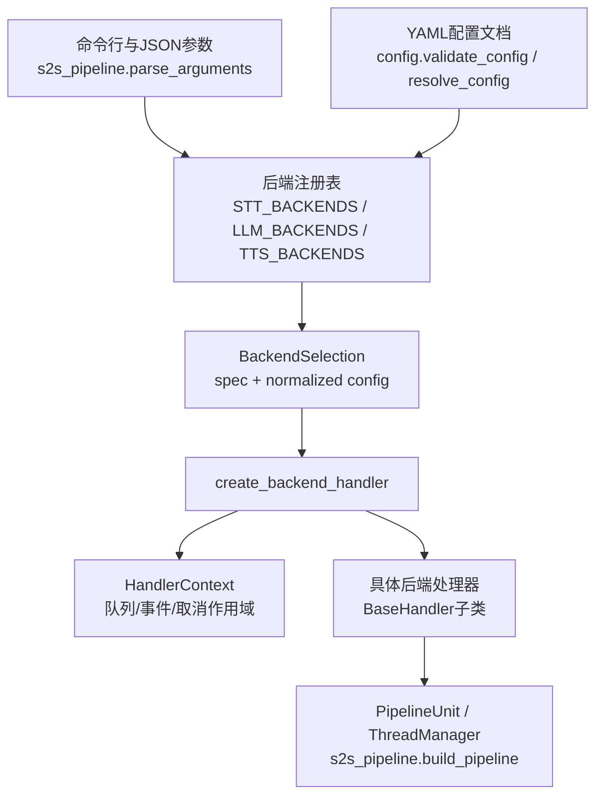
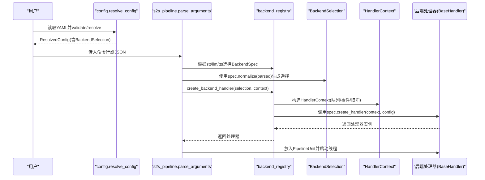
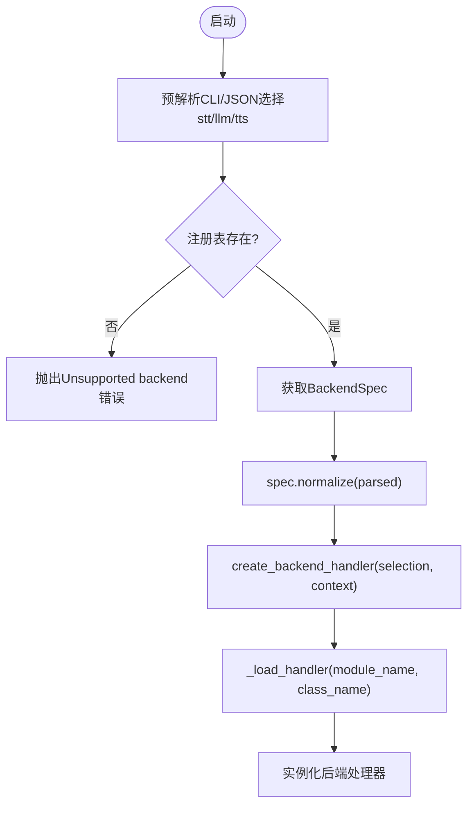
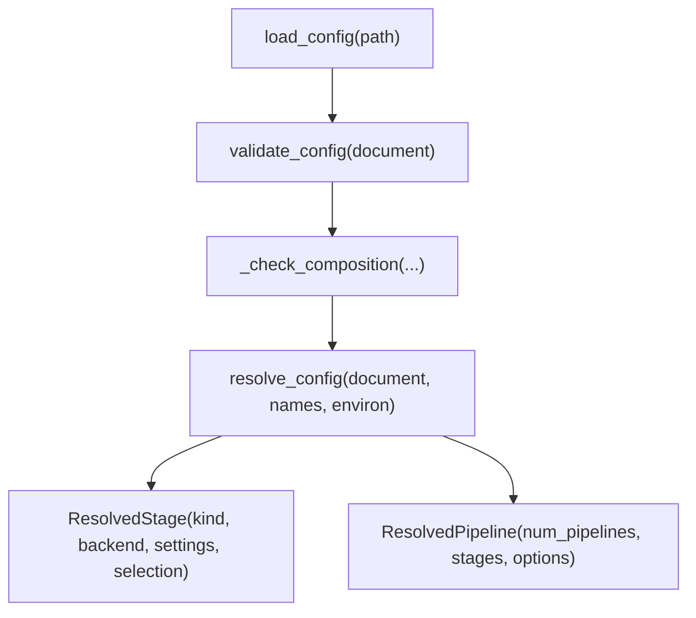
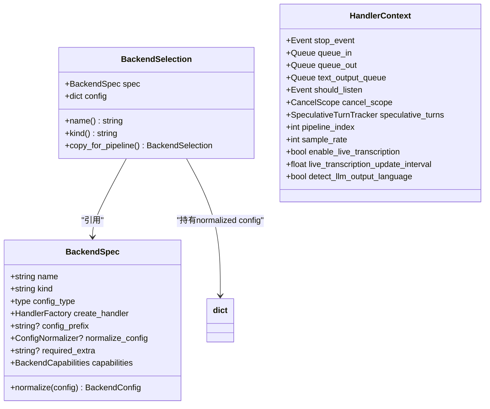
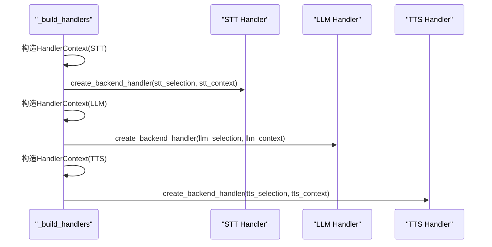
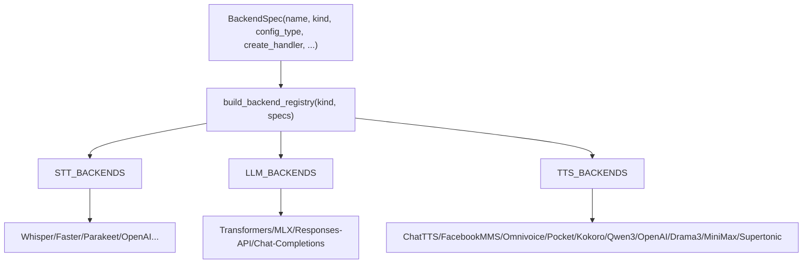
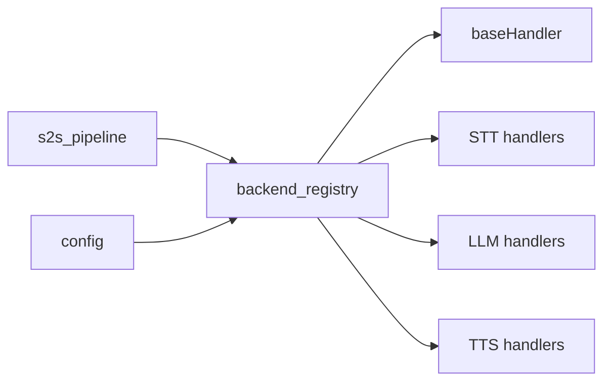
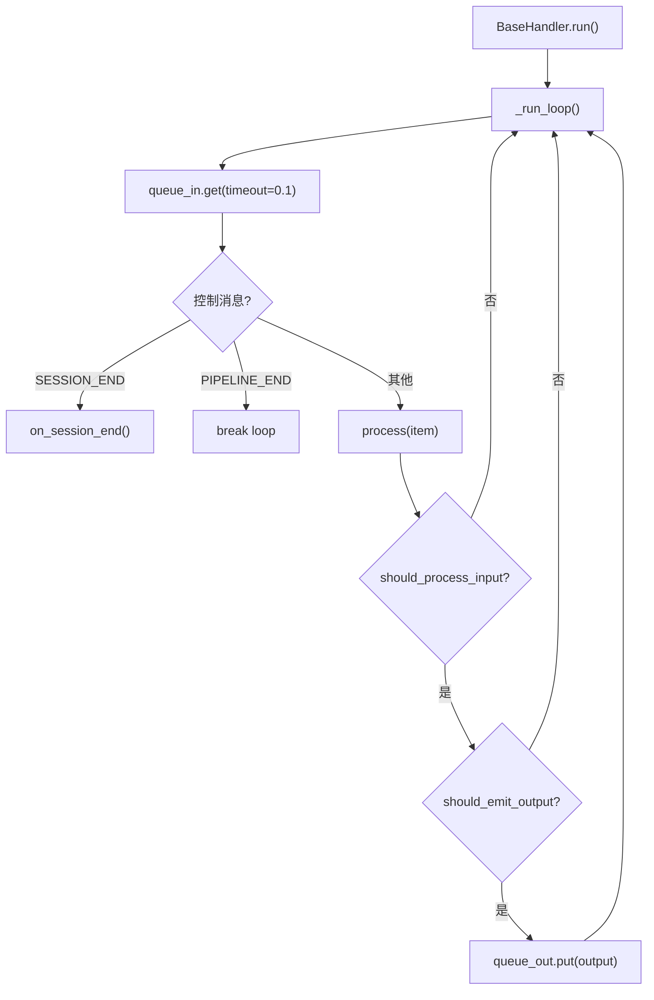
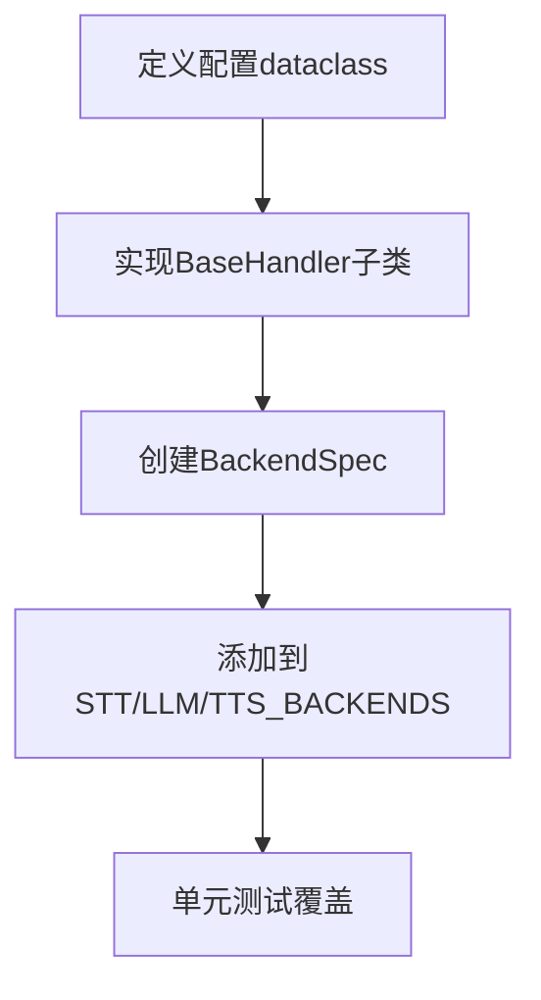

# 后端注册系统

<cite>
**本文引用的文件**   
- [backend_registry.py](file://src/speech_to_speech/backend_registry.py)
- [baseHandler.py](file://src/speech_to_speech/baseHandler.py)
- [config.py](file://src/speech_to_speech/config.py)
- [s2s_pipeline.py](file://src/speech_to_speech/s2s_pipeline.py)
- [whisper_stt_handler.py](file://src/speech_to_speech/STT/whisper_stt_handler.py)
- [chat_completions_language_model.py](file://src/speech_to_speech/LLM/chat_completions_language_model.py)
- [kokoro_handler.py](file://src/speech_to_speech/TTS/kokoro_handler.py)
- [test_backend_registry.py](file://tests/test_backend_registry.py)
</cite>

## 目录
1. [引言](#引言)
2. [项目结构](#项目结构)
3. [核心组件](#核心组件)
4. [架构总览](#架构总览)
5. [详细组件分析](#详细组件分析)
6. [依赖关系分析](#依赖关系分析)
7. [性能与生命周期特性](#性能与生命周期特性)
8. [故障排查指南](#故障排查指南)
9. [自定义后端开发指南](#自定义后端开发指南)
10. [结论](#结论)

## 引言
本文件面向希望理解并扩展“语音到语音”后端注册系统的开发者。系统围绕可插拔的 STT、LLM、TTS 后端展开，通过统一的注册表、配置解析与验证机制，将命令行参数、YAML 配置和运行时上下文安全地注入到具体后端实现中。文档重点解释：
- 可插拔架构的设计原理：后端发现、动态加载与生命周期管理。
- STT、LLM、TTS 后端的注册流程、配置归一化与校验。
- BackendSelection 与 BackendSpec 的职责与差异。
- HandlerContext 如何为不同处理器提供统一运行环境。
- 如何编写、测试和集成自定义后端。

## 项目结构
后端注册系统主要位于 `src/speech_to_speech` 下，关键文件如下：
- `backend_registry.py`：定义后端元数据、选择对象、上下文、工厂函数以及内置后端注册表。
- `baseHandler.py`：定义所有处理器的基类，负责队列消费、生命周期、事件转发与错误处理。
- `config.py`：负责 YAML 配置加载、类型校验、环境变量注入、阶段组合校验与最终配置解析。
- `s2s_pipeline.py`：CLI 参数解析、后端选择、PipelineUnit 构建、线程管理与服务启动。
- 各后端实现（如 `STT/whisper_stt_handler.py`、`LLM/chat_completions_language_model.py`、`TTS/kokoro_handler.py`）继承基类并通过注册表被动态实例化。
- `tests/test_backend_registry.py`：覆盖注册表、能力标志、配置归一化、可选依赖提示等关键行为。

**图示来源**
- [s2s_pipeline.py:185-297](file://src/speech_to_speech/s2s_pipeline.py#L185-L297)
- [backend_registry.py:172-206](file://src/speech_to_speech/backend_registry.py#L172-L206)
- [config.py:371-538](file://src/speech_to_speech/config.py#L371-L538)

**章节来源**
- [s2s_pipeline.py:185-297](file://src/speech_to_speech/s2s_pipeline.py#L185-L297)
- [backend_registry.py:172-206](file://src/speech_to_speech/backend_registry.py#L172-L206)
- [config.py:371-538](file://src/speech_to_speech/config.py#L371-L538)

## 核心组件
本节聚焦后端注册系统的核心抽象与职责边界。

### BackendSpec：后端静态元数据
- 描述一个已注册后端的名称、种类（stt/llm/tts）、配置类型、创建工厂、配置前缀、可选依赖、能力标志等。
- 提供 `normalize` 方法，将用户提供的配置对象转换为处理器可用的字典；支持自定义归一器以适配不同后端字段差异。

### BackendSelection：后端选择结果
- 封装一个 `BackendSpec` 与其归一化后的配置字典。
- 提供 `copy_for_pipeline` 用于每个 Pipeline 副本隔离配置，避免多实例间相互污染。

### HandlerContext：处理器运行上下文
- 向每个后端工厂暴露统一的运行时环境：停止事件、输入输出队列、文本输出队列、监听事件、取消作用域、推测轮次跟踪器、流水线索引、采样率、是否启用实时转录等。
- 某些后端需要额外上下文字段（例如 `detect_llm_output_language`），由构造上下文时注入。

### 工厂与注册表
- `build_backend_registry` 构建按 kind 过滤的注册表，拒绝重复名称与错误 kind。
- `_simple_handler_factory`、`_create_streaming_stt`、`_create_local_llm`、`_create_openai_tts` 等工厂函数负责根据后端特性组装构造函数参数。
- `create_backend_handler` 调用 spec 的 create_handler，并将可选依赖缺失错误包装为更友好的 ImportError。

**章节来源**
- [backend_registry.py:65-163](file://src/speech_to_speech/backend_registry.py#L65-L163)
- [backend_registry.py:172-206](file://src/speech_to_speech/backend_registry.py#L172-L206)
- [backend_registry.py:208-347](file://src/speech_to_speech/backend_registry.py#L208-L347)

## 架构总览
下图展示从配置到处理器实例化的完整链路，包括配置解析、后端选择、上下文传递与处理器生命周期。

**图示来源**
- [config.py:441-538](file://src/speech_to_speech/config.py#L441-L538)
- [s2s_pipeline.py:185-297](file://src/speech_to_speech/s2s_pipeline.py#L185-L297)
- [backend_registry.py:196-206](file://src/speech_to_speech/backend_registry.py#L196-L206)
- [s2s_pipeline.py:382-574](file://src/speech_to_speech/s2s_pipeline.py#L382-L574)

## 详细组件分析

### 后端发现与动态加载
- 内置后端在模块加载时即注册到 `STT_BACKENDS`、`LLM_BACKENDS`、`TTS_BACKENDS`。
- CLI 预解析阶段会读取 `--stt`、`--llm_backend`、`--tts`，并在注册表中查找对应名称；若不存在则抛出明确错误。
- 动态加载通过 `_load_handler` 使用 `import_module` 按需导入后端模块，避免未选中后端带来的启动开销。

**图示来源**
- [s2s_pipeline.py:185-297](file://src/speech_to_speech/s2s_pipeline.py#L185-L297)
- [backend_registry.py:208-216](file://src/speech_to_speech/backend_registry.py#L208-L216)

**章节来源**
- [s2s_pipeline.py:185-297](file://src/speech_to_speech/s2s_pipeline.py#L185-L297)
- [backend_registry.py:208-216](file://src/speech_to_speech/backend_registry.py#L208-L216)

### 配置解析与验证机制
- YAML 文档先进行结构校验：schema_version、blocks、pipelines、stage kind 与 backend 名称必须合法。
- 对每个 stage 的 settings 使用对应的 dataclass 类型进行强类型校验，支持 env 引用、路径展开、choices 限制。
- 组合校验 `_check_composition` 确保：
  - STT bypass（none）要求 LLM 支持音频输入。
  - 说话人分离需启用 STT。
  - LLM 代理需后端具备 `supports_llm_proxy` 能力。
- `resolve_config` 将 blocks/pipelines 解析为 `ResolvedStage`，并为非 VAD 阶段生成 `BackendSelection`。

**图示来源**
- [config.py:106-125](file://src/speech_to_speech/config.py#L106-L125)
- [config.py:345-438](file://src/speech_to_speech/config.py#L345-L438)
- [config.py:441-538](file://src/speech_to_speech/config.py#L441-L538)

**章节来源**
- [config.py:106-125](file://src/speech_to_speech/config.py#L106-L125)
- [config.py:345-438](file://src/speech_to_speech/config.py#L345-L438)
- [config.py:441-538](file://src/speech_to_speech/config.py#L441-L538)

### BackendSelection 与 BackendSpec 的作用与差异
- `BackendSpec` 是“蓝图”，描述后端如何被识别、如何解析配置、如何创建处理器、有哪些能力。
- `BackendSelection` 是“实例化前的选择结果”，包含具体 spec 与已归一化的配置字典；它不可变且可复制，保证多 pipeline 隔离。
- 配置差异通过 `config_type` 与 `normalize_config` 解决：
  - 通用场景使用 `normalize_dataclass_config`，自动剥离 `gen_kwargs` 与 `gen_*` 前缀。
  - 特殊场景提供自定义归一器，例如 Facebook MMS 将 `tts_language` 重命名为 `language`。

**图示来源**
- [backend_registry.py:65-163](file://src/speech_to_speech/backend_registry.py#L65-L163)
- [backend_registry.py:124-141](file://src/speech_to_speech/backend_registry.py#L124-L141)

**章节来源**
- [backend_registry.py:65-163](file://src/speech_to_speech/backend_registry.py#L65-L163)
- [backend_registry.py:124-141](file://src/speech_to_speech/backend_registry.py#L124-L141)

### HandlerContext 的上下文管理机制
- 每个后端处理器通过 `HandlerContext` 获得统一的运行时环境，而不直接耦合上游队列或事件。
- 构造器根据阶段差异注入不同字段：
  - STT：接收 VAD 输出的 spoken prompt 队列，可选择绕过 TranscriptionNotifier。
  - LLM：接收文本提示队列，输出响应队列。
  - TTS：接收 LM 处理后文本，输出音频流。
- 上下文还携带取消作用域与推测轮次跟踪器，使后端能丢弃陈旧请求、参与端到端延迟统计。

**图示来源**
- [s2s_pipeline.py:469-551](file://src/speech_to_speech/s2s_pipeline.py#L469-L551)
- [backend_registry.py:80-98](file://src/speech_to_speech/backend_registry.py#L80-L98)

**章节来源**
- [s2s_pipeline.py:469-551](file://src/speech_to_speech/s2s_pipeline.py#L469-L551)
- [backend_registry.py:80-98](file://src/speech_to_speech/backend_registry.py#L80-L98)

### STT、LLM、TTS 后端注册流程示例
- STT：
  - 内置多个实现（whisper、faster-whisper、parakeet、openai-realtime 等）。
  - 部分后端标记 `streams_audio_chunks=True`，表示可直接向 VAD 推送音频片段，从而跳过 TranscriptionNotifier。
  - 部分后端标记 `required_extra`，缺失可选依赖时会给出安装指引。
- LLM：
  - 本地后端（transformers、mlx-lm）与远程兼容后端（responses-api、chat-completions）。
  - 能力标志控制是否支持音频输入与 LLM 代理。
- TTS：
  - 多种后端（chatTTS、facebookMMS、omnivoice、pocket、kokoro、qwen3、openai、drama3、minimax、supertonic）。
  - 多数 TTS 后端需要 `setup_should_listen=True` 与 `context_kwargs=True`，以便接入监听信号与上下文。

**图示来源**
- [backend_registry.py:350-508](file://src/speech_to_speech/backend_registry.py#L350-L508)
- [backend_registry.py:510-553](file://src/speech_to_speech/backend_registry.py#L510-L553)
- [backend_registry.py:555-693](file://src/speech_to_speech/backend_registry.py#L555-L693)

**章节来源**
- [backend_registry.py:350-508](file://src/speech_to_speech/backend_registry.py#L350-L508)
- [backend_registry.py:510-553](file://src/speech_to_speech/backend_registry.py#L510-L553)
- [backend_registry.py:555-693](file://src/speech_to_speech/backend_registry.py#L555-L693)

## 依赖关系分析
- `s2s_pipeline.parse_arguments` 依赖注册表中的后端名称作为 CLI choices，确保用户只能选择已注册后端。
- `config.validate_config` 与 `resolve_config` 依赖注册表进行 stage 配置类型校验与 `BackendSelection` 生成。
- `create_backend_handler` 依赖 `_load_handler` 动态导入后端模块，并将可选依赖缺失转换为友好错误。
- 各后端处理器继承 `BaseHandler`，遵循统一的队列消费、生命周期与事件转发协议。

**图示来源**
- [s2s_pipeline.py:30-38](file://src/speech_to_speech/s2s_pipeline.py#L30-L38)
- [config.py:128-139](file://src/speech_to_speech/config.py#L128-L139)
- [backend_registry.py:196-216](file://src/speech_to_speech/backend_registry.py#L196-L216)
- [baseHandler.py:32-68](file://src/speech_to_speech/baseHandler.py#L32-L68)

**章节来源**
- [s2s_pipeline.py:30-38](file://src/speech_to_speech/s2s_pipeline.py#L30-L38)
- [config.py:128-139](file://src/speech_to_speech/config.py#L128-L139)
- [backend_registry.py:196-216](file://src/speech_to_speech/backend_registry.py#L196-L216)
- [baseHandler.py:32-68](file://src/speech_to_speech/baseHandler.py#L32-L68)

## 性能与生命周期特性
- BaseHandler 提供统一的线程循环：
  - 从输入队列取消息，处理并写入输出队列。
  - 支持 SESSION_END 软重置、PIPELINE_END 终止信号。
  - 记录处理耗时，支持日志级别控制。
  - 支持 should_process_input/should_emit_output 钩子，用于丢弃陈旧或未被认领的请求。
- 推测轮次与取消作用域：
  - 通过 `cancel_scope.is_stale` 与 `speculative_turns.is_latest` 丢弃过时请求，避免慢 TTS 阻塞后续逻辑。
- 模型监控：
  - 每个处理器共享 `get_model_monitor()`，记录调用延迟、资源使用与输入输出负载。

**图示来源**
- [baseHandler.py:126-221](file://src/speech_to_speech/baseHandler.py#L126-L221)

**章节来源**
- [baseHandler.py:126-221](file://src/speech_to_speech/baseHandler.py#L126-L221)

## 故障排查指南
- 可选依赖缺失：
  - 当后端标记 `required_extra` 且导入失败时，`create_backend_handler` 会抛出包含安装命令的 ImportError。
- 配置类型不匹配：
  - `BackendSpec.normalize` 会检查传入配置是否为期望的 dataclass 类型，否则抛出 TypeError。
- 后端名称冲突或种类错误：
  - `build_backend_registry` 会拒绝重复名称与错误 kind。
- LLM 代理与音频输入能力：
  - 若启用 LLM 代理但所选后端不支持，会在 `build_llm_proxy_config` 或 `prepare_module_args` 中抛出明确错误。
- CLI 参数未知：
  - 未选中的后端参数会被忽略并警告；未知参数会直接报错。

**章节来源**
- [backend_registry.py:185-206](file://src/speech_to_speech/backend_registry.py#L185-L206)
- [backend_registry.py:172-182](file://src/speech_to_speech/backend_registry.py#L172-L182)
- [s2s_pipeline.py:121-142](file://src/speech_to_speech/s2s_pipeline.py#L121-L142)
- [s2s_pipeline.py:347-366](file://src/speech_to_speech/s2s_pipeline.py#L347-L366)
- [tests/test_backend_registry.py:759-787](file://tests/test_backend_registry.py#L759-L787)

## 自定义后端开发指南

### 接口规范
- 处理器必须继承 `BaseHandler`，实现 `setup` 与 `process`。
- 处理器通过 `queue_in` 接收输入，通过 `queue_out` 输出结果。
- 支持 `should_process_input`、`should_emit_output`、`before_emit_output`、`cleanup`、`on_session_end` 等钩子。
- 推荐使用 `monitor` 记录调用指标，使用 `cancel_scope` 与 `speculative_turns` 处理取消与推测轮次。

**章节来源**
- [baseHandler.py:32-68](file://src/speech_to_speech/baseHandler.py#L32-L68)
- [baseHandler.py:70-98](file://src/speech_to_speech/baseHandler.py#L70-L98)
- [baseHandler.py:237-241](file://src/speech_to_speech/baseHandler.py#L237-L241)

### 注册步骤
1. 定义后端配置 dataclass（例如 `MySTTArguments`），字段类型需与 YAML/CLI 映射一致。
2. 编写后端处理器类（例如 `MySTTHandler(BaseHandler)`），实现 `setup` 与 `process`。
3. 在 `backend_registry.py` 中添加 `BackendSpec`：
   - 指定 `name`、`kind`、`config_type`、`create_handler`。
   - 如需配置前缀，设置 `config_prefix`。
   - 如需自定义归一化，设置 `normalize_config`。
   - 如需可选依赖提示，设置 `required_extra`。
   - 如需声明能力，设置 `capabilities`（如 `streams_audio_chunks`、`supports_audio_input`、`supports_llm_proxy`）。
4. 将 spec 加入对应注册表（`STT_BACKENDS`、`LLM_BACKENDS` 或 `TTS_BACKENDS`）。

**图示来源**
- [backend_registry.py:350-693](file://src/speech_to_speech/backend_registry.py#L350-L693)

**章节来源**
- [backend_registry.py:350-693](file://src/speech_to_speech/backend_registry.py#L350-L693)

### 最佳实践
- 使用 `normalize_dataclass_config` 或自定义 `normalize_config` 处理字段差异，避免处理器内部做过多适配。
- 对于需要上下文能力的后端，使用 `_simple_handler_factory` 或自定义工厂函数，正确注入 `cancel_scope`、`speculative_turns`、`detect_llm_output_language` 等。
- 对可选依赖缺失的后端，务必设置 `required_extra`，以便用户获得清晰安装指引。
- 对能力敏感的后端（如音频输入、LLM 代理、流式音频），准确设置 `capabilities`，避免运行时组合校验失败。

**章节来源**
- [backend_registry.py:218-248](file://src/speech_to_speech/backend_registry.py#L218-L248)
- [backend_registry.py:309-347](file://src/speech_to_speech/backend_registry.py#L309-L347)
- [backend_registry.py:185-206](file://src/speech_to_speech/backend_registry.py#L185-L206)

### 测试策略
- 使用 `build_backend_registry` 与 `BackendSpec` 构造最小注册表，验证 `create_backend_handler` 的行为。
- 验证配置归一化：确保 `selection.config` 符合预期，原始 parsed 对象不被修改。
- 验证能力标志：确保 `supports_audio_input`、`supports_llm_proxy`、`streams_audio_chunks` 影响组合校验。
- 验证可选依赖提示：确保 ImportError 被包装为包含安装命令的错误。
- 验证 CLI 与 YAML 一致性：确保注册表名称与 ModuleArguments 的 choices 一致。

**章节来源**
- [tests/test_backend_registry.py:385-404](file://tests/test_backend_registry.py#L385-L404)
- [tests/test_backend_registry.py:406-446](file://tests/test_backend_registry.py#L406-L446)
- [tests/test_backend_registry.py:631-665](file://tests/test_backend_registry.py#L631-L665)

## 结论
后端注册系统通过 `BackendSpec`、`BackendSelection`、`HandlerContext` 与统一注册表，实现了 STT、LLM、TTS 后端的可插拔架构。配置解析与验证机制确保 YAML 与 CLI 参数的安全性与一致性，而生命周期管理则保证处理器在多线程环境中稳定运行。开发者可通过简单步骤添加自定义后端，并利用现有工具链完成配置归一化、能力声明、可选依赖提示与测试覆盖。