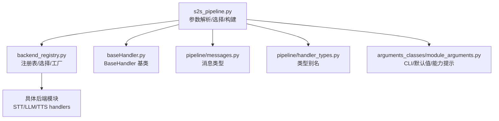
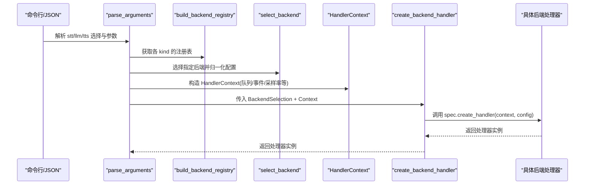
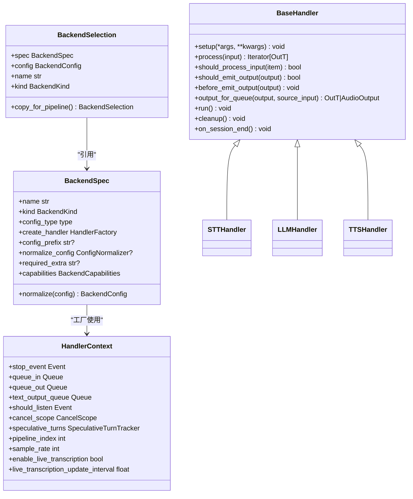

# 后端注册表机制

<cite>
**本文引用的文件**
- [backend_registry.py](file://src/speech_to_speech/backend_registry.py)
- [baseHandler.py](file://src/speech_to_speech/baseHandler.py)
- [handler_types.py](file://src/speech_to_speech/pipeline/handler_types.py)
- [messages.py](file://src/speech_to_speech/pipeline/messages.py)
- [module_arguments.py](file://src/speech_to_speech/arguments_classes/module_arguments.py)
- [runtime_config.py](file://src/speech_to_speech/api/openai_realtime/runtime_config.py)
- [s2s_pipeline.py](file://src/speech_to_speech/s2s_pipeline.py)
- [test_backend_registry.py](file://tests/test_backend_registry.py)
</cite>

## 目录
1. [简介](#简介)
2. [项目结构](#项目结构)
3. [核心组件](#核心组件)
4. [架构总览](#架构总览)
5. [详细组件分析](#详细组件分析)
6. [依赖关系分析](#依赖关系分析)
7. [性能考量](#性能考量)
8. [故障排查指南](#故障排查指南)
9. [结论](#结论)
10. [附录：添加新后端的完整指南](#附录添加新后端的完整指南)

## 简介
本文件系统性阐述后端注册表机制，覆盖以下主题：
- 核心数据结构：BackendSpec、BackendSelection、HandlerContext 的设计目的与使用方式
- 后端注册表的注册、查找与实例化流程
- create_backend_handler 如何根据配置动态创建处理器实例
- 能力声明（capabilities）机制：supports_audio_input、supports_llm_proxy 等能力的定义与检查
- 不同后端配置差异与参数映射的处理策略
- 后端选择策略与热插拔机制的实现细节
- 扩展新后端的步骤与最佳实践

## 项目结构
后端注册表位于 speech_to_speech.backend_registry 模块中，集中管理 STT、LLM、TTS 三类后端的元数据与工厂函数；管道构建在 s2s_pipeline.py 中完成，负责解析参数、选择后端并组装处理链。基础处理器基类 baseHandler.py 提供统一的线程生命周期与队列处理协议；消息类型与类型别名在 pipeline/messages.py 与 handler_types.py 中统一。

图表来源
- [s2s_pipeline.py:175-285](file://src/speech_to_speech/s2s_pipeline.py#L175-L285)
- [backend_registry.py:153-173](file://src/speech_to_speech/backend_registry.py#L153-L173)
- [baseHandler.py:25-55](file://src/speech_to_speech/baseHandler.py#L25-L55)
- [messages.py:31-225](file://src/speech_to_speech/pipeline/messages.py#L31-L225)
- [handler_types.py:31-46](file://src/speech_to_speech/pipeline/handler_types.py#L31-L46)
- [module_arguments.py:12-105](file://src/speech_to_speech/arguments_classes/module_arguments.py#L12-L105)

章节来源
- [s2s_pipeline.py:175-285](file://src/speech_to_speech/s2s_pipeline.py#L175-L285)
- [backend_registry.py:153-173](file://src/speech_to_speech/backend_registry.py#L153-L173)

## 核心组件
- BackendSpec：描述一个内置后端的静态构造元信息，包括名称、种类、配置类型、工厂函数、可选配置前缀、配置归一化器、可选依赖标识以及能力声明。
- BackendSelection：封装已选择的 BackendSpec 与其归一化后的配置，并提供按流水线副本的深拷贝能力。
- HandlerContext：传递给每个工厂函数的运行时上下文，包含停止事件、输入输出队列、文本输出队列、监听控制、取消作用域、推测性轮次跟踪、流水线索引、采样率与实时转录开关等。
- BackendCapabilities：声明影响阶段组合的能力标志，如 bypasses_transcription_notifier、supports_audio_input、supports_llm_proxy。
- 工厂函数族：_simple_handler_factory、_create_parakeet、_create_openai_tts、_create_local_llm 等，用于将通用上下文与配置适配到具体后端构造函数。

章节来源
- [backend_registry.py:48-122](file://src/speech_to_speech/backend_registry.py#L48-L122)
- [backend_registry.py:186-235](file://src/speech_to_speech/backend_registry.py#L186-L235)

## 架构总览
后端注册表通过 build_backend_registry 为每种 kind（stt/llm/tts）建立名称到 BackendSpec 的映射；select_backend 根据名称查找并执行配置归一化；create_backend_handler 调用 spec.create_handler 进行延迟导入与实例化，并将可选依赖缺失转换为可操作的 ImportError。

图表来源
- [s2s_pipeline.py:175-285](file://src/speech_to_speech/s2s_pipeline.py#L175-L285)
- [backend_registry.py:153-195](file://src/speech_to_speech/backend_registry.py#L153-L195)

## 详细组件分析

### BackendSpec、BackendSelection、HandlerContext
- BackendSpec.normalize：校验配置类型，若定义了 normalize_config 则调用自定义归一化器，否则通过 normalize_dataclass_config 将 dataclass 字段转为扁平字典，并将以 gen_ 开头的字段收集到 gen_kwargs，支持配置前缀剥离。
- BackendSelection：持有 spec 与 normalized config，提供 name/kind 属性与 copy_for_pipeline 深拷贝，避免多流水线共享可变配置。
- HandlerContext：集中传递运行时对象，确保所有后端工厂具备一致的上下文访问点，如 stop_event、queue_in/out、cancel_scope、speculative_turns、sample_rate、enable_live_transcription 等。

章节来源
- [backend_registry.py:96-144](file://src/speech_to_speech/backend_registry.py#L96-L144)
- [backend_registry.py:105-122](file://src/speech_to_speech/backend_registry.py#L105-L122)
- [backend_registry.py:62-79](file://src/speech_to_speech/backend_registry.py#L62-L79)

### 注册、查找与实例化
- 注册：STT_BACKENDS、LLM_BACKENDS、TTS_BACKENDS 通过 build_backend_registry 构建，重复名称或错误 kind 会立即报错，保证注册表一致性。
- 查找：select_backend 根据名称从 registry 查找，不存在时抛出包含可用选项的错误。
- 实例化：create_backend_handler 调用 spec.create_handler，捕获 ImportError 并通过 required_extra 生成带安装指引的错误信息。

章节来源
- [backend_registry.py:153-173](file://src/speech_to_speech/backend_registry.py#L153-L173)
- [backend_registry.py:175-195](file://src/speech_to_speech/backend_registry.py#L175-L195)

### 工厂函数与参数映射
- _simple_handler_factory：通用工厂，加载后端类，注入 cancel_scope/speculative_turns（当 context_kwargs=True），必要时附加 should_listen 与 speculative_turns 引用。
- _create_parakeet：为 Parakeet TDT 注入 enable_live_transcription 与 live_transcription_update_interval，并附加 speculative_turns。
- _create_openai_tts：为 OpenAI Compatible TTS 注入 cancel_scope 与 speculative_turns，并附带 should_listen。
- _create_local_llm：根据 backend 选择 transformers 或 mlx-lm，设置 is_vlm 与 backend 标记，并注入 cancel_scope/speculative_turns。

章节来源
- [backend_registry.py:198-235](file://src/speech_to_speech/backend_registry.py#L198-L235)
- [backend_registry.py:238-306](file://src/speech_to_speech/backend_registry.py#L238-L306)

### 能力声明（capabilities）机制
- BackendCapabilities：bypasses_transcription_notifier（跳过转写通知器）、supports_audio_input（LLM 直接接收音频输入）、supports_llm_proxy（支持 LLM 代理）。
- 使用位置：
  - 管道构建时根据 stt_backend.spec.capabilities.bypasses_transcription_notifier 决定 STT 输出是否经 TranscriptionNotifier。
  - prepare_module_args 校验 --stt none 必须搭配 supports_audio_input 的 LLM 后端。
  - build_llm_proxy_config 与 prepare_module_args 校验 enable_llm_proxy 必须搭配 supports_llm_proxy 的 LLM 后端。
  - module_arguments 中的 help 文案动态列出支持音频输入与代理的后端名。

章节来源
- [backend_registry.py:53-60](file://src/speech_to_speech/backend_registry.py#L53-L60)
- [s2s_pipeline.py:324-338](file://src/speech_to_speech/s2s_pipeline.py#L324-L338)
- [s2s_pipeline.py:111-132](file://src/speech_to_speech/s2s_pipeline.py#L111-L132)
- [module_arguments.py:6-10](file://src/speech_to_speech/arguments_classes/module_arguments.py#L6-L10)

### 不同后端配置差异与参数映射
- 配置前缀：config_prefix 允许 CLI 参数以特定前缀命名（如 faster_whisper_stt、mlx_audio_whisper、openai_stt），normalize_dataclass_config 会剥离前缀并合并到最终配置。
- 自定义归一化：例如 Facebook MMS 的 tts_language 被重命名为 language；parakeet 额外注入实时转录相关参数。
- 全局设备：prepare_all_args 将全局 device 应用到含 device 字段的选中后端配置中，但不覆盖 MLX Audio Whisper 的特殊 setup。

章节来源
- [backend_registry.py:124-150](file://src/speech_to_speech/backend_registry.py#L124-L150)
- [backend_registry.py:309-395](file://src/speech_to_speech/backend_registry.py#L309-L395)
- [s2s_pipeline.py:340-352](file://src/speech_to_speech/s2s_pipeline.py#L340-L352)

### 后端选择策略与热插拔
- 选择策略：CLI/JSON 先确定 stt/llm/tts 的名称，再基于注册表选择对应 spec 并归一化配置；choices 由注册表动态生成，保证 CLI 与内置注册表一致。
- 热插拔：通过替换注册表条目或新增 spec 即可在不修改核心逻辑的情况下启用新后端；create_backend_handler 的延迟导入确保未选中的后端不会提前加载依赖。

章节来源
- [s2s_pipeline.py:200-285](file://src/speech_to_speech/s2s_pipeline.py#L200-L285)
- [backend_registry.py:153-173](file://src/speech_to_speech/backend_registry.py#L153-L173)
- [test_backend_registry.py:527-540](file://tests/test_backend_registry.py#L527-L540)

## 依赖关系分析
- BaseHandler：所有后端处理器继承该基类，实现 process 方法，统一处理队列、控制消息、会话结束、输出包装与计时日志。
- Pipeline 消息：VADAudio、PartialTranscription、Transcription、LLMResponseChunk、TTSInput、AudioOutput 等作为阶段间契约，确保类型安全与顺序保持。
- RuntimeConfig：会话级配置，支持增量更新与中断响应开关，供 VAD/LLM/TTS 读取。

图表来源
- [baseHandler.py:25-186](file://src/speech_to_speech/baseHandler.py#L25-L186)
- [backend_registry.py:48-122](file://src/speech_to_speech/backend_registry.py#L48-L122)

章节来源
- [baseHandler.py:25-186](file://src/speech_to_speech/baseHandler.py#L25-L186)
- [messages.py:46-225](file://src/speech_to_speech/pipeline/messages.py#L46-L225)
- [runtime_config.py:27-82](file://src/speech_to_speech/api/openai_realtime/runtime_config.py#L27-L82)

## 性能考量
- 延迟导入：后端模块仅在 create_backend_handler 时加载，减少启动时间与内存占用。
- 配置归一化：避免重复转换，gen_kwargs 集中管理生成参数，降低后续处理分支复杂度。
- 队列与事件：BaseHandler 使用超时轮询 stop_event，避免忙等待；PIPELINE_END 哨兵防止队列死锁。
- 推测性轮次：通过 SpeculativeTurnTracker 与 cancel_scope 丢弃陈旧输入，减少无效计算。

章节来源
- [backend_registry.py:198-235](file://src/speech_to_speech/backend_registry.py#L198-L235)
- [baseHandler.py:105-165](file://src/speech_to_speech/baseHandler.py#L105-L165)

## 故障排查指南
- 不支持的后端名称：select_backend 抛出包含可用选项的错误，检查 CLI 选择与注册表。
- 可选依赖缺失：create_backend_handler 捕获 ImportError 并提示 pip install "speech-to-speech[extra]"，按提示安装。
- 能力不匹配：
  - --stt none 需搭配 supports_audio_input 的 LLM 后端。
  - enable_llm_proxy 需搭配 supports_llm_proxy 的 LLM 后端。
- macOS 限制：device=cuda 不被允许，建议使用 cpu/mps；推荐 mlx-lm 与 qwen3。

章节来源
- [backend_registry.py:166-195](file://src/speech_to_speech/backend_registry.py#L166-L195)
- [s2s_pipeline.py:309-338](file://src/speech_to_speech/s2s_pipeline.py#L309-L338)
- [test_backend_registry.py:162-199](file://tests/test_backend_registry.py#L162-L199)

## 结论
后端注册表机制通过 BackendSpec/BackendSelection/HandlerContext 将“元数据—选择—实例化”解耦，结合能力声明与配置归一化，实现了可扩展、可验证、可维护的后端生态。create_backend_handler 的延迟导入与可选依赖提示提升了用户体验；s2s_pipeline 的选择与校验保证了运行时的正确性。遵循本文附录指南，可快速添加新后端并保持与系统的一致行为。

## 附录：添加新后端的完整指南

### 1. 实现后端处理器
- 继承 BaseHandler，实现 process 方法，遵守消息类型与队列协议。
- 如需特殊初始化，可在 setup 中处理 should_listen、cancel_scope、speculative_turns 等。

章节来源
- [baseHandler.py:25-55](file://src/speech_to_speech/baseHandler.py#L25-L55)
- [handler_types.py:31-46](file://src/speech_to_speech/pipeline/handler_types.py#L31-L46)

### 2. 定义配置类
- 在 arguments_classes 下新增 dataclass 配置类，字段即 CLI 参数。
- 若需要配置前缀或自定义归一化，在 BackendSpec 中设置 config_prefix 与 normalize_config。

章节来源
- [backend_registry.py:124-150](file://src/speech_to_speech/backend_registry.py#L124-L150)

### 3. 编写工厂函数
- 使用 _simple_handler_factory 或自定义工厂，注入 cancel_scope/speculative_turns，必要时附加 should_listen。
- 对于需要注入实时转录参数的后端，参考 _create_parakeet。

章节来源
- [backend_registry.py:208-266](file://src/speech_to_speech/backend_registry.py#L208-L266)

### 4. 声明能力与可选依赖
- 在 BackendSpec.capabilities 中声明 supports_audio_input、supports_llm_proxy、bypasses_transcription_notifier。
- 若后端依赖可选包，设置 required_extra，以便错误提示安装命令。

章节来源
- [backend_registry.py:53-60](file://src/speech_to_speech/backend_registry.py#L53-L60)
- [backend_registry.py:175-195](file://src/speech_to_speech/backend_registry.py#L175-L195)

### 5. 注册后端
- 在 STT_BACKENDS/LLM_BACKENDS/TTS_BACKENDS 中添加 BackendSpec，确保 name 唯一且 kind 正确。
- 确保 CLI choices 自动同步（由注册表生成）。

章节来源
- [backend_registry.py:309-543](file://src/speech_to_speech/backend_registry.py#L309-L543)
- [s2s_pipeline.py:200-285](file://src/speech_to_speech/s2s_pipeline.py#L200-L285)

### 6. 测试与验证
- 使用 test_backend_registry.py 中的模式验证：
  - 注册表查找与 CLI choices 一致
  - 配置归一化符合预期
  - 能力校验生效
  - 可选依赖错误提示正确
  - 工厂延迟导入

章节来源
- [test_backend_registry.py:59-77](file://tests/test_backend_registry.py#L59-L77)
- [test_backend_registry.py:127-134](file://tests/test_backend_registry.py#L127-L134)
- [test_backend_registry.py:162-199](file://tests/test_backend_registry.py#L162-L199)
- [test_backend_registry.py:527-540](file://tests/test_backend_registry.py#L527-L540)