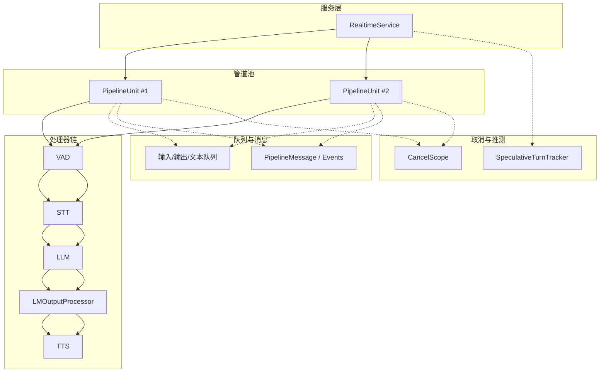
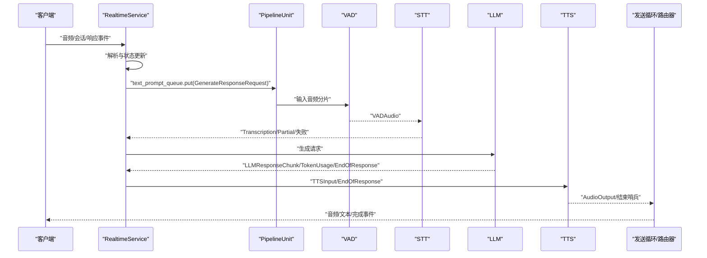
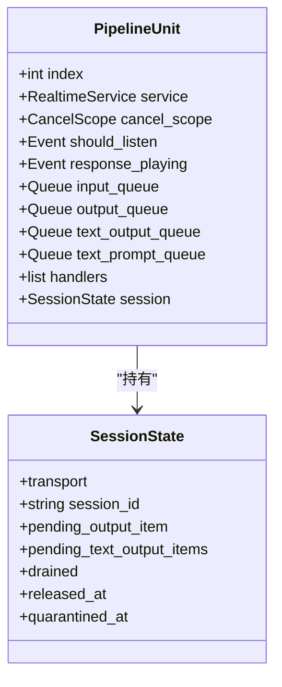
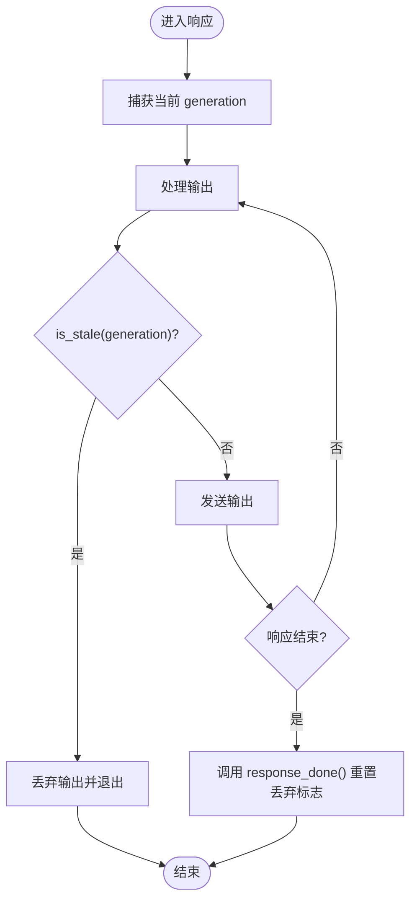
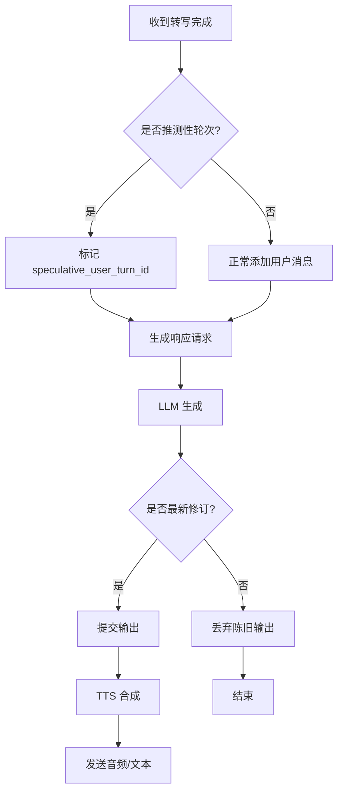
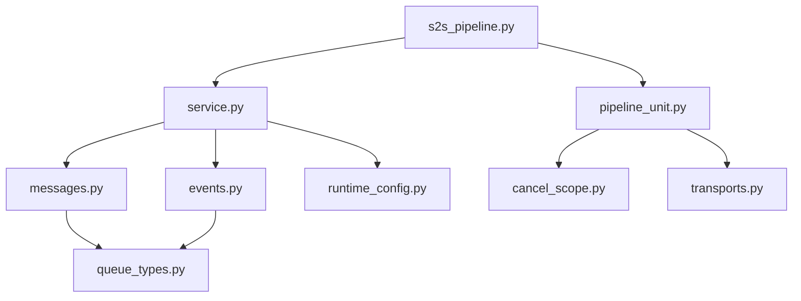

# 任务调度

<cite>
**本文引用的文件**
- [s2s_pipeline.py](file://src/speech_to_speech/s2s_pipeline.py)
- [pipeline_unit.py](file://src/speech_to_speech/api/openai_realtime/pipeline_unit.py)
- [cancel_scope.py](file://src/speech_to_speech/pipeline/cancel_scope.py)
- [messages.py](file://src/speech_to_speech/pipeline/messages.py)
- [queue_types.py](file://src/speech_to_speech/pipeline/queue_types.py)
- [control.py](file://src/speech_to_speech/pipeline/control.py)
- [events.py](file://src/speech_to_speech/pipeline/events.py)
- [handler_types.py](file://src/speech_to_speech/pipeline/handler_types.py)
- [service.py](file://src/speech_to_speech/api/openai_realtime/service.py)
- [thread_manager.py](file://src/speech_to_speech/utils/thread_manager.py)
- [speculative_turns.py](file://src/speech_to_speech/pipeline/speculative_turns.py)
- [log_context.py](file://src/speech_to_speech/pipeline/log_context.py)
- [transcript_logging.py](file://src/speech_to_speech/pipeline/transcript_logging.py)
</cite>

## 目录
1. [简介](#简介)
2. [项目结构](#项目结构)
3. [核心组件](#核心组件)
4. [架构总览](#架构总览)
5. [详细组件分析](#详细组件分析)
6. [依赖关系分析](#依赖关系分析)
7. [性能考量](#性能考量)
8. [故障排查指南](#故障排查指南)
9. [结论](#结论)
10. [附录：使用场景与最佳实践](#附录使用场景与最佳实践)

## 简介
本文件围绕“任务调度”主题，系统化说明语音到语音（Speech-to-Speech）实时管线中的隔离设计、取消机制、队列与消息传递、任务依赖管理、监控与调试工具，以及实际使用建议。重点覆盖：
- PipelineUnit 的隔离设计：每个管道单元拥有独立状态、资源与生命周期。
- CancelScope 优雅取消：基于生成代数的线程安全取消信号，支持丢弃陈旧输出。
- 任务队列与消息：类型化消息、控制消息、哨兵值，跨阶段有序流转。
- 任务依赖：串行、并行、条件执行与推测性重开（speculative turns）。
- 监控与调试：指标收集、错误追踪、日志上下文与转录内容开关。

## 项目结构
该任务调度系统由“服务层 + 管道单元 + 处理器链 + 队列与消息 + 取消与推测性跟踪”组成：
- 服务层：RealtimeService 负责协议事件与内部管线事件的桥接、连接状态、指标统计。
- 管道单元：PipelineUnit 封装一组处理器（VAD → STT → LLM → TTS），并持有各自队列、事件与 CancelScope。
- 处理器链：通过统一上下文创建后端处理器，串联成处理流水线。
- 队列与消息：强类型消息模型与控制消息，保证跨线程/协程的数据一致性。
- 取消与推测性：CancelScope 提供全局取消信号；SpeculativeTurnTracker 维护推测性轮次与版本一致性。

图表来源
- [service.py:287-326](file://src/speech_to_speech/api/openai_realtime/service.py#L287-L326)
- [pipeline_unit.py:53-77](file://src/speech_to_speech/api/openai_realtime/pipeline_unit.py#L53-L77)
- [s2s_pipeline.py:354-458](file://src/speech_to_speech/s2s_pipeline.py#L354-L458)

章节来源
- [s2s_pipeline.py:461-587](file://src/speech_to_speech/s2s_pipeline.py#L461-L587)
- [pipeline_unit.py:53-77](file://src/speech_to_speech/api/openai_realtime/pipeline_unit.py#L53-L77)
- [service.py:287-326](file://src/speech_to_speech/api/openai_realtime/service.py#L287-L326)

## 核心组件
- PipelineUnit：一个隔离的实时管道，包含独立的队列、事件、RealtimeService 实例、处理器链和 CancelScope。
- RealtimeService：将 OpenAI Realtime 协议事件映射为内部管线消息，维护连接状态、响应生命周期与指标。
- CancelScope：线程安全的取消信号，基于生成代数与丢弃标志，用于优雅终止与清理。
- SpeculativeTurnTracker：维护推测性轮次的最新版本、提交窗口与重开候选，确保乱序到达的输出按序生效。
- 消息与事件：类型化的 PipelineMessage 与 PipelineEvent，承载数据流与控制流。
- 队列类型：集中定义各阶段队列项的联合类型，避免散落 union 带来的不一致。
- ThreadManager：统一管理处理器线程的启动、等待与停止。

章节来源
- [pipeline_unit.py:13-77](file://src/speech_to_speech/api/openai_realtime/pipeline_unit.py#L13-L77)
- [service.py:138-179](file://src/speech_to_speech/api/openai_realtime/service.py#L138-L179)
- [cancel_scope.py:1-65](file://src/speech_to_speech/pipeline/cancel_scope.py#L1-L65)
- [speculative_turns.py:24-117](file://src/speech_to_speech/pipeline/speculative_turns.py#L24-L117)
- [messages.py:31-225](file://src/speech_to_speech/pipeline/messages.py#L31-L225)
- [queue_types.py:20-47](file://src/speech_to_speech/pipeline/queue_types.py#L20-L47)
- [thread_manager.py:9-40](file://src/speech_to_speech/utils/thread_manager.py#L9-L40)

## 架构总览
下图展示从客户端事件到管线处理的端到端流程，包括消息路由、响应生命周期与指标记录。

图表来源
- [service.py:629-727](file://src/speech_to_speech/api/openai_realtime/service.py#L629-L727)
- [messages.py:335-357](file://src/speech_to_speech/pipeline/messages.py#L335-L357)
- [events.py:36-100](file://src/speech_to_speech/pipeline/events.py#L36-L100)
- [handler_types.py:31-46](file://src/speech_to_speech/pipeline/handler_types.py#L31-L46)

## 详细组件分析

### PipelineUnit 的隔离设计
- 每个 PipelineUnit 拥有独立的：
  - 队列：输入、输出、文本输出、文本提示等，避免跨会话污染。
  - 事件：should_listen、response_playing，控制监听与播放状态。
  - CancelScope：每单元独立取消域，防止影响其他单元。
  - RealtimeService：连接级状态与指标隔离。
  - 处理器链：VAD→STT→LLM→TTS，按顺序构建并注入上下文。
- SessionState：绑定传输、会话ID、待发送项、释放时间等，确保生命周期一致。

图表来源
- [pipeline_unit.py:13-77](file://src/speech_to_speech/api/openai_realtime/pipeline_unit.py#L13-L77)

章节来源
- [pipeline_unit.py:53-77](file://src/speech_to_speech/api/openai_realtime/pipeline_unit.py#L53-L77)
- [s2s_pipeline.py:461-547](file://src/speech_to_speech/s2s_pipeline.py#L461-L547)

### CancelScope 机制：优雅取消与资源清理
- 生成代数：每次 cancel() 递增 generation，并在 response_done() 或 new_response() 时重置丢弃标志。
- 丢弃守卫：discarding 标志使发送循环在取消期间静默丢弃陈旧输出，避免客户端收到过时数据。
- 线程安全：单写多读，利用 Python GIL 保证原子性，无需额外锁。
- 使用点：LLM/TTS 线程在开始响应时捕获当前 generation，后续检查 is_stale(gen) 决定是否继续。

图表来源
- [cancel_scope.py:13-65](file://src/speech_to_speech/pipeline/cancel_scope.py#L13-L65)

章节来源
- [cancel_scope.py:1-65](file://src/speech_to_speech/pipeline/cancel_scope.py#L1-L65)

### 任务队列与消息传递：优先级与负载均衡
- 队列类型：集中定义各阶段队列项的联合类型，如 AudioInItem、STTOutItem、TextPromptItem、LMOutItem、TTSInItem、AudioOutItem、TextEventItem。
- 消息模型：PipelineMessage 子类承载业务数据（如 VADAudio、Transcription、LLMResponseChunk、TTSInput、AudioOutput），带 turn_id/turn_revision/response_key 等上下文。
- 控制消息：PipelineControlMessage（如 SESSION_END）与二进制哨兵（PIPELINE_END、AUDIO_RESPONSE_DONE）用于控制流与结束信号。
- 优先级与负载均衡：
  - 优先级：通过不同队列分离控制流与数据流，确保关键控制消息优先处理。
  - 负载均衡：通过 PipelineUnit 池与 ThreadManager 多线程并行处理多个会话，实现水平扩展。

图表来源
- [queue_types.py:20-47](file://src/speech_to_speech/pipeline/queue_types.py#L20-L47)
- [messages.py:46-225](file://src/speech_to_speech/pipeline/messages.py#L46-L225)
- [control.py:7-27](file://src/speech_to_speech/pipeline/control.py#L7-L27)

章节来源
- [queue_types.py:20-47](file://src/speech_to_speech/pipeline/queue_types.py#L20-L47)
- [messages.py:31-225](file://src/speech_to_speech/pipeline/messages.py#L31-L225)
- [control.py:7-27](file://src/speech_to_speech/pipeline/control.py#L7-L27)

### 任务依赖关系：串行、并行与条件执行
- 串行执行：VAD→STT→LLM→TTS 严格顺序，确保数据依赖正确。
- 并行执行：
  - 推测性工具调用：AssistantToolCallReadyEvent 允许工具调用提前暴露，不阻塞 TTS 继续合成。
  - 侧通道事件：TokenUsageEvent、ResponseGenerationDoneEvent 走专用路径，不影响主输出顺序。
- 条件执行：
  - 推测性轮次：SpeculativeTurnTracker 维护最新版本与提交窗口，只有最新修订被提交。
  - 重开候选：begin_reopen_candidate/confirm_reopen_candidate 支持在稳定后提交或取消。
  - 超时与门控：reopen grace 窗口内等待最新修订，避免过早提交。

图表来源
- [service.py:629-727](file://src/speech_to_speech/api/openai_realtime/service.py#L629-L727)
- [speculative_turns.py:226-339](file://src/speech_to_speech/pipeline/speculative_turns.py#L226-L339)

章节来源
- [speculative_turns.py:24-117](file://src/speech_to_speech/pipeline/speculative_turns.py#L24-L117)
- [service.py:529-618](file://src/speech_to_speech/api/openai_realtime/service.py#L529-L618)

### 监控与调试工具
- 指标收集：
  - UsageMetrics：每响应计数（输入/输出 token、音频时长、响应数、工具调用、轮次）。
  - GlobalUsageMetrics：全局连接数、错误分类、累计指标。
  - TokenUsageEvent：侧通道上报 token 用量，按 response_key 聚合。
- 错误追踪：
  - log_exception：默认隐藏异常详情，启用 --log_transcripts 后可见完整堆栈。
  - transcript_for_log：默认仅记录字符数，避免生产环境泄露敏感内容。
- 日志上下文：
  - PipelineLogFilter：自动注入 [pipeline N] 前缀，便于区分不同管道单元的日志。
- 调试建议：
  - 启用 --log_transcripts 进行问题复现与定位。
  - 观察 ResponseFailedEvent 与 TranscriptionFailedEvent 快速定位失败原因。
  - 使用 /v1/pool 接口查看卡住的 PipelineUnit（released_at/quarantined_at）。

章节来源
- [service.py:138-179](file://src/speech_to_speech/api/openai_realtime/service.py#L138-L179)
- [transcript_logging.py:35-86](file://src/speech_to_speech/pipeline/transcript_logging.py#L35-L86)
- [log_context.py:1-26](file://src/speech_to_speech/pipeline/log_context.py#L1-L26)

## 依赖关系分析
- 模块耦合：
  - s2s_pipeline.py 依赖 pipeline_unit、service、handlers、arguments_classes，负责组装与启动。
  - service.py 依赖 events、messages、runtime_config、chat，负责协议转换与状态管理。
  - pipeline_unit.py 依赖 service、transports、cancel_scope，封装隔离单元。
  - messages.py、events.py、queue_types.py 提供类型化消息与事件，解耦上下游。
- 外部依赖：
  - OpenAI Realtime 类型定义用于协议事件。
  - Pydantic 用于模型校验与序列化。
  - threading.Queue 用于线程间通信。
- 潜在循环依赖：
  - 通过类型别名与延迟导入避免循环引用。
  - 处理器链通过工厂函数 create_backend_handler 动态创建，降低编译期耦合。

图表来源
- [s2s_pipeline.py:21-56](file://src/speech_to_speech/s2s_pipeline.py#L21-L56)
- [service.py:56-75](file://src/speech_to_speech/api/openai_realtime/service.py#L56-L75)
- [pipeline_unit.py:8-11](file://src/speech_to_speech/api/openai_realtime/pipeline_unit.py#L8-L11)

章节来源
- [s2s_pipeline.py:21-56](file://src/speech_to_speech/s2s_pipeline.py#L21-L56)
- [service.py:56-75](file://src/speech_to_speech/api/openai_realtime/service.py#L56-L75)

## 性能考量
- 线程与队列：
  - 每个 PipelineUnit 独立队列，减少锁竞争。
  - ThreadManager 统一管理线程生命周期，避免泄漏。
- 推测性优化：
  - 工具调用提前暴露，减少端到端延迟。
  - 重开 grace 窗口避免频繁重算。
- 设备与平台：
  - macOS 上 MLX 全局锁导致并发限制，多管道时禁用实时转写以降低争用。
- 内存与缓存：
  - Chat 大小可配置，避免历史膨胀。
  - 关闭不必要的日志以减少 IO 开销。

[本节为通用性能讨论，未直接分析具体文件]

## 故障排查指南
- 常见问题：
  - 响应卡住：检查 PipelineUnit 的 released_at/quarantined_at，确认 SESSION_END 是否已 draining。
  - 输出错乱：确认 SpeculativeTurnTracker 的版本提交逻辑，检查 is_latest_after_reopen_grace。
  - 取消无效：验证 CancelScope 的 generation 与 discarding 标志是否正确设置。
- 调试步骤：
  - 启用 --log_transcripts 获取完整对话内容。
  - 观察 ResponseFailedEvent 与 TranscriptionFailedEvent 的错误信息。
  - 使用 /v1/pool 接口查看管道单元状态。
- 恢复策略：
  - 重新建立会话，清空 ConnState 与 PendingResponses。
  - 重启管道单元，重置 CancelScope 与队列。

章节来源
- [service.py:464-489](file://src/speech_to_speech/api/openai_realtime/service.py#L464-L489)
- [speculative_turns.py:308-386](file://src/speech_to_speech/pipeline/speculative_turns.py#L308-L386)
- [cancel_scope.py:24-65](file://src/speech_to_speech/pipeline/cancel_scope.py#L24-L65)

## 结论
本任务调度系统通过 PipelineUnit 隔离、CancelScope 优雅取消、类型化消息与队列、推测性轮次管理，实现了高并发、低延迟、可观测的实时语音处理。其设计兼顾了性能与可维护性，适用于生产环境的语音交互场景。

[本节为总结，未直接分析具体文件]

## 附录：使用场景与最佳实践
- 场景示例：
  - 实时语音助手：VAD 检测说话开始/结束，STT 转写，LLM 生成回复，TTS 合成音频。
  - 工具调用：AssistantToolCallReadyEvent 提前触发工具执行，提升响应速度。
  - 多会话并发：PipelineUnit 池 + ThreadManager 实现水平扩展。
- 最佳实践：
  - 合理配置 chat_size 与 live_transcription_update_interval，平衡内存与延迟。
  - 在生产环境禁用 --log_transcripts，避免敏感数据泄露。
  - 监控 /v1/pool 接口，及时发现卡住的管道单元。
  - 使用 SpeculativeTurnTracker 的 grace 窗口优化推测性提交。

[本节为概念性内容，未直接分析具体文件]