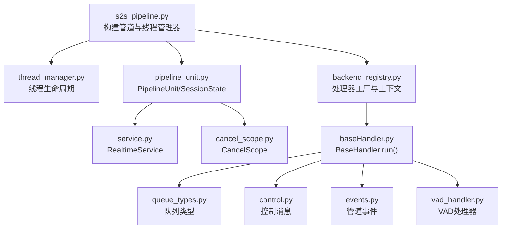
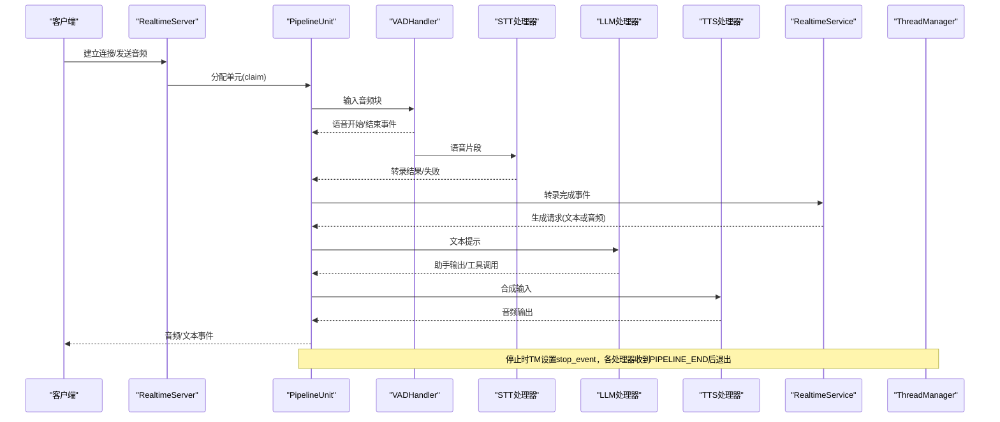
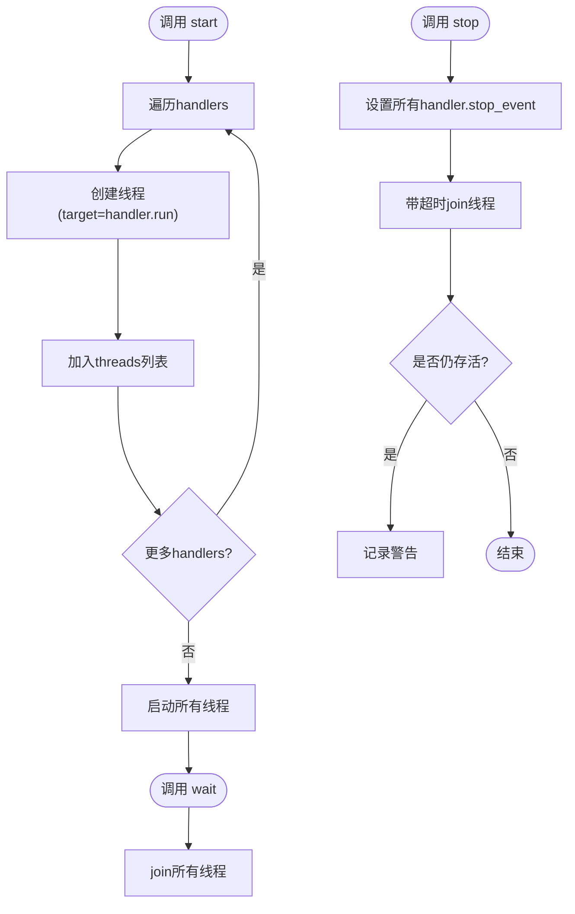
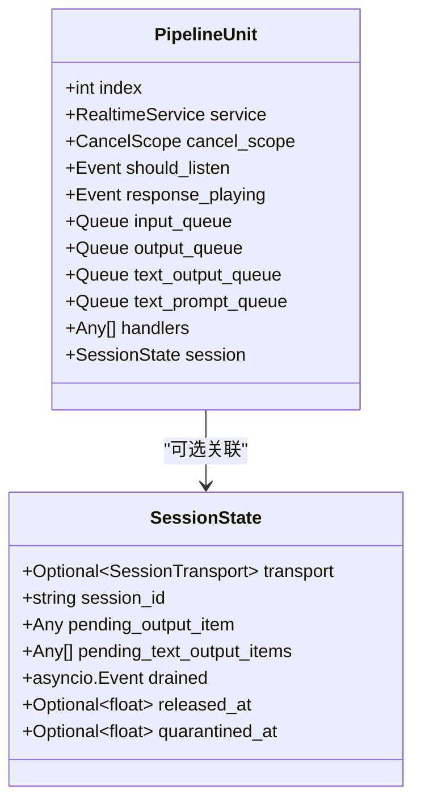
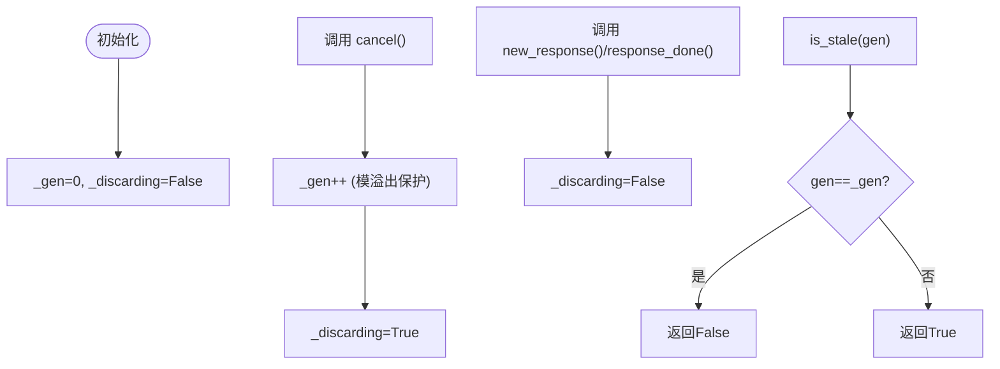
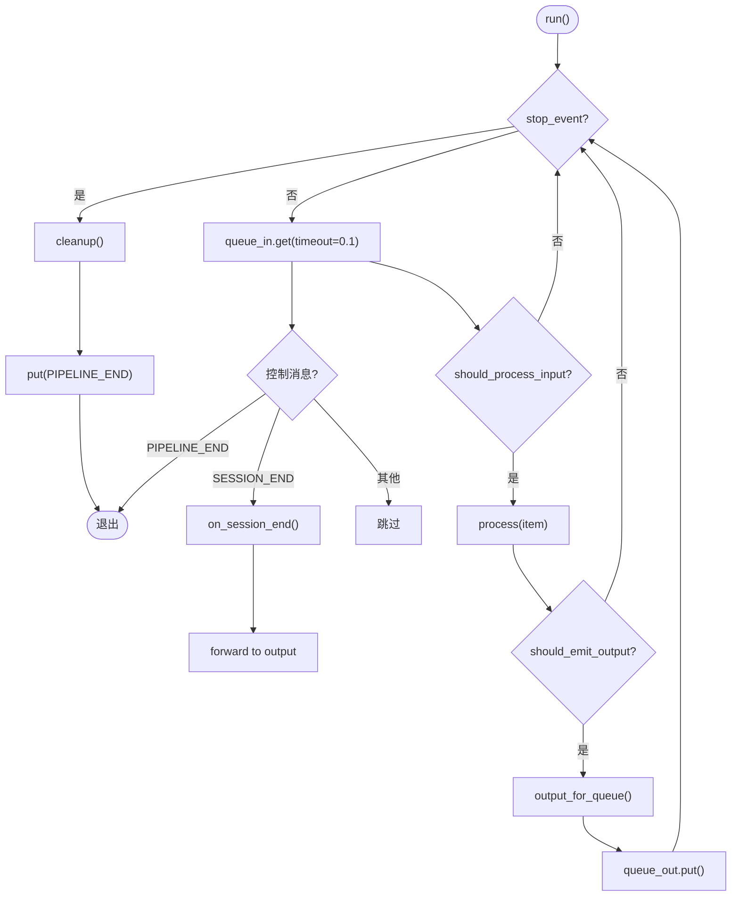
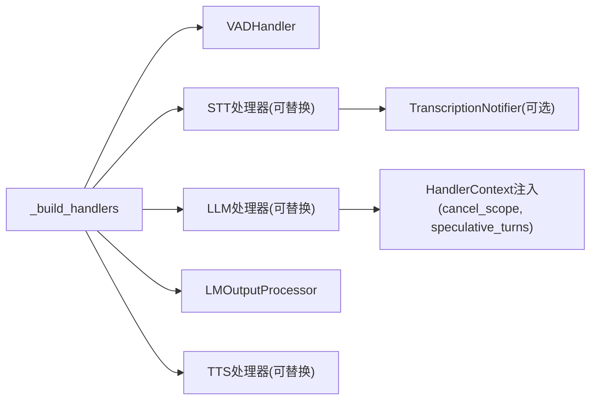
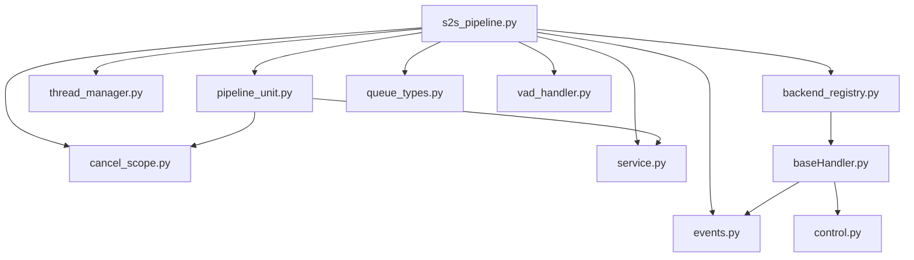

# 多线程处理模型

<cite>
**本文引用的文件**
- [s2s_pipeline.py](file://src/speech_to_speech/s2s_pipeline.py)
- [thread_manager.py](file://src/speech_to_speech/utils/thread_manager.py)
- [pipeline_unit.py](file://src/speech_to_speech/api/openai_realtime/pipeline_unit.py)
- [cancel_scope.py](file://src/speech_to_speech/pipeline/cancel_scope.py)
- [baseHandler.py](file://src/speech_to_speech/baseHandler.py)
- [backend_registry.py](file://src/speech_to_speech/backend_registry.py)
- [queue_types.py](file://src/speech_to_speech/pipeline/queue_types.py)
- [control.py](file://src/speech_to_speech/pipeline/control.py)
- [events.py](file://src/speech_to_speech/pipeline/events.py)
- [service.py](file://src/speech_to_speech/api/openai_realtime/service.py)
- [vad_handler.py](file://src/speech_to_speech/VAD/vad_handler.py)
</cite>

## 目录
1. [简介](#简介)
2. [项目结构](#项目结构)
3. [核心组件](#核心组件)
4. [架构总览](#架构总览)
5. [详细组件分析](#详细组件分析)
6. [依赖关系分析](#依赖关系分析)
7. [性能考虑](#性能考虑)
8. [故障排除指南](#故障排除指南)
9. [结论](#结论)

## 简介
本文件系统性阐述语音到语音（Speech-to-Speech）系统中的多线程处理模型，重点覆盖：
- ThreadManager 如何统一启动、等待与停止多个处理线程
- PipelineUnit 的隔离设计：每个管道的独立状态、队列与资源管理
- CancelScope 的任务取消与清理机制
- 线程间通信模式：队列传递、事件同步与状态共享
- 资源分配策略：内存、GPU 与并发控制
- 线程生命周期：启动、运行、停止与异常恢复
- 性能优化建议：线程池大小调优、负载均衡与死锁预防
- 调试技巧与故障排除

## 项目结构
系统以“管道单元”为基本执行单元，每个单元包含一组处理器（VAD、STT、LLM、TTS 等），通过队列串联。所有单元由统一的服务器进程托管，并由 ThreadManager 统一管理线程生命周期。关键文件职责如下：
- s2s_pipeline.py：构建管道单元、组装处理器链、创建服务与服务器、注册信号处理并启动线程管理器
- thread_manager.py：线程生命周期管理（start/wait/stop）
- pipeline_unit.py：定义 PipelineUnit 与 SessionState，封装单实例的队列、事件与服务
- cancel_scope.py：跨线程的取消作用域，基于代际号与丢弃标志实现任务取消
- baseHandler.py：处理器基类，提供 run 循环、控制消息处理、异常与收尾
- backend_registry.py：后端选择与上下文注入（含 cancel_scope、speculative turns）
- queue_types.py：队列数据类型的集中定义
- control.py：控制消息（如 SESSION_END）
- events.py：管道事件类型（语音开始/结束、转录、助手输出、响应完成等）
- service.py：实时协议与内部事件的桥接，维护连接级状态与指标
- vad_handler.py：语音活动检测，驱动后续 STT/LLM/TTS 流程

**图表来源**
- [s2s_pipeline.py:461-587](file://src/speech_to_speech/s2s_pipeline.py#L461-L587)
- [thread_manager.py:9-40](file://src/speech_to_speech/utils/thread_manager.py#L9-L40)
- [pipeline_unit.py:13-77](file://src/speech_to_speech/api/openai_realtime/pipeline_unit.py#L13-L77)
- [backend_registry.py:62-79](file://src/speech_to_speech/backend_registry.py#L62-L79)
- [baseHandler.py:25-186](file://src/speech_to_speech/baseHandler.py#L25-L186)
- [queue_types.py:1-47](file://src/speech_to_speech/pipeline/queue_types.py#L1-L47)
- [control.py:7-27](file://src/speech_to_speech/pipeline/control.py#L7-L27)
- [events.py:23-206](file://src/speech_to_speech/pipeline/events.py#L23-L206)
- [service.py:287-327](file://src/speech_to_speech/api/openai_realtime/service.py#L287-L327)
- [vad_handler.py:53-172](file://src/speech_to_speech/VAD/vad_handler.py#L53-L172)

**章节来源**
- [s2s_pipeline.py:461-587](file://src/speech_to_speech/s2s_pipeline.py#L461-L587)
- [thread_manager.py:9-40](file://src/speech_to_speech/utils/thread_manager.py#L9-L40)
- [pipeline_unit.py:13-77](file://src/speech_to_speech/api/openai_realtime/pipeline_unit.py#L13-L77)

## 核心组件
- ThreadManager：负责创建、启动、等待与停止多个 handler 线程；通过 stop_event 通知所有处理器退出，并在超时后记录未终止线程
- PipelineUnit：一个独立的实时管道实例，持有输入/输出队列、文本队列、事件、处理器链以及会话状态；每个单元拥有独立的 CancelScope 和 SpeculativeTurnTracker
- BaseHandler：所有处理器的基类，提供 run 循环、控制消息处理、异常捕获与 PIPELINE_END 哨兵机制，确保无阻塞退出
- CancelScope：跨线程取消信号，使用代际号与丢弃标志，使流水线线程能安全丢弃过期输出
- RealtimeService：将 OpenAI Realtime 协议事件映射到内部管道事件，维护连接级状态、响应键、指标与调度逻辑
- VADHandler：语音活动检测，产出语音开始/结束事件，驱动后续 STT/LLM/TTS 流程

**章节来源**
- [thread_manager.py:9-40](file://src/speech_to_speech/utils/thread_manager.py#L9-L40)
- [pipeline_unit.py:53-77](file://src/speech_to_speech/api/openai_realtime/pipeline_unit.py#L53-L77)
- [baseHandler.py:25-186](file://src/speech_to_speech/baseHandler.py#L25-L186)
- [cancel_scope.py:1-65](file://src/speech_to_speech/pipeline/cancel_scope.py#L1-L65)
- [service.py:287-327](file://src/speech_to_speech/api/openai_realtime/service.py#L287-L327)
- [vad_handler.py:53-172](file://src/speech_to_speech/VAD/vad_handler.py#L53-L172)

## 架构总览
下图展示了从音频输入到语音输出的整体数据流与线程协作关系：

**图表来源**
- [s2s_pipeline.py:354-458](file://src/speech_to_speech/s2s_pipeline.py#L354-L458)
- [service.py:629-727](file://src/speech_to_speech/api/openai_realtime/service.py#L629-L727)
- [baseHandler.py:105-165](file://src/speech_to_speech/baseHandler.py#L105-L165)
- [thread_manager.py:18-40](file://src/speech_to_speech/utils/thread_manager.py#L18-L40)

## 详细组件分析

### ThreadManager：线程管理与调度
- 启动：遍历 handlers，为每个 handler.run 创建线程并启动
- 等待：join 所有线程，确保优雅退出
- 停止：设置所有 handler 的 stop_event，然后带超时的 join，记录未终止线程

**图表来源**
- [thread_manager.py:18-40](file://src/speech_to_speech/utils/thread_manager.py#L18-L40)

**章节来源**
- [thread_manager.py:9-40](file://src/speech_to_speech/utils/thread_manager.py#L9-L40)

### PipelineUnit：隔离设计与资源管理
- 每个单元拥有独立的：
  - 输入/输出队列（音频）、文本队列（事件/提示）
  - should_listen/response_playing 事件
  - handlers 列表（VAD、STT、LLM、TTS 等）
  - session（可选，包含 transport、session_id、pending_output_item、drained 等）
- 通过 deepcopy 复制配置，避免第三方库在 setup 阶段的副作用污染其他单元
- 每个单元绑定一个 CancelScope 与 SpeculativeTurnTracker，保证取消与推测性轮次隔离

**图表来源**
- [pipeline_unit.py:13-77](file://src/speech_to_speech/api/openai_realtime/pipeline_unit.py#L13-L77)

**章节来源**
- [pipeline_unit.py:13-77](file://src/speech_to_speech/api/openai_realtime/pipeline_unit.py#L13-L77)
- [s2s_pipeline.py:461-547](file://src/speech_to_speech/s2s_pipeline.py#L461-L547)

### CancelScope：任务取消与清理
- 使用 generation 计数器标识当前响应周期；cancel 时递增并启用 discarding
- is_stale(gen) 判断传入的 gen 是否已被新的 cancel 取代
- response_done/new_response/reset 用于清理丢弃状态
- 线程安全：单写多读，Python GIL 保证 int/bool 原子读写

**图表来源**
- [cancel_scope.py:13-65](file://src/speech_to_speech/pipeline/cancel_scope.py#L13-L65)

**章节来源**
- [cancel_scope.py:1-65](file://src/speech_to_speech/pipeline/cancel_scope.py#L1-L65)

### BaseHandler：处理器基类与生命周期
- run 循环：
  - 每 0.1 秒从 queue_in 取项，检查 stop_event
  - 处理控制消息（SESSION_END）与 PIPELINE_END 哨兵
  - 过滤过时输入（should_process_input）
  - 对 PipelineEvent 直接转发到输出队列
  - 调用 process 迭代输出，包装为 AudioOutput 携带 cancel_generation/response_key
  - 异常捕获并记录日志
  - 结束时 cleanup 并放入 PIPELINE_END
- should_process_input：
  - 支持 prefetch 事务等待与取消作用域检查
  - 丢弃过期的 cancel_generation 对应输入

**图表来源**
- [baseHandler.py:105-165](file://src/speech_to_speech/baseHandler.py#L105-L165)

**章节来源**
- [baseHandler.py:25-186](file://src/speech_to_speech/baseHandler.py#L25-L186)

### 处理器链构建与后端注入
- _build_handlers：按顺序构建 VAD → STT/AudioInput → LLM → LMOutputProcessor → TTS
- HandlerContext：向每个处理器注入 stop_event、队列、text_output_queue、should_listen、cancel_scope、speculative_turns、pipeline_index、sample_rate、live transcription 参数
- create_backend_handler：根据后端选择动态加载处理器类，处理可选依赖缺失错误

**图表来源**
- [s2s_pipeline.py:354-458](file://src/speech_to_speech/s2s_pipeline.py#L354-L458)
- [backend_registry.py:62-79](file://src/speech_to_speech/backend_registry.py#L62-L79)
- [backend_registry.py:186-196](file://src/speech_to_speech/backend_registry.py#L186-L196)

**章节来源**
- [s2s_pipeline.py:354-458](file://src/speech_to_speech/s2s_pipeline.py#L354-L458)
- [backend_registry.py:62-79](file://src/speech_to_speech/backend_registry.py#L62-L79)
- [backend_registry.py:186-196](file://src/speech_to_speech/backend_registry.py#L186-L196)

### 线程间通信模式
- 队列传递：
  - 音频输入：recv_audio_chunks_queue → VAD
  - 语音片段：spoken_prompt_queue → STT
  - 转录结果：stt_output_queue → TranscriptionNotifier（可选）→ text_prompt_queue → LLM
  - LLM 输出：lm_response_queue → LMOutputProcessor → lm_processed_queue → TTS
  - 音频输出：send_audio_chunks_queue → 客户端
  - 文本事件：text_output_queue → 客户端（不等待 TTS）
- 事件同步：
  - should_listen：控制监听/暂停
  - response_playing：播放状态
  - stop_event：全局停止信号
- 状态共享：
  - CancelScope：跨线程取消
  - SpeculativeTurnTracker：推测性轮次跟踪（在多处注入）
  - RealtimeService：连接级状态与会话管理

**章节来源**
- [queue_types.py:1-47](file://src/speech_to_speech/pipeline/queue_types.py#L1-L47)
- [control.py:7-27](file://src/speech_to_speech/pipeline/control.py#L7-L27)
- [events.py:23-206](file://src/speech_to_speech/pipeline/events.py#L23-L206)
- [service.py:287-327](file://src/speech_to_speech/api/openai_realtime/service.py#L287-L327)

### 资源分配策略
- 内存管理：
  - 每个 PipelineUnit 使用 deepcopy 复制配置，避免共享状态污染
  - 队列作为缓冲，避免生产者/消费者速度差异导致的阻塞
- GPU 资源：
  - 通过 BackendSelection.config.device 字段统一设置设备（CPU/CUDA/MPS）
  - macOS 平台限制 CUDA，推荐 MPS；MLX 路径在多管线下禁用实时转录以避免全局锁竞争
- 并发控制：
  - num_pipelines 决定并行单元数量
  - ThreadManager 统一管理线程，stop_event 协调退出
  - BaseHandler 使用短超时取队，避免忙等

**章节来源**
- [s2s_pipeline.py:340-352](file://src/speech_to_speech/s2s_pipeline.py#L340-L352)
- [s2s_pipeline.py:639-655](file://src/speech_to_speech/s2s_pipeline.py#L639-L655)
- [backend_registry.py:120-122](file://src/speech_to_speech/backend_registry.py#L120-L122)

### 线程生命周期管理
- 启动：
  - build_pipeline/build_local_pipeline 创建 PipelineUnit 与 RealtimeServer
  - ThreadManager.start 启动所有 handler 线程
- 运行：
  - BaseHandler.run 循环处理输入，转发事件，写入输出队列
  - RealtimeService 路由协议事件到内部处理器
- 停止：
  - 信号处理触发 pipeline_manager.stop()
  - ThreadManager.stop 设置 stop_event 并带超时 join
  - BaseHandler 收到 PIPELINE_END 后退出
- 异常恢复：
  - BaseHandler 捕获 process 异常并记录日志
  - RealtimeService 对无效事件进行校验与错误上报

**章节来源**
- [s2s_pipeline.py:628-682](file://src/speech_to_speech/s2s_pipeline.py#L628-L682)
- [thread_manager.py:18-40](file://src/speech_to_speech/utils/thread_manager.py#L18-L40)
- [baseHandler.py:105-165](file://src/speech_to_speech/baseHandler.py#L105-L165)
- [service.py:379-393](file://src/speech_to_speech/api/openai_realtime/service.py#L379-L393)

## 依赖关系分析
- s2s_pipeline.py 依赖：
  - pipeline_unit.py（PipelineUnit）
  - thread_manager.py（ThreadManager）
  - backend_registry.py（后端选择与上下文）
  - cancel_scope.py（取消作用域）
  - queue_types.py（队列类型）
  - events.py（管道事件）
  - service.py（实时服务）
  - vad_handler.py（语音活动检测）
- 处理器链依赖：
  - VAD → STT → LLM → LMOutputProcessor → TTS
  - 可选 TranscriptionNotifier 插入 STT 与 LLM 之间
- 控制与事件：
  - control.py 提供 SESSION_END 控制消息
  - events.py 定义各类管道事件，供 RealtimeService 路由

**图表来源**
- [s2s_pipeline.py:21-56](file://src/speech_to_speech/s2s_pipeline.py#L21-L56)
- [backend_registry.py:62-79](file://src/speech_to_speech/backend_registry.py#L62-L79)
- [baseHandler.py:13-17](file://src/speech_to_speech/baseHandler.py#L13-L17)

**章节来源**
- [s2s_pipeline.py:21-56](file://src/speech_to_speech/s2s_pipeline.py#L21-L56)
- [backend_registry.py:62-79](file://src/speech_to_speech/backend_registry.py#L62-L79)
- [baseHandler.py:13-17](file://src/speech_to_speech/baseHandler.py#L13-L17)

## 性能考虑
- 线程池大小调优：
  - num_pipelines 控制并行单元数，需结合 CPU/GPU 能力与模型推理开销调整
  - macOS 上多管线时建议关闭实时转录以避免 MLX 全局锁竞争
- 负载均衡：
  - 通过 RealtimeServer 将连接分配到空闲 PipelineUnit
  - 使用 should_listen/response_playing 事件协调负载
- 死锁预防：
  - BaseHandler 使用短超时取队，避免长时间阻塞
  - 控制消息（SESSION_END）与 PIPELINE_END 哨兵确保有序退出
  - 队列类型明确，避免误放控制消息导致下游无法识别
- 内存与 GPU：
  - 使用 deepcopy 隔离配置，减少共享状态
  - 合理设置 device，避免跨设备拷贝开销
  - 监控队列长度，防止背压导致内存增长

[本节为通用指导，不直接分析具体文件]

## 故障排除指南
- 线程未正常退出：
  - 检查 ThreadManager.stop 是否被调用，确认 stop_event 已设置
  - 查看日志中是否有“未终止线程”警告
- 队列阻塞：
  - 确认上游处理器是否正确放入 PIPELINE_END
  - 检查下游是否消费了控制消息与事件
- 取消失效：
  - 验证 CancelScope.is_stale 是否被正确调用
  - 确认 should_process_input 中对 cancel_generation 的检查生效
- 事件丢失：
  - 检查 RealtimeService.dispatch_pipeline_event 路由逻辑
  - 确认 text_output_queue 与 output_queue 的使用场景
- 设备相关错误：
  - macOS 上避免使用 CUDA，改用 MPS
  - 多管线时关闭实时转录以减少 MLX 锁竞争

**章节来源**
- [thread_manager.py:29-40](file://src/speech_to_speech/utils/thread_manager.py#L29-L40)
- [baseHandler.py:116-165](file://src/speech_to_speech/baseHandler.py#L116-L165)
- [cancel_scope.py:24-54](file://src/speech_to_speech/pipeline/cancel_scope.py#L24-L54)
- [service.py:500-580](file://src/speech_to_speech/api/openai_realtime/service.py#L500-L580)
- [s2s_pipeline.py:639-655](file://src/speech_to_speech/s2s_pipeline.py#L639-L655)

## 结论
该多线程处理模型通过 PipelineUnit 实现强隔离的管道实例，配合 ThreadManager 统一管理线程生命周期，利用 CancelScope 实现安全的任务取消，并通过队列与事件完成线程间通信。处理器链采用可插拔后端设计，便于扩展与替换。系统在资源分配、并发控制与异常恢复方面提供了完善的支持，适用于高吞吐、低延迟的语音到语音实时处理场景。

[本节为总结，不直接分析具体文件]