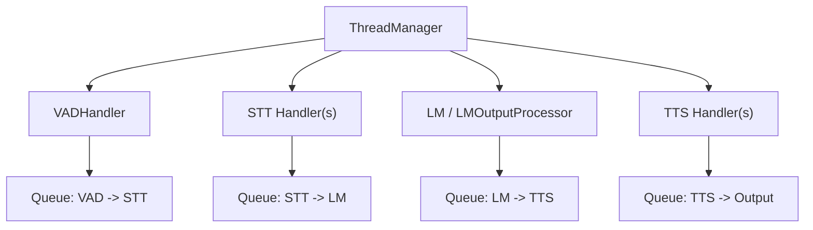
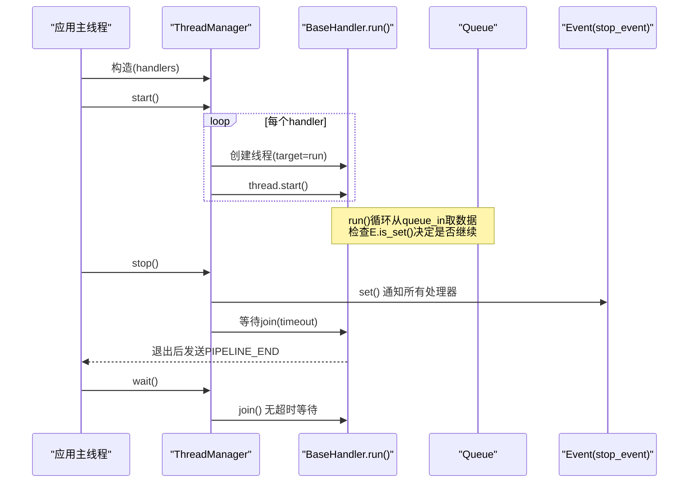
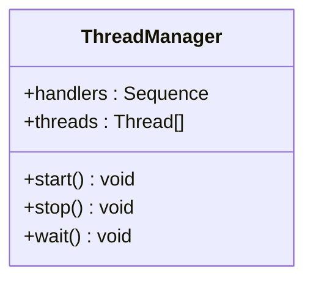
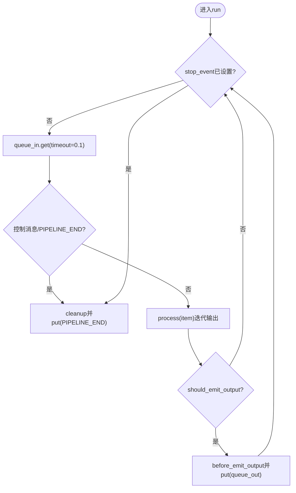
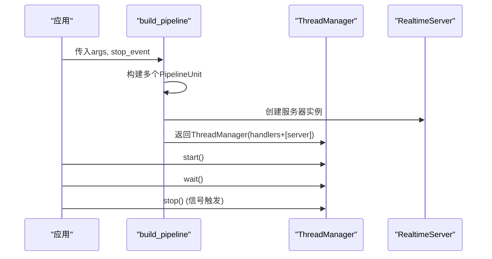
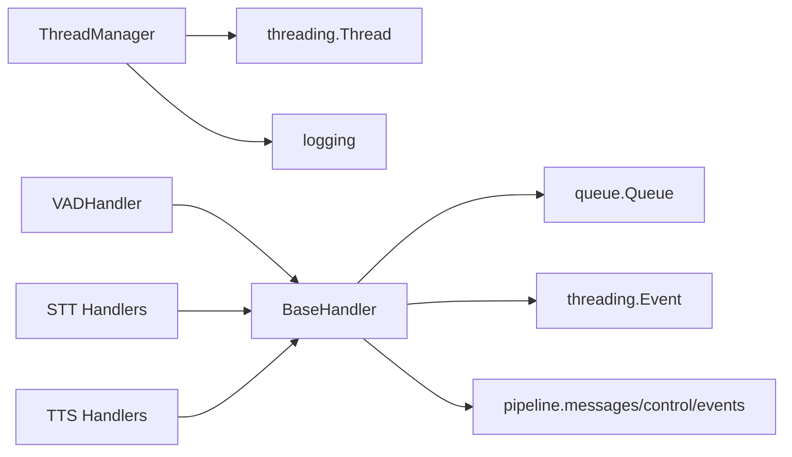

# 线程管理

<cite>
**本文引用的文件**
- [thread_manager.py](file://src/speech_to_speech/utils/thread_manager.py)
- [baseHandler.py](file://src/speech_to_speech/baseHandler.py)
- [s2s_pipeline.py](file://src/speech_to_speech/s2s_pipeline.py)
- [vad_handler.py](file://src/speech_to_speech/VAD/vad_handler.py)
- [base_stt_handler.py](file://src/speech_to_speech/STT/base_stt_handler.py)
- [faster_whisper_handler.py](file://src/speech_to_speech/STT/faster_whisper_handler.py)
- [qwen3_tts_handler.py](file://src/speech_to_speech/TTS/qwen3_tts_handler.py)
</cite>

## 目录
1. [简介](#简介)
2. [项目结构](#项目结构)
3. [核心组件](#核心组件)
4. [架构总览](#架构总览)
5. [详细组件分析](#详细组件分析)
6. [依赖关系分析](#依赖关系分析)
7. [性能考虑](#性能考虑)
8. [故障排查指南](#故障排查指南)
9. [结论](#结论)
10. [附录：使用示例与最佳实践](#附录：使用示例与最佳实践)

## 简介
本章节聚焦于语音处理管道中的线程管理方案，围绕 ThreadManager 类的设计模式与实现原理展开，说明如何统一管理多个处理器（VAD、STT、LLM、TTS 等）的线程生命周期。文档涵盖线程启动、停止与等待机制，daemon 线程的设置与 join 行为，stop_event 事件的使用模式，以及并发访问控制与资源竞争避免策略。最后提供在语音处理管道中正确使用 ThreadManager 的实践要点。

## 项目结构
本项目采用“处理器链 + 队列”的流水线架构：每个处理器继承自 BaseHandler，拥有独立的输入/输出队列和 stop_event；ThreadManager 负责统一创建、启动、停止并等待这些处理器线程。

图示来源
- [s2s_pipeline.py:354-458](file://src/speech_to_speech/s2s_pipeline.py#L354-L458)
- [baseHandler.py:25-186](file://src/speech_to_speech/baseHandler.py#L25-L186)

章节来源
- [s2s_pipeline.py:354-587](file://src/speech_to_speech/s2s_pipeline.py#L354-L587)
- [baseHandler.py:25-186](file://src/speech_to_speech/baseHandler.py#L25-L186)

## 核心组件
- ThreadManager：集中管理一组 handler 的线程生命周期，包括 start、wait、stop。
- BaseHandler：所有处理器的基类，定义 run 主循环、队列消费、stop_event 检查、PIPELINE_END 哨兵清理等。
- 具体处理器：VADHandler、STT/TTS 各后端处理器，均继承 BaseHandler，实现 process 逻辑。

章节来源
- [thread_manager.py:9-40](file://src/speech_to_speech/utils/thread_manager.py#L9-L40)
- [baseHandler.py:25-186](file://src/speech_to_speech/baseHandler.py#L25-L186)

## 架构总览
下图展示了从入口到处理器线程的生命周期管理流程：构建管线时组装处理器列表，ThreadManager 为每个处理器创建线程并启动；停止时通过 stop_event 通知所有处理器退出，再按序 join 等待结束。

图示来源
- [thread_manager.py:14-40](file://src/speech_to_speech/utils/thread_manager.py#L14-L40)
- [baseHandler.py:105-165](file://src/speech_to_speech/baseHandler.py#L105-L165)
- [s2s_pipeline.py:550-587](file://src/speech_to_speech/s2s_pipeline.py#L550-L587)

## 详细组件分析

### ThreadManager：设计模式与实现原理
- 职责：统一管理多个 handler 的线程生命周期。
- 关键方法：
  - start：为每个 handler 创建线程，target 为 handler.run；显式设置 daemon=False，确保关闭时能被等待。
  - stop：向所有 handler 的 stop_event 发出信号，随后对每个线程执行带超时的 join，若超时未退出则记录警告。
  - wait：对所有线程执行 join，阻塞直到全部结束。
- 设计要点：
  - 非守护线程：保证进程退出前能等待所有处理器完成收尾。
  - 事件驱动停止：通过共享 Event 对象通知所有处理器退出，避免轮询或强制中断。
  - 超时保护：stop 中使用 join(timeout)，防止个别处理器卡死导致整体无法退出。

图示来源
- [thread_manager.py:9-40](file://src/speech_to_speech/utils/thread_manager.py#L9-L40)

章节来源
- [thread_manager.py:9-40](file://src/speech_to_speech/utils/thread_manager.py#L9-L40)

### BaseHandler：线程运行模型与停止协议
- run 主循环：
  - 周期性从 queue_in 获取数据（带短超时），检查 stop_event 是否置位以退出。
  - 处理控制消息（如 SESSION_END）与 PIPELINE_END 哨兵，避免队列死锁。
  - 调用 process 生成结果，经 should_emit_output、before_emit_output 过滤/包装后放入 queue_out。
  - 退出前调用 cleanup，并向 queue_out 写入 PIPELINE_END，通知下游结束。
- 停止协议：
  - 外部通过设置 stop_event 通知处理器退出。
  - 处理器需配合在适当时机读取并处理 PIPELINE_END，避免队列堆积或死锁。

图示来源
- [baseHandler.py:105-165](file://src/speech_to_speech/baseHandler.py#L105-L165)

章节来源
- [baseHandler.py:25-186](file://src/speech_to_speech/baseHandler.py#L25-L186)

### VADHandler：语音活动检测与实时分段
- 基于 Silero VAD 进行语音起止检测，支持渐进式音频释放与智能回合（smart turn）。
- 通过 should_listen 控制是否接收音频；将检测到的语音片段封装为 VADAudio，包含 turn_id/turn_revision 用于后续去重与稳定性判断。
- 与 BaseHandler 协作：在主循环中消费输入队列，产出 VADAudio 至下一处理器。

章节来源
- [vad_handler.py:53-172](file://src/speech_to_speech/VAD/vad_handler.py#L53-L172)
- [vad_handler.py:548-789](file://src/speech_to_speech/VAD/vad_handler.py#L548-L789)

### STT 处理器：转写与陈旧数据丢弃
- BaseSTTHandler 扩展了 BaseHandler，增加针对“推测性回合”的陈旧输入/输出丢弃逻辑，避免重复或过期的转写被下游处理。
- FasterWhisperSTTHandler 作为具体实现，将 VADAudio 转为 PartialTranscription/Transcription，并携带 turn_id/turn_revision。

章节来源
- [base_stt_handler.py:16-214](file://src/speech_to_speech/STT/base_stt_handler.py#L16-L214)
- [faster_whisper_handler.py:36-149](file://src/speech_to_speech/STT/faster_whisper_handler.py#L36-L149)

### TTS 处理器：文本到语音合成
- Qwen3TTSHandler 根据平台选择 MLX 或 faster-qwen3-tts 后端，支持流式与非流式模式，输出音频块并附带 cancel_scope/speculative_turns 信息。
- 与 BaseHandler 协作：消费文本输入，产生音频输出，遵循统一的 run/cleanup/PIPELINE_END 协议。

章节来源
- [qwen3_tts_handler.py:93-200](file://src/speech_to_speech/TTS/qwen3_tts_handler.py#L93-L200)

### 管线构建与线程编排
- _build_handlers：组装 VAD → STT → LM → TTS 处理器链，并通过 Queue 连接。
- build_pipeline/build_local_pipeline：创建多个 PipelineUnit，收集 handlers 并交由 ThreadManager 管理。
- run_pipeline_command：创建 stop_event，注册信号处理，调用 ThreadManager.start/wait/stop。

图示来源
- [s2s_pipeline.py:550-587](file://src/speech_to_speech/s2s_pipeline.py#L550-L587)
- [s2s_pipeline.py:628-682](file://src/speech_to_speech/s2s_pipeline.py#L628-L682)

章节来源
- [s2s_pipeline.py:354-587](file://src/speech_to_speech/s2s_pipeline.py#L354-L587)
- [s2s_pipeline.py:628-682](file://src/speech_to_speech/s2s_pipeline.py#L628-L682)

## 依赖关系分析
- ThreadManager 依赖：
  - threading.Thread：创建与管理线程。
  - logging：记录超时未退出的警告。
- BaseHandler 依赖：
  - queue.Queue：处理器间数据传递。
  - threading.Event：stop_event 控制退出。
  - pipeline.messages/control/events：控制消息与事件类型。
- 处理器之间通过 Queue 解耦，降低耦合度，提高可维护性与可扩展性。

图示来源
- [thread_manager.py:1-40](file://src/speech_to_speech/utils/thread_manager.py#L1-L40)
- [baseHandler.py:1-186](file://src/speech_to_speech/baseHandler.py#L1-L186)

章节来源
- [thread_manager.py:1-40](file://src/speech_to_speech/utils/thread_manager.py#L1-L40)
- [baseHandler.py:1-186](file://src/speech_to_speech/baseHandler.py#L1-L186)

## 性能考虑
- 短超时轮询：BaseHandler.run 使用 queue_in.get(timeout=0.1) 平衡响应延迟与 CPU 占用。
- 队列缓冲：合理设置队列大小以避免背压导致的阻塞或丢包。
- 日志节流：VADHandler 内部对日志进行节流，减少高频 I/O 开销。
- 设备与模型加载：不同后端（MLX/faster-qwen3-tts）在不同平台的性能差异需在部署时评估。

[本节为通用指导，不直接分析具体文件]

## 故障排查指南
- 线程未正常退出：
  - 检查 stop_event 是否被正确设置。
  - 确认处理器是否在 run 循环中检查 stop_event 并在合适时机退出。
  - 查看 ThreadManager.stop 的超时日志，定位卡住的处理器。
- 队列死锁：
  - 确保上游在退出前向下游发送 PIPELINE_END。
  - 检查处理器是否正确消费并转发控制消息。
- 资源泄漏：
  - 确认 cleanup 中释放模型、句柄等资源。
  - 对于第三方库的全局锁（如 MLX），注意多管线下的竞争与降级策略。

章节来源
- [thread_manager.py:29-40](file://src/speech_to_speech/utils/thread_manager.py#L29-L40)
- [baseHandler.py:105-165](file://src/speech_to_speech/baseHandler.py#L105-L165)
- [s2s_pipeline.py:628-682](file://src/speech_to_speech/s2s_pipeline.py#L628-L682)

## 结论
ThreadManager 提供了简洁而健壮的线程生命周期管理能力，结合 BaseHandler 的统一运行模型与停止协议，使得语音处理管道中的各个组件可以以线程安全的方式协同工作。通过 stop_event 事件驱动停止、PIPELINE_END 哨兵避免队列死锁、以及超时 join 保障优雅退出，系统具备良好的可维护性与鲁棒性。

[本节为总结，不直接分析具体文件]

## 附录：使用示例与最佳实践
- 构建管线并启动：
  - 使用 build_pipeline 或 build_local_pipeline 创建 ThreadManager，传入 stop_event。
  - 调用 ThreadManager.start 启动所有处理器线程。
  - 调用 ThreadManager.wait 阻塞等待所有线程结束。
- 优雅停止：
  - 捕获系统信号（SIGINT/SIGTERM），调用 ThreadManager.stop 通知所有处理器退出。
  - 确保处理器实现 cleanup 并发送 PIPELINE_END。
- 并发与资源竞争：
  - 使用队列进行线程间通信，避免共享状态直接读写。
  - 对需要互斥访问的资源（如全局锁）使用合适的同步原语。
  - 在多管线场景下，注意平台相关限制（如 Apple Silicon 的 MLX 锁竞争），必要时调整配置。

章节来源
- [s2s_pipeline.py:550-587](file://src/speech_to_speech/s2s_pipeline.py#L550-L587)
- [s2s_pipeline.py:628-682](file://src/speech_to_speech/s2s_pipeline.py#L628-L682)
- [baseHandler.py:105-165](file://src/speech_to_speech/baseHandler.py#L105-L165)
- [thread_manager.py:14-40](file://src/speech_to_speech/utils/thread_manager.py#L14-L40)