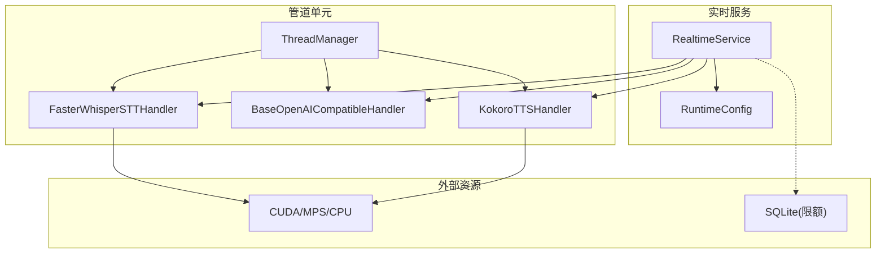
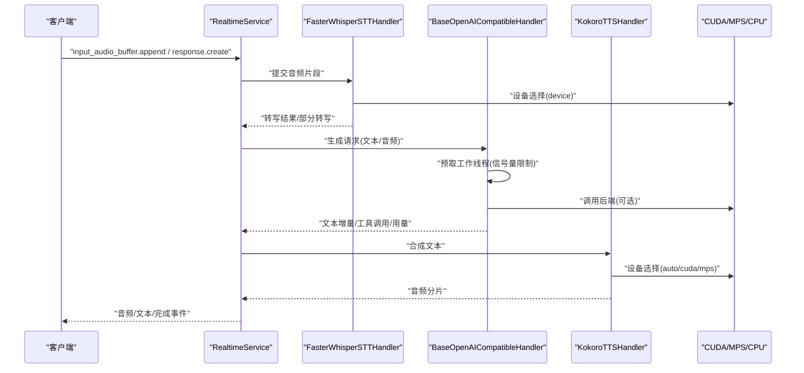
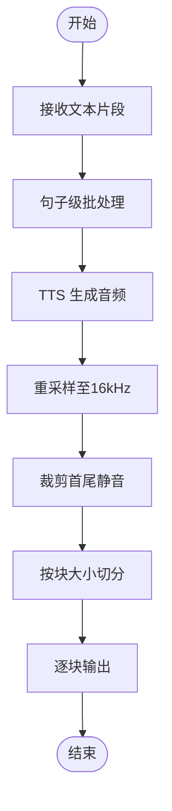
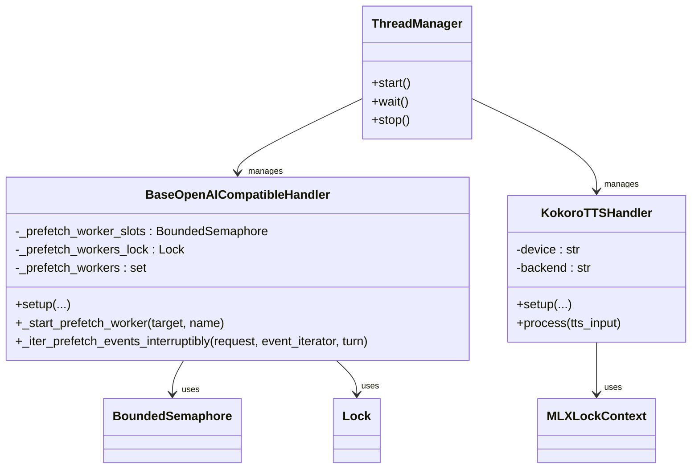
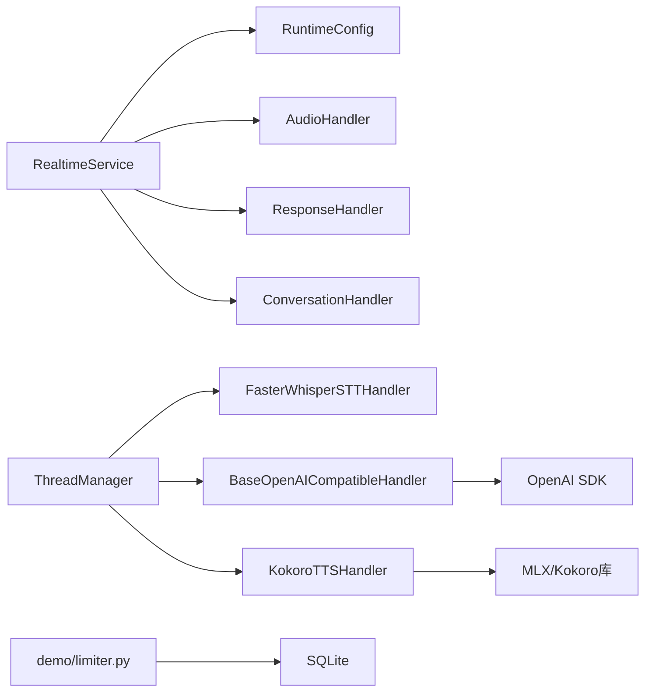

# 资源控制

<cite>
**本文引用的文件**
- [src/speech_to_speech/utils/thread_manager.py](file://src/speech_to_speech/utils/thread_manager.py)
- [src/speech_to_speech/LLM/base_openai_compatible_language_model.py](file://src/speech_to_speech/LLM/base_openai_compatible_language_model.py)
- [demo/limiter.py](file://demo/limiter.py)
- [src/speech_to_speech/api/openai_realtime/runtime_config.py](file://src/speech_to_speech/api/openai_realtime/runtime_config.py)
- [src/speech_to_speech/pipeline/control.py](file://src/speech_to_speech/pipeline/control.py)
- [src/speech_to_speech/api/openai_realtime/service.py](file://src/speech_to_speech/api/openai_realtime/service.py)
- [src/speech_to_speech/STT/faster_whisper_handler.py](file://src/speech_to_speech/STT/faster_whisper_handler.py)
- [src/speech_to_speech/TTS/kokoro_handler.py](file://src/speech_to_speech/TTS/kokoro_handler.py)
</cite>

## 目录
1. [简介](#简介)
2. [项目结构](#项目结构)
3. [核心组件](#核心组件)
4. [架构总览](#架构总览)
5. [详细组件分析](#详细组件分析)
6. [依赖关系分析](#依赖关系分析)
7. [性能考量](#性能考量)
8. [故障排除指南](#故障排除指南)
9. [结论](#结论)
10. [附录](#附录)

## 简介
本文件聚焦于语音到语音系统的“资源控制”主题，覆盖内存管理、GPU资源分配、并发控制、资源限制配置以及监控与调优工具。文档基于仓库中的实际实现进行说明，帮助读者在生产环境中合理配置并优化系统资源使用，确保低延迟、高吞吐与稳定性。

## 项目结构
围绕资源控制的关键模块分布如下：
- 线程与生命周期管理：ThreadManager 统一管理流水线各阶段线程的启动、等待与停止。
- LLM 并发与预取：BaseOpenAICompatibleHandler 提供预取工作线程上限、队列容量、取消与陈旧轮次处理等机制。
- 会话级运行时配置：RuntimeConfig 维护会话音频配置与中断策略，供各处理器读取。
- 服务层事件路由与指标：RealtimeService 负责事件分发、连接状态、用量统计与错误追踪。
- STT/GPU设备选择：FasterWhisperSTTHandler 通过 device 参数控制推理设备（auto/cuda/cpu）。
- TTS设备与锁：KokoroTTSHandler 在 MPS/CUDA/CPU 上分别加载模型，并使用 MLXLockContext 保证跨线程安全。
- 演示限流器：demo/limiter.py 提供按日预算的会话时长配额与心跳续期。

**图表来源**
- [src/speech_to_speech/api/openai_realtime/service.py:287-315](file://src/speech_to_speech/api/openai_realtime/service.py#L287-L315)
- [src/speech_to_speech/api/openai_realtime/runtime_config.py:27-82](file://src/speech_to_speech/api/openai_realtime/runtime_config.py#L27-L82)
- [src/speech_to_speech/utils/thread_manager.py:9-40](file://src/speech_to_speech/utils/thread_manager.py#L9-L40)
- [src/speech_to_speech/STT/faster_whisper_handler.py:45-63](file://src/speech_to_speech/STT/faster_whisper_handler.py#L45-L63)
- [src/speech_to_speech/TTS/kokoro_handler.py:87-152](file://src/speech_to_speech/TTS/kokoro_handler.py#L87-L152)
- [demo/limiter.py:111-137](file://demo/limiter.py#L111-L137)

**章节来源**
- [src/speech_to_speech/utils/thread_manager.py:9-40](file://src/speech_to_speech/utils/thread_manager.py#L9-L40)
- [src/speech_to_speech/api/openai_realtime/service.py:287-315](file://src/speech_to_speech/api/openai_realtime/service.py#L287-L315)
- [src/speech_to_speech/api/openai_realtime/runtime_config.py:27-82](file://src/speech_to_speech/api/openai_realtime/runtime_config.py#L27-L82)
- [src/speech_to_speech/STT/faster_whisper_handler.py:45-63](file://src/speech_to_speech/STT/faster_whisper_handler.py#L45-L63)
- [src/speech_to_speech/TTS/kokoro_handler.py:87-152](file://src/speech_to_speech/TTS/kokoro_handler.py#L87-L152)
- [demo/limiter.py:111-137](file://demo/limiter.py#L111-L137)

## 核心组件
- 线程管理器 ThreadManager：为每个处理器创建独立线程，支持优雅停止与超时等待，避免僵尸线程。
- LLM 预取与并发控制：通过有界信号量限制预取工作线程数量，使用队列缓冲事件，结合取消范围与陈旧轮次判断，防止无效计算。
- 运行时配置 RuntimeConfig：集中管理会话音频输入输出配置与中断策略，供 VAD/LLM/TTS 读取。
- 实时服务 RealtimeService：统一事件路由、连接状态、用量统计与错误计数，支撑生产可观测性。
- STT 设备选择 FasterWhisperSTTHandler：根据 device 参数自动或显式选择 CUDA/MPS/CPU，影响显存占用与吞吐。
- TTS 设备与锁 KokoroTTSHandler：在 MPS 上使用 MLXLockContext 保护共享状态；在 CUDA/CPU 使用原生库；支持预热与多语言声音预加载。
- 演示限流 limiter：按日预算对会话进行配额控制，心跳续期与静默回收，保障公平性与成本可控。

**章节来源**
- [src/speech_to_speech/utils/thread_manager.py:9-40](file://src/speech_to_speech/utils/thread_manager.py#L9-L40)
- [src/speech_to_speech/LLM/base_openai_compatible_language_model.py:159-216](file://src/speech_to_speech/LLM/base_openai_compatible_language_model.py#L159-L216)
- [src/speech_to_speech/api/openai_realtime/runtime_config.py:27-82](file://src/speech_to_speech/api/openai_realtime/runtime_config.py#L27-L82)
- [src/speech_to_speech/api/openai_realtime/service.py:138-177](file://src/speech_to_speech/api/openai_realtime/service.py#L138-L177)
- [src/speech_to_speech/STT/faster_whisper_handler.py:45-63](file://src/speech_to_speech/STT/faster_whisper_handler.py#L45-L63)
- [src/speech_to_speech/TTS/kokoro_handler.py:87-152](file://src/speech_to_speech/TTS/kokoro_handler.py#L87-L152)
- [demo/limiter.py:170-277](file://demo/limiter.py#L170-L277)

## 架构总览
下图展示了从客户端事件到内部管线再到后端模型的完整数据流，以及资源控制点（并发、设备、配额）的位置。

**图表来源**
- [src/speech_to_speech/api/openai_realtime/service.py:411-462](file://src/speech_to_speech/api/openai_realtime/service.py#L411-L462)
- [src/speech_to_speech/STT/faster_whisper_handler.py:45-63](file://src/speech_to_speech/STT/faster_whisper_handler.py#L45-L63)
- [src/speech_to_speech/LLM/base_openai_compatible_language_model.py:380-494](file://src/speech_to_speech/LLM/base_openai_compatible_language_model.py#L380-L494)
- [src/speech_to_speech/TTS/kokoro_handler.py:87-152](file://src/speech_to_speech/TTS/kokoro_handler.py#L87-L152)

## 详细组件分析

### 内存管理与音频缓冲策略
- 音频分片与重采样：TTS 将 24kHz 输出重采样至 16kHz，并以固定块大小（blocksize）切分输出，降低单次内存峰值。
- 静音裁剪与填充：对音频首尾静音进行裁剪，并对不足块大小的尾部进行填充，保证下游稳定消费。
- 文本到音频的流式处理：LLM 以句子为单位分批输出，减少一次性文本累积导致的内存压力。
- 历史压缩：LLM 支持历史压缩（compact_history），通过生成函数对长上下文进行摘要，降低上下文长度带来的内存占用。

**图表来源**
- [src/speech_to_speech/TTS/kokoro_handler.py:282-354](file://src/speech_to_speech/TTS/kokoro_handler.py#L282-L354)
- [src/speech_to_speech/TTS/kokoro_handler.py:356-405](file://src/speech_to_speech/TTS/kokoro_handler.py#L356-L405)
- [src/speech_to_speech/LLM/base_openai_compatible_language_model.py:589-685](file://src/speech_to_speech/LLM/base_openai_compatible_language_model.py#L589-L685)

**章节来源**
- [src/speech_to_speech/TTS/kokoro_handler.py:282-354](file://src/speech_to_speech/TTS/kokoro_handler.py#L282-L354)
- [src/speech_to_speech/TTS/kokoro_handler.py:356-405](file://src/speech_to_speech/TTS/kokoro_handler.py#L356-L405)
- [src/speech_to_speech/LLM/base_openai_compatible_language_model.py:589-685](file://src/speech_to_speech/LLM/base_openai_compatible_language_model.py#L589-L685)

### 模型权重加载优化
- 预热（warmup）：LLM 与 TTS 均在初始化后执行一次轻量推理，使后端连接与缓存就绪，降低首包延迟。
- 多语言声音预加载：TTS 在 MPS 路径下预加载常用语言的声音张量，避免推理时动态下载与加载开销。
- 设备自适应：TTS 在 Apple Silicon 使用 MLX 后端，在其他平台使用原生 kokoro 库，最大化硬件利用。
- 上下文压缩：LLM 支持 compact_history，通过生成函数对长对话历史进行压缩，减少上下文长度与显存占用。

**章节来源**
- [src/speech_to_speech/LLM/base_openai_compatible_language_model.py:159-216](file://src/speech_to_speech/LLM/base_openai_compatible_language_model.py#L159-L216)
- [src/speech_to_speech/TTS/kokoro_handler.py:154-214](file://src/speech_to_speech/TTS/kokoro_handler.py#L154-L214)
- [src/speech_to_speech/TTS/kokoro_handler.py:215-232](file://src/speech_to_speech/TTS/kokoro_handler.py#L215-L232)

### 垃圾回收控制
- 响应关闭：LLM 在迭代结束后尝试关闭响应对象，释放网络与句柄资源。
- 会话注销：RealtimeService 在连接注销时关闭 Chat 并汇总用量，避免悬挂引用。
- 清理钩子：STT 提供 cleanup 方法，删除模型引用，触发 Python GC 回收。

**章节来源**
- [src/speech_to_speech/LLM/base_openai_compatible_language_model.py:372-378](file://src/speech_to_speech/LLM/base_openai_compatible_language_model.py#L372-L378)
- [src/speech_to_speech/api/openai_realtime/service.py:347-365](file://src/speech_to_speech/api/openai_realtime/service.py#L347-L365)
- [src/speech_to_speech/STT/faster_whisper_handler.py:141-144](file://src/speech_to_speech/STT/faster_whisper_handler.py#L141-L144)

### GPU 资源分配策略
- 设备选择：STT 通过 device 参数选择 auto/cuda/cpu；TTS 在 auto 模式下检测 MPS/CUDA/CPU 并加载对应后端。
- 批量处理：TTS 使用 blocksize 控制音频分块大小，平衡延迟与吞吐；LLM 使用 stream_batch_sentences 控制文本批大小。
- 预取限制：LLM 预取工作线程上限为 1，避免过多并发请求导致显存抖动。

**章节来源**
- [src/speech_to_speech/STT/faster_whisper_handler.py:45-63](file://src/speech_to_speech/STT/faster_whisper_handler.py#L45-L63)
- [src/speech_to_speech/TTS/kokoro_handler.py:122-152](file://src/speech_to_speech/TTS/kokoro_handler.py#L122-L152)
- [src/speech_to_speech/LLM/base_openai_compatible_language_model.py:66-69](file://src/speech_to_speech/LLM/base_openai_compatible_language_model.py#L66-L69)

### 并发控制机制
- 信号量与锁：LLM 使用 BoundedSemaphore 限制预取工作线程数，使用 Lock 保护工作线程集合；TTS 在 MPS 路径使用 MLXLockContext 保护共享状态。
- 取消与陈旧轮次：LLM 通过 CancelScope 与 SpeculativeTurnTracker 判断是否继续输出，避免陈旧轮次的无效计算。
- 线程生命周期：ThreadManager 统一管理处理器线程的启动、等待与停止，确保退出时所有线程终止。

**图表来源**
- [src/speech_to_speech/LLM/base_openai_compatible_language_model.py:211-214](file://src/speech_to_speech/LLM/base_openai_compatible_language_model.py#L211-L214)
- [src/speech_to_speech/LLM/base_openai_compatible_language_model.py:380-404](file://src/speech_to_speech/LLM/base_openai_compatible_language_model.py#L380-L404)
- [src/speech_to_speech/TTS/kokoro_handler.py:282-354](file://src/speech_to_speech/TTS/kokoro_handler.py#L282-L354)
- [src/speech_to_speech/utils/thread_manager.py:9-40](file://src/speech_to_speech/utils/thread_manager.py#L9-L40)

**章节来源**
- [src/speech_to_speech/LLM/base_openai_compatible_language_model.py:211-214](file://src/speech_to_speech/LLM/base_openai_compatible_language_model.py#L211-L214)
- [src/speech_to_speech/LLM/base_openai_compatible_language_model.py:380-404](file://src/speech_to_speech/LLM/base_openai_compatible_language_model.py#L380-L404)
- [src/speech_to_speech/TTS/kokoro_handler.py:282-354](file://src/speech_to_speech/TTS/kokoro_handler.py#L282-L354)
- [src/speech_to_speech/utils/thread_manager.py:9-40](file://src/speech_to_speech/utils/thread_manager.py#L9-L40)

### 资源限制配置
- 最大线程数：LLM 预取工作线程上限为 1，避免过度并发。
- 内存上限：通过流式批处理与上下文压缩控制内存峰值；TTS 使用固定块大小控制音频缓冲。
- CPU 使用率：设备选择 auto 让框架根据可用硬件决定最佳路径；STT 可通过 compute_type 调整精度与速度。
- 会话配额：demo/limiter.py 提供按日预算的会话时长限制，心跳续期与静默回收。

**章节来源**
- [src/speech_to_speech/LLM/base_openai_compatible_language_model.py:66-69](file://src/speech_to_speech/LLM/base_openai_compatible_language_model.py#L66-L69)
- [src/speech_to_speech/STT/faster_whisper_handler.py:45-63](file://src/speech_to_speech/STT/faster_whisper_handler.py#L45-L63)
- [src/speech_to_speech/TTS/kokoro_handler.py:122-152](file://src/speech_to_speech/TTS/kokoro_handler.py#L122-L152)
- [demo/limiter.py:170-277](file://demo/limiter.py#L170-L277)

### 资源监控与调优工具
- 用量统计：RealtimeService 维护全局与每响应的用量指标（输入/输出 token、音频时长、响应计数、工具调用次数）。
- 错误追踪：GlobalUsageMetrics 记录错误类型与总数，便于定位瓶颈。
- 日志与调试：各处理器输出关键日志（如转写、TTS 分片、取消原因），辅助问题诊断。
- 建议工具：结合系统级监控（nvidia-smi、top、htop）与 Python 内存分析（tracemalloc、memory_profiler）进行深度分析。

**章节来源**
- [src/speech_to_speech/api/openai_realtime/service.py:138-177](file://src/speech_to_speech/api/openai_realtime/service.py#L138-L177)
- [src/speech_to_speech/api/openai_realtime/service.py:731-770](file://src/speech_to_speech/api/openai_realtime/service.py#L731-L770)
- [src/speech_to_speech/STT/faster_whisper_handler.py:107-140](file://src/speech_to_speech/STT/faster_whisper_handler.py#L107-L140)
- [src/speech_to_speech/TTS/kokoro_handler.py:234-405](file://src/speech_to_speech/TTS/kokoro_handler.py#L234-L405)

## 依赖关系分析
- RealtimeService 依赖 RuntimeConfig 获取会话音频配置，驱动 Audio/Response/Conversation 处理器。
- ThreadManager 依赖各处理器（STT/LLM/TTS）的 run/stop 接口，统一管理生命周期。
- LLM 依赖 OpenAI SDK 与 HTTP 客户端，使用信号量与队列协调预取与消费。
- TTS 依赖 MLX 或 kokoro 库，根据平台选择后端，并通过锁保护共享状态。
- demo/limiter.py 依赖 SQLite 存储每日用量与会话状态，提供配额控制。

**图表来源**
- [src/speech_to_speech/api/openai_realtime/service.py:287-315](file://src/speech_to_speech/api/openai_realtime/service.py#L287-L315)
- [src/speech_to_speech/utils/thread_manager.py:9-40](file://src/speech_to_speech/utils/thread_manager.py#L9-L40)
- [src/speech_to_speech/LLM/base_openai_compatible_language_model.py:159-216](file://src/speech_to_speech/LLM/base_openai_compatible_language_model.py#L159-L216)
- [src/speech_to_speech/TTS/kokoro_handler.py:87-152](file://src/speech_to_speech/TTS/kokoro_handler.py#L87-L152)
- [demo/limiter.py:111-137](file://demo/limiter.py#L111-L137)

**章节来源**
- [src/speech_to_speech/api/openai_realtime/service.py:287-315](file://src/speech_to_speech/api/openai_realtime/service.py#L287-L315)
- [src/speech_to_speech/utils/thread_manager.py:9-40](file://src/speech_to_speech/utils/thread_manager.py#L9-L40)
- [src/speech_to_speech/LLM/base_openai_compatible_language_model.py:159-216](file://src/speech_to_speech/LLM/base_openai_compatible_language_model.py#L159-L216)
- [src/speech_to_speech/TTS/kokoro_handler.py:87-152](file://src/speech_to_speech/TTS/kokoro_handler.py#L87-L152)
- [demo/limiter.py:111-137](file://demo/limiter.py#L111-L137)

## 性能考量
- 预取与批处理：LLM 预取工作线程上限为 1，配合流式批处理降低延迟；TTS 使用固定块大小提升吞吐。
- 设备选择：STT/TTS 根据硬件自动选择最优后端，避免不必要的迁移与拷贝。
- 上下文压缩：LLM 支持历史压缩，减少长对话的显存与计算压力。
- 配额控制：demo/limiter.py 通过心跳续期与静默回收，保障公平性与成本可控。

[本节为通用指导，不直接分析具体文件]

## 故障排除指南
- 预取失败：检查 _start_prefetch_worker 的信号量获取与队列满情况，确认网络与后端可用性。
- 设备不可用：STT/TTS 的 device 参数需与实际硬件匹配；MPS 路径需安装 MLX 依赖。
- 线程未退出：ThreadManager.stop 设置停止事件并等待超时，若仍存活需检查处理器是否正确响应 stop_event。
- 配额耗尽：demo/limiter.py 心跳续期失败会导致会话过期，检查数据库写入与心跳频率。

**章节来源**
- [src/speech_to_speech/LLM/base_openai_compatible_language_model.py:380-404](file://src/speech_to_speech/LLM/base_openai_compatible_language_model.py#L380-L404)
- [src/speech_to_speech/STT/faster_whisper_handler.py:45-63](file://src/speech_to_speech/STT/faster_whisper_handler.py#L45-L63)
- [src/speech_to_speech/TTS/kokoro_handler.py:154-196](file://src/speech_to_speech/TTS/kokoro_handler.py#L154-L196)
- [src/speech_to_speech/utils/thread_manager.py:29-40](file://src/speech_to_speech/utils/thread_manager.py#L29-L40)
- [demo/limiter.py:200-277](file://demo/limiter.py#L200-L277)

## 结论
本系统通过精细的并发控制、设备自适应、流式批处理与配额管理，实现了高效的资源控制。生产部署时应结合硬件能力与业务需求，合理配置设备、批大小、预取上限与配额策略，并借助内置指标与日志进行持续监控与调优。

[本节为总结性内容，不直接分析具体文件]

## 附录
- 关键配置项参考：
  - LLM 预取：PREFETCH_PROVIDER_WORKER_LIMIT=1，PREFETCH_STREAM_QUEUE_MAXSIZE=16
  - TTS 块大小：blocksize=512（可调）
  - STT 设备：device="auto"/"cuda"/"cpu"
  - 会话配额：LIMIT_ANON_SEC、LIMIT_FREE_SEC、RESERVE_CHUNK_SEC、HEARTBEAT_SEC

**章节来源**
- [src/speech_to_speech/LLM/base_openai_compatible_language_model.py:66-69](file://src/speech_to_speech/LLM/base_openai_compatible_language_model.py#L66-L69)
- [src/speech_to_speech/TTS/kokoro_handler.py:87-152](file://src/speech_to_speech/TTS/kokoro_handler.py#L87-L152)
- [src/speech_to_speech/STT/faster_whisper_handler.py:45-63](file://src/speech_to_speech/STT/faster_whisper_handler.py#L45-L63)
- [demo/limiter.py:40-46](file://demo/limiter.py#L40-L46)