# 实例注册与监控系统

<cite>
**本文引用的文件**   
- [README.md](file://README.md)
- [configured_runtime.py](file://src/speech_to_speech/configured_runtime.py)
- [backend_registry.py](file://src/speech_to_speech/backend_registry.py)
- [console_integration.py](file://src/speech_to_speech/console_integration.py)
- [param_instance.py](file://console/backend/app/models\param_instance.py)
- [param_instance_metric.py](file://console/backend/app\models\param_instance_metric.py)
- [instance_repository.py](file://console/backend/app\repositories\instance_repository.py)
- [instance_metric_repository.py](file://console/backend/app\repositories\instance_metric_repository.py)
- [2026-10-26-instance-registry-monitoring.md](file://docs\superpowers\plans\2026-10-26-instance-registry-monitoring.md)
- [instance_registry.py](file://console/backend/app/services/instance_registry.py)
- [instance_monitor.py](file://console/backend/app/services/instance_monitor.py)
- [instance_probe.py](file://console/backend/app/services/instance_probe.py)
- [allocator.py](file://console/backend/app/services/allocator.py)
- [instances_service.py](file://console/backend/app/services/instances_service.py)
- [instances.py](file://console/backend/app/routers/instances.py)
- [InstancesView.vue](file://console/frontend/src/views/InstancesView.vue)
- [InstanceTrendChart.vue](file://console/frontend/src/components/InstanceTrendChart.vue)
- [InstanceTrendsView.vue](file://console/frontend/src/views/InstanceTrendsView.vue)
- [router/index.ts](file://console/frontend/src/router/index.ts)
- [router/nav.ts](file://console/frontend/src/router/nav.ts)
</cite>

## 更新摘要
**变更内容**   
- 新增 InstanceRegistry、InstanceMonitor、InstanceProbe 三个核心服务模块的完整实现
- 添加本地分配系统，支持加权最少负载选择算法
- 实现双模式会话管理（负载均衡模式和本地模式）
- 新增管理 API 端点，支持摘流/恢复操作和手动探测
- 增强状态聚合功能，同时支持传统单实例和多实例模式
- **简化前端仪表板**：移除 InstancesView 中的内联趋势图表功能，改为导航到专门的 InstanceTrendsView 页面
- **新增独立趋势页面**：InstanceTrendsView 提供完整的趋势分析界面，包含实例选择和时间窗口切换
- **重构路由结构**：新增 `/console/instances/trends` 路由，将趋势功能从实例管理页面分离

## 目录
1. [引言](#引言)
2. [项目结构](#项目结构)
3. [核心组件](#核心组件)
4. [架构总览](#架构总览)
5. [详细组件分析](#详细组件分析)
6. [依赖关系分析](#依赖关系分析)
7. [性能与可观测性](#性能与可观测性)
8. [故障排查指南](#故障排查指南)
9. [结论](#结论)
10. [附录：数据模型与配置项](#附录数据模型与配置项)

## 引言
本文件聚焦"实例注册与监控系统"，围绕语音到语音（Speech-to-Speech）服务在控制台（Console）侧的多实例注册、健康巡检、状态机与指标落库能力进行系统化说明。该体系将"实例元数据"与"运行时监控"解耦：数据库作为真相源，内存中的运行态由常驻巡检任务推导；同时为分配器、前端视图和运维操作提供稳定接口。

**更新** 系统现已实现完整的三层架构：InstanceRegistry（实例级状态机）、InstanceMonitor（常驻巡检）、InstanceProbe（实例探测），并集成了本地分配系统和双模式会话管理。**简化了前端界面设计**：移除了 InstancesView 中的内联趋势图表，改为独立的 InstanceTrendsView 页面，提供更好的用户体验和职责分离。

系统的关键目标包括：
- 通过数据库维护多实例注册表，支持启用/摘流等运维开关。
- 以固定周期探测实例池可用性，驱动在线/离线等状态机转换。
- 将状态跳变与周期性采样写入指标表，供面板与告警使用。
- 提供快照缓存、清理策略与异常隔离，保证巡检循环健壮运行。
- 与现有语音管线构建流程集成，确保实例生命周期与资源清理一致。
- **支持本地分配和负载均衡两种会话管理模式**。
- **提供管理 API 端点进行实例运维操作**。
- **简化前端界面**：实例管理页面专注于列表展示和操作，趋势分析移至独立页面。

## 项目结构
从仓库视角看，实例注册与监控相关代码横跨三条主线：
- 语音管线侧：负责按配置构建并管理多个 PipelineUnit、RealtimeServer 与客户端，承担实例的启动、停止与资源回收。
- 控制台后端侧：负责实例注册表、健康巡检、指标存储与查询，以及面向前端的运行态快照。
- 控制台前端侧：**重构后的界面架构**：实例管理页面专注于列表展示和操作，趋势分析功能移至独立的 InstanceTrendsView 页面。

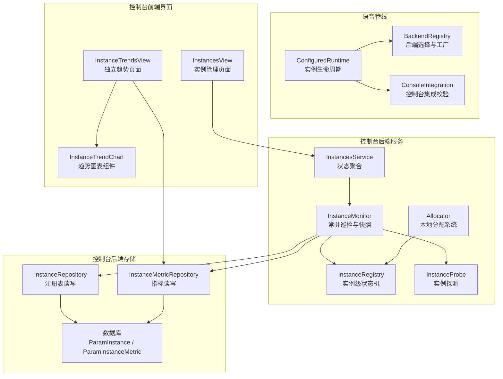

**图表来源**
- [configured_runtime.py:168-286](file://src/speech_to_speech/configured_runtime.py#L168-L286)
- [backend_registry.py:103-141](file://src/speech_to_speech/backend_registry.py#L103-L141)
- [console_integration.py:82-118](file://src/speech_to_speech/console_integration.py#L82-L118)
- [instance_registry.py:57-129](file://console/backend/app/services/instance_registry.py#L57-L129)
- [instance_monitor.py:27-180](file://console/backend/app/services/instance_monitor.py#L27-L180)
- [instance_probe.py:15-35](file://console/backend/app/services/instance_probe.py#L15-L35)
- [allocator.py:18-104](file://console/backend/app/services/allocator.py#L18-L104)
- [instances_service.py:20-168](file://console/backend/app/services/instances_service.py#L20-L168)
- [InstancesView.vue:1-342](file://console/frontend/src/views/InstancesView.vue#L1-L342)
- [InstanceTrendsView.vue:1-136](file://console/frontend/src/views/InstanceTrendsView.vue#L1-L136)
- [InstanceTrendChart.vue:1-98](file://console/frontend/src/components/InstanceTrendChart.vue#L1-L98)

章节来源
- [README.md:129-138](file://README.md#L129-L138)
- [configured_runtime.py:168-286](file://src/speech_to_speech/configured_runtime.py#L168-L286)
- [backend_registry.py:103-141](file://src/speech_to_speech/backend_registry.py#L103-L141)
- [console_integration.py:82-118](file://src/speech_to_speech/console_integration.py#L82-L118)
- [instance_repository.py:13-81](file://console/backend/app\repositories\instance_repository.py#L13-L81)
- [instance_metric_repository.py:22-54](file://console/backend/app\repositories\instance_metric_repository.py#L22-L54)

## 核心组件
本节梳理与"实例注册与监控"直接相关的核心对象及其职责。

**更新** 新增了四个关键服务模块和**重构后的前端界面架构**：

- ConfiguredRuntime：封装命名工作池、服务器与客户端的生命周期，负责线程启动、停止、失败传播与资源清理。
- BackendRegistry：集中声明 STT/LLM/TTS 后端规格、配置归一化与工厂方法，支撑按名称选择具体实现。
- ConsoleIntegration：校验控制台前后端路径与环境，避免在模型加载前静默失败。
- **InstanceRegistry**：实例级状态机，维护每个实例的运行状态（unknown/online/degraded/offline/draining），处理成功/失败观察和摘流操作。
- **InstanceMonitor**：常驻巡检循环，负责刷新规格、探测所有实例、采样指标、清理历史数据和提供防抖快照。
- **InstanceProbe**：对指定实例地址执行 pool/usage 探测，返回标准化的 PoolProbe 结果。
- **Allocator**：本地分配系统，实现加权最少负载选择算法，支持会话授权和过期清理。
- InstancesService：状态聚合服务，支持传统单实例和多实例两种模式的兼容输出。
- **InstancesView**：**重构后的实例管理页面**，专注于实例列表展示、汇总统计和操作按钮，移除了内联趋势图表。
- **InstanceTrendsView**：**新增的独立趋势页面**，提供完整的趋势分析界面，包含实例选择和时间窗口切换。
- **InstanceTrendChart**：前端趋势图表组件，可视化容量、空闲和探测耗时趋势。
- InstanceRepository：对 ParamInstance 表执行幂等 upsert、启用/摘流开关更新。
- InstanceMetricRepository：批量写入指标、窗口查询、过期清理。

章节来源
- [configured_runtime.py:168-286](file://src/speech_to_speech/configured_runtime.py#L168-L286)
- [backend_registry.py:103-141](file://src/speech_to_speech/backend_registry.py#L103-L141)
- [console_integration.py:82-118](file://src/speech_to_speech/console_integration.py#L82-L118)
- [instance_registry.py:57-129](file://console/backend/app/services/instance_registry.py#L57-L129)
- [instance_monitor.py:27-180](file://console/backend/app/services/instance_monitor.py#L27-L180)
- [instance_probe.py:15-35](file://console/backend/app/services/instance_probe.py#L15-L35)
- [allocator.py:18-104](file://console/backend/app/services/allocator.py#L18-L104)
- [instances_service.py:20-168](file://console/backend/app/services/instances_service.py#L20-L168)
- [InstancesView.vue:1-342](file://console/frontend/src/views/InstancesView.vue#L1-L342)
- [InstanceTrendsView.vue:1-136](file://console/frontend/src/views/InstanceTrendsView.vue#L1-L136)
- [InstanceTrendChart.vue:1-98](file://console/frontend/src/components/InstanceTrendChart.vue#L1-L98)
- [instance_repository.py:13-81](file://console/backend/app\repositories\instance_repository.py#L13-L81)
- [instance_metric_repository.py:22-54](file://console/backend/app\repositories\instance_metric_repository.py#L22-L54)

## 架构总览
实例注册与监控的整体流程如下：控制台启动后，常驻巡检任务按配置周期拉取注册表，对每个实例发起健康探测；根据探测结果更新内存中的状态机，并在状态跳变时即时写入指标；周期性采样当前池容量与使用量，并将分配计数器的增量合并进指标行；读接口通过短 TTL 防抖缓存降低热点压力。

**更新** 新增本地分配流程和**重构后的前端界面架构**：当检测到本地模式且注册表非空时，Allocator 根据加权最少负载算法选择实例，签发连接授权；前端 InstancesView 提供实时更新的实例列表、汇总统计卡片和操作按钮，用户点击"趋势"按钮或实例ID链接跳转到独立的 InstanceTrendsView 页面进行趋势分析。

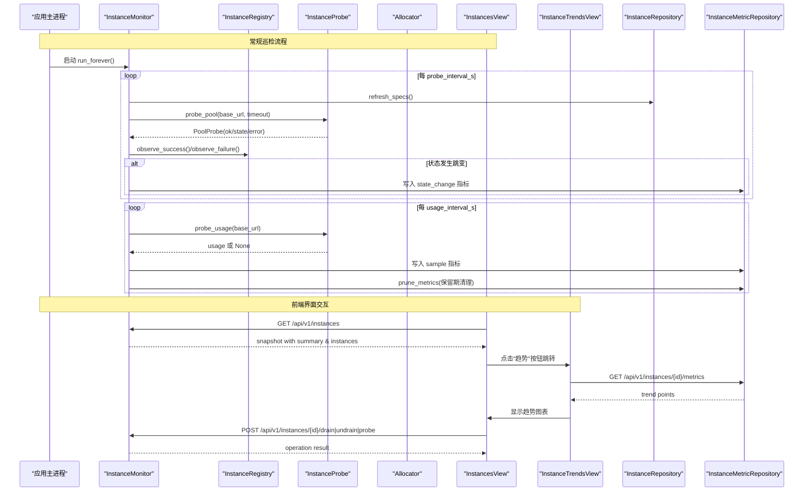

**图表来源**
- [instance_monitor.py:148-180](file://console/backend/app/services/instance_monitor.py#L148-L180)
- [instance_registry.py:89-129](file://console/backend/app/services/instance_registry.py#L89-L129)
- [instance_probe.py:23-35](file://console/backend/app/services/instance_probe.py#L23-L35)
- [allocator.py:55-104](file://console/backend/app/services/allocator.py#L55-L104)
- [InstancesView.vue:131-133](file://console/frontend/src/views/InstancesView.vue#L131-L133)
- [InstanceTrendsView.vue:52-69](file://console/frontend/src/views/InstanceTrendsView.vue#L52-L69)
- [instances.py:23-150](file://console/backend/app/routers/instances.py#L23-L150)

## 详细组件分析

### 语音管线侧：实例构建与生命周期
ConfiguredRuntime 是实例生命周期的统一入口。它维护命名工作池、服务器与客户端引用，并通过事件与线程协调启动、停止与失败传播。关键行为包括：
- start：为每个 handler 创建线程，启动监控线程，进入 running 状态。
- stop：设置停止信号，等待线程退出，清理未启动资源，最终进入 stopped 或 failed。
- wait：阻塞直到所有线程退出，再调用 stop，若存在失败则抛出运行时错误。
- build_configured_server：根据配置构造 RealtimeServer，必要时附加本地客户端与 LLM 代理配置。

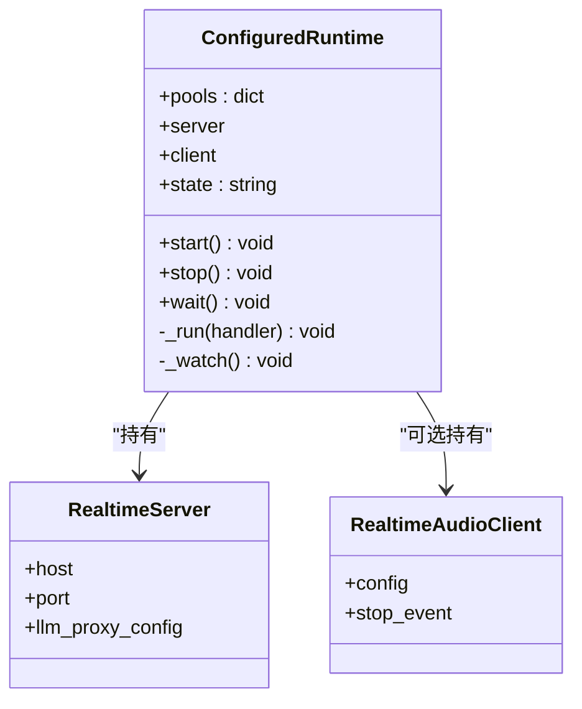

**图表来源**
- [configured_runtime.py:168-286](file://src/speech_to_speech/configured_runtime.py#L168-L286)
- [configured_runtime.py:320-361](file://src/speech_to_speech/configured_runtime.py#L320-L361)

章节来源
- [configured_runtime.py:168-286](file://src/speech_to_speech/configured_runtime.py#L168-L286)
- [configured_runtime.py:320-361](file://src/speech_to_speech/configured_runtime.py#L320-L361)

### 后端选择与工厂：BackendRegistry
BackendRegistry 通过 BackendSpec 描述每个后端的能力、参数类型、配置归一化与工厂方法，并按 kind 构建无歧义注册表。其设计要点：
- normalize_dataclass_config：将 dataclass 字段转换为 handler kwargs，分离 gen_kwargs。
- create_backend_handler：包装工厂调用，将可选依赖缺失转化为明确 ImportError。
- _simple_handler_factory：通用工厂，支持注入 cancel_scope、speculative_turns、should_listen 等上下文。
- 三类后端注册表：STT_BACKENDS、LLM_BACKENDS、TTS_BACKENDS，覆盖默认与可选后端。

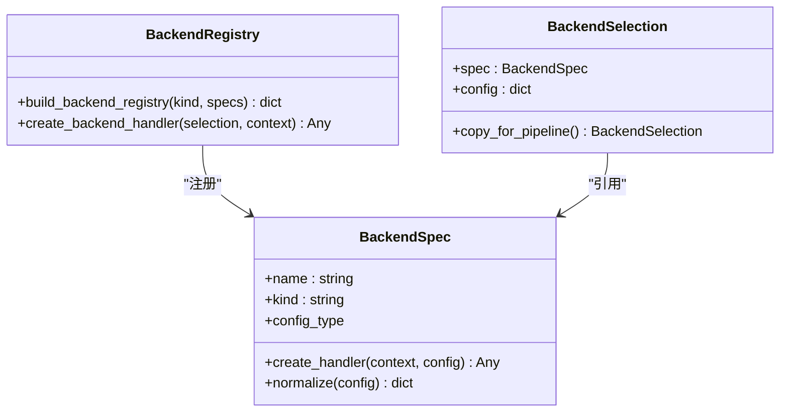

**图表来源**
- [backend_registry.py:103-141](file://src/speech_to_speech/backend_registry.py#L103-L141)
- [backend_registry.py:144-207](file://src/speech_to_speech/backend_registry.py#L144-L207)
- [backend_registry.py:219-348](file://src/speech_to_speech/backend_registry.py#L219-L348)
- [backend_registry.py:351-708](file://src/speech_to_speech/backend_registry.py#L351-L708)

章节来源
- [backend_registry.py:103-141](file://src/speech_to_speech/backend_registry.py#L103-L141)
- [backend_registry.py:144-207](file://src/speech_to_speech/backend_registry.py#L144-L207)
- [backend_registry.py:219-348](file://src/speech_to_speech/backend_registry.py#L219-L348)
- [backend_registry.py:351-708](file://src/speech_to_speech/backend_registry.py#L351-L708)

### 控制台集成：ConsoleIntegration
ConsoleIntegration 在启动前校验控制台后端与静态资源是否存在，避免模型加载后才暴露问题。ConsoleAttachment 承载 ASGI app、lifespan、静态目录与管道基地址，便于父应用挂载。

章节来源
- [console_integration.py:82-118](file://src/speech_to_speech/console_integration.py#L82-L118)

### 控制台侧：实例注册表与指标存储
- ParamInstance：实例元数据表，包含 instance_id、base_url、weight、max_sessions_hint、labels_json、enabled、drain_requested 及审计时间戳。
- ParamInstanceMetric：指标表，记录 size/in_use/free/stuck/status/probe_ms 与分配/摘除/恢复计数，支持多 console 观察者标识。
- InstanceRepository：提供 list_all、get_by_instance_id、upsert_seed、set_drain、set_enabled。
- InstanceMetricRepository：提供 insert_many、window、latest_observed_at、prune_before。

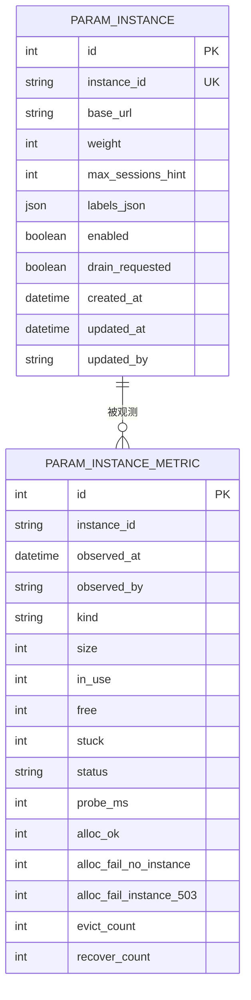

**图表来源**
- [param_instance.py:11-31](file://console/backend/app\models\param_instance.py#L11-L31)
- [param_instance_metric.py:11-34](file://console/backend/app\models\param_instance_metric.py#L11-L34)

章节来源
- [param_instance.py:11-31](file://console/backend/app\models\param_instance.py#L11-L31)
- [param_instance_metric.py:11-34](file://console/backend/app\models\param_instance_metric.py#L11-L34)
- [instance_repository.py:13-81](file://console/backend/app\repositories\instance_repository.py#L13-L81)
- [instance_metric_repository.py:22-54](file://console/backend/app\repositories\instance_metric_repository.py#L22-L54)

### 实例级状态机：InstanceRegistry（增强）
InstanceRegistry 是实例级状态机的核心实现，维护每个实例的运行状态和处理逻辑。

**核心特性：**
- 五种状态：unknown（未知）、online（在线）、degraded（降级）、offline（离线）、draining（摘流中）
- 阈值机制：fail_threshold（连续失败次数触发离线）、recover_threshold（连续成功次数恢复在线）
- 探测历史：保留最近 20 次探测耗时，计算 p50/p95 延迟
- 有效容量：effective_free 属性考虑已用和卡住单元
- 摘流优先：draining 状态优先级最高，不受探测结果影响
- **RuntimeState 数据结构**，包含完整的实例运行状态信息

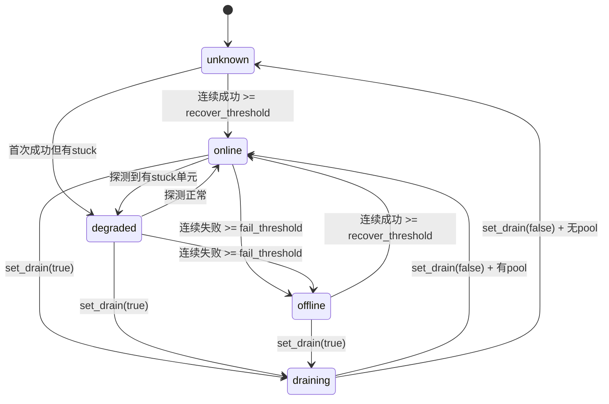

**图表来源**
- [instance_registry.py:14-129](file://console/backend/app/services/instance_registry.py#L14-L129)

章节来源
- [instance_registry.py:57-129](file://console/backend/app/services/instance_registry.py#L57-L129)

### 常驻巡检与状态机：InstanceMonitor（增强）
InstanceMonitor 是监控系统的核心，职责包括：
- refresh_specs：从数据库拉取实例列表，同步到内存注册表。
- probe_all：一轮探测全部实例，单台异常不阻断其余；状态跳变即时写入 state_change 指标。
- sample_metrics：周期性采集 usage，写入 sample 指标，并合并分配计数器增量。
- prune_metrics：按保留期清理历史指标。
- snapshot：读接口 2 秒防抖缓存，避免高频读取风暴。
- run_forever：lifespan 启停，异常只记日志不杀循环。

**更新** 增强了与 Allocator 的集成，支持分配计数器的自动合并和清理。

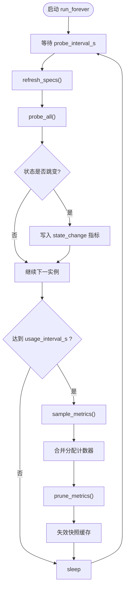

**图表来源**
- [instance_monitor.py:148-180](file://console/backend/app/services/instance_monitor.py#L148-L180)

章节来源
- [instance_monitor.py:27-180](file://console/backend/app/services/instance_monitor.py#L27-L180)

### 实例探测：InstanceProbe（增强）
InstanceProbe 负责对指定实例地址执行探测操作，提供统一的探测接口。

**核心功能：**
- probe_pool：探测实例池状态，返回 PoolProbe 对象包含 ok、state、probe_ms、error
- probe_usage：探测实例使用情况，失败不影响健康判定
- hangup_call：跨机代理实例侧的 WebRTC 挂断
- 超时控制：pool 探测默认 2 秒，usage 探测默认 5 秒
- 错误处理：网络异常、超时、响应格式错误等统一处理

章节来源
- [instance_probe.py:15-53](file://console/backend/app/services/instance_probe.py#L15-L53)

### 本地分配系统：Allocator（增强）
Allocator 实现本地会话分配逻辑，支持加权最少负载选择算法。

**核心算法：**
1. 候选过滤：enabled=true、weight>0、status=online/degraded、有余量
2. 负载计算：free/capacity 比率作为主要排序键
3. 权重随机：同负载实例按 weight 进行加权随机选择
4. 重试机制：首次分配失败后尝试下一个实例
5. 去重保护：基于 X-Request-Id 或 Cookie 的去重机制

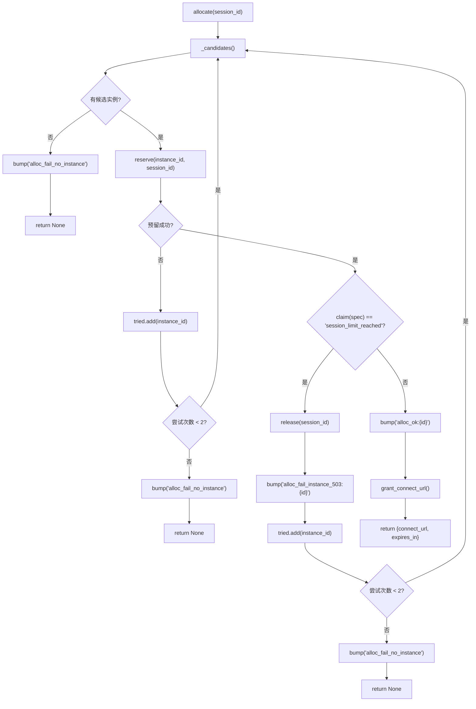

**图表来源**
- [allocator.py:55-104](file://console/backend/app/services/allocator.py#L55-L104)

章节来源
- [allocator.py:18-104](file://console/backend/app/services/allocator.py#L18-L104)

### 状态聚合服务：InstancesService（增强）
InstancesService 提供统一的状态聚合接口，支持传统单实例和多实例两种模式。

**更新** 实现了双模式兼容：
- 传统模式：当注册表为空时，直接使用 pool.read_pool()/read_usage() 获取本机实例信息
- 多实例模式：当注册表非空时，使用 instance_monitor.snapshot() 获取所有实例状态
- 向后兼容：保持原有 API 响应格式不变，新增 summary 和 instances 字段

章节来源
- [instances_service.py:20-168](file://console/backend/app/services/instances_service.py#L20-L168)

### 重构后的前端界面架构

#### 实例管理页面：InstancesView（简化）
InstancesView 现在专注于实例管理功能，移除了内联趋势图表，提供更简洁的用户界面。

**核心功能：**
- 实时轮询：每 5 秒自动刷新实例状态
- 实例列表：显示实例 ID、状态、容量、占用、权重、探测延迟等信息
- 汇总统计：展示实例总数、在线/降级/离线/摘除数量、槽位使用情况
- 运维操作：支持摘除、恢复、手动探测等操作
- **趋势导航**：点击"趋势"按钮或实例ID链接跳转到独立的 InstanceTrendsView 页面
- 权限控制：operator/admin 角色才能执行运维操作

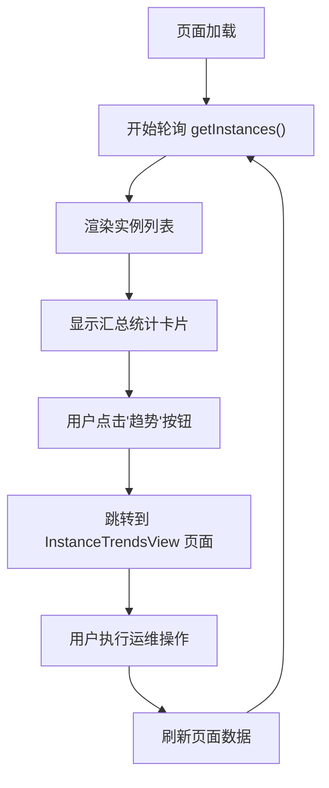

**图表来源**
- [InstancesView.vue:131-133](file://console/frontend/src/views/InstancesView.vue#L131-L133)

章节来源
- [InstancesView.vue:1-342](file://console/frontend/src/views/InstancesView.vue#L1-L342)

#### 独立趋势页面：InstanceTrendsView（新增）
InstanceTrendsView 是专门用于趋势分析的独立页面，提供完整的趋势查看功能。

**核心功能：**
- 实例选择：下拉选择要查看趋势的实例
- 时间窗口：支持 1小时、6小时、24小时、7天等不同时间范围
- 趋势图表：使用 InstanceTrendChart 组件展示容量、空闲和探测耗时趋势
- 数据刷新：支持手动刷新和自动重新加载
- 错误处理：完善的错误提示和加载状态

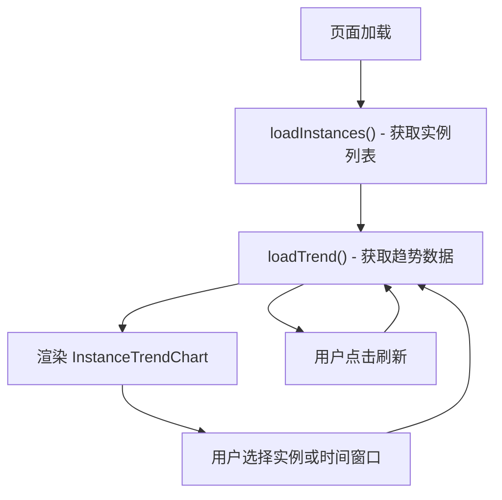

**图表来源**
- [InstanceTrendsView.vue:39-83](file://console/frontend/src/views/InstanceTrendsView.vue#L39-L83)

章节来源
- [InstanceTrendsView.vue:1-136](file://console/frontend/src/views/InstanceTrendsView.vue#L1-L136)

#### 趋势图表组件：InstanceTrendChart（保持不变）
InstanceTrendChart 是前端趋势图表组件，使用手写 SVG 实现。

**核心功能：**
- 三条趋势线：容量（蓝色）、空闲（绿色）、探测耗时（橙色虚线）
- 数据去重：按观察者去重，避免多 console 重复采样
- 自适应缩放：根据数据最大值自动调整 Y 轴刻度
- 交互式图例：显示各趋势线的含义

章节来源
- [InstanceTrendChart.vue:1-98](file://console/frontend/src/components/InstanceTrendChart.vue#L1-L98)

### 管理 API 端点（增强）
新增的管理 API 端点提供实例运维操作能力：

**端点列表：**
- `POST /api/v1/instances/{instance_id}/drain`：标记实例为摘流状态
- `POST /api/v1/instances/{instance_id}/undrain`：取消摘流状态
- `POST /api/v1/instances/{instance_id}/probe`：手动触发实例探测
- `GET /api/v1/instances/{instance_id}`：获取实例详细信息
- `GET /api/v1/instances/{instance_id}/metrics`：获取实例指标历史
- `POST /api/v1/instances/{instance_id}/hangup`：跨机代理实例侧的 WebRTC 挂断

**安全特性：**
- 需要 operator 权限（部分操作需要 admin 权限）
- 操作审计记录
- 请求 ID 关联追踪

章节来源
- [instances.py:53-181](file://console/backend/app/routers/instances.py#L53-L181)

## 依赖关系分析
- 语音管线侧依赖 BackendRegistry 完成后端选择与实例单元构建；ConfiguredRuntime 负责线程与资源管理。
- 控制台侧 InstanceMonitor 依赖 InstanceRepository 与 InstanceMetricRepository，间接依赖数据库。
- ConsoleIntegration 与 ConfiguredRuntime 协作，确保控制台集成在正确时机校验与挂载。
- **Allocator 依赖 InstanceRegistry 获取可用实例列表**。
- **InstancesService 依赖 InstanceMonitor 获取最新状态快照**。
- **重构后的前端架构**：InstancesView 依赖后端 API 获取实例数据，InstanceTrendsView 依赖 InstanceTrendChart 组件和指标 API。

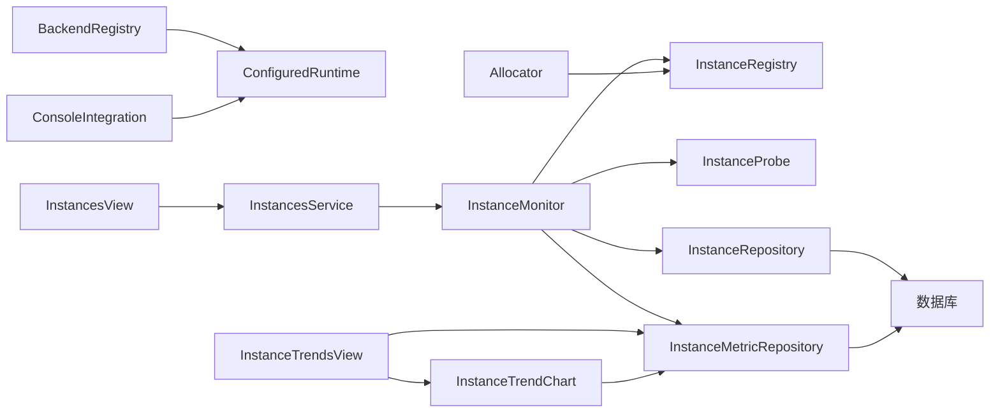

**图表来源**
- [configured_runtime.py:168-286](file://src/speech_to_speech/configured_runtime.py#L168-L286)
- [backend_registry.py:103-141](file://src/speech_to_speech/backend_registry.py#L103-L141)
- [console_integration.py:82-118](file://src/speech_to_speech/console_integration.py#L82-L118)
- [instance_registry.py:57-129](file://console/backend/app/services/instance_registry.py#L57-L129)
- [instance_monitor.py:27-180](file://console/backend/app/services/instance_monitor.py#L27-L180)
- [instance_probe.py:15-35](file://console/backend/app/services/instance_probe.py#L15-L35)
- [allocator.py:18-104](file://console/backend/app/services/allocator.py#L18-L104)
- [instances_service.py:20-168](file://console/backend/app/services/instances_service.py#L20-L168)
- [InstancesView.vue:1-342](file://console/frontend/src/views/InstancesView.vue#L1-L342)
- [InstanceTrendsView.vue:1-136](file://console/frontend/src/views/InstanceTrendsView.vue#L1-L136)
- [InstanceTrendChart.vue:1-98](file://console/frontend/src/components/InstanceTrendChart.vue#L1-L98)

章节来源
- [configured_runtime.py:168-286](file://src/speech_to_speech/configured_runtime.py#L168-L286)
- [backend_registry.py:103-141](file://src/speech_to_speech/backend_registry.py#L103-L141)
- [console_integration.py:82-118](file://src/speech_to_speech/console_integration.py#L82-L118)
- [instance_repository.py:13-81](file://console/backend/app\repositories\instance_repository.py#L13-L81)
- [instance_metric_repository.py:22-54](file://console/backend/app\repositories\instance_metric_repository.py#L22-L54)
- [instance_registry.py:57-129](file://console/backend/app/services/instance_registry.py#L57-L129)
- [instance_monitor.py:27-180](file://console/backend/app/services/instance_monitor.py#L27-L180)
- [instance_probe.py:15-35](file://console/backend/app/services/instance_probe.py#L15-L35)
- [allocator.py:18-104](file://console/backend/app/services/allocator.py#L18-L104)
- [instances_service.py:20-168](file://console/backend/app/services/instances_service.py#L20-L168)
- [InstancesView.vue:1-342](file://console/frontend/src/views/InstancesView.vue#L1-L342)
- [InstanceTrendsView.vue:1-136](file://console/frontend/src/views/InstanceTrendsView.vue#L1-L136)
- [InstanceTrendChart.vue:1-98](file://console/frontend/src/components/InstanceTrendChart.vue#L1-L98)

## 性能与可观测性
- 快照缓存：InstanceMonitor.snapshot 提供 2 秒防抖，减少读侧风暴。
- 指标采样：usage_interval_s 周期写入 sample 指标，避免频繁 IO。
- 异常隔离：单实例探测异常不影响整轮巡检，任务异常仅记录日志。
- 指标清理：prune_metrics 按保留期删除旧数据，控制表增长。
- 多 console 支持：observed_by 区分不同控制台实例，聚合取最新值而非累加。
- **分配计数器**：跟踪分配成功/失败统计，支持按实例维度聚合。
- **探测历史**：保留最近 20 次探测耗时，支持 p50/p95 延迟统计。
- **前端性能优化**：实例列表分页、趋势图表按需加载、操作确认对话框。
- **界面重构优化**：趋势图表组件复用，减少代码重复，提升加载性能。

章节来源
- [instance_monitor.py:137-180](file://console/backend/app/services/instance_monitor.py#L137-L180)
- [instance_registry.py:42-55](file://console/backend/app/services/instance_registry.py#L42-L55)
- [allocator.py:90-104](file://console/backend/app/services/allocator.py#L90-L104)
- [InstancesView.vue:74-127](file://console/frontend/src/views/InstancesView.vue#L74-L127)

## 故障排查指南
- 端口绑定失败：当 RealtimeServer 无法绑定端口时，ConfiguredRuntime.wait 会捕获并抛出 StartupError，提示端口不可用。
- 线程未正常退出：stop 阶段若仍有存活线程，会抛出运行时错误，需检查 handler 的清理逻辑。
- 控制台集成失败：ConsoleIntegration.validate 会在缺少后端或前端构建产物时报错，应在模型加载前解决。
- 实例探测异常：InstanceMonitor.probe_all 对单实例异常进行日志记录，不会中断整轮；查看日志定位具体实例与错误信息。
- 指标缺失或为空：offline 实例的 size/in_use/free/stuck 应写 NULL，表示不可得；确认 probe_pool 返回 ok=false 且 error 非空。
- **分配失败**：检查 allocator.drain_counters() 返回值，确认 alloc_fail_no_instance 或 alloc_fail_instance_503 计数增长。
- **状态不一致**：使用 POST /api/v1/instances/{instance_id}/probe 手动触发探测，验证实例实际状态。
- **前端显示异常**：检查浏览器控制台网络请求，确认后端 API 返回数据格式正确。
- **趋势图表不显示**：确认实例有足够的数据点（至少 2 个采样点），检查数据去重逻辑。
- **趋势页面无法访问**：检查路由配置 `/console/instances/trends` 是否正确注册，确认导航菜单配置。
- **实例跳转失败**：验证 router.push 调用是否正确传递实例ID参数，检查 instance-trends 路由名称。

章节来源
- [configured_runtime.py:381-442](file://src/speech_to_speech/configured_runtime.py#L381-L442)
- [console_integration.py:82-118](file://src/speech_to_speech/console_integration.py#L82-L118)
- [instance_monitor.py:66-90](file://console/backend/app/services/instance_monitor.py#L66-L90)
- [allocator.py:55-104](file://console/backend/app/services/allocator.py#L55-L104)
- [instances.py:84-102](file://console/backend/app/routers/instances.py#L84-L102)
- [InstancesView.vue:131-133](file://console/frontend/src/views/InstancesView.vue#L131-L133)
- [InstanceTrendsView.vue:39-83](file://console/frontend/src/views/InstanceTrendsView.vue#L39-L83)

## 结论
实例注册与监控系统通过"数据库真相源 + 内存运行态 + 常驻巡检"的分层设计，实现了多实例的可观测性与可运维性。语音管线侧的 ConfiguredRuntime 与 BackendRegistry 提供了稳定的实例构建与后端选择机制；控制台侧的 InstanceRepository、InstanceMetricRepository 与 InstanceMonitor 共同完成了注册、探测、状态机与指标落库闭环。

**更新** 新增的 InstanceRegistry、InstanceProbe 和 Allocator 模块进一步完善了系统架构，提供了强大的实例状态管理和智能分配能力。双模式会话管理（负载均衡和本地模式）确保了系统的灵活性和可扩展性。管理 API 端点则为运维操作提供了标准化接口。**重构后的前端界面架构**：移除了 InstancesView 中的内联趋势图表，改为独立的 InstanceTrendsView 页面，提供更好的用户体验和职责分离。实例管理页面专注于列表展示和操作，趋势分析功能移至专门的页面，提升了界面的清晰度和易用性。

该体系在保证低耦合的同时，兼顾了扩展性与鲁棒性，适合在生产环境中管理大量语音处理实例。

## 附录：数据模型与配置项
- 实例元数据（ParamInstance）
  - instance_id：唯一键，用于标识实例。
  - base_url：实例对外地址。
  - weight：权重，用于负载均衡展示与偏差告警。
  - max_sessions_hint：最大会话提示，不参与分配。
  - labels_json：标签集合。
  - enabled：启用开关。
  - drain_requested：期望摘流开关，持久化。
  - created_at/updated_at/updated_by：审计字段。

- 指标元数据（ParamInstanceMetric）
  - instance_id：关联实例。
  - observed_at：观测时间。
  - observed_by：观察者标识（控制台 ID）。
  - kind：sample 或 state_change。
  - size/in_use/free/stuck：池容量与使用量，NULL 表示不可得。
  - status：online/offline/unknown 等。
  - probe_ms：探测耗时。
  - alloc_ok/alloc_fail_no_instance/alloc_fail_instance_503：分配计数器增量。
  - evict_count/recover_count：摘除/恢复边沿计数。

**RuntimeState 数据结构**
- instance_id/base_url：实例基本信息
- weight/enabled：实例配置
- status：运行状态（unknown/online/degraded/offline/draining）
- pool/usage：探测结果
- probe_ms/probe_history：探测延迟统计
- consecutive_failures/consecutive_successes：连续失败/成功计数
- last_error：最后错误信息

**前端数据类型**
- InstanceRow：实例行数据，包含实例基本信息、状态、容量、探测信息等
- InstanceSnapshot：实例快照，包含容器信息、池状态、使用情况和汇总统计
- InstanceMetricPoint：指标数据点，包含观测时间、状态、容量、探测耗时等
- InstancesSummary：汇总统计数据，包含实例总数、状态分布、槽位统计等

**新增前端路由配置**
- 路由名称：instance-trends
- 路由路径：/console/instances/trends
- 组件：InstanceTrendsView
- 导航组：负载均衡（lb）
- 导航图标：trend

章节来源
- [param_instance.py:11-31](file://console/backend/app\models\param_instance.py#L11-L31)
- [param_instance_metric.py:11-34](file://console/backend/app\models\param_instance_metric.py#L11-L34)
- [instance_registry.py:20-55](file://console/backend/app/services/instance_registry.py#L20-L55)
- [InstancesView.vue:35-47](file://console/frontend/src/views/InstancesView.vue#L35-L47)
- [InstanceTrendChart.vue:12-19](file://console/frontend/src/components/InstanceTrendChart.vue#L12-L19)
- [router/index.ts:38-43](file://console/frontend/src/router/index.ts#L38-L43)
- [router/nav.ts:59-66](file://console/frontend/src/router/nav.ts#L59-L66)