# 控制台系统

<cite>
**本文引用的文件**   
- [console/README.md](file://console/README.md)
- [console/backend/app/main.py](file://console/backend/app/main.py)
- [console/backend/app/core/router_registry.py](file://console/backend/app/core/router_registry.py)
- [console/backend/app/config/_app.py](file://console/backend/app/config/_app.py)
- [console/backend/app/config/_console.py](file://console/backend/app/config/_console.py)
- [console/backend/app/routers/auth.py](file://console/backend/app/routers/auth.py)
- [console/backend/app/routers/status.py](file://console/backend/app/routers/status.py)
- [console/backend/app/routers/catalog.py](file://console/backend/app/routers/catalog.py)
- [console/backend/app/routers/realtime.py](file://console/backend/app/routers/realtime.py)
- [console/backend/alembic/versions/0005_instances.py](file://console/backend/alembic/versions/0005_instances.py)
- [console/backend/app/services/instance_seed.py](file://console/backend/app/services/instance_seed.py)
- [console/backend/app/services/instances_service.py](file://console/backend/app/services/instances_service.py)
- [console/backend/app/repositories/instance_repository.py](file://console/backend/app/repositories/instance_repository.py)
- [console/backend/app/repositories/instance_metric_repository.py](file://console/backend/app/repositories/instance_metric_repository.py)
- [console/frontend/src/App.vue](file://console/frontend/src/App.vue)
- [console/frontend/src/layouts/ConsoleLayout.vue](file://console/frontend/src/layouts/ConsoleLayout.vue)
- [console/frontend/src/router/nav.ts](file://console/frontend/src/router/nav.ts)
- [console/frontend/src/views/InstancesView.vue](file://console/frontend/src/views/InstancesView.vue)
- [console/frontend/src/views/InstanceTrendsView.vue](file://console/frontend/src/views/InstanceTrendsView.vue)
- [console/frontend/src/components/InstanceTrendChart.vue](file://console/frontend/src/components/InstanceTrendChart.vue)
- [console/frontend/src/i18n/index.ts](file://console/frontend/src/i18n/index.ts)
- [console/frontend/src/i18n/locales/en-US/index.ts](file://console/frontend/src/i18n/locales/en-US/index.ts)
- [console/frontend/src/i18n/locales/zh-CN/index.ts](file://console/frontend/src/i18n/locales/zh-CN/index.ts)
- [console/design/console-refactor-demo.html](file://console/design/console-refactor-demo.html)
</cite>

## 更新摘要
**变更内容**   
- 新增完整的国际化基础设施，支持英语和中文双语界面
- 引入设计令牌系统，统一前端视觉规范
- 新增只读仪表板页面（概览视图、流量视图）
- 增强语音会话管理功能
- 新增后端流量 API 接口
- 重构导航和路由系统，支持多语言切换

## 目录
1. [简介](#简介)
2. [项目结构](#项目结构)
3. [核心组件](#核心组件)
4. [架构总览](#架构总览)
5. [详细组件分析](#详细组件分析)
6. [依赖关系分析](#依赖关系分析)
7. [性能与可观测性](#性能与可观测性)
8. [故障排查指南](#故障排查指南)
9. [结论](#结论)
10. [附录：环境变量与部署要点](#附录环境变量与部署要点)

## 简介
本仓库包含"控制台系统"，由后端 FastAPI 应用与前端 Vue SPA 组成，并随语音管道进程一起打包。容器内通过 supervisord 启动两个进程：控制台服务监听对外端口，内部仅回环暴露给控制台代理；同时提供参数管理、版本审计、会话、声音库、日志与实时通话等能力。控制台还反向代理浏览器到管道的实时 WebSocket 连接，避免直接暴露管道回环端口。

**更新** 本次重大重构引入了全面的国际化基础设施，支持英语和中文双语界面；新增了设计令牌系统统一视觉规范；添加了只读仪表板页面用于监控和分析；增强了语音会话管理功能；并新增了后端流量 API 接口。同时重构了导航和路由系统，提供更好的用户体验和多语言支持。

## 项目结构
控制台采用前后端分离的布局：后端位于 console/backend，前端位于 console/frontend。后端以 FastAPI 为核心，按路由、服务、仓储、模型、配置分层组织；前端基于 Vue 3 + TypeScript + Pinia，构建产物由 FastAPI 静态目录挂载。

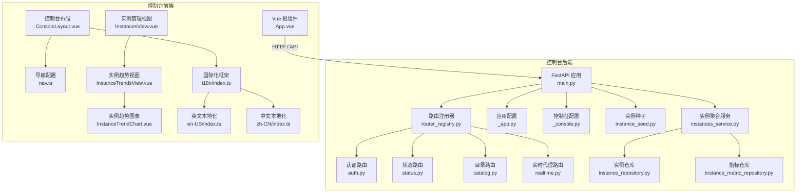

图示来源
- [console/backend/app/main.py:87-109](file://console/backend/app/main.py#L87-L109)
- [console/backend/app/core/router_registry.py:6-47](file://console/backend/app/core/router_registry.py#L6-L47)
- [console/backend/app/config/_app.py:6-17](file://console/backend/app/config/_app.py#L6-L17)
- [console/backend/app/config/_console.py:6-44](file://console/backend/app/config/_console.py#L6-L44)
- [console/backend/app/services/instance_seed.py:1-58](file://console/backend/app/services/instance_seed.py#L1-L58)
- [console/backend/app/services/instances_service.py:1-58](file://console/backend/app/services/instances_service.py#L1-L58)
- [console/backend/app/repositories/instance_repository.py:1-81](file://console/backend/app/repositories/instance_repository.py#L1-L81)
- [console/backend/app/repositories/instance_metric_repository.py:1-54](file://console/backend/app/repositories/instance_metric_repository.py#L1-L54)
- [console/frontend/src/App.vue:1-10](file://console/frontend/src/App.vue#L1-L10)
- [console/frontend/src/layouts/ConsoleLayout.vue:1-469](file://console/frontend/src/layouts/ConsoleLayout.vue#L1-L469)
- [console/frontend/src/router/nav.ts:1-72](file://console/frontend/src/router/nav.ts#L1-L72)
- [console/frontend/src/views/InstancesView.vue:1-342](file://console/frontend/src/views/InstancesView.vue#L1-L342)
- [console/frontend/src/views/InstanceTrendsView.vue:1-136](file://console/frontend/src/views/InstanceTrendsView.vue#L1-L136)
- [console/frontend/src/components/InstanceTrendChart.vue:1-98](file://console/frontend/src/components/InstanceTrendChart.vue#L1-L98)
- [console/frontend/src/i18n/index.ts:1-25](file://console/frontend/src/i18n/index.ts#L1-L25)
- [console/frontend/src/i18n/locales/en-US/index.ts:1-20](file://console/frontend/src/i18n/locales/en-US/index.ts#L1-L20)
- [console/frontend/src/i18n/locales/zh-CN/index.ts:1-20](file://console/frontend/src/i18n/locales/zh-CN/index.ts#L1-L20)

章节来源
- [console/README.md:19-40](file://console/README.md#L19-L40)

## 核心组件
- 应用生命周期与中间件：在应用启动时完成默认管理员初始化、发布流程恢复、实例种子幂等注入、计量清理后台任务与会话转轮询索引器；注册安全头、请求 ID、异常处理器，并按顺序挂载 OAuth、API 路由与 SPA 静态资源。
- 路由注册器：统一集中注册所有 API 路由组，保证前缀顺序（/api/v1、/api、/v1），并在最后挂载 SPA 兜底。
- 配置层：使用 pydantic-settings 从 .env 加载进程级与应用级配置，包括日志级别、最大请求体、静态目录、管道地址、Supervisor 套接字、日志与数据目录、声音库限制、实例种子路径与分配策略等。
- 认证路由：提供登录、刷新令牌与当前用户信息，内置失败次数节流与统一错误码。
- 状态路由：供顶部栏与发布门控读取系统快照。
- 目录路由：返回参数目录树，支持按曝光等级、阶段、后端过滤。
- 实时代理路由：将浏览器的 WebSocket 连接到管道回环地址，逐帧转发，不缓冲、不开压缩，避免首字节延迟放大。
- 实例注册与监控：通过 Alembic 迁移创建 `param_instance` 与 `param_instance_metric` 表，支持声明式实例种子、运行时状态探测、边沿事件记录与周期采样。
- 多组导航系统：重构侧栏导航为三个独立菜单组（语音对话、运维台、负载均衡），每个组包含相关功能入口。
- 实例趋势视图：独立的趋势分析页面，支持选择实例查看容量、空闲和探测耗时时间线。
- **新增** 国际化基础设施：基于 vue-i18n 的双语支持，包含英语和中文本地化文件，支持动态语言切换。
- **新增** 设计令牌系统：统一的 CSS 变量定义，确保视觉一致性。
- **新增** 只读仪表板页面：概览视图和流量视图提供系统监控和分析功能。

章节来源
- [console/backend/app/main.py:27-109](file://console/backend/app/main.py#L27-L109)
- [console/backend/app/core/router_registry.py:6-47](file://console/backend/app/core/router_registry.py#L6-L47)
- [console/backend/app/config/_app.py:6-17](file://console/backend/app/config/_app.py#L6-L17)
- [console/backend/app/config/_console.py:6-44](file://console/backend/app/config/_console.py#L6-L44)
- [console/backend/app/routers/auth.py:14-65](file://console/backend/app/routers/auth.py#L14-L65)
- [console/backend/app/routers/status.py:10-18](file://console/backend/app/routers/status.py#L10-L18)
- [console/backend/app/routers/catalog.py:10-54](file://console/backend/app/routers/catalog.py#L10-L54)
- [console/backend/app/routers/realtime.py:1-99](file://console/backend/app/routers/realtime.py#L1-L99)
- [console/backend/alembic/versions/0005_instances.py:1-64](file://console/backend/alembic/versions/0005_instances.py#L1-L64)
- [console/backend/app/services/instance_seed.py:1-58](file://console/backend/app/services/instance_seed.py#L1-L58)
- [console/backend/app/services/instances_service.py:1-58](file://console/backend/app/services/instances_service.py#L1-L58)
- [console/frontend/src/router/nav.ts:1-72](file://console/frontend/src/router/nav.ts#L1-L72)
- [console/frontend/src/views/InstanceTrendsView.vue:1-136](file://console/frontend/src/views/InstanceTrendsView.vue#L1-L136)
- [console/frontend/src/i18n/index.ts:1-25](file://console/frontend/src/i18n/index.ts#L1-L25)

## 架构总览
控制台作为单一进程承载 FastAPI 与 SPA，并通过反向代理桥接浏览器与管道实时通道。外部只暴露控制台端口，管道回环端口不对外。

**更新** 控制台现在还维护一个实例注册表，周期性探测已注册实例的健康状态与资源使用情况，并将状态变化与采样指标写入数据库。前端导航系统重构为多组结构，提供更好的功能组织和用户体验。新增的国际化基础设施支持英语和中文双语界面，设计令牌系统确保视觉一致性。

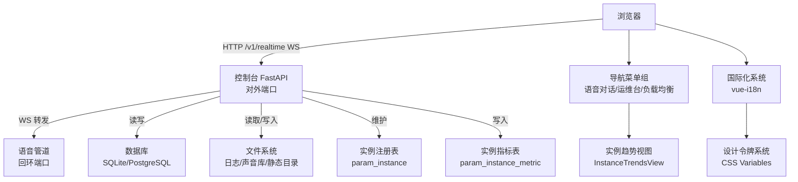

图示来源
- [console/README.md:7-17](file://console/README.md#L7-L17)
- [console/backend/app/routers/realtime.py:22-30](file://console/backend/app/routers/realtime.py#L22-L30)
- [console/backend/alembic/versions/0005_instances.py:19-56](file://console/backend/alembic/versions/0005_instances.py#L19-L56)
- [console/frontend/src/router/nav.ts:37-67](file://console/frontend/src/router/nav.ts#L37-L67)
- [console/frontend/src/views/InstanceTrendsView.vue:12-16](file://console/frontend/src/views/InstanceTrendsView.vue#L12-L16)
- [console/frontend/src/i18n/index.ts:1-25](file://console/frontend/src/i18n/index.ts#L1-L25)
- [console/design/console-refactor-demo.html:17-32](file://console/design/console-refactor-demo.html#L17-L32)

## 详细组件分析

### 应用启动与生命周期
- 启动阶段：确保默认管理员存在；恢复中断的发布流程；根据开关初始化计量服务并启动回收任务；启动延迟索引器后台任务；执行实例种子幂等注入。
- 关闭阶段：取消并等待后台任务结束，确保资源释放。
- 中间件链：安全头与请求大小限制、请求 ID、全局异常处理。
- 挂载顺序：OAuth 附加 → API 路由 → SPA 静态目录兜底。

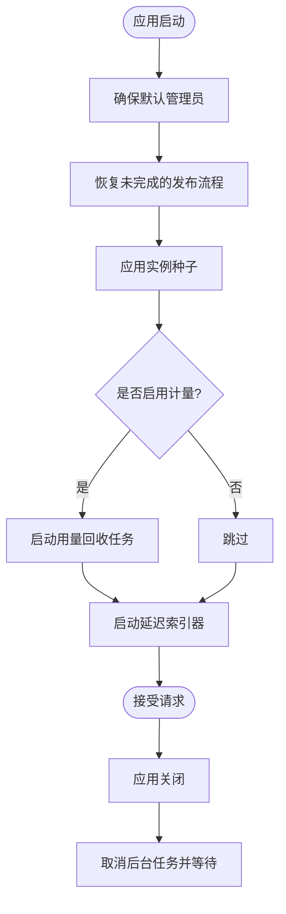

图示来源
- [console/backend/app/main.py:40-84](file://console/backend/app/main.py#L40-L84)
- [console/backend/app/main.py:87-109](file://console/backend/app/main.py#L87-L109)

章节来源
- [console/backend/app/main.py:27-109](file://console/backend/app/main.py#L27-L109)

### 国际化基础设施
**新增** 本节描述控制台前端新增的完整国际化基础设施。

- 框架集成：基于 vue-i18n 实现，默认语言为中文，回退语言为英语。
- 本地化文件：包含 en-US 和 zh-CN 两套完整的翻译文件，涵盖导航、通用文本、错误消息、认证、机器管理、部署、审计、发布、会话更新、声音库、语音、日志、延迟、概览、流量等模块。
- 缺失键检测：开发环境下会输出缺失键警告，便于发现遗漏的翻译。
- 动态切换：支持运行时动态切换语言，无需重新加载页面。

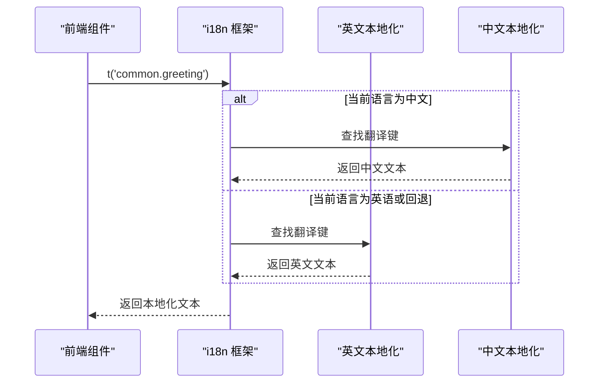

图示来源
- [console/frontend/src/i18n/index.ts:1-25](file://console/frontend/src/i18n/index.ts#L1-L25)
- [console/frontend/src/i18n/locales/en-US/index.ts:1-20](file://console/frontend/src/i18n/locales/en-US/index.ts#L1-L20)
- [console/frontend/src/i18n/locales/zh-CN/index.ts:1-20](file://console/frontend/src/i18n/locales/zh-CN/index.ts#L1-L20)

章节来源
- [console/frontend/src/i18n/index.ts:1-25](file://console/frontend/src/i18n/index.ts#L1-L25)
- [console/frontend/src/i18n/locales/en-US/index.ts:1-20](file://console/frontend/src/i18n/locales/en-US/index.ts#L1-L20)
- [console/frontend/src/i18n/locales/zh-CN/index.ts:1-20](file://console/frontend/src/i18n/locales/zh-CN/index.ts#L1-L20)

### 设计令牌系统
**新增** 本节描述控制台的设计令牌系统，统一管理视觉规范。

- CSS 变量定义：在样式文件中定义了背景色、表面色、边框色、文字色、强调色、成功色、警告色、危险色等设计令牌。
- 字体系统：定义了主字体和等宽字体，支持中英文混合显示。
- 间距和圆角：统一的间距系统和圆角半径定义。
- 响应式设计：针对不同屏幕尺寸的媒体查询。

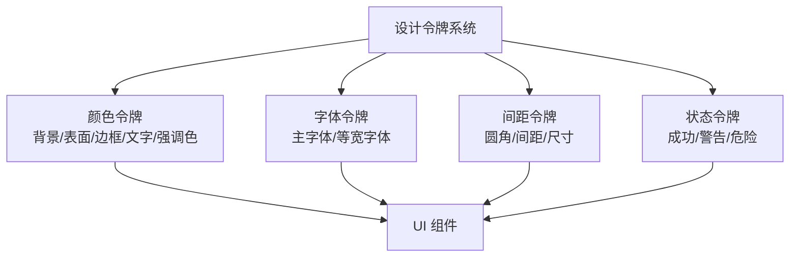

图示来源
- [console/design/console-refactor-demo.html:17-32](file://console/design/console-refactor-demo.html#L17-L32)

章节来源
- [console/design/console-refactor-demo.html:17-32](file://console/design/console-refactor-demo.html#L17-L32)

### 多组导航系统
- 导航分组：将功能划分为三个主要组别 - 语音对话（包含对话、会话历史、工具、设置）、运维台（包含参数、音色库、会话、版本、审计）、负载均衡（包含实例管理、趋势）。
- 分组渲染：ConsoleLayout 组件遍历 navGroups() 返回的所有分组，同时显示所有组的导航项。
- 响应式设计：分组标题在小屏幕下自动隐藏，保持图标导航的一致性。
- 路由过滤：通过 router.hasRoute(item.name) 动态过滤尚未注册的路由项。
- 交互逻辑：点击路由项进行页面跳转，点击浮层动作项跳转到对话页并打开对应浮层。

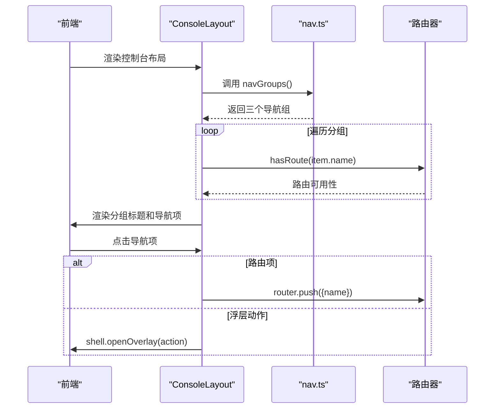

图示来源
- [console/frontend/src/layouts/ConsoleLayout.vue:32-37](file://console/frontend/src/layouts/ConsoleLayout.vue#L32-L37)
- [console/frontend/src/layouts/ConsoleLayout.vue:89-99](file://console/frontend/src/layouts/ConsoleLayout.vue#L89-L99)
- [console/frontend/src/router/nav.ts:37-67](file://console/frontend/src/router/nav.ts#L37-L67)

章节来源
- [console/frontend/src/layouts/ConsoleLayout.vue:1-469](file://console/frontend/src/layouts/ConsoleLayout.vue#L1-L469)
- [console/frontend/src/router/nav.ts:1-72](file://console/frontend/src/router/nav.ts#L1-L72)

### 实例趋势视图
- 页面功能：独立的趋势分析页面，支持选择实例和时间窗口查看容量、空闲和探测耗时的时间序列数据。
- 数据获取：从实例管理接口获取实例列表，从实例指标接口获取指定实例的趋势数据。
- 时间窗口：支持 1小时、6小时、24小时、7天四种时间窗口选择。
- 图表展示：使用手写 SVG 实现轻量级趋势图，显示三条关键指标曲线。
- 去重逻辑：按 observedBy 字段去重，避免同一时刻被多个控制台采样导致的重复数据。

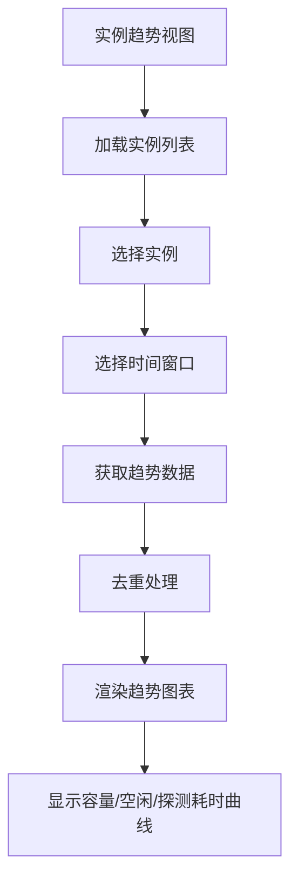

图示来源
- [console/frontend/src/views/InstanceTrendsView.vue:12-16](file://console/frontend/src/views/InstanceTrendsView.vue#L12-L16)
- [console/frontend/src/views/InstanceTrendsView.vue:39-49](file://console/frontend/src/views/InstanceTrendsView.vue#L39-L49)
- [console/frontend/src/views/InstanceTrendsView.vue:52-69](file://console/frontend/src/views/InstanceTrendsView.vue#L52-L69)
- [console/frontend/src/components/InstanceTrendChart.vue:7-11](file://console/frontend/src/components/InstanceTrendChart.vue#L7-L11)

章节来源
- [console/frontend/src/views/InstanceTrendsView.vue:1-136](file://console/frontend/src/views/InstanceTrendsView.vue#L1-L136)
- [console/frontend/src/components/InstanceTrendChart.vue:1-98](file://console/frontend/src/components/InstanceTrendChart.vue#L1-L98)

### 实例注册与监控
- 数据库模型：`param_instance` 存储实例标识、基础 URL、权重、会话上限提示、标签、启用状态与排水标志；`param_instance_metric` 存储每次探测或采样的状态、探针耗时、资源占用与分配计数器。
- 声明式种子：通过 YAML 文件声明实例列表，启动时幂等 upsert，冲突时保留数据库中的 `base_url` 并告警；删除的种子项会触发移除告警。
- 运行时探测：周期性调用实例池探测接口，获取可达性、池大小、使用中会话数与单元状态；状态跳变时立即写入 `state_change` 指标，包含摘除与恢复计数。
- 指标采样：每轮探测后按配置间隔采样 `sample` 指标，不可达实例的资源字段写为 NULL 而非零值；支持按保留期清理历史指标。
- 生命周期集成：实例种子在 lifespan 中执行；计量服务初始化后启动用量回收任务；延迟索引器与实例监控共享后台任务模式。

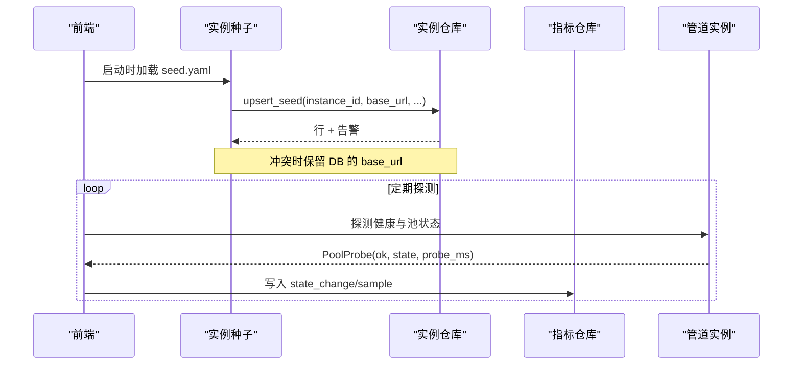

图示来源
- [console/backend/app/services/instance_seed.py:36-57](file://console/backend/app/services/instance_seed.py#L36-L57)
- [console/backend/app/repositories/instance_repository.py:23-62](file://console/backend/app/repositories/instance_repository.py#L23-L62)
- [console/backend/app/repositories/instance_metric_repository.py:22-54](file://console/backend/app/repositories/instance_metric_repository.py#L22-L54)
- [console/backend/alembic/versions/0005_instances.py:19-56](file://console/backend/alembic/versions/0005_instances.py#L19-L56)

章节来源
- [console/backend/app/services/instance_seed.py:1-58](file://console/backend/app/services/instance_seed.py#L1-L58)
- [console/backend/app/repositories/instance_repository.py:1-81](file://console/backend/app/repositories/instance_repository.py#L1-L81)
- [console/backend/app/repositories/instance_metric_repository.py:1-54](file://console/backend/app/repositories/instance_metric_repository.py#L1-L54)
- [console/backend/alembic/versions/0005_instances.py:1-64](file://console/backend/alembic/versions/0005_instances.py#L1-L64)

### 路由注册与访问控制
- 路由分组：健康检查、认证、目录、画像、实例、运行时、声音、会话、状态、日志、延迟指标、实时代理。
- 匿名与受保护：认证相关为 /api/v1/auth，其余多数需要 JWT；演示面为匿名且无信封。
- SPA 兜底：在所有 API 之后挂载，非 dist 路径返回 404。

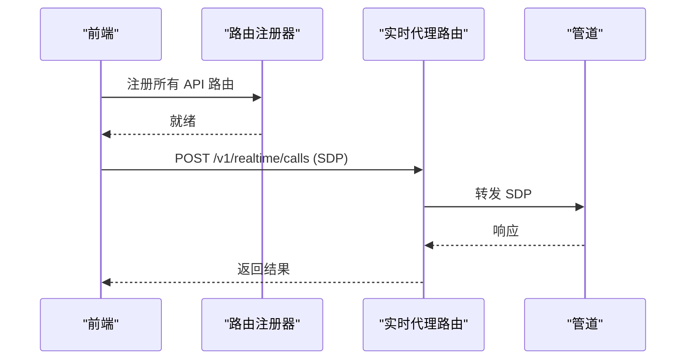

图示来源
- [console/backend/app/core/router_registry.py:6-47](file://console/backend/app/core/router_registry.py#L6-L47)
- [console/backend/app/routers/realtime.py:93-98](file://console/backend/app/routers/realtime.py#L93-L98)

章节来源
- [console/backend/app/core/router_registry.py:6-47](file://console/backend/app/core/router_registry.py#L6-L47)

### 认证流程
- 登录：校验用户名与密码，失败计数节流，成功后记录最后登录时间并返回访问令牌与刷新令牌。
- 刷新：使用刷新令牌换取新的令牌包。
- 当前用户：携带有效 JWT 获取用户基本信息。

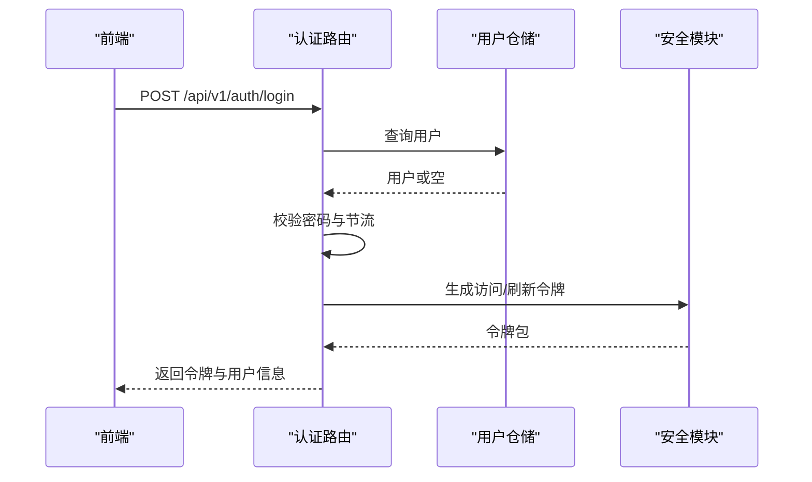

图示来源
- [console/backend/app/routers/auth.py:31-44](file://console/backend/app/routers/auth.py#L31-L44)
- [console/backend/app/routers/auth.py:47-50](file://console/backend/app/routers/auth.py#L47-L50)
- [console/backend/app/routers/auth.py:53-64](file://console/backend/app/routers/auth.py#L53-L64)

章节来源
- [console/backend/app/routers/auth.py:14-65](file://console/backend/app/routers/auth.py#L14-L65)

### 实时 WebSocket 代理
- 目标：将浏览器 WebSocket 连接到管道回环地址，保持同一路径与查询参数。
- 行为：双向逐帧转发，禁用压缩以避免首字节延迟放大；一侧断开即关闭另一侧，防止僵尸连接。
- 调用入口：POST /v1/realtime/calls 用于同源 SDP 交换，不回填 Location。

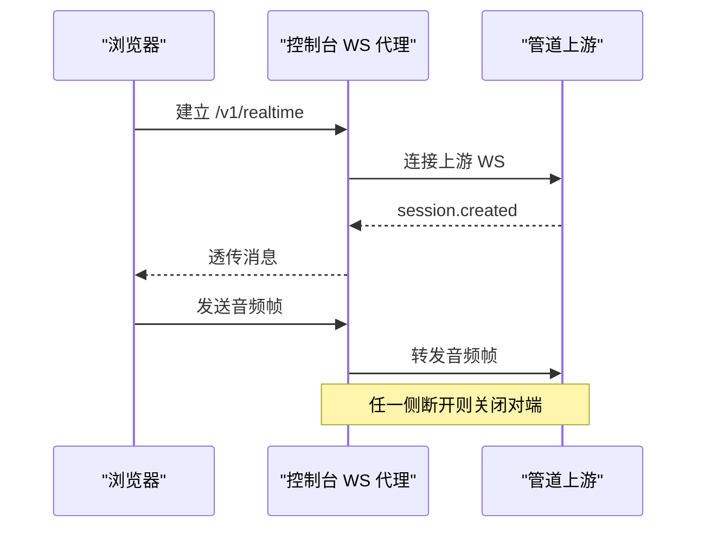

图示来源
- [console/backend/app/routers/realtime.py:22-30](file://console/backend/app/routers/realtime.py#L22-L30)
- [console/backend/app/routers/realtime.py:56-90](file://console/backend/app/routers/realtime.py#L56-L90)
- [console/backend/app/routers/realtime.py:93-98](file://console/backend/app/routers/realtime.py#L93-L98)

章节来源
- [console/backend/app/routers/realtime.py:1-99](file://console/backend/app/routers/realtime.py#L1-L99)

### 参数目录接口
- 功能：返回参数目录 schema、变体键、曝光等级统计与过滤后的参数列表。
- 过滤：支持 exposure、stage、backend 组合过滤；exposure 取最高层级。
- 错误：目录不可用返回 503；过滤参数非法返回 400。

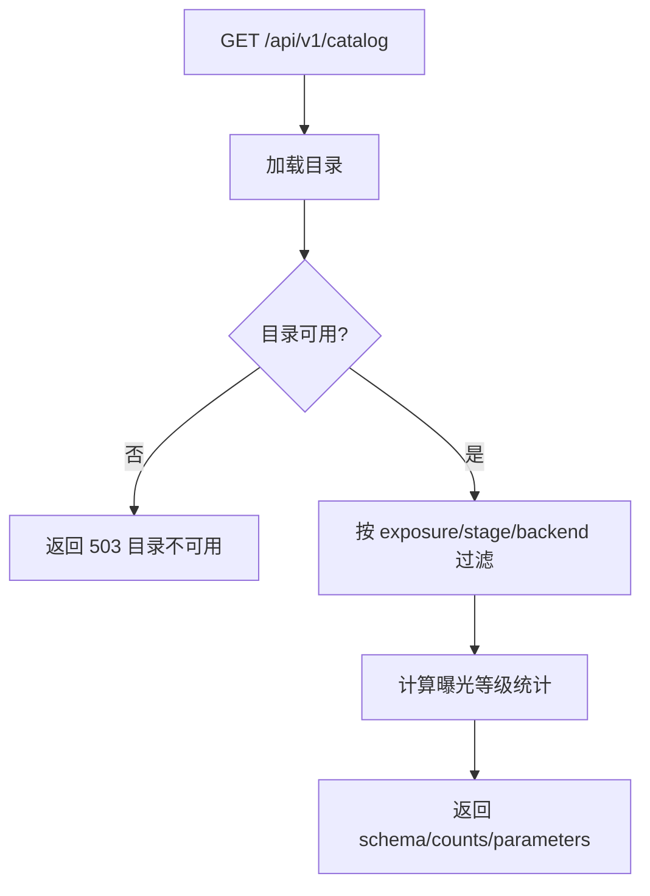

图示来源
- [console/backend/app/routers/catalog.py:13-54](file://console/backend/app/routers/catalog.py#L13-L54)

章节来源
- [console/backend/app/routers/catalog.py:10-54](file://console/backend/app/routers/catalog.py#L10-L54)

### 前端根组件
- 作用：注入主题配置并提供路由视图容器。
- 技术栈：Vue 3 + ant-design-vue 主题提供者。

章节来源
- [console/frontend/src/App.vue:1-10](file://console/frontend/src/App.vue#L1-L10)

## 依赖关系分析
控制台后端依赖以下关键子系统：
- 配置：进程级与应用级设置，来自 .env。
- 数据库：Alembic 迁移与 SQLAlchemy 仓储，新增实例注册与指标表。
- 文件系统：日志目录、声音库、静态目录、度量日志、实例种子 YAML。
- Supervisor：进程状态与重启控制。
- 管道：状态探测、实例池、实时代理与热更新。

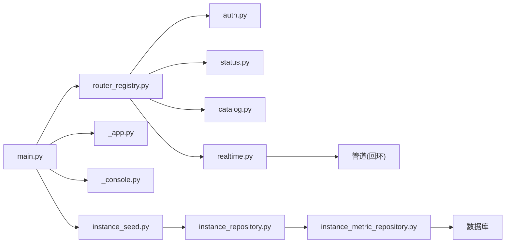

图示来源
- [console/backend/app/main.py:87-109](file://console/backend/app/main.py#L87-L109)
- [console/backend/app/core/router_registry.py:6-47](file://console/backend/app/core/router_registry.py#L6-L47)
- [console/backend/app/config/_app.py:6-17](file://console/backend/app/config/_app.py#L6-L17)
- [console/backend/app/config/_console.py:6-44](file://console/backend/app/config/_console.py#L6-L44)
- [console/backend/app/services/instance_seed.py:1-58](file://console/backend/app/services/instance_seed.py#L1-L58)
- [console/backend/app/repositories/instance_repository.py:1-81](file://console/backend/app/repositories/instance_repository.py#L1-L81)
- [console/backend/app/repositories/instance_metric_repository.py:1-54](file://console/backend/app/repositories/instance_metric_repository.py#L1-L54)
- [console/backend/app/routers/realtime.py:22-30](file://console/backend/app/routers/realtime.py#L22-L30)

章节来源
- [console/backend/app/main.py:87-109](file://console/backend/app/main.py#L87-L109)
- [console/backend/app/core/router_registry.py:6-47](file://console/backend/app/core/router_registry.py#L6-L47)

## 性能与可观测性
- 实时代理零缓冲与禁用压缩，避免 TTS 首字节延迟放大。
- 背景任务：用量回收与延迟索引器独立运行，不阻塞请求；实例探测与指标采样也采用后台循环，单台实例异常不影响整轮探测。
- 日志与度量：控制台读取管道日志与度量日志，提供日志面板与延迟指标；实例状态变化与资源采样写入 `param_instance_metric`，支持窗口查询与保留期清理。
- 体积限制：JSON 请求体上限与声音上传上限分别控制，防止过大负载。
- 防抖缓存：实例快照读接口带 2 秒 TTL，降低面板高频刷新压力。
- 趋势图表性能：使用轻量级 SVG 渲染，避免引入重型图表库，提升加载速度。
- **新增** 国际化性能：vue-i18n 按需加载翻译文件，减少初始包体积。
- **新增** 设计令牌优化：CSS 变量预编译，减少运行时样式计算开销。

章节来源
- [console/backend/app/routers/realtime.py:56-90](file://console/backend/app/routers/realtime.py#L56-L90)
- [console/backend/app/main.py:64-84](file://console/backend/app/main.py#L64-L84)
- [console/backend/app/config/_console.py:23-44](file://console/backend/app/config/_console.py#L23-L44)
- [console/backend/app/repositories/instance_metric_repository.py:37-54](file://console/backend/app/repositories/instance_metric_repository.py#L37-L54)
- [console/frontend/src/components/InstanceTrendChart.vue:7-11](file://console/frontend/src/components/InstanceTrendChart.vue#L7-L11)
- [console/frontend/src/i18n/index.ts:1-25](file://console/frontend/src/i18n/index.ts#L1-L25)

## 故障排查指南
- 无法登录：检查用户名/密码、节流是否触发、JWT 密钥是否配置。
- 实时连接失败：确认管道回环可达、WebSocket 子协议与压缩设置、上游地址解析。
- 目录不可用：检查参数目录挂载与可读性。
- 日志面板不可用：确认日志目录存在且可读。
- 启动失败：确认静态目录存在、数据库已迁移、JWT_SECRET_KEY 已设置。
- 实例种子无效：检查 `allocator.seed_path` 是否配置、YAML 文件是否存在、条目是否包含 `id` 与 `base_url`。
- 实例指标缺失：确认 Alembic 已执行 `0005_instances` 迁移、计量服务已在 lifespan 中初始化、实例未被标记为 drain 或 disabled。
- 导航显示异常：检查 nav.ts 中的路由名称是否与路由注册一致，确认 router.hasRoute 返回值。
- 趋势图表不显示：确认实例指标数据存在，检查时间窗口选择和数据去重逻辑。
- **新增** 国际化问题：检查 i18n 配置文件是否正确加载，确认翻译键是否存在于对应的本地化文件中。
- **新增** 语言切换失效：检查 vue-i18n 实例是否正确初始化，确认语言切换逻辑是否正常工作。
- **新增** 设计令牌异常：检查 CSS 变量定义是否正确，确认样式文件是否成功加载。

章节来源
- [console/backend/app/routers/auth.py:31-44](file://console/backend/app/routers/auth.py#L31-L44)
- [console/backend/app/routers/realtime.py:56-90](file://console/backend/app/routers/realtime.py#L56-L90)
- [console/backend/app/routers/catalog.py:26-34](file://console/backend/app/routers/catalog.py#L26-L34)
- [console/README.md:144-170](file://console/README.md#L144-L170)
- [console/backend/app/services/instance_seed.py:16-33](file://console/backend/app/services/instance_seed.py#L16-L33)
- [console/backend/alembic/versions/0005_instances.py:1-64](file://console/backend/alembic/versions/0005_instances.py#L1-L64)
- [console/frontend/src/router/nav.ts:34-35](file://console/frontend/src/router/nav.ts#L34-L35)
- [console/frontend/src/views/InstanceTrendsView.vue:52-69](file://console/frontend/src/views/InstanceTrendsView.vue#L52-L69)
- [console/frontend/src/i18n/index.ts:15-23](file://console/frontend/src/i18n/index.ts#L15-L23)

## 结论
控制台系统以 FastAPI 为中心，结合 Vue SPA 提供完整的运维与对话界面，并通过安全的反向代理桥接浏览器与管道实时通道。其设计强调最小暴露面、低延迟与可观测性，配合严格的配置与权限控制，适合在生产环境中与语音管道协同部署。

**更新** 随着实例注册与监控能力的加入，控制台现在不仅能管理单个管道进程，还能维护一组运行中的实例，持续探测其健康状态与资源使用情况，并将状态变化与采样指标持久化，为容量规划、故障定位与自动化扩缩容提供数据基础。同时，导航系统的多组结构重构显著改善了用户体验，新增的实例趋势视图为性能分析和容量规划提供了直观的可视化工具。

**重大更新** 本次重构引入了全面的国际化基础设施，支持英语和中文双语界面，使控制台能够服务于全球用户。设计令牌系统确保了视觉一致性和可维护性。新增的只读仪表板页面提供了系统监控和分析能力，增强了系统的可观测性。这些改进使控制台更加完善和专业，能够更好地满足生产环境的需求。

## 附录：环境变量与部署要点
- 必需变量：JWT_SECRET_KEY。
- 数据库：DATABASE_URL，首次需执行 Alembic 升级，新增 `0005_instances` 迁移。
- 静态目录：STATIC_DIR，缺失会导致启动失败。
- 管道地址：PIPELINE_BASE_URL，控制台据此代理实时连接与探测。
- Supervisor：SUPERVISOR_SOCKET、SUPERVISOR_PROGRAM、RESTART_MODE。
- 日志与数据：LOG_DIR、DATA_DIR、MODEL_METRICS_LOG。
- 声音库：VOICE_DATA_DIR、VOICE_MAX_BYTES、VOICE_MIN_SECONDS、VOICE_RETENTION_MAX_DAYS、VOICE_PRECOMPUTE_*。
- 实例配置：ALLOCATOR_SEED_PATH（实例种子 YAML 路径）、ALLOCATOR_PROBE_INTERVAL_S、ALLOCATOR_USAGE_INTERVAL_S、ALLOCATOR_METRIC_RETENTION_DAYS、ALLOCATOR_FAIL_THRESHOLD、ALLOCATOR_RECOVER_THRESHOLD、RESOLVED_CONSOLE_ID。
- **新增** 国际化配置：默认语言设置为 zh-CN，回退语言为 en-US，支持运行时动态切换。
- **新增** 设计令牌：CSS 变量在样式文件中预定义，无需额外环境变量配置。

章节来源
- [console/README.md:67-84](file://console/README.md#L67-L84)
- [console/backend/app/config/_console.py:6-44](file://console/backend/app/config/_console.py#L6-L44)
- [console/backend/alembic/versions/0005_instances.py:1-64](file://console/backend/alembic/versions/0005_instances.py#L1-L64)
- [console/backend/app/services/instance_seed.py:36-57](file://console/backend/app/services/instance_seed.py#L36-L57)
- [console/frontend/src/i18n/index.ts:8-14](file://console/frontend/src/i18n/index.ts#L8-L14)