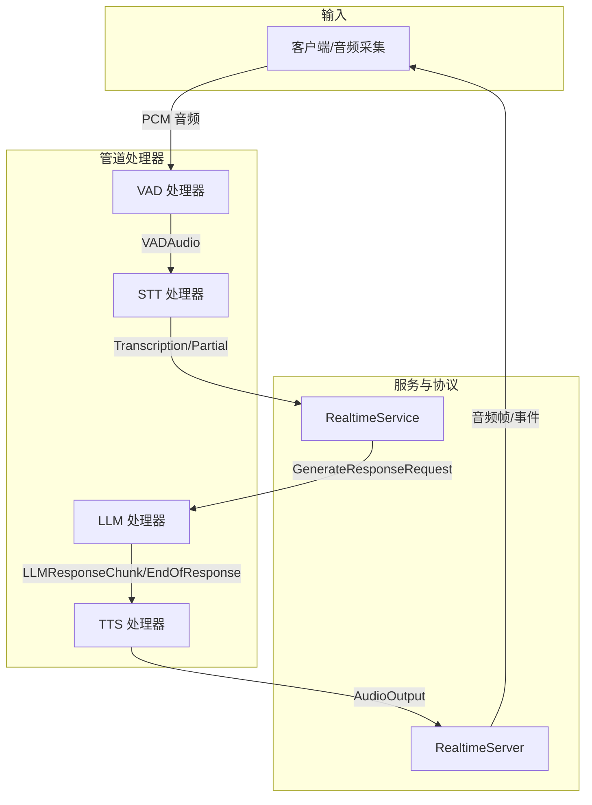
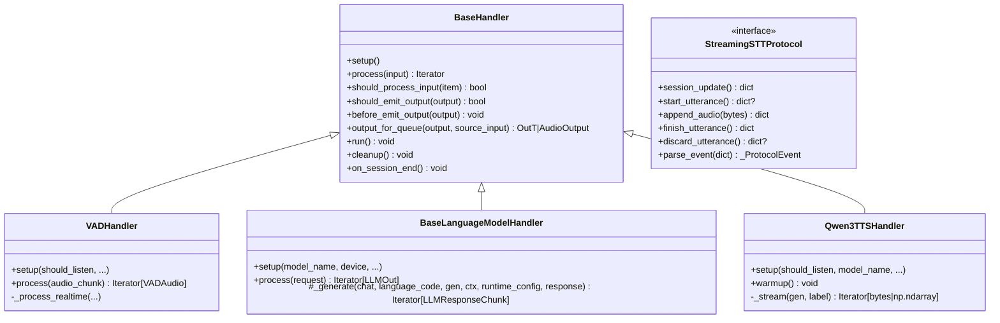
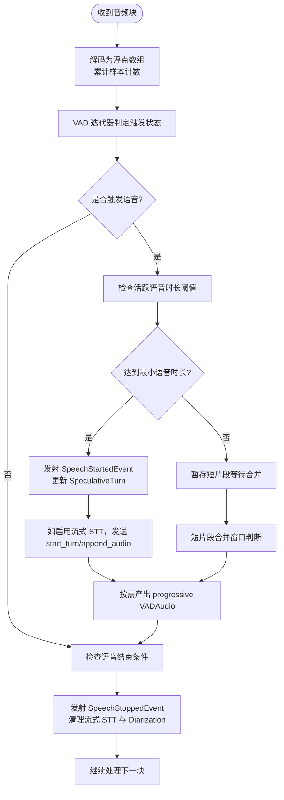
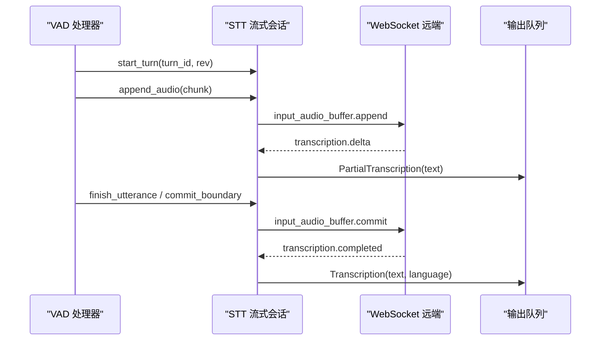
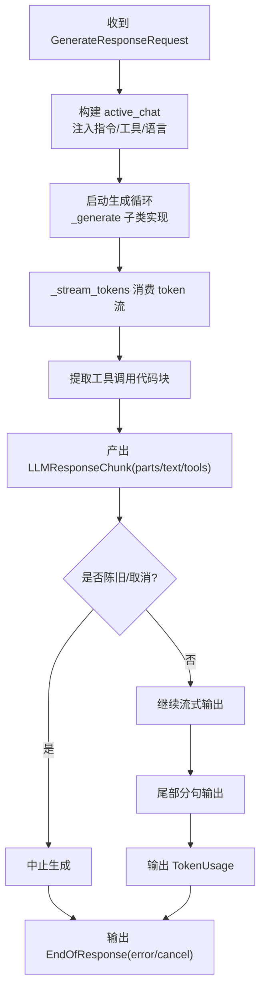
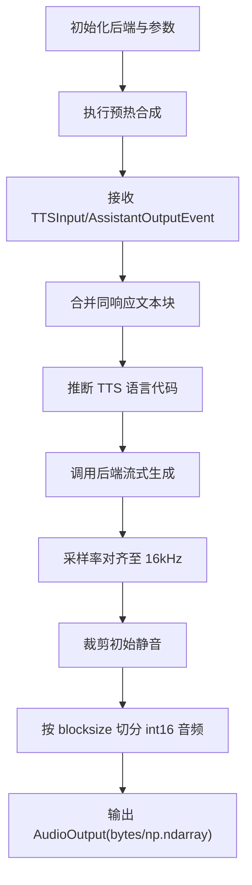
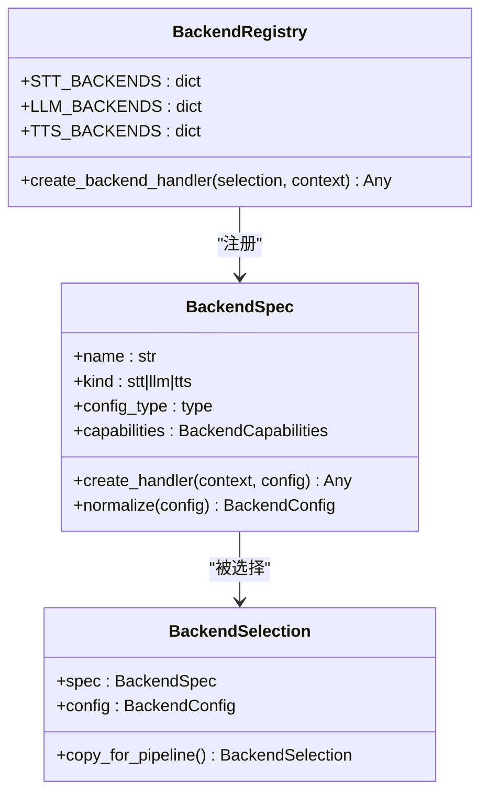
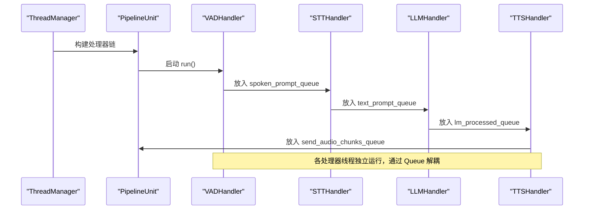
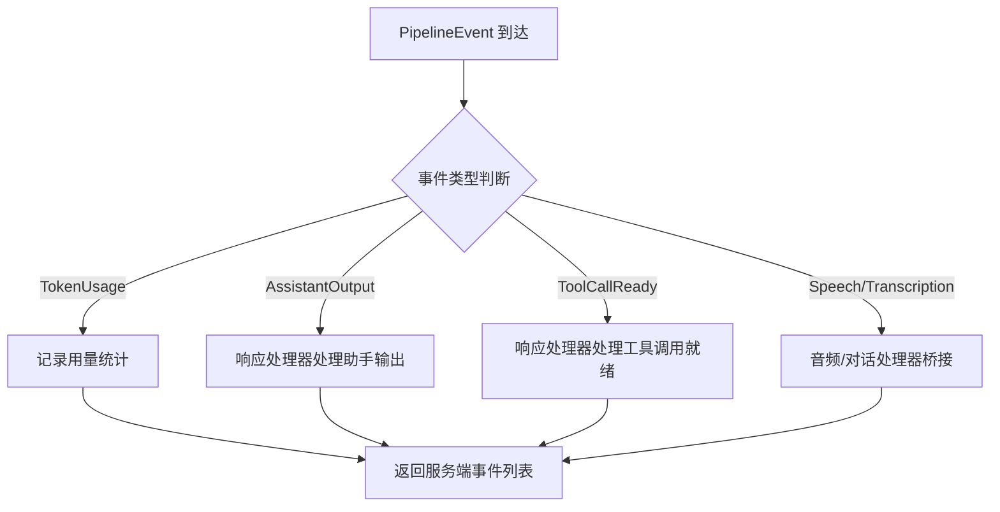
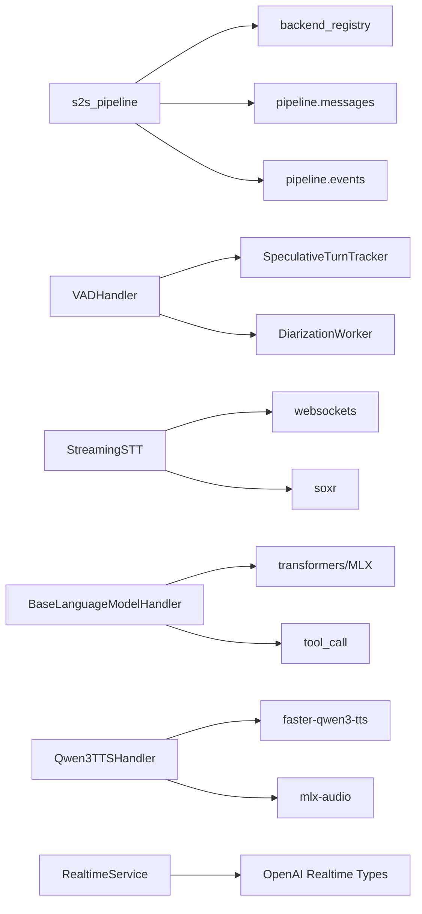

# 核心架构

<cite>
**本文引用的文件**   
- [s2s_pipeline.py](file://src/speech_to_speech/s2s_pipeline.py)
- [backend_registry.py](file://src/speech_to_speech/backend_registry.py)
- [messages.py](file://src/speech_to_speech/pipeline/messages.py)
- [events.py](file://src/speech_to_speech/pipeline/events.py)
- [handler_types.py](file://src/speech_to_speech/pipeline/handler_types.py)
- [baseHandler.py](file://src/speech_to_speech/baseHandler.py)
- [vad_handler.py](file://src/speech_to_speech/VAD/vad_handler.py)
- [streaming_handler.py](file://src/speech_to_speech/STT/streaming_handler.py)
- [language_model.py](file://src/speech_to_speech/LLM/language_model.py)
- [qwen3_tts_handler.py](file://src/speech_to_speech/TTS/qwen3_tts_handler.py)
- [service.py](file://src/speech_to_speech/api/openai_realtime/service.py)
- [config.py](file://src/speech_to_speech/config.py)
</cite>

## 目录
1. [引言](#引言)
2. [项目结构](#项目结构)
3. [核心组件](#核心组件)
4. [架构总览](#架构总览)
5. [详细组件分析](#详细组件分析)
6. [依赖关系分析](#依赖关系分析)
7. [性能与权衡](#性能与权衡)
8. [故障排查指南](#故障排查指南)
9. [结论](#结论)
10. [附录：扩展与自定义指南](#附录扩展与自定义指南)

## 引言
本文件面向开发者，系统性阐述 speech-to-speech 四阶段处理管道（VAD → STT → LLM → TTS）的架构设计、线程模型、队列机制、事件驱动流程、后端注册系统与可插拔组件设计，并给出数据流、消息格式、状态管理与错误处理的实现细节。文档同时提供架构图与交互流程图，帮助读者快速理解关键设计决策与技术权衡，并提供扩展与自定义指导。

## 项目结构
该仓库将实时语音对话的核心能力拆分为四层处理器：
- VAD：语音活动检测与分段，支持渐进式快照、智能回合、说话人分离侧路。
- STT：多种语音转文本后端，支持流式协议与本地推理。
- LLM：语言模型推理，支持本地 Transformers/MLX 与远程 API，统一工具调用与历史管理。
- TTS：文本转语音，支持多后端与平台优化路径。

这些处理器通过统一的 BaseHandler 基类组织为线程化工作单元，并通过 Queue 传递结构化消息；RealtimeService 作为协议桥接层，负责 OpenAI Realtime 事件与内部 PipelineEvent 的双向转换。

**图示来源**
- [s2s_pipeline.py:382-574](file://src/speech_to_speech/s2s_pipeline.py#L382-L574)
- [service.py:355-403](file://src/speech_to_speech/api/openai_realtime/service.py#L355-L403)

**章节来源**
- [s2s_pipeline.py:382-574](file://src/speech_to_speech/s2s_pipeline.py#L382-L574)
- [service.py:355-403](file://src/speech_to_speech/api/openai_realtime/service.py#L355-L403)

## 核心组件
- BaseHandler：所有处理器的通用基类，封装线程循环、控制消息、停止信号、输出包装与计时统计。
- VADHandler：语音活动检测、分段、渐进式快照、短片段合并、智能回合、说话人分离集成。
- STT 处理器族：包括流式协议适配（OpenAI Realtime、vLLM Realtime）与本地推理后端。
- LLM 处理器族：抽象 BaseLanguageModelHandler，统一生成生命周期、工具解析、历史压缩与中断控制。
- TTS 处理器族：以 Qwen3TTSHandler 为代表，支持多后端与平台优化。
- BackendRegistry：后端注册系统，集中声明 STT/LLM/TTS 后端规格、配置归一化与工厂创建。
- PipelineMessage/PipelineEvent：管道内消息与事件的类型定义，确保跨组件的数据契约。
- RealtimeService：协议桥接层，维护会话状态、响应生命周期、使用量统计与延迟追踪。

**章节来源**
- [baseHandler.py:32-242](file://src/speech_to_speech/baseHandler.py#L32-L242)
- [vad_handler.py:58-209](file://src/speech_to_speech/VAD/vad_handler.py#L58-L209)
- [streaming_handler.py:349-475](file://src/speech_to_speech/STT/streaming_handler.py#L349-L475)
- [language_model.py:166-257](file://src/speech_to_speech/LLM/language_model.py#L166-L257)
- [qwen3_tts_handler.py:96-220](file://src/speech_to_speech/TTS/qwen3_tts_handler.py#L96-L220)
- [backend_registry.py:70-141](file://src/speech_to_speech/backend_registry.py#L70-L141)
- [messages.py:34-267](file://src/speech_to_speech/pipeline/messages.py#L34-L267)
- [events.py:26-228](file://src/speech_to_speech/pipeline/events.py#L26-L228)
- [service.py:355-403](file://src/speech_to_speech/api/openai_realtime/service.py#L355-L403)

## 架构总览
整体架构由“构建器 + 处理器链 + 协议服务”组成：
- s2s_pipeline.build_pipeline 根据配置实例化多个 PipelineUnit，每个单元包含独立的队列、服务与处理器链。
- _build_handlers 组装 VAD → STT/AudioInput → LLM → TTS 处理器链，并根据后端能力插入 TranscriptionNotifier 或 STV 可视化口型。
- backend_registry 提供 STT_BACKENDS、LLM_BACKENDS、TTS_BACKENDS 三个注册表，统一规范后端选择、配置归一化与工厂创建。
- service.RealtimeService 维护 ConnState，将 OpenAI Realtime 事件映射到内部 PipelineEvent，并驱动 LLM 生成与 TTS 合成。

**图示来源**
- [baseHandler.py:32-242](file://src/speech_to_speech/baseHandler.py#L32-L242)
- [vad_handler.py:58-209](file://src/speech_to_speech/VAD/vad_handler.py#L58-L209)
- [streaming_handler.py:55-70](file://src/speech_to_speech/STT/streaming_handler.py#L55-L70)
- [language_model.py:166-257](file://src/speech_to_speech/LLM/language_model.py#L166-L257)
- [qwen3_tts_handler.py:96-220](file://src/speech_to_speech/TTS/qwen3_tts_handler.py#L96-L220)

**章节来源**
- [s2s_pipeline.py:382-574](file://src/speech_to_speech/s2s_pipeline.py#L382-L574)
- [backend_registry.py:350-693](file://src/speech_to_speech/backend_registry.py#L350-L693)
- [service.py:355-403](file://src/speech_to_speech/api/openai_realtime/service.py#L355-L403)

## 详细组件分析

### VAD 处理器
职责与行为：
- 接收 PCM 音频块，按阈值与静音时长判定语音起止。
- 支持渐进式快照（enable_realtime_transcription），用于实时转录展示。
- 短片段合并窗口避免误触发打断。
- 与 SpeculativeTurnTracker 协作，决定是否重开回合与丢弃陈旧输出。
- 可选接入说话人分离（DiarizationWorker），在语音边界处产出说话人标签。

关键流程：
- process 中累积样本、调用迭代器判定触发状态。
- 当活跃语音达到阈值时发射 SpeechStartedEvent，并在语音结束时发射 SpeechStoppedEvent。
- 若启用流式 STT，则通过 streaming_stt_sink 发送音频片段与边界标记。

**图示来源**
- [vad_handler.py:565-668](file://src/speech_to_speech/VAD/vad_handler.py#L565-L668)
- [vad_handler.py:670-800](file://src/speech_to_speech/VAD/vad_handler.py#L670-L800)

**章节来源**
- [vad_handler.py:58-209](file://src/speech_to_speech/VAD/vad_handler.py#L58-L209)
- [vad_handler.py:565-800](file://src/speech_to_speech/VAD/vad_handler.py#L565-L800)

### STT 处理器（流式协议）
职责与行为：
- 封装不同后端的流式协议（OpenAI Realtime、vLLM Realtime）。
- 维护 WebSocket 连接与会话状态，序列化 append_audio/start_turn/finish_utterance/discard_utterance。
- 将远端 delta/completed/failed/error 事件转换为 PartialTranscription/Transcription/TranscriptionFailure。
- 对未归属的事件进行过滤，保证 item_id/content_index 一致性。
- 支持超时与断线恢复，失败时 poison turn 并关闭连接。

关键流程：
- _StreamingSession._run 主循环消费命令队列，建立连接、发送 session.update、处理事件。
- handle_protocol_event 根据事件类型聚合 hypothesis、提交最终结果、记录失败。
- commit 与 begin_commit 协调 VAD 的边界，确保最终转录与语音段对齐。

**图示来源**
- [streaming_handler.py:349-475](file://src/speech_to_speech/STT/streaming_handler.py#L349-L475)
- [streaming_handler.py:630-767](file://src/speech_to_speech/STT/streaming_handler.py#L630-L767)

**章节来源**
- [streaming_handler.py:349-475](file://src/speech_to_speech/STT/streaming_handler.py#L349-L475)
- [streaming_handler.py:630-767](file://src/speech_to_speech/STT/streaming_handler.py#L630-L767)

### LLM 处理器
职责与行为：
- 抽象 BaseLanguageModelHandler 统一生成生命周期：加载模型、构建提示、流式 token 处理、工具提取、历史压缩。
- 支持 Transformers 与 MLX 后端，分别处理 streamer 与 MLX generator。
- 通过 CancelScope 与 SpeculativeTurnTracker 控制中断与陈旧回合丢弃。
- 将文本与工具调用组织为 AssistantOutputPart，并按顺序写入 ResponseHistory。

关键流程：
- process 接收 GenerateResponseRequest，构建 active_chat，应用指令与工具。
- _stream_tokens 消费 token 流，分句缓冲，提取工具代码块，产出 LLMResponseChunk。
- 完成后输出 TokenUsage 与 EndOfResponse，异常路径仍保证终止响应。

**图示来源**
- [language_model.py:486-554](file://src/speech_to_speech/LLM/language_model.py#L486-L554)
- [language_model.py:560-765](file://src/speech_to_speech/LLM/language_model.py#L560-L765)

**章节来源**
- [language_model.py:166-257](file://src/speech_to_speech/LLM/language_model.py#L166-L257)
- [language_model.py:486-765](file://src/speech_to_speech/LLM/language_model.py#L486-L765)

### TTS 处理器（Qwen3）
职责与行为：
- 根据平台选择后端：Apple Silicon 使用 mlx-audio，其他平台使用 faster-qwen3-tts。
- 支持 voice cloning/custom voice/voice design 三种模式，自动推断模型类型。
- 流式合成：TTFA 测量、RTF 统计、初始静音裁剪、块大小对齐输出。
- 语言选择：支持 auto 与显式语言映射，结合 LLM 输出语言检测。

关键流程：
- setup 初始化后端、量化参数、参考音频缓存、流式 chunk size。
- warmup 执行一次合成预热，验证后端可用性。
- _stream 遍历生成项，采样率对齐、int16 转换、静音裁剪、块切分输出。

**图示来源**
- [qwen3_tts_handler.py:110-220](file://src/speech_to_speech/TTS/qwen3_tts_handler.py#L110-L220)
- [qwen3_tts_handler.py:704-762](file://src/speech_to_speech/TTS/qwen3_tts_handler.py#L704-L762)
- [qwen3_tts_handler.py:764-800](file://src/speech_to_speech/TTS/qwen3_tts_handler.py#L764-L800)

**章节来源**
- [qwen3_tts_handler.py:96-220](file://src/speech_to_speech/TTS/qwen3_tts_handler.py#L96-L220)
- [qwen3_tts_handler.py:704-800](file://src/speech_to_speech/TTS/qwen3_tts_handler.py#L704-L800)

### 后端注册系统与可插拔设计
- BackendSpec 描述后端名称、类型、配置类、工厂函数、能力标志。
- build_backend_registry 构建命名空间，拒绝重复与类型不匹配。
- create_backend_handler 通过 spec.create_handler(context, config) 动态实例化处理器，捕获可选依赖缺失并给出安装指引。
- STT_BACKENDS、LLM_BACKENDS、TTS_BACKENDS 集中声明所有内置后端，支持 openai-realtime、vllm-realtime、mlx-lm、chat-completions、qwen3 等。

**图示来源**
- [backend_registry.py:70-141](file://src/speech_to_speech/backend_registry.py#L70-L141)
- [backend_registry.py:172-205](file://src/speech_to_speech/backend_registry.py#L172-L205)
- [backend_registry.py:350-693](file://src/speech_to_speech/backend_registry.py#L350-L693)

**章节来源**
- [backend_registry.py:70-141](file://src/speech_to_speech/backend_registry.py#L70-L141)
- [backend_registry.py:172-205](file://src/speech_to_speech/backend_registry.py#L172-L205)
- [backend_registry.py:350-693](file://src/speech_to_speech/backend_registry.py#L350-L693)

### 数据流与消息格式
- VAD → STT：VADAudio（含 audio、speaker_attribution、runtime_config、mode、turn_id、turn_revision）。
- STT → Service：PartialTranscription、Transcription、TranscriptionFailure。
- Service → LLM：GenerateResponseRequest（含 runtime_config、response、audio、language_code、turn_id、prefetch_transaction）。
- LLM → TTS：LLMResponseChunk（parts/text/tools）、TokenUsage、EndOfResponse。
- TTS → Output：AudioOutput（audio、visemes、cancel_generation、response_key）。

事件侧通道：
- SpeechStartedEvent、SpeechStoppedEvent、PartialTranscriptionEvent、TranscriptionCompletedEvent、TranscriptionFailedEvent、AssistantOutputEvent、AssistantToolCallReadyEvent、TokenUsageEvent、AssistantResponseDoneEvent、ResponseGenerationDoneEvent、ResponseFailedEvent。

**章节来源**
- [messages.py:49-267](file://src/speech_to_speech/pipeline/messages.py#L49-L267)
- [events.py:39-228](file://src/speech_to_speech/pipeline/events.py#L39-L228)
- [handler_types.py:31-46](file://src/speech_to_speech/pipeline/handler_types.py#L31-L46)

### 线程模型与队列机制
- 每个 PipelineUnit 拥有独立队列集合：recv_audio_chunks_queue、spoken_prompt_queue、stt_output_queue、text_prompt_queue、lm_response_queue、lm_processed_queue、send_audio_chunks_queue、text_output_queue。
- BaseHandler.run 启动线程循环，从 queue_in 读取，经 process 处理后放入 queue_out，遇到 PIPELINE_END 退出。
- ThreadManager 统一管理所有处理器与服务线程的生命周期。
- 控制消息 SESSION_END 用于会话重置，不终止线程。

**图示来源**
- [s2s_pipeline.py:594-707](file://src/speech_to_speech/s2s_pipeline.py#L594-L707)
- [baseHandler.py:126-242](file://src/speech_to_speech/baseHandler.py#L126-L242)

**章节来源**
- [s2s_pipeline.py:594-707](file://src/speech_to_speech/s2s_pipeline.py#L594-L707)
- [baseHandler.py:126-242](file://src/speech_to_speech/baseHandler.py#L126-L242)

### 事件驱动架构
- RealtimeService.dispatch_pipeline_event 将内部事件路由到对应处理器（audio/conversation/response/history）。
- 对陈旧回合事件进行过滤，避免过时转录或助手输出污染当前会话。
- 对 TokenUsageEvent 单独处理，不计入助手输出但计入用量统计。
- 对 AssistantOutputEvent/AssistantToolCallReadyEvent 进行序列号管理，保证工具调用与文本输出的有序性。

**图示来源**
- [service.py:610-688](file://src/speech_to_speech/api/openai_realtime/service.py#L610-L688)

**章节来源**
- [service.py:610-688](file://src/speech_to_speech/api/openai_realtime/service.py#L610-L688)

## 依赖关系分析
- s2s_pipeline 依赖 backend_registry 选择后端，依赖 arguments_classes 解析配置，依赖 pipeline.messages/events 定义数据契约。
- VADHandler 依赖 SpeculativeTurnTracker 与 Optional DiarizationWorker。
- STT 流式处理器依赖 websockets 与 soxr 重采样。
- LLM 处理器依赖 transformers 或 mlx_lm，以及 tool_call 模块解析函数调用。
- TTS 处理器依赖 faster-qwen3-tts 或 mlx-audio。
- RealtimeService 依赖 OpenAI Realtime 类型定义与内部 handler 模块。

**图示来源**
- [s2s_pipeline.py:21-58](file://src/speech_to_speech/s2s_pipeline.py#L21-L58)
- [streaming_handler.py:15-22](file://src/speech_to_speech/STT/streaming_handler.py#L15-L22)
- [language_model.py:21-34](file://src/speech_to_speech/LLM/language_model.py#L21-L34)
- [qwen3_tts_handler.py:22-45](file://src/speech_to_speech/TTS/qwen3_tts_handler.py#L22-L45)
- [service.py:7-47](file://src/speech_to_speech/api/openai_realtime/service.py#L7-L47)

**章节来源**
- [s2s_pipeline.py:21-58](file://src/speech_to_speech/s2s_pipeline.py#L21-L58)
- [streaming_handler.py:15-22](file://src/speech_to_speech/STT/streaming_handler.py#L15-L22)
- [language_model.py:21-34](file://src/speech_to_speech/LLM/language_model.py#L21-L34)
- [qwen3_tts_handler.py:22-45](file://src/speech_to_speech/TTS/qwen3_tts_handler.py#L22-L45)
- [service.py:7-47](file://src/speech_to_speech/api/openai_realtime/service.py#L7-L47)

## 性能与权衡
- VAD 渐进式快照与短片段合并降低误触发与延迟，但增加内存与计算开销。
- STT 流式协议减少端到端延迟，但需要处理网络抖动与事件乱序。
- LLM 流式 token 输出提升首字延迟，但需平衡句子分片与工具调用完整性。
- TTS 平台优化（Apple Silicon 使用 MLX，其他使用 GGML/Torch）在不同硬件上取得最佳吞吐与延迟。
- 取消作用域与陈旧回合丢弃避免无用计算，但可能影响历史一致性，需配合 SpeculativeTurnTracker 管理。

[本节为一般性讨论，不直接分析具体文件]

## 故障排查指南
- 导入错误：后端可选依赖缺失时，create_backend_handler 会抛出 ImportError 并提示安装命令。
- 配置错误：config.validate_config 对字段类型、选择值、组合约束进行严格校验，错误信息不含敏感值。
- 流式 STT 超时：_StreamingSession 对 boundary_queued_at_s + final_timeout 进行超时处理，失败时关闭连接并 poison turn。
- LLM 生成失败：BaseLanguageModelHandler.process 捕获异常并输出 EndOfResponse，确保响应生命周期正常结束。
- TTS 预热失败：Qwen3TTSHandler.warmup 捕获异常并记录警告，不影响后续运行。

**章节来源**
- [backend_registry.py:185-205](file://src/speech_to_speech/backend_registry.py#L185-L205)
- [config.py:96-103](file://src/speech_to_speech/config.py#L96-L103)
- [streaming_handler.py:771-800](file://src/speech_to_speech/STT/streaming_handler.py#L771-L800)
- [language_model.py:735-765](file://src/speech_to_speech/LLM/language_model.py#L735-L765)
- [qwen3_tts_handler.py:563-581](file://src/speech_to_speech/TTS/qwen3_tts_handler.py#L563-L581)

## 结论
speech-to-speech 核心架构通过清晰的四阶段管道、统一的处理器基类、严格的类型化消息与事件契约、以及灵活的后端注册系统，实现了高内聚、低耦合的可插拔设计。线程模型与队列机制确保各阶段并行处理，事件驱动架构保障协议兼容性与状态一致性。关键设计决策在延迟、吞吐、可靠性之间取得平衡，为开发者提供了扩展与自定义的良好基础。

[本节为总结性内容，不直接分析具体文件]

## 附录：扩展与自定义指南
- 新增 STT/LLM/TTS 后端：
  - 在 backend_registry 中添加 BackendSpec，指定 config_type、create_handler、capabilities。
  - 实现处理器类继承 BaseHandler，实现 setup/process/cleanup。
  - 在 arguments_classes 中定义对应的 Arguments 数据类，供配置解析使用。
- 自定义消息与事件：
  - 在 pipeline.messages 与 pipeline.events 中扩展类型，保持 tag/type 字段一致。
  - 在 RealtimeService.dispatch_pipeline_event 中添加路由逻辑。
- 调整线程与队列：
  - 在 _build_handlers 中插入新处理器，连接相应队列。
  - 使用 ThreadManager 统一管理生命周期。
- 配置与部署：
  - 使用 config.resolve_config 解析 YAML 配置，支持环境变量与环境引用。
  - 通过 s2s_pipeline.build_pipeline 或 build_local_pipeline 启动服务或本地音频客户端。

**章节来源**
- [backend_registry.py:102-141](file://src/speech_to_speech/backend_registry.py#L102-L141)
- [backend_registry.py:350-693](file://src/speech_to_speech/backend_registry.py#L350-L693)
- [messages.py:34-267](file://src/speech_to_speech/pipeline/messages.py#L34-L267)
- [events.py:26-228](file://src/speech_to_speech/pipeline/events.py#L26-L228)
- [service.py:610-688](file://src/speech_to_speech/api/openai_realtime/service.py#L610-L688)
- [s2s_pipeline.py:710-785](file://src/speech_to_speech/s2s_pipeline.py#L710-L785)
- [config.py:441-538](file://src/speech_to_speech/config.py#L441-L538)