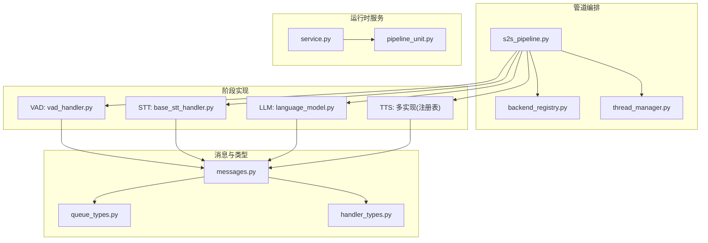
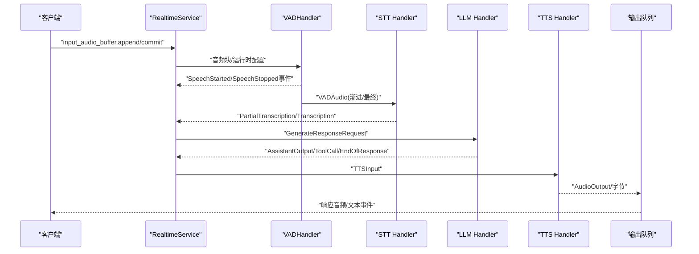
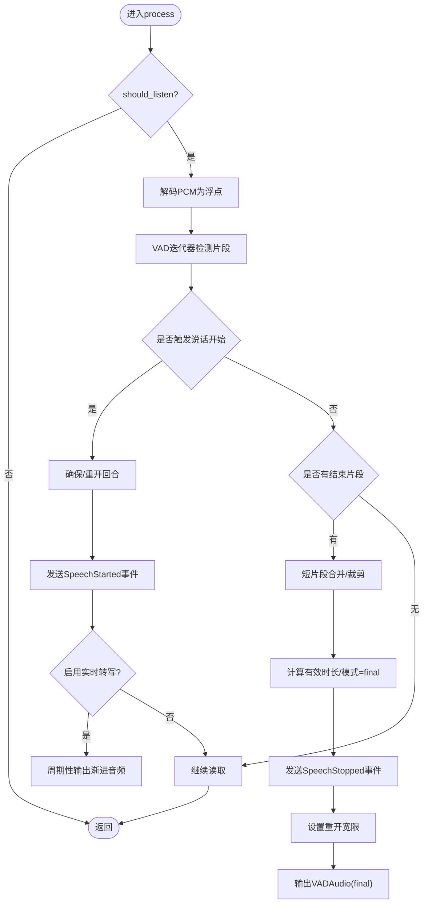
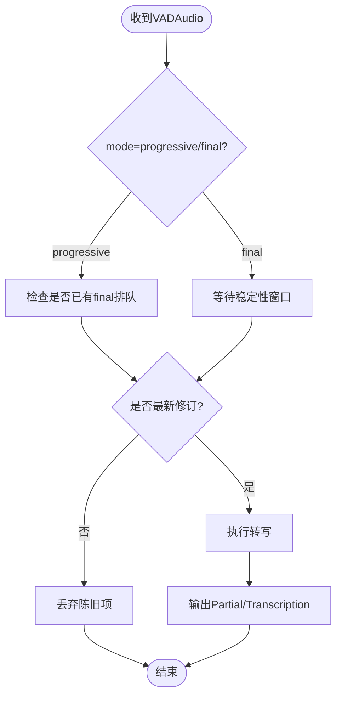
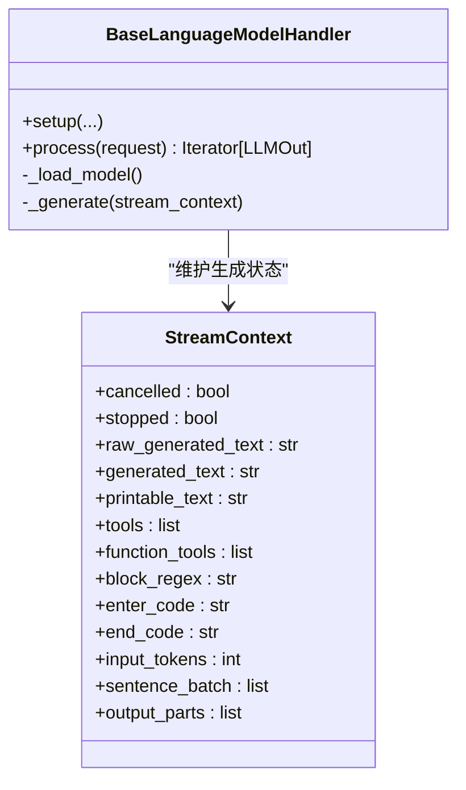
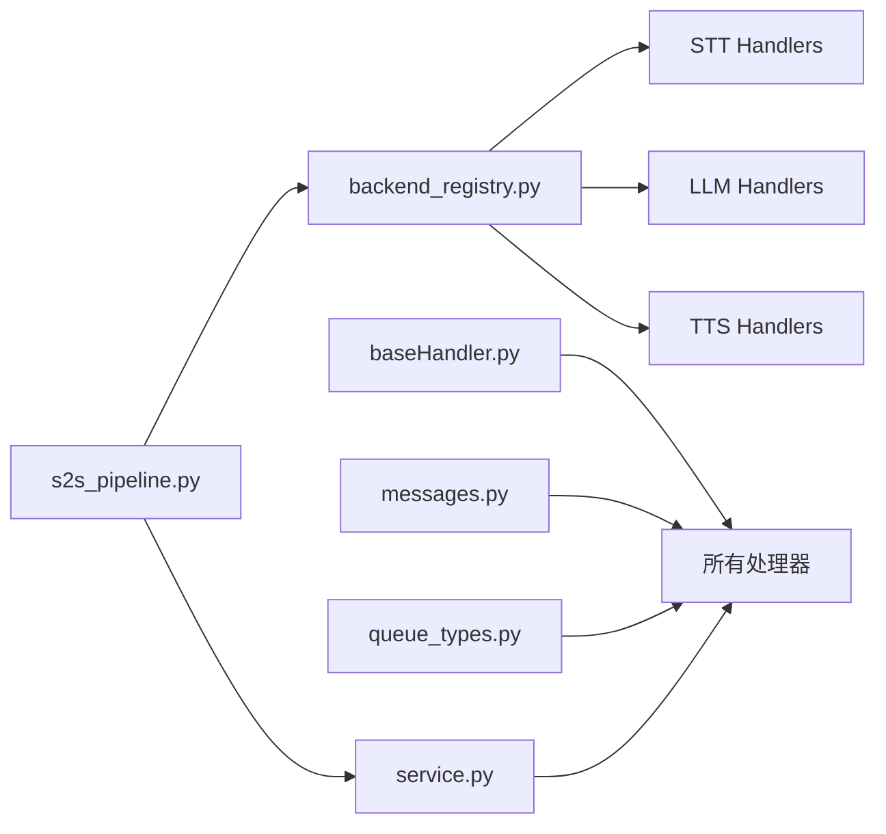

# 核心架构

<cite>
**本文引用的文件**
- [s2s_pipeline.py](file://src/speech_to_speech/s2s_pipeline.py)
- [backend_registry.py](file://src/speech_to_speech/backend_registry.py)
- [baseHandler.py](file://src/speech_to_speech/baseHandler.py)
- [vad_handler.py](file://src/speech_to_speech/VAD/vad_handler.py)
- [base_stt_handler.py](file://src/speech_to_speech/STT/base_stt_handler.py)
- [queue_types.py](file://src/speech_to_speech/pipeline/queue_types.py)
- [messages.py](file://src/speech_to_speech/pipeline/messages.py)
- [handler_types.py](file://src/speech_to_speech/pipeline/handler_types.py)
- [thread_manager.py](file://src/speech_to_speech/utils/thread_manager.py)
- [service.py](file://src/speech_to_speech/api/openai_realtime/service.py)
- [pipeline_unit.py](file://src/speech_to_speech/api/openai_realtime/pipeline_unit.py)
- [language_model.py](file://src/speech_to_speech/LLM/language_model.py)
</cite>

## 目录
1. [简介](#简介)
2. [项目结构](#项目结构)
3. [核心组件](#核心组件)
4. [架构总览](#架构总览)
5. [详细组件分析](#详细组件分析)
6. [依赖关系分析](#依赖关系分析)
7. [性能考量](#性能考量)
8. [故障排查指南](#故障排查指南)
9. [结论](#结论)
10. [附录](#附录)

## 简介
本架构文档面向语音到语音（Speech-to-Speech）实时处理管道，系统性说明 VAD→STT→LLM→TTS 四个阶段的职责、数据流向与状态管理；解释后端注册表如何实现可插拔扩展；阐述多线程模型、任务调度、错误处理、资源分配策略；并提供架构图与时序图，帮助读者理解关键业务流程与扩展点。

## 项目结构
仓库采用分层模块化组织：
- 入口与编排：s2s_pipeline.py 负责参数解析、管线构建、线程管理与生命周期控制
- 后端注册表：backend_registry.py 集中定义 STT/LLM/TTS 后端规格、工厂与能力声明
- 基础处理器：baseHandler.py 提供统一的队列驱动、事件处理、错误与计时基类
- 阶段实现：
  - VAD：vad_handler.py 实现语音活动检测、片段合并、智能回合与渐进式输出
  - STT：base_stt_handler.py 提供转写结果过滤、陈旧项丢弃等通用逻辑
  - LLM：language_model.py 封装本地/远程语言模型流式生成与工具调用
  - TTS：各具体处理器通过注册表接入
- 管道消息与类型：messages.py、queue_types.py、handler_types.py 统一跨阶段通信协议
- 运行时服务：service.py 将 OpenAI Realtime 协议事件映射为内部消息，维护会话状态
- 单元与线程：pipeline_unit.py 定义隔离的 PipelineUnit；thread_manager.py 管理线程启动/停止

图表来源
- [s2s_pipeline.py:354-587](file://src/speech_to_speech/s2s_pipeline.py#L354-L587)
- [backend_registry.py:309-543](file://src/speech_to_speech/backend_registry.py#L309-L543)
- [thread_manager.py:9-40](file://src/speech_to_speech/utils/thread_manager.py#L9-L40)
- [vad_handler.py:53-150](file://src/speech_to_speech/VAD/vad_handler.py#L53-L150)
- [base_stt_handler.py:16-61](file://src/speech_to_speech/STT/base_stt_handler.py#L16-L61)
- [language_model.py:165-200](file://src/speech_to_speech/LLM/language_model.py#L165-L200)
- [messages.py:46-225](file://src/speech_to_speech/pipeline/messages.py#L46-L225)
- [queue_types.py:20-47](file://src/speech_to_speech/pipeline/queue_types.py#L20-L47)
- [handler_types.py:31-46](file://src/speech_to_speech/pipeline/handler_types.py#L31-L46)
- [service.py:287-327](file://src/speech_to_speech/api/openai_realtime/service.py#L287-L327)
- [pipeline_unit.py:53-77](file://src/speech_to_speech/api/openai_realtime/pipeline_unit.py#L53-L77)

章节来源
- [s2s_pipeline.py:175-285](file://src/speech_to_speech/s2s_pipeline.py#L175-L285)
- [backend_registry.py:48-122](file://src/speech_to_speech/backend_registry.py#L48-L122)
- [baseHandler.py:25-186](file://src/speech_to_speech/baseHandler.py#L25-L186)
- [vad_handler.py:53-150](file://src/speech_to_speech/VAD/vad_handler.py#L53-L150)
- [base_stt_handler.py:16-61](file://src/speech_to_speech/STT/base_stt_handler.py#L16-L61)
- [messages.py:46-225](file://src/speech_to_speech/pipeline/messages.py#L46-L225)
- [queue_types.py:20-47](file://src/speech_to_speech/pipeline/queue_types.py#L20-L47)
- [handler_types.py:31-46](file://src/speech_to_speech/pipeline/handler_types.py#L31-L46)
- [thread_manager.py:9-40](file://src/speech_to_speech/utils/thread_manager.py#L9-L40)
- [service.py:287-327](file://src/speech_to_speech/api/openai_realtime/service.py#L287-L327)
- [pipeline_unit.py:53-77](file://src/speech_to_speech/api/openai_realtime/pipeline_unit.py#L53-L77)

## 核心组件
- 管道编排器：负责参数解析、后端选择、管线构建、线程池管理、优雅关闭
- 后端注册表：集中管理 STT/LLM/TTS 后端规格、配置归一化、工厂创建与可选依赖提示
- 基础处理器：统一输入/输出队列循环、控制消息、会话结束、异常记录、计时统计
- VAD：语音活动检测、片段合并、渐进式输出、智能回合判定、重开窗口
- STT：转写结果过滤、陈旧项丢弃、最终版本稳定等待
- LLM：流式文本/工具调用生成、上下文压缩、取消与预取事务
- TTS：文本到语音合成，支持多种后端
- 运行时服务：OpenAI Realtime 协议事件到内部消息的转换与会话状态管理
- 管道单元：每个连接或会话拥有独立的队列、事件与服务实例

章节来源
- [s2s_pipeline.py:354-587](file://src/speech_to_speech/s2s_pipeline.py#L354-L587)
- [backend_registry.py:153-196](file://src/speech_to_speech/backend_registry.py#L153-L196)
- [baseHandler.py:25-186](file://src/speech_to_speech/baseHandler.py#L25-L186)
- [vad_handler.py:53-150](file://src/speech_to_speech/VAD/vad_handler.py#L53-L150)
- [base_stt_handler.py:16-61](file://src/speech_to_speech/STT/base_stt_handler.py#L16-L61)
- [language_model.py:165-200](file://src/speech_to_speech/LLM/language_model.py#L165-L200)
- [service.py:287-327](file://src/speech_to_speech/api/openai_realtime/service.py#L287-L327)
- [pipeline_unit.py:53-77](file://src/speech_to_speech/api/openai_realtime/pipeline_unit.py#L53-L77)

## 架构总览
整体流程遵循“音频输入 → VAD 分段 → STT 转写 → LLM 生成 → TTS 合成 → 音频输出”的流水线。每个阶段以独立线程运行，通过队列进行解耦通信；运行时服务在连接层将协议事件转换为内部消息并触发后续阶段。

图表来源
- [service.py:411-447](file://src/speech_to_speech/api/openai_realtime/service.py#L411-L447)
- [vad_handler.py:548-787](file://src/speech_to_speech/VAD/vad_handler.py#L548-L787)
- [base_stt_handler.py:24-61](file://src/speech_to_speech/STT/base_stt_handler.py#L24-L61)
- [messages.py:62-225](file://src/speech_to_speech/pipeline/messages.py#L62-L225)
- [s2s_pipeline.py:354-458](file://src/speech_to_speech/s2s_pipeline.py#L354-L458)

## 详细组件分析

### VAD（语音活动检测）
- 职责：从连续音频中检测说话起止，产出渐进式与最终片段；支持短片段合并、智能回合判定、重开窗口与音频增强
- 数据流：接收 PCM 字节或带运行时配置的元组；输出 VADAudio（含 turn_id/turn_revision/mode）
- 关键点：
  - 渐进式释放：在说话期间周期性输出累积音频，降低首包延迟
  - 智能回合：根据语义完整性预测调整重开窗口与处理延迟
  - 重开机制：在未提交回复前允许用户继续说话，避免打断未完成的助手输出
  - 日志节流：每秒汇总统计，避免高频日志影响性能

图表来源
- [vad_handler.py:548-787](file://src/speech_to_speech/VAD/vad_handler.py#L548-L787)

章节来源
- [vad_handler.py:53-150](file://src/speech_to_speech/VAD/vad_handler.py#L53-L150)
- [vad_handler.py:548-787](file://src/speech_to_speech/VAD/vad_handler.py#L548-L787)

### STT（语音转文本）
- 职责：将 VADAudio 转为 PartialTranscription/Transcription；过滤陈旧项与已完成最终版本后的多余工作
- 数据流：输入 VADAudio；输出 PartialTranscription/Transcription/TranscriptionFailure
- 关键点：
  - 陈旧输入丢弃：基于 SpeculativeTurnTracker 判断是否为最新修订
  - 最终版本稳定等待：对 final 模式增加稳定性窗口，避免过早提交
  - 队列清理：直接扫描输入队列，丢弃过时项，减少下游压力

图表来源
- [base_stt_handler.py:24-61](file://src/speech_to_speech/STT/base_stt_handler.py#L24-L61)
- [base_stt_handler.py:77-128](file://src/speech_to_speech/STT/base_stt_handler.py#L77-L128)

章节来源
- [base_stt_handler.py:16-61](file://src/speech_to_speech/STT/base_stt_handler.py#L16-L61)
- [base_stt_handler.py:77-128](file://src/speech_to_speech/STT/base_stt_handler.py#L77-L128)

### LLM（语言模型）
- 职责：接收 GenerateResponseRequest，流式生成文本与工具调用，输出 LLMResponseChunk/TokenUsage/EndOfResponse
- 数据流：输入 GenerateResponseRequest；输出 LLMResponseChunk/TokenUsage/EndOfResponse
- 关键点：
  - 流式分片：按句子批处理输出，提升交互流畅度
  - 工具调用：提取函数调用并顺序化输出
  - 上下文压缩：历史压缩以减少输入长度
  - 取消与预取：支持外部取消与预取事务，避免无效工作

图表来源
- [language_model.py:131-158](file://src/speech_to_speech/LLM/language_model.py#L131-L158)
- [language_model.py:165-200](file://src/speech_to_speech/LLM/language_model.py#L165-L200)

章节来源
- [language_model.py:165-200](file://src/speech_to_speech/LLM/language_model.py#L165-L200)

### TTS（文本转语音）
- 职责：将 TTSInput 转换为音频字节或数组，支持多种后端（如 qwen3、pocket、kokoro、omnivoice、openai 等）
- 数据流：输入 TTSInput/EndOfResponse；输出 bytes/np.ndarray/AudioOutput
- 关键点：
  - 通过注册表动态加载具体处理器
  - 支持 should_listen 控制播放时机
  - 与响应键关联，便于取消与清理

章节来源
- [backend_registry.py:443-543](file://src/speech_to_speech/backend_registry.py#L443-L543)
- [messages.py:201-225](file://src/speech_to_speech/pipeline/messages.py#L201-L225)

### 运行时服务与会话管理
- 职责：将 OpenAI Realtime 协议事件转换为内部消息，维护每连接状态，协调 VAD/STT/LLM/TTS 的事件路由
- 关键点：
  - 会话注册/注销：创建 ConnState，聚合使用指标
  - 事件分发：SpeechStarted/Stopped、转写完成/失败、响应生成完成等
  - 响应生命周期：begin_audio_response/finish_response，保证有序输出
  - 推测性回合：跟踪用户与助手的推测性修订，避免乱序与重复

章节来源
- [service.py:287-327](file://src/speech_to_speech/api/openai_realtime/service.py#L287-L327)
- [service.py:411-447](file://src/speech_to_speech/api/openai_realtime/service.py#L411-L447)
- [service.py:629-727](file://src/speech_to_speech/api/openai_realtime/service.py#L629-L727)

### 管道构建与线程管理
- 构建过程：
  - 解析参数与后端选择
  - 为每个 PipelineUnit 创建独立队列、事件与服务
  - 组装处理器链：VAD → STT(可选 TranscriptionNotifier) → LLM → LMOutputProcessor → TTS
  - 通过 ThreadManager 启动所有处理器线程
- 线程池管理：
  - 每个处理器一个线程，daemon=False 确保关闭时等待
  - stop_event 信号通知所有处理器退出
  - 优雅关闭：捕获 SIGINT/SIGTERM，调用 pipeline_manager.stop()

章节来源
- [s2s_pipeline.py:354-587](file://src/speech_to_speech/s2s_pipeline.py#L354-L587)
- [s2s_pipeline.py:628-683](file://src/speech_to_speech/s2s_pipeline.py#L628-L683)
- [thread_manager.py:9-40](file://src/speech_to_speech/utils/thread_manager.py#L9-L40)

## 依赖关系分析
- 模块耦合：
  - s2s_pipeline.py 依赖 backend_registry.py 进行后端选择与实例化
  - 各阶段处理器继承 baseHandler.py，统一队列与生命周期
  - messages.py 与 queue_types.py 定义跨阶段通信协议，强约束数据类型
  - service.py 作为协议桥接，依赖 handler_types.py 与 messages.py
- 外部依赖：
  - STT/LLM/TTS 的具体实现按需导入，缺失时给出安装提示
  - MLX/Transformers/OpenAI SDK 等库按需加载

图表来源
- [backend_registry.py:309-543](file://src/speech_to_speech/backend_registry.py#L309-L543)
- [baseHandler.py:25-186](file://src/speech_to_speech/baseHandler.py#L25-L186)
- [messages.py:46-225](file://src/speech_to_speech/pipeline/messages.py#L46-L225)
- [queue_types.py:20-47](file://src/speech_to_speech/pipeline/queue_types.py#L20-L47)
- [service.py:287-327](file://src/speech_to_speech/api/openai_realtime/service.py#L287-L327)
- [s2s_pipeline.py:354-587](file://src/speech_to_speech/s2s_pipeline.py#L354-L587)

章节来源
- [backend_registry.py:153-196](file://src/speech_to_speech/backend_registry.py#L153-L196)
- [baseHandler.py:25-186](file://src/speech_to_speech/baseHandler.py#L25-L186)
- [messages.py:46-225](file://src/speech_to_speech/pipeline/messages.py#L46-L225)
- [queue_types.py:20-47](file://src/speech_to_speech/pipeline/queue_types.py#L20-L47)
- [service.py:287-327](file://src/speech_to_speech/api/openai_realtime/service.py#L287-L327)
- [s2s_pipeline.py:354-587](file://src/speech_to_speech/s2s_pipeline.py#L354-L587)

## 性能考量
- 渐进式输出：VAD 在说话期间周期性输出累积音频，降低首包延迟
- 陈旧项丢弃：STT 与 VAD 主动清理队列中的过时项，减少无用计算
- 稳定性窗口：STT 对 final 模式增加等待时间，提高最终结果一致性
- 日志节流：VAD 每秒汇总统计，避免高频日志影响吞吐
- 设备与并发：macOS 上 MLX 全局锁导致多管线下禁用实时转写，避免竞争
- 编译缓存：设置 TorchInductor 缓存目录，减少编译时间

章节来源
- [vad_handler.py:617-619](file://src/speech_to_speech/VAD/vad_handler.py#L617-L619)
- [base_stt_handler.py:77-128](file://src/speech_to_speech/STT/base_stt_handler.py#L77-L128)
- [s2s_pipeline.py:643-654](file://src/speech_to_speech/s2s_pipeline.py#L643-L654)
- [s2s_pipeline.py:68-72](file://src/speech_to_speech/s2s_pipeline.py#L68-L72)

## 故障排查指南
- 常见错误：
  - 缺少可选依赖：注册表会提示安装命令
  - macOS CUDA 不兼容：需切换至 cpu/mps
  - 多管线 MLX 竞争：自动禁用实时转写
  - 响应失败：服务层记录错误并关闭响应
- 调试建议：
  - 开启 debug 日志观察各阶段耗时
  - 关注陈旧项丢弃日志定位乱序问题
  - 使用 /v1/pool 查看卡住的单元

章节来源
- [backend_registry.py:175-196](file://src/speech_to_speech/backend_registry.py#L175-L196)
- [s2s_pipeline.py:309-337](file://src/speech_to_speech/s2s_pipeline.py#L309-L337)
- [s2s_pipeline.py:643-654](file://src/speech_to_speech/s2s_pipeline.py#L643-L654)
- [service.py:772-800](file://src/speech_to_speech/api/openai_realtime/service.py#L772-L800)

## 结论
该语音到语音管道通过清晰的阶段划分、统一的消息协议与可插拔的后端注册表，实现了高内聚、低耦合的实时处理能力。VAD 的智能回合与渐进式输出、STT 的陈旧项过滤、LLM 的流式生成与工具调用、TTS 的多后端支持共同构成完整的端到端链路。线程化的处理器与队列驱动确保了可扩展性与鲁棒性，配合运行时服务的协议适配，满足复杂交互场景的需求。

## 附录

### 组件间通信协议与数据格式
- VAD → STT：VADAudio（包含音频、模式、回合标识、处理延迟）
- STT → LLM：PartialTranscription/Transcription/TranscriptionFailure（文本、语言、回合信息）
- LLM → TTS：TTSInput（文本、语言、回合信息、响应键、预取事务）
- TTS → 输出：AudioOutput/bytes/np.ndarray（音频数据、响应键、清理标志）
- 控制与哨兵：PIPELINE_END、AUDIO_RESPONSE_DONE

章节来源
- [messages.py:46-225](file://src/speech_to_speech/pipeline/messages.py#L46-L225)
- [messages.py:359-367](file://src/speech_to_speech/pipeline/messages.py#L359-L367)
- [queue_types.py:20-47](file://src/speech_to_speech/pipeline/queue_types.py#L20-L47)
- [handler_types.py:31-46](file://src/speech_to_speech/pipeline/handler_types.py#L31-L46)

### 扩展点设计与自定义开发指南
- 新增后端：
  - 在 backend_registry.py 中添加 BackendSpec，指定名称、类型、配置类、工厂函数与能力
  - 实现处理器类，继承 BaseHandler，实现 process 方法
  - 如需特殊上下文注入，使用 _simple_handler_factory 或自定义工厂
- 自定义阶段：
  - 基于 BaseHandler 实现新阶段，定义输入/输出类型
  - 在 s2s_pipeline.py 的 _build_handlers 中插入到处理器链
- 协议扩展：
  - 在 messages.py 中定义新的 PipelineMessage 子类
  - 在 service.py 中注册事件处理逻辑

章节来源
- [backend_registry.py:48-122](file://src/speech_to_speech/backend_registry.py#L48-L122)
- [backend_registry.py:153-196](file://src/speech_to_speech/backend_registry.py#L153-L196)
- [backend_registry.py:309-543](file://src/speech_to_speech/backend_registry.py#L309-L543)
- [baseHandler.py:25-186](file://src/speech_to_speech/baseHandler.py#L25-L186)
- [s2s_pipeline.py:354-458](file://src/speech_to_speech/s2s_pipeline.py#L354-L458)
- [messages.py:31-225](file://src/speech_to_speech/pipeline/messages.py#L31-L225)
- [service.py:316-327](file://src/speech_to_speech/api/openai_realtime/service.py#L316-L327)