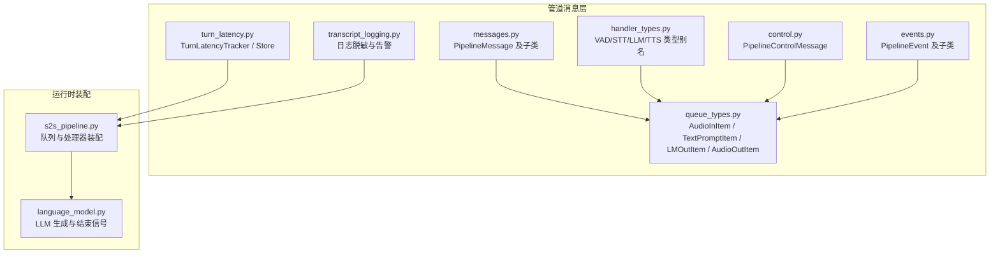
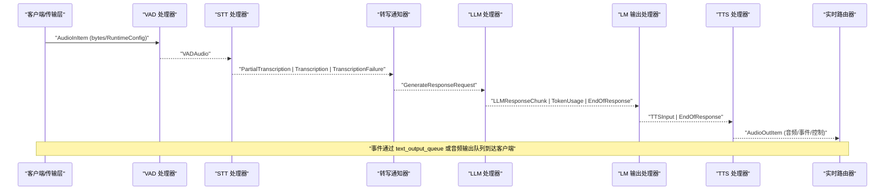
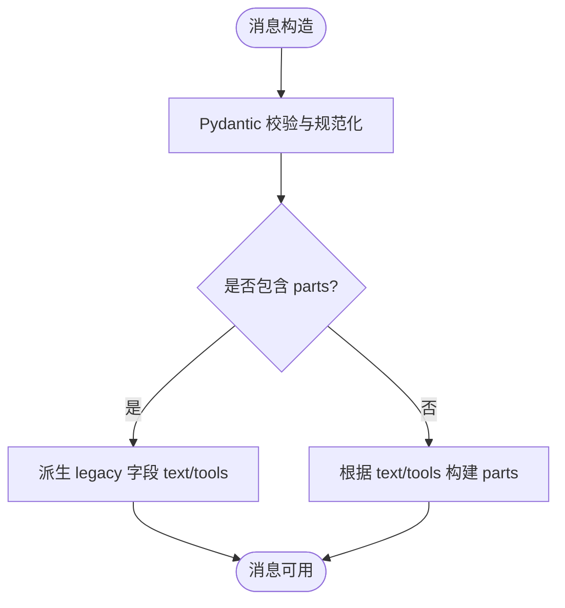
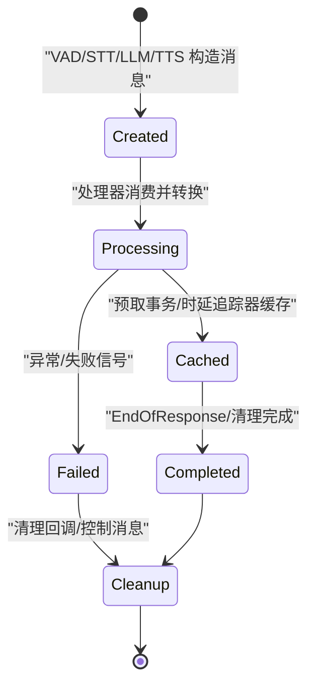
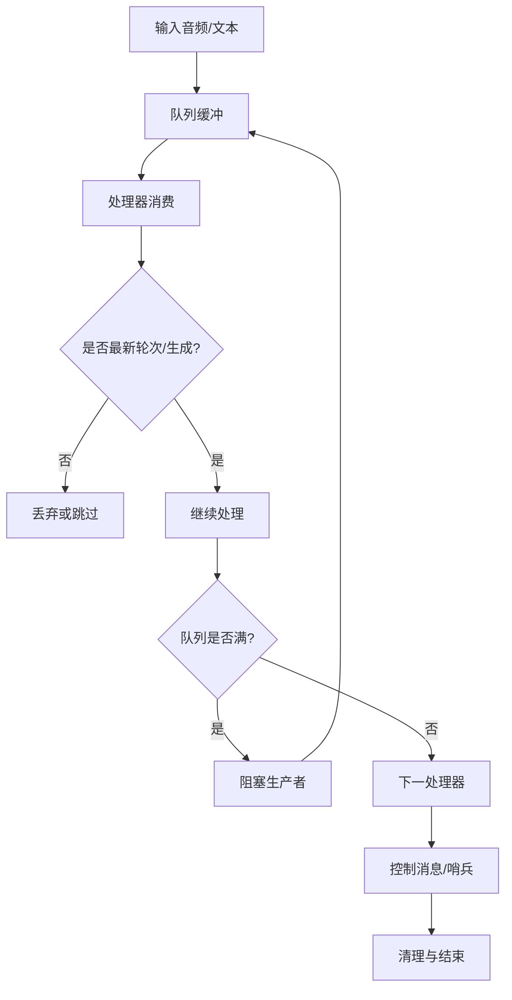
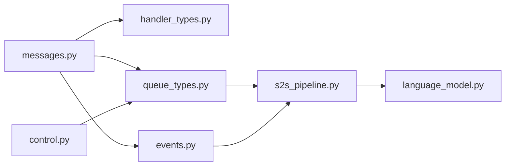

# 消息流设计

<cite>
**本文引用的文件**   
- [messages.py](file://src/speech_to_speech/pipeline/messages.py)
- [handler_types.py](file://src/speech_to_speech/pipeline/handler_types.py)
- [queue_types.py](file://src/speech_to_speech/pipeline/queue_types.py)
- [control.py](file://src/speech_to_speech/pipeline/control.py)
- [events.py](file://src/speech_to_speech/pipeline/events.py)
- [transcript_logging.py](file://src/speech_to_speech/pipeline/transcript_logging.py)
- [turn_latency.py](file://src/speech_to_speech/pipeline/turn_latency.py)
- [s2s_pipeline.py](file://src/speech_to_speech/s2s_pipeline.py)
- [language_model.py](file://src/speech_to_speech/LLM/language_model.py)
</cite>

## 目录
1. [引言](#引言)
2. [项目结构](#项目结构)
3. [核心组件](#核心组件)
4. [架构总览](#架构总览)
5. [详细组件分析](#详细组件分析)
6. [依赖关系分析](#依赖关系分析)
7. [性能与可观测性](#性能与可观测性)
8. [故障排查指南](#故障排查指南)
9. [结论](#结论)
10. [附录：扩展指南](#附录扩展指南)

## 引言
本文件面向开发者，系统化梳理语音到语音（Speech-to-Speech）管道中的“消息流”设计。重点包括：
- 各类消息的数据结构与职责边界
- 消息在 VAD → STT → LLM → TTS 各阶段间的转换、序列化与格式适配
- 消息生命周期管理：创建、处理、缓存、清理
- 优先级、背压与流量控制机制
- 监控、调试与性能分析方法
- 自定义消息类型与处理器的开发指南

## 项目结构
与消息流直接相关的代码集中在 `pipeline` 子包中，辅以运行时装配逻辑和语言模型实现：
- `pipeline/messages.py`：所有跨组件消息的权威定义
- `pipeline/handler_types.py`：处理器输入输出类型的别名
- `pipeline/queue_types.py`：队列项的类型别名，统一内部控制消息、事件与业务消息
- `pipeline/control.py`：强类型控制消息
- `pipeline/events.py`：面向实时路由器的协议中性事件
- `pipeline/transcript_logging.py`：对话内容日志开关与脱敏
- `pipeline/turn_latency.py`：端到端时延追踪与统计
- `s2s_pipeline.py`：管道构建、队列连接与处理器装配
- `LLM/language_model.py`：LLM 生成流程、取消与结束信号、Token 使用上报

**图表来源**
- [messages.py:34-416](file://src/speech_to_speech/pipeline/messages.py#L34-L416)
- [queue_types.py:20-47](file://src/speech_to_speech/pipeline/queue_types.py#L20-L47)
- [handler_types.py:31-46](file://src/speech_to_speech/pipeline/handler_types.py#L31-L46)
- [control.py:7-27](file://src/speech_to_speech/pipeline/control.py#L7-L27)
- [events.py:26-228](file://src/speech_to_speech/pipeline/events.py#L26-L228)
- [turn_latency.py:75-421](file://src/speech_to_speech/pipeline/turn_latency.py#L75-L421)
- [transcript_logging.py:25-81](file://src/speech_to_speech/pipeline/transcript_logging.py#L25-L81)
- [s2s_pipeline.py:463-553](file://src/speech_to_speech/s2s_pipeline.py#L463-L553)
- [language_model.py:560-760](file://src/speech_to_speech/LLM/language_model.py#L560-L760)

**章节来源**
- [messages.py:34-416](file://src/speech_to_speech/pipeline/messages.py#L34-L416)
- [queue_types.py:20-47](file://src/speech_to_speech/pipeline/queue_types.py#L20-L47)
- [handler_types.py:31-46](file://src/speech_to_speech/pipeline/handler_types.py#L31-L46)
- [control.py:7-27](file://src/speech_to_speech/pipeline/control.py#L7-L27)
- [events.py:26-228](file://src/speech_to_speech/pipeline/events.py#L26-L228)
- [turn_latency.py:75-421](file://src/speech_to_speech/pipeline/turn_latency.py#L75-L421)
- [transcript_logging.py:25-81](file://src/speech_to_speech/pipeline/transcript_logging.py#L25-L81)
- [s2s_pipeline.py:463-553](file://src/speech_to_speech/s2s_pipeline.py#L463-L553)
- [language_model.py:560-760](file://src/speech_to_speech/LLM/language_model.py#L560-L760)

## 核心组件
本节聚焦消息体系的核心抽象与类型别名，解释它们在管道中的作用。

- PipelineMessage 是所有消息的基类，提供统一的 `tag` 字段作为 Pydantic 判别器，便于从原始字典反序列化为具体消息类型。
- handler_types.py 为 VAD、STT、LLM、TTS 四个阶段的输入输出定义了清晰类型别名，屏蔽了底层 Union 的复杂性。
- queue_types.py 将业务消息与控制消息、事件进行组合，形成稳定的队列项类型别名，如 `AudioInItem`、`TextPromptItem`、`LMOutItem`、`AudioOutItem`。
- control.py 提供强类型控制消息 `PipelineControlMessage`，用于会话结束等控制信号。
- events.py 定义面向实时路由器的协议中性事件，如语音开始/停止、转写完成、助手文本、工具调用就绪、Token 用量、响应完成等。
- messages.py 还包含响应预取事务 `ResponsePrefetchTransaction`，用于协调推测式请求的生命周期与清理。

```mermaid
classDiagram
class PipelineMessage {
+string tag
}
class VADAudio {
+ndarray audio
+SpeakerAttribution speaker_attribution
+RuntimeConfig runtime_config
+string mode
+string turn_id
+int turn_revision
+float processing_delay_s
+float created_at_s
+float speech_end_at_s
}
class PartialTranscription {
+string text
+string turn_id
+int turn_revision
}
class Transcription {
+string text
+SpeakerAttribution speaker_attribution
+string language_code
+string turn_id
+int turn_revision
+float speech_stopped_at_s
}
class TranscriptionFailure {
+string message
+string turn_id
+int turn_revision
+float speech_stopped_at_s
}
class LLMResponseChunk {
+list parts
+string text
+string language_code
+RuntimeConfig runtime_config
+RealtimeResponseCreateParams response
+string turn_id
+int turn_revision
+float speech_stopped_at_s
+int cancel_generation
+string response_key
+Any prefetch_transaction
}
class TokenUsage {
+int input_tokens
+int output_tokens
+string turn_id
+int turn_revision
+int cancel_generation
+string response_key
}
class EndOfResponse {
+string turn_id
+int turn_revision
+int cancel_generation
+string response_key
+string error
+string status
+string reason
+bool cleanup_only
+list input_tool_call_ids
}
class TTSInput {
+string text
+string language_code
+string selected_language
+string tts_language_code
+string response_assistant_language_code
+RuntimeConfig runtime_config
+RealtimeResponseCreateParams response
+string turn_id
+int turn_revision
+float speech_stopped_at_s
+int cancel_generation
+string response_key
+Any prefetch_transaction
}
class AudioOutput {
+bytes|ndarray audio
+list visemes
+int cancel_generation
+string response_key
+bool cleanup_only
}
class GenerateResponseRequest {
+string response_key
+RuntimeConfig runtime_config
+string selected_language
+RealtimeResponseCreateParams response
+ndarray audio
+int audio_sample_rate
+string input_item_id
+string language_code
+string turn_id
+int turn_revision
+float speech_stopped_at_s
+ResponsePrefetchTransaction prefetch_transaction
}
class ResponsePrefetchTransaction {
+register_abort(abort)
+wait_until_resolved(timeout) bool
+complete(cleanup)
+claim() bool
+discard()
}
PipelineMessage <|-- VADAudio
PipelineMessage <|-- PartialTranscription
PipelineMessage <|-- Transcription
PipelineMessage <|-- TranscriptionFailure
PipelineMessage <|-- LLMResponseChunk
PipelineMessage <|-- TokenUsage
PipelineMessage <|-- EndOfResponse
PipelineMessage <|-- TTSInput
PipelineMessage <|-- AudioOutput
PipelineMessage <|-- GenerateResponseRequest
```

**图表来源**
- [messages.py:34-416](file://src/speech_to_speech/pipeline/messages.py#L34-L416)

**章节来源**
- [messages.py:34-416](file://src/speech_to_speech/pipeline/messages.py#L34-L416)
- [handler_types.py:31-46](file://src/speech_to_speech/pipeline/handler_types.py#L31-L46)
- [queue_types.py:20-47](file://src/speech_to_speech/pipeline/queue_types.py#L20-L47)
- [control.py:7-27](file://src/speech_to_speech/pipeline/control.py#L7-L27)
- [events.py:26-228](file://src/speech_to_speech/pipeline/events.py#L26-L228)

## 架构总览
下图展示了消息在管道中的流转路径，以及控制消息与事件的穿插位置。

**图表来源**
- [s2s_pipeline.py:463-553](file://src/speech_to_speech/s2s_pipeline.py#L463-L553)
- [queue_types.py:20-47](file://src/speech_to_speech/pipeline/queue_types.py#L20-L47)
- [events.py:26-228](file://src/speech_to_speech/pipeline/events.py#L26-L228)
- [messages.py:34-416](file://src/speech_to_speech/pipeline/messages.py#L34-L416)

**章节来源**
- [s2s_pipeline.py:463-553](file://src/speech_to_speech/s2s_pipeline.py#L463-L553)
- [queue_types.py:20-47](file://src/speech_to_speech/pipeline/queue_types.py#L20-L47)
- [events.py:26-228](file://src/speech_to_speech/pipeline/events.py#L26-L228)
- [messages.py:34-416](file://src/speech_to_speech/pipeline/messages.py#L34-L416)

## 详细组件分析

### 消息类型与数据结构
- VADAudio：携带音频片段、说话人归属、运行时配置、模式、轮次标识、时间戳等，是 VAD 到 STT 的主要数据载体。
- PartialTranscription：实时部分转写结果，仅由转写通知器消费，不转发给 LLM。
- Transcription：最终转写结果，包含说话人归属、语言代码、轮次与语音停止时间。
- TranscriptionFailure：转写失败信号，携带错误信息与上下文。
- LLMResponseChunk：LLM 输出的有序片段，支持文本与工具调用的交错；同时保留 legacy 兼容字段 `text` 与 `tools`，并通过验证器保证一致性。
- TokenUsage：侧信道 Token 用量报告，不进入 TTS。
- EndOfResponse：响应结束哨兵，支持错误、状态、原因、清理标志、输入工具调用 ID 等。
- TTSInput：待合成文本及其上下文，包含语言选择、TTS 语言码、响应快照、轮次与取消标记等。
- AudioOutput：带响应键与可视音素信息的音频输出项。
- GenerateResponseRequest：触发 LLM 生成的请求，封装会话配置、响应覆盖、音频输入、采样率、稳定聊天标识、语言、轮次、预取事务等。
- ResponsePrefetchTransaction：协调推测式请求的清理与放弃，确保历史写入仅在预取被认领后提交。

**图表来源**
- [messages.py:123-176](file://src/speech_to_speech/pipeline/messages.py#L123-L176)

**章节来源**
- [messages.py:34-416](file://src/speech_to_speech/pipeline/messages.py#L34-L416)

### 队列项与类型别名
- `AudioInItem`：接收自传输层的音频块，可能附带运行时配置，也可能混入控制消息。
- `VADOutItem`：VAD 输出，可能是业务消息或内部控制消息。
- `STTOutItem`：STT 输出，可能包含部分转写、最终转写、失败信号或控制消息。
- `TextPromptItem`：进入 LLM 的文本提示，通常是 `GenerateResponseRequest` 或控制消息。
- `LMOutItem`：LLM 输出，可能是响应片段、Token 用量、响应结束或控制消息。
- `TTSInItem`：TTS 输入，可能是 `TTSInput`、`EndOfResponse`、事件或控制消息。
- `AudioOutItem`：最终输出到客户端的有序事件与音频，可能包含二进制音频、NumPy 数组、`AudioOutput`、事件或控制消息。
- `TextEventItem`：不等待 TTS 的 VAD 与转写事件。

这些别名集中了 Union 类型，使处理器声明更可读，并减少重复。

**章节来源**
- [queue_types.py:20-47](file://src/speech_to_speech/pipeline/queue_types.py#L20-L47)
- [handler_types.py:31-46](file://src/speech_to_speech/pipeline/handler_types.py#L31-L46)

### 控制消息与事件
- 控制消息 `PipelineControlMessage`：强类型枚举 `SESSION_END`，可用于会话结束等控制场景，支持可选的 session_id 以区分池化发送循环中的释放与回收。
- 事件 `PipelineEvent`：面向实时路由器的协议中性事件，包括语音开始/停止、部分转写、转写完成/失败、直接音频输入完成、助手文本、工具调用就绪、Token 用量、助手响应完成、响应生成完成、响应失败等。

事件通过 `text_output_queue` 或音频输出队列分发，由实时服务统一调度。

**章节来源**
- [control.py:7-27](file://src/speech_to_speech/pipeline/control.py#L7-L27)
- [events.py:26-228](file://src/speech_to_speech/pipeline/events.py#L26-L228)

### 消息生命周期管理
- 创建：
  - VAD 产出 `VADAudio`，携带时间戳与估计语音结束时间。
  - STT 产出 `PartialTranscription`、`Transcription`、`TranscriptionFailure`。
  - LLM 产出 `LLMResponseChunk`、`TokenUsage`、`EndOfResponse`。
  - TTS 产出 `AudioOutput`。
- 处理：
  - 转写通知器聚合部分转写，并将最终结果转换为 `GenerateResponseRequest` 送入 LLM。
  - LM 输出处理器将 LLM 输出转换为 TTS 输入，并维护有序输出与工具调用可见性。
- 缓存：
  - `ResponsePrefetchTransaction` 保存推测式请求的清理回调，直到标准响应认领后才提交历史变更。
  - `TurnLatencyStore` 按 `response_key` 缓存时延追踪器，并在会话结束时清理。
- 清理：
  - `EndOfResponse` 携带 `cleanup_only` 标志，允许仅执行清理而不产生用户可见输出。
  - 控制消息 `SESSION_END` 用于会话结束，驱动资源释放。
  - 日志模块默认关闭转录内容记录，避免敏感信息持久化。

**图表来源**
- [messages.py:272-374](file://src/speech_to_speech/pipeline/messages.py#L272-L374)
- [turn_latency.py:261-421](file://src/speech_to_speech/pipeline/turn_latency.py#L261-L421)
- [control.py:7-27](file://src/speech_to_speech/pipeline/control.py#L7-L27)
- [transcript_logging.py:25-81](file://src/speech_to_speech/pipeline/transcript_logging.py#L25-L81)

**章节来源**
- [messages.py:272-374](file://src/speech_to_speech/pipeline/messages.py#L272-L374)
- [turn_latency.py:261-421](file://src/speech_to_speech/pipeline/turn_latency.py#L261-L421)
- [control.py:7-27](file://src/speech_to_speech/pipeline/control.py#L7-L27)
- [transcript_logging.py:25-81](file://src/speech_to_speech/pipeline/transcript_logging.py#L25-L81)

### 序列化、反序列化与格式适配
- 所有消息基于 Pydantic BaseModel，支持从原始字典反序列化为强类型对象。
- `LLMResponseChunk` 与 `AssistantOutputEvent` 均提供 `_normalize_assistant_output_fields` 逻辑，确保 ordered parts 与 legacy 字段 `text`/`tools` 一致。
- `TTSInput` 在反序列化前自动解析 `selected_language` 与 `tts_language_code`，优先使用运行时配置。
- `GenerateResponseRequest` 在反序列化前自动填充 `selected_language`，若未显式提供则取自 `runtime_config.selected_language`。
- 二进制哨兵常量 `AUDIO_RESPONSE_DONE` 与 `PIPELINE_END` 用于音频/输出队列的终止信号。

**章节来源**
- [messages.py:123-176](file://src/speech_to_speech/pipeline/messages.py#L123-L176)
- [messages.py:240-256](file://src/speech_to_speech/pipeline/messages.py#L240-L256)
- [messages.py:402-409](file://src/speech_to_speech/pipeline/messages.py#L402-L409)
- [messages.py:414-416](file://src/speech_to_speech/pipeline/messages.py#L414-L416)

### 优先级、背压与流量控制
- 优先级：
  - 通过 `cancel_generation` 与 `turn_id`/`turn_revision` 标识最新轮次与生成序号，旧请求会被丢弃或跳过。
  - `ResponsePrefetchTransaction` 支持推测式请求的放弃与认领，确保只有有效请求提交历史。
- 背压：
  - 管道使用 Python `Queue` 连接各处理器，天然具备阻塞与缓冲能力。
  - 控制消息 `SESSION_END` 与二进制哨兵用于优雅退出与资源清理。
- 流量控制：
  - VAD 与 STT 之间可通过 `streaming_stt_sink` 与窗口参数调节实时转写频率。
  - 智能轮次（smart turn）通过 `TurnLatencyTracker.smart_turn_wait_s` 与相关字段记录等待与分析耗时，辅助调优。

**图表来源**
- [language_model.py:560-760](file://src/speech_to_speech/LLM/language_model.py#L560-L760)
- [messages.py:272-374](file://src/speech_to_speech/pipeline/messages.py#L272-L374)
- [control.py:7-27](file://src/speech_to_speech/pipeline/control.py#L7-L27)

**章节来源**
- [language_model.py:560-760](file://src/speech_to_speech/LLM/language_model.py#L560-L760)
- [messages.py:272-374](file://src/speech_to_speech/pipeline/messages.py#L272-L374)
- [control.py:7-27](file://src/speech_to_speech/pipeline/control.py#L7-L27)

### 监控、调试与性能分析
- 转录日志：
  - 默认关闭完整转录内容记录，避免生产环境泄露敏感信息。
  - 可通过模块级开关启用，并在首次启用时发出警告。
  - 异常日志默认隐藏详情，仅在开启转录日志时打印完整异常。
- 时延追踪：
  - `TurnLatencyTracker` 记录 STT、LLM TTFT、LLM 总时长、TTS 首音频时间、端到端时延、VAD 静默等待、智能轮次等待等指标。
  - `TurnLatencyStore` 按 `response_key` 管理追踪器，支持会话清理与 pending 合并。
  - 提供格式化日志行与元数据负载，便于外部系统采集。
- 运行时装配：
  - `s2s_pipeline.py` 组装 VAD、STT、LLM、TTS 处理器与队列，并注入 `speculative_turns`、`cancel_scope`、`turn_latency_store` 等上下文。

**章节来源**
- [transcript_logging.py:25-81](file://src/speech_to_speech/pipeline/transcript_logging.py#L25-L81)
- [turn_latency.py:75-421](file://src/speech_to_speech/pipeline/turn_latency.py#L75-L421)
- [s2s_pipeline.py:463-553](file://src/speech_to_speech/s2s_pipeline.py#L463-L553)

## 依赖关系分析
- `messages.py` 是消息体系的权威来源，被 `handler_types.py`、`queue_types.py`、`events.py` 引用。
- `queue_types.py` 汇总队列项类型，供管道装配与处理器使用。
- `control.py` 提供控制消息，被 `queue_types.py` 与管道装配逻辑引用。
- `events.py` 定义事件，被实时路由器与处理器消费。
- `s2s_pipeline.py` 装配处理器与队列，注入 `speculative_turns`、`cancel_scope`、`turn_latency_store`。
- `language_model.py` 实现 LLM 生成流程，产出 `LLMResponseChunk`、`TokenUsage`、`EndOfResponse`，并处理取消与结束。

**图表来源**
- [messages.py:34-416](file://src/speech_to_speech/pipeline/messages.py#L34-L416)
- [handler_types.py:31-46](file://src/speech_to_speech/pipeline/handler_types.py#L31-L46)
- [queue_types.py:20-47](file://src/speech_to_speech/pipeline/queue_types.py#L20-L47)
- [control.py:7-27](file://src/speech_to_speech/pipeline/control.py#L7-L27)
- [events.py:26-228](file://src/speech_to_speech/pipeline/events.py#L26-L228)
- [s2s_pipeline.py:463-553](file://src/speech_to_speech/s2s_pipeline.py#L463-L553)
- [language_model.py:560-760](file://src/speech_to_speech/LLM/language_model.py#L560-L760)

**章节来源**
- [messages.py:34-416](file://src/speech_to_speech/pipeline/messages.py#L34-L416)
- [handler_types.py:31-46](file://src/speech_to_speech/pipeline/handler_types.py#L31-L46)
- [queue_types.py:20-47](file://src/speech_to_speech/pipeline/queue_types.py#L20-L47)
- [control.py:7-27](file://src/speech_to_speech/pipeline/control.py#L7-L27)
- [events.py:26-228](file://src/speech_to_speech/pipeline/events.py#L26-L228)
- [s2s_pipeline.py:463-553](file://src/speech_to_speech/s2s_pipeline.py#L463-L553)
- [language_model.py:560-760](file://src/speech_to_speech/LLM/language_model.py#L560-L760)

## 性能与可观测性
- 时延指标：
  - STT 处理时长、LLM 首 token 时间、LLM 总时长、TTS 首音频时间、端到端时延。
  - VAD 静默等待与智能轮次等待，帮助识别瓶颈。
- MLX 锁统计：
  - 在 macOS 平台记录 MLX 锁等待与持有时间，按处理器维度汇总。
- 日志策略：
  - 默认关闭转录内容日志，避免敏感信息泄露。
  - 异常日志默认隐藏详情，仅在开启转录日志时打印完整异常。
- 运行时优化：
  - 管道装配时注入 `speculative_turns`、`cancel_scope`、`turn_latency_store`，支持推测式生成与取消。
  - 可根据 STT 后端能力启用流式音频块与实时转写更新间隔。

**章节来源**
- [turn_latency.py:75-421](file://src/speech_to_speech/pipeline/turn_latency.py#L75-L421)
- [transcript_logging.py:25-81](file://src/speech_to_speech/pipeline/transcript_logging.py#L25-L81)
- [s2s_pipeline.py:463-553](file://src/speech_to_speech/s2s_pipeline.py#L463-L553)

## 故障排查指南
- 转写失败：
  - 检查 `TranscriptionFailure` 的 `message` 与上下文字段，确认是否为网络或模型问题。
- LLM 生成失败：
  - 查看 `EndOfResponse.error` 与日志，确认是否因超时、内容过滤或后端异常导致。
- 响应未完成：
  - 检查 `EndOfResponse.status` 与 `reason`，判断是否因最大输出 token 或内容过滤截断。
- 清理问题：
  - 确认 `EndOfResponse.cleanup_only` 是否正确设置，确保资源释放。
- 控制消息：
  - 检查 `SESSION_END` 是否被正确消费，避免会话残留。
- 日志与监控：
  - 如需调试，临时启用转录日志，但注意生产环境风险。
  - 使用 `TurnLatencyStore` 获取响应级时延指标，定位瓶颈。

**章节来源**
- [messages.py:90-98](file://src/speech_to_speech/pipeline/messages.py#L90-L98)
- [messages.py:194-217](file://src/speech_to_speech/pipeline/messages.py#L194-L217)
- [control.py:7-27](file://src/speech_to_speech/pipeline/control.py#L7-L27)
- [transcript_logging.py:25-81](file://src/speech_to_speech/pipeline/transcript_logging.py#L25-L81)
- [turn_latency.py:261-421](file://src/speech_to_speech/pipeline/turn_latency.py#L261-L421)

## 结论
该消息流设计通过强类型消息、统一队列项别名、控制消息与事件分离，实现了 VAD → STT → LLM → TTS 的高内聚、低耦合管道。消息生命周期管理借助预取事务与时延追踪器，确保推测式请求的正确性与可观测性。优先级与背压通过轮次标识、生成序号与队列缓冲实现，配合控制消息与哨兵保障优雅退出。监控与调试工具默认保守，避免敏感信息泄露，同时提供按需启用的日志与详尽的时延指标。

## 附录：扩展指南

### 自定义消息类型
- 继承 `PipelineMessage`，定义 `tag` 与业务字段。
- 如需兼容 legacy 字段，参考 `LLMResponseChunk` 的 `_normalize_assistant_output_fields` 逻辑。
- 在反序列化前需要计算字段的，使用 `model_validator(mode="before")`。

**章节来源**
- [messages.py:34-416](file://src/speech_to_speech/pipeline/messages.py#L34-L416)

### 自定义消息处理器
- 使用 `BaseHandler[In, Out]` 泛型，明确输入输出类型。
- 在 `process` 方法中消费队列项，产出下游消息。
- 处理控制消息与事件，确保管道稳定。
- 注入 `speculative_turns`、`cancel_scope`、`turn_latency_store` 等上下文，支持取消与时延追踪。

**章节来源**
- [handler_types.py:31-46](file://src/speech_to_speech/pipeline/handler_types.py#L31-L46)
- [s2s_pipeline.py:463-553](file://src/speech_to_speech/s2s_pipeline.py#L463-L553)