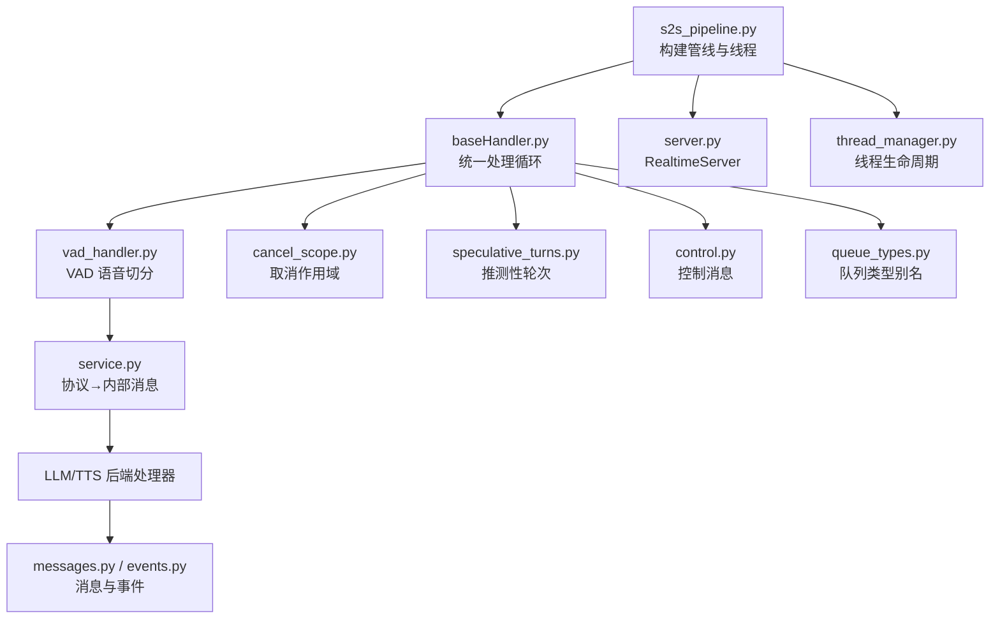
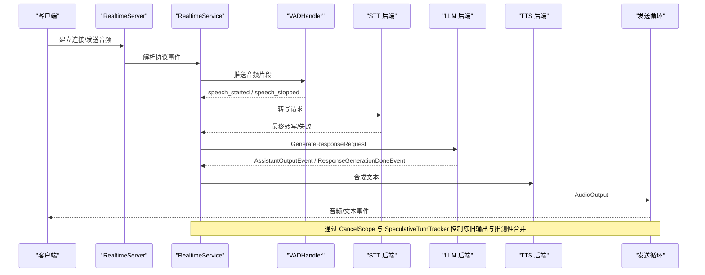
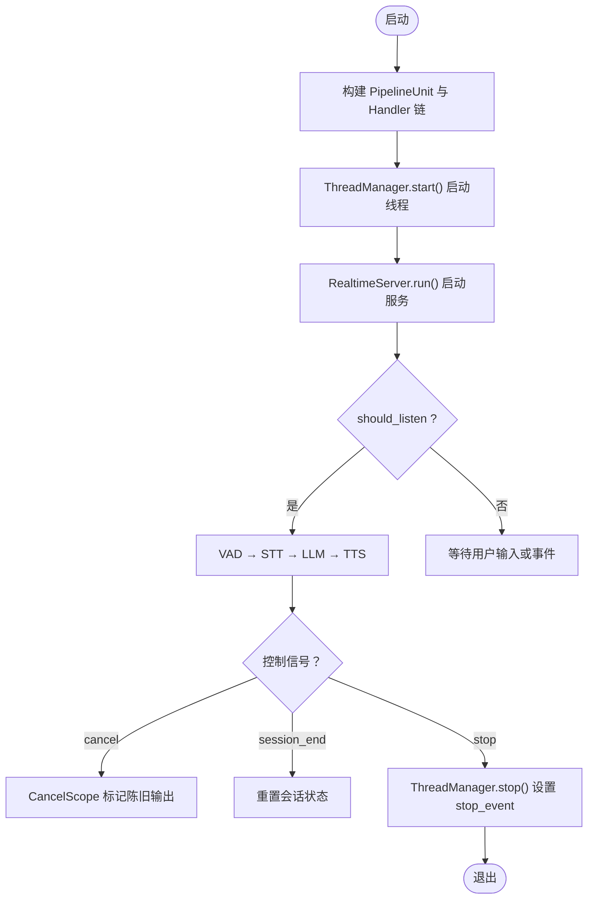
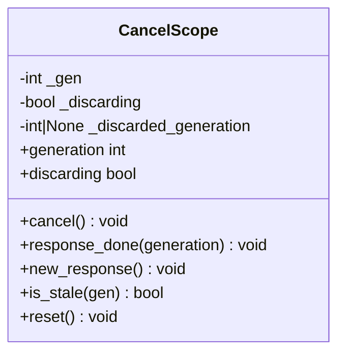
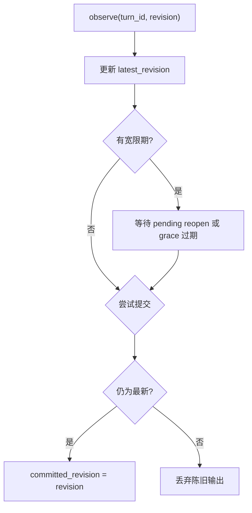
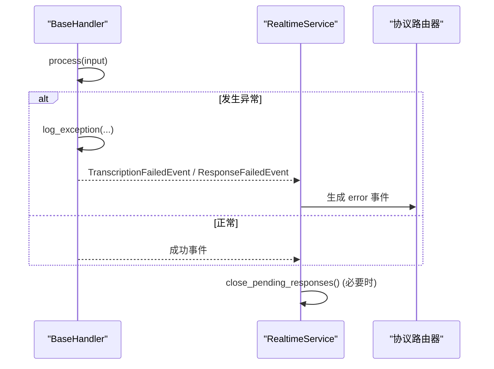
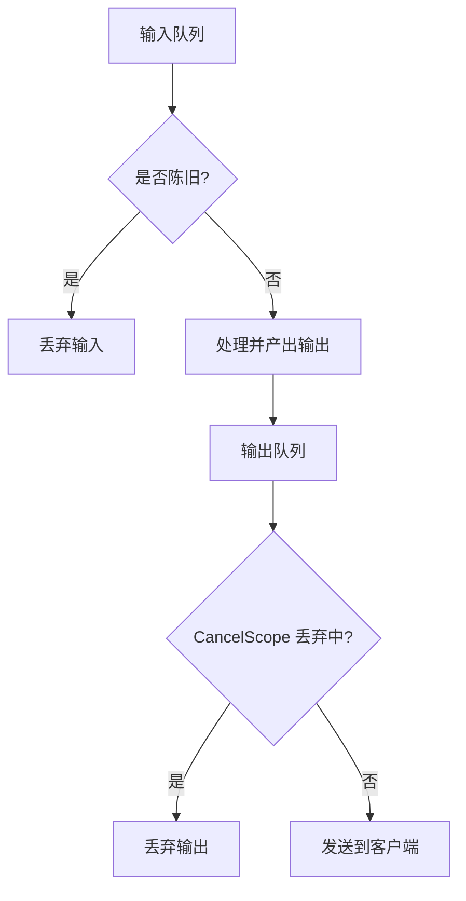
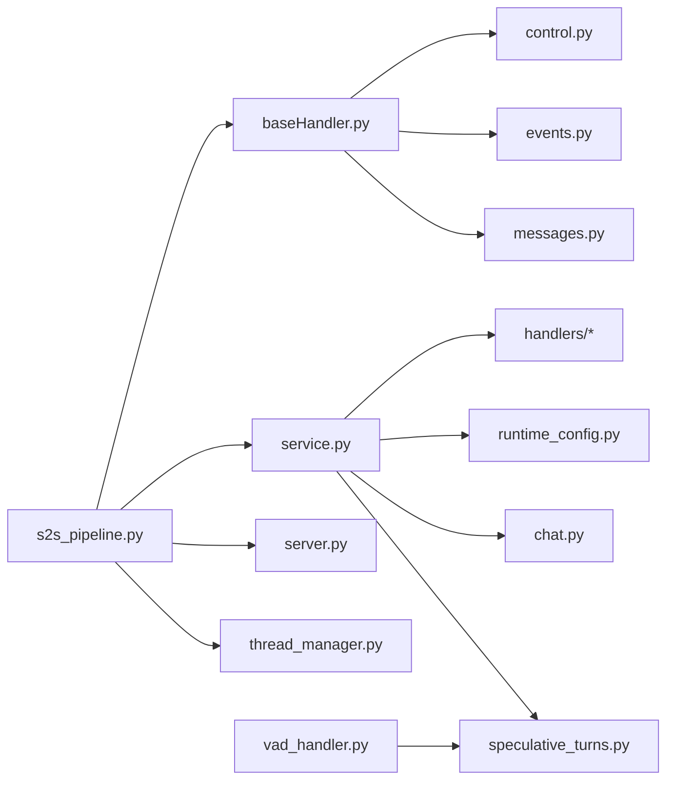

# 数据流控制

<cite>
**本文引用的文件**
- [s2s_pipeline.py](file://src/speech_to_speech/s2s_pipeline.py)
- [cancel_scope.py](file://src/speech_to_speech/pipeline/cancel_scope.py)
- [control.py](file://src/speech_to_speech/pipeline/control.py)
- [speculative_turns.py](file://src/speech_to_speech/pipeline/speculative_turns.py)
- [messages.py](file://src/speech_to_speech/pipeline/messages.py)
- [events.py](file://src/speech_to_speech/pipeline/events.py)
- [queue_types.py](file://src/speech_to_speech/pipeline/queue_types.py)
- [baseHandler.py](file://src/speech_to_speech/baseHandler.py)
- [service.py](file://src/speech_to_speech/api/openai_realtime/service.py)
- [server.py](file://src/speech_to_speech/api/openai_realtime/server.py)
- [thread_manager.py](file://src/speech_to_speech/utils/thread_manager.py)
- [vad_handler.py](file://src/speech_to_speech/VAD/vad_handler.py)
</cite>

## 目录
1. [简介](#简介)
2. [项目结构](#项目结构)
3. [核心组件](#核心组件)
4. [架构总览](#架构总览)
5. [详细组件分析](#详细组件分析)
6. [依赖关系分析](#依赖关系分析)
7. [性能考量](#性能考量)
8. [故障排查指南](#故障排查指南)
9. [结论](#结论)
10. [附录](#附录)

## 简介
本文件聚焦于语音到语音（Speech-to-Speech）管道中的数据流控制，覆盖以下主题：
- 管道的启动、暂停、恢复与停止控制机制
- 取消作用域（CancelScope）的任务级取消与资源清理
- 推测性对话（Speculative Turns）的并行请求与结果合并
- 错误传播机制：异常捕获、错误上报与管道恢复
- 流量控制与背压策略：防止内存溢出和处理积压
- 性能监控与瓶颈识别方法
- 数据流可视化调试工具

## 项目结构
该仓库采用“按功能分层 + 模块化”的组织方式：
- 入口与编排：s2s_pipeline.py 负责解析参数、构建处理器链、创建服务与线程管理
- 管道基础：baseHandler.py 提供统一的队列驱动处理循环、控制消息与结束哨兵
- 消息与事件：messages.py、events.py、queue_types.py 定义跨阶段的消息类型与队列项类型
- 控制信号：cancel_scope.py、control.py 提供取消与作用域控制
- 实时服务：service.py、server.py 将协议事件映射为内部消息，并协调会话状态
- VAD：vad_handler.py 实现语音活动检测与轮次边界判定
- 推测性轮次：speculative_turns.py 维护多版本轮次的最新性与提交一致性

**图表来源**
- [s2s_pipeline.py:461-587](file://src/speech_to_speech/s2s_pipeline.py#L461-L587)
- [baseHandler.py:105-165](file://src/speech_to_speech/baseHandler.py#L105-L165)
- [service.py:287-327](file://src/speech_to_speech/api/openai_realtime/service.py#L287-L327)
- [server.py:14-70](file://src/speech_to_speech/api/openai_realtime/server.py#L14-L70)
- [thread_manager.py:9-40](file://src/speech_to_speech/utils/thread_manager.py#L9-L40)

**章节来源**
- [s2s_pipeline.py:461-587](file://src/speech_to_speech/s2s_pipeline.py#L461-L587)
- [baseHandler.py:105-165](file://src/speech_to_speech/baseHandler.py#L105-L165)
- [queue_types.py:20-47](file://src/speech_to_speech/pipeline/queue_types.py#L20-L47)

## 核心组件
- BaseHandler：统一输入输出队列驱动的处理循环，支持控制消息、结束哨兵、异常捕获与计时统计
- CancelScope：基于生成号（generation）的取消作用域，用于丢弃陈旧响应输出
- SpeculativeTurnTracker：线程安全的推测性轮次追踪器，维护最新版本、待重开候选、宽限期与提交一致性
- RealtimeService：OpenAI Realtime 协议事件到内部消息的转换与路由，管理会话状态与指标
- VADHandler：语音活动检测与轮次边界判定，支持智能轮次与推测性重开
- ThreadManager：统一管理所有处理器线程的启动、等待与停止

**章节来源**
- [baseHandler.py:25-186](file://src/speech_to_speech/baseHandler.py#L25-L186)
- [cancel_scope.py:1-65](file://src/speech_to_speech/pipeline/cancel_scope.py#L1-L65)
- [speculative_turns.py:24-417](file://src/speech_to_speech/pipeline/speculative_turns.py#L24-L417)
- [service.py:287-327](file://src/speech_to_speech/api/openai_realtime/service.py#L287-L327)
- [vad_handler.py:53-172](file://src/speech_to_speech/VAD/vad_handler.py#L53-L172)
- [thread_manager.py:9-40](file://src/speech_to_speech/utils/thread_manager.py#L9-L40)

## 架构总览
下图展示了从音频输入到文本/音频输出的完整数据流与控制路径。

**图表来源**
- [service.py:627-727](file://src/speech_to_speech/api/openai_realtime/service.py#L627-L727)
- [baseHandler.py:105-165](file://src/speech_to_speech/baseHandler.py#L105-L165)
- [messages.py:335-357](file://src/speech_to_speech/pipeline/messages.py#L335-L357)
- [events.py:105-190](file://src/speech_to_speech/pipeline/events.py#L105-L190)

## 详细组件分析

### 管道启动、暂停、恢复与停止控制
- 启动：s2s_pipeline.py 构建多个 PipelineUnit，每个单元包含独立的队列与服务实例；ThreadManager 启动所有处理器线程；RealtimeServer 启动 uvicorn 监听
- 暂停/恢复：通过 should_listen Event 控制 VAD 是否继续监听；在会话中断时可通过 cancel_scope.cancel() 触发当前响应丢弃
- 停止：ThreadManager.stop() 设置 stop_event，BaseHandler 收到 PIPELINE_END 后退出循环并清理

**图表来源**
- [s2s_pipeline.py:550-587](file://src/speech_to_speech/s2s_pipeline.py#L550-L587)
- [thread_manager.py:18-40](file://src/speech_to_speech/utils/thread_manager.py#L18-L40)
- [baseHandler.py:116-165](file://src/speech_to_speech/baseHandler.py#L116-L165)
- [control.py:7-27](file://src/speech_to_speech/pipeline/control.py#L7-L27)

**章节来源**
- [s2s_pipeline.py:550-587](file://src/speech_to_speech/s2s_pipeline.py#L550-L587)
- [thread_manager.py:18-40](file://src/speech_to_speech/utils/thread_manager.py#L18-L40)
- [baseHandler.py:116-165](file://src/speech_to_speech/baseHandler.py#L116-L165)
- [control.py:7-27](file://src/speech_to_speech/pipeline/control.py#L7-L27)

### 取消作用域（CancelScope）的实现
- 设计要点：使用自增 generation 计数与 discarding 标志，确保异步发送循环可丢弃陈旧输出；线程安全由 Python GIL 保证基本读写原子性
- 关键方法：
  - cancel()：递增 generation 并启用丢弃标志
  - response_done()/new_response()：清理丢弃标志
  - is_stale(gen)：判断传入 generation 是否已被覆盖
- 集成点：BaseHandler.should_process_input() 检查 cancel_generation 与 CancelScope.is_stale()，丢弃陈旧输入；AudioOutput 携带 cancel_generation 以便下游丢弃

**图表来源**
- [cancel_scope.py:1-65](file://src/speech_to_speech/pipeline/cancel_scope.py#L1-L65)
- [baseHandler.py:67-81](file://src/speech_to_speech/baseHandler.py#L67-L81)
- [messages.py:217-225](file://src/speech_to_speech/pipeline/messages.py#L217-L225)

**章节来源**
- [cancel_scope.py:1-65](file://src/speech_to_speech/pipeline/cancel_scope.py#L1-L65)
- [baseHandler.py:67-81](file://src/speech_to_speech/baseHandler.py#L67-L81)
- [messages.py:217-225](file://src/speech_to_speech/pipeline/messages.py#L217-L225)

### 推测性对话（Speculative Turns）的处理逻辑
- 目标：允许并行发起后续轮次请求，并在稳定窗口后合并结果，减少端到端延迟
- 核心数据结构：
  - latest_revision：记录每个 turn_id 的最新 revision
  - committed_revision：已提交的 revision，用于避免重复写入
  - pending_reopen：待确认的重开候选（base → candidate）
  - reopen_grace：宽限期，允许短暂延迟以等待更稳定的 revision
- 关键流程：
  - observe(turn_id, revision)：观察新版本并更新 latest
  - start_reopen_grace()：开启宽限期
  - commit_if_latest_after_pending_reopen()/commit_if_latest_after_reopen_grace()：在条件满足后提交
  - begin_reopen_candidate()/confirm_reopen_candidate()/cancel_reopen_candidate()：管理重开候选
  - is_latest_after_stability_window()：等待稳定性窗口后判断是否为最新

**图表来源**
- [speculative_turns.py:38-110](file://src/speech_to_speech/pipeline/speculative_turns.py#L38-L110)
- [speculative_turns.py:159-204](file://src/speech_to_speech/pipeline/speculative_turns.py#L159-L204)
- [speculative_turns.py:226-339](file://src/speech_to_speech/pipeline/speculative_turns.py#L226-L339)

**章节来源**
- [speculative_turns.py:24-417](file://src/speech_to_speech/pipeline/speculative_turns.py#L24-L417)
- [service.py:529-625](file://src/speech_to_speech/api/openai_realtime/service.py#L529-L625)

### 错误传播机制
- 异常捕获：BaseHandler.process() 包裹 try/except，调用 log_exception 记录异常
- 错误上报：TranscriptionFailedEvent、ResponseFailedEvent 等事件经 RealtimeService 路由至协议层，生成 error 事件
- 管道恢复：SESSION_END 控制消息触发 on_session_end() 重置会话状态；close_pending_responses() 清理挂起响应与工具调用

**图表来源**
- [baseHandler.py:144-165](file://src/speech_to_speech/baseHandler.py#L144-L165)
- [events.py:78-83](file://src/speech_to_speech/pipeline/events.py#L78-L83)
- [events.py:193-206](file://src/speech_to_speech/pipeline/events.py#L193-L206)
- [service.py:772-800](file://src/speech_to_speech/api/openai_realtime/service.py#L772-L800)

**章节来源**
- [baseHandler.py:144-165](file://src/speech_to_speech/baseHandler.py#L144-L165)
- [events.py:78-83](file://src/speech_to_speech/pipeline/events.py#L78-L83)
- [events.py:193-206](file://src/speech_to_speech/pipeline/events.py#L193-L206)
- [service.py:772-800](file://src/speech_to_speech/api/openai_realtime/service.py#L772-L800)

### 流量控制与背压处理
- 队列缓冲：各阶段通过 Queue 解耦生产者与消费者，避免阻塞上游
- 丢弃陈旧输出：CancelScope.discarding 与 cancel_generation 配合，快速释放内存与带宽
- 推测性重开与宽限期：SpeculativeTurnTracker 限制并发与资源占用，避免过多未提交工作
- 会话级清理：close_pending_responses() 清理挂起响应与工具调用，防止泄漏
- 线程超时：BaseHandler.run() 使用短超时轮询 stop_event，提高响应性

**图表来源**
- [baseHandler.py:67-81](file://src/speech_to_speech/baseHandler.py#L67-L81)
- [cancel_scope.py:24-59](file://src/speech_to_speech/pipeline/cancel_scope.py#L24-L59)
- [service.py:464-489](file://src/speech_to_speech/api/openai_realtime/service.py#L464-L489)

**章节来源**
- [baseHandler.py:67-81](file://src/speech_to_speech/baseHandler.py#L67-L81)
- [cancel_scope.py:24-59](file://src/speech_to_speech/pipeline/cancel_scope.py#L24-L59)
- [service.py:464-489](file://src/speech_to_speech/api/openai_realtime/service.py#L464-L489)

### 性能监控与瓶颈识别
- 计时统计：BaseHandler.last_time 记录每次处理耗时，支持 DEBUG 级别日志输出
- 指标聚合：RealtimeService 维护 UsageMetrics 与 GlobalUsageMetrics，累计 token 用量、音频时长、错误数
- 日志过滤：PipelineLogFilter 添加 pipeline_prefix，便于区分不同管线实例
- 建议：
  - 在高负载下关注 TTS 与 LLM 的 last_time 分布，识别长尾延迟
  - 监控 errors_by_type 增长趋势，定位不稳定后端
  - 结合 speculative turns 的 observe/commit 日志，评估推测收益与开销

**章节来源**
- [baseHandler.py:166-186](file://src/speech_to_speech/baseHandler.py#L166-L186)
- [service.py:138-178](file://src/speech_to_speech/api/openai_realtime/service.py#L138-L178)
- [s2s_pipeline.py:288-307](file://src/speech_to_speech/s2s_pipeline.py#L288-L307)

### 数据流可视化调试工具
- 结构化日志：所有事件与消息均带 turn_id、turn_revision、response_key 等字段，便于关联同一轮次
- 时间戳：perf_counter 用于测量处理延迟，结合日志级别筛选慢路径
- 建议工具：
  - 使用日志聚合系统（如 ELK）按 pipeline_index 过滤，绘制端到端延迟曲线
  - 对 SpeculativeTurnTracker.observe/commit 日志进行时序分析，识别重开竞争
  - 对 CancelScope 的 discard 事件进行统计，评估取消频率与效果

[本节为概念性内容，不直接分析具体文件]

## 依赖关系分析
- s2s_pipeline.py 依赖 baseHandler、service、server、thread_manager 以及各后端处理器
- baseHandler 依赖 control、events、messages、transcript_logging
- service 依赖 handlers、runtime_config、chat、pipeline 消息与事件
- speculative_turns 被 service 与 vad_handler 引用，用于推测性轮次管理
- queue_types 集中定义队列项类型，降低耦合

**图表来源**
- [s2s_pipeline.py:21-57](file://src/speech_to_speech/s2s_pipeline.py#L21-L57)
- [baseHandler.py:13-18](file://src/speech_to_speech/baseHandler.py#L13-L18)
- [service.py:47-75](file://src/speech_to_speech/api/openai_realtime/service.py#L47-L75)
- [vad_handler.py:14-22](file://src/speech_to_speech/VAD/vad_handler.py#L14-L22)

**章节来源**
- [s2s_pipeline.py:21-57](file://src/speech_to_speech/s2s_pipeline.py#L21-L57)
- [baseHandler.py:13-18](file://src/speech_to_speech/baseHandler.py#L13-L18)
- [service.py:47-75](file://src/speech_to_speech/api/openai_realtime/service.py#L47-L75)
- [vad_handler.py:14-22](file://src/speech_to_speech/VAD/vad_handler.py#L14-L22)

## 性能考量
- 线程模型：每个 PipelineUnit 独立线程，避免全局锁竞争；MLX 平台需考虑全局锁影响
- 队列长度：合理设置队列容量，防止内存膨胀；结合丢弃策略及时释放
- 推测性开销：权衡 speculate 的收益与资源消耗，调整 stability window 与 grace period
- 日志级别：生产环境关闭 DEBUG 日志，仅保留必要指标；使用 PipelineLogFilter 精准过滤

[本节提供通用指导，不直接分析具体文件]

## 故障排查指南
- 常见问题：
  - 输出陈旧：检查 CancelScope.generation 与 cancel_generation 是否匹配
  - 推测性冲突：查看 SpeculativeTurnTracker 的 observe/commit 日志，确认 latest_revision 变化
  - 会话泄漏：确认 SESSION_END 与 close_pending_responses() 正确执行
- 诊断步骤：
  - 启用 DEBUG 日志，定位慢路径与异常堆栈
  - 按 pipeline_index 过滤日志，隔离问题实例
  - 监控 GlobalUsageMetrics.errors_by_type，识别不稳定后端

**章节来源**
- [baseHandler.py:144-165](file://src/speech_to_speech/baseHandler.py#L144-L165)
- [service.py:772-800](file://src/speech_to_speech/api/openai_realtime/service.py#L772-L800)
- [speculative_turns.py:38-110](file://src/speech_to_speech/pipeline/speculative_turns.py#L38-L110)

## 结论
本管道通过 BaseHandler 的统一处理循环、CancelScope 的任务级取消、SpeculativeTurnTracker 的推测性合并，实现了高效、可控的数据流。结合 RealtimeService 的协议适配与 ThreadManager 的生命周期管理，系统在高并发场景下仍能保持低延迟与高吞吐。建议在生产环境中结合日志与指标进行持续优化，重点关注推测性策略与背压控制。

[本节为总结性内容，不直接分析具体文件]

## 附录
- 关键消息类型：见 messages.py 与 events.py
- 队列类型别名：见 queue_types.py
- 控制消息：见 control.py
- 线程管理：见 thread_manager.py

[本节为参考性内容，不直接分析具体文件]