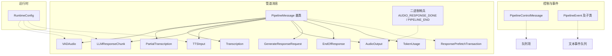
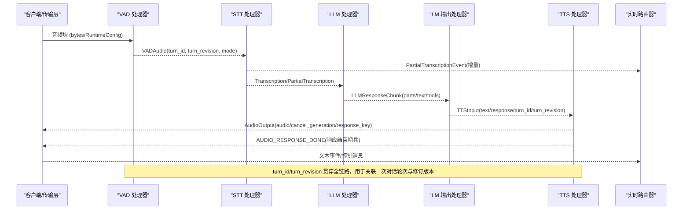
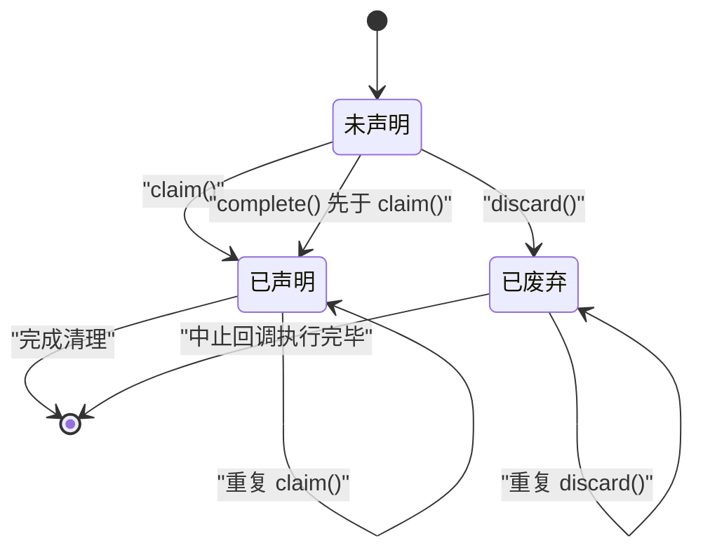
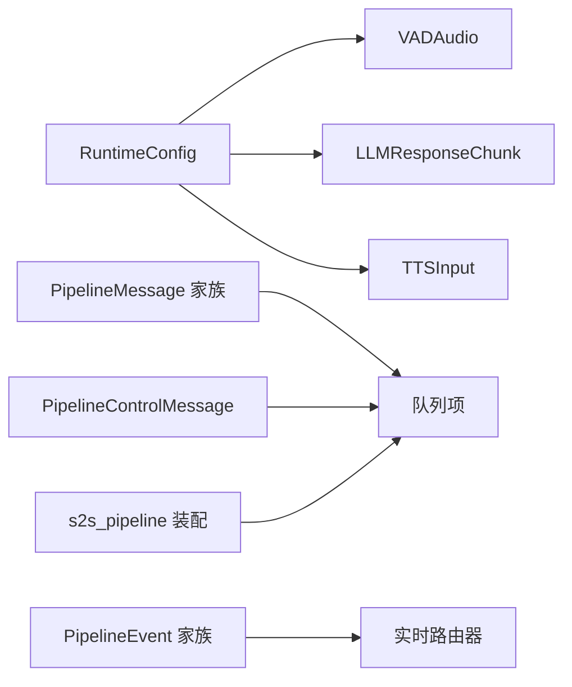
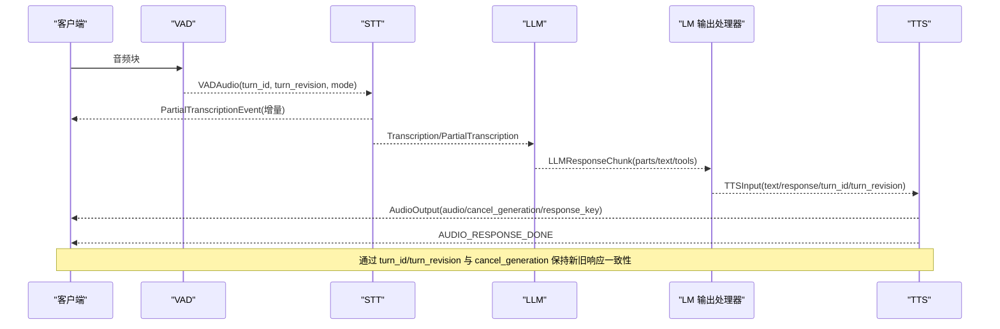

# 消息系统

<cite>
**本文引用的文件**
- [messages.py](file://src/speech_to_speech/pipeline/messages.py)
- [handler_types.py](file://src/speech_to_speech/pipeline/handler_types.py)
- [queue_types.py](file://src/speech_to_speech/pipeline/queue_types.py)
- [control.py](file://src/speech_to_speech/pipeline/control.py)
- [events.py](file://src/speech_to_speech/pipeline/events.py)
- [runtime_config.py](file://src/speech_to_speech/api/openai_realtime/runtime_config.py)
- [s2s_pipeline.py](file://src/speech_to_speech/s2s_pipeline.py)
- [test_pipeline_messages.py](file://tests/test_pipeline_messages.py)
</cite>

## 目录
1. [简介](#简介)
2. [项目结构](#项目结构)
3. [核心组件](#核心组件)
4. [架构总览](#架构总览)
5. [详细组件分析](#详细组件分析)
6. [依赖关系分析](#依赖关系分析)
7. [性能考虑](#性能考虑)
8. [故障排查指南](#故障排查指南)
9. [结论](#结论)
10. [附录](#附录)

## 简介
本文件系统化梳理语音到语音（Speech-to-Speech）管道中的“消息系统”，围绕 PipelineMessage 基类与类型安全机制展开，解释各消息类型的职责、字段与生命周期管理（turn_id/turn_revision），并深入说明 ResponsePrefetchTransaction 的预取事务处理以及 AUDIO_RESPONSE_DONE、PIPELINE_END 等二进制哨兵信号的作用。文末提供消息流转时序图与状态转换图，帮助读者从整体到细节理解数据与控制流。

## 项目结构
消息系统主要位于 pipeline 模块中，采用“消息即对象”的设计：所有跨阶段的数据均通过强类型的 Pydantic 模型传递，控制流通过控制消息与二进制哨兵进行协调。关键文件职责如下：
- messages.py：定义 PipelineMessage 基类与各业务消息类型，包括 VADAudio、PartialTranscription、Transcription、LLMResponseChunk、TTSInput、AudioOutput、GenerateResponseRequest、EndOfResponse、TokenUsage，以及 ResponsePrefetchTransaction 和二进制哨兵常量。
- handler_types.py：为各阶段处理器输入输出定义类型别名，便于声明式地表达阶段契约。
- queue_types.py：集中定义队列项的类型联合，统一内部队列承载的消息集合（含控制消息与哨兵）。
- control.py：定义 PipelineControlMessage 及其枚举种类，用于会话级控制。
- events.py：定义面向实时路由器的协议中性事件（如语音开始/停止、转录事件、助手输出事件、令牌用量事件等）。
- runtime_config.py：运行时配置对象，贯穿多个消息以携带会话上下文与能力开关。
- s2s_pipeline.py：组装管道单元与队列，驱动 VAD→STT→LLM→TTS 的处理链。

图表来源
- [messages.py:31-366](file://src/speech_to_speech/pipeline/messages.py#L31-L366)
- [control.py:7-27](file://src/speech_to_speech/pipeline/control.py#L7-L27)
- [events.py:23-206](file://src/speech_to_speech/pipeline/events.py#L23-L206)
- [runtime_config.py:27-82](file://src/speech_to_speech/api/openai_realtime/runtime_config.py#L27-L82)

章节来源
- [messages.py:31-366](file://src/speech_to_speech/pipeline/messages.py#L31-L366)
- [handler_types.py:1-46](file://src/speech_to_speech/pipeline/handler_types.py#L1-L46)
- [queue_types.py:1-47](file://src/speech_to_speech/pipeline/queue_types.py#L1-L47)
- [control.py:7-27](file://src/speech_to_speech/pipeline/control.py#L7-L27)
- [events.py:23-206](file://src/speech_to_speech/pipeline/events.py#L23-L206)
- [runtime_config.py:27-82](file://src/speech_to_speech/api/openai_realtime/runtime_config.py#L27-L82)
- [s2s_pipeline.py:354-547](file://src/speech_to_speech/s2s_pipeline.py#L354-L547)

## 核心组件
- PipelineMessage 基类：所有消息的统一基类，使用 tag 字段作为 Pydantic 判别器，支持从原始字典验证 Union 类型消息，确保跨阶段消息的类型安全。
- 业务消息：
  - VADAudio：来自 VAD 的音频片段，包含音频数据、运行时配置、模式、turn_id/turn_revision、处理延迟与创建时间戳。
  - PartialTranscription：STT 的增量/部分转录结果，仅被 TranscriptionNotifier 消费，不直接转发给 LLM。
  - Transcription：最终转录结果，包含语言代码、结束时刻等。
  - LLMResponseChunk：LLM 响应分片，支持有序 parts（文本与工具调用交错），兼容 text/tools 视图，附带运行时配置、response 覆盖、turn_id/turn_revision、取消生成标记、响应键与预取事务。
  - TokenUsage：侧信道令牌用量报告，不进入 TTS。
  - EndOfResponse：响应结束哨兵，可能携带错误信息或仅清理标志。
  - TTSInput：待合成文本，携带 response 覆盖、turn_id/turn_revision、取消生成标记、响应键与预取事务。
  - AudioOutput：最终音频输出，携带 cancel_generation 与 response_key，用于按响应粒度丢弃陈旧输出。
  - GenerateResponseRequest：触发 LLM 生成的请求，携带运行时配置、response 覆盖、音频输入、语言代码、turn_id/turn_revision、预取事务等。
- 预取事务：ResponsePrefetchTransaction 提供 claim/complete/discard/register_abort/wait_until_resolved 等方法，保证仅在标准 response.create 到达后才提交不可逆清理，否则可回滚或中止。
- 二进制哨兵：AUDIO_RESPONSE_DONE 与 PIPELINE_END 用于在音频/输出队列中标记响应结束与管道结束。

章节来源
- [messages.py:31-366](file://src/speech_to_speech/pipeline/messages.py#L31-L366)

## 架构总览
管道由 VAD → STT → LLM → TTS 四阶段组成，消息在各阶段之间通过队列传递；控制消息与事件通过专用队列或侧通道传递；二进制哨兵用于终止与收尾。

图表来源
- [s2s_pipeline.py:354-547](file://src/speech_to_speech/s2s_pipeline.py#L354-L547)
- [messages.py:46-225](file://src/speech_to_speech/pipeline/messages.py#L46-L225)
- [events.py:36-206](file://src/speech_to_speech/pipeline/events.py#L36-L206)

## 详细组件分析

### PipelineMessage 基类与类型安全
- 设计要点：
  - 所有消息继承自 PipelineMessage，使用 tag 字段作为 Pydantic 判别器，使 Union[消息] 可从原始 dict 安全反序列化。
  - 通过 Literal 约束 tag 值，避免非法标签。
  - 多数消息携带 turn_id/turn_revision，用于追踪一次对话轮次与其修订版本，支持中断/重入场景下的正确排序与丢弃。
- 复杂度与性能：
  - Pydantic 校验带来少量开销，但换来强类型与一致性，适合高吞吐管道。
  - 使用 perf_counter 记录 created_at_s，便于测量端到端延迟。

章节来源
- [messages.py:31-57](file://src/speech_to_speech/pipeline/messages.py#L31-L57)

### 各消息类型用途与字段定义
- VADAudio：
  - 用途：将 VAD 检测到的音频片段传递给 STT，支持 progressive/final 模式。
  - 关键字段：audio、runtime_config、mode、turn_id、turn_revision、processing_delay_s、created_at_s。
- PartialTranscription：
  - 用途：STT 的增量假设，供 TranscriptionNotifier 展示，不直接送入 LLM。
  - 关键字段：text、turn_id、turn_revision。
- Transcription：
  - 用途：最终转录结果，携带语言代码与语音停止时刻。
  - 关键字段：text、language_code、turn_id、turn_revision、speech_stopped_at_s。
- LLMResponseChunk：
  - 用途：LLM 输出的有序分片，支持文本与工具调用交错；兼容旧版 text/tools 视图。
  - 关键字段：parts、text、tools、language_code、runtime_config、response、turn_id、turn_revision、speech_stopped_at_s、cancel_generation、response_key、prefetch_transaction。
- TokenUsage：
  - 用途：侧信道统计，不进入 TTS。
  - 关键字段：input_tokens、output_tokens、turn_id、turn_revision、cancel_generation、response_key。
- EndOfResponse：
  - 用途：响应结束哨兵，可能携带错误信息或仅清理。
  - 关键字段：turn_id、turn_revision、cancel_generation、response_key、error、cleanup_only。
- TTSInput：
  - 用途：待合成的文本，携带 response 覆盖与上下文。
  - 关键字段：text、language_code、runtime_config、response、turn_id、turn_revision、speech_stopped_at_s、cancel_generation、response_key、prefetch_transaction。
- AudioOutput：
  - 用途：最终音频输出，携带 cancel_generation 与 response_key，用于按响应丢弃陈旧音频。
  - 关键字段：audio、cancel_generation、response_key、cleanup_only。
- GenerateResponseRequest：
  - 用途：触发 LLM 生成，携带运行时配置、response 覆盖、音频输入、语言代码、turn_id/turn_revision、预取事务。
  - 关键字段：response_key、runtime_config、response、audio、audio_sample_rate、language_code、turn_id、turn_revision、speech_stopped_at_s、prefetch_transaction。

章节来源
- [messages.py:46-225](file://src/speech_to_speech/pipeline/messages.py#L46-L225)
- [messages.py:335-357](file://src/speech_to_speech/pipeline/messages.py#L335-L357)

### 消息生命周期管理与 turn_id/turn_revision 追踪
- turn_id：标识一次对话轮次（例如用户一段语音对应的完整响应）。
- turn_revision：当同一轮次内发生中断/重入时递增，下游据此丢弃陈旧输出（如 cancel_generation）。
- 传播路径：
  - VADAudio 携带 turn_id/turn_revision 进入 STT。
  - STT 产出 PartialTranscription/Transcription 继续携带。
  - LLMResponseChunk/TTSInput/AudioOutput 均携带 turn_id/turn_revision 与 cancel_generation/response_key，用于响应级与修订级的一致性。
- 作用：
  - 保障在 barge-in（打断）场景下，旧响应的音频与文本能被正确丢弃，新响应能尽快呈现。

章节来源
- [messages.py:46-225](file://src/speech_to_speech/pipeline/messages.py#L46-L225)
- [events.py:36-206](file://src/speech_to_speech/pipeline/events.py#L36-L206)

### ResponsePrefetchTransaction 预取事务处理
- 目标：对“预取”的 LLM 响应进行原子性提交或回滚，避免在未确认的标准 response.create 到达前执行不可逆操作（如图像剥离、历史裁剪）。
- 关键方法：
  - register_abort(abort)：注册中止回调；若已 discard 则立即运行，否则挂起等待 claim。
  - complete(cleanup)：登记清理函数；若已 claim 则立即执行，否则延后。
  - claim()：唯一提交点；成功返回 True 并执行清理，失败或已 discard 返回 False。
  - discard()：作废预取；触发已注册的 abort 回调，阻止后续 claim。
  - wait_until_resolved(timeout)：阻塞直到 claim 或 discard 决定。
- 线程安全：内部使用 Lock 与 Event 保护状态机，确保并发安全。
- 测试覆盖：见 tests/test_pipeline_messages.py，覆盖 claim/complete/discard/register_abort 的行为与异常隔离。

图表来源
- [messages.py:230-333](file://src/speech_to_speech/pipeline/messages.py#L230-L333)
- [test_pipeline_messages.py:11-66](file://tests/test_pipeline_messages.py#L11-L66)

章节来源
- [messages.py:230-333](file://src/speech_to_speech/pipeline/messages.py#L230-L333)
- [test_pipeline_messages.py:11-66](file://tests/test_pipeline_messages.py#L11-L66)

### 二进制哨兵信号：AUDIO_RESPONSE_DONE 与 PIPELINE_END
- AUDIO_RESPONSE_DONE：
  - 位置：音频/输出队列。
  - 作用：标记一个响应内的音频输出结束，下游据此关闭该响应的发送循环或资源。
- PIPELINE_END：
  - 位置：内部队列。
  - 作用：通知整个管道结束，用于优雅退出与资源回收。
- 类型约定：使用 plain bytes 常量，避免 Queue 不变性导致的类型问题。

章节来源
- [messages.py:359-366](file://src/speech_to_speech/pipeline/messages.py#L359-L366)
- [queue_types.py:20-22](file://src/speech_to_speech/pipeline/queue_types.py#L20-L22)

### 处理器阶段与类型契约
- VAD 阶段：
  - 输入：VADIn = bytes | tuple[bytes, RuntimeConfig]
  - 输出：VADOut = VADAudio
- STT 阶段：
  - 输入：STTIn = VADAudio
  - 输出：STTOut = PartialTranscription | Transcription | TranscriptionFailure
- LLM 阶段：
  - 输入：LLMIn = GenerateResponseRequest
  - 输出：LLMOut = LLMResponseChunk | TokenUsage | EndOfResponse
- TTS 阶段：
  - 输入：TTSIn = TTSInput | EndOfResponse
  - 输出：TTSOut = bytes | np.ndarray | AudioOutput

章节来源
- [handler_types.py:31-46](file://src/speech_to_speech/pipeline/handler_types.py#L31-L46)

### 队列项与事件通道
- 内部队列项：
  - PipelineInternalItem = PipelineControlMessage | bytes（控制消息与哨兵）
  - AudioInItem/VADOutItem/STTOutItem/TextPromptItem/LMOutItem/TTSInItem/AudioOutItem/TextEventItem：各阶段队列承载的具体联合类型，统一抽象。
- 事件通道：
  - 文本事件（语音开始/停止、转录完成/失败、助手输出、令牌用量、响应完成/失败等）通过 text_output_queue 或侧通道发送到实时路由器。

章节来源
- [queue_types.py:20-47](file://src/speech_to_speech/pipeline/queue_types.py#L20-L47)
- [events.py:23-206](file://src/speech_to_speech/pipeline/events.py#L23-L206)

## 依赖关系分析
- 消息与运行时配置：
  - RuntimeConfig 在 VADAudio、LLMResponseChunk、TTSInput 中被引用，用于携带会话配置与能力开关（如 interrupt_response_enabled）。
- 消息与事件：
  - events.py 中的事件与 messages.py 中的消息解耦：消息负责阶段间数据传递，事件负责向实时路由器上报协议中性事件。
- 管道装配：
  - s2s_pipeline.py 构建各阶段处理器与队列，串联消息流；通过 ThreadManager 启动线程池。

图表来源
- [runtime_config.py:27-82](file://src/speech_to_speech/api/openai_realtime/runtime_config.py#L27-L82)
- [messages.py:31-366](file://src/speech_to_speech/pipeline/messages.py#L31-L366)
- [events.py:23-206](file://src/speech_to_speech/pipeline/events.py#L23-L206)
- [queue_types.py:20-47](file://src/speech_to_speech/pipeline/queue_types.py#L20-L47)
- [s2s_pipeline.py:354-547](file://src/speech_to_speech/s2s_pipeline.py#L354-L547)

章节来源
- [runtime_config.py:27-82](file://src/speech_to_speech/api/openai_realtime/runtime_config.py#L27-L82)
- [messages.py:31-366](file://src/speech_to_speech/pipeline/messages.py#L31-L366)
- [events.py:23-206](file://src/speech_to_speech/pipeline/events.py#L23-L206)
- [queue_types.py:20-47](file://src/speech_to_speech/pipeline/queue_types.py#L20-L47)
- [s2s_pipeline.py:354-547](file://src/speech_to_speech/s2s_pipeline.py#L354-L547)

## 性能考虑
- 类型校验成本：Pydantic 模型校验带来一定开销，但在现代硬件上可接受，且换取了强一致性与易维护性。
- 内存与拷贝：
  - numpy 数组与 bytes 在队列中传递时注意避免不必要的深拷贝；必要时使用共享内存或零拷贝策略（当前实现以简单队列为主）。
- 并发与锁：
  - ResponsePrefetchTransaction 使用 Lock/Event 保证并发安全；在高并发场景下应关注争用热点。
- 实时性：
  - 使用 created_at_s 与 processing_delay_s 可评估端到端延迟；结合 live transcription 更新间隔平衡实时性与稳定性。

## 故障排查指南
- 常见问题定位：
  - 转录失败：检查 TranscriptionFailure 消息与 TranscriptionFailedEvent，确认 STT 后端状态与输入音频质量。
  - 响应未完成：检查 EndOfResponse 是否到达，以及 AUDIO_RESPONSE_DONE 是否正确发送。
  - 陈旧输出未丢弃：确认 cancel_generation 与 response_key 是否正确设置，下游是否按响应粒度丢弃。
  - 预取事务异常：检查 ResponsePrefetchTransaction 的 claim/complete/discard 顺序，确保未 claim 的事务不会提交不可逆清理。
- 日志与调试：
  - 启用 transcript logging 与 debug 级别日志，观察消息流转与延迟指标。
  - 使用 test_pipeline_messages.py 中的用例思路，编写最小化复现脚本验证事务行为。

章节来源
- [messages.py:82-90](file://src/speech_to_speech/pipeline/messages.py#L82-L90)
- [messages.py:180-196](file://src/speech_to_speech/pipeline/messages.py#L180-L196)
- [messages.py:359-366](file://src/speech_to_speech/pipeline/messages.py#L359-L366)
- [test_pipeline_messages.py:11-66](file://tests/test_pipeline_messages.py#L11-L66)

## 结论
本消息系统通过强类型消息模型与统一的队列/事件通道，实现了 VAD→STT→LLM→TTS 的高内聚、低耦合流水线。turn_id/turn_revision 与 cancel_generation/response_key 提供了精细的生命周期管理能力；ResponsePrefetchTransaction 保证了预取响应的原子提交与回滚；二进制哨兵确保了响应与管道的优雅收尾。整体设计兼顾了实时性、可靠性与可扩展性。

## 附录

### 消息流转时序图（端到端）

图表来源
- [messages.py:46-225](file://src/speech_to_speech/pipeline/messages.py#L46-L225)
- [events.py:36-206](file://src/speech_to_speech/pipeline/events.py#L36-L206)
- [s2s_pipeline.py:354-547](file://src/speech_to_speech/s2s_pipeline.py#L354-L547)

### 预取事务状态转换图

图表来源
- [messages.py:230-333](file://src/speech_to_speech/pipeline/messages.py#L230-L333)
- [test_pipeline_messages.py:11-66](file://tests/test_pipeline_messages.py#L11-L66)